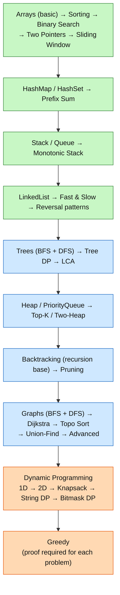

# 🌉 DS → Patterns → Problems Bridge Map

## 5W1H: Using the Data Structure Bridge Map

> [!NOTE]
> **WHAT:** A mapping index connecting core Data Structures to the algorithmic patterns they unlock and the specific problems used to master them.
>
> **WHY:** Learning a Data Structure in isolation is useless if you don't know which algorithmic patterns it naturally pairs with (e.g., Arrays enable Sliding Window and Two Pointers).
>
> **WHO:** Candidates transitioning from learning syntax and basic DSA theory to actual LeetCode problem solving.
>
> **WHEN:** Use this map IMMEDIATELY after finishing a theoretical DS module (e.g., after reading `01b_Arrays.md`, come here to find the next step).
>
> **HOW:** By looking up the Data Structure you just learned, finding the patterns it unlocks, and navigating to the practice problem sets.

> **Purpose:** When you finish a Data Structure topic, use this map to know EXACTLY where to go next.
>
> 📋 **All Patterns Hub:** [00_PATTERN_MASTER_GUIDE.md](../04_Patterns_Templates/00_PATTERN_MASTER_GUIDE.md)

---

## 💬 Explain It Like a Study Partner — DS → Pattern → Problem Bridges

> [!TIP]
> **Ask yourself first:** *"I just learned arrays. Which problems should I solve next, and why those?"*

### 1. The bottom line

Every data structure naturally unlocks a few problem-solving **patterns**, and every pattern has a short list of classic problems, so you can practise in the right order instead of at random.

### 2. The textbook core

- A **pattern** is a reusable technique (two pointers, sliding window, monotonic stack, BFS, …) triggered by constraints in the problem statement.
- The mapping runs **data structure → pattern → problems**; this file lists it for arrays, lists, stacks/queues, hash tables, trees, heaps and graphs.
- Learn the structure's costs first (chapters `01a`–`01g`), then practise its patterns (this file), then drill the problem sets (`02_PROBLEM_SETS.md`).

### 3. The real-world analogy

A **map of a transit system**: the stations are data structures, the lines are patterns, and the stops along each line are the practice problems. You do not wander the city; you follow a line.

### 4. Walkthrough: after finishing arrays

1. Look up **Array** in the map below.
2. It unlocks patterns such as **two pointers**, **sliding window** and **prefix sum**.
3. Pick one pattern (say sliding window) and solve its listed problems from easy to hard.
4. Move to **Hash Map**: it pairs with prefix sums to solve "subarray sum equals K", which links back to what you just practised.

> [!NOTE]
> **Quick check:** which structure goes with "next greater element"? *A monotonic stack.*

---

## Historical Evolution: How DS-Problem Bridges Emerged

| Era       | Event                                                                              | Impact on DS-Problem Mapping                                                                                                                               |
| --------- | ---------------------------------------------------------------------------------- | ---------------------------------------------------------------------------------------------------------------------------------------------------------- |
| **1970s** | B-tree invented for disk-based database indexes                                    | DBs forced DS theory into production; the "Array → Binary Search → Range Query" bridge was born                                                            |
| **1980s** | B-tree adopted across Oracle, IBM DB2                                              | DS knowledge moved from academic to enterprise; bridges became explicit (e.g., "Sorted Array → BST → Search" already standard)                             |
| **1990s** | Bloom filter popularized for web caching (Ncache, Akamai)                          | New DS-to-problem bridge surfaced: "Hash function + multiple hash → set membership with false positives"                                                   |
| **2000s** | LSM-tree (Log-Structured Merge) revived for SSD-backed stores (Cassandra, LevelDB) | Showed that write-optimized DSs required rethinking the "Array → Sorted → Search" bridge                                                                   |
| **2010s** | Distributed systems (DynamoDB, Cassandra) forced radical DS rethinking             | CRDTs (G-Counter, PN-Counter), consistent hashing (Ring), Merkle trees entered mainstream; existing bridges (Graph → Shortest Path) extended to multi-node |
| **2020s** | Learned indexes proposed as ML-replacement for B-trees                             | Redefined the "Sorted Array → Binary Search → Range Query" bridge: "key prediction model → smarter index placement"                                        |

**Predecessor:** Before these bridges existed, DS knowledge was siloed by course — you learned Arrays in Week 1, Trees in Week 4, and Graphs in Week 6, but nobody told you how the same DS solved problems in databases, caches, OR leetcode. This file makes those cross-domain connections explicit.

> **Why this matters:** Every bridge in this file mirrors a real production decision. When you use "Array + Sliding Window → Longest Substring," you're reusing the same mental model that Netflix uses to stream buffer windows.

---

## 📦 Array → Patterns → Problems

| Array Concept                 | Pattern Unlocked     | Learn Pattern Here                                                                         | Practice Problems                                           |
| ----------------------------- | -------------------- | ------------------------------------------------------------------------------------------ | ----------------------------------------------------------- |
| Contiguous subarray           | Sliding Window       | [01_Sliding_Window.md](../04_Patterns_Templates/01_Sliding_Window.md)                      | [SW PS](../05_Problem_Solving/05_Sliding_Window.md)         |
| Contiguous subarray           | Two Pointers         | [07_Two_Pointers_Complete.md](../04_Patterns_Templates/07_Two_Pointers_Complete.md)        | [2P PS](../05_Problem_Solving/06_Two_Pointers.md)            |
| Sub-sequence (not contiguous) | DP (LCS, LIS)        | [04b_DP_Fundamentals.md](../03_Algorithms/04b_DP_Fundamentals.md)                          | [DP PS](../05_Problem_Solving/11_Dynamic_Programming.md)                     |
| Sorted position               | Binary Search        | [06_Binary_Search_Patterns.md](../04_Patterns_Templates/06_Binary_Search_Patterns.md)      | [BS PS](../05_Problem_Solving/07_Binary_Search.md) |
| Frequency count               | HashMap              | [10_HashMap_Plus_Counting.md](../04_Patterns_Templates/10_HashMap_Plus_Counting.md)        | [HashMap PS](../05_Problem_Solving/17_HashMap_Hashing.md)   |
| Sort + scan                   | Greedy               | [12_Greedy_Algorithms_Complete.md](../03_Algorithms/12_Greedy_Algorithms_Complete.md)      | [Greedy PS](../05_Problem_Solving/13_Greedy.md)             |
| Prefix sum                    | Prefix Sum + HashMap | [19_Prefix_Sum...md](../03_Algorithms/19_Prefix_Sum_Prefix_XOR_2D_Prefix_Java_Complete.md) | [Arrays PS](../05_Problem_Solving/04_Arrays.md)             |

---

## 🔗 Linked List → Patterns → Problems

| LL Concept                | Pattern Unlocked     | Learn Pattern Here                                                                              | Practice Problems                               |
| ------------------------- | -------------------- | ----------------------------------------------------------------------------------------------- | ----------------------------------------------- |
| Middle/Cycle              | Fast & Slow Pointers | [12_LinkedList_Plus_TwoPointers.md](../04_Patterns_Templates/12_LinkedList_Plus_TwoPointers.md) | [LL PS](../05_Problem_Solving/15_LinkedList.md) |
| Unknown head after ops    | Dummy Head Sentinel  | [12_LinkedList_Plus_TwoPointers.md](../04_Patterns_Templates/12_LinkedList_Plus_TwoPointers.md) | [LL PS](../05_Problem_Solving/15_LinkedList.md) |
| Reverse / Reverse K-Group | 3-Pointer Reversal   | [03b_Recursion_Fundamentals.md](../03_Algorithms/03b_Recursion_Fundamentals.md)                 | [LL PS](../05_Problem_Solving/15_LinkedList.md) |
| Merge sorted lists        | Min-Heap of heads    | [15_Heap_Plus_GreedySelection.md](../04_Patterns_Templates/15_Heap_Plus_GreedySelection.md)     | [Heap PS](../05_Problem_Solving/16_Heap.md)     |

---

## 🌳 Trees → Patterns → Problems

| Tree Concept            | Pattern Unlocked       | Learn Pattern Here                                                                          | Practice Problems                                           |
| ----------------------- | ---------------------- | ------------------------------------------------------------------------------------------- | ----------------------------------------------------------- |
| Level-by-level          | BFS (Queue)            | [13_Tree_Plus_DFS_BFS.md](../04_Patterns_Templates/13_Tree_Plus_DFS_BFS.md)                 | [Trees PS](../05_Problem_Solving/09_Trees.md)               |
| Root-to-leaf            | DFS (pre/in/postorder) | [13_Tree_Plus_DFS_BFS.md](../04_Patterns_Templates/13_Tree_Plus_DFS_BFS.md)                 | [Trees PS](../05_Problem_Solving/09_Trees.md)               |
| Overlapping subproblems | DP on trees            | [04b_DP_Fundamentals.md](../03_Algorithms/04b_DP_Fundamentals.md)                           | [DP PS](../05_Problem_Solving/11_Dynamic_Programming.md)                     |
| Choose/Explore paths    | Backtracking           | [17_Backtracking_Plus_Pruning.md](../04_Patterns_Templates/17_Backtracking_Plus_Pruning.md) | [Backtracking PS](../05_Problem_Solving/12_Backtracking.md) |

---

## 📊 Stack / Queue → Patterns → Problems

| Concept                    | Pattern Unlocked | Learn Pattern Here                                                                              | Practice Problems                                     |
| -------------------------- | ---------------- | ----------------------------------------------------------------------------------------------- | ----------------------------------------------------- |
| Nearest Greater/Smaller    | Monotonic Stack  | [11_Stack_Plus_MonotonicPattern.md](../04_Patterns_Templates/11_Stack_Plus_MonotonicPattern.md) | [Stack/Q PS](../05_Problem_Solving/08_Stack_Queue.md) |
| Shortest path (unweighted) | BFS Queue        | [05c_Graphs_Fundamentals.md](../03_Algorithms/05c_Graphs_Fundamentals.md)                       | [Graphs PS](../05_Problem_Solving/10_Graphs.md)       |
| Evaluate expressions       | Stack            | [02_Code_Templates.md](../04_Patterns_Templates/02_Code_Templates.md)                           | [Stack/Q PS](../05_Problem_Solving/08_Stack_Queue.md) |

---

## 🏔️ Heap (Priority Queue) → Patterns → Problems

| Concept          | Pattern Unlocked   | Learn Pattern Here                                                                          | Practice Problems                           |
| ---------------- | ------------------ | ------------------------------------------------------------------------------------------- | ------------------------------------------- |
| Top K elements   | Min-heap of size K | [15_Heap_Plus_GreedySelection.md](../04_Patterns_Templates/15_Heap_Plus_GreedySelection.md) | [Heap PS](../05_Problem_Solving/16_Heap.md) |
| Median of stream | Two Heaps          | [15_Heap_Plus_GreedySelection.md](../04_Patterns_Templates/15_Heap_Plus_GreedySelection.md) | [Heap PS](../05_Problem_Solving/16_Heap.md) |
| Merge K sorted   | Min-heap + merge   | [15_Heap_Plus_GreedySelection.md](../04_Patterns_Templates/15_Heap_Plus_GreedySelection.md) | [Heap PS](../05_Problem_Solving/16_Heap.md) |

---

## 🗄️ HashMap / HashSet → Patterns → Problems

| Concept             | Pattern Unlocked     | Learn Pattern Here                                                                         | Practice Problems                                         |
| ------------------- | -------------------- | ------------------------------------------------------------------------------------------ | --------------------------------------------------------- |
| Complement lookup   | Two-Sum Pattern      | [10_HashMap_Plus_Counting.md](../04_Patterns_Templates/10_HashMap_Plus_Counting.md)        | [HashMap PS](../05_Problem_Solving/17_HashMap_Hashing.md) |
| Count frequencies   | Frequency Map        | [10_HashMap_Plus_Counting.md](../04_Patterns_Templates/10_HashMap_Plus_Counting.md)        | [HashMap PS](../05_Problem_Solving/17_HashMap_Hashing.md) |
| Prefix sum tracking | Prefix Sum + HashMap | [19_Prefix_Sum...md](../03_Algorithms/19_Prefix_Sum_Prefix_XOR_2D_Prefix_Java_Complete.md) | [Arrays PS](../05_Problem_Solving/04_Arrays.md)           |
| Group anagrams      | Grouping pattern     | [10_HashMap_Plus_Counting.md](../04_Patterns_Templates/10_HashMap_Plus_Counting.md)        | [HashMap PS](../05_Problem_Solving/17_HashMap_Hashing.md) |

---

## 🕸️ Graph → Patterns → Problems

| Concept                  | Pattern Unlocked   | Learn Pattern Here                                                              | Practice Problems                               |
| ------------------------ | ------------------ | ------------------------------------------------------------------------------- | ----------------------------------------------- |
| Shortest unweighted path | BFS                | [05c_Graphs_Fundamentals.md](../03_Algorithms/05c_Graphs_Fundamentals.md)       | [Graphs PS](../05_Problem_Solving/10_Graphs.md) |
| Shortest weighted path   | Dijkstra           | [05d_Graphs_Advanced_Algos.md](../03_Algorithms/05d_Graphs_Advanced_Algos.md)   | [Graphs PS](../05_Problem_Solving/10_Graphs.md) |
| Prerequisites / ordering | Topological Sort   | [05c_Graphs_Fundamentals.md](../03_Algorithms/05c_Graphs_Fundamentals.md)       | [Graphs PS](../05_Problem_Solving/10_Graphs.md) |
| Connected components     | DFS / Union-Find   | [14_Union_Find_DSU_Complete.md](../03_Algorithms/14_Union_Find_DSU_Complete.md) | [Graphs PS](../05_Problem_Solving/10_Graphs.md) |
| Minimum connection cost  | Kruskal / Prim MST | [05d_Graphs_Advanced_Algos.md](../03_Algorithms/05d_Graphs_Advanced_Algos.md)   | [Graphs PS](../05_Problem_Solving/10_Graphs.md) |

---

## 🔄 Reverse Lookup: Problem Type → DS → Algorithm

| I see this type of problem          | Use this DS     | Apply this algo/pattern                |
| ----------------------------------- | --------------- | -------------------------------------- |
| "subarray sum = K"                  | Array           | Prefix Sum + HashMap                   |
| "longest substring with K distinct" | Array + HashMap | Sliding Window (variable)              |
| "find kth largest"                  | Array + Heap    | Min-Heap of size K                     |
| "cycle in linked list"              | LL              | Fast & Slow pointers                   |
| "find all combinations"             | —               | Backtracking (Choose-Explore-Unchoose) |
| "minimum path from A to B"          | Graph           | BFS (unweighted) / Dijkstra (weighted) |
| "course schedule / prerequisites"   | Graph           | Topological Sort (Kahn's)              |
| "house robber / climbing stairs"    | Array           | 1D DP                                  |
| "longest common subsequence"        | String          | 2D DP                                  |
| "next greater element"              | Array + Stack   | Monotonic Stack                        |
| "sort + pair sum"                   | Array           | Sort + Two Pointers                    |

---

## Where These Bridges Fail in Production

The DS-to-pattern-to-problem mapping is a mental scaffold — it breaks down when real-world constraints distort the clean theory.

### Failure Mode 1: Using a Trie When a Simple HashMap Suffices

**Problem:** Tries are elegant for autocomplete and prefix queries, but they carry significant memory overhead (every node stores a map of children). In production, a small dictionary (< 10K words) often runs faster on a `HashMap<String, List<String>>` because the heap is more cache-friendly.

**Signal to switch:** If your vocabulary is bounded and read-heavy, measure the memory delta. A trie for 5,000 English words can consume 5–10x more RAM than a flat HashMap with prefix scanning.

**Bridge affected:** String → Trie → Autocomplete / Prefix Match

---

### Failure Mode 2: Bloom Filter False Positives in User-Facing Flows

**Problem:** Bloom filters return "probably present" — false positives are guaranteed by design (false negatives are impossible). If your user-facing "check before write" flow blindly trusts a Bloom filter positive, you may block a legitimate user action.

**Example:** A password uniqueness check using a Bloom filter that returns a false positive will reject a valid new password as "already taken."

**Mitigation:** Always add a confirmation layer (e.g., DB lookup on Bloom positive). Never use a Bloom filter as the sole source of truth for user-facing decisions.

**Bridge affected:** Hash function + Bit array → Bloom filter → Cache / Membership check

---

### Failure Mode 3: Skip List vs. Balanced BST in Concurrent Systems

**Problem:** Redis uses a Skip List for sorted sets (ZSET). A balanced BST (AVL/Red-Black) offers the same O(log N) performance. The difference is concurrency: skip lists are lock-friendly (layered structure supports partial updates), while rebalancing a BST under write contention requires aggressive locking.

**Why this matters:** In a multi-core production environment, a skip list often outperforms a BST not because of asymptotic complexity but because of lock contention patterns. Choosing a BST over a skip list for a high-write sorted store is a production mistake.

**Bridge affected:** Sorted structure → Ordered operations → Range queries, rank lookups

---

### Failure Mode 4: Using a Heap When You Actually Need a Fully Sorted Structure

**Problem:** A min-heap gives you the top-K elements in O(N log K) but does NOT give you a sorted sequence in order. Candidates frequently reach for a heap to solve "find the median" (correct) but then try to extract a full sorted array from it (incorrect — heap sort on a heap is O(N log N) with poor cache locality vs. O(N log N) quicksort).

**Signal to switch:** If you need an ordered output (e.g., "return the sorted list of results"), use a sort. Reserve heaps for top-K, median, merge-K-sorted-stream patterns.

**Bridge affected:** Heap → Top-K / Median of stream (correct) → Full sorted extraction (incorrect)

---

## 🎓 Recommended Study Order



**How to read this diagram.** Follow the arrows top to bottom as a suggested study order: green is foundations, blue is core structures and traversals, orange is the optimization-heavy topics.

---

## Pedagogical Challenges

These bridges are tools — the only way to truly own them is to stretch them.

**Challenge 1: Trace the Bloom Filter's 50-Year Journey**

Pick one bridge — the Bloom filter (Hash functions + bit array → membership check). Trace its journey: invented by Burton Howard Bloom in 1970 for hash-join deduplication in IBM mainframes, adopted by Akamai in the late 1990s for cache-shared bloom filters, built into Redis 4.0+ as `BF.ADD`, and used in Cassandra for read-before-write reduction. What changed at each stage? (Scale? Accuracy requirements? Memory budgets?) What stayed the same?

**Challenge 2: Reverse-Engineer a Production System's DS Diet**

Pick one system you use regularly — a database (PostgreSQL), a cache (Redis), a message broker (Kafka), a search engine (Elasticsearch). For each, name at least 3 data structures it uses internally and connect each to a bridge in this file. Example: Kafka uses a Skip List (disk-backed log) → Bridge: "Sorted structure → Range queries." What problem does each DS solve in that system that no other DS would?

**Challenge 3: Find the Missing Bridge**

The mapping tables in this file are incomplete by design. Pick a data structure not prominently covered (e.g., Disjoint Set / Union-Find, Trie, Segment Tree, Fenwick Tree) and build the full bridge: DS → Patterns unlocked → 3 practice problems → 1 production use case. Submit a PR to extend this file.

**Challenge 4: Prove the Counter-Intuitive Case**

In Failure Mode 1 (Trie vs HashMap), the HashMap wins for small bounded vocabularies. But for unbounded, streaming, or prefix-heavy workloads, the Trie wins decisively. Find or construct a concrete threshold (vocabulary size, character set, access pattern) where the crossover happens, and write a 5-sentence argument defending it.

---

## 🎓 University-Level Addendum — Problem Bridges as Formal Theory

> **Purpose:** This addendum elevates the chapter to MIT/KTH/ETH rigor. The body has comprehensive bridge mapping (DS → Patterns → Problems → Production); this addendum provides the **constraint-first framing** for each bridge — formal constraint triple → DS-choice → algorithm → solution → edge cases — turning every bridge into an exam-style problem that prepares a student for the algorithmic reasoning required at university level.

### The Constraint-First Bridge Template

Every bridge in this file should be readable through this 5-part template. The template is the formalization of D004 (DSA constraint-first methodology) applied to bridges.

```
1. CONSTRAINT TRIPLE:  (n_max, time_budget, memory_budget)
2. DS CHOICE:          Which DS the constraints point to
3. ALGORITHM:          Which algorithm on that DS
4. SOLUTION SHAPE:     The solution structure (pseudocode outline)
5. EDGE CASES:         The 3-5 edge cases that always apply
```

The template is the same for every bridge below; only the specifics differ. Master the template once and every bridge is mechanical.

### Bridge Re-Analysis — Constraint-First Framing

#### Bridge 1: Array → Sliding Window → Two Pointers → Three-Pattern Synthesis

**Constraint triple:** n ≤ 10⁶, time = 1 s, memory = O(n).

**DS choice:** Contiguous array (random access O(1), cache locality).

**Algorithm:** Sliding window maintains a `[left, right]` invariant on a sub-array satisfying a property.

**Solution shape:**
```
left = 0; right = 0; window = empty
while right < n:
    expand: add arr[right] to window
    while window violates property:
        shrink: remove arr[left] from window
        left++
    record window state if it's a valid solution
    right++
```

**Edge cases:**
- n = 0 (empty input)
- n = 1 (single element)
- All elements equal (no valid window)
- k = 0 or k = n (boundary window sizes)
- Duplicate elements (overlapping windows)

**Why this bridge is the foundation:** Sliding window is the "two-pointer reduction" of brute force. Brute force: O(n·k) enumerate all windows. Sliding window: O(n) amortized (each element enters and exits the window once). The reduction is enabled by the constraint that windows are contiguous and properties are monotonic.

#### Bridge 2: Linked List → Slow-Fast Pointer → Cycle Detection → Reverse

**Constraint triple:** n ≤ 10⁶, time = O(n), memory = O(1).

**DS choice:** Singly linked list (no random access; pointer manipulation only).

**Algorithm:** Floyd's tortoise-and-hare for cycle detection; iterative three-pointer for reverse.

**Solution shape (cycle detection):**
```
slow = head; fast = head
while fast != null && fast.next != null:
    slow = slow.next       // 1 step
    fast = fast.next.next  // 2 steps
    if slow == fast:
        return true  // cycle detected
return false
```

**Solution shape (reverse):**
```
prev = null; curr = head
while curr != null:
    next = curr.next   // save before mutation
    curr.next = prev   // reverse pointer
    prev = curr
    curr = next
head = prev
```

**Edge cases:**
- Empty list (`head == null`)
- Single node (cycle = self-loop)
- Two nodes (cycle between them)
- Long list without cycle (loop terminates at null)
- List with cycle at head (`head.next == head`)

**Proof sketch (cycle detection correctness):** If cycle exists, fast catches slow because fast moves 2 steps per slow's 1 step, so the gap closes by 1 per iteration. Inside the cycle, after at most C iterations, they meet.

#### Bridge 3: Stack/Queue → Monotonic Stack → Next Greater Element → Histogram

**Constraint triple:** n ≤ 10⁶, time = O(n), memory = O(n).

**DS choice:** Stack (LIFO) for monotonic structure.

**Algorithm:** Monotonic decreasing stack. For each element, pop smaller elements (they can never be the "next greater" for future elements).

**Solution shape:**
```
stack = empty  // stores indices of elements in decreasing value order
result = [-1] * n
for i in 0..n-1:
    while stack not empty AND arr[stack.top] < arr[i]:
        idx = stack.pop()
        result[idx] = arr[i]  // arr[i] is the next greater for arr[idx]
    stack.push(i)
return result
```

**Edge cases:**
- n = 0
- Sorted ascending (every element has a next greater; result = [arr[1..n-1], -1])
- Sorted descending (no element has a next greater; result = [-1, -1, ..., -1])
- All duplicates (no element strictly greater; result = all -1)
- Single element

**Complexity proof:** Each index is pushed once and popped at most once → 2n operations → O(n). The nested-looking loop is amortized O(1) per iteration.

#### Bridge 4: Hash Table → Two-Sum → LRU Cache → Distributed Cache

**Constraint triple:** n ≤ 10⁷, time = O(n) per query, memory = O(n).

**DS choice:** Hash table (O(1) avg lookup; no ordering needed unless explicit).

**Algorithm:** HashMap for O(1) lookup; combine with LinkedList for LRU ordering.

**Solution shape (LRU cache):**
```
class LRUCache<K, V>:
    HashMap<K, Node<K, V>> map
    DoublyLinkedList<Node<K, V>> list  // head = LRU, tail = MRU
    
    V get(K key):
        if !map.containsKey(key): return null
        node = map.get(key)
        list.moveToTail(node)  // mark as MRU
        return node.value
    
    void put(K key, V value):
        if map.containsKey(key):
            node = map.get(key)
            node.value = value
            list.moveToTail(node)
        else:
            if map.size() >= capacity:
                lru = list.removeHead()
                map.remove(lru.key)
            node = new Node(key, value)
            map.put(key, node)
            list.addToTail(node)
```

**Edge cases:**
- Empty cache (first put)
- Single-entry cache
- Capacity = 1 (constant eviction)
- Negative capacity (invalid)
- Concurrent access (use ConcurrentHashMap + synchronized list)
- Key mutation while in cache (use immutable keys)

**The LRU cache is the canonical "hash + linked list" combination** — it shows how two DS combine to give a property neither has alone (O(1) lookup + LRU eviction).

#### Bridge 5: Tree → BST Iterator → Traversal Orders → Range Queries

**Constraint triple:** n ≤ 10⁶, time = O(n) total for traversal, memory = O(h) for stack-based iterator (h = tree height).

**DS choice:** Self-balancing BST (AVL, Red-Black) for O(log n) ops + O(h) traversal.

**Algorithm:** In-order traversal with explicit stack (Morris traversal for O(1) space).

**Solution shape (in-order iterator):**
```
class BSTIterator:
    Stack<Node> stack
    pushLeftSpine(root)
    
    bool hasNext():
        return !stack.isEmpty()
    
    int next():
        node = stack.pop()
        pushLeftSpine(node.right)  // prepare right subtree
        return node.val
    
    void pushLeftSpine(Node n):
        while n != null:
            stack.push(n)
            n = n.left
```

**Edge cases:**
- Empty tree
- Single node
- Left-skewed tree (deepest stack)
- Right-skewed tree (shallow stack)
- Tree with all equal keys (depends on comparator)

**Range queries** (`count nodes in [a, b]`): Use TreeMap's `subMap(a, b+1)` for O(log n + k) where k is result count. Compare to brute force O(n).

#### Bridge 6: Heap → Top-K → K-Way Merge → Dijkstra

**Constraint triple:** n ≤ 10⁹, k ≤ 10⁴, time = O(n log k), memory = O(k).

**DS choice:** Min-heap of size K (priority queue).

**Algorithm:** Insert first K elements; for each remaining element, if greater than heap.min, replace.

**Solution shape:**
```
heap = new MinHeap(arr[0..K-1])
heapify O(K)

for i in K..n-1:
    if arr[i] > heap.peek():
        heap.poll()      // remove smallest
        heap.add(arr[i]) // add larger

return heap.toArray()  // top-K in arbitrary order
```

**Edge cases:**
- n < k (return all elements)
- k = 0 (return empty)
- All elements equal (return first k)
- Negative numbers (heap still works; min-heap returns most negative)

**K-way merge:** Merge K sorted lists into one sorted list using a min-heap of size K. Each step: extract min from heap (O(log K)), insert next element from that list (O(log K)). Total: O(n log K) where n = total elements.

**Dijkstra's shortest path:** Use min-heap of (distance, node) pairs. Extract closest unvisited node, update neighbors, repeat. O((V + E) log V).

#### Bridge 7: Trie → Autocomplete → IP Routing → String Search

**Constraint triple:** vocabulary ≤ 10⁶ strings, average length ≤ 20 chars, query latency ≤ 1 ms.

**DS choice:** Trie (prefix tree) for O(L) query where L = string length.

**Algorithm:** Walk character by character; if prefix not present, return empty.

**Solution shape:**
```
class TrieNode:
    children: Map<char, TrieNode>  // or fixed-size array[26]
    isEnd: bool
    value: V  // optional payload at end-of-word

insert(word, value):
    node = root
    for char in word:
        if char not in node.children:
            node.children[char] = new TrieNode()
        node = node.children[char]
    node.isEnd = true
    node.value = value

search(word):
    node = root
    for char in word:
        if char not in node.children:
            return null
        node = node.children[char]
    return node.value if node.isEnd else null

autocomplete(prefix):
    node = root
    for char in prefix:
        if char not in node.children:
            return []
        node = node.children[char]
    return collectAllWords(node)
```

**Edge cases:**
- Empty string (treat as root's value)
- Single character (depth 1)
- Prefix matches many words (DFS through subtree)
- Prefix doesn't match (return empty)
- Unicode strings (each char may be multi-byte; size accordingly)

**Production use:** IP routing tables use compressed tries (radix trees) for longest-prefix matching; autocomplete in IDEs; spell-checkers.

#### Bridge 8: Union-Find → Connected Components → Kruskal's MST → Percolation

**Constraint triple:** n ≤ 10⁶ operations, time = O(n α(n)) amortized, memory = O(n).

**DS choice:** Disjoint Set (Union-Find) with path compression + union by rank.

**Algorithm:** `find(x)` returns the root of x's set; `union(x, y)` merges two sets.

**Solution shape:**
```
parent = [0, 1, 2, ..., n-1]
rank = [0] * n

find(x):
    if parent[x] != x:
        parent[x] = find(parent[x])  // path compression
    return parent[x]

union(x, y):
    rx = find(x); ry = find(y)
    if rx == ry: return false  // already in same set
    if rank[rx] < rank[ry]: swap
    parent[ry] = rx
    if rank[rx] == rank[ry]: rank[rx]++
    return true
```

**Edge cases:**
- n = 0
- n = 1
- Self-union (`union(x, x)`)
- Repeated union of same pair (no-op after first)
- Chain union (long chain without path compression → O(n) find)

**Amortized complexity:** Tarjan's inverse-Ackermann proof: m operations on n elements is O(m α(n)) where α is the inverse Ackermann function, which is < 5 for any practical n.

#### Bridge 9: Segment Tree → Range Sum Query → Range Update → Persistent DS

**Constraint triple:** n ≤ 10⁶, q ≤ 10⁵ queries, time = O(log n) per query.

**DS choice:** Segment tree (binary tree where each node represents a range).

**Algorithm:** Build O(n); query O(log n); point update O(log n); range update O(log n) with lazy propagation.

**Solution shape (range sum query):**
```
class SegmentTree:
    tree: int[]  // size 4n
    n: int
    
    build(arr, node, start, end):
        if start == end:
            tree[node] = arr[start]
            return
        mid = (start + end) / 2
        build(arr, 2*node, start, mid)
        build(arr, 2*node+1, mid+1, end)
        tree[node] = tree[2*node] + tree[2*node+1]
    
    query(node, start, end, l, r):
        if r < start || end < l: return 0  // no overlap
        if l <= start && end <= r: return tree[node]  // full overlap
        mid = (start + end) / 2
        return query(2*node, start, mid, l, r) +
               query(2*node+1, mid+1, end, l, r)
    
    update(node, start, end, idx, val):
        if start == end:
            tree[node] = val
            return
        mid = (start + end) / 2
        if idx <= mid: update(2*node, start, mid, idx, val)
        else: update(2*node+1, mid+1, end, idx, val)
        tree[node] = tree[2*node] + tree[2*node+1]
```

**Edge cases:**
- n = 0
- n = 1
- Query out of range (return 0 for sum, MIN for min)
- Update out of range (no-op)
- Repeated update of same index (idempotent)

**Use case:** Range Sum Query - Mutable (LC 307); competitive programming range queries; persistent data structures.

#### Bridge 10: Graph → BFS → DFS → Shortest Path

**Constraint triple:** V + E ≤ 10⁶, time = O(V + E), memory = O(V).

**DS choice:** Adjacency list (memory-efficient for sparse graphs) + queue (BFS) or stack (DFS).

**Algorithm:** BFS for shortest path (unweighted); DFS for cycle detection, topological sort, connected components.

**Solution shape (BFS shortest path):**
```
distance = [-1] * V
distance[start] = 0
queue = [start]
while queue not empty:
    u = queue.dequeue()
    for v in adj[u]:
        if distance[v] == -1:
            distance[v] = distance[u] + 1
            queue.enqueue(v)
```

**Edge cases:**
- V = 0
- V = 1
- Disconnected graph (some nodes unreachable; distance = -1)
- Self-loop (adj[u] contains u)
- Multi-edge (parallel edges; treat as single)
- Cycle (BFS handles via visited set)

**Production use:** Social network "degrees of separation"; web crawler URL discovery; shortest path in maps.

### When Bridges Break — Failure Modes Across DS

The bridges above share failure modes that emerge from the *combination* of DS + algorithm. The most common:

#### Cross-DS Failure 1 — Off-By-One in Sliding Window

**Symptom:** Window misses or duplicates elements at boundaries.

**Cause:** Initialization of left/right pointers; condition `right < n` vs `right <= n`.

> [!TIP]
> **Defense:** Test with k = 1 (window of size 1); test with k = n (window is the entire array).

#### Cross-DS Failure 2 — HashMap Iteration Order Surprise

**Symptom:** Tests pass in some JVM versions, fail in others.

**Cause:** HashMap iteration order is implementation-defined (not insertion order, not sorted).

> [!TIP]
> **Defense:** Use LinkedHashMap (insertion order) or TreeMap (sorted order) when order matters.

#### Cross-DS Failure 3 — Recursive DFS Stack Overflow

**Symptom:** `StackOverflowError` on deep graph traversal.

**Cause:** Recursion depth = number of nodes; default stack size = 1 MiB ≈ 10⁴ frames.

> [!TIP]
> **Defense:** Convert recursion to iteration using explicit stack (see `01d_Stack_Queue.md` recursion-to-iterative section).

#### Cross-DS Failure 4 — PriorityQueue Non-Determinism

**Symptom:** Dijkstra returns different paths for same graph.

**Cause:** Equal priorities in the comparator → non-deterministic ordering.

> [!TIP]
> **Defense:** Always include a tie-breaker (node ID or insertion order).

#### Cross-DS Failure 5 — Trie Memory Blowup

**Symptom:** 10⁶ strings × 256 children per node = OOM.

**Cause:** Each TrieNode has 256 child pointers even when only a few are used.

> [!TIP]
> **Defense:** Use HashMap-based children (sparse); or use a sorted array of children (compact); or use double-array trie (DAWG) for memory efficiency.

#### Cross-DS Failure 6 — Union-Find Path Compression Recursion

**Symptom:** `StackOverflowError` on deeply nested union chains.

**Cause:** Recursive `find(x)` recurses to the root before compressing.

**Defense:** Use iterative path compression:
```
find(x):
    while parent[x] != x:
        parent[x] = parent[parent[x]]  // halve the path
        x = parent[x]
    return x
```

### Cross-References

- **`02_PROBLEM_SETS.md`** — exam-style problems for each bridge (constraint-first, invariant reasoning, edge-case enumeration).
- **`01a_Memory_Foundations.md`** — memory layout and cache behavior that underpins array/heap performance.
- **`01b_Arrays.md`** — array invariants and resize cost (Sliding Window, Two Pointers).
- **`01c_LinkedList.md`** — pointer invariants (Cycle Detection, Reverse).
- **`01d_Stack_Queue.md`** — Stack/Queue invariants (Monotonic Stack, BFS).
- **`01e_HashTable.md`** — HashMap invariants (Two-Sum, LRU Cache).
- **`01f_Trees_Heaps.md`** — Tree/Heap invariants (BST Iterator, Top-K).
- **`02a_DS_Variants_Core.md`** — variant selection for Deque, PriorityQueue, MultiMap.
- **`02b_DS_Variants_Advanced.md`** — Skip List, Bloom Filter, B-Tree, LSM-Tree, Treap, Splay.
- **`A1_DS_Correctness_Invariants.md`** — formal proofs of all DS invariants referenced in bridges.
- **`A3_DS_Lower_Bounds.md`** — lower bound proofs for comparison-based sorting and search.
