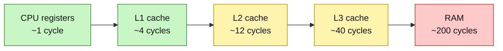

# 🧠 Memory Foundations — Where Data Structures Live

**Navigation**: [Back to Index](../00_MASTER_INDEX.md) | [Next Chapter >](01b_Arrays.md)

---

## 📚 Data Structures: Deep Dive Guide

## Understanding DS from Core - Behavior, Nature & Implementation

## 📚 Topic Pages in This Chapter

This chapter is split into focused pages so each topic can be read on its own. Read them in order the first time; use the table to jump back later.

| # | Page | What is inside | Lines |
| --- | --- | --- | --- |
| 1 | [Section 0: War Stories — When Memory Ignorance Caused Real…](01a_Memory_Foundations/01_section_0_war_stories_when_memory.md) | Section 0: War Stories — When Memory… | 103 |
| 2 | [5W1H — Why This Chapter?](01a_Memory_Foundations/02_5w1h_why_this_chapter.md) | 5W1H — Why This Chapter? | 14 |
| 3 | [HOW COMPUTER MEMORY ACTUALLY WORKS (The Foundation)](01a_Memory_Foundations/03_how_computer_memory_actually_works_the.md) | THE MEMORY HIERARCHY - Why Some Operations… · HOW MEMORY IS ORGANIZED (Addresses & Bytes) | 160 |
| 4 | [JAVA MEMORY MODEL - Stack vs Heap](01a_Memory_Foundations/04_java_memory_model_stack_vs_heap.md) | JAVA MEMORY MODEL - Stack vs Heap · WHY ARRAYS ARE FAST — Memory Layout Explained · WHY LINKED LISTS ARE SLOW - Memory Layout… · CPU OPERATIONS - What Actually Happens · Cpu Instruction Cycle - The Basics · … | 349 |
| 5 | [Production Failure Modes — Real Incidents from Real Systems](01a_Memory_Foundations/05_production_failure_modes_real_incidents_from.md) | Production Failure Modes — Real Incidents… · BIT MANIPULATION - The Fastest Operations | 166 |
| 6 | [Bit-Level Operations - Complete Guide](01a_Memory_Foundations/06_bit_level_operations_complete_guide.md) | Bit-Level Operations - Complete Guide | 156 |
| 7 | [University-Level Addendum — Memory Foundations as Formal Theory](01a_Memory_Foundations/07_university_level_addendum_memory_foundations_as.md) | University-Level Addendum — Memory… | 323 |

## 💬 Explain It Like a Study Partner — Memory

> [!TIP]
> **Ask yourself first:** *"If two programs do the same number of steps, why can one be 50× faster?"* Keep that question in mind. The answer is below.

### 1. The bottom line

Your program is only as fast as the **memory it has to wait for**, and memory that sits close together is much cheaper to read than memory that is spread out.

### 2. The textbook core

- Memory is a long sequence of **bytes**, each with an **address**. Data types have fixed sizes (`int` = 4 bytes, `long` = 8, reference = 4 or 8).
- Local variables and call frames live on the **stack**; objects and arrays live on the **heap**, and variables hold **references** to them.
- The CPU reads memory in **cache lines** (typically 64 bytes) through a hierarchy: registers → L1 → L2 → L3 → RAM → disk. Each level is bigger and slower.
- **Spatial locality** (nearby addresses) and **temporal locality** (reused data) make caches effective. A read that finds data in cache is a **hit**; otherwise it is a **miss**.

### 3. The real-world analogy

Think of a **library**. Your desk is the cache, the shelf next to you is L2, the stacks across the building is RAM, and the warehouse downtown is the disk. If every book you need is on the same shelf, you finish quickly. If each book is in a different building, you spend all your time walking, even though you are "doing the same number of steps".

### 4. Walkthrough: summing an array vs a linked list

1. You loop over `int[] arr` with 1,000,000 elements. The CPU asks for `arr[0]`.
2. That is a cache miss, so it fetches the whole 64-byte line, which holds `arr[0]` to `arr[15]`.
3. The next 15 reads are hits (about 1 ns each). Only every 16th read pays the ~100 ns miss.
4. Now repeat with a `LinkedList<Integer>`. Each node is somewhere else on the heap, so almost every hop is a miss.
5. Result: same Big-O (`O(n)`), but the array finishes roughly 10× faster.

> [!NOTE]
> **Quick check:** why does `arr[i]` cost the same as `arr[0]`? *Because the address is just `base + i × size`: one multiplication and one add, with no pointer chasing.*

---

## ⚡ At a Glance — Memory Is the Foundation

> [!NOTE]
> **Mental model:** a data structure is a *layout of bytes plus rules for walking them*. Every Big-O cost in this folder comes from one question — how many memory hops, and how far apart are they?

**How to read this diagram.** Left to right is the memory hierarchy: each step is bigger but slower. Green levels are cheap, yellow are tolerable, red is the cache miss that dominates real-world run time. Contiguous layouts (arrays) keep you on the green side; pointer-chasing layouts (linked lists, trees) keep falling to red.

| Concept | One-line takeaway | Where it bites |
| ------- | ----------------- | -------------- |
| Stack vs heap | Locals live on the stack; objects live on the heap | Object-heavy structures pay header + pointer overhead |
| Cache line (64 B) | Memory moves in 64-byte chunks | Sequential access is "free"; random access is not |
| Object header | Every Java object carries ~12–16 bytes of metadata | `ArrayList<Integer>` costs far more than `int[]` |
| Alignment/padding | Fields are padded to 4/8-byte boundaries | Sizes round up in surprising ways |

> [!TIP]
> When two structures have the same Big-O, pick the one with better **locality** — it usually wins by a large constant factor.

---

## Historical Evolution — From Punched Cards to Persistent Memory

Every concept in this chapter has a history. Understanding _why_ memory architectures evolved teaches you what constraints they solved — and those constraints still shape your code today.

### Timeline of Memory Architecture Innovations

| Era     | Technology                                        | Key Innovation                                               | Why It Mattered                                                                                                            |
| ------- | ------------------------------------------------- | ------------------------------------------------------------ | -------------------------------------------------------------------------------------------------------------------------- |
| 1946–48 | **Williams–Kilburn tube** (Manchester) | First electronic random-access memory (CRT charge spots that must be refreshed, a DRAM ancestor) | Random access replacing sequential delay lines; the Manchester Baby (1948) held 1,024 bits |
| 1947+   | **Selectron tube** (RCA) | Electrostatic memory (4,096-bit design; production tubes held 256 bits) | Too expensive and unreliable; superseded by magnetic core |
| 1950s   | **Magnetic core memory** | Ferrite rings on wire grids; non-volatile | Dominated computing until the 1970s (e.g. IBM 704, 1955); data survives power loss |
| 1966–70 | **MOS dynamic RAM** (Dennard 1966; Intel 1103, 1970) | One transistor + one capacitor per cell; 1 Kbit per chip | First DRAM chip to undercut magnetic core on cost; became the standard RAM of mainframes and minis |
| 1968    | **IBM System/360 Model 85** | First commercial computer with a cache memory | Showed that a small fast buffer in front of slower main memory hides latency |
| 1984    | **MESI / Illinois protocol** (Papamarcos and Patel) | Cache-coherence protocol for multiprocessors | Multi-processor systems need coherent caches; MESI-style protocols still underpin modern CPUs |
| 1989    | **Intel 80486**                                   | First on-chip L1 cache (8 KiB)                               | Eliminated the external cache bus bottleneck; instruction decode now overlapped with cache fetch                           |
| 1993    | **Pentium (P5)**                                  | Separate L1 instruction + data caches                        | Enables simultaneous fetch of instructions and data; halves conflict misses                                                |
| 2000    | **Pentium III Coppermine / AMD Athlon Thunderbird** | Full-speed on-die L2 cache | Reduced L2 latency versus off-chip L2 and ended the external L2 era |
| 2003–08 | **NUMA topology** (AMD Opteron/HyperTransport 2003, Intel QPI 2008) | Non-uniform memory access; each socket owns local DRAM | Scale-out servers showed that flat memory was a bottleneck; locality became a first-class concern |
| 2019–22 | **Intel Optane DC Persistent Memory** | Memory-mode DIMMs of 128–512 GiB, roughly 300 ns latency (product line discontinued in 2022) | Blurred the line between DRAM and storage; the idea lives on in CXL-attached memory |
| 2020s   | **Compute Express Link (CXL)**                    | Cache-coherent CPU-device memory pooling                     | Heterogeneous memory hierarchies; GPU/HBM and DRAM served by a single coherent address space                               |

### Named Predecessors Still Visible in Modern Code

| Ancestor                   | Modern Echo                                | Where You See It                                                                                                   |
| -------------------------- | ------------------------------------------ | ------------------------------------------------------------------------------------------------------------------ |
| **Williams tube** (1947)   | Refresh cycles                             | DRAM needs `REF` commands every 64 ms; `memtest86` checks refresh integrity                                        |
| **Magnetic core** (1950s)  | Memory-mapped I/O, non-volatile primitives | `mmap(2)` and `fadvise(2)` inherit core's "attach physical location to address" semantics                          |
| **Intel 1103 DRAM** (1970) | Row/column addressing, bank conflicts      | Modern DDR4 row-hit rate directly determines memory throughput; profilers (perf, VTune) report "row buffer misses" |
| **IBM System/360 Model 85 cache** (1968) | Cache line behavior, prefetching | Cache-line size (64 bytes on x86) still governs spatial locality decisions |

### Why This History Matters for Your Code

The memory hierarchy exists because of three immutable physics constraints:

1. **Speed costs power.** A fast register costs more energy per bit than slow DRAM.
2. **Capacity costs money.** Dense DRAM costs less per bit than SRAM.
3. **Distance costs latency.** Registers are nanometers from the ALU; RAM is millimeters.

All data structure design — from B-trees to skiplists to hash tables — is an engineering response to these three constraints. When you choose an `ArrayList` over a `LinkedList`, you are exploiting the same cache-line streaming that Cray discovered in 1976.

---

## Reality Check

> [!CAUTION]
> **Myth:** "Stack memory is faster because it's a special hardware chip"
>
> **Reality:** The stack and heap are both regions of RAM. The stack is faster because it is *used* differently: push/pop is a single pointer increment, and the working set stays in L1/L2 cache. The heap involves a memory allocator (malloc/GC), bookkeeping headers, and scattered allocations that cause cache misses.

> [!CAUTION]
> **Myth:** "When a function returns, its local variables are freed immediately"
>
> **Reality:** The stack pointer moves back — but the bytes aren't erased. They still exist in RAM until overwritten by the next stack frame. Reading a deallocated stack slot returns stale data (undefined behaviour in C). Java prevents this; C/C++ do not.

> [!CAUTION]
> **Myth:** "Virtual memory = RAM"
>
> **Reality:** Virtual memory is an OS abstraction. Your process sees a large contiguous address space (e.g., 48 bits = 256 TB) even though physical RAM may be 8 GB. The MMU (Memory Management Unit, hardware in the CPU) translates virtual → physical on every access using a page table. Pages not in RAM are stored on disk (swap); accessing them triggers a page fault and a disk read.

> [!CAUTION]
> **Myth:** "64-bit addresses mean the program can use 16 EB of memory"
>
> **Reality:** The CPU supports 64-bit addresses in theory but the OS limits user-space to 47–48 bits (128 TB) in practice. And physical RAM limits practical use further. The 64-bit pointer size itself wastes memory: each pointer in a linked list or object header is 8 bytes vs 4 bytes on 32-bit — a significant cost for pointer-heavy data structures.

> [!CAUTION]
> **Myth:** "Garbage collection in Java/Python makes memory management a non-issue"
>
> **Reality:** GC prevents use-after-free crashes but not logical memory leaks (objects reachable but logically dead — static collections, event listeners, ThreadLocal). GC also introduces pause latency (stop-the-world events) and throughput overhead. Memory tuning (heap size, GC algorithm choice) is a real production concern.
