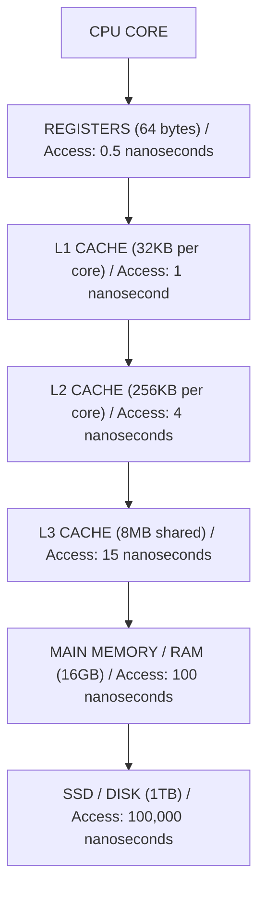
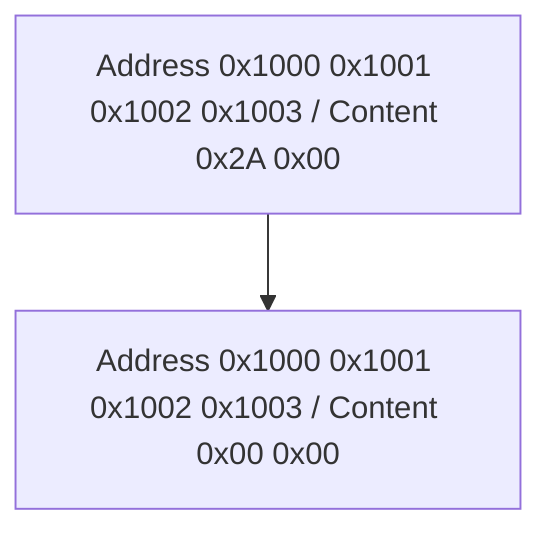
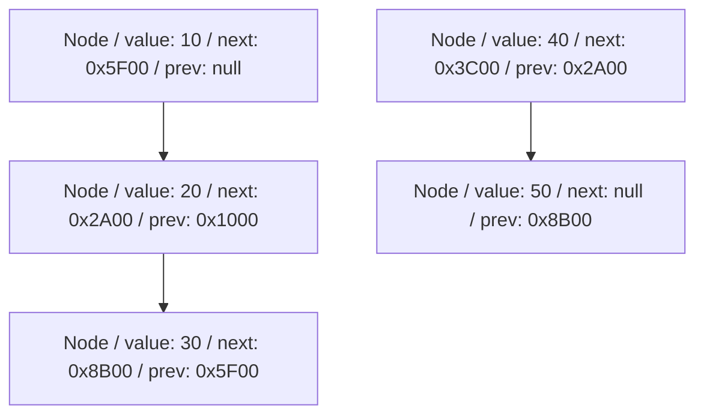

> **Navigation**: [Back to Index](../00_MASTER_INDEX.md) | [Next Chapter >](01b_Arrays.md)

---

# 📚 Data Structures: Deep Dive Guide

## Understanding DS from Core - Behavior, Nature & Implementation

---


# 🔬 PART 0A: HOW COMPUTER MEMORY ACTUALLY WORKS (The Foundation)


> BEFORE YOU LEARN DATA STRUCTURES - UNDERSTAND THE MACHINE


Why does this matter?
─────────────────────
Every data structure exists in MEMORY. If you don't understand memory,
you'll never truly understand why:
• Arrays are fast for random access
• LinkedLists are slow for random access
• HashMaps are O(1) but use more memory
• Cache-friendly code runs 100x faster

Let's go DEEP into how computers actually work!

## THE MEMORY HIERARCHY - Why Some Operations Are Faster

```
┌─────────────────────────────────────────────────────────────────────────────────┐
│                        MEMORY HIERARCHY (Speed vs Size)                         │
├─────────────────────────────────────────────────────────────────────────────────┤
│                                                                                 │
│                          ┌─────────────┐                                        │
│                          │  CPU CORE   │                                        │
│                          └──────┬──────┘                                        │
│                                 │                                               │
│    FASTEST    ┌─────────────────▼─────────────────┐                             │
│    (~1 cycle) │     REGISTERS (64 bytes)          │  ← Variables being computed │
│               │     Access: 0.5 nanoseconds       │                             │
│               └─────────────────┬─────────────────┘                             │
│                                 │                                               │
│    VERY FAST  ┌─────────────────▼─────────────────┐                             │
│    (~4 cycles)│     L1 CACHE (32KB per core)      │  ← Hot data (current loop)  │
│               │     Access: 1 nanosecond          │                             │
│               └─────────────────┬─────────────────┘                             │
│                                 │                                               │
│    FAST       ┌─────────────────▼─────────────────┐                             │
│   (~12 cycles)│     L2 CACHE (256KB per core)     │  ← Recent data              │
│               │     Access: 4 nanoseconds         │                             │
│               └─────────────────┬─────────────────┘                             │
│                                 │                                               │
│    MODERATE   ┌─────────────────▼─────────────────┐                             │
│   (~40 cycles)│     L3 CACHE (8MB shared)         │  ← Shared between cores     │
│               │     Access: 15 nanoseconds        │                             │
│               └─────────────────┬─────────────────┘                             │
│                                 │                                               │
│    SLOW       ┌─────────────────▼─────────────────┐                             │
│  (~200 cycles)│     MAIN MEMORY / RAM (16GB)      │  ← All your program data    │
│               │     Access: 100 nanoseconds       │                             │
│               └─────────────────┬─────────────────┘                             │
│                                 │                                               │
│    VERY SLOW  ┌─────────────────▼─────────────────┐                             │
│  (~millions)  │     SSD / DISK (1TB)              │  ← Persistent storage       │
│               │     Access: 100,000 nanoseconds   │                             │
│               └─────────────────────────────────────┘                           │
│                                                                                 │
│  KEY INSIGHT:                                                                   │
│  ─────────────                                                                  │
│  RAM is 100x SLOWER than L1 cache!                                              │
│  Disk is 1000x SLOWER than RAM!                                                 │
│                                                                                 │
│  This is why CACHE-FRIENDLY data structures matter so much!                     │
│                                                                                 │
└─────────────────────────────────────────────────────────────────────────────────┘
```

**Flow:**
- CPU CORE
- ↓
- REGISTERS (64 bytes) / Access: 0.5 nanoseconds
- ↓
- L1 CACHE (32KB per core) / Access: 1 nanosecond
- ↓
- L2 CACHE (256KB per core) / Access: 4 nanoseconds
- ↓
- L3 CACHE (8MB shared) / Access: 15 nanoseconds
- ↓
- MAIN MEMORY / RAM (16GB) / Access: 100 nanoseconds
- ↓
- SSD / DISK (1TB) / Access: 100,000 nanoseconds




> 🔬 **Section Challenge — THE MEMORY HIERARCHY - Why Some Operations Are Faster**
>
> **Challenge 1 (Reasoning):** Why does `Error` extend `Throwable` separately from `Exception`? When should you catch `Error`?
> <details><summary>Answer</summary>
>
> `Error` represents JVM-level failures: `OutOfMemoryError`, `StackOverflowError`, `VirtualMachineError`. These indicate unrecoverable states. You should almost NEVER catch `Error` — the JVM state is undefined. Only exception: top-level handlers that log the error before terminating gracefully (`catch(Throwable t)` in shutdown hooks). Never catch `Error` in normal application code.
> </details>
>
> **Challenge 2 (Bug Hunt):** `catch(Exception e) { log(e.getMessage()); }` — name 3 things wrong with this.
> <details><summary>Answer</summary>
>
> 1) `e.getMessage()` returns null for some exceptions (NPE, CCE) → NullPointerException in the logger! Use `log(e)` instead to print full stack. 2) Swallowing `Exception` catches runtime bugs (NPE, illegal arg) that should crash/bubble — silent failure is worse than loud failure. 3) No re-throw or meaningful handling — caller has no idea the operation failed.
> </details>
>

## HOW MEMORY IS ORGANIZED (Addresses & Bytes)

```
┌─────────────────────────────────────────────────────────────────────────────────┐
│                         MEMORY ADDRESS SPACE                                    │
├─────────────────────────────────────────────────────────────────────────────────┤
│                                                                                 │
│  Memory is like a HUGE array of bytes, each with an ADDRESS                     │
│                                                                                 │
│  ADDRESS        CONTENT (1 byte = 8 bits)                                       │
│  ────────────────────────────────────────────                                   │
│  0x00000000     [01001010]  ← First byte of RAM                                 │
│  0x00000001     [11010010]                                                      │
│  0x00000002     [00001111]                                                      │
│  0x00000003     [10101010]                                                      │
│  ...                                                                            │
│  0xFFFFFFFF     [????????]  ← Last byte (in 32-bit system)                      │
│                                                                                 │
│                                                                                 │
│  DATA TYPE SIZES (Java):                                                        │
│  ───────────────────────                                                        │
│  byte     = 1 byte  = 8 bits   → Range: -128 to 127                             │
│  short    = 2 bytes = 16 bits  → Range: -32,768 to 32,767                       │
│  int      = 4 bytes = 32 bits  → Range: -2.1 billion to 2.1 billion             │
│  long     = 8 bytes = 64 bits  → Range: ±9.2 quintillion                        │
│  float    = 4 bytes = 32 bits  → ~7 decimal digits precision                    │
│  double   = 8 bytes = 64 bits  → ~15 decimal digits precision                   │
│  char     = 2 bytes = 16 bits  → Unicode character                              │
│  boolean  = 1 byte* = 8 bits   → true or false                                  │
│  reference= 4 or 8 bytes       → Points to object in heap                       │
│                                                                                 │
│  * JVM may use 1 bit internally but allocates 1 byte                            │
│                                                                                 │
└─────────────────────────────────────────────────────────────────────────────────┘


┌─────────────────────────────────────────────────────────────────────────────────┐
│                    HOW AN int IS STORED IN MEMORY                               │
├─────────────────────────────────────────────────────────────────────────────────┤
│                                                                                 │
│  int x = 42;                                                                    │
│                                                                                 │
│  Binary of 42:  00000000 00000000 00000000 00101010                             │
│                 ────────┬────────┬────────┬────────                             │
│                   Byte 3  Byte 2  Byte 1  Byte 0                                │
│                                                                                 │
│  In Memory (Little Endian - Intel/AMD):                                         │
│  ┌──────────────────────────────────────────────────┐                           │
│  │ Address  │ 0x1000 │ 0x1001 │ 0x1002 │ 0x1003 │  │                            │
│  │ Content  │  0x2A  │  0x00  │  0x00  │  0x00  │  │                            │
│  │          │ (42)   │  (0)   │  (0)   │  (0)   │  │                            │
│  └──────────────────────────────────────────────────┘                           │
│              ↑                                                                  │
│              Least Significant Byte stored FIRST                                │
│                                                                                 │
│  In Memory (Big Endian - Network Order):                                        │
│  ┌──────────────────────────────────────────────────┐                           │
│  │ Address  │ 0x1000 │ 0x1001 │ 0x1002 │ 0x1003 │  │                            │
│  │ Content  │  0x00  │  0x00  │  0x00  │  0x2A  │  │                            │
│  │          │  (0)   │  (0)   │  (0)   │ (42)   │  │                            │
│  └──────────────────────────────────────────────────┘                           │
│                                              ↑                                  │
│              Most Significant Byte stored FIRST                                 │
│                                                                                 │
│  WHY DOES THIS MATTER?                                                          │
│  • Network protocols use Big Endian                                             │
│  • Your CPU likely uses Little Endian                                           │
│  • Must convert when sending data over network!                                 │
│                                                                                 │
└─────────────────────────────────────────────────────────────────────────────────┘
```

**Flow:**
- Address 0x1000 0x1001 0x1002 0x1003 / Content 0x2A 0x00
- ↓
- Address 0x1000 0x1001 0x1002 0x1003 / Content 0x00 0x00



## JAVA MEMORY MODEL - Stack vs Heap

```
┌─────────────────────────────────────────────────────────────────────────────────┐
│                        JAVA MEMORY LAYOUT                                       │
├─────────────────────────────────────────────────────────────────────────────────┤
│                                                                                 │
│  When JVM runs your program, memory is divided into:                            │
│                                                                                 │
│  ┌─────────────────────────────────────────────────────────────────────────┐    │
│  │                           JVM MEMORY                                     │   │
│  │                                                                          │   │
│  │  ┌───────────────────────────────────────────────────────────────────┐  │    │
│  │  │                    METHOD AREA                                    │  │    │
│  │  │  • Class metadata (methods, fields)                              │  │     │
│  │  │  • Static variables                                              │  │     │
│  │  │  • Constant pool (string literals, numbers)                      │  │     │
│  │  │  • Method bytecode                                               │  │     │
│  │  └───────────────────────────────────────────────────────────────────┘  │    │
│  │                                                                          │   │
│  │  ┌───────────────────────────────────────────────────────────────────┐  │    │
│  │  │                         HEAP                                      │  │    │
│  │  │  • All objects live here                                         │  │     │
│  │  │  • Arrays are objects!                                           │  │     │
│  │  │  • Garbage collected                                             │  │     │
│  │  │  • Shared between all threads                                    │  │     │
│  │  │                                                                   │  │    │
│  │  │  Divided into:                                                   │  │     │
│  │  │  ┌─────────────────┬──────────────────┬────────────────────┐    │  │      │
│  │  │  │ Young Gen       │ Old Gen           │ Metaspace          │    │  │     │
│  │  │  │ (Eden+Survivor) │ (Long-lived objs) │ (Class metadata)   │    │  │     │
│  │  │  └─────────────────┴──────────────────┴────────────────────┘    │  │      │
│  │  └───────────────────────────────────────────────────────────────────┘  │    │
│  │                                                                          │   │
│  │  ┌───────────────────┐  ┌───────────────────┐  ┌───────────────────┐   │     │
│  │  │   STACK (Thread1) │  │   STACK (Thread2) │  │   STACK (Thread3) │   │     │
│  │  │                   │  │                   │  │                   │   │     │
│  │  │  ┌─────────────┐  │  │  ┌─────────────┐  │  │  ┌─────────────┐  │   │     │
│  │  │  │ Frame 3     │  │  │  │ Frame 2     │  │  │  │ Frame 1     │  │   │     │
│  │  │  │ (method c)  │  │  │  │ (method b)  │  │  │  │ (method a)  │  │   │     │
│  │  │  ├─────────────┤  │  │  ├─────────────┤  │  │  ├─────────────┤  │   │     │
│  │  │  │ Frame 2     │  │  │  │ Frame 1     │  │  │  │             │  │   │     │
│  │  │  │ (method b)  │  │  │  │ (main)      │  │  │  │             │  │   │     │
│  │  │  ├─────────────┤  │  │  ├─────────────┤  │  │  │             │  │   │     │
│  │  │  │ Frame 1     │  │  │  │             │  │  │  │             │  │   │     │
│  │  │  │ (main)      │  │  │  │             │  │  │  │             │  │   │     │
│  │  │  └─────────────┘  │  │  └─────────────┘  │  │  └─────────────┘  │   │     │
│  │  └───────────────────┘  └───────────────────┘  └───────────────────┘   │     │
│  │                                                                          │   │
│  │  Each thread has its OWN stack!                                         │    │
│  │                                                                          │   │
│  └─────────────────────────────────────────────────────────────────────────┘    │
│                                                                                 │
└─────────────────────────────────────────────────────────────────────────────────┘


┌─────────────────────────────────────────────────────────────────────────────────┐
│                     STACK FRAME - INSIDE VIEW                                   │
├─────────────────────────────────────────────────────────────────────────────────┤
│                                                                                 │
│  When you call a method:                                                        │
│                                                                                 │
│  public int calculate(int a, int b) {                                           │
│      int sum = a + b;        // Local variable                                  │
│      int[] arr = new int[5]; // Reference on stack, array on HEAP               │
│      return sum;                                                                │
│  }                                                                              │
│                                                                                 │
│                                                                                 │
│  STACK FRAME for calculate():                                                   │
│  ┌───────────────────────────────────────────────────────────────┐              │
│  │                                                               │              │
│  │  HIGH ADDRESS (top of stack)                                  │              │
│  │  ┌─────────────────────────────────────────────────────────┐ │               │
│  │  │  Return Address                                         │ │               │
│  │  │  (where to go after method ends)                        │ │               │
│  │  ├─────────────────────────────────────────────────────────┤ │               │
│  │  │  Previous Frame Pointer                                 │ │               │
│  │  │  (link to caller's frame)                               │ │               │
│  │  ├─────────────────────────────────────────────────────────┤ │               │
│  │  │  Local Variable: sum = 15                              │ │                │
│  │  │  (4 bytes for int)                                      │ │               │
│  │  ├─────────────────────────────────────────────────────────┤ │               │
│  │  │  Local Variable: arr = 0x00ABC123                      │ │                │
│  │  │  (reference pointing to heap)──────────────────────┐   │ │                │
│  │  ├─────────────────────────────────────────────────────┤   │ │               │
│  │  │  Parameter: a = 5                                   │   │ │               │
│  │  │  (4 bytes for int)                                  │   │ │               │
│  │  ├─────────────────────────────────────────────────────┤   │ │               │
│  │  │  Parameter: b = 10                                  │   │ │               │
│  │  │  (4 bytes for int)                                  │   │ │               │
│  │  └─────────────────────────────────────────────────────┘   │ │               │
│  │  LOW ADDRESS (bottom of frame)                         │   │ │               │
│  │                                                        │   │ │               │
│  └────────────────────────────────────────────────────────│───┘ │               │
│                                                           │     │               │
│                                                           ▼     │               │
│  HEAP:                                                          │               │
│  ┌─────────────────────────────────────────────────────────┐   │                │
│  │  Address 0x00ABC123:                                    │◄──┘                │
│  │  ┌───────────────────────────────────────────────────┐ │                     │
│  │  │ Object Header (12 bytes)                          │ │                     │
│  │  │  • Mark Word (8 bytes): GC info, hash, locks     │ │                      │
│  │  │  • Class Pointer (4 bytes): points to int[].class│ │                      │
│  │  ├───────────────────────────────────────────────────┤ │                     │
│  │  │ Array Length (4 bytes): 5                         │ │                     │
│  │  ├───────────────────────────────────────────────────┤ │                     │
│  │  │ arr[0] = 0  (4 bytes)                            │ │                      │
│  │  │ arr[1] = 0  (4 bytes)                            │ │                      │
│  │  │ arr[2] = 0  (4 bytes)                            │ │                      │
│  │  │ arr[3] = 0  (4 bytes)                            │ │                      │
│  │  │ arr[4] = 0  (4 bytes)                            │ │                      │
│  │  └───────────────────────────────────────────────────┘ │                     │
│  │                                                        │                     │
│  │  Total: 12 + 4 + (5×4) = 36 bytes                     │                      │
│  │  (may be padded to 40 bytes for alignment)            │                      │
│  └────────────────────────────────────────────────────────┘                     │
│                                                                                 │
└─────────────────────────────────────────────────────────────────────────────────┘
```


> 🔬 **Section Challenge — JAVA MEMORY MODEL - Stack vs Heap**
>
> **Challenge 1 (Reasoning):** Monotonic DECREASING stack — when you push a new element, which existing elements are popped and what information do those pops tell you?
> <details><summary>Answer</summary>
>
> In a decreasing stack (top is smallest), pushing element `x`: all elements smaller than `x` are popped. For each popped element `y`: `x` is the NEXT GREATER ELEMENT of `y`. This is the key insight: the pop event = answer event. Application: Daily Temperatures (next warmer day), Largest Rectangle in Histogram (right boundary), Next Greater Element. Each element is pushed and popped exactly once → O(N) total.
> </details>
>

## WHY ARRAYS ARE FAST - Memory Layout Explained


## Array Memory Layout - The Speed Secret

int[] arr = {10, 20, 30, 40, 50};
MEMORY (CONTIGUOUS - all elements side by side):
| Address | 0x1000 | 0x1004 | 0x1008 | 0x100C | 0x1010 | |
| Index   |   [0]  |   [1]  |   [2]  |   [3]  |   [4]  | |
| Value   |   10   |   20   |   30   |   40   |   50   | |
ADDRESS CALCULATION (O(1)):
address(arr[i]) = baseAddress + (i × elementSize)
arr[3] = 0x1000 + (3 × 4) = 0x1000 + 12 = 0x100C
This is just ONE arithmetic operation! CPU does this in 1 cycle!

**Cache Friendliness**:
When you access arr[0], the CPU loads a "cache line" (typically 64 bytes)
Cache Line Loaded:
| arr[0] | arr[1] | arr[2] | arr[3] | arr[4] | arr[5] | ... | arr[15] | |
| 10    |  20    |  30    |  40    |  50    |  ...   | ... |  ...    | |
Now arr[1], arr[2], etc. are already in L1 cache!
Access time: ~1 nanosecond instead of ~100 nanoseconds
This is why iterating an array is SO FAST:
for (int i = 0; i < arr.length; i++) {
sum += arr[i];  // Most accesses are cache hits!
}

## WHY LINKED LISTS ARE SLOW - Memory Layout Explained

```
┌─────────────────────────────────────────────────────────────────────────────────┐
│                 LINKED LIST MEMORY LAYOUT - THE SLOWNESS SECRET                 │
├─────────────────────────────────────────────────────────────────────────────────┤
│                                                                                 │
│  LinkedList<Integer> list; // [10 → 20 → 30 → 40 → 50]                          │
│                                                                                 │
│  MEMORY (SCATTERED - nodes all over heap):                                      │
│                                                                                 │
│  HEAP:                                                                          │
│  ┌──────────────────────────────────────────────────────────────────────────┐   │
│  │                                                                          │   │
│  │    Address 0x1000:          Address 0x5F00:          Address 0x2A00:    │    │
│  │    ┌─────────────┐          ┌─────────────┐          ┌─────────────┐    │    │
│  │    │ Node        │          │ Node        │          │ Node        │    │    │
│  │    ├─────────────┤          ├─────────────┤          ├─────────────┤    │    │
│  │    │ value: 10   │          │ value: 20   │          │ value: 30   │    │    │
│  │    │ next: 0x5F00│─────────►│ next: 0x2A00│─────────►│ next: 0x8B00│──┐ │    │
│  │    │ prev: null  │◄─────────│ prev: 0x1000│◄─────────│ prev: 0x5F00│  │ │    │
│  │    └─────────────┘          └─────────────┘          └─────────────┘  │ │    │
│  │                                                                        │ │   │
│  │                                                       ┌────────────────┘ │   │
│  │    Address 0x8B00:          Address 0x3C00:          ▼                   │   │
│  │    ┌─────────────┐          ┌─────────────┐                             │    │
│  │    │ Node        │          │ Node        │                             │    │
│  │    ├─────────────┤          ├─────────────┤                             │    │
│  │    │ value: 40   │          │ value: 50   │                             │    │
│  │    │ next: 0x3C00│─────────►│ next: null  │                             │    │
│  │    │ prev: 0x2A00│◄─────────│ prev: 0x8B00│                             │    │
│  │    └─────────────┘          └─────────────┘                             │    │
│  │                                                                          │   │
│  └──────────────────────────────────────────────────────────────────────────┘   │
│                                                                                 │
│  TO ACCESS list.get(3) (value 40):                                              │
│  ───────────────────────────────────                                            │
│  1. Start at head: 0x1000 (value 10)     - Cache miss! Load from RAM            │
│  2. Follow next to: 0x5F00 (value 20)    - Cache miss! Different location       │
│  3. Follow next to: 0x2A00 (value 30)    - Cache miss! Different location       │
│  4. Follow next to: 0x8B00 (value 40)    - Cache miss! Found it!                │
│                                                                                 │
│  4 memory accesses × 100ns each = 400 nanoseconds!                              │
│  Compare to array: 1 memory access = 1-100 nanoseconds                          │
│                                                                                 │
│                                                                                 │
│  MEMORY OVERHEAD:                                                               │
│  ────────────────                                                               │
│  Array:  5 integers = 20 bytes + 16 bytes header = 36 bytes                     │
│                                                                                 │
│  LinkedList: Each node needs:                                                   │
│  • Object header: 12 bytes                                                      │
│  • Integer object reference: 4 bytes                                            │
│  • Next pointer: 8 bytes                                                        │
│  • Prev pointer: 8 bytes                                                        │
│  • Integer object: 16 bytes (12 header + 4 value)                               │
│  Total per node: ~48 bytes                                                      │
│                                                                                 │
│  5 nodes = 240 bytes vs 36 bytes for array                                      │
│  LinkedList uses 6.7x MORE memory!                                              │
│                                                                                 │
└─────────────────────────────────────────────────────────────────────────────────┘
```

**Flow:**
- Node / value: 10 / next: 0x5F00 / prev: null
- ↓
- Node / value: 20 / next: 0x2A00 / prev: 0x1000
- ↓
- Node / value: 30 / next: 0x8B00 / prev: 0x5F00
- ↓
- Node / value: 40 / next: 0x3C00 / prev: 0x2A00
- ↓
- Node / value: 50 / next: null / prev: 0x8B00




## CPU OPERATIONS - What Actually Happens

## Cpu Instruction Cycle - The Basics

Every operation in your code becomes CPU instructions
Java Code:        int sum = a + b;
Bytecode:         iload_1        // Load 'a' onto stack
iload_2        // Load 'b' onto stack
iadd           // Add top two values
istore_3       // Store result in 'sum'
Machine Code:     MOV eax, [a]   // Load a into register
(x86)             ADD eax, [b]   // Add b to register
MOV [sum], eax // Store result

**Cpu Clock Cycles For Common Operations**:
| Operation                | Cycles | Notes |
┼────────┼
| Integer ADD/SUB          | 1      | Fastest operations |
| Integer MUL              | 3      | Multiplication is costlier |
| Integer DIV              | 20-80  | Division is VERY expensive! |
| Floating-point ADD       | 3-5    | Separate FPU unit |
| Floating-point MUL       | 4-5    | |
| Floating-point DIV       | 10-40  | |
| Comparison (==, <, >)    | 1      | Simple comparison |
| Branch (if/else)         | 1-20   | Depends on prediction |
| Memory Read (L1 cache)   | 4      | Cache hit |
| Memory Read (L2 cache)   | 12     | |
| Memory Read (L3 cache)   | 40     | |
| Memory Read (RAM)        | 200    | Cache miss - EXPENSIVE! |
| Function Call            | 15-30  | Stack frame setup |
| Virtual Method Call      | 25-50  | Vtable lookup + call |
┴────────┴

**Why This Matters For Dsa**:
- Division is 20-80x slower than addition!
Use bit shifts: n / 2  →  n >> 1
Use bit masks:  n % 8  →  n & 7
- Memory access is 200x slower than arithmetic!
Cache-friendly code beats clever algorithms
- Branch misprediction costs ~15 cycles!
Predictable patterns are faster than random


## BIT MANIPULATION - The Fastest Operations

## Bit-Level Operations - Complete Guide


**Binary Representation**:
int x = 42;
42 in binary: 00000000 00000000 00000000 00101010
Position: 5 4 3 2 1 0
Value:    32+0+8+0+2+0 = 42
32
8
2

**Bit Operations**:
AND (&) - Both bits must be 1
42 & 15 = ?
42: 00101010
15: 00001111
00001010 = 10

**Use**: Masking bits, checking if bit is set
- Check if even:    (n & 1) == 0
- Get last k bits:  n & ((1 << k) - 1)
OR (|) - Either bit can be 1
42 | 15 = ?
42: 00101010
15: 00001111
00101111 = 47

**Use**: Setting bits
- Set bit i:  n | (1 << i)
XOR (^) - Bits must be different
42 ^ 15 = ?
42: 00101010
15: 00001111
00100101 = 37

**Use**: Toggle bits, find single number, swap
- Toggle bit i:  n ^ (1 << i)
- Swap without temp:  a ^= b; b ^= a; a ^= b;
- a ^ a = 0 (cancel out)
- a ^ 0 = a (identity)
NOT (~) - Flip all bits
~42 = ?
42:  00000000 00000000 00000000 00101010
~42: 11111111 11111111 11111111 11010101 = -43
(Two's complement: -43 = ~42)
LEFT SHIFT (<<) - Multiply by 2^n
42 << 2 = ?
42:     00101010
42<<2:  10101000 = 168
42 × 4 = 168  (same as 42 × 2²)

**Use**: Fast multiplication
- n * 2:   n << 1
- n * 8:   n << 3
- n * 2^k: n << k
RIGHT SHIFT (>>) - Divide by 2^n
42 >> 2 = ?
42:     00101010
42>>2:  00001010 = 10
42 / 4 = 10 (integer division)

**Use**: Fast division
- n / 2:   n >> 1
- n / 8:   n >> 3

**Common Bit Tricks**:
1. Check if power of 2:
(n & (n-1)) == 0
8:     1000
7:     0111
8 & 7: 0000 ✓ (power of 2)
6:     0110
5:     0101
6 & 5: 0100 ✗ (not power of 2)
2. Get lowest set bit:
n & (-n)
12:     1100
-12:     0100 (two's complement)
12&-12: 0100 = 4 (lowest set bit)
3. Clear lowest set bit:
n & (n-1)
12:     1100
11:     1011
12&11:  1000 = 8 (cleared bit at position 2)
4. Count set bits (Brian Kernighan's):
int count = 0;
while (n != 0) {
n = n & (n - 1);  // Clear lowest bit
count++;
}
5. Check if bit i is set:
(n & (1 << i)) != 0
6. Set bit i:
n | (1 << i)
7. Clear bit i:
n & ~(1 << i)
8. Toggle bit i:
n ^ (1 << i)

---

> **Navigation**: [Back to Index](../00_MASTER_INDEX.md) | [Next >](01b_Arrays.md)