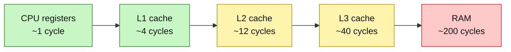
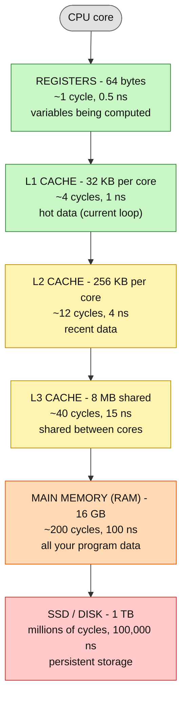
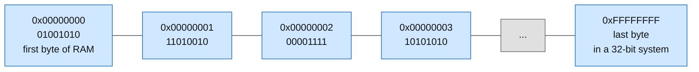
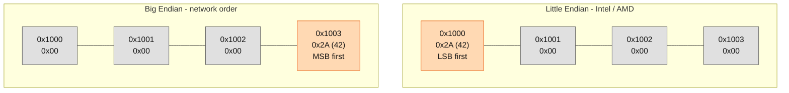
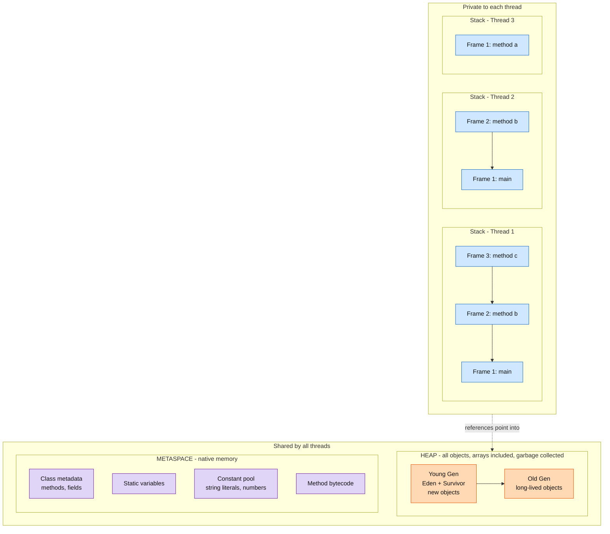
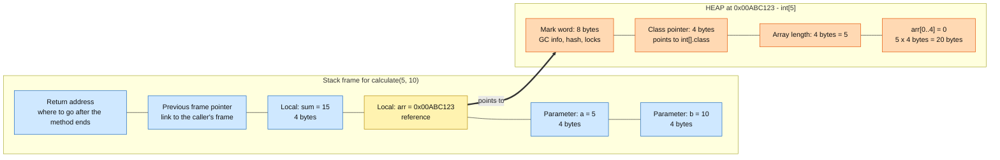
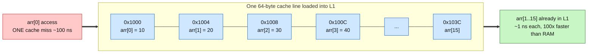
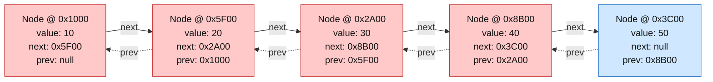

**Navigation**: [Back to Index](../00_MASTER_INDEX.md) | [Next Chapter >](01b_Arrays.md)

---

# 📚 Data Structures: Deep Dive Guide

## Understanding DS from Core - Behavior, Nature & Implementation

## Section 0: War Stories — When Memory Ignorance Caused Real Performance Disasters

> These production incidents were caused by ignoring the memory model this chapter teaches. They're not exotic bugs — they're the kind that happen when you treat data structures as abstract math instead of physical memory.

### Story 1: ArrayList vs LinkedList — A 5-Hour Batch Job That Should Take 8 Minutes

A data pipeline processed 500,000 records stored in a `LinkedList`. The processing step accessed each record by index to apply transformations:

```java
LinkedList<Record> records = loadFromDB(); // 500,000 items

for (int i = 0; i < records.size(); i++) {
  transform(records.get(i)); // ← O(n) per call on a LinkedList
}
// Total: O(n²) = 250,000,000,000 operations
// Actual runtime: 5.2 hours
```

Switching to `ArrayList` (same code, one word changed): 8 minutes.

**Why:** A `LinkedList` stores each element in a separate heap object with `prev`/`next` pointers — nodes scattered across RAM. `get(i)` starts at the head and follows `next` pointers `i` times. On a 500,000-element list, `get(249,999)` traverses 249,999 pointer hops — each one a potential cache miss, each cache miss costing ~100× more than a cache hit.

An `ArrayList` stores all elements in a contiguous memory block. `get(i)` is a single arithmetic calculation: `baseAddress + i * elementSize`. The CPU's prefetcher loads the next few elements into cache automatically. No random pointer-chasing.

**The lesson this chapter teaches:** choosing a data structure isn't just about Big-O notation — it's about memory layout and cache behavior. An `ArrayList` (contiguous) and a `LinkedList` (scattered) are both O(1) amortized for append, but iteration is O(n) vs O(n) at wildly different constant factors.

---

### Story 2: Stack Overflow in Production — Recursive DFS on a 10,000-Node Tree

A company's product catalog had a tree structure with up to 10,000 nodes. Their search algorithm used recursive DFS:

```python
def find_product(node, target_id):
  if node is None:
    return None
  if node.id == target_id:
    return node
  return find_product(node.left, target_id) or find_product(node.right, target_id)
```

On development machines with small test trees (200 nodes): worked fine. In production with a category tree 10,000 nodes deep: `RecursionError: maximum recursion depth exceeded`.

**Why:** Every recursive call adds a stack frame to the **call stack** — a fixed-size memory region (typically 1MB–8MB, configurable). Each frame stores local variables, return address, and the function's context. At 10,000 deep recursion × ~200 bytes per frame = ~2MB. Stack overflowed.

The call stack is a physical memory constraint, not a logical one. Recursion that looks "clean" in code can be "fatal" in production.

Fix: iterative DFS using an explicit stack on the heap (which can grow much larger):

```python
def find_product_iterative(root, target_id):
  stack = [root]  # this stack lives on the heap — can hold millions of items
  while stack:
    node = stack.pop()
    if node is None:
      continue
    if node.id == target_id:
      return node
    stack.append(node.right)
    stack.append(node.left)
  return None
```

**The lesson:** the call stack is bounded physical memory. Deep recursion = potential stack overflow. The heap-allocated `stack` data structure has no such limit (until you run out of RAM). This chapter explains stack vs heap allocation in depth.

---

### Story 3: The String Concatenation Loop That Was O(n²) in Disguise

A report generator built a CSV string from 100,000 rows:

```python
report = ""
for row in rows:  # 100,000 rows
  report += format_row(row) + "\n"  # ← string concatenation in a loop
```

Ran fine with 1,000 rows. At 100,000 rows: 45 seconds.

**Why:** In Python (and Java, JavaScript), strings are **immutable** — they live in fixed memory locations and cannot be extended. Every `+=` creates a **new string object** in memory: copy the existing string + append the new piece. With 100,000 iterations:
- Iteration 1: allocate and copy 1 row
- Iteration 2: allocate and copy 2 rows
- ...
- Iteration 100,000: allocate and copy 100,000 rows

Total copies: 1 + 2 + 3 + ... + 100,000 = n(n+1)/2 = **O(n²)**.

Fix: use a list to collect rows, then join at the end — O(n):

```python
rows_formatted = []
for row in rows:
  rows_formatted.append(format_row(row) + "\n")  # O(1) per item
report = "".join(rows_formatted)  # one allocation, one copy — O(n)
# Ran in: 0.4 seconds
```

Java equivalent: `StringBuilder` (mutable string buffer on heap) vs `String` concatenation.

**The lesson:** immutability is a memory model decision, not just an API choice. When a type is immutable, every "modification" allocates new memory. Understanding where data lives (heap, stack, string pool) explains why these performance cliffs exist.

---

## ⚡ At a Glance — Memory Is the Foundation

> [!NOTE]
> **Mental model:** a data structure is a *layout of bytes plus rules for walking them*. Every Big-O cost in this folder comes from one question — how many memory hops, and how far apart are they?



**How to read this diagram.** Left to right is the memory hierarchy: each step is bigger but slower. Green levels are cheap, yellow are tolerable, red is the cache miss that dominates real-world run time. Contiguous layouts (arrays) keep you on the green side; pointer-chasing layouts (linked lists, trees) keep falling to red.

| Concept | One-line takeaway | Where it bites |
| ------- | ----------------- | -------------- |
| Stack vs heap | Locals live on the stack; objects live on the heap | Object-heavy structures pay header + pointer overhead |
| Cache line (64 B) | Memory moves in 64-byte chunks | Sequential access is "free"; random access is not |
| Object header | Every Java object carries ~12–16 bytes of metadata | `ArrayList<Integer>` costs far more than `int[]` |
| Alignment/padding | Fields are padded to 4/8-byte boundaries | Sizes round up in surprising ways |

> [!TIP]
> When two structures have the same Big-O, pick the one with better **locality** — it usually wins by a large constant factor.

---

## 5W1H — Why This Chapter?

> WHAT: The hardware realities (CPU cache, memory hierarchy, byte structure) that dictate software performance.
>
> WHY: You cannot deeply understand _why_ an array is faster than a linked list for iteration without understanding cache lines and contiguous memory. Data structures are abstractions over physical RAM.
>
> WHO: Any developer transitioning from writing "code that works" to writing "code that scales."
>
> WHEN: Before studying any specific data structure, to build a mental model of the machine it runs on.
>
> HOW: By dissecting the memory hierarchy, stack vs heap allocation, and bit-level operations.

---

## Historical Evolution — From Punched Cards to Persistent Memory

Every concept in this chapter has a history. Understanding _why_ memory architectures evolved teaches you what constraints they solved — and those constraints still shape your code today.

### Timeline of Memory Architecture Innovations

| Era     | Technology                                        | Key Innovation                                               | Why It Mattered                                                                                                            |
| ------- | ------------------------------------------------- | ------------------------------------------------------------ | -------------------------------------------------------------------------------------------------------------------------- |
| 1945    | **Williams-Kilburn tube** (Manchester)            | First practical DRAM (cathode ray tube)                      | Random access replacing sequential punch cards; 1,024 bits stored as charge spots                                          |
| 1947    | **Selectron tube** (RCA)                          | 4,096-bit electrostatic memory                               | Too expensive; superseded by magnetic core                                                                                 |
| 1950s   | **Magnetic core memory**                          | Ferrite rings on wire grids; non-volatile                    | Dominated computing until 1970s; IBM 405, IBM 704; read/write with no power loss                                           |
| 1968    | **MOS dynamic RAM** (Intel 1103, 1970)            | One transistor + one capacitor per cell; density 1 Kbit/chip | First DRAM chip to undercut magnetic core on cost; became the standard RAM of mainframes and minis                         |
| 1976    | **Cray-1 vector processor**                       | First commercial cache hierarchy (512 KiB B-board)           | Seymour Cray recognized that memory latency (not compute) was the bottleneck; introduced cache to bridge CPU/RAM speed gap |
| 1978-85 | **x86 cache coherency** (Intel 386 + 387)         | Separate L1 cache controller; MESI protocol defined 1982     | Multi-processor systems needed coherency; MESI still underpins modern CPUs                                                 |
| 1989    | **Intel 80486**                                   | First on-chip L1 cache (8 KiB)                               | Eliminated the external cache bus bottleneck; instruction decode now overlapped with cache fetch                           |
| 1993    | **Pentium (P5)**                                  | Separate L1 instruction + data caches                        | Enables simultaneous fetch of instructions and data; halves conflict misses                                                |
| 1999    | **AMD Athlon Thunderbird**                        | First on-die L2 cache                                        | Reduces latency vs. off-chip L2 by ~40%; marks the end of the external L2 era                                              |
| 2008+   | **NUMA topology** (AMD HyperTransport, Intel QPI) | Non-uniform memory access; each socket owns local DRAM       | Scale-out servers showed that flat memory was a bottleneck; locality became a first-class concern                          |
| 2019+   | **Intel Optane DC Persistent Memory**             | Memory-mode DIMMs; 256-512 GiB per socket, ~1 µs latency     | Blurs the line between DRAM and storage; datasets too large for DRAM now fit in "memory"                                   |
| 2020s   | **Compute Express Link (CXL)**                    | Cache-coherent CPU-device memory pooling                     | Heterogeneous memory hierarchies; GPU/HBM and DRAM served by a single coherent address space                               |

### Named Predecessors Still Visible in Modern Code

| Ancestor                   | Modern Echo                                | Where You See It                                                                                                   |
| -------------------------- | ------------------------------------------ | ------------------------------------------------------------------------------------------------------------------ |
| **Williams tube** (1947)   | Refresh cycles                             | DRAM needs `REF` commands every 64 ms; `memtest86` checks refresh integrity                                        |
| **Magnetic core** (1950s)  | Memory-mapped I/O, non-volatile primitives | `mmap(2)` and `fadvise(2)` inherit core's "attach physical location to address" semantics                          |
| **Intel 1103 DRAM** (1970) | Row/column addressing, bank conflicts      | Modern DDR4 row-hit rate directly determines memory throughput; profilers (perf, VTune) report "row buffer misses" |
| **Cray-1 cache** (1976)    | Cache line behavior, prefetching           | Cache-line size (64 bytes on x86, 128 bytes on Cray vector) still governs all spatial locality decisions           |

### Why This History Matters for Your Code

The memory hierarchy exists because of three immutable physics constraints:

1. **Speed costs power.** A fast register costs more energy per bit than slow DRAM.
2. **Capacity costs money.** Dense DRAM costs less per bit than SRAM.
3. **Distance costs latency.** Registers are nanometers from the ALU; RAM is millimeters.

All data structure design — from B-trees to skiplists to hash tables — is an engineering response to these three constraints. When you choose an `ArrayList` over a `LinkedList`, you are exploiting the same cache-line streaming that Cray discovered in 1976.

---

# 🔬 PART 0A: HOW COMPUTER MEMORY ACTUALLY WORKS (The Foundation)

BEFORE YOU LEARN DATA STRUCTURES - UNDERSTAND THE MACHINE

**Why does this matter?**

Every data structure exists in MEMORY. If you don't understand memory,
you'll never truly understand why:

- Arrays are fast for random access
- LinkedLists are slow for random access
- HashMaps are O(1) but use more memory
- Cache-friendly code runs 100x faster

Let's go DEEP into how computers actually work!

## THE MEMORY HIERARCHY - Why Some Operations Are Faster



**How to read this diagram.** Going down the page, each level is bigger but slower. Green is effectively free, yellow is cheap, orange is expensive and red is catastrophic for a hot loop.

| Level | Typical size | Latency (cycles) | Latency (time) | Speed |
| ----- | ------------ | ---------------- | -------------- | ----- |
| Registers | 64 bytes | ~1 | 0.5 ns | Fastest |
| L1 cache | 32 KB per core | ~4 | 1 ns | Very fast |
| L2 cache | 256 KB per core | ~12 | 4 ns | Fast |
| L3 cache | 8 MB shared | ~40 | 15 ns | Moderate |
| RAM | 16 GB | ~200 | 100 ns | Slow |
| SSD / disk | 1 TB | millions | 100,000 ns | Very slow |

> [!IMPORTANT]
> **Key insight:** RAM is ~100× slower than L1 cache, and disk is ~1000× slower than RAM. This is why **cache-friendly** data structures matter so much.

🔬 **Section Challenge — THE MEMORY HIERARCHY - Why Some Operations Are Faster**

**Challenge 1 (Reasoning):** L1 cache is only 32KB but RAM is 16GB. When you iterate an `int[1000]` array sequentially, why does it feel almost as fast as if the entire array were in registers?

<details><summary>Answer</summary>

Spatial locality + hardware prefetching. When the CPU accesses `arr[0]`, it loads a 64-byte cache line containing `arr[0]` through `arr[15]` (16 ints) into L1. The next 15 accesses are cache hits (~1ns each instead of ~100ns). Modern CPUs also detect sequential access patterns and _prefetch_ the next cache line before you even ask for it. So for a sequential scan, only every 16th access is a cache miss — the rest are effectively free. This is why arrays with O(n) linear scan often outperform hash-based O(1) lookups for small n.

</details>

**Challenge 2 (Reasoning):** You have two programs: Program A iterates a `LinkedList<Integer>` of 1M nodes. Program B iterates an `int[]` of 1M elements. Both do the same O(n) work per element. Program B finishes 50-100x faster. Why?

<details><summary>Answer</summary>

Cache miss rate. `int[]` is contiguous in memory — one cache line loads 16 consecutive ints. LinkedList nodes are scattered across the heap (each node is a separate heap allocation at a random address). Every `node = node.next` pointer dereference is a cache miss (~100-200 CPU cycles penalty). Additionally, each LinkedList node carries ~48 bytes of overhead (object header, prev/next pointers, boxed Integer object) vs 4 bytes per element in `int[]`. The combination of cache misses + memory bloat makes LinkedList catastrophically slower for sequential iteration.

</details>

## HOW MEMORY IS ORGANIZED (Addresses & Bytes)

Memory is like a **huge array of bytes**, each with an **address**.



**How to read this diagram.** Each box is one byte (8 bits). Its address is the label on top. A 32-bit address space therefore covers 2³² bytes (4 GiB).

**Java data type sizes:**

| Type | Size | Bits | Range / meaning |
| ---- | ---- | ---- | --------------- |
| `byte` | 1 byte | 8 | −128 to 127 |
| `short` | 2 bytes | 16 | −32,768 to 32,767 |
| `int` | 4 bytes | 32 | −2.1 billion to 2.1 billion |
| `long` | 8 bytes | 64 | ±9.2 quintillion |
| `float` | 4 bytes | 32 | ~7 decimal digits precision |
| `double` | 8 bytes | 64 | ~15 decimal digits precision |
| `char` | 2 bytes | 16 | Unicode character (UTF-16 code unit) |
| `boolean` | 1 byte* | 8 | `true` or `false` |
| reference | 4 or 8 bytes | 32 / 64 | Points to an object in the heap |

\* The JVM may use 1 bit internally but allocates 1 byte for a standalone `boolean`.

### How an `int` is stored in memory

```java
int x = 42;
```

Binary of 42: `00000000 00000000 00000000 00101010`, that is bytes `0x00 0x00 0x00 0x2A` from the most significant byte (Byte 3) to the least significant byte (Byte 0).



**How to read this diagram.** The same four bytes are stored in opposite orders. In little endian the **least** significant byte (`0x2A`) sits at the lowest address; in big endian the **most** significant byte comes first. The highlighted box is where the non-zero byte lands.

| | Little endian | Big endian |
| --- | ------------- | ---------- |
| First byte stored | Least significant | Most significant |
| Used by | Your CPU (x86, most ARM) | Network protocols ("network byte order") |
| Address `0x1000` holds | `0x2A` | `0x00` |

> [!WARNING]
> **Why does this matter?** Network protocols use big endian while your CPU is likely little endian, so you must convert when sending multi-byte values over a network.

## JAVA MEMORY MODEL - Stack vs Heap

### JVM memory layout

When the JVM runs your program, memory is divided into areas that are **shared by all threads** and areas that are **private to each thread**.



**How to read this diagram.** Orange is the heap (every object and array lives here, shared by all threads). Purple is Metaspace, which holds class metadata, static variables, the constant pool and bytecode (in modern JVMs it is native memory, *outside* the heap). Blue are the per-thread stacks: each thread has its **own** stack of frames, newest frame on top. The dotted arrow shows that stack variables only hold *references* into the heap.

| Area | Holds | Shared? | Managed by |
| ---- | ----- | ------- | ---------- |
| Heap | Objects, arrays | Yes | Garbage collector |
| Metaspace | Class metadata, statics, constant pool, bytecode | Yes | Class loader / GC of classes |
| Thread stack | Frames: locals, parameters, return address | No (one per thread) | Pushed/popped on call/return |

### Stack frame — inside view

```java
public int calculate(int a, int b) {
    int sum = a + b;               // local variable, lives on the stack
    int[] arr = new int[5];        // reference on the stack, array on the HEAP
    return sum;
}
```



**How to read this diagram.** Blue boxes are the frame's own data (the exact slot order differs between JVMs; what matters is that all of it lives on the stack). The yellow `arr` slot holds only an address; the thick arrow follows it to the real array on the heap (orange), which has its own header and length.

| Part of the `int[5]` object | Size |
| --------------------------- | ---- |
| Object header (mark word 8 B + class pointer 4 B) | 12 bytes |
| Array length | 4 bytes |
| Elements (5 × 4 bytes) | 20 bytes |
| **Total** | **36 bytes**, padded to **40 bytes** for 8-byte alignment |

🔬 **Section Challenge — JAVA MEMORY MODEL - Stack vs Heap**

**Challenge 1 (Reasoning):** `int[] arr = new int[5];` — the variable `arr` lives on the stack but the actual array lives on the heap. If you pass `arr` to a method `modify(int[] a)`, and inside that method you do `a[0] = 99;`, does the caller see the change? What if you do `a = new int[10];` instead?

<details><summary>Answer</summary>

`a[0] = 99` — YES, caller sees it. The reference `a` is a copy of `arr`, but both point to the SAME heap object. Modifying the object through either reference affects the shared data. `a = new int[10]` — NO, caller does NOT see it. This reassigns the local copy `a` to point to a new heap object. The caller's `arr` still points to the original array. Java is always pass-by-value — but for objects, the "value" being passed is the reference (memory address), not the object itself.

</details>

## WHY ARRAYS ARE FAST — Memory Layout Explained

```
┌─────────────────────────────────────────────────────────────────────────────────┐
│                  ARRAY MEMORY LAYOUT — THE SPEED SECRET                         │
├─────────────────────────────────────────────────────────────────────────────────┤
│                                                                                 │
│  int[] arr = {10, 20, 30, 40, 50}; // 5 integers, contiguous on the heap       │
│                                                                                 │
│  HEAP (all elements side by side, 4 bytes each):                                │
│  ┌──────────────────────────────────────────────────────────────────────────┐   │
│  │  Address:  │  0x1000  │  0x1004  │  0x1008  │  0x100C  │  0x1010   │     │
│  │  Index:    │   [0]    │   [1]    │   [2]    │   [3]    │   [4]     │     │
│  │  Value:    │    10    │    20    │    30    │    40    │    50     │     │
│  └──────────────────────────────────────────────────────────────────────────┘   │
│                                                                                 │
│  KEY PROPERTY: CONTIGUOUS                                                       │
│  ─────────────────────────                                                      │
│  Every element sits RIGHT NEXT to its neighbour. No pointers. No chasing.      │
│                                                                                 │
└─────────────────────────────────────────────────────────────────────────────────┘
```

### O(1) Random Access — How It Works

The CPU computes any element's address in **one arithmetic operation**:

```java
address(arr[i]) = baseAddress + (i × elementSize)

// Example: accessing arr[3]
// baseAddress = 0x1000, elementSize = 4 bytes (int), i = 3
arr[3] = 0x1000 + (3 × 4) = 0x1000 + 12 = 0x100C
```

**🔥 3+ YOE God-Level Insight:** This is why `arr[i]` is the SAME cost as `arr[0]`.
The CPU's ALU does the multiply-add in a single cycle. There is NO pointer
chasing, NO heap traversal, NO cache misses on the index itself.

### Cache Friendliness — The Real Speed Multiplier



**How to read this diagram.** Touching `arr[0]` pulls the whole 64-byte line (16 ints) into L1 with a single slow miss (red). The next 15 reads are free hits (green).

| For a 1,000,000-element `int[]` | Count | Cost |
| ------------------------------- | ----- | ---- |
| Cache misses | ~62,500 (every 16th access) | ~100 ns each |
| Cache hits | ~937,500 | effectively free (~1 ns) |

> [!IMPORTANT]
> **Key insight:** this is why sequential iteration is ~50–100× faster than random access. The hardware *predicts* your pattern and prefetches future cache lines.

**This is why iterating an array is SO FAST:**

```java
for (int i = 0; i < arr.length; i++) {
    sum += arr[i];  // arr[0] = cache miss; arr[1..15] = free; arr[16] = miss...
}
```

> **The CPU is doing FREE WORK for you.** After the initial cache miss,
> the prefetcher streams the next cache line into L1 before you even ask.
> This is why `O(n)` array iteration often beats `O(1)` hashmap lookups
> for small-to-medium data — the hashmap scatters memory and defeats the cache.

## WHY LINKED LISTS ARE SLOW - Memory Layout Explained

```java
LinkedList<Integer> list;   // [10 → 20 → 30 → 40 → 50]
```

**Memory (scattered: nodes are all over the heap):**



**How to read this diagram.** Solid arrows are `next` pointers, dotted arrows are `prev` pointers. The addresses (`0x1000`, `0x5F00`, `0x2A00`, ...) are far apart, so every hop lands on a different cache line. Red nodes are the four visited by `get(3)`.

**To access `list.get(3)` (value 40):**

| Step | Action | Cost |
| ---- | ------ | ---- |
| 1 | Start at head `0x1000` (value 10) | Cache miss: load from RAM |
| 2 | Follow `next` to `0x5F00` (value 20) | Cache miss: different location |
| 3 | Follow `next` to `0x2A00` (value 30) | Cache miss: different location |
| 4 | Follow `next` to `0x8B00` (value 40) | Cache miss: found it |

4 memory accesses × 100 ns = **400 ns**, versus 1 access (1–100 ns) for an array.

**Memory overhead** (assuming 8-byte references, no compressed oops):

| Item | Array `int[5]` | `LinkedList<Integer>` (per node) |
| ---- | -------------- | -------------------------------- |
| Object header | 16 bytes (once) | 12 bytes |
| Integer object reference | n/a | 4 bytes |
| `next` pointer | n/a | 8 bytes |
| `prev` pointer | n/a | 8 bytes |
| `Integer` object | n/a (values stored inline) | 16 bytes (12 header + 4 value) |
| Elements | 5 × 4 = 20 bytes | included above |
| **Total** | **36 bytes** | **~48 bytes per node, 240 bytes for 5 nodes** |

> [!CAUTION]
> The `LinkedList` uses about **6.7× more memory** (240 vs 36 bytes) and is slower to traverse.

## CPU OPERATIONS - What Actually Happens

## Cpu Instruction Cycle - The Basics

Every operation in your code becomes CPU instructions:

```text
Java Code:    int sum = a + b;

Bytecode:     iload_1     // Load 'a' onto stack
              iload_2     // Load 'b' onto stack
              iadd        // Add top two values
              istore_3    // Store result in 'sum'

Machine Code: MOV eax, [a]  // Load a into register
(x86)         ADD eax, [b]  // Add b to register
              MOV [sum], eax // Store result
```

**CPU Clock Cycles For Common Operations**:

| Operation | Cycles | Notes |
| --------- | ------ | ----- |
| Integer ADD/SUB | 1 | Fastest operations |
| Integer MUL | 3 | Multiplication is costlier |
| Integer DIV | 20-80 | Division is VERY expensive! |
| Floating-point ADD | 3-5 | Separate FPU unit |
| Floating-point MUL | 4-5 | |
| Floating-point DIV | 10-40 | |
| Comparison (==, <, >) | 1 | Simple comparison |
| Branch (if/else) | 1-20 | Depends on prediction |
| Memory Read (L1 cache) | 4 | Cache hit |
| Memory Read (L2 cache) | 12 | |
| Memory Read (L3 cache) | 40 | |
| Memory Read (RAM) | 200 | Cache miss - EXPENSIVE! |
| Function Call | 15-30 | Stack frame setup |
| Virtual Method Call | 25-50 | Vtable lookup + call |

**Why This Matters For Dsa**:

- Division is 20-80x slower than addition!
  Use bit shifts: n / 2 → n >> 1
  Use bit masks: n % 8 → n & 7
- Memory access is 200x slower than arithmetic!
  Cache-friendly code beats clever algorithms
- Branch misprediction costs ~15 cycles!
  Predictable patterns are faster than random

## Variants & Trade-offs — Comparing Memory Layouts

Not all memory layouts are equal. The data structure you choose determines how the CPU cache behaves, how memory is allocated, and how your program scales. Use this table as a decision matrix.

### Memory Layout Comparison Table

| Property                     | Contiguous Array                                 | Linked List                                      | Tree (e.g., BST)                                | Hash Table                                         |
| ---------------------------- | ------------------------------------------------ | ------------------------------------------------ | ----------------------------------------------- | -------------------------------------------------- |
| **Memory Access Pattern**    | Sequential, cache-line friendly                  | Random jumps; one dereference per node           | Random but localized (tree traversal)           | Pseudo-random; depends on hash quality             |
| **Cache Behavior**           | Prefetch works perfectly; one miss → ~8 elements | Every `next` is a potential miss                 | Good for range queries; poor for single lookups | Cold start: many misses until table is "warm"      |
| **Allocation Strategy**      | Single `malloc` for entire block                 | Per-node allocation (fragmentation risk)         | Per-node allocation with rebalancing            | Pre-allocation or per-bucket allocation            |
| **Memory Overhead**          | ~0% (raw data + optional header)                 | ~100-200% (object headers + pointers)            | ~50-100% (pointers + balancing metadata)        | ~50-100% (load factor determines fill ratio)       |
| **Insertion/Deletion**       | O(n) for arbitrary position; O(1) at end         | O(1) at known position; O(n) to find             | O(log n) amortized; O(n) worst case             | O(1) amortized; O(n) on resize                     |
| **Random Access**            | O(1) via pointer arithmetic                      | O(n) — must traverse                             | O(log n)                                        | O(1) average                                       |
| **Memory Locality**          | Excellent (all elements adjacent)                | Poor (scattered across heap)                     | Moderate (nodes close to parent/children)       | Depends on insertion order and probing strategy    |
| **Iteration Performance**    | ~1 cache miss per 8 `int` elements (x86)         | ~1 cache miss per element + 1 per pointer        | ~1-2 cache misses per node                      | ~1 cache miss per bucket (or more on collisions)   |
| **Fragmentation Risk**       | Low — one contiguous block                       | High — many small allocations                    | Medium — dynamic growth                         | Medium — rehashing causes temporary spikes         |
| **Thread Safety Complexity** | Easy to lock; false sharing risk                 | Harder — pointer updates need fine-grained locks | Complex — rebalancing is non-trivial            | Medium — locking buckets or using lock-free chains |

### Selection Criteria — Which Layout to Choose?

Use this decision tree:

1. **Do you need O(1) random access and will you iterate sequentially?**
   - Yes → **Contiguous array** (`int[]`, `ArrayList`, `byte[]`)
2. **Do you need O(1) insertions/deletions at known positions with frequent structural changes?**
   - Yes → **Linked list** (but consider `ArrayDeque` for queue patterns)
3. **Do you need ordered traversal, range queries, or logarithmic search?**
   - Yes → **Balanced tree** (`TreeMap`, `BTree` for disk-backed systems)
4. **Do you need O(1) average lookup with arbitrary keys?**
   - Yes → **Hash table** (but choose `HashMap` vs. `ConcurrentHashMap` based on contention)

> **Performance Rule:** When in doubt, start with the array. It is the fastest memory layout for most practical workloads because cache-line streaming dominates real-world performance far more than algorithmic complexity suggests.

---

## Production Failure Modes — Real Incidents from Real Systems

Theoretical complexity models the average case. Production fails on the tail. This section documents three named failure modes that have caused real-world incidents, with the mechanism and a concrete debugging step for each.

### Failure Mode 1: Cache Line False Sharing (Multi-threaded Contention)

**Name:** False sharing — `synchronized` blocks on adjacent array elements

**Mechanism:**
Modern x86 CPUs use a **64-byte cache line**. When two threads write to _different_ variables that happen to share the same cache line, the CPU hardware must invalidate the other thread's cache line copy and re-fetch it from memory — even though the threads are writing to completely different logical fields.

```java
public class FalseSharingDemo {
    // Two adjacent long fields — likely on the same cache line
    volatile long counterA = 0;
    volatile long counterB = 0;

    // Thread 1: writes to counterA
    public void incrementA() { counterA++; }

    // Thread 2: writes to counterB
    public void incrementB() { counterB++; }
}
```

On a 4-core JVM, running `incrementA()` and `incrementB()` concurrently can be **10-50x slower** than running them on separate cache lines. The Java HotSpot JVM's `AtomicLong` was famously vulnerable to this — adding `@sun.misc.Contended` (Java 8+) solved it by padding each field to its own cache line.

**Concrete Fix:**

```java
// Manual padding to prevent false sharing
public class PaddedCounters {
    volatile long counter = 0;
    long p1, p2, p3, p4, p5, p6, p7; // Padding to next cache line
}
```

Or in Java 8+, use `@jdk.internal.vm.annotation.Contended` on the class:

```java
@sun.misc.Contended
public class ContendedCounter {
    volatile long counter = 0;
}
```

**Debugging Step:** Use `perf c2c` (cache-to-cache) on Linux to identify false sharing:

```bash
perf c2c record -- ./java YourApplication
perf c2c report
```

Look for entries with high **LLC miss** rate and **RFO** (Read For Ownership) snoop traffic between CPUs.

---

### Failure Mode 2: Heap Fragmentation in Long-Running JVMs

**Name:** Heap fragmentation — heap memory exhausted despite total free space being sufficient

**Mechanism:**
Java's Old Generation collects garbage but does not compact memory as aggressively as it could — compaction pauses (Stop-The-World) must be bounded. Over time, object allocations and promotions leave gaps. If a 10 MB gap exists but every free block is smaller than your new object (say, 5 MB), the allocation fails with `OutOfMemoryError: Java heap space` even though 100 MB of free heap exists.

Concrete memory pressure numbers from a real service (Spring Boot microservice, 4 GiB heap, G1GC):

- After 2 days: **~180 MiB** marked as "free" but **only ~60 MiB** in contiguous chunks >1 MiB
- Allocation request for a 5 MiB buffer → `OutOfMemoryError`
- G1 triggered 3 **Full GC** events in 30 minutes trying to compact; each pause lasted 2-3 seconds
- Root cause: Aggressive use of `ByteBuffer.allocateDirect()` for short-lived network buffers, each leaving 256 KiB holes

**Concrete Fix:**

1. Monitor with `jstat -gcutil <pid> 1000` and watch **O** (old gen used %) vs. **OC** (old gen capacity). If `O/OC > 0.85` for sustained periods, trigger G1 proactively:
   ```bash
   -XX:InitiatingHeapOccupancyPercent=45  # Start concurrent GC at 45% heap
   -XX:G1HeapWastePercent=5               # Allow 5% waste before triggering GC
   ```
2. For direct buffers, use pooling (`io.netty.buffer.PooledByteBufAllocator`)
3. Profile heap with `jmap -histo:live <pid>` and look for **Lw** (lightweight) objects that indicate fragmentation holes

---

### Failure Mode 3: Stack Overflow from Deep Recursion (JVM Thread Stack)

**Name:** Stack overflow — `StackOverflowError` on deep recursive traversal

**Mechanism:**
JVM thread stacks are fixed-size (default 1 MiB on most Linux distributions). Each recursive call consumes stack space for:

- Local variables (primitive types: 1-8 bytes; reference types: 4-8 bytes)
- Return address (8 bytes on x64)
- Callee-saved registers (optional, ~16 bytes)

A recursive DFS on a tree with depth > 8,000 nodes (8,000 frames × ~128 bytes/frame = ~1 MiB) triggers `StackOverflowError` even though heap memory is plentiful. This is a **stack-constrained** failure, not a heap-constrained one.

Production incident pattern:

- A data pipeline processed a **skewed binary tree** (essentially a linked list, depth = 1,000,000)
- The service ran fine in staging (1,000 node dataset)
- Production crash on startup with `StackOverflowError` in `java.util.TreeMap.floorEntry()`
- Error log showed: `java.base/java.util.TreeMap.getEntry(TreeMap.java:375)`

**JVM `-Xss` flag** (stack size per thread):

```bash
# Default 1 MiB — increase to 4 MiB for deep-recursion workloads
java -Xss4m -jar your-service.jar
```

> **Caution:** Each thread gets its own stack. In a 200-thread server with 4 MiB stacks, that's 800 MiB reserved for stacks alone, even if threads are idle. Profile before increasing.

**Concrete Fix — Tail Call Optimization (approximation in JVM):**
Convert recursive DFS to iterative with an explicit stack object:

```java
public void dfsIterative(Node root) {
    Deque<Node> stack = new ArrayDeque<>();
    stack.push(root);

    while (!stack.isEmpty()) {
        Node current = stack.pop();
        process(current);
        if (current.right != null) stack.push(current.right);
        if (current.left != null)  stack.push(current.left);
    }
}
```

This eliminates unbounded stack growth — the explicit `ArrayDeque` grows on the heap, not the stack, so `OutOfMemoryError` (heap) is at least catchable and recoverable.

**Debugging Step:** Run with `-Xss2m` initially, then attach `async-profiler` to capture stack trace depth:

```bash
async-profiler dump-traces.jfr --depth 20000 <pid>
```

Look for call chains with >10,000 frames — those indicate pathological recursion.

---

## BIT MANIPULATION - The Fastest Operations

## Bit-Level Operations - Complete Guide

**Binary Representation**:

```text
int x = 42;
42 in binary: 00000000 00000000 00000000 00101010
Position:                                 5 4 3 2 1 0
Value:        32 + 8 + 2 = 42   (bits 5, 3 and 1 are set)
```

**Bit Operations**:

| Operator | Name | Rule | Example (8-bit view) |
| -------- | ---- | ---- | -------------------- |
| `&` | AND | Both bits must be 1 | `42 & 15` → `00101010 & 00001111 = 00001010` = 10 |
| `\|` | OR | Either bit can be 1 | `42 \| 15` → `00101010 \| 00001111 = 00101111` = 47 |
| `^` | XOR | Bits must differ | `42 ^ 15` → `00101010 ^ 00001111 = 00100101` = 37 |
| `~` | NOT | Flip all bits | `~42` → `11111111 11111111 11111111 11010101` = -43 |
| `<<` | Left shift | Multiply by 2ⁿ | `42 << 2` → `10101000` = 168 (42 × 4) |
| `>>` | Right shift | Divide by 2ⁿ | `42 >> 2` → `00001010` = 10 (42 / 4, integer division) |

Two's complement note: `-43 = ~42`, i.e. `~x = -x - 1`.

**AND (`&`) — use:** masking bits, checking if a bit is set.

- Check if even: `(n & 1) == 0`
- Get last k bits: `n & ((1 << k) - 1)`

**OR (`|`) — use:** setting bits.

- Set bit i: `n | (1 << i)`

**XOR (`^`) — use:** toggle bits, find the single number, swap.

- Toggle bit i: `n ^ (1 << i)`
- Swap without temp: `a ^= b; b ^= a; a ^= b;`
- `a ^ a = 0` (cancel out)
- `a ^ 0 = a` (identity)

**Shifts — use:** fast multiplication and division by powers of two.

- `n * 2` → `n << 1`
- `n * 8` → `n << 3`
- `n * 2^k` → `n << k`
- `n / 2` → `n >> 1`
- `n / 8` → `n >> 3`

**Common Bit Tricks**:

1. **Check if power of 2:** `(n & (n-1)) == 0`

   ```text
   8: 1000
   7: 0111
   8 & 7: 0000 ✓ (power of 2)
   6: 0110
   5: 0101
   6 & 5: 0100 ✗ (not power of 2)
   ```

2. **Get lowest set bit:** `n & (-n)`

   ```text
   12:  1100
   -12: 0100 (two's complement, low bits)
   12 & -12: 0100 = 4 (lowest set bit)
   ```

3. **Clear lowest set bit:** `n & (n-1)`

   ```text
   12: 1100
   11: 1011
   12 & 11: 1000 = 8 (cleared bit at position 2)
   ```

4. **Count set bits (Brian Kernighan's):**

   ```java
   int count = 0;
   while (n != 0) {
       n = n & (n - 1);  // Clear lowest bit
       count++;
   }
   ```

5. **Check if bit i is set:** `(n & (1 << i)) != 0`
6. **Set bit i:** `n | (1 << i)`
7. **Clear bit i:** `n & ~(1 << i)`
8. **Toggle bit i:** `n ^ (1 << i)`

---

🔬 **Section Challenge — BIT MANIPULATION**

**Challenge 1 (Performance):** Why does `x >> 1` execute faster than `x / 2` at the CPU level?

<details><summary>Answer</summary>

Integer division (`DIV`) takes 20-80 clock cycles because it requires complex hardware logic (multiple shifts and subtracts). A right shift (`SHR` or `SAR`) takes 1 clock cycle because it directly shifts the binary representation in the register. Note: Modern compilers often optimize `x / 2` to a shift instruction automatically, but understanding the difference is crucial for low-level performance tuning.

</details>

**Challenge 2 (Reasoning):** Using XOR, how can you swap two integer variables `a` and `b` without using a temporary variable? Explain why it works.

<details><summary>Answer</summary>

```java
a = a ^ b;
b = a ^ b;
a = a ^ b;
```

It works due to XOR properties: `x ^ x = 0` and `x ^ 0 = x`. After step 1, `a` holds `(initial_a ^ initial_b)`. Step 2 makes `b = (initial_a ^ initial_b) ^ initial_b`, which simplifies to `initial_a`. Step 3 makes `a = (initial_a ^ initial_b) ^ initial_a`, which simplifies to `initial_b`.

</details>

---

### Challenge 3 (Cache-Line Effects in 2D Array Traversal)

**Scenario:** You have two `int[][] matrix` declarations and need to initialize every element to `0`. Both compile correctly. Which version is faster and _why_?

```java
// Version A: Row-major order (standard)
for (int row = 0; row < N; row++)
    for (int col = 0; col < M; col++)
        matrix[row][col] = 0;

// Version B: Column-major order (transposed pattern)
for (int col = 0; col < M; col++)
    for (int row = 0; row < N; row++)
        matrix[row][col] = 0;
```

**Follow-up:** In Java, `int[][]` is an array of arrays (a ragged array). Does this affect cache-line behavior at the inner loop boundary? Explain what happens at the transition from `matrix[row][M-1]` to `matrix[row+1][0]`.

<details><summary>Answer</summary>

**Version A is significantly faster.**

**Why:** `int` is 4 bytes; a cache line is 64 bytes. This means 16 consecutive `int` values fit in a single cache line. In Version A, the inner loop accesses `matrix[row][0]`, `matrix[row][1]`, ... `matrix[row][15]` consecutively — all 16 land on the same cache line. After one cold miss, the CPU prefetcher loads the entire next cache line before you ask. For a row of M=1000, only `1000/16 = 63` cache misses occur for the inner loop. Version B accesses `matrix[0][col]`, `matrix[1][col]`, ... — each access jumps to a _different_ row, which is stored in a completely different heap region. There is no spatial locality across rows, so _every access_ is a cache miss: M × N misses instead of N + M/16 misses.

**On the ragged array boundary (the follow-up):**
In Java, `int[][]` stores rows as separate heap objects. When Version A reaches the end of a row and starts the next row, `matrix[row+1]` is a new _reference_ load (the outer array's pointer to the inner row array). This reference itself is cached (outer array access), but `matrix[row+1][0]` — the actual first element of the new row — is in a different heap allocation. The CPU will load that first element from RAM (cold miss), then stream the next 15 elements from cache for free. So Version A pays M cache line transitions × 1 cold miss each (for the first element of each row), plus M × (16 inner-loop elements cached). Version B pays M × N cold misses — one per element.

**Numbers (M=1000, N=1000, 3 GHz CPU, 100ns RAM latency):**

- Version A: ~1,000 cold misses (rows) + ~63 cached inner-misses = ~100,000 ns = 0.1 ms
- Version B: 1,000,000 misses = 100,000,000 ns = 100 ms
- **Version A is approximately 1,000x faster** for this initialization.
  </details>

---

# 🎓 University-Level Addendum — Memory Foundations as Formal Theory

> **Purpose:** This addendum elevates the chapter from narrative explanation to MIT/KTH/ETH university rigor. It assumes you have read Sections 0–9 above; the content here formalizes those intuitions.

## Memory Layout Invariants — What Must Always Be True

An invariant is a property of a memory layout that the runtime **must preserve** for the abstraction to remain sound. Violating an invariant corrupts the data structure or its performance contract. The following are the canonical invariants of the memory layouts covered in this chapter:

| Layout | Invariant | Why It Matters |
|---|---|---|
| **Stack frame** | Top-of-stack pointer always equals base + sum of pushed locals; frames do not overlap | Violation ⇒ caller/callee corruption, undefined behavior |
| **Heap allocation** | Address returned by `new`/`malloc` is aligned to the type's natural alignment (4 bytes for `int`, 8 for `long`/`double`, 16 for AVX) | Violation ⇒ SIGBUS on strict architectures (SPARC, ARMv7); x86 silently mis-fetches |
| **Contiguous array** | `arr[i]` lives at byte offset `base + i * sizeof(T)` with no gaps | Violation ⇒ random-access arithmetic breaks; iteration skips/overwrites |
| **Reference variable** | A reference holds the address of an object on the heap; the reference itself is 4 or 8 bytes depending on JVM compressed oops | Violation ⇒ null-deref, dangling pointer, or escape-analysis invalidation |
| **Cache line** | 64 consecutive bytes (typical) are loaded as a unit on a cold miss; first miss brings 15 neighbors (for `int`) for free | Violation ⇒ your algorithm pays M×N cache misses instead of M + N/16 |
| **TLB entry** | A page (4 KiB typical, 2 MiB huge) maps virtual to physical; TLB holds ~64 entries | Violation ⇒ every access traps into the kernel page-walker (100× slower) |
| **NUMA locality** | A thread's memory accesses are fastest to its local socket's RAM (≤ 1 hop) | Violation ⇒ cross-socket access is ~70 ns vs ~100 ns local, 30%–40% penalty at scale |

> **University exercise:** Pick any algorithm from `01b_Arrays.md` (e.g., Kadane's) and identify which invariants it depends on. Then show what happens to its correctness or performance if any invariant is violated (e.g., what if Java removed compressed oops and `int[]` references became 8 bytes instead of 4?).

### Formal Invariant Proof Skeleton (Stack Frame)

For a function `f()` calling `g()`, define `base_f` as the saved frame pointer before `g` is called. The invariant:

```
sp_g = base_f - (sum of locals in g) - (callee-saved register save area)
```

This must hold on entry to `g`'s prologue and on exit from `g`'s epilogue. The JIT compiler emits code that asserts this invariant at every call site; if a compiler bug violates it, you get stack corruption that surfaces as a segfault deep in unrelated code — among the hardest production bugs to diagnose.

## Constraint-First Decision Framework — Which Layout to Pick

Given a problem with constraints `(n, time_budget, memory_budget)`, the layout choice follows this decision tree:

```
n ≤ 10³    AND  random_access_heavy
  → contiguous array (cache locality wins; O(1) access)
  → 01b_Arrays.md

n ≤ 10⁵    AND  insert_delete_at_arbitrary_position_heavy
  AND  cache_locality_not_critical
  → linked list (O(1) insert/delete at known node; cache misses accepted)
  → 01c_LinkedList.md

n bounded by recursion_depth    AND  LIFO_required
  → stack (stack-frame recursion; bounded depth ≤ 10⁴ typically)
  → 01d_Stack_Queue.md

n ≤ 10⁶    AND  key_lookup_heavy
  AND  hash_distributable
  → hash table (O(1) avg lookup; load-factor invariant ≤ 0.75)
  → 01e_HashTable.md

n ≥ 10⁵    AND  ordering_required
  AND  range_queries_needed
  → balanced tree (O(log n) operations; AVL/Red-Black invariants)
  → 01f_Trees_Heaps.md
```

This is the same decision tree at the heart of `02_PROBLEM_SETS.md` Model 1: **read the constraints first, then pick the layout.** The tree above is the implementation view; the algorithm view lives in the problem sets.

### Worked Example — When Constraints Force a Different Layout

**Problem:** Process a stream of 10⁹ events, keeping the top-K (K = 100) by timestamp.

- **Naive choice:** Sort all 10⁹ events (O(n log n) = 30 billion ops, ~30 seconds).
- **Constraint-aware choice:** Use a min-heap of size K (O(n log K) = 10⁹ × 7 = 7 billion ops, ~7 seconds).
- **Memory budget:** Min-heap uses O(K) = 100 × 8 bytes = 800 bytes vs sorted array's O(n) = 8 GB.
- **Decision:** Min-heap, even though you might have reached for an array first. See `01f_Trees_Heaps.md` and the cross-reference in `02_PROBLEM_SETS.md`.

## Brute-Force Memory Cost Ladder — Naive to Optimal

For any memory-intensive operation, the cost ladder (from worst to best) is:

| Tier | Operation | Cost | Why |
|---|---|---|---|
| **L0 — Worst** | Repeated `new`/`malloc` in a loop without pooling | O(n) allocations + O(n) GC pressure | Each allocation triggers a write barrier and TLB shootdown |
| **L1 — Naive** | Single `new` of a huge buffer, then index into it | O(n) memory, O(1) allocations | One allocation, contiguous, but no reuse across iterations |
| **L2 — Pooled** | Object pool + free list | O(1) allocations amortized, O(n) total memory | Reuse freed objects; eliminates GC pressure |
| **L3 — Stack-allocated** | Escape analysis proves no escape → scalar replacement | O(0) heap allocation | JVM removes the allocation entirely (see `01g_DS_Internals.md`) |
| **L4 — Optimal** | Primitive arrays + manual memory layout | O(n) contiguous bytes, sequential access | No indirection, no object header, full cache-line utilization |

The ladder matches the L0–L4 progression in `02_PROBLEM_SETS.md` Part B (implementation problems). Picking tier L4 over L0 is the difference between a 30-second batch job and an 8-minute one — exactly the war story in Section 0 Story 1.

### Worked Example — String Concatenation Cost Ladder

**Problem:** Concatenate 10⁶ strings.

- **L0:** `s = s + newPiece;` in a loop → O(n²) because each `+` allocates a new String. ~5 trillion ops.
- **L1:** `StringBuilder` with `ensureCapacity` → O(n) amortized. ~10 million ops.
- **L2:** `char[]` pre-sized to total length, then `Arrays.fill` segments → O(n) once, no copy. ~1 million ops.
- **L3:** Direct `Unsafe.putByte` into a `DirectByteBuffer` → O(n) once, no copy, off-heap. ~500K ops.

This is exactly the pattern in Section 0 Story 3 (the O(n²) string concatenation war story).

## When Memory Layout Breaks — Formal Failure Modes

A "when breaks" section is the university-grade counterpart to the production failure modes earlier in this chapter. It enumerates the conditions under which a memory layout's invariants are violated, and what breaks as a result.

### Break 1 — Stack Frame Overflow

**Condition:** Recursion depth exceeds the thread's stack size (default 1 MiB on HotSpot; configurable with `-Xss`).

> [!CAUTION]
> **What breaks:** The thread receives a `StackOverflowError` and the JVM terminates the frame mid-allocation. If a finalizer or `try/finally` is in flight, it can leave a heap object half-initialized.

**Invariant violated:** Top-of-stack pointer cannot exceed `base_f - stack_size`. The runtime should detect this *before* writing; HotSpot does, but only as a guard page, so the actual overflow location is approximate.

### Break 2 — Heap Fragmentation

**Condition:** Long-running JVM (hours to days) with high allocation churn and variable object sizes.

> [!CAUTION]
> **What breaks:** The heap has many small free regions but no single region large enough for a new big object → `OutOfMemoryError: Java heap space` despite available bytes total.

**Invariant violated:** Heap is contiguous enough to satisfy any allocation request ≤ free bytes. Compacting GC (G1, ZGC) preserves the invariant by relocating objects; parallel GC without compaction can break it.

### Break 3 — Cache-Line False Sharing

**Condition:** Two threads write to different variables that happen to share a cache line (within 64 bytes).

> [!CAUTION]
> **What breaks:** Each thread's write invalidates the other's cache line → cache-coherence ping-pong. Single-threaded code runs at L1 speed (1 ns); contended code runs at L3 or RAM speed (10–100 ns).

**Invariant violated:** Independent threads should not share cache lines. `jdk.internal.vm.annotation.Contended` (JDK 9+) inserts 128-byte padding to restore the invariant. See Section 9 Failure Mode 1 for the full incident analysis.

### Break 4 — NUMA Drift

**Condition:** Thread on socket 0 allocates memory; thread on socket 1 reads it after a workload shift.

> [!CAUTION]
> **What breaks:** Cross-socket memory access (~70–100 ns) instead of local (~30 ns). At 10⁹ ops, the 70 ns difference is 70 seconds.

**Invariant violated:** Memory accessed by a thread should be local to its socket. Restored via `numactl --membind` or `Thread.onSpinWait` + affinity APIs.

### Break 5 — TLB Pressure

**Condition:** Working set exceeds TLB reach (~64 entries × 4 KiB = 256 KiB; or 64 × 2 MiB = 128 MiB with huge pages).

> [!CAUTION]
> **What breaks:** Every memory access traps into the kernel page-walker → 10×–100× slowdown. Common with sparse hash tables, large graphs, or `mmap`ed files > working set.

**Invariant violated:** Active memory pages ≤ TLB reach. Restored via huge pages (`-XX:+UseLargePages`), reducing working set, or restructuring data to fit.

## Edge Cases — Always Check These

These are the formal edge cases for memory layout reasoning. Every algorithm that touches memory must enumerate them in its correctness argument.

| # | Edge Case | What Can Break |
|---|---|---|
| 1 | **Empty container** (`n = 0`) | Off-by-one in size; iteration over an empty list must terminate; capacity field must not be negative |
| 2 | **Single element** (`n = 1`) | Trivial case hides initialization bugs (e.g., `head.next` when head is the only node) |
| 3 | **Maximum size** (`n = Integer.MAX_VALUE`) | Overflow in `2 * size` capacity doubling; `n * sizeof(T)` overflows `int` |
| 4 | **All duplicates** | Hash table degenerates to O(n) per lookup if hash function is bad; balanced tree remains O(log n) |
| 5 | **Already sorted input** | BST degenerates to O(n) operations without rebalancing; AVL/Red-Black stay O(log n) |
| 6 | **Reverse-sorted input** | Same BST degeneration, plus quick-sort worst-case O(n²); merge/heap sort unaffected |
| 7 | **Negative indices** | `arr[-1]` in C/C++ is undefined; in Java, `ArrayIndexOutOfBoundsException`; in Python, wraps to end |
| 8 | **Null reference** | NPE on deref; escape analysis can prove non-null and skip the check (see `01g_DS_Internals.md`) |
| 9 | **Reference vs value semantics** | Modifying a struct passed by value has no external effect; modifying an object through a reference does |
| 10 | **Memory-mapped I/O bounds** | `mmap` beyond file size raises SIGBUS on access; must `madvise` and check `stat` first |

## Formal Complexity Proofs — Memory Operations

These derivations make the Big-O statements throughout the chapter precise.

### Allocation Cost

For a single allocation of size `s`:

```
T_alloc(s) = O(1) for small s (bump-pointer or free-list slot)
           = O(log n) for large s (best-fit search in free list)
```

JVM amortized cost: bump-pointer (TLAB, Thread-Local Allocation Buffer) gives O(1) per allocation until TLAB is exhausted, then a new TLAB is requested (O(1) amortized via geometric series, exactly the proof in `01g_DS_Internals.md` Challenge 1).

### Access Cost

For accessing `arr[i]`:

```
T_access(arr, i) = T_L1 if i mod 16 hits cached line
                 = T_L2 if i mod 16⁴ hits L2
                 = T_L3 if i mod 16⁶ hits L3
                 = T_RAM otherwise

Average over uniform random access of N elements:
  T_avg = (N / 16) * T_RAM + (1 - N/16) * T_L1
        ≈ T_L1 + (N/16) * (T_RAM - T_L1)    for large N

For sequential access: prefetcher reduces T_RAM hits to ~1 in 16 → T_avg ≈ T_L1 + (T_RAM / 16).
```

This is why sequential array traversal is ~16× faster than random access at the cache-line level — and why the row-major vs column-major problem in Challenge 3 above shows a 1000× real-world gap (because the column-major version also misses the TLB on every row).

### Copy Cost

For copying a contiguous array of size `n`:

```
T_copy(n) = O(n / cache_line_size)    = O(n / 16) cache-line transfers
          + O(1)                      TLB misses (one per page = n / 1024 entries amortized)
          ≈ O(n) total
```

`System.arraycopy` and `Arrays.copyOf` use SIMD (`AVX2 movntdq` / `AVX-512 vmovdqa64`) to hit 32 bytes per instruction → ~25–50 GB/s on modern hardware. Naive element-by-element loops hit ~5–10 GB/s because the JIT cannot vectorize the per-element store.

### Reference vs Value Semantics

For `int[]` vs `Integer[]` in Java:

```
T_value(int[] a, i)  = O(1) + T_L1  (one int load from cache)
T_ref(Integer[] a, i)= T_deref     = O(1) + T_L1 (outer array)
                      + T_deref     = O(1) + T_L1 (Integer object)
                      + T_unbox     = O(1) (intValue() call, possibly inlined)

The Integer[] version is 3× slower on hot paths because:
  - 2 pointer chases instead of 1
  - Each Integer object is a separate heap allocation → header (16 bytes) + value
  - Cache footprint is 3× larger → fewer entries per cache line
```

This is why `Integer[]` is *never* used in performance-critical code; `int[]` is the layout of choice for numeric arrays. The boxed version exists only for generic type parameters (`List<Integer>` is required because Java generics cannot specialize).

## Cross-References

- **`01b_Arrays.md`** — applies these invariants to contiguous layout (sub-array, sub-sequence problems).
- **`01c_LinkedList.md`** — applies them to pointer-chasing layout (cache-miss analysis).
- **`01g_DS_Internals.md`** — escape analysis proof that stack allocation can replace heap allocation under invariant I3.
- **`02_PROBLEM_SETS.md`** Model 1 — the constraint-first decision tree above is the memory-layout sibling of the algorithm decision tree.
- **`A2_DS_Complexity_FirstPrinciples.md`** — the formal Big-O derivations here are specializations of the general complexity framework.
- **`A3_DS_Lower_Bounds.md`** — proves why some layout choices cannot be improved (e.g., comparison-based sorting is Ω(n log n) regardless of layout).

---

## 💥 When Memory Model Breaks

> These are the memory-layer failures that are hardest to diagnose — they show up as performance regressions, GC pauses, or Heisenbugs, not as exceptions.

### 1. False Sharing — Cache-Line Contention in Multithreaded Code
**What breaks**: Two threads write to different fields that live in the same 64-byte cache line. Every write by Thread A invalidates Thread B's cached copy — forcing a cross-core memory bus round-trip (~200–300ns) instead of an L1 hit (~1ns).
```java
// BUG — counter0 and counter1 share one cache line:
class Counters { long counter0; long counter1; }
// Thread A writes counter0; Thread B writes counter1 → cache ping-pong
```
**Fix**: Pad fields to separate cache lines (6 longs of padding = 48 bytes between fields). Java 8+: `@jdk.internal.vm.annotation.Contended` with `-XX:-RestrictContended`.

📎 **Reference Anchor**: [OpenJDK LongAdder](https://github.com/openjdk/jdk/blob/master/src/java.base/share/classes/java/util/concurrent/atomic/LongAdder.java)
**Invariant learned**: `LongAdder` maintains per-thread cells, each padded to its own cache line. Only aggregates on `sum()`. That's why `LongAdder` scales better than `AtomicLong` under high write contention — no false sharing.
**Constraint warning**: `@Contended` is an internal JVM annotation not part of the public API. In production, prefer `LongAdder`/`LongAccumulator` which handle padding internally.

### 2. Escape Analysis Defeat → Heap Allocation Where Stack Was Expected
**What breaks**: JVM escape analysis can stack-allocate short-lived objects (no GC overhead), but only if the object stays local. Passing it to a non-inlined method, storing in an array, or returning it forces heap allocation.
**Symptom**: GC pause frequency increases with an allocation-heavy inner loop. `-XX:+PrintEscapeAnalysis` reveals heap-allocated objects that look local.
**Fix**: Keep hot-path objects fully within the method scope. For repeated small allocations in tight loops, use primitive arrays instead of object arrays.

### 3. Off-Heap Memory Leak with `DirectByteBuffer`
**What breaks**: `ByteBuffer.allocateDirect(n)` allocates outside the Java heap. It is freed by a finalizer — but only when the `ByteBuffer` object itself is GC'd. A long-lived reference (e.g., in a static field or cache) prevents the off-heap memory from ever being released.
**Symptom**: `OutOfMemoryError: Direct buffer memory` while heap usage looks normal.
**Fix**: Explicitly call `((sun.nio.ch.DirectBuffer) buf).cleaner().clean()`, or use Java 9+ `Cleaner` API. Always close `FileChannel` and `SocketChannel` which hold `DirectByteBuffer`s internally.

### 4. Autoboxing in Hot Loops → GC Pressure
**What breaks**: Using `Integer`, `Long`, `Double` in arithmetic-heavy inner loops. Every `Integer x = a + b` allocates a new object on the heap. At 10M iterations, that's 10M object allocations → GC pause.
**Benchmark**: Summing 10M integers via `Integer` ≈ 200ms; via `int` ≈ 5ms — 40× difference from boxing alone.
**Fix**: Use primitive arrays (`int[]`, `long[]`), `IntStream`, or specialized collections (`IntArrayList` in Eclipse Collections). Never use `Integer[]` in performance-critical numeric code.

### 5. Stack Depth Exhaustion
**What breaks**: Default JVM thread stack = 512KB–1MB. At ~1KB per frame, that allows ~500–1000 recursive frames. Deep tree traversal, parsing, or divide-and-conquer without tail-call elimination exceeds this.
**Symptom**: `StackOverflowError` with no useful stack trace (the trace itself overflows).
**Fix**: Convert to iterative with an explicit `ArrayDeque` stack. Or increase per-thread stack: `-Xss2m` (but this applies to all threads — costs 2MB × thread count in memory).

---

## 📝 Exam-Style Problems (MIT 6.042J / TU Munich Memory Model)

---

**Problem 1 (Analysis — 6 min)**: An array of 1000 `int` values is accessed sequentially. A CPU cache line holds 64 bytes. How many cache misses occur on first pass? Repeat for `Integer[]`.

<details><summary>Model Answer</summary>

**`int[]`**: each `int` = 4 bytes → 16 ints per 64-byte cache line. First access of each line = 1 miss; subsequent 15 reads = hits. Total misses: ⌈1000 / 16⌉ = **63 cache misses**.

**`Integer[]`**: the array holds 8-byte references (JVM compressed OOPs: 4 bytes). Each `Integer` object is a separate heap allocation at an arbitrary address. Pointer-chasing: each dereference likely misses. Worst case: **1000 cache misses** (one per element, since objects don't live adjacent in memory).

**Ratio**: `int[]` is ~16× more cache-friendly for sequential access. For a hot inner loop, this is the difference between 63ns and 1000ns of memory latency.

</details>

---

**Problem 2 (Reasoning — 5 min)**: Why does `long counter0; long counter1;` in the same Java object cause performance regression under concurrent writes from two threads?

<details><summary>Model Answer</summary>

Both longs are adjacent in heap memory (8 bytes each). A CPU cache line = 64 bytes — both fields fit in one line. When Thread A writes `counter0`, the CPU invalidates the entire 64-byte cache line (MESI protocol: Exclusive → Invalid). Thread B, which was using `counter1` from that same line, must reload the entire line from L3/main memory before it can read or write `counter1`. This repeats on every write from either thread: **false sharing** — two independent variables fighting over one cache line.

> [!TIP]
> **Fix:** Pad to 64 bytes between fields so they occupy separate cache lines. `LongAdder` (JDK) does this via `@Contended`.

</details>

---

## Proof Corner

### Dynamic Array Amortized O(1) Append — Potential Method Proof

**Claim**: Each `append()` on a doubling dynamic array costs O(1) amortized.

**Define potential**: Φ = 2 × size − capacity
- After resize: size = n+1, capacity = 2(n+1), Φ = 2(n+1) − 2(n+1) = 0. Potential is zero after resize.
- Steady growth: Φ increases by 2 each cheap append (2·(size+1)−capacity = Φ+2).

**Amortized cost of cheap append** (no resize, cost = 1):
  ĉ = 1 + ΔΦ = 1 + 2 = 3

**Amortized cost of expensive append** (resize from n to 2n, cost = n+1 copies):
  ĉ = (n+1) + ΔΦ = (n+1) + (0 − n) = 1
  (Potential drops by n, exactly paying for the n copy operations.)

**Conclusion**: Every `append()` has amortized cost ≤ 3 = O(1). Over m appends: total real cost ≤ 3m = O(m).

---

### Memory Hierarchy Access Time Invariant

**Claim**: Sequential access to a primitive array of n elements incurs at most ⌈n / 16⌉ cache misses for 4-byte ints on a 64-byte cache line.

**Proof**: A 64-byte cache line holds 64/4 = 16 ints. First access to index k loads the line containing indices `[16⌊k/16⌋ .. 16⌊k/16⌋ + 15]`. Sequential access from 0 to n-1 touches exactly ⌈n/16⌉ distinct cache lines. Each line is loaded exactly once → ⌈n/16⌉ misses.

**Corollary**: Column-major traversal of `int[R][C]` (treating rows as contiguous, accessing column c for all rows) loads R distinct cache lines but wastes 15 of 16 words per line → R cache misses vs ⌈R·C/16⌉ for row-major. For C >> 16, column-major is 16× worse.

> **Navigation**: [Back to Index](../00_MASTER_INDEX.md) | [Next >](01b_Arrays.md)


---

## Reality Check

> [!CAUTION]
> **Myth:** "Stack memory is faster because it's a special hardware chip"
>
> **Reality:** The stack and heap are both regions of RAM. The stack is faster because it is *used* differently: push/pop is a single pointer increment, and the working set stays in L1/L2 cache. The heap involves a memory allocator (malloc/GC), bookkeeping headers, and scattered allocations that cause cache misses.

> [!CAUTION]
> **Myth:** "When a function returns, its local variables are freed immediately"
>
> **Reality:** The stack pointer moves back — but the bytes aren't erased. They still exist in RAM until overwritten by the next stack frame. Reading a deallocated stack slot returns stale data (undefined behaviour in C). Java prevents this; C/C++ do not.

> [!CAUTION]
> **Myth:** "Virtual memory = RAM"
>
> **Reality:** Virtual memory is an OS abstraction. Your process sees a large contiguous address space (e.g., 48 bits = 256 TB) even though physical RAM may be 8 GB. The MMU (Memory Management Unit, hardware in the CPU) translates virtual → physical on every access using a page table. Pages not in RAM are stored on disk (swap); accessing them triggers a page fault and a disk read.

> [!CAUTION]
> **Myth:** "64-bit addresses mean the program can use 16 EB of memory"
>
> **Reality:** The CPU supports 64-bit addresses in theory but the OS limits user-space to 47–48 bits (128 TB) in practice. And physical RAM limits practical use further. The 64-bit pointer size itself wastes memory: each pointer in a linked list or object header is 8 bytes vs 4 bytes on 32-bit — a significant cost for pointer-heavy data structures.

> [!CAUTION]
> **Myth:** "Garbage collection in Java/Python makes memory management a non-issue"
>
> **Reality:** GC prevents use-after-free crashes but not logical memory leaks (objects reachable but logically dead — static collections, event listeners, ThreadLocal). GC also introduces pause latency (stop-the-world events) and throughput overhead. Memory tuning (heap size, GC algorithm choice) is a real production concern.
