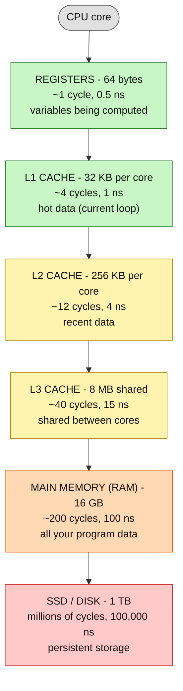
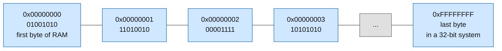
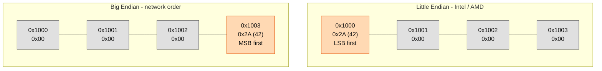

# 🔬 PART 0A: HOW COMPUTER MEMORY ACTUALLY WORKS (The Foundation)

> **Navigation**: [← 5W1H — Why This Chapter?](02_5w1h_why_this_chapter.md) | [Chapter overview](../01a_Memory_Foundations.md) | [JAVA MEMORY MODEL - Stack vs Heap →](04_java_memory_model_stack_vs_heap.md)
> Page 3 of 7 in **Memory Foundations — Where Data Structures Live**


BEFORE YOU LEARN DATA STRUCTURES - UNDERSTAND THE MACHINE

**Why does this matter?**

Every data structure exists in MEMORY. If you don't understand memory,
you'll never truly understand why:

- Arrays are fast for random access
- LinkedLists are slow for random access
- HashMaps are O(1) but use more memory
- Cache-friendly code runs 100x faster

Let's go DEEP into how computers actually work!

## THE MEMORY HIERARCHY - Why Some Operations Are Faster

### 💬 Study-Partner View — The Memory Hierarchy

**1. The bottom line:** Computers keep a small, fast memory close to the CPU and a large, slow one further away, and your program is fast when it stays in the small one.

**2. The textbook core:**

- Levels: registers → L1 → L2 → L3 → RAM → SSD/disk; each is larger and slower (≈1 ns for L1, ≈100 ns for RAM, ≈100 µs for SSD).
- Data moves in **cache lines** (64 bytes), not single bytes.
- **Hit** = found in cache; **miss** = fetch from the next level.
- Locality of reference (spatial and temporal) is what makes this work.

**3. The real-world analogy:** A **desk, a shelf, a library and a warehouse**: you can work quickly only with what is on the desk.

**4. Walkthrough:**

1. Loop over `int[1000]`: reading `a[0]` misses and loads 16 ints.
2. `a[1]`…`a[15]` are hits.
3. `a[16]` misses and loads the next line, and so on: about 63 misses for 1000 reads.
4. The same loop over scattered nodes would miss on almost every element.

> [!NOTE]
> **Quick check:** How many `int`s fit in one 64-byte cache line? *16.*




**How to read this diagram.** Going down the page, each level is bigger but slower. Green is effectively free, yellow is cheap, orange is expensive and red is catastrophic for a hot loop.

| Level | Typical size | Latency (cycles) | Latency (time) | Speed |
| ----- | ------------ | ---------------- | -------------- | ----- |
| Registers | 64 bytes | ~1 | 0.5 ns | Fastest |
| L1 cache | 32 KB per core | ~4 | 1 ns | Very fast |
| L2 cache | 256 KB per core | ~12 | 4 ns | Fast |
| L3 cache | 8 MB shared | ~40 | 15 ns | Moderate |
| RAM | 16 GB | ~200 | 100 ns | Slow |
| SSD / disk | 1 TB | millions | 100,000 ns | Very slow |

> [!IMPORTANT]
> **Key insight:** RAM is ~100× slower than L1 cache, and disk is ~1000× slower than RAM. This is why **cache-friendly** data structures matter so much.

🔬 **Section Challenge — THE MEMORY HIERARCHY - Why Some Operations Are Faster**

**Challenge 1 (Reasoning):** L1 cache is only 32KB but RAM is 16GB. When you iterate an `int[1000]` array sequentially, why does it feel almost as fast as if the entire array were in registers?

<details><summary>Answer</summary>

Spatial locality + hardware prefetching. When the CPU accesses `arr[0]`, it loads a 64-byte cache line containing `arr[0]` through `arr[15]` (16 ints) into L1. The next 15 accesses are cache hits (~1ns each instead of ~100ns). Modern CPUs also detect sequential access patterns and _prefetch_ the next cache line before you even ask for it. So for a sequential scan, only every 16th access is a cache miss — the rest are effectively free. This is why arrays with O(n) linear scan often outperform hash-based O(1) lookups for small n.

</details>

**Challenge 2 (Reasoning):** You have two programs: Program A iterates a `LinkedList<Integer>` of 1M nodes. Program B iterates an `int[]` of 1M elements. Both do the same O(n) work per element. Program B finishes 50-100x faster. Why?

<details><summary>Answer</summary>

Cache miss rate. `int[]` is contiguous in memory — one cache line loads 16 consecutive ints. LinkedList nodes are scattered across the heap (each node is a separate heap allocation at a random address). Every `node = node.next` pointer dereference is a cache miss (~100-200 CPU cycles penalty). Additionally, each LinkedList node carries ~48 bytes of overhead (object header, prev/next pointers, boxed Integer object) vs 4 bytes per element in `int[]`. The combination of cache misses + memory bloat makes LinkedList catastrophically slower for sequential iteration.

</details>

## HOW MEMORY IS ORGANIZED (Addresses & Bytes)

Memory is like a **huge array of bytes**, each with an **address**.



**How to read this diagram.** Each box is one byte (8 bits). Its address is the label on top. A 32-bit address space therefore covers 2³² bytes (4 GiB).

**Java data type sizes:**

| Type | Size | Bits | Range / meaning |
| ---- | ---- | ---- | --------------- |
| `byte` | 1 byte | 8 | −128 to 127 |
| `short` | 2 bytes | 16 | −32,768 to 32,767 |
| `int` | 4 bytes | 32 | −2.1 billion to 2.1 billion |
| `long` | 8 bytes | 64 | ±9.2 quintillion |
| `float` | 4 bytes | 32 | ~7 decimal digits precision |
| `double` | 8 bytes | 64 | ~15 decimal digits precision |
| `char` | 2 bytes | 16 | Unicode character (UTF-16 code unit) |
| `boolean` | 1 byte* | 8 | `true` or `false` |
| reference | 4 or 8 bytes | 32 / 64 | Points to an object in the heap |

\* The JVM may use 1 bit internally but allocates 1 byte for a standalone `boolean`.

### How an `int` is stored in memory

```java
int x = 42;
```

Binary of 42: `00000000 00000000 00000000 00101010`, that is bytes `0x00 0x00 0x00 0x2A` from the most significant byte (Byte 3) to the least significant byte (Byte 0).



**How to read this diagram.** The same four bytes are stored in opposite orders. In little endian the **least** significant byte (`0x2A`) sits at the lowest address; in big endian the **most** significant byte comes first. The highlighted box is where the non-zero byte lands.

| | Little endian | Big endian |
| --- | ------------- | ---------- |
| First byte stored | Least significant | Most significant |
| Used by | Your CPU (x86, most ARM) | Network protocols ("network byte order") |
| Address `0x1000` holds | `0x2A` | `0x00` |

> [!WARNING]
> **Why does this matter?** Network protocols use big endian while your CPU is likely little endian, so you must convert when sending multi-byte values over a network.

---

[← 5W1H — Why This Chapter?](02_5w1h_why_this_chapter.md) | [Chapter overview](../01a_Memory_Foundations.md) | [JAVA MEMORY MODEL - Stack vs Heap →](04_java_memory_model_stack_vs_heap.md)
