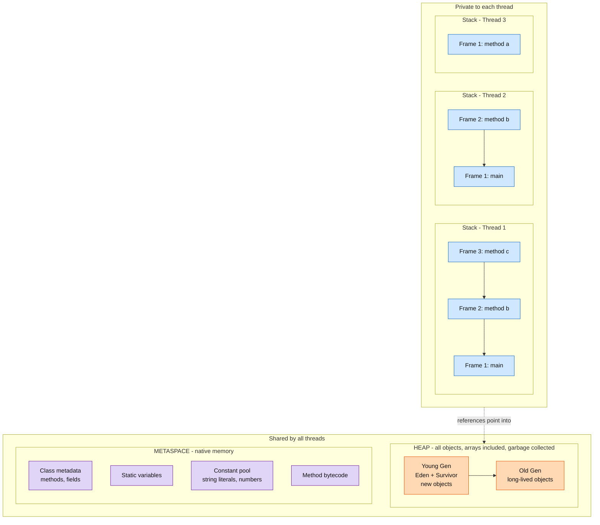
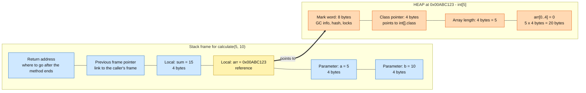
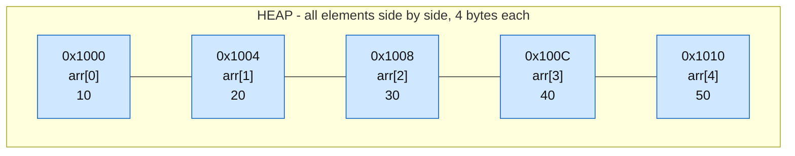
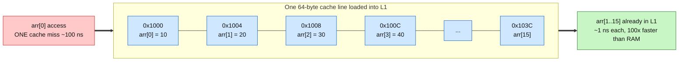
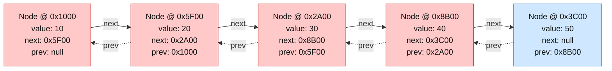

# JAVA MEMORY MODEL - Stack vs Heap

> **Navigation**: [← HOW COMPUTER MEMORY ACTUALLY WORKS (The…](03_how_computer_memory_actually_works_the.md) | [Chapter overview](../01a_Memory_Foundations.md) | [Production Failure Modes — Real Incidents… →](05_production_failure_modes_real_incidents_from.md)
> Page 4 of 7 in **Memory Foundations — Where Data Structures Live**


## 💬 Study-Partner View — Stack vs Heap

**1. The bottom line:** Local variables and method calls live on a fast, automatically cleaned stack; objects live on a larger heap that the garbage collector cleans.

**2. The textbook core:**

- **Stack:** one per thread; each call pushes a frame with locals, parameters and the return address; freed on return.
- **Heap:** shared by all threads; all objects and arrays; reclaimed by the garbage collector.
- A local variable of object type holds a **reference** (pointer) into the heap.
- `StackOverflowError` = too many frames; `OutOfMemoryError` = heap exhausted.

**3. The real-world analogy:** The **stack** is a pile of sticky notes on your desk (quick, thrown away when finished); the **heap** is a storage room where bigger items are kept and a janitor clears out whatever nobody uses.

**4. Walkthrough:**

1. `int[] arr = new int[5];` inside `calculate()`.
2. The reference `arr` (4 or 8 bytes) is a local variable in the stack frame.
3. The array object (header + length + 20 bytes) is allocated on the heap.
4. When `calculate()` returns, the frame is popped; the array becomes garbage once nothing references it.

> [!NOTE]
> **Quick check:** Where does `new Node()` live? *On the heap; the variable holding it is on the stack.*


## JVM memory layout

When the JVM runs your program, memory is divided into areas that are **shared by all threads** and areas that are **private to each thread**.



**How to read this diagram.** Orange is the heap (every object and array lives here, shared by all threads). Purple is Metaspace, which holds class metadata, static variables, the constant pool and bytecode (in modern JVMs it is native memory, *outside* the heap). Blue are the per-thread stacks: each thread has its **own** stack of frames, newest frame on top. The dotted arrow shows that stack variables only hold *references* into the heap.

| Area | Holds | Shared? | Managed by |
| ---- | ----- | ------- | ---------- |
| Heap | Objects, arrays | Yes | Garbage collector |
| Metaspace | Class metadata, statics, constant pool, bytecode | Yes | Class loader / GC of classes |
| Thread stack | Frames: locals, parameters, return address | No (one per thread) | Pushed/popped on call/return |

## Stack frame — inside view

```java
public int calculate(int a, int b) {
    int sum = a + b;               // local variable, lives on the stack
    int[] arr = new int[5];        // reference on the stack, array on the HEAP
    return sum;
}
```



**How to read this diagram.** Blue boxes are the frame's own data (the exact slot order differs between JVMs; what matters is that all of it lives on the stack). The yellow `arr` slot holds only an address; the thick arrow follows it to the real array on the heap (orange), which has its own header and length.

| Part of the `int[5]` object | Size |
| --------------------------- | ---- |
| Object header (mark word 8 B + class pointer 4 B) | 12 bytes |
| Array length | 4 bytes |
| Elements (5 × 4 bytes) | 20 bytes |
| **Total** | **36 bytes**, padded to **40 bytes** for 8-byte alignment |

🔬 **Section Challenge — JAVA MEMORY MODEL - Stack vs Heap**

**Challenge 1 (Reasoning):** `int[] arr = new int[5];` — the variable `arr` lives on the stack but the actual array lives on the heap. If you pass `arr` to a method `modify(int[] a)`, and inside that method you do `a[0] = 99;`, does the caller see the change? What if you do `a = new int[10];` instead?

<details><summary>Answer</summary>

`a[0] = 99` — YES, caller sees it. The reference `a` is a copy of `arr`, but both point to the SAME heap object. Modifying the object through either reference affects the shared data. `a = new int[10]` — NO, caller does NOT see it. This reassigns the local copy `a` to point to a new heap object. The caller's `arr` still points to the original array. Java is always pass-by-value — but for objects, the "value" being passed is the reference (memory address), not the object itself.

</details>

## WHY ARRAYS ARE FAST — Memory Layout Explained

```java
int[] arr = {10, 20, 30, 40, 50};   // 5 integers, contiguous on the heap
```



**How to read this diagram.** Every element sits right next to its neighbour; addresses grow by 4 bytes per `int`.

> [!IMPORTANT]
> **Key property: CONTIGUOUS.** No pointers, no chasing, which is the speed secret of arrays.

### O(1) Random Access — How It Works

The CPU computes any element's address in **one arithmetic operation**:

```java
address(arr[i]) = baseAddress + (i × elementSize)

// Example: accessing arr[3]
// baseAddress = 0x1000, elementSize = 4 bytes (int), i = 3
arr[3] = 0x1000 + (3 × 4) = 0x1000 + 12 = 0x100C
```

**🔥 3+ YOE God-Level Insight:** This is why `arr[i]` is the SAME cost as `arr[0]`.
The CPU's ALU does the multiply-add in a single cycle. There is NO pointer
chasing, NO heap traversal, NO cache misses on the index itself.

### Cache Friendliness — The Real Speed Multiplier



**How to read this diagram.** Touching `arr[0]` pulls the whole 64-byte line (16 ints) into L1 with a single slow miss (red). The next 15 reads are free hits (green).

| For a 1,000,000-element `int[]` | Count | Cost |
| ------------------------------- | ----- | ---- |
| Cache misses | ~62,500 (every 16th access) | ~100 ns each |
| Cache hits | ~937,500 | effectively free (~1 ns) |

> [!IMPORTANT]
> **Key insight:** this is why sequential iteration is ~50–100× faster than random access. The hardware *predicts* your pattern and prefetches future cache lines.

**This is why iterating an array is SO FAST:**

```java
for (int i = 0; i < arr.length; i++) {
    sum += arr[i];  // arr[0] = cache miss; arr[1..15] = free; arr[16] = miss...
}
```

> **The CPU is doing FREE WORK for you.** After the initial cache miss,
> the prefetcher streams the next cache line into L1 before you even ask.
> This is why `O(n)` array iteration often beats `O(1)` hashmap lookups
> for small-to-medium data — the hashmap scatters memory and defeats the cache.

## WHY LINKED LISTS ARE SLOW - Memory Layout Explained

```java
LinkedList<Integer> list;   // [10 → 20 → 30 → 40 → 50]
```

**Memory (scattered: nodes are all over the heap):**



**How to read this diagram.** Solid arrows are `next` pointers, dotted arrows are `prev` pointers. The addresses (`0x1000`, `0x5F00`, `0x2A00`, ...) are far apart, so every hop lands on a different cache line. Red nodes are the four visited by `get(3)`.

**To access `list.get(3)` (value 40):**

| Step | Action | Cost |
| ---- | ------ | ---- |
| 1 | Start at head `0x1000` (value 10) | Cache miss: load from RAM |
| 2 | Follow `next` to `0x5F00` (value 20) | Cache miss: different location |
| 3 | Follow `next` to `0x2A00` (value 30) | Cache miss: different location |
| 4 | Follow `next` to `0x8B00` (value 40) | Cache miss: found it |

4 memory accesses × 100 ns = **400 ns**, versus 1 access (1–100 ns) for an array.

**Memory overhead** (assuming 8-byte references, no compressed oops):

| Item | Array `int[5]` | `LinkedList<Integer>` (per node) |
| ---- | -------------- | -------------------------------- |
| Object header | 16 bytes (once) | 12 bytes |
| Integer object reference | n/a | 4 bytes |
| `next` pointer | n/a | 8 bytes |
| `prev` pointer | n/a | 8 bytes |
| `Integer` object | n/a (values stored inline) | 16 bytes (12 header + 4 value) |
| Elements | 5 × 4 = 20 bytes | included above |
| **Total** | **36 bytes** | **~48 bytes per node, 240 bytes for 5 nodes** |

> [!CAUTION]
> The `LinkedList` uses about **6.7× more memory** (240 vs 36 bytes) and is slower to traverse.

## CPU OPERATIONS - What Actually Happens

## Cpu Instruction Cycle - The Basics

Every operation in your code becomes CPU instructions:

```text
Java Code:    int sum = a + b;

Bytecode:     iload_1     // Load 'a' onto stack
              iload_2     // Load 'b' onto stack
              iadd        // Add top two values
              istore_3    // Store result in 'sum'

Machine Code: MOV eax, [a]  // Load a into register
(x86)         ADD eax, [b]  // Add b to register
              MOV [sum], eax // Store result
```

**CPU Clock Cycles For Common Operations**:

| Operation | Cycles | Notes |
| --------- | ------ | ----- |
| Integer ADD/SUB | 1 | Fastest operations |
| Integer MUL | 3 | Multiplication is costlier |
| Integer DIV | 20-80 | Division is VERY expensive! |
| Floating-point ADD | 3-5 | Separate FPU unit |
| Floating-point MUL | 4-5 | |
| Floating-point DIV | 10-40 | |
| Comparison (==, <, >) | 1 | Simple comparison |
| Branch (if/else) | 1-20 | Depends on prediction |
| Memory Read (L1 cache) | 4 | Cache hit |
| Memory Read (L2 cache) | 12 | |
| Memory Read (L3 cache) | 40 | |
| Memory Read (RAM) | 200 | Cache miss - EXPENSIVE! |
| Function Call | 15-30 | Stack frame setup |
| Virtual Method Call | 25-50 | Vtable lookup + call |

**Why This Matters For Dsa**:

- Division is 20-80x slower than addition!
  Use bit shifts: n / 2 → n >> 1
  Use bit masks: n % 8 → n & 7
- Memory access is 200x slower than arithmetic!
  Cache-friendly code beats clever algorithms
- Branch misprediction costs ~15 cycles!
  Predictable patterns are faster than random

## Variants & Trade-offs — Comparing Memory Layouts

Not all memory layouts are equal. The data structure you choose determines how the CPU cache behaves, how memory is allocated, and how your program scales. Use this table as a decision matrix.

### Memory Layout Comparison Table

| Property                     | Contiguous Array                                 | Linked List                                      | Tree (e.g., BST)                                | Hash Table                                         |
| ---------------------------- | ------------------------------------------------ | ------------------------------------------------ | ----------------------------------------------- | -------------------------------------------------- |
| **Memory Access Pattern**    | Sequential, cache-line friendly                  | Random jumps; one dereference per node           | Random but localized (tree traversal)           | Pseudo-random; depends on hash quality             |
| **Cache Behavior**           | Prefetch works perfectly; one miss → ~8 elements | Every `next` is a potential miss                 | Good for range queries; poor for single lookups | Cold start: many misses until table is "warm"      |
| **Allocation Strategy**      | Single `malloc` for entire block                 | Per-node allocation (fragmentation risk)         | Per-node allocation with rebalancing            | Pre-allocation or per-bucket allocation            |
| **Memory Overhead**          | ~0% (raw data + optional header)                 | ~100-200% (object headers + pointers)            | ~50-100% (pointers + balancing metadata)        | ~50-100% (load factor determines fill ratio)       |
| **Insertion/Deletion**       | O(n) for arbitrary position; O(1) at end         | O(1) at known position; O(n) to find             | O(log n) amortized; O(n) worst case             | O(1) amortized; O(n) on resize                     |
| **Random Access**            | O(1) via pointer arithmetic                      | O(n) — must traverse                             | O(log n)                                        | O(1) average                                       |
| **Memory Locality**          | Excellent (all elements adjacent)                | Poor (scattered across heap)                     | Moderate (nodes close to parent/children)       | Depends on insertion order and probing strategy    |
| **Iteration Performance**    | ~1 cache miss per 8 `int` elements (x86)         | ~1 cache miss per element + 1 per pointer        | ~1-2 cache misses per node                      | ~1 cache miss per bucket (or more on collisions)   |
| **Fragmentation Risk**       | Low — one contiguous block                       | High — many small allocations                    | Medium — dynamic growth                         | Medium — rehashing causes temporary spikes         |
| **Thread Safety Complexity** | Easy to lock; false sharing risk                 | Harder — pointer updates need fine-grained locks | Complex — rebalancing is non-trivial            | Medium — locking buckets or using lock-free chains |

### Selection Criteria — Which Layout to Choose?

Use this decision tree:

1. **Do you need O(1) random access and will you iterate sequentially?**
   - Yes → **Contiguous array** (`int[]`, `ArrayList`, `byte[]`)
2. **Do you need O(1) insertions/deletions at known positions with frequent structural changes?**
   - Yes → **Linked list** (but consider `ArrayDeque` for queue patterns)
3. **Do you need ordered traversal, range queries, or logarithmic search?**
   - Yes → **Balanced tree** (`TreeMap`, `BTree` for disk-backed systems)
4. **Do you need O(1) average lookup with arbitrary keys?**
   - Yes → **Hash table** (but choose `HashMap` vs. `ConcurrentHashMap` based on contention)

> **Performance Rule:** When in doubt, start with the array. It is the fastest memory layout for most practical workloads because cache-line streaming dominates real-world performance far more than algorithmic complexity suggests.

---

[← HOW COMPUTER MEMORY ACTUALLY WORKS (The…](03_how_computer_memory_actually_works_the.md) | [Chapter overview](../01a_Memory_Foundations.md) | [Production Failure Modes — Real Incidents… →](05_production_failure_modes_real_incidents_from.md)
