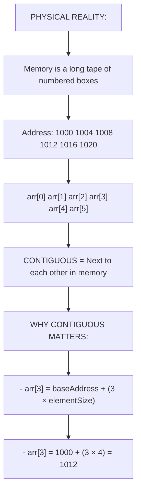

> **Navigation**: [< Previous Chapter](01a_Memory_Foundations.md) | [Back to Index](../00_MASTER_INDEX.md) | [Next Chapter >](01c_LinkedList.md)

---

# 📚 Part 0: Complete Understanding + Growth Mindset

> **🎯 Goal:** Understand what data structures are, why they exist, and develop the right mindset for mastering them.

---

## 📦 What Are Data Structures?

A **data structure** is a way of ORGANIZING and STORING data so that we can perform OPERATIONS efficiently.

> 💡 **Key Insight:** It's not just about *storing* data — it's about making certain *operations* fast!

**Analogy — Same Books, Different Organizations:**
- Library with books thrown randomly → Hard to find books
- Library with books sorted by topic → Easy to find by topic
- Library with books sorted by author → Easy to find by author

Same books, different organizations, different speeds for different tasks!

### Historical Evolution

| Year | Innovation | Motivation |
|------|-----------|------------|
| 1945 | First computers | Data just thrown in memory |
| 1950s | **Arrays** | Need for sequential data |
| 1956 | **Linked Lists** | Need for dynamic size |
| 1960s | **Stacks, Queues** | Need for order control |
| 1962 | **AVL Trees** | Need for balanced search |
| 1972 | **B-Trees** | Need for database indexing |
| 1984 | **Skip Lists** | Probabilistic alternative to trees |
| 1990s | **Hash structures** | O(1) lookup need |

---

## ❓ What Problem Do Data Structures Solve?

**Core Problem: Operations are too slow!**

Consider 1 million user accounts — the DS you choose determines performance:

| Operation | Unsorted List | Sorted Array | HashMap |
|-----------|---------------|--------------|---------|
| Find user by ID | 1 million ops | 20 ops | **1 op** |
| Add new user | **1 op** | 1 million ops | **1 op** |
| Delete user | 1 million ops | 1 million ops | **1 op** |
| List all users | 1 million ops | 1 million ops | 1 million ops |

> ⚠️ **Trade-Off:** Every DS is GOOD at some operations and BAD at others.
> There is NO perfect data structure — only the **perfect choice for your problem!**

---

## 📖 Why Learn Data Structures?

1. **Performance** — Same problem can be 1000x faster with the right DS
   - Finding a word in dictionary: Linear search checks 170,000 words. Binary search checks only **18**!

2. **Scalability** — Programs must handle growth
   - O(n²) works for 1,000 items but crashes with 1 million
   - Right DS keeps O(log n) even at scale

3. **Problem Modeling** — DS helps you THINK about problems
   - Hierarchy? → **Tree** · Relationships? → **Graph** · Fast lookup? → **HashMap** · Order matters? → **Stack/Queue**

4. **Foundation** — Advanced concepts BUILD on DS
   - Databases use B-Trees · Networks use Graphs · Compilers use Stacks · OS uses Queues

---

## ⭐ Growth Mindset: Choosing & Creating Data Structures

> ❌ **Don't:** "I need to memorize all data structures"
> ✅ **Do:** "I need to understand WHAT operations each DS optimizes for"

### The Selection Framework

1. List ALL operations you need
2. Mark which operations are **MOST FREQUENT**
3. Find DS that makes frequent operations **FAST**
4. Accept that rare operations might be slow

### Quick Selection Guide

| Need | Use |
|------|-----|
| Fast access by index | **Array** |
| Fast insert/delete anywhere | **LinkedList** |
| LIFO (Last In First Out) | **Stack** |
| FIFO (First In First Out) | **Queue** |
| Fast lookup by key | **HashMap** |
| Fast lookup + sorted order | **TreeMap** |
| Unique elements only | **Set** |
| Hierarchical relationships | **Tree** |
| Complex relationships | **Graph** |
| Priority-based access | **Heap / PriorityQueue** |

> 💡 **When no existing DS fits → Create your own by COMBINING!**
> - **LRU Cache** = HashMap + DoublyLinkedList
> - **MinStack** = Stack + Stack (for mins)
> - **Trie** = Tree with characters as edges
> - **Graph with fast lookup** = Adjacency List using HashMap

---


## 🧗 Common Difficulties in Learning DS

| Difficulty | Solution |
|-----------|----------|
| "Too many DS to learn!" | Master the **10 core DS** first: Array, List, Stack, Queue, HashMap, Set, Tree, Heap, Graph, Trie |
| "I know DS but don't know when to use it" | Focus on **OPERATIONS** each DS optimizes |
| "I understand concept but can't implement" | **Draw pictures first**, code follows naturally |
| "Array is O(1), HashMap is O(1) — what's the difference?" | Array: O(1) by **INDEX** · HashMap: O(1) by **KEY** |
| "Each DS feels completely different" | See how DS **COMBINE**: TreeMap = Tree + Map, HashSet = HashMap with only keys |

---


## 🎯 Expected Outcomes of Mastering DS

- ✅ **Instant Recognition** — See problem → Know which DS fits
- ✅ **Trade-Off Analysis** — Understand costs of each choice
- ✅ **Combination Skills** — Combine DS to solve complex problems
- ✅ **Implementation** — Code any DS from scratch
- ✅ **Debugging** — Recognize DS-related bugs quickly
- ✅ **Optimization** — Know when to switch DS for better performance
- ✅ **Creation** — Design custom DS when needed

> 🔄 **The Transformation:**
> FROM: "I'll try arrays for everything"
> TO: "I'll choose the **RIGHT DS** for each operation"


---


# ❓ Part 1: Why Data Structures Exist

## The Origin Story

**1950s:** Computers had **LIMITED memory** (just a few KB).
The problem was clear — *how do you organize data efficiently?*
The solution: **Data Structures were born!**

Every DS was created to solve a **SPECIFIC** problem:

| Data Structure | Created For |
|---------------|-------------|
| **Array** | Fast access by position |
| **LinkedList** | Fast insertion/deletion |
| **Stack** | Last-In-First-Out (LIFO) |
| **Queue** | First-In-First-Out (FIFO) |
| **Tree** | Hierarchical data |
| **Graph** | Relationships between entities |
| **HashMap** | O(1) lookup |

---


# 📊 Part 2: Arrays

### 5W1H: Deep Understanding of Arrays

```
╔══════════════════════════════════════════════════════════════════════╗
║  WHAT: An array is a CONTIGUOUS block of memory storing elements    ║
║        of the SAME TYPE at consecutive addresses.                    ║
║                                                                      ║
║  WHY:  Arrays exploit how CPU hardware works:                        ║
║        • O(1) access: address = base + (index × size)               ║
║        • Cache-friendly: contiguous data → fewer cache misses        ║
║        • Simplest data structure with the best raw performance       ║
║                                                                      ║
║  WHEN to use Arrays:                                                 ║
║        ✔ Random access by index is frequent                          ║
║        ✔ Size is known in advance (or rarely changes)                ║
║        ✔ Sequential iteration (cache locality = 10x faster)          ║
║        ✘ Frequent insertions/deletions at arbitrary positions        ║
║        ✘ Unknown or wildly varying size at runtime                    ║
║                                                                      ║
║  WHERE arrays appear in production:                                  ║
║        • Database pages are arrays of records (fixed-size pages)     ║
║        • Image pixels: 2D array of RGB values                        ║
║        • Network buffers: byte arrays holding packet data            ║
║        • GPU matrices: arrays for parallel computation               ║
║                                                                      ║
║  HOW (JVM internals):                                                ║
║  Java `int[] arr = new int[6]`:                                      ║
║  1. JVM allocates 24 bytes (6 × 4) PLUS 16 bytes object header      ║
║     (mark word + klass pointer + array length) = 40 bytes total     ║
║  2. All 24 bytes are CONTIGUOUS in heap memory                       ║
║  3. JVM stores the array length (arr.length is O(1))                 ║
║  4. Bounds checking: arr[i] verifies 0 ≤ i < length (throws AIOOBE) ║
╚══════════════════════════════════════════════════════════════════════╝
```

## 🧬 Nature & Behavior

### What is an Array?

```
PHYSICAL REALITY:
┌────────────────────────────────────────────────────┐
│ Memory is a long tape of numbered boxes            │
│                                                    │
│ Address: 1000  1004  1008  1012  1016  1020        │
│          ┌────┬────┬────┬────┬────┬────┐           │
│          │ 10 │ 20 │ 30 │ 40 │ 50 │ 60 │           │
│          └────┴────┴────┴────┴────┴────┘           │
│          arr[0] arr[1] arr[2] arr[3] arr[4] arr[5] │
│                                                    │
│ CONTIGUOUS = Next to each other in memory          │
└────────────────────────────────────────────────────┘

WHY CONTIGUOUS MATTERS:
- arr[3] = baseAddress + (3 × elementSize)
- arr[3] = 1000 + (3 × 4) = 1012
- This is O(1) random access!
```

**Flow:**
- PHYSICAL REALITY:
- ↓
- Memory is a long tape of numbered boxes
- ↓
- Address: 1000 1004 1008 1012 1016 1020
- ↓
- arr[0] arr[1] arr[2] arr[3] arr[4] arr[5]
- ↓
- CONTIGUOUS = Next to each other in memory
- ↓
- WHY CONTIGUOUS MATTERS:
- ↓
- - arr[3] = baseAddress + (3 × elementSize)



### Array Characteristics

| Property         | Value      | Why?                       |
| ---------------- | ---------- | -------------------------- |
| Access           | O(1)       | Direct address calculation |
| Search           | O(n)       | Must check each element    |
| Insert at end    | O(1)       | If space available         |
| Insert at middle | O(n)       | Must shift elements        |
| Delete           | O(n)       | Must shift elements        |
| Memory           | Contiguous | Fixed block needed         |

### 🧠 CPU Cache Locality — Why Arrays Are 10x Faster Than LinkedLists

```
THE HIDDEN PERFORMANCE SECRET:
═══════════════════════════════

Big-O says array access and linked list access are both O(n) for iteration.
But in practice, iterating an array is 10-100x FASTER. Why?

THE CPU MEMORY HIERARCHY:
┌─────────────┐ ← L1 Cache: 32KB, ~1 nanosecond (4 cycles)
├─────────────┤ ← L2 Cache: 256KB, ~4 nanoseconds (12 cycles)
├─────────────┤ ← L3 Cache: 8MB, ~12 nanoseconds (36 cycles)
├─────────────┤ ← RAM: 16GB, ~100 nanoseconds (300 cycles) 
├─────────────┤ ← SSD: 1TB, ~100,000 nanoseconds
└─────────────┘ ← HDD: 2TB, ~10,000,000 nanoseconds

When CPU reads arr[0], it doesn't just fetch 4 bytes.
It fetches a CACHE LINE of 64 bytes (on most CPUs).
That's 16 ints in one fetch!

ARRAY ITERATION:
  arr[0]: CACHE MISS → fetch 64 bytes → arr[0..15] now in cache
  arr[1]: CACHE HIT!  (already in cache)
  arr[2]: CACHE HIT!  (already in cache)
  ...
  arr[15]: CACHE HIT! (already in cache)
  arr[16]: CACHE MISS → fetch next 64 bytes
  
  Result: Only 1 cache miss per 16 elements = 6.25% miss rate

LINKED LIST ITERATION:
  node1 at address 0x1000: CACHE MISS → fetch 64 bytes
  node2 at address 0x5F00: CACHE MISS → different region!
  node3 at address 0x2A00: CACHE MISS → different region!
  node4 at address 0x8100: CACHE MISS → different region!
  
  Result: Nearly 100% cache miss rate (nodes scattered in memory)

REAL NUMBERS (summing 1 million integers):
  Array:      ~0.5 ms  (cache-friendly sequential access)
  LinkedList: ~5.0 ms  (cache-hostile random access)
  That's 10x slower with the SAME Big-O complexity!

ANALOGY: Reading a book vs reading a dictionary.
  Array = reading pages sequentially (fast — pages are next to each other)
  LinkedList = following "see also" references that jump to random pages
  (slow — you keep flipping through the entire dictionary)
```

### 🔴 Real-World Origin: Supermarket Inventory (1957)

**Problem at IBM (1957):**
- Supermarket needed to track **10,000 products**
- Each product has: ID, Name, Price, Quantity
- Need to look up any product by ID **quickly**

**Before Arrays:**
- Products stored in random memory locations
- Finding product #5000 required searching 5000 locations
- Time: **O(n)** for every lookup 😩

**Solution — Array:**
- Store products in **consecutive memory**
- Product ID = Array Index
- `products[5000]` = **instant access!**

> ✅ **Result:** Lookup went from O(n) → **O(1)**, inventory checks became **1000x faster**, and this approach made modern retail possible!

## 💻 Implementation WITHOUT Collections

```java
public class MyArray {
    private int[] data;
    private int size;
    private int capacity;

    // Constructor
    public MyArray(int capacity) {
        this.capacity = capacity;
        this.data = new int[capacity];
        this.size = 0;
    }

    // GET - O(1)
    public int get(int index) {
        if (index < 0 || index >= size) {
            throw new IndexOutOfBoundsException("Index: " + index);
        }
        return data[index];
    }

    // SET - O(1)
    public void set(int index, int value) {
        if (index < 0 || index >= size) {
            throw new IndexOutOfBoundsException("Index: " + index);
        }
        data[index] = value;
    }

    // ADD at end - O(1) amortized
    public void add(int value) {
        if (size == capacity) {
            resize();  // O(n) but rare
        }
        data[size++] = value;
    }

    // INSERT at index - O(n)
    public void insert(int index, int value) {
        if (size == capacity) {
            resize();
        }
        // Shift elements right
        for (int i = size; i > index; i--) {
            data[i] = data[i - 1];
        }
        data[index] = value;
        size++;
    }

    // DELETE at index - O(n)
    public int delete(int index) {
        int removed = data[index];
        // Shift elements left
        for (int i = index; i < size - 1; i++) {
            data[i] = data[i + 1];
        }
        size--;
        return removed;
    }

    // RESIZE - O(n)
    private void resize() {
        capacity *= 2;
        int[] newData = new int[capacity];
        for (int i = 0; i < size; i++) {
            newData[i] = data[i];
        }
        data = newData;
    }

    // SEARCH - O(n)
    public int search(int value) {
        for (int i = 0; i < size; i++) {
            if (data[i] == value) return i;
        }
        return -1;
    }

    // SIZE - O(1)
    public int size() {
        return size;
    }
}
```

---

## 🏋️ Part 3: Foundation Practice — Build Array Muscle Memory

> 💡 **Learning path:** Walk through these before touching patterns. They train loop instincts and set up every concept that follows.

### 📦 Group A — Traversal Basics

**Q1 — Declare & Print All Elements**
```java
int[] arr = {10, 20, 30, 40, 50};
for (int i = 0; i < arr.length; i++)
    System.out.print(arr[i] + " ");   // 10 20 30 40 50
```

**Q2 — Read From User**
```java
Scanner sc = new Scanner(System.in);
int n = sc.nextInt();
int[] arr = new int[n];
for (int i = 0; i < n; i++) arr[i] = sc.nextInt();
```

**Q3 — Print All EVEN Numbers** — O(n) *(already optimal — must check each element)*
```java
for (int x : arr) if (x % 2 == 0) System.out.print(x + " ");
```
> ❓ Why can't we do better than O(n)? Because we must inspect every element at least once.

**Q4 — Sum of Odd Numbers**
```java
int sum = 0;
for (int x : arr) if (x % 2 != 0) sum += x;
```

**Q5 — Average of All Elements**
```java
int sum = 0;
for (int x : arr) sum += x;
double avg = (double) sum / arr.length;
```

**Q6 — Average of Prime Numbers in Array**
```java
boolean isPrime(int n) {
    if (n < 2) return false;
    for (int i = 2; i * i <= n; i++) if (n % i == 0) return false;
    return true;
}
// In main:
int sum = 0, count = 0;
for (int x : arr) if (isPrime(x)) { sum += x; count++; }
double primeAvg = count > 0 ? (double)sum/count : 0;
```
> 💡 `i * i <= n` is the √n optimization — O(√n) instead of O(n) per check.

**Q7 — Print in Reverse Order** *(just print, don't rearrange)*
```java
for (int i = arr.length - 1; i >= 0; i--)
    System.out.print(arr[i] + " ");
// {11,34,67} → 67 34 11
```

**Q8 — Sum of First + Last Element**
```java
int result = arr[0] + arr[arr.length - 1];
```

**Q9 — Swap Every Two Adjacent Elements**
```
Input:  {8,7,5,1,5,2,6}
Output: {7,8,1,5,2,5,6}   ← pairs (0,1),(2,3),(4,5) swapped; last stays if odd length
```
```java
for (int i = 0; i + 1 < arr.length; i += 2) {
    int tmp = arr[i]; arr[i] = arr[i+1]; arr[i+1] = tmp;
}
```

**Q10 — Print Alternative Elements**
```java
for (int i = 0; i < arr.length; i += 2)
    System.out.print(arr[i] + " ");
```

**Q11 — Sum Up to Given Index K** *(prefix sum preview!)*
```java
int k = 3, sum = 0;
for (int i = 0; i <= k; i++) sum += arr[i];
```
> 💡 If you need this for many K values, computing each time = O(n) per query.
> **Prefix Sum** (Part 13) makes it O(1) per query after O(n) build.

---

### 📦 Group B — Min / Max First Look

**Q12 — Find Biggest Element**
```java
int max = arr[0];
for (int x : arr) if (x > max) max = x;
// O(n) — optimal (must look at every element at least once)
```

**Q13 — Find Smallest Element**
```java
int min = arr[0];
for (int x : arr) if (x < min) min = x;
```

**Q14 — Find Second Highest Element**
```
Brute: Sort descending → arr[1]   O(n log n)
Better: Two-variable single pass   O(n)
```
```java
int first = Integer.MIN_VALUE, second = Integer.MIN_VALUE;
for (int x : arr) {
    if (x > first)       { second = first; first = x; }
    else if (x > second) { second = x; }
}
```

**Q15 — Count Numbers Below Key Value**
```java
int key = 10, count = 0;
for (int x : arr) if (x < key) count++;
```

---

### 📦 Group C — Pairs & Two Arrays

**Q16 — All Pairs Summing to Target K** *(Two Sum brute force)*
```
Input: {4,6,18,10,14,2}, target=20 → Output: {6,14}, {18,2}
```
```java
// Brute: O(n²)
for (int i = 0; i < n; i++)
    for (int j = i+1; j < n; j++)
        if (arr[i] + arr[j] == k)
            System.out.println("{" + arr[i] + "," + arr[j] + "}");
```
> 🧱 **You hit the wall** — for n=10⁶ this is 10¹² operations.
> **HashMap reduces this to O(n)** — you'll apply that after learning HashMap (Part 10).

**Q17 — Sum of Same Position Values in Two Arrays**
```java
int[] a = {1,2,3}, b = {10,20,30};
for (int i = 0; i < a.length; i++)
    System.out.print((a[i] + b[i]) + " ");  // 11 22 33
```

**Q18 — Merge Two Arrays**
```java
int[] merged = new int[a.length + b.length];
for (int i = 0; i < a.length; i++) merged[i] = a[i];
for (int i = 0; i < b.length; i++) merged[a.length + i] = b[i];
```

---

### 🎯 Practice Problems — Foundation Level

| Problem | Platform | Difficulty | Concept |
|---------|----------|------------|---------|
| LC 1929 — Concatenation of Array | LeetCode | ⭐ Easy | Array building |
| LC 2011 — Final Value After Operations | LeetCode | ⭐ Easy | Simple traversal |
| LC 1512 — Number of Good Pairs | LeetCode | ⭐ Easy | Nested loops |
| CF 4A — Watermelon | Codeforces | Div2-A | Simple math |
| CF 158A — Next Round | Codeforces | Div2-A | Linear scan |

> 🌟 **Goal:** Solve all 5 before moving to Sub Arrays. These cement loop instincts.

---

## 🎯 LeetCode Problems → Real-World Connection

### Problem: Two Sum

> 🏦 **Real-World Origin:** Financial Trading System (1990s)

**Problem at Goldman Sachs:**
- Traders needed to find **pairs of stocks** where Stock A + Stock B = Target budget
- Thousands of stocks, **milliseconds** to decide

**Before Optimization:**
```
for each stock A:
    for each stock B:
        if A + B == target: found!
```
Time: **O(n²)** — too slow for real-time trading!

**Solution — The Thinking Process:**
1. "We're checking the same pairs multiple times"
2. "What if we **remember** what we've seen?"
3. "**HashMap!** Store value → index"
4. "For each stock, check if the complement exists"

> ✅ **After:** O(n) time complexity → real-time trading possible. This **HashMap complement** pattern is now used in ALL trading systems.

---

## 🔲 Part 4: Sub Arrays — From Brute Force to Mastery

> 🎯 **This is where the most important array algorithms live. You'll hit walls that force you to learn Sliding Window, Two Pointers, and Prefix Sum.**

### 📖 Theory — What is a Sub Array?

```
Input: {1, 2, 3}
All sub-arrays:
  Length 1: {1}    {2}    {3}
  Length 2: {1,2}  {2,3}
  Length 3: {1,2,3}
  Total = n*(n+1)/2 = 3*4/2 = 6

KEY PROPERTIES:
  ✅ Contiguous  ← elements must be adjacent in original
  ✅ Order preserved
  ✅ Non-empty

SUBARRAY vs SUBSEQUENCE:
  {1,3} from {1,2,3} → ❌ NOT a sub-array  (2 is skipped)
  {1,3} from {1,2,3} → ✅ Valid subsequence (order kept, gaps allowed)
```

> ❓ **Quick Check:** How many sub-arrays in `{1,2,3,4,5}`?
> → 5×6/2 = **15**

---

### 🔵 Level 1: Enumerate All Sub Arrays

```java
// Time: O(n²) enumerate | O(n³) if printing each element
public void printAllSubArrays(int[] arr) {
    int n = arr.length;
    for (int start = 0; start < n; start++) {
        for (int end = start; end < n; end++) {
            for (int k = start; k <= end; k++)
                System.out.print(arr[k] + " ");
            System.out.println();
        }
    }
}
// Pattern to memorize: start→n, end→start..n → every window [start,end]
```

---

### 🧱 Level 2: You Hit the Wall — Max Sum Subarray

**Brute O(n³):** — TLE for n > 5,000
```java
int maxSum = arr[0];
for (int i = 0; i < n; i++)
    for (int j = i; j < n; j++) {
        int sum = 0;
        for (int k = i; k <= j; k++) sum += arr[k];  // ← 3rd loop = the bottleneck
        maxSum = Math.max(maxSum, sum);
    }
```

**Better O(n²):** Remove 3rd loop by accumulating
```java
int maxSum = arr[0];
for (int i = 0; i < n; i++) {
    int sum = 0;
    for (int j = i; j < n; j++) {
        sum += arr[j];          // extend instead of recompute
        maxSum = Math.max(maxSum, sum);
    }
}
// Still O(n²) — TLE for n > 10⁵. Need something smarter.
```

---

### 🚀 GO LEARN — Techniques You Need

> **STOP HERE — Learn these patterns, then return to "✅ Apply" below:**
>

| Technique | When You Need It | Study File |
|-----------|-----------------|------------|
| **Sliding Window** | Variable/fixed window on array | 📖 [01_Sliding_Window.md](../04_Patterns_Templates/01_Sliding_Window.md) |
| **Two Pointers** | Sorted array, pairs/triplets | 📖 [07_Two_Pointers_Complete.md](../04_Patterns_Templates/07_Two_Pointers_Complete.md) |
| **Prefix Sum** | Sum queries, count subarrays with sum K | 📖 [04_Pattern_Recognition.md](../04_Patterns_Templates/04_Pattern_Recognition.md) |

>
> ⬅️ **RETURN CHECKPOINT** — Come back here and apply each below.

---

### ✅ Apply 1: Maximum Subarray Sum — Kadane's Algorithm O(n)

```
KEY INSIGHT: At every index ask ONE question:
"Extend previous subarray  OR  start fresh from here?"
  currentMax = max(arr[i],  currentMax + arr[i])
```

```java
public int maxSubarraySum(int[] arr) {
    int maxSum = arr[0], current = arr[0];
    for (int i = 1; i < arr.length; i++) {
        current = Math.max(arr[i], current + arr[i]);    // extend or restart
        maxSum  = Math.max(maxSum, current);
    }
    return maxSum;
}
// Time: O(n) | Space: O(1)
```

**Dry Run — `[-2,1,-3,4,-1,2,1,-5,4]`:**
```
i  arr[i]  current                   maxSum
0   -2     -2                         -2
1    1     max(1,  -2+1) = 1           1
2   -3     max(-3,  1-3) = -2          1
3    4     max(4,  -2+4) = 4           4
4   -1     max(-1,  4-1) = 3           4
5    2     max(2,   3+2) = 5           5
6    1     max(1,   5+1) = 6           6  ← ANSWER
7   -5     max(-5,  6-5) = 1           6
8    4     max(4,   1+4) = 5           6
Answer: 6  (subarray [4,-1,2,1])
```

> 📖 **LeetCode 53** — Maximum Subarray

---

### ✅ Apply 2: Count Subarrays with Sum = K

**Brute O(n²):**
```java
int count = 0;
for (int i = 0; i < n; i++) {
    int sum = 0;
    for (int j = i; j < n; j++) {
        sum += arr[j];
        if (sum == k) count++;
    }
}
```

**Optimal O(n) — Prefix Sum + HashMap:**
```
INSIGHT: if prefixSum[j] - prefixSum[i] == k
         then subarray arr[i+1..j] has sum k
         Rearranged: prefixSum[i] = currentSum - k
         → For each position j, check if (currentSum - k) seen before in HashMap
```
```java
public int subarraySum(int[] arr, int k) {
    Map<Integer,Integer> freq = new HashMap<>();
    freq.put(0, 1);          // empty prefix has sum 0
    int count = 0, sum = 0;
    for (int x : arr) {
        sum += x;
        count += freq.getOrDefault(sum - k, 0);
        freq.merge(sum, 1, Integer::sum);
    }
    return count;
}
// Time: O(n) | Space: O(n)
```
> 🔗 **New to HashMap?** → 📖 [Go learn HashTable first](01e_HashTable.md) then return here.

> 📖 **LeetCode 560** — Subarray Sum Equals K

---

### ✅ Apply 3: Smallest Subarray with Sum ≥ K — Sliding Window O(n)

```java
public int minSubarrayLen(int k, int[] arr) {
    int left = 0, sum = 0, minLen = Integer.MAX_VALUE;
    for (int right = 0; right < arr.length; right++) {
        sum += arr[right];                                   // expand right
        while (sum >= k) {                                   // shrink left
            minLen = Math.min(minLen, right - left + 1);
            sum -= arr[left++];
        }
    }
    return minLen == Integer.MAX_VALUE ? 0 : minLen;
}
// Time: O(n) — each element enters/exits window once
```

> 📖 **LeetCode 209** — Minimum Size Subarray Sum

---

### ✅ Apply 4: Maximum Product Subarray O(n)

```
GOTCHA: Negative × Negative = Positive!
Track BOTH max and min at each step.
```
```java
public int maxProduct(int[] arr) {
    int maxProd = arr[0], curMax = arr[0], curMin = arr[0];
    for (int i = 1; i < arr.length; i++) {
        if (arr[i] < 0) { int t = curMax; curMax = curMin; curMin = t; }
        curMax  = Math.max(arr[i], curMax * arr[i]);
        curMin  = Math.min(arr[i], curMin * arr[i]);
        maxProd = Math.max(maxProd, curMax);
    }
    return maxProd;
}
```

> 📖 **LeetCode 152** — Maximum Product Subarray

---

### 🎯 Problem Set — Sub Arrays

| # | Problem | Platform | Difficulty | Key Technique |
|---|---------|----------|------------|---------------|
| 1 | LC 53 — Maximum Subarray | LeetCode | ⭐⭐ Med | Kadane's |
| 2 | LC 560 — Subarray Sum Equals K | LeetCode | ⭐⭐ Med | Prefix Sum + HashMap |
| 3 | LC 209 — Min Size Subarray Sum | LeetCode | ⭐⭐ Med | Sliding Window |
| 4 | LC 152 — Max Product Subarray | LeetCode | ⭐⭐ Med | Track max+min |
| 5 | LC 1004 — Max Consecutive Ones III | LeetCode | ⭐⭐ Med | Sliding Window |
| 6 | LC 713 — Subarray Product < K | LeetCode | ⭐⭐ Med | Sliding Window |
| 7 | LC 76 — Minimum Window Substring | LeetCode | ⭐⭐⭐ Hard | Sliding Window |

### 🧠 Pattern Fingerprint — Sub Arrays

```
SEE THESE WORDS → USE THIS:
┌─────────────────────────────────────────────────────────┐
│ "contiguous" + "max/min sum"       → Kadane's O(n)     │
│ "subarray sum equals K"            → Prefix Sum + Map   │
│ "smallest/min window" + "sum ≥ K" → Sliding Window     │
│ "fixed window size K"              → Fixed S.Window     │
│ "all subarrays"                    → 2 nested loops     │
│ "product" instead of sum           → Track max + min    │
└─────────────────────────────────────────────────────────┘
```

### 📅 Revisit Tracker
- **Day 3:** Redo LC 53 + LC 209 from memory (no hints)
- **Day 7:** Redo LC 560 (Prefix Sum + HashMap) + LC 713

---

## 🌿 Part 5: Sub Sequences — Order Without Contiguity

### 📖 Theory — What is a Sub Sequence?

```
Input: {1, 2, 3}
All subsequences (2ⁿ - 1 = 7):
  {1} {2} {3} {1,2} {1,3} {2,3} {1,2,3}

KEY: Order preserved, gaps ALLOWED.

COMPARISON:
  Subarray:    {2,3,4}  from {1,2,3,4,5}  ← contiguous slice
  Subsequence: {1,3,5}  from {1,2,3,4,5}  ← pick any, keep order
```

> ❓ **Quick Check:** How many subsequences in `{1,2,3,4}`?
> → 2⁴ - 1 = **15**

---

### 🔵 Level 1: The Include/Exclude Paradigm

```
For each element you have exactly 2 choices:
  ① INCLUDE it in current subsequence
  ② EXCLUDE it

Binary decision tree → 2ⁿ leaves

        {1,2,3}
           []
          /    \
      Incl 1   Excl 1
       [1]       []
      /   \     /   \
  [1,2] [1]  [2]   []
  ...
```

---

### 🚀 GO LEARN — Recursion (You Need This First)

> **STOP** — Subsequence generation is built on recursion.
>
> 📖 [03b_Recursion_Fundamentals.md](../03_Algorithms/03b_Recursion_Fundamentals.md)
> 📖 [03c_Recursion_Advanced.md — Subsets section](../03_Algorithms/03c_Recursion_Advanced.md)
>
> ⬅️ **RETURN CHECKPOINT** — Come back and apply below.

---

### ✅ Apply 1: Print All Subsequences — Recursion O(2ⁿ)

```java
public void subsequences(int[] arr, int index, List<Integer> current) {
    if (index == arr.length) {
        if (!current.isEmpty()) System.out.println(current);
        return;
    }
    current.add(arr[index]);           // INCLUDE
    subsequences(arr, index + 1, current);
    current.remove(current.size() - 1); // EXCLUDE (backtrack)
    subsequences(arr, index + 1, current);
}
// Call: subsequences(arr, 0, new ArrayList<>())
// Time: O(2ⁿ) — unavoidable (2ⁿ subsequences exist)
```

---

### ✅ Apply 2: Count Subsequences with Sum = K

```java
public int countSubseqSum(int[] arr, int index, int target) {
    if (target == 0) return 1;                        // found valid subsequence
    if (index == arr.length || target < 0) return 0;
    return countSubseqSum(arr, index + 1, target - arr[index])   // include
         + countSubseqSum(arr, index + 1, target);               // exclude
}
```

---

### ✅ Apply 3: Longest Increasing Subsequence (LIS)

```
Example: {10, 9, 2, 5, 3, 7, 101, 18}
LIS:     {2, 3, 7, 101}   length = 4
```

**Layer 1 — DP O(n²):**
```java
public int lisDP(int[] arr) {
    int n = arr.length;
    int[] dp = new int[n];
    Arrays.fill(dp, 1);          // every element alone is LIS of length 1
    int max = 1;
    for (int i = 1; i < n; i++)
        for (int j = 0; j < i; j++)
            if (arr[j] < arr[i]) {
                dp[i] = Math.max(dp[i], dp[j] + 1);
                max   = Math.max(max, dp[i]);
            }
    return max;
}
```

**Layer 2 — Binary Search O(n log n):**
```java
public int lisOptimal(int[] arr) {
    List<Integer> tails = new ArrayList<>();
    for (int x : arr) {
        int pos = Collections.binarySearch(tails, x);
        if (pos < 0) pos = -(pos + 1);
        if (pos == tails.size()) tails.add(x);
        else tails.set(pos, x);
    }
    return tails.size();
}
// Uses Binary Search: 📖 06_Binary_Search_Patterns.md
```

> ❓ **Think:** Why does replacing with a smaller value work? Smaller tail = more room for future elements to extend the sequence.

---

### ✅ Apply 4: Longest Common Subsequence (LCS)

```java
public int lcs(String s1, String s2) {
    int m = s1.length(), n = s2.length();
    int[][] dp = new int[m+1][n+1];
    for (int i = 1; i <= m; i++)
        for (int j = 1; j <= n; j++)
            dp[i][j] = s1.charAt(i-1) == s2.charAt(j-1)
                ? dp[i-1][j-1] + 1
                : Math.max(dp[i-1][j], dp[i][j-1]);
    return dp[m][n];
}
// Time: O(m*n) | Space: O(m*n)
// DP foundation: 📖 03_Algorithms/04b_DP_Fundamentals.md
```

---

### 🎯 Problem Set — Sub Sequences

| # | Problem | Platform | Difficulty | Technique |
|---|---------|----------|------------|-----------|
| 1 | LC 78 — Subsets | LeetCode | ⭐⭐ Med | Recursion |
| 2 | LC 300 — LIS | LeetCode | ⭐⭐ Med | DP → BinSearch |
| 3 | LC 1143 — LCS | LeetCode | ⭐⭐ Med | 2D DP |
| 4 | LC 416 — Partition Equal Subset Sum | LeetCode | ⭐⭐ Med | Subset-sum DP |
| 5 | LC 1035 — Uncrossed Lines | LeetCode | ⭐⭐ Med | LCS in disguise |

### 🧠 Pattern Fingerprint — Sub Sequences

```
SEE THESE WORDS → USE THIS:
┌──────────────────────────────────────────────────────────┐
│ "all subsequences / subsets"          → Recursion 2ⁿ   │
│ "longest increasing subsequence"      → DP + BinSearch  │
│ "longest common subsequence"          → 2D DP            │
│ "not necessarily contiguous"          → SUBSEQUENCE!     │
│ "count subsequences with sum"         → Recursion / DP  │
└──────────────────────────────────────────────────────────┘
```

### 📅 Revisit Tracker
- **Day 3:** Redo LC 78 (Subsets recursion) + LC 300 (LIS DP)
- **Day 7:** Redo LC 300 using binary search approach from memory

---

## 🔎 Part 6: Searching in Arrays

### Linear Search — O(n) | No sorted requirement

```java
public int linearSearch(int[] arr, int target) {
    for (int i = 0; i < arr.length; i++)
        if (arr[i] == target) return i;
    return -1;
}
// Use when: unsorted, or searching only once
```

### Binary Search — O(log n) | Array MUST be sorted

```java
public int binarySearch(int[] arr, int target) {
    int left = 0, right = arr.length - 1;
    while (left <= right) {
        int mid = left + (right - left) / 2;    // avoids int overflow!
        if (arr[mid] == target) return mid;
        else if (arr[mid] < target) left = mid + 1;
        else right = mid - 1;
    }
    return -1;
}
// For n=1,000,000: Linear = 1M checks. Binary = 20 checks!
```

> 📖 **GO DEEPER** — Binary Search has many variants (lower bound, answer space):
> 📖 [06_Binary_Search_Patterns.md](../04_Patterns_Templates/06_Binary_Search_Patterns.md)
> ⬅️ Return here after studying for: search in rotated array, first/last occurrence.

| | Linear Search | Binary Search |
|---|---|---|
| Requires sorted? | ❌ No | ✅ Yes |
| Time | O(n) | O(log n) |
| Use when | Unsorted / search once | Sorted / search many times |

### 🎯 Problems
| Problem | Pattern |
|---------|---------|
| LC 704 — Binary Search | Classic |
| LC 35 — Search Insert Position | Lower bound |
| LC 33 — Search in Rotated Array | Modified binary search |
| LC 34 — First and Last Position | Two binary searches |

---


## 📈 Part 7: Sorting Algorithms — All 5

> 🔗 **Deep dive (Quick+Merge internals, TimSort, Dutch Flag):**
> 📖 [02a_Sorting_Fundamentals.md](../03_Algorithms/02a_Sorting_Fundamentals.md)

### 1. Bubble Sort — O(n²) avg, O(n) best with flag

```java
public void bubbleSort(int[] arr) {
    int n = arr.length;
    for (int i = 0; i < n - 1; i++) {
        boolean swapped = false;
        for (int j = 0; j < n - i - 1; j++)
            if (arr[j] > arr[j+1]) {
                int tmp = arr[j]; arr[j] = arr[j+1]; arr[j+1] = tmp;
                swapped = true;
            }
        if (!swapped) break;    // already sorted → O(n) early exit
    }
}
```

### 2. Selection Sort — O(n²) always | Min swaps

```java
public void selectionSort(int[] arr) {
    for (int i = 0; i < arr.length - 1; i++) {
        int minIdx = i;
        for (int j = i+1; j < arr.length; j++)
            if (arr[j] < arr[minIdx]) minIdx = j;
        int tmp = arr[minIdx]; arr[minIdx] = arr[i]; arr[i] = tmp;
    }
}
// Never more than n-1 swaps — good when writes are expensive
```

### 3. Insertion Sort — O(n) best (nearly sorted), O(n²) worst

```java
public void insertionSort(int[] arr) {
    for (int i = 1; i < arr.length; i++) {
        int key = arr[i], j = i - 1;
        while (j >= 0 && arr[j] > key) { arr[j+1] = arr[j]; j--; }
        arr[j+1] = key;
    }
}
// BEST sort for small n or nearly-sorted input
```

### 4. Merge Sort — O(n log n) guaranteed, Stable, O(n) space

```java
public void mergeSort(int[] arr, int l, int r) {
    if (l >= r) return;
    int mid = l + (r - l) / 2;
    mergeSort(arr, l, mid);
    mergeSort(arr, mid+1, r);
    merge(arr, l, mid, r);
}
private void merge(int[] arr, int l, int mid, int r) {
    int[] tmp = Arrays.copyOfRange(arr, l, r + 1);
    int i = 0, j = mid - l + 1, k = l;
    while (i <= mid-l && j <= r-l)
        arr[k++] = tmp[i] <= tmp[j] ? tmp[i++] : tmp[j++];
    while (i <= mid-l) arr[k++] = tmp[i++];
    while (j <= r-l)   arr[k++] = tmp[j++];
}
```

### 5. Quick Sort — O(n log n) avg, O(n²) worst, In-place

```java
public void quickSort(int[] arr, int low, int high) {
    if (low >= high) return;
    int p = partition(arr, low, high);
    quickSort(arr, low, p - 1);
    quickSort(arr, p + 1, high);
}
private int partition(int[] arr, int low, int high) {
    int pivot = arr[high], i = low - 1;
    for (int j = low; j < high; j++)
        if (arr[j] <= pivot) { i++; int t=arr[i]; arr[i]=arr[j]; arr[j]=t; }
    int t = arr[i+1]; arr[i+1] = arr[high]; arr[high] = t;
    return i + 1;
}
```

### Comparison Table

| Sort | Best | Avg | Worst | Space | Stable | Best For |
|------|------|-----|-------|-------|--------|----------|
| Bubble | O(n) | O(n²) | O(n²) | O(1) | ✅ | Teaching |
| Selection | O(n²) | O(n²) | O(n²) | O(1) | ❌ | Min writes |
| Insertion | **O(n)** | O(n²) | O(n²) | O(1) | ✅ | Small/nearly-sorted |
| Merge | O(n log n) | O(n log n) | O(n log n) | O(n) | ✅ | Need stable guaranteed |
| Quick | O(n log n) | O(n log n) | O(n²) | O(log n) | ❌ | General in-place |

### 🎯 Problems
| Problem | Sort Technique |
|---------|----------------|
| LC 912 — Sort an Array | Implement merge/quick sort |
| LC 75 — Sort Colors | Dutch National Flag |
| LC 56 — Merge Intervals | Sort by start, merge |
| LC 1636 — Sort by Frequency | Custom comparator |

---


> 🔬 **Section Challenge — 📈 Part 7: Sorting Algorithms — All 5**
>
> **Challenge 1 (Reasoning):** QuickSort average O(N log N) but worst case O(N²). When exactly does the worst case happen and how do you prevent it?
> <details><summary>Answer</summary>
>
> Worst case: pivot always ends up at position 0 or N-1 (completely unbalanced partition). This happens when: (1) always picking first/last element as pivot on already-sorted or reverse-sorted data. (2) Pivot happens to be the minimum or maximum. Prevention: random pivot (randomized quicksort — expected O(N log N) even on adversarial input), or median-of-three (pick median of first/middle/last element as pivot). Java's dual-pivot quicksort uses careful pivot selection to avoid this.
> </details>
>

## 📊 Part 8: Frequency & Duplicates

### 🔵 Level 1: Brute — Nested Loops O(n²)

```java
// Count how many times each element appears — O(n²)
for (int i = 0; i < n; i++) {
    int freq = 0;
    for (int j = 0; j < n; j++)
        if (arr[j] == arr[i]) freq++;
    System.out.println(arr[i] + " appears " + freq + " times");
}
// Problem: counts same element multiple times, and O(n²) is too slow for large n
```

### 🧱 Hit the Wall — Need O(n) Lookup by Value

Finding most repeated, least repeated, duplicates: all O(n²) with nested loops.

---

### 🚀 GO LEARN — HashMap

> **STOP** — The O(n) solution for ALL frequency problems uses HashMap.
>
> 📖 [01e_HashTable.md](01e_HashTable.md)
> Focus on: `put`, `get`, `getOrDefault`, `containsKey`, `merge`, `entrySet`
>
> ⬅️ **RETURN CHECKPOINT** — Apply HashMap below.

---

### ✅ Apply: Frequency using HashMap O(n)

```java
// Build frequency map — O(n)
Map<Integer,Integer> freq = new HashMap<>();
for (int x : arr) freq.merge(x, 1, Integer::sum);   // freq[x]++

// Most repeated element
int maxFreq = 0, mostRepeated = -1;
for (var e : freq.entrySet())
    if (e.getValue() > maxFreq) { maxFreq = e.getValue(); mostRepeated = e.getKey(); }

// Count unique elements
int uniques = freq.size();

// Count elements appearing more than once
long dups = freq.values().stream().filter(v -> v > 1).count();
```

### ✅ Loop Patterns for Frequency

```java
// Include right loop (expand from left — cumulative)
for (int right = 0; right < n; right++) { /* process arr[right] */ }

// Include both (shrink/grow window)
for (int left = 0, right = 0; right < n; right++) {
    // add arr[right] to window
    while (/* condition violated */) { /* remove arr[left] */ left++; }
}
```

### ✅ Common Elements in Two Arrays — HashSet O(n+m)

```java
Set<Integer> setA = new HashSet<>();
for (int x : a) setA.add(x);
for (int x : b) if (setA.contains(x)) System.out.print(x + " ");
// vs brute: O(n*m) nested loops
```

### ✅ LCM / GCD of Array Elements

```java
int gcd(int a, int b) { return b == 0 ? a : gcd(b, a % b); }
int lcm(int a, int b) { return a / gcd(a,b) * b; }   // a/gcd first avoids overflow

// GCD of entire array
int arrGcd = arr[0];
for (int i = 1; i < n; i++) arrGcd = gcd(arrGcd, arr[i]);

// LCM of entire array
long arrLcm = arr[0];
for (int i = 1; i < n; i++) arrLcm = lcm((int)arrLcm, arr[i]);

// LCM of only odd numbers
long oddLcm = 1;
for (int x : arr) if (x % 2 != 0) oddLcm = lcm((int)oddLcm, x);
```

### 🎯 Problems
| Problem | Pattern |
|---------|---------|
| LC 1 — Two Sum | HashMap complement lookup |
| LC 242 — Valid Anagram | Frequency count |
| LC 347 — Top K Frequent Elements | Freq + Heap |
| LC 128 — Longest Consecutive Sequence | HashSet O(n) |
| CF 4C — Registration System | HashMap counting |

### 🧠 Pattern Fingerprint — Frequency

```
SEE THESE WORDS → USE THIS:
┌──────────────────────────────────────────────────────────┐
│ "most/least frequent"            → HashMap + track max  │
│ "count occurrences"              → HashMap freq          │
│ "find duplicate"                 → HashSet or sorting    │
│ "common elements two arrays"     → HashSet O(n+m)       │
│ "O(1) lookup by value"           → HashMap               │
└──────────────────────────────────────────────────────────┘
```

### 📅 Revisit Tracker
- **Day 3:** Redo LC 1 (Two Sum) + LC 242 (Anagram)
- **Day 7:** Redo LC 128 (Consecutive — HashSet O(n))

---

## 🔄 Part 9: Circular Arrays & Rotations

### Theory — What is a Circular Array?

```
A circular array wraps: index (n-1)+1 → loops back to 0
Input: {1,2,3}
All rotations:
  {1,2,3}  (rotate by 0)
  {2,3,1}  (rotate left by 1)
  {3,1,2}  (rotate left by 2)
Key: use (i + rotate) % n  to access circularly
```

### Print All Circular Rotations O(n²)
```java
public void printRotations(int[] arr) {
    int n = arr.length;
    for (int r = 0; r < n; r++) {
        for (int i = 0; i < n; i++)
            System.out.print(arr[(r + i) % n] + " ");   // modulo is the trick
        System.out.println();
    }
}
```

### Rotate Array Left by K — Reverse Trick O(n) time O(1) space

```java
public void rotateLeft(int[] arr, int k) {
    int n = arr.length;
    k = k % n;                         // handle k > n
    reverse(arr, 0, k - 1);           // reverse first k
    reverse(arr, k, n - 1);           // reverse rest
    reverse(arr, 0, n - 1);           // reverse all
}
private void reverse(int[] arr, int l, int r) {
    while (l < r) { int t=arr[l]; arr[l]=arr[r]; arr[r]=t; l++; r--; }
}
// {1,2,3,4,5}, k=2 → {3,4,5,1,2}
```

### 🎯 Problems
| Problem | Pattern |
|---------|---------|
| LC 189 — Rotate Array | Reverse trick |
| LC 153 — Min in Rotated Sorted Array | Binary search |
| LC 918 — Max Sum Circular Subarray | Kadane's + circular trick |

---

## 🌀 Part 10: Recursion in Arrays

> 📖 **GO LEARN Recursion fundamentals first if new:**
> 📖 [03b_Recursion_Fundamentals.md](../03_Algorithms/03b_Recursion_Fundamentals.md)
> ⬅️ Return here to apply it to arrays.

### Recursive Sum
```java
public int sum(int[] arr, int n) {
    if (n == 0) return 0;                         // base case
    return arr[n-1] + sum(arr, n-1);             // reduce and recurse
}
// T(n) = T(n-1) + O(1)  →  O(n) time, O(n) space (stack frames)
```

### Recursive Binary Search
```java
public int binarySearch(int[] arr, int l, int r, int target) {
    if (l > r) return -1;
    int mid = l + (r - l) / 2;
    if (arr[mid] == target) return mid;
    if (arr[mid] < target) return binarySearch(arr, mid+1, r, target);
    return binarySearch(arr, l, mid-1, target);
}
// T(n) = T(n/2) + O(1)  →  O(log n)
```

### Recursive Reverse
```java
public void reverse(int[] arr, int left, int right) {
    if (left >= right) return;
    int tmp = arr[left]; arr[left] = arr[right]; arr[right] = tmp;
    reverse(arr, left+1, right-1);
}
```

> 🧠 **Key insight:** Recursion on arrays is often the brute force for subsequences and subsets. DP is the optimization: recursion + memoization.

---


> 🔬 **Section Challenge — 🌀 Part 10: Recursion in Arrays**
>
> **Challenge 1 (Reasoning):** Every recursive algorithm can be converted to iterative. What data structure replaces the call stack?
> <details><summary>Answer</summary>
>
> An explicit `Stack<State>` where State holds what the stack frame would hold (current node, remaining work, partial results). DFS → explicit stack. Factorial → accumulator variable (tail recursion → loop). Tree traversal → stack with nodes + 'visited' flag. When to use recursion vs iteration: recursion = cleaner code when tree/graph depth is bounded. Iteration = necessary when depth is unbounded (stack overflow risk) or when performance is critical.
> </details>
>
> **Challenge 2 (Bug Hunt):** ```java
void fib(int n) { return n<=1 ? n : fib(n-1) + fib(n-2); }
fib(50) // takes forever
```
Why and what are the 3 fixes?
> <details><summary>Answer</summary>
>
> Exponential time O(2^N) — `fib(n-1)` and `fib(n-2)` each recursively recompute the same subproblems billions of times. Fix 1: Memoization — `Map<Integer,Long> memo`, return early if computed. O(N) time, O(N) space. Fix 2: Bottom-up DP — array `dp[i] = dp[i-1] + dp[i-2]`. O(N) time, O(N) space. Fix 3: O(1) space — just track last two values with two variables. O(N) time, O(1) space.
> </details>
>

## ⚡ Part 11: Pattern Connections Hub

> **Master map:** Array problem type → Pattern → DS needed → Where to learn

| Problem Type | Pattern | DS Used | Study File | Example |
|---|---|---|---|---|
| Max/min subarray sum | **Kadane's** | Variables | [04_Pattern_Recognition](../04_Patterns_Templates/04_Pattern_Recognition.md) | LC 53 |
| Subarray sum = K | **Prefix Sum + HashMap** | HashMap | [04_Pattern_Recognition](../04_Patterns_Templates/04_Pattern_Recognition.md) | LC 560 |
| Min window subarray | **Sliding Window** | Two ptrs | [01_Sliding_Window](../04_Patterns_Templates/01_Sliding_Window.md) | LC 209, 76 |
| Pairs with sum K | **Two Pointers** or **HashMap** | Array/Map | [07_Two_Pointers](../04_Patterns_Templates/07_Two_Pointers_Complete.md) | LC 1, 167 |
| All subsequences | **Recursion / Backtracking** | Call stack | [03c_Recursion_Advanced](../03_Algorithms/03c_Recursion_Advanced.md) | LC 78 |
| LIS / LCS | **DP** | 1D/2D array | [04b_DP_Fundamentals](../03_Algorithms/04b_DP_Fundamentals.md) | LC 300, 1143 |
| Frequency / count | **HashMap** | HashMap | [01e_HashTable](01e_HashTable.md) | LC 1, 347 |
| Find in sorted | **Binary Search** | Two ptrs | [06_Binary_Search_Patterns](../04_Patterns_Templates/06_Binary_Search_Patterns.md) | LC 704, 33 |
| k-th largest | **Heap / QuickSelect** | PriorityQueue | [01f_Trees_Heaps](01f_Trees_Heaps.md) | LC 215 |
| 3 groups (0,1,2) | **Dutch National Flag** | Two ptrs | [02a_Sorting](../03_Algorithms/02a_Sorting_Fundamentals.md) | LC 75 |

### 🧠 Master Keyword → Pattern Map

```
"contiguous" + "sum/max/min"      → Sliding Window or Kadane's
"subarray" + "sum equals K"       → Prefix Sum + HashMap
"subsequence"                     → Recursion or DP
"pairs/triplets" + "sum"          → Two Pointers (sort first) or HashMap
"sorted" + "search"               → Binary Search
"frequency" / "count"             → HashMap
"rotate" / "circular"             → Modulo arithmetic  (i+k)%n
"k-th largest/smallest"           → Min-Heap of size k
"all possible" / "generate all"   → Recursion / Backtracking
"minimum/maximum" + "global"      → Greedy or DP
```

---

### 🔗 Cross-References — Navigate the Ecosystem

| Topic | Related Content |
|---|---|
| Array patterns & templates | [Array + Two Pointers](../04_Patterns_Templates/08_Array_Plus_TwoPointers.md) |
| Array practice problems | [Problem Solving — Arrays](../05_Problem_Solving/04_Arrays.md) |
| Sorting algorithms on arrays | [Sorting Fundamentals](../03_Algorithms/02a_Sorting_Fundamentals.md) |
| Sliding window on arrays | [Sliding Window Mastery](../04_Patterns_Templates/01_Sliding_Window.md) |
| Binary search on sorted arrays | [Binary Search Patterns](../04_Patterns_Templates/06_Binary_Search_Patterns.md) |
| 2D arrays / Matrix | [2D Arrays & Matrix](04_2D_Arrays_Matrix.md) |
| NumPy arrays (Python) | [NumPy & Pandas](../21_Python_ML_DL_NLP/03_NumPy_Pandas_Essentials.md) |

---

---


## ✅ You Know Arrays — Now Practice! (JIT Study Path)

> **Follow this exact order. Don't skip steps.**
>
> **Step 1 — Basic Problems (Warm Up):**

| Problem | LC # | Pattern | What to Learn |
|---|---|---|---|
| Two Sum | LC 1 | HashMap lookup | O(n²) → O(n) with complement map |
| Best Time to Buy/Sell Stock | LC 121 | Min-so-far scan | Single pass tracking |
| Contains Duplicate | LC 217 | HashSet | O(n) existence check |
| Missing Number | LC 268 | Math / XOR | n*(n+1)/2 or XOR trick |
| Maximum Subarray | LC 53 | Kadane's algo | dp[i] = max(num, dp[i-1]+num) |

>
> **Step 2 — Hit a wall? Learn these patterns:**
> - Contiguous subarray → **[Sliding Window Template](../04_Patterns_Templates/01_Sliding_Window.md)**
> - In-place operations → **[Two Pointers Template](../04_Patterns_Templates/07_Two_Pointers_Complete.md)**
> - "Sum equals K"  → **[Prefix Sum Guide](../03_Algorithms/19_Prefix_Sum_Prefix_XOR_2D_Prefix_Java_Complete.md)**
>
> **Step 3 — Apply patterns on harder problems:**
> 👉 **[Go to Arrays Problem Solving File →](../05_Problem_Solving/04_Arrays.md)**
>
> **Step 4 — Competitive Practice:**

| CF Problem | Topic | Difficulty |
|---|---|---|
| [CF 1A — Theatre Square](https://codeforces.com/problemset/problem/1/A) | Math on arrays | ⭐ Easy |
| [CF 158B — Taxi](https://codeforces.com/problemset/problem/158/B) | Array grouping | ⭐ Easy |
| [CF 1515C — Phoenix and Towers](https://codeforces.com/problemset/problem/1515/C) | Array construction | ⭐⭐ Medium |

>
> 🌍 **Real-World Connections:**
> - **Netflix** stores your watch history as an array, uses sliding window to compute "trending in last 7 days"
> - **Stock price APIs** return arrays; max profit = max(price[i] - min(price[0..i-1]))
> - **Sensor data** (IoT, medical devices) uses circular arrays / ring buffers
> - **Git diff** (add/remove lines) uses LCS algorithm on arrays of lines

---


---

## 🏋️ Practice & Interview Questions — Arrays

> Attempt each before looking at the answer. Time yourself.

### Predict / Trace
**Q1.** What is the output? `int[] a = {1,2,3}; int[] b = a; b[0] = 99; System.out.println(a[0]);`
<details><summary>Answer</summary>

`99` — arrays are objects; `b = a` copies the **reference**, not the data. Both point to the same array.
</details>

**Q2.** What is the time complexity of inserting at index 0 of an array of size N?
<details><summary>Answer</summary>

O(N) — every element must shift right by one position.
</details>

**Q3.** Given sorted array `[1,3,5,7,9]`, binary search for 6 — trace the mid values.
<details><summary>Answer</summary>

lo=0,hi=4 → mid=2 (value=5) → lo=3,hi=4 → mid=3 (value=7) → lo=3,hi=2 → NOT FOUND
</details>

### LeetCode / Coding
**Q4.** ⭐ Two Sum — find indices of two numbers that add to target. O(N) solution.
<details><summary>Solution</summary>

```java
Map<Integer,Integer> map = new HashMap<>();
for(int i=0;i<nums.length;i++){
    int comp = target - nums[i];
    if(map.containsKey(comp)) return new int[]{map.get(comp), i};
    map.put(nums[i], i);
}
```
</details>

**Q5.** ⭐ Maximum Subarray (Kadane's Algorithm). Write the O(N) solution.
<details><summary>Solution</summary>

```java
int maxSum = nums[0], curr = nums[0];
for(int i=1;i<nums.length;i++){
    curr = Math.max(nums[i], curr + nums[i]);
    maxSum = Math.max(maxSum, curr);
}
return maxSum;
```
</details>

**Q6.** ⭐ Best Time to Buy and Sell Stock — single pass O(N).
<details><summary>Solution</summary>

```java
int minPrice = Integer.MAX_VALUE, maxProfit = 0;
for(int p : prices){
    minPrice = Math.min(minPrice, p);
    maxProfit = Math.max(maxProfit, p - minPrice);
}
return maxProfit;
```
</details>

**Q7.** ⭐ Product of Array Except Self — without division, O(N).
<details><summary>Solution</summary>

```java
int[] res = new int[n];
res[0] = 1;
for(int i=1;i<n;i++) res[i] = res[i-1] * nums[i-1];
int right = 1;
for(int i=n-1;i>=0;i--){ res[i] *= right; right *= nums[i]; }
return res;
```
</details>

**Q8.** ⭐⭐ Container With Most Water (Two Pointers).
<details><summary>Solution</summary>

```java
int l=0, r=nums.length-1, max=0;
while(l<r){
    max = Math.max(max, Math.min(height[l],height[r])*(r-l));
    if(height[l]<height[r]) l++; else r--;
}
```
</details>

**Q9.** ⭐⭐ 3Sum — find all unique triplets summing to 0. O(N²).
<details><summary>Solution</summary>

```java
Arrays.sort(nums);
for(int i=0;i<n-2;i++){
    if(i>0 && nums[i]==nums[i-1]) continue;
    int l=i+1, r=n-1;
    while(l<r){
        int s=nums[i]+nums[l]+nums[r];
        if(s==0){ result.add(List.of(nums[i],nums[l++],nums[r--])); 
            while(l<r&&nums[l]==nums[l-1])l++; while(l<r&&nums[r]==nums[r+1])r--; }
        else if(s<0) l++; else r--;
    }
}
```
</details>

**Q10.** ⭐⭐ Rotate Array by k positions in-place O(1) space.
<details><summary>Solution</summary>

```java
// Reverse full array, then reverse first k, then reverse rest
k %= n;
reverse(nums, 0, n-1);
reverse(nums, 0, k-1);
reverse(nums, k, n-1);
```
</details>

**Q11.** ⭐⭐ Find the duplicate number in array [1..n] — O(N) time, O(1) space (Floyd's cycle).
<details><summary>Solution</summary>

```java
int slow=nums[0], fast=nums[0];
do{ slow=nums[slow]; fast=nums[nums[fast]]; } while(slow!=fast);
slow=nums[0];
while(slow!=fast){ slow=nums[slow]; fast=nums[fast]; }
return slow;
```
</details>

**Q12.** ⭐⭐⭐ Trapping Rain Water — O(N) two-pointer solution.
<details><summary>Solution</summary>

```java
int l=0,r=n-1,lMax=0,rMax=0,water=0;
while(l<r){
    if(height[l]<=height[r]){
        if(height[l]>=lMax) lMax=height[l]; else water+=lMax-height[l];
        l++;
    } else {
        if(height[r]>=rMax) rMax=height[r]; else water+=rMax-height[r];
        r--;
    }
}
```
</details>

### Interview Questions
**Q13.** What's the difference between `ArrayList` and `LinkedList` for index access?
<details><summary>Answer</summary>

ArrayList: O(1) random access (array backing). LinkedList: O(N) — must traverse from head. Use ArrayList for most cases; LinkedList only when frequent insertions/deletions at head/tail.
</details>

**Q14.** When would you use `int[]` over `ArrayList<Integer>`?
<details><summary>Answer</summary>

`int[]`: primitive, no boxing overhead, fixed-size, cache-friendly. `ArrayList<Integer>`: dynamic resizing, collection API, but 4-16x memory overhead per element due to Integer boxing.
</details>

**Q15.** What is cache locality and why do arrays benefit from it?
<details><summary>Answer</summary>

CPU loads data in cache lines (~64 bytes). Arrays store elements contiguously → sequential access loads entire cache line at once → very fast. LinkedList nodes are scattered in heap → each node access = potential cache miss.
</details>

### MCQ Rapid Fire
| # | Question | Answer |
|---|---|---|
| 1 | Array access a[i] time complexity | O(1) |
| 2 | Array insertion at middle time complexity | O(N) |
| 3 | Default value of int[] in Java | 0 |
| 4 | Arrays.sort() algorithm for primitives | Dual-pivot QuickSort |
| 5 | Arrays.sort() algorithm for objects | TimSort (stable) |
| 6 | Arrays.copyOfRange(a,2,5) — how many elements? | 3 (indices 2,3,4) |
| 7 | Can arrays store null? | Yes (reference arrays only) |
| 8 | Arrays.fill(a, 7) — what does it do? | Sets every element to 7 |
| 9 | Multi-dim array a[3][4] — total elements? | 12 |
| 10 | Arrays.binarySearch requires? | Sorted array |


---

## 🧠 Deep Conceptual Questions — Arrays & Memory

> These questions test your REASONING, not just recall. Think before expanding.

**C1. Why is array access O(1)?**
<details><summary>Deep Answer</summary>

Arrays store elements at **contiguous memory addresses**. Given base address B and element size S:
`address(i) = B + (i × S)` — this is a single multiplication and addition (constant time regardless of N).
The CPU can compute this directly without any traversal. This is why arrays are the fastest data structure for indexed access.
</details>

**C2. Why does cache performance matter for algorithms, and why do arrays win?**
<details><summary>Deep Answer</summary>

Modern CPUs fetch memory in **cache lines** (~64 bytes). When you access `array[i]`, the CPU also loads `array[i+1]` through `array[i+7]` into L1 cache automatically (spatial locality). Sequential array access hits cache nearly 100% of the time (~1ns). LinkedList traversal: each node is at a random heap address → each step is a potential **cache miss** (~100ns). For 1M elements: array traversal ≈ 1ms; linked list ≈ 100ms. Same O(N), 100x different in practice.
</details>

**C3. Why does `Arrays.sort()` use different algorithms for primitives vs objects?**
<details><summary>Deep Answer</summary>

**Primitives (`int[]`)**: Uses Dual-Pivot QuickSort. No stability needed (equal ints are indistinguishable). QuickSort is in-place (O(1) extra space), cache-friendly (sequential access), fastest in practice. **Objects (`Integer[]`)**: Uses TimSort (hybrid MergeSort + InsertionSort). MUST be stable — equal objects may have different fields that should preserve original order (think: sort by name, then by age — equal names must stay age-ordered). TimSort guarantees O(N log N) worst case; QuickSort can degrade to O(N²) if not careful.
</details>

**C4. Why is inserting at the beginning of an array O(N) but appending at end is O(1) amortized?**
<details><summary>Deep Answer</summary>

**Insert at index 0**: must shift every element right → N operations always.
**Append**: if capacity exists, write at `arr[size]` → O(1). If full, resize (double capacity) → copy all N elements. But resizing happens only after 1, 2, 4, 8... N elements. Total copies over N appends = N/2 + N/4 + ... = N. Average per operation = N/N = O(1) — this is **amortized analysis**. ArrayList uses this strategy.
</details>

**C5. What is the REAL cost of `ArrayList.remove(0)` in a 1M element list? Why?**
<details><summary>Deep Answer</summary>

~1 million array element shifts. Java calls `System.arraycopy()` — a native bulk memory move. Even though it's one instruction, it copies 1M references = 4MB-8MB of memory movement. At memory bandwidth ~20GB/s: ~200-400 microseconds actual cost. Not "slow" but definitely O(N) — avoid repeatedly removing from the front of a large ArrayList. Use `ArrayDeque` for front-removal O(1).
</details>

**C6. Two Sum: why does the HashMap approach work, and what's its actual space tradeoff?**
<details><summary>Deep Answer</summary>

HashMap approach: as you iterate, store `{value → index}`. For each element, check if `target - current` already seen. This is the **complement pattern**: instead of "find two that sum to target", reframe as "have I seen what I need?". Space: O(N) worst case (all elements unique, no match until last pair). But we trade space for a reduction from O(N²) to O(N) time — classic space-time tradeoff. The 1-pass variant finds the answer in one scan without a second loop.
</details>

**C7. Sliding Window: what is the INVARIANT being maintained?**
<details><summary>Deep Answer</summary>

A sliding window maintains a **window [left, right]** where some property (max sum, no duplicates, valid substring) holds. The invariant: the window always satisfies the constraint. When violated: shrink from left until valid again. This avoids re-examining elements already processed — each element enters and leaves the window exactly once → O(N). Mental model: two pointers chasing each other, never crossing, each moving forward-only.
</details>

**C8. Prefix Sum: why does it reduce range-sum queries from O(N) to O(1)?**
<details><summary>Deep Answer</summary>

`prefix[i] = arr[0] + arr[1] + ... + arr[i]`. Sum of range [l,r] = `prefix[r] - prefix[l-1]`. Precomputation: O(N). Each query: O(1) subtraction. Without prefix sum: each query scans the range = O(N) per query → O(N×Q) total for Q queries. With prefix sum: O(N) build + O(Q) queries = O(N+Q). Break-even at Q=1; better for Q>1. Classic **precomputation tradeoff**: pay once, query forever.
</details>

**C9. Why does Kadane's Algorithm work for Maximum Subarray?**
<details><summary>Deep Answer</summary>

The key insight: at each position i, the maximum subarray ending at i is either:
1. `arr[i]` alone (start fresh — previous subarray was negative, drags us down)
2. `arr[i] + best_ending_at[i-1]` (extend the previous best)

`curr = max(arr[i], curr + arr[i])` captures this exactly. If curr becomes negative, it's better to start fresh at next element. We track global max throughout. This is a 1D DP where the "state" is "maximum subarray sum ending here". The recurrence is the key reasoning step.
</details>

**C10. Binary Search: why does `mid = lo + (hi - lo) / 2` instead of `(lo + hi) / 2`?**
<details><summary>Deep Answer</summary>

**Integer overflow!** If `lo + hi` exceeds `Integer.MAX_VALUE` (2,147,483,647), the sum wraps to a negative number. For huge arrays (lo=1B, hi=2B), `lo + hi = 3B > 2.1B`. This bug brought down a famous JDK implementation of binary search in 2006 (Joshua Bloch's blog post). `lo + (hi - lo) / 2` can never overflow since `hi - lo` is always positive and smaller than either value alone.
</details>


> **Navigation**: [< Previous](01a_Memory_Foundations.md) | [Back to Index](../00_MASTER_INDEX.md) | [Next >](01c_LinkedList.md)