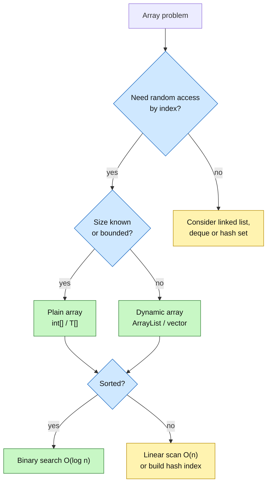

# 📊 Arrays

> **Navigation**: [← Memory Foundations — Where Data…](01a_Memory_Foundations.md) | [Chapter index](00_INDEX.md) | [Linked Lists →](01c_LinkedList.md)

---

## 📚 Part 0: Complete Understanding + Growth Mindset

**🎯 Goal:** Understand what data structures are, why they exist, and develop the right mindset for mastering them.

## 💬 Explain It Like a Study Partner — Arrays

> [!TIP]
> **Ask yourself first:** *"How can `arr[1000000]` be as fast as `arr[0]`?"*

### 1. The bottom line

An array is a row of same-sized boxes sitting side by side, so the computer can jump straight to box *i* with simple arithmetic.

### 2. The textbook core

- An array stores elements of one type in **contiguous** memory.
- Access by index is **O(1)**: `address = base + index × elementSize`.
- Search is O(n) unsorted and O(log n) when sorted (binary search).
- Insert/delete in the middle is **O(n)** because later elements must shift.
- A **dynamic array** (`ArrayList`) grows by allocating a bigger array (about 1.5× in OpenJDK) and copying, giving **amortized O(1)** appends.
- Invariant: valid indices are `0 <= i < length`; anything else throws `ArrayIndexOutOfBoundsException`.

### 3. The real-world analogy

An **egg carton** or a **row of numbered lockers**: locker 47 is exactly 47 doors from the start, so you walk straight to it. But if you want to squeeze a new locker in at position 5, every locker after it has to be moved down one space.

### 4. Walkthrough: insert 25 at index 2 of `[10, 20, 30, 40]`

1. Check there is room (otherwise grow the array and copy).
2. Shift `40` one slot right → `[10, 20, 30, _, 40]`.
3. Shift `30` one slot right → `[10, 20, _, 30, 40]`.
4. Write `25` into the gap → `[10, 20, 25, 30, 40]`.
5. Cost: two shifts here, in general up to `n`. That is why middle inserts are O(n) while `arr[i]` is O(1).

> [!NOTE]
> **Quick check:** which is cheaper, inserting at the front or at the end of an array? *The end: no shifting. The front shifts every element.*

---

## ⚡ At a Glance — Arrays

> [!NOTE]
> **Mental model:** an array is one unbroken block of equal-sized slots, so the address of slot `i` is just `base + i × size`. That single formula gives O(1) access and also explains why inserting in the middle is expensive.

**How to read this diagram.** Start at the top and answer the blue questions. Green boxes are the cheap outcomes; yellow boxes mean you either pay O(n) or should switch structure.

| Operation | Static array | Dynamic array | Why |
| --------- | ------------ | ------------- | --- |
| Access `a[i]` | O(1) | O(1) | Address arithmetic |
| Search (unsorted) | O(n) | O(n) | Must inspect elements |
| Search (sorted) | O(log n) | O(log n) | Binary search |
| Append at end | n/a (fixed) | O(1) amortized | Occasional resize copy |
| Insert/delete in middle | O(n) | O(n) | Shift the tail |
| Insert/delete at end | O(1) | O(1) | No shifting |

> [!WARNING]
> Off-by-one errors and unchecked bounds are the #1 array bug. State the loop invariant (`a[0..i)` is processed) before writing the loop.

---

## 📚 Topic Pages in This Chapter

This chapter is split into focused pages so each topic can be read on its own. Read them in order the first time; use the table to jump back later.

| # | Page | What is inside | Lines |
| --- | --- | --- | --- |
| 1 | [5W1H — Why This Chapter?](01b_Arrays/01_5w1h_why_this_chapter.md) | 5W1H — Why This Chapter? · University Proof Corner · What Are Data Structures? · What Problem Do Data Structures Solve? · Why Learn Data Structures? · … | 473 |
| 2 | [Foundation Practice — Build Array Muscle Memory](01b_Arrays/02_foundation_practice_build_array_muscle_memory.md) | Foundation Practice — Build Array Muscle… · LeetCode Problems → Real-World Connection | 232 |
| 3 | [Sub Arrays — From Brute Force to Mastery](01b_Arrays/03_sub_arrays_from_brute_force_to.md) | Sub Arrays — From Brute Force to Mastery | 283 |
| 4 | [Sub Sequences — Order Without Contiguity](01b_Arrays/04_sub_sequences_order_without_contiguity.md) | Sub Sequences — Order Without Contiguity · Searching in Arrays | 283 |
| 5 | [Sorting Algorithms — All 5](01b_Arrays/05_sorting_algorithms_all_5.md) | Sorting Algorithms — All 5 · Production Failure Modes & Debugging | 247 |
| 6 | [Frequency & Duplicates](01b_Arrays/06_frequency_duplicates.md) | Frequency & Duplicates · Circular Arrays & Rotations · Recursion in Arrays · Pattern Connections Hub · You Know Arrays — Now Practice! (JIT Study… | 380 |
| 7 | [University-Level Addendum — Arrays as Formal Theory](01b_Arrays/07_university_level_addendum_arrays_as_formal.md) | University-Level Addendum — Arrays as Formal… | 335 |

## Reality Check

> [!CAUTION]
> **Myth:** "ArrayList and Array are the same thing"
>
> **Reality:** `int[]` is a contiguous block of raw ints in memory — no object headers, no capacity metadata, fixed size. `ArrayList<Integer>` stores *boxed* Integer objects (each 16 bytes on JVM), holds pointers to them, has a capacity buffer (1.5× growth), and incurs boxing/unboxing on every access. For numeric data, a primitive array is 4-8× more memory-efficient.

> [!CAUTION]
> **Myth:** "Array index out of bounds crashes are just off-by-one errors"
>
> **Reality:** Off-by-one is *one cause*. The actual check: the JVM verifies `0 ≤ index < length` on every array access. In C, there is no such check — you silently read/write adjacent memory (buffer overflow). This is a major class of security vulnerabilities. Java's bounds checking costs ~1 CPU cycle per access but prevents entire exploit categories.

> [!CAUTION]
> **Myth:** "`array2 = array1` makes a copy"
>
> **Reality:** It copies the *reference*. Both variables now point to the same array object. Mutating `array2[0]` changes `array1[0]` too. To copy: `Arrays.copyOf(array1, array1.length)` or `array1.clone()`.

> [!CAUTION]
> **Myth:** "2D arrays in Java are rectangular grids stored in a grid"
>
> **Reality:** A Java `int[][]` is an array of *references to* `int[]` arrays. Each row is a separate heap object. They need not be the same length (jagged arrays). Memory is NOT contiguous between rows — cache misses on row transitions. For performance-critical matrix math, use a flattened 1D array and compute `[row * cols + col]` manually.

> [!CAUTION]
> **Myth:** "Passing an array to a method is pass-by-value, so the original won't change"
>
> **Reality:** Java is always pass-by-value, but for arrays the *value* passed is the reference (memory address). The method receives the same reference and CAN mutate the array contents. What it cannot do is make the caller's variable point to a different array.
