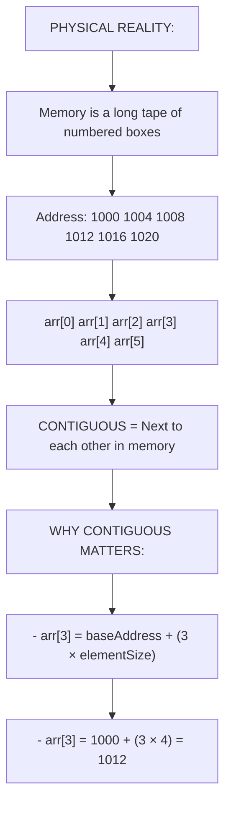

> **Navigation**: [< Previous Chapter](01a_Memory_Foundations.md) | [Back to Index](../00_MASTER_INDEX.md) | [Next Chapter >](01c_LinkedList.md)

---

# 📚 Part 0: Complete Understanding + Growth Mindset

> **🎯 Goal:** Understand what data structures are, why they exist, and develop the right mindset for mastering them.

---

## 📦 What Are Data Structures?

A **data structure** is a way of ORGANIZING and STORING data so that we can perform OPERATIONS efficiently.

> 💡 **Key Insight:** It's not just about *storing* data — it's about making certain *operations* fast!

**Analogy — Same Books, Different Organizations:**
- Library with books thrown randomly → Hard to find books
- Library with books sorted by topic → Easy to find by topic
- Library with books sorted by author → Easy to find by author

Same books, different organizations, different speeds for different tasks!

### Historical Evolution

| Year | Innovation | Motivation |
|------|-----------|------------|
| 1945 | First computers | Data just thrown in memory |
| 1950s | **Arrays** | Need for sequential data |
| 1956 | **Linked Lists** | Need for dynamic size |
| 1960s | **Stacks, Queues** | Need for order control |
| 1962 | **AVL Trees** | Need for balanced search |
| 1972 | **B-Trees** | Need for database indexing |
| 1984 | **Skip Lists** | Probabilistic alternative to trees |
| 1990s | **Hash structures** | O(1) lookup need |

---

## ❓ What Problem Do Data Structures Solve?

**Core Problem: Operations are too slow!**

Consider 1 million user accounts — the DS you choose determines performance:

| Operation | Unsorted List | Sorted Array | HashMap |
|-----------|---------------|--------------|---------|
| Find user by ID | 1 million ops | 20 ops | **1 op** |
| Add new user | **1 op** | 1 million ops | **1 op** |
| Delete user | 1 million ops | 1 million ops | **1 op** |
| List all users | 1 million ops | 1 million ops | 1 million ops |

> ⚠️ **Trade-Off:** Every DS is GOOD at some operations and BAD at others.
> There is NO perfect data structure — only the **perfect choice for your problem!**

---

## 📖 Why Learn Data Structures?

1. **Performance** — Same problem can be 1000x faster with the right DS
   - Finding a word in dictionary: Linear search checks 170,000 words. Binary search checks only **18**!

2. **Scalability** — Programs must handle growth
   - O(n²) works for 1,000 items but crashes with 1 million
   - Right DS keeps O(log n) even at scale

3. **Problem Modeling** — DS helps you THINK about problems
   - Hierarchy? → **Tree** · Relationships? → **Graph** · Fast lookup? → **HashMap** · Order matters? → **Stack/Queue**

4. **Foundation** — Advanced concepts BUILD on DS
   - Databases use B-Trees · Networks use Graphs · Compilers use Stacks · OS uses Queues

---

## ⭐ Growth Mindset: Choosing & Creating Data Structures

> ❌ **Don't:** "I need to memorize all data structures"
> ✅ **Do:** "I need to understand WHAT operations each DS optimizes for"

### The Selection Framework

1. List ALL operations you need
2. Mark which operations are **MOST FREQUENT**
3. Find DS that makes frequent operations **FAST**
4. Accept that rare operations might be slow

### Quick Selection Guide

| Need | Use |
|------|-----|
| Fast access by index | **Array** |
| Fast insert/delete anywhere | **LinkedList** |
| LIFO (Last In First Out) | **Stack** |
| FIFO (First In First Out) | **Queue** |
| Fast lookup by key | **HashMap** |
| Fast lookup + sorted order | **TreeMap** |
| Unique elements only | **Set** |
| Hierarchical relationships | **Tree** |
| Complex relationships | **Graph** |
| Priority-based access | **Heap / PriorityQueue** |

> 💡 **When no existing DS fits → Create your own by COMBINING!**
> - **LRU Cache** = HashMap + DoublyLinkedList
> - **MinStack** = Stack + Stack (for mins)
> - **Trie** = Tree with characters as edges
> - **Graph with fast lookup** = Adjacency List using HashMap

---

## 🧗 Common Difficulties in Learning DS

| Difficulty | Solution |
|-----------|----------|
| "Too many DS to learn!" | Master the **10 core DS** first: Array, List, Stack, Queue, HashMap, Set, Tree, Heap, Graph, Trie |
| "I know DS but don't know when to use it" | Focus on **OPERATIONS** each DS optimizes |
| "I understand concept but can't implement" | **Draw pictures first**, code follows naturally |
| "Array is O(1), HashMap is O(1) — what's the difference?" | Array: O(1) by **INDEX** · HashMap: O(1) by **KEY** |
| "Each DS feels completely different" | See how DS **COMBINE**: TreeMap = Tree + Map, HashSet = HashMap with only keys |

---

## 🎯 Expected Outcomes of Mastering DS

- ✅ **Instant Recognition** — See problem → Know which DS fits
- ✅ **Trade-Off Analysis** — Understand costs of each choice
- ✅ **Combination Skills** — Combine DS to solve complex problems
- ✅ **Implementation** — Code any DS from scratch
- ✅ **Debugging** — Recognize DS-related bugs quickly
- ✅ **Optimization** — Know when to switch DS for better performance
- ✅ **Creation** — Design custom DS when needed

> 🔄 **The Transformation:**
> FROM: "I'll try arrays for everything"
> TO: "I'll choose the **RIGHT DS** for each operation"


---

# ❓ Part 1: Why Data Structures Exist

## The Origin Story

**1950s:** Computers had **LIMITED memory** (just a few KB).
The problem was clear — *how do you organize data efficiently?*
The solution: **Data Structures were born!**

Every DS was created to solve a **SPECIFIC** problem:

| Data Structure | Created For |
|---------------|-------------|
| **Array** | Fast access by position |
| **LinkedList** | Fast insertion/deletion |
| **Stack** | Last-In-First-Out (LIFO) |
| **Queue** | First-In-First-Out (FIFO) |
| **Tree** | Hierarchical data |
| **Graph** | Relationships between entities |
| **HashMap** | O(1) lookup |

---

# 📊 Part 2: Arrays

### 5W1H: Deep Understanding of Arrays

```
╔══════════════════════════════════════════════════════════════════════╗
║  WHAT: An array is a CONTIGUOUS block of memory storing elements    ║
║        of the SAME TYPE at consecutive addresses.                    ║
║                                                                      ║
║  WHY:  Arrays exploit how CPU hardware works:                        ║
║        • O(1) access: address = base + (index × size)               ║
║        • Cache-friendly: contiguous data → fewer cache misses        ║
║        • Simplest data structure with the best raw performance       ║
║                                                                      ║
║  WHEN to use Arrays:                                                 ║
║        ✔ Random access by index is frequent                          ║
║        ✔ Size is known in advance (or rarely changes)                ║
║        ✔ Sequential iteration (cache locality = 10x faster)          ║
║        ✘ Frequent insertions/deletions at arbitrary positions        ║
║        ✘ Unknown or wildly varying size at runtime                    ║
║                                                                      ║
║  WHERE arrays appear in production:                                  ║
║        • Database pages are arrays of records (fixed-size pages)     ║
║        • Image pixels: 2D array of RGB values                        ║
║        • Network buffers: byte arrays holding packet data            ║
║        • GPU matrices: arrays for parallel computation               ║
║                                                                      ║
║  HOW (JVM internals):                                                ║
║  Java `int[] arr = new int[6]`:                                      ║
║  1. JVM allocates 24 bytes (6 × 4) PLUS 16 bytes object header      ║
║     (mark word + klass pointer + array length) = 40 bytes total     ║
║  2. All 24 bytes are CONTIGUOUS in heap memory                       ║
║  3. JVM stores the array length (arr.length is O(1))                 ║
║  4. Bounds checking: arr[i] verifies 0 ≤ i < length (throws AIOOBE) ║
╚══════════════════════════════════════════════════════════════════════╝
```

## 🧬 Nature & Behavior

### What is an Array?

```
PHYSICAL REALITY:
┌────────────────────────────────────────────────────┐
│ Memory is a long tape of numbered boxes            │
│                                                    │
│ Address: 1000  1004  1008  1012  1016  1020        │
│          ┌────┬────┬────┬────┬────┬────┐           │
│          │ 10 │ 20 │ 30 │ 40 │ 50 │ 60 │           │
│          └────┴────┴────┴────┴────┴────┘           │
│          arr[0] arr[1] arr[2] arr[3] arr[4] arr[5] │
│                                                    │
│ CONTIGUOUS = Next to each other in memory          │
└────────────────────────────────────────────────────┘

WHY CONTIGUOUS MATTERS:
- arr[3] = baseAddress + (3 × elementSize)
- arr[3] = 1000 + (3 × 4) = 1012
- This is O(1) random access!
```

**Flow:**
- PHYSICAL REALITY:
- ↓
- Memory is a long tape of numbered boxes
- ↓
- Address: 1000 1004 1008 1012 1016 1020
- ↓
- arr[0] arr[1] arr[2] arr[3] arr[4] arr[5]
- ↓
- CONTIGUOUS = Next to each other in memory
- ↓
- WHY CONTIGUOUS MATTERS:
- ↓
- - arr[3] = baseAddress + (3 × elementSize)



### Array Characteristics

| Property         | Value      | Why?                       |
| ---------------- | ---------- | -------------------------- |
| Access           | O(1)       | Direct address calculation |
| Search           | O(n)       | Must check each element    |
| Insert at end    | O(1)       | If space available         |
| Insert at middle | O(n)       | Must shift elements        |
| Delete           | O(n)       | Must shift elements        |
| Memory           | Contiguous | Fixed block needed         |

### 🧠 CPU Cache Locality — Why Arrays Are 10x Faster Than LinkedLists

```
THE HIDDEN PERFORMANCE SECRET:
═══════════════════════════════

Big-O says array access and linked list access are both O(n) for iteration.
But in practice, iterating an array is 10-100x FASTER. Why?

THE CPU MEMORY HIERARCHY:
┌─────────────┐ ← L1 Cache: 32KB, ~1 nanosecond (4 cycles)
├─────────────┤ ← L2 Cache: 256KB, ~4 nanoseconds (12 cycles)
├─────────────┤ ← L3 Cache: 8MB, ~12 nanoseconds (36 cycles)
├─────────────┤ ← RAM: 16GB, ~100 nanoseconds (300 cycles) 
├─────────────┤ ← SSD: 1TB, ~100,000 nanoseconds
└─────────────┘ ← HDD: 2TB, ~10,000,000 nanoseconds

When CPU reads arr[0], it doesn't just fetch 4 bytes.
It fetches a CACHE LINE of 64 bytes (on most CPUs).
That's 16 ints in one fetch!

ARRAY ITERATION:
  arr[0]: CACHE MISS → fetch 64 bytes → arr[0..15] now in cache
  arr[1]: CACHE HIT!  (already in cache)
  arr[2]: CACHE HIT!  (already in cache)
  ...
  arr[15]: CACHE HIT! (already in cache)
  arr[16]: CACHE MISS → fetch next 64 bytes
  
  Result: Only 1 cache miss per 16 elements = 6.25% miss rate

LINKED LIST ITERATION:
  node1 at address 0x1000: CACHE MISS → fetch 64 bytes
  node2 at address 0x5F00: CACHE MISS → different region!
  node3 at address 0x2A00: CACHE MISS → different region!
  node4 at address 0x8100: CACHE MISS → different region!
  
  Result: Nearly 100% cache miss rate (nodes scattered in memory)

REAL NUMBERS (summing 1 million integers):
  Array:      ~0.5 ms  (cache-friendly sequential access)
  LinkedList: ~5.0 ms  (cache-hostile random access)
  That's 10x slower with the SAME Big-O complexity!

ANALOGY: Reading a book vs reading a dictionary.
  Array = reading pages sequentially (fast — pages are next to each other)
  LinkedList = following "see also" references that jump to random pages
  (slow — you keep flipping through the entire dictionary)
```

### 🔴 Real-World Origin: Supermarket Inventory (1957)

**Problem at IBM (1957):**
- Supermarket needed to track **10,000 products**
- Each product has: ID, Name, Price, Quantity
- Need to look up any product by ID **quickly**

**Before Arrays:**
- Products stored in random memory locations
- Finding product #5000 required searching 5000 locations
- Time: **O(n)** for every lookup 😩

**Solution — Array:**
- Store products in **consecutive memory**
- Product ID = Array Index
- `products[5000]` = **instant access!**

> ✅ **Result:** Lookup went from O(n) → **O(1)**, inventory checks became **1000x faster**, and this approach made modern retail possible!

## 💻 Implementation WITHOUT Collections

```java
public class MyArray {
    private int[] data;
    private int size;
    private int capacity;

    // Constructor
    public MyArray(int capacity) {
        this.capacity = capacity;
        this.data = new int[capacity];
        this.size = 0;
    }

    // GET - O(1)
    public int get(int index) {
        if (index < 0 || index >= size) {
            throw new IndexOutOfBoundsException("Index: " + index);
        }
        return data[index];
    }

    // SET - O(1)
    public void set(int index, int value) {
        if (index < 0 || index >= size) {
            throw new IndexOutOfBoundsException("Index: " + index);
        }
        data[index] = value;
    }

    // ADD at end - O(1) amortized
    public void add(int value) {
        if (size == capacity) {
            resize();  // O(n) but rare
        }
        data[size++] = value;
    }

    // INSERT at index - O(n)
    public void insert(int index, int value) {
        if (size == capacity) {
            resize();
        }
        // Shift elements right
        for (int i = size; i > index; i--) {
            data[i] = data[i - 1];
        }
        data[index] = value;
        size++;
    }

    // DELETE at index - O(n)
    public int delete(int index) {
        int removed = data[index];
        // Shift elements left
        for (int i = index; i < size - 1; i++) {
            data[i] = data[i + 1];
        }
        size--;
        return removed;
    }

    // RESIZE - O(n)
    private void resize() {
        capacity *= 2;
        int[] newData = new int[capacity];
        for (int i = 0; i < size; i++) {
            newData[i] = data[i];
        }
        data = newData;
    }

    // SEARCH - O(n)
    public int search(int value) {
        for (int i = 0; i < size; i++) {
            if (data[i] == value) return i;
        }
        return -1;
    }

    // SIZE - O(1)
    public int size() {
        return size;
    }
}
```

## 🎯 LeetCode Problems → Real-World Connection

### Problem: Two Sum

> 🏦 **Real-World Origin:** Financial Trading System (1990s)

**Problem at Goldman Sachs:**
- Traders needed to find **pairs of stocks** where Stock A + Stock B = Target budget
- Thousands of stocks, **milliseconds** to decide

**Before Optimization:**
```
for each stock A:
    for each stock B:
        if A + B == target: found!
```
Time: **O(n²)** — too slow for real-time trading!

**Solution — The Thinking Process:**
1. "We're checking the same pairs multiple times"
2. "What if we **remember** what we've seen?"
3. "**HashMap!** Store value → index"
4. "For each stock, check if the complement exists"

> ✅ **After:** O(n) time complexity → real-time trading possible. This **HashMap complement** pattern is now used in ALL trading systems.

### 🔗 Cross-References — Navigate the Ecosystem

| Topic | Related Content |
|---|---|
| Array patterns & templates | [Array + Two Pointers](../04_Patterns_Templates/08_Array_Plus_TwoPointers.md) |
| Array practice problems | [Problem Solving — Arrays](../05_Problem_Solving/04_Arrays.md) |
| Sorting algorithms on arrays | [Sorting Fundamentals](../03_Algorithms/02a_Sorting_Fundamentals.md) |
| Sliding window on arrays | [Sliding Window Mastery](../04_Patterns_Templates/01_Sliding_Window.md) |
| Binary search on sorted arrays | [Binary Search Patterns](../04_Patterns_Templates/06_Binary_Search_Patterns.md) |
| 2D arrays / Matrix | [2D Arrays & Matrix](04_2D_Arrays_Matrix.md) |
| NumPy arrays (Python) | [NumPy & Pandas](../21_Python_ML_DL_NLP/03_NumPy_Pandas_Essentials.md) |

---

> **Navigation**: [< Previous](01a_Memory_Foundations.md) | [Back to Index](../00_MASTER_INDEX.md) | [Next >](01c_LinkedList.md)