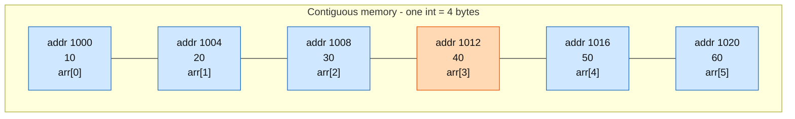

# 5W1H — Why This Chapter?

> **Navigation**: [Chapter overview](../01b_Arrays.md) | [Foundation Practice — Build Array Muscle… →](02_foundation_practice_build_array_muscle_memory.md)
> Page 1 of 7 in **Arrays**


> WHAT: The foundation of all data organization—Arrays and general data structure theory.
>
> WHY: Arrays are the primitive building block. Without understanding contiguous memory and O(1) index access, you cannot deeply understand why other structures (like Linked Lists or Trees) were invented to solve array limitations.
>
> WHO: Anyone beginning the journey into algorithms and memory management.
>
> WHEN: This is step one. Master this before moving to more complex dynamic structures.
>
> HOW: By understanding array memory layout, CPU cache locality, and foundational traversal and sub-array patterns.

---

## 🎓 University Proof Corner

> **MIT 6.006 L9 / KTH DD1352 / TU Munich IN0007 layer** — Why dynamic arrays (ArrayList/Vector) achieve O(1) amortized append despite occasional O(n) copy operations.

### Amortized Analysis: Dynamic Array Doubling

A dynamic array doubles its capacity when full. Appending n elements triggers resizes at sizes 1, 2, 4, 8, ..., n. The copy costs are:

```
1 + 2 + 4 + 8 + ... + n  =  2n − 1   total element copies
```

Divided across n appends: **(2n − 1) / n < 2 = O(1) amortized per append**.

This is the **aggregate method**: total cost / total operations.

**Accounting method (banker's metaphor)**: charge each `append` 3 units — 1 to insert, 1 "saved" for its own future copy, 1 "saved" for an element copied last resize. When resize happens, every element has pre-paid its copy cost. The bank never goes negative. ✓

### Why Halving on Delete Needs a Threshold

If you shrink at half-full, a sequence of alternating insert/delete at the boundary triggers O(n) resize on every operation — Θ(1) amortized breaks. The fix: shrink only at **quarter-full** (the standard). Then:
- After shrinking, the array is half-full — insert n/4 more before the next resize.
- Cost is amortized over those n/4 operations → still O(1). ✓

### Static vs Dynamic Arrays: When the Constant Factor Matters

Dynamic array doubling wastes up to 50% of allocated memory. For latency-critical systems where a single resize spike is unacceptable, pre-size the array to the known maximum or use a growth factor < 2 (Python uses ~1.125; this trades memory for smoother resize costs).

> Full amortized analysis (all 3 methods): [A2 — Complexity from First Principles](../../03_Algorithms/A2_Complexity_FirstPrinciples.md) (Section 5: Amortized Analysis)

---

## 📦 What Are Data Structures?

A **data structure** is a way of ORGANIZING and STORING data so that we can perform OPERATIONS efficiently.

💡 **Key Insight:** It's not just about _storing_ data — it's about making certain _operations_ fast!

**Analogy — Same Books, Different Organizations:**

- Library with books thrown randomly → Hard to find books
- Library with books sorted by topic → Easy to find by topic
- Library with books sorted by author → Easy to find by author

Same books, different organizations, different speeds for different tasks!

### Historical Evolution

| Year  | Innovation           | Motivation                                      |
| ----- | -------------------- | ----------------------------------------------- |
| 1945  | First computers      | Data just thrown in memory                      |
| 1950s | **Arrays**           | Need for sequential data                        |
| 1956  | **Linked Lists**     | Need for dynamic size                           |
| 1960s | **Stacks, Queues**   | Need for order control                          |
| 1962  | **AVL Trees**        | Need for balanced search                        |
| 1972  | **B-Trees**          | Need for database indexing                      |
| 1984  | **Skip Lists**       | Probabilistic alternative to trees              |
| 1990s | **Hash structures**  | O(1) lookup need                                |
| 2006  | **NumPy** (Python)   | N-dimensional array ops, vectorized math        |
| 2008  | **Pandas**           | Columnar data frames built on NumPy             |
| 2016  | **Apache Arrow**     | Cross-language columnar array format            |
| 2020s | **ML tensor arrays** | GPU-accelerated array primitives (PyTorch, JAX) |

---

## ❓ What Problem Do Data Structures Solve?

**Core Problem: Operations are too slow!**

Consider 1 million user accounts — the DS you choose determines performance:

| Operation       | Unsorted List | Sorted Array  | HashMap       |
| --------------- | ------------- | ------------- | ------------- |
| Find user by ID | 1 million ops | 20 ops        | **1 op**      |
| Add new user    | **1 op**      | 1 million ops | **1 op**      |
| Delete user     | 1 million ops | 1 million ops | **1 op**      |
| List all users  | 1 million ops | 1 million ops | 1 million ops |

⚠️ **Trade-Off:** Every DS is GOOD at some operations and BAD at others.
There is NO perfect data structure — only the **perfect choice for your problem!**

🔬 **Challenge — Trade-Off Deep Dive:**

> When would a 1D array of `int[1_000_000]` be _slower_ than `int[1000][1000]`? (Hint: think about CPU cache lines and strided access.)
>
> <details><summary>Answer</summary>
>
> **Answer:** In the common case of _row-by-row traversal_, both layouts perform equally since rows fit neatly into cache lines. The performance gap appears in **column-wise traversal** (accessing every 1000th element):
>
> - `int[1_000_000]` (flat): accesses strided elements — each access is a cache **miss**, since each row of 1000 elements sits on a different cache line (64 bytes). Miss rate ~100%.
> - `int[1000][1000]` (2D): accessing `arr[r][c]` still requires `arr[r]` base + offset. However, the 2D form's **inner loop** over columns is still contiguous. The real win is that each inner row (1000 ints = 4000 bytes) spans ~62 cache lines — so the first access in a row is a miss, but the next 15 elements hit.
>
> **Bottom line:** For 2D matrix problems, using a `int[rows][cols]` lets the JIT optimize inner loops as contiguous. But when writing a `int[1_000_000]` flat array and iterating column-major, each `arr[i * cols + c]` is a potential cache-line boundary — up to 1000x slower than the equivalent `arr[c]` in a true 2D layout.
>
> **Rule of thumb:** Choose the array layout that matches your access pattern. Row-major loop → flat 1D. Column-major → prefer 2D or transpose first.
>
> </details>

---

## 📖 Why Learn Data Structures?

1. **Performance** — Same problem can be 1000x faster with the right DS
   - Finding a word in dictionary: Linear search checks 170,000 words. Binary search checks only **18**!

2. **Scalability** — Programs must handle growth
   - O(n²) works for 1,000 items but crashes with 1 million
   - Right DS keeps O(log n) even at scale

3. **Problem Modeling** — DS helps you THINK about problems
   - Hierarchy? → **Tree** · Relationships? → **Graph** · Fast lookup? → **HashMap** · Order matters? → **Stack/Queue**

4. **Foundation** — Advanced concepts BUILD on DS
   - Databases use B-Trees · Networks use Graphs · Compilers use Stacks · OS uses Queues

---

## ⭐ Growth Mindset: Choosing & Creating Data Structures

❌ **Don't:** "I need to memorize all data structures"
✅ **Do:** "I need to understand WHAT operations each DS optimizes for"

### The Selection Framework

1. List ALL operations you need
2. Mark which operations are **MOST FREQUENT**
3. Find DS that makes frequent operations **FAST**
4. Accept that rare operations might be slow

### Quick Selection Guide

| Need                        | Use                      |
| --------------------------- | ------------------------ |
| Fast access by index        | **Array**                |
| Fast insert/delete anywhere | **LinkedList**           |
| LIFO (Last In First Out)    | **Stack**                |
| FIFO (First In First Out)   | **Queue**                |
| Fast lookup by key          | **HashMap**              |
| Fast lookup + sorted order  | **TreeMap**              |
| Unique elements only        | **Set**                  |
| Hierarchical relationships  | **Tree**                 |
| Complex relationships       | **Graph**                |
| Priority-based access       | **Heap / PriorityQueue** |

💡 **When no existing DS fits → Create your own by COMBINING!**

- **LRU Cache** = HashMap + DoublyLinkedList
- **MinStack** = Stack + Stack (for mins)
- **Trie** = Tree with characters as edges
- **Graph with fast lookup** = Adjacency List using HashMap

---

## 🧗 Common Difficulties in Learning DS

| Difficulty                                                | Solution                                                                                          |
| --------------------------------------------------------- | ------------------------------------------------------------------------------------------------- |
| "Too many DS to learn!"                                   | Master the **10 core DS** first: Array, List, Stack, Queue, HashMap, Set, Tree, Heap, Graph, Trie |
| "I know DS but don't know when to use it"                 | Focus on **OPERATIONS** each DS optimizes                                                         |
| "I understand concept but can't implement"                | **Draw pictures first**, code follows naturally                                                   |
| "Array is O(1), HashMap is O(1) — what's the difference?" | Array: O(1) by **INDEX** · HashMap: O(1) by **KEY**                                               |
| "Each DS feels completely different"                      | See how DS **COMBINE**: TreeMap = Tree + Map, HashSet = HashMap with only keys                    |

---

## 🎯 Expected Outcomes of Mastering DS

- ✅ **Instant Recognition** — See problem → Know which DS fits
- ✅ **Trade-Off Analysis** — Understand costs of each choice
- ✅ **Combination Skills** — Combine DS to solve complex problems
- ✅ **Implementation** — Code any DS from scratch
- ✅ **Debugging** — Recognize DS-related bugs quickly
- ✅ **Optimization** — Know when to switch DS for better performance
- ✅ **Creation** — Design custom DS when needed

🔄 **The Transformation:**

- FROM: "I'll try arrays for everything"
- TO: "I'll choose the **RIGHT DS** for each operation"

---

## ❓ Part 1: Why Data Structures Exist

### The Origin Story

**1950s:** Computers had **LIMITED memory** (just a few KB).
The problem was clear — _how do you organize data efficiently?_
The solution: **Data Structures were born!**

Every DS was created to solve a **SPECIFIC** problem:

| Data Structure | Created For                    |
| -------------- | ------------------------------ |
| **Array**      | Fast access by position        |
| **LinkedList** | Fast insertion/deletion        |
| **Stack**      | Last-In-First-Out (LIFO)       |
| **Queue**      | First-In-First-Out (FIFO)      |
| **Tree**       | Hierarchical data              |
| **Graph**      | Relationships between entities |
| **HashMap**    | O(1) lookup                    |

---

## 📊 Part 2: Arrays

### 5W1H: Deep Understanding of Arrays

> [!NOTE]
> **WHAT:** An array is a **contiguous** block of memory storing elements of the **same type** at consecutive addresses.

**WHY:** arrays exploit how CPU hardware works.

- **O(1) access:** `address = base + (index × size)`
- **Cache-friendly:** contiguous data → fewer cache misses
- Simplest data structure with the best raw performance

| ✅ Use arrays when | ❌ Avoid arrays when |
| ----------------- | ------------------- |
| Random access by index is frequent | Insertions/deletions at arbitrary positions are frequent |
| Size is known in advance (or rarely changes) | Size is unknown or varies wildly at runtime |
| You iterate sequentially (cache locality ≈ 10× faster) | |

**WHERE arrays appear in production:**

- Database pages are arrays of records (fixed-size pages)
- Image pixels: 2D array of RGB values
- Network buffers: byte arrays holding packet data
- GPU matrices: arrays for parallel computation

**HOW (JVM internals)** for `int[] arr = new int[6]`:

1. The JVM allocates 24 bytes (6 × 4) **plus** a 16-byte object header (mark word + klass pointer + array length) = **40 bytes** total.
2. All 24 data bytes are **contiguous** in heap memory.
3. The JVM stores the array length, so `arr.length` is O(1).
4. Bounds checking: `arr[i]` verifies `0 ≤ i < length` (throws `ArrayIndexOutOfBoundsException`).

## 🔒 Array Invariants (Always True — Never Assumptions)

| Invariant                             | Expression                                                                                                                              | Violation Result                                            |
| ------------------------------------- | --------------------------------------------------------------------------------------------------------------------------------------- | ----------------------------------------------------------- |
| **Bounds invariant**                  | `0 <= index < length` for all valid accesses                                                                                            | `ArrayIndexOutOfBoundsException` at runtime                 |
| **Contiguity invariant**              | All elements live at `base + k * elementSize` for `k = 0..n-1`                                                                          | Corrupted data if violated (hardware/OS guarantee this)     |
| **ArrayList grow rule (JDK default)** | Grows by **1.5x** (`newCapacity = oldCapacity + oldCapacity >> 1`) when full                                                            | Some JVMs use 2x — always check the vendor's implementation |
| **Primitive vs object array**         | `int[]` holds raw values (4 bytes each). `Integer[]` holds **object references** (8 bytes each on 64-bit JVM) plus heap object overhead | Confusing these causes ~3x memory bloat                     |

⚠️ **Common misconception:** Many students assume `arr.length` is O(n). It is always **O(1)** — the JVM stores length as a field in the object header.

🔬 **Challenge — Memory Layout (near 5W1H):**

> Trace through a 10×10 `int` array's memory layout. What is the **byte offset** of element `arr[3][7]` in row-major order on a 64-bit JVM where `int` = 4 bytes?
>
> <details><summary>Answer</summary>
>
> **Step-by-step:**
>
> 1. Row-major formula: `offset = (row * numCols + col) * elementSize`
> 2. Substituting: `offset = (3 * 10 + 7) * 4 = (30 + 7) * 4 = 37 * 4 = 148 bytes`
> 3. If `arr` starts at address `0x1000`, then `arr[3][7]` lives at `0x1000 + 148 = 0x1094`.
>
> **Verification:** `arr[0][0]` = offset 0, `arr[0][9]` = offset 36, `arr[1][0]` = offset 40, `arr[3][7]` = 148. Each row is exactly 40 bytes (10 cols × 4 bytes). Row 3 starts at 120, plus 7 elements × 4 = 28 more = 148.
>
> **Follow-up:** For a `byte[10][10]`, `arr[3][7]` offset = `(3*10+7)*1 = 37 bytes`. For `double[10][10]` (8 bytes each), offset = `(3*10+7)*8 = 296 bytes`. Always multiply by `elementSize`!
>
> </details>

## 🧬 Nature & Behavior

### What is an Array?

**Physical reality:** memory is a long tape of numbered boxes.



**How to read this diagram.** Each box is one `int` sitting right next to the previous one (addresses differ by 4). The orange box is `arr[3]`, found directly by arithmetic.

**Why contiguous matters:**

- `arr[3] = baseAddress + (3 × elementSize)`
- `arr[3] = 1000 + (3 × 4) = 1012`
- This is O(1) random access!

### Array Characteristics

| Property         | Value      | Why?                       |
| ---------------- | ---------- | -------------------------- |
| Access           | O(1)       | Direct address calculation |
| Search           | O(n)       | Must check each element    |
| Insert at end    | O(1)       | If space available         |
| Insert at middle | O(n)       | Must shift elements        |
| Delete           | O(n)       | Must shift elements        |
| Memory           | Contiguous | Fixed block needed         |

### 🧠 CPU Cache Locality — Why Arrays Are 10x Faster Than LinkedLists

Big-O says array iteration and linked-list iteration are both O(n), but in practice iterating an array is **10–100× faster**. Why?

**The CPU memory hierarchy:**

| Level | Size | Latency | Cycles |
| ----- | ---- | ------- | ------ |
| L1 cache | 32 KB | ~1 ns | ~4 |
| L2 cache | 256 KB | ~4 ns | ~12 |
| L3 cache | 8 MB | ~12 ns | ~36 |
| RAM | 16 GB | ~100 ns | ~300 |
| SSD | 1 TB | ~100,000 ns | — |
| HDD | 2 TB | ~10,000,000 ns | — |

When the CPU reads `arr[0]` it doesn't fetch just 4 bytes: it fetches a **cache line of 64 bytes** (on most CPUs), that is **16 ints in one fetch**.

```mermaid
flowchart TB
    subgraph ARR["ARRAY ITERATION - 1 miss per 16 elements"]
        direction LR
        r0["arr[0]<br/>MISS: fetch 64 bytes"] --> r1["arr[1]<br/>HIT"] --> r2["arr[2]<br/>HIT"] --> rd["...<br/>HIT"] --> r15["arr[15]<br/>HIT"] --> r16["arr[16]<br/>MISS: next 64 bytes"]
    end
    subgraph LST["LINKED LIST ITERATION - nearly every node misses"]
        direction LR
        n1["node1 @ 0x1000<br/>MISS"] --> n2["node2 @ 0x5F00<br/>MISS"] --> n3["node3 @ 0x2A00<br/>MISS"] --> n4["node4 @ 0x8100<br/>MISS"]
    end
    classDef miss fill:#ffc9c9,stroke:#c62828,color:#111
    classDef hit fill:#c8f7c5,stroke:#2e7d32,color:#111
    class r0,r16,n1,n2,n3,n4 miss
    class r1,r2,rd,r15 hit
```



**How to read this diagram.** Red is a cache miss (slow, goes to RAM), green is a cache hit (fast). The array hits 15 times for every miss (6.25% miss rate); the linked list's nodes are scattered, so almost every hop misses (~100% miss rate).

| Summing 1 million integers | Time | Behaviour |
| -------------------------- | ---- | --------- |
| Array | ~0.5 ms | Cache-friendly sequential access |
| LinkedList | ~5.0 ms | Cache-hostile random access |

Same Big-O, **10× slower** in practice.

> [!TIP]
> **Analogy:** reading a book vs reading a dictionary. An array is reading pages in order (fast, pages are adjacent). A linked list is following "see also" references that jump to random pages (slow).

### 🔴 Real-World Origin: Supermarket Inventory (1957)

**Problem at IBM (1957):**

- Supermarket needed to track **10,000 products**
- Each product has: ID, Name, Price, Quantity
- Need to look up any product by ID **quickly**

**Before Arrays:**

- Products stored in random memory locations
- Finding product #5000 required searching 5000 locations
- Time: **O(n)** for every lookup 😩

**Solution — Array:**

- Store products in **consecutive memory**
- Product ID = Array Index
- `products[5000]` = **instant access!**

✅ **Result:** Lookup went from O(n) → **O(1)**, inventory checks became **1000x faster**, and this approach made modern retail possible!

## 💻 Implementation WITHOUT Collections

```java
public class MyArray {
    private int[] data;
    private int size;
    private int capacity;

    // Constructor
    public MyArray(int capacity) {
        this.capacity = capacity;
        this.data = new int[capacity];
        this.size = 0;
    }

    // GET - O(1)
    public int get(int index) {
        if (index < 0 || index >= size) {
            throw new IndexOutOfBoundsException("Index: " + index);
        }
        return data[index];
    }

    // SET - O(1)
    public void set(int index, int value) {
        if (index < 0 || index >= size) {
            throw new IndexOutOfBoundsException("Index: " + index);
        }
        data[index] = value;
    }

    // ADD at end - O(1) amortized
    public void add(int value) {
        if (size == capacity) {
            resize();  // O(n) but rare
        }
        data[size++] = value;
    }

    // INSERT at index - O(n)
    public void insert(int index, int value) {
        if (size == capacity) {
            resize();
        }
        // Shift elements right
        for (int i = size; i > index; i--) {
            data[i] = data[i - 1];
        }
        data[index] = value;
        size++;
    }

    // DELETE at index - O(n)
    public int delete(int index) {
        int removed = data[index];
        // Shift elements left
        for (int i = index; i < size - 1; i++) {
            data[i] = data[i + 1];
        }
        size--;
        return removed;
    }

    // RESIZE - O(n)
    private void resize() {
        capacity *= 2;
        int[] newData = new int[capacity];
        for (int i = 0; i < size; i++) {
            newData[i] = data[i];
        }
        data = newData;
    }

    // SEARCH - O(n)
    public int search(int value) {
        for (int i = 0; i < size; i++) {
            if (data[i] == value) return i;
        }
        return -1;
    }

    // SIZE - O(1)
    public int size() {
        return size;
    }
}
```

---

[Chapter overview](../01b_Arrays.md) | [Foundation Practice — Build Array Muscle… →](02_foundation_practice_build_array_muscle_memory.md)
