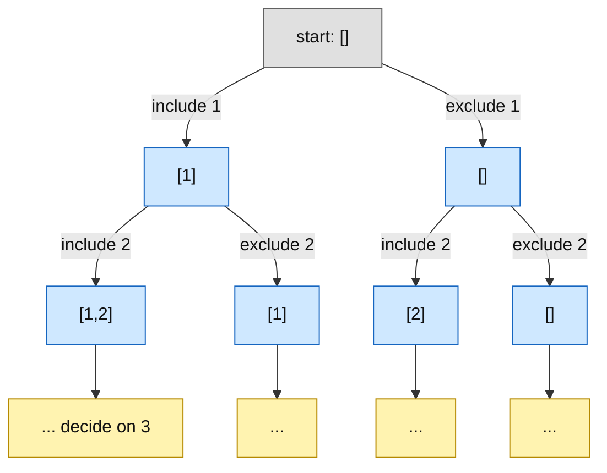

# 🌿 Part 5: Sub Sequences — Order Without Contiguity

> **Navigation**: [← Sub Arrays — From Brute Force to Mastery](03_sub_arrays_from_brute_force_to.md) | [Chapter overview](../01b_Arrays.md) | [Sorting Algorithms — All 5 →](05_sorting_algorithms_all_5.md)
> Page 4 of 7 in **Arrays**


## 💬 Study-Partner View — Sub-sequences

**1. The bottom line:** A subsequence keeps the original order but may skip elements, so there are exponentially many and you need recursion or DP.

**2. The textbook core:**

- A subsequence preserves relative order but is **not** required to be contiguous; there are **2ⁿ** of them.
- Each element has two choices: **include** or **exclude** (a binary decision tree).
- Brute force with recursion/backtracking is O(2ⁿ); many "best subsequence" problems drop to O(n²) or O(n log n) with DP.
- Every sub-array is a subsequence, but not vice versa.

**3. The real-world analogy:** Choosing **toppings for a pizza** in menu order: for each topping you say yes or no, and the order on the menu stays the same.

**4. Walkthrough:**

1. Enumerate the subsequences of `[1, 2, 3]`.
2. Decide for `1`: include or exclude; then for `2`; then for `3`.
3. That gives 2×2×2 = 8: `[]`, `[1]`, `[2]`, `[3]`, `[1,2]`, `[1,3]`, `[2,3]`, `[1,2,3]`.
4. `[1,3]` is a subsequence but not a sub-array (2 is skipped).

> [!NOTE]
> **Quick check:** Why does the Longest Increasing Subsequence need DP? *Trying all 2ⁿ subsequences is too slow; DP reuses answers for shorter prefixes.*


## 📖 Theory — What is a Sub Sequence?

```
Input: {1, 2, 3}
All subsequences (2ⁿ - 1 = 7):
  {1} {2} {3} {1,2} {1,3} {2,3} {1,2,3}

KEY: Order preserved, gaps ALLOWED.

COMPARISON:
  Subarray:    {2,3,4}  from {1,2,3,4,5}  ← contiguous slice
  Subsequence: {1,3,5}  from {1,2,3,4,5}  ← pick any, keep order
```

❓ **Quick Check:** How many subsequences in `{1,2,3,4}`?
→ 2⁴ - 1 = **15**

---

## 🔵 Level 1: The Include/Exclude Paradigm

For each element you have exactly 2 choices: ① **include** it in the current subsequence, or ② **exclude** it. That is a binary decision tree with 2ⁿ leaves.



**How to read this diagram.** Each level decides one element of `{1,2,3}`. After all three decisions there are 2³ = 8 leaves, one per subsequence.

---

## 🚀 GO LEARN — Recursion (You Need This First)

**STOP** — Subsequence generation is built on recursion.

📖 [03b_Recursion_Fundamentals.md](../../03_Algorithms/03b_Recursion_Fundamentals.md)
📖 [03c_Recursion_Advanced.md — Subsets section](../../03_Algorithms/03c_Recursion_Advanced.md)

⬅️ **RETURN CHECKPOINT** — Come back and apply below.

---

## ✅ Apply 1: Print All Subsequences — Recursion O(2ⁿ)

```java
public void subsequences(int[] arr, int index, List<Integer> current) {
    if (index == arr.length) {
        if (!current.isEmpty()) System.out.println(current);
        return;
    }
    current.add(arr[index]);           // INCLUDE
    subsequences(arr, index + 1, current);
    current.remove(current.size() - 1); // EXCLUDE (backtrack)
    subsequences(arr, index + 1, current);
}
// Call: subsequences(arr, 0, new ArrayList<>())
// Time: O(2ⁿ) — unavoidable (2ⁿ subsequences exist)
```

---

## ✅ Apply 2: Count Subsequences with Sum = K

```java
public int countSubseqSum(int[] arr, int index, int target) {
    if (target == 0) return 1;                        // found valid subsequence
    if (index == arr.length || target < 0) return 0;
    return countSubseqSum(arr, index + 1, target - arr[index])   // include
         + countSubseqSum(arr, index + 1, target);               // exclude
}
```

---

## ✅ Apply 3: Longest Increasing Subsequence (LIS)

```
Example: {10, 9, 2, 5, 3, 7, 101, 18}
LIS:     {2, 3, 7, 101}   length = 4
```

**Layer 1 — DP O(n²):**

```java
public int lisDP(int[] arr) {
    int n = arr.length;
    int[] dp = new int[n];
    Arrays.fill(dp, 1);          // every element alone is LIS of length 1
    int max = 1;
    for (int i = 1; i < n; i++)
        for (int j = 0; j < i; j++)
            if (arr[j] < arr[i]) {
                dp[i] = Math.max(dp[i], dp[j] + 1);
                max   = Math.max(max, dp[i]);
            }
    return max;
}
```

**Layer 2 — Binary Search O(n log n):**

```java
public int lisOptimal(int[] arr) {
    List<Integer> tails = new ArrayList<>();
    for (int x : arr) {
        int pos = Collections.binarySearch(tails, x);
        if (pos < 0) pos = -(pos + 1);
        if (pos == tails.size()) tails.add(x);
        else tails.set(pos, x);
    }
    return tails.size();
}
// Uses Binary Search: 📖 06_Binary_Search_Patterns.md
```

❓ **Think:** Why does replacing with a smaller value work? Smaller tail = more room for future elements to extend the sequence.

---

## ✅ Apply 4: Longest Common Subsequence (LCS)

```java
public int lcs(String s1, String s2) {
    int m = s1.length(), n = s2.length();
    int[][] dp = new int[m+1][n+1];
    for (int i = 1; i <= m; i++)
        for (int j = 1; j <= n; j++)
            dp[i][j] = s1.charAt(i-1) == s2.charAt(j-1)
                ? dp[i-1][j-1] + 1
                : Math.max(dp[i-1][j], dp[i][j-1]);
    return dp[m][n];
}
// Time: O(m*n) | Space: O(m*n)
// DP foundation: 📖 03_Algorithms/04b_DP_Fundamentals.md
```

---

## 🎯 Problem Set — Sub Sequences

| #   | Problem                             | Platform | Difficulty | Technique       |
| --- | ----------------------------------- | -------- | ---------- | --------------- |
| 1   | LC 78 — Subsets                     | LeetCode | ⭐⭐ Med   | Recursion       |
| 2   | LC 300 — LIS                        | LeetCode | ⭐⭐ Med   | DP → BinSearch  |
| 3   | LC 1143 — LCS                       | LeetCode | ⭐⭐ Med   | 2D DP           |
| 4   | LC 416 — Partition Equal Subset Sum | LeetCode | ⭐⭐ Med   | Subset-sum DP   |
| 5   | LC 1035 — Uncrossed Lines           | LeetCode | ⭐⭐ Med   | LCS in disguise |

## 🧠 Pattern Fingerprint — Sub Sequences

**See these words → use this technique:**

| If the problem says... | Use |
| ---------------------- | --- |
| "all subsequences / subsets" | Recursion 2ⁿ |
| "longest increasing subsequence" | DP + BinSearch |
| "longest common subsequence" | 2D DP |
| "not necessarily contiguous" | SUBSEQUENCE! |
| "count subsequences with sum" | Recursion / DP |

## 📅 Revisit Tracker

- **Day 3:** Redo LC 78 (Subsets recursion) + LC 300 (LIS DP)
- **Day 7:** Redo LC 300 using binary search approach from memory

---

## 🔎 Part 6: Searching in Arrays

### 💬 Study-Partner View — Searching in Arrays

**1. The bottom line:** If the array is unsorted you must look at everything; if it is sorted you can halve the search space each step.

**2. The textbook core:**

- **Linear search:** O(n), works on any array.
- **Binary search:** O(log n) on a **sorted** array; keep `lo`, `hi`, compare with the middle `mid = lo + (hi - lo) / 2`.
- Invariant: if the target exists, it is inside `[lo, hi]`.
- Binary search generalises to "search on the answer" (find the smallest `x` where a monotone condition becomes true).

**3. The real-world analogy:** Guessing a number from 1 to 100 with **"higher or lower?"** hints: always guess the middle and you need at most 7 guesses.

**4. Walkthrough:**

1. Find 23 in `[2, 5, 8, 12, 16, 23, 38, 56]`.
2. `lo = 0`, `hi = 7`, `mid = 3` → 12 < 23 → `lo = 4`.
3. `mid = 5` → 23 == 23 → found at index 5, after 2 comparisons.
4. Computing `mid = lo + (hi - lo) / 2` avoids integer overflow of `(lo + hi) / 2`.

> [!NOTE]
> **Quick check:** What happens if the array is not sorted? *Binary search can return wrong answers; sort first or use linear search/hashing.*


### Linear Search — O(n) | No sorted requirement

```java
public int linearSearch(int[] arr, int target) {
    for (int i = 0; i < arr.length; i++)
        if (arr[i] == target) return i;
    return -1;
}
// Use when: unsorted, or searching only once
```

### Binary Search — O(log n) | Array MUST be sorted

```java
public int binarySearch(int[] arr, int target) {
    int left = 0, right = arr.length - 1;
    while (left <= right) {
        int mid = left + (right - left) / 2;    // avoids int overflow!
        if (arr[mid] == target) return mid;
        else if (arr[mid] < target) left = mid + 1;
        else right = mid - 1;
    }
    return -1;
}
// For n=1,000,000: Linear = 1M checks. Binary = 20 checks!
```

📖 **GO DEEPER** — Binary Search has many variants (lower bound, answer space):

- 📖 [06_Binary_Search_Patterns.md](../../04_Patterns_Templates/06_Binary_Search_Patterns.md)
- ⬅️ Return here after studying for: search in rotated array, first/last occurrence.

|                  | Linear Search          | Binary Search              |
| ---------------- | ---------------------- | -------------------------- |
| Requires sorted? | ❌ No                  | ✅ Yes                     |
| Time             | O(n)                   | O(log n)                   |
| Use when         | Unsorted / search once | Sorted / search many times |

### 🎯 Problems

| Problem                         | Pattern                |
| ------------------------------- | ---------------------- |
| LC 704 — Binary Search          | Classic                |
| LC 35 — Search Insert Position  | Lower bound            |
| LC 33 — Search in Rotated Array | Modified binary search |
| LC 34 — First and Last Position | Two binary searches    |

---

[← Sub Arrays — From Brute Force to Mastery](03_sub_arrays_from_brute_force_to.md) | [Chapter overview](../01b_Arrays.md) | [Sorting Algorithms — All 5 →](05_sorting_algorithms_all_5.md)
