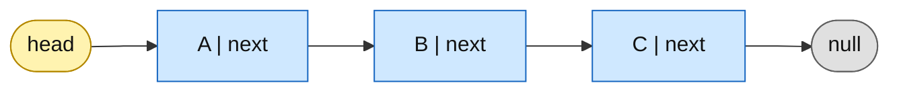

# 🔗 Linked Lists

> **Navigation**: [< Previous Chapter](01b_Arrays.md) | [Back to Index](../00_MASTER_INDEX.md) | [Next Chapter >](01d_Stack_Queue.md)

---

## 🔗 Part 3: Linked List

### 5W1H: Deep Understanding

> [!NOTE]
> **WHAT:** A linked list is a sequence of NODES where each node holds DATA and a POINTER (reference) to the next node. Nodes are SCATTERED in memory (not contiguous).
>
> **WHY:** Arrays have a fatal flaw: inserting/deleting at arbitrary positions requires SHIFTING all subsequent elements O(n). Linked lists solve this — insert/delete is O(1) pointer manipulation (if you have a reference to the position).
>
> **WHEN:** Use when insertions/deletions dominate over random access.
>
> - ✅ Implementing stacks, queues, hash table chaining
> - ✅ Size unknown or changes frequently
> - ✅ LRU cache (doubly-linked list + HashMap)
> - ❌ Random access needed (use array)
> - ❌ Cache performance critical (nodes scatter in memory)
>
> **HOW (JVM internals):**  Each `new Node(data)` allocates on the Java HEAP:
>
> - Object header: 12-16 bytes (mark word + klass pointer)
> - data field: 4 bytes (int) or 8 bytes (reference)
> - next field: 4-8 bytes (compressed/uncompressed reference)
> - Total per node: ~32 bytes for a single int! vs Array: 4 bytes per int (8x less memory!)
>
> **GC IMPACT:** Linked list nodes are scattered → harder for GC to traverse (poor GC locality). Pre-tenured nodes (old gen) cause longer full GC pauses than arrays in young gen.
>
> **REAL-WORLD SYSTEM USAGE:**
>
> - OS kernel: free memory blocks managed as a linked list
> - Java ConcurrentLinkedQueue: lock-free queue using CAS
> - Linux kernel: task_struct linked list for process management
> - Memcached LRU: doubly-linked list per slab class for eviction ordering (Redis approximates LRU by sampling instead)

## 💬 Explain It Like a Study Partner — Linked Lists

> [!TIP]
> **Ask yourself first:** *"If arrays are so fast, why does anyone use a list of scattered nodes?"*

### 1. The bottom line

A linked list trades fast indexing for cheap re-wiring: each item just remembers where the next one is, so you can splice items in or out without moving anything else.

### 2. The textbook core

- A linked list is a sequence of **nodes**; each holds **data** and a **reference** to the next node (and to the previous one in a **doubly** linked list).
- Access by index and search are **O(n)**.
- Insert/delete **at a known node** (or at the head) is **O(1)** because only pointers change.
- Insert at the tail is O(1) only if you keep a **tail pointer**; deleting the tail of a singly linked list is O(n).
- Nodes are allocated separately, so they are scattered in memory (poor cache locality).

### 3. The real-world analogy

A **scavenger hunt**: each clue only tells you where the next clue is. You cannot jump to clue 7; you must follow clues 1 to 6. But adding a new clue between two others is easy: you just rewrite the two notes that point to it.

### 4. Walkthrough: insert `X` after `A` in `A → B → C`

1. Create node `X`.
2. Point `X.next` at `B` (what `A.next` used to be).
3. Point `A.next` at `X`.
4. The list is now `A → X → B → C`. No element was moved; we changed two pointers.

> [!WARNING]
> **Order matters:** if you set `A.next = X` first, you lose the only reference to `B`. Save the old `next` before you overwrite it.

> [!NOTE]
> **Quick check:** why is deleting a node O(1) in a doubly linked list but O(n) in a singly linked one when you only hold the node? *The doubly linked node knows its predecessor; the singly linked one does not, so you must search for it.*

---

## ⚡ At a Glance — Linked Lists

> [!NOTE]
> **Mental model:** a chain of separately allocated nodes, each holding data plus a pointer to the next (and, in a doubly-linked list, the previous). You trade O(1) indexing for O(1) splicing — *if* you already hold the node.

**How to read this diagram.** Follow the arrows: reaching `C` means walking `A → B → C`, so access is O(n). Re-linking a pointer (e.g. removing `B`) is just changing `A.next`, which is O(1) once you are standing on `A`.

| Operation | Singly | Doubly | Notes |
| --------- | ------ | ------ | ----- |
| Access by index | O(n) | O(n) | Doubly can start from the nearer end |
| Insert/delete at head | O(1) | O(1) | |
| Insert at tail | O(1) with tail pointer | O(1) | O(n) without a tail pointer |
| Delete tail | O(n) | O(1) | Singly needs the predecessor |
| Delete a known node | O(n) (find predecessor) | O(1) | `prev` pointer removes the search |
| Search | O(n) | O(n) | No random access |

> [!TIP]
> Reach for a **dummy (sentinel) head** and the **fast/slow pointer** trick first — together they remove most edge cases and solve cycle, middle and k-th-from-end problems.

> [!WARNING]
> Nodes are scattered in memory, so traversal is cache-unfriendly. In Java, `ArrayList` or `ArrayDeque` usually beats `LinkedList` even for queue workloads.

---

## 📚 Topic Pages in This Chapter

This chapter is split into focused pages so each topic can be read on its own. Read them in order the first time; use the table to jump back later.

| # | Page | What is inside | Lines |
| --- | --- | --- | --- |
| 1 | [COMPLETE UNDERSTANDING — The WHY Before the WHAT](01c_LinkedList/01_complete_understanding_the_why_before_the.md) | COMPLETE UNDERSTANDING — The WHY Before the… · Nature & Behavior | 178 |
| 2 | [Implementation WITHOUT Collections](01c_LinkedList/02_implementation_without_collections.md) | Implementation WITHOUT Collections · LeetCode → Real-World Connection · Foundation Practice — LinkedList Basics · Interview Patterns — The 4 LinkedList… · Quick Problem Walkthrough: Detect Cycle Start… · … | 561 |
| 3 | [Production Failure Modes & Debugging](01c_LinkedList/03_production_failure_modes_debugging.md) | Production Failure Modes & Debugging · Pattern Fingerprint — LinkedList · You Know Linked Lists — Now Practice! (JIT… · Linked List Invariants — The Critical Missing… | 314 |
| 4 | [Proof Corner — Three Derivations from First Principles](01c_LinkedList/04_proof_corner_three_derivations_from_first.md) | Proof Corner — Three Derivations from First… · Brute Force → Optimal: Linked List Motivation · Constraint-First Decision Framework — When to… · When Linked Lists Break — Formal Failure Modes · Edge Cases — Always Check These · … | 559 |

## Reality Check

> [!CAUTION]
> **Myth:** "LinkedList insertion at position i is O(1)"
>
> **Reality:** Insertion after a *known node* is O(1). But finding that node at position i requires traversing from the head — O(i). The full operation is O(n). The only truly O(1) insertions are at head and tail (if you hold a tail reference).

> [!CAUTION]
> **Myth:** "LinkedList uses less memory than ArrayList for the same elements"
>
> **Reality:** The opposite. Each node in a singly-linked list of Integers: 16 bytes (object header) + 4 bytes (int field) + 8 bytes (next pointer) = 28 bytes, padded to 32 bytes. A `int[]` stores the same integer in 4 bytes. LinkedList uses 8× more memory per element for primitive data.

> [!CAUTION]
> **Myth:** "Java's LinkedList is good for queue operations"
>
> **Reality:** Java's `LinkedList` implements `Deque` but `ArrayDeque` is 2-3× faster for queue operations because it is a circular buffer — cache-contiguous, no pointer chasing. `LinkedList` for queues is a common Java mistake.

> [!CAUTION]
> **Myth:** "Doubly-linked lists are always better than singly-linked"
>
> **Reality:** Doubly-linked enables O(1) backwards traversal and O(1) deletion given a node reference (no need to find the previous node). But each node carries an extra pointer (8 bytes on 64-bit JVM). For read-mostly or forward-only use cases, singly-linked saves memory and is simpler. Doubly-linked is worth it when you need O(1) deletion given node reference — as in LRU cache implementation.

> [!CAUTION]
> **Myth:** "Sentinel nodes are just an optimization"
>
> **Reality:** Sentinel (dummy) head and tail nodes eliminate special-case code for empty-list and single-element operations. They make the logic *correct by construction* — all nodes always have a prev and next. Without sentinels, every insert/delete must check `if (head == null)` and `if (tail == null)` separately. Sentinels are a correctness technique as much as a performance one.
