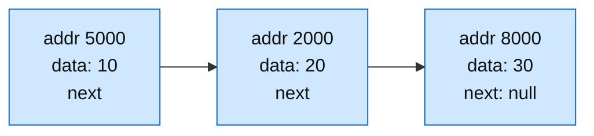
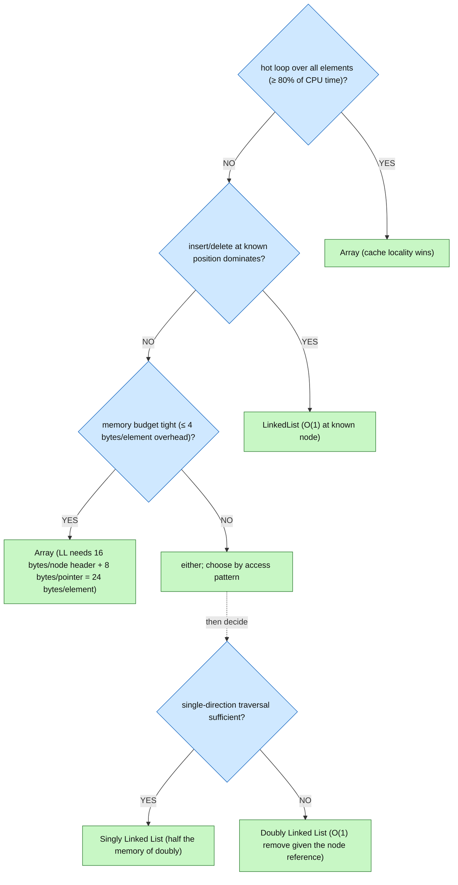

> **Navigation**: [< Previous Chapter](01b_Arrays.md) | [Back to Index](../00_MASTER_INDEX.md) | [Next Chapter >](01d_Stack_Queue.md)

---

# 🔗 Part 3: Linked List

### 5W1H: Deep Understanding

> [!NOTE]
> **WHAT:** A linked list is a sequence of NODES where each node holds DATA and a POINTER (reference) to the next node. Nodes are SCATTERED in memory (not contiguous).
>
> **WHY:** Arrays have a fatal flaw: inserting/deleting at arbitrary positions requires SHIFTING all subsequent elements O(n). Linked lists solve this — insert/delete is O(1) pointer manipulation (if you have a reference to the position).
>
> **WHEN:** Use when insertions/deletions dominate over random access.
>
> - ✅ Implementing stacks, queues, hash table chaining
> - ✅ Size unknown or changes frequently
> - ✅ LRU cache (doubly-linked list + HashMap)
> - ❌ Random access needed (use array)
> - ❌ Cache performance critical (nodes scatter in memory)
>
> **HOW (JVM internals):**  Each `new Node(data)` allocates on the Java HEAP:
>
> - Object header: 12-16 bytes (mark word + klass pointer)
> - data field: 4 bytes (int) or 8 bytes (reference)
> - next field: 4-8 bytes (compressed/uncompressed reference)
> - Total per node: ~32 bytes for a single int! vs Array: 4 bytes per int (8x less memory!)
>
> **GC IMPACT:** Linked list nodes are scattered → harder for GC to traverse (poor GC locality). Pre-tenured nodes (old gen) cause longer full GC pauses than arrays in young gen.
>
> **REAL-WORLD SYSTEM USAGE:**
>
> - OS kernel: free memory blocks managed as a linked list
> - Java ConcurrentLinkedQueue: lock-free queue using CAS
> - Linux kernel: task_struct linked list for process management
> - Memcached LRU: doubly-linked list per slab class for eviction ordering (Redis approximates LRU by sampling instead)

## ⚡ At a Glance — Linked Lists

> [!NOTE]
> **Mental model:** a chain of separately allocated nodes, each holding data plus a pointer to the next (and, in a doubly-linked list, the previous). You trade O(1) indexing for O(1) splicing — *if* you already hold the node.


**How to read this diagram.** Follow the arrows: reaching `C` means walking `A → B → C`, so access is O(n). Re-linking a pointer (e.g. removing `B`) is just changing `A.next`, which is O(1) once you are standing on `A`.

| Operation | Singly | Doubly | Notes |
| --------- | ------ | ------ | ----- |
| Access by index | O(n) | O(n) | Doubly can start from the nearer end |
| Insert/delete at head | O(1) | O(1) | |
| Insert at tail | O(1) with tail pointer | O(1) | O(n) without a tail pointer |
| Delete tail | O(n) | O(1) | Singly needs the predecessor |
| Delete a known node | O(n) (find predecessor) | O(1) | `prev` pointer removes the search |
| Search | O(n) | O(n) | No random access |

> [!TIP]
> Reach for a **dummy (sentinel) head** and the **fast/slow pointer** trick first — together they remove most edge cases and solve cycle, middle and k-th-from-end problems.

> [!WARNING]
> Nodes are scattered in memory, so traversal is cache-unfriendly. In Java, `ArrayList` or `ArrayDeque` usually beats `LinkedList` even for queue workloads.

---

## PART 0: COMPLETE UNDERSTANDING — The WHY Before the WHAT

### What Problem Does a Linked List Solve?

**The Fundamental Problem:** Arrays are **RIGID**. Once created, they sit in one contiguous memory block.

- Insert at the beginning? → Shift EVERYTHING right → **O(n)**
- Array is full? → Allocate bigger array, copy everything → **O(n)**

**Linked Lists exist because sometimes you need:**

- ✅ Frequent insertions/deletions (especially at front/middle)
- ✅ Unknown size that grows/shrinks dynamically
- ✅ No need for random access (you process sequentially)
- ✅ Building other structures (stacks, queues, graphs, hash chains)

### Who Invented It and Why?

**1955-1956:** Allen Newell, Cliff Shaw, and Herbert Simon at **RAND Corporation** needed to represent "thoughts" in an AI program called _Logic Theorist_. Thoughts connect to other thoughts — not a flat list — a **LINKED STRUCTURE**.

> 💡 **The revolutionary concept:** Each piece of data carries a _pointer_ to the next piece. Until then, data was always stored in contiguous arrays.

**Impact — Linked lists became the foundation for:**

- **Stacks and Queues** (implemented via linked list)
- **Hash table chaining** (collision handling)
- **Graphs** (adjacency lists)
- **Memory allocation** (free lists in OS)
- **Undo systems**, playlists, browser history

### When to Use (and NOT Use) Linked Lists

**✅ USE Linked List when:**

- You frequently insert/delete at the **FRONT** → O(1) vs Array's O(n)
- You implement a **Stack or Queue** (LIFO/FIFO)
- You don't know the size in advance
- You're building **hash chains** (HashMap collision resolution)
- You need to merge/split lists efficiently

**❌ DO NOT USE when:**

- You need random access (`arr[i]`) → LinkedList is O(n)
- **Cache performance** matters → LinkedList has terrible cache locality
- You're mostly reading, rarely inserting → Array is better
- Memory is tight → Each node has pointer overhead (8-16 bytes extra)

### The Types at a Glance

```
SINGLY LINKED LIST:
  [10|●]→[20|●]→[30|null]
  - Each node: data + next pointer
  - Can only traverse FORWARD
  - Used in: Stack, simple queue, hash chaining

DOUBLY LINKED LIST:
  null←[●|10|●]↔[●|20|●]↔[●|30|●]→null
  - Each node: prev + data + next
  - Can traverse BOTH directions
  - Used in: LRU cache, browser history, text editors

CIRCULAR LINKED LIST:
  [10|●]→[20|●]→[30|●]→(back to 10)
  - Last node points back to first
  - No null at the end
  - Used in: Round-robin scheduling, multiplayer game turns
```

### Linked List Variants Comparison Table

| Variant             | Node Fields                     | Memory Overhead per Node             | Search (avg) | Insert/Delete (at known pos) | Cache Behavior               | When to Use                                                | Java/OpenJDK Representation                                                 |
| ------------------- | ------------------------------- | ------------------------------------ | ------------ | ---------------------------- | ---------------------------- | ---------------------------------------------------------- | --------------------------------------------------------------------------- |
| **Singly Linked**   | `data`, `next`                  | ~16-24 bytes (next ref)              | O(n)         | O(1) insert, O(n) delete\*   | Poor (scattered nodes)       | Stack, simple queues, hash chaining                        | `java.util.LinkedList` uses this internally for traversal                   |
| **Doubly Linked**   | `data`, `prev`, `next`          | ~24-32 bytes (2 refs)                | O(n)         | O(1) bidirectional           | Poor (scattered nodes)       | LRU cache, browser history, text editors                   | `java.util.LinkedList` is doubly-linked; `LinkedHashMap` uses this          |
| **Circular Singly** | `data`, `next`                  | ~16-24 bytes (next ref)              | O(n)         | O(1) with tail pointer       | Poor                         | Round-robin scheduling, multiplayer game turn order        | `java.util.concurrent.ConcurrentLinkedQueue` (CAS-based, circular)          |
| **Circular Doubly** | `data`, `prev`, `next`          | ~24-32 bytes (2 refs)                | O(n)         | O(1) bidirectional with wrap | Poor                         | Re-do/undo systems, circular buffers, music playlist loops | `java.util.LinkedHashMap` maintains circular references for iteration order |
| **Skip List**       | `data`, multiple `next` (level) | O(log n) refs per node (16-48 bytes) | O(log n)     | O(log n)                     | Moderate (leveled structure) | Concurrent sorted maps, `ConcurrentSkipListMap`            | `java.util.concurrent.ConcurrentSkipListMap` is skip list                   |
| **XOR Linked**      | `data`, `xor` (prev XOR next)   | ~12-20 bytes (1 field vs 2)          | O(n)         | O(n) (need both neighbors)   | Poor                         | Memory-constrained embedded systems                        | Not in standard JDK; requires pointer arithmetic in C/C++                   |

> **Key insight:** Memory overhead is the primary tradeoff. A doubly-linked list node for a single `int` costs ~32 bytes vs 4 bytes for an array element. Use an array when memory locality matters. Use a skip list when you need sorted access with better-than-linear search.

> **Invariant (Doubly-Linked List):** For every non-sentinel node `node` in a properly-formed doubly-linked list: `node.prev.next == node` and `node.next.prev == node`. Violation of this bidirectional invariant at any point indicates **list corruption** (a memory bug, dangling pointer, or concurrency race).

### Mental Model: Train Cars

```
ARRAY = Subway train (fixed cars, all connected rigidly)
  [Car1][Car2][Car3][Car4][Car5]
  Adding a car in the middle? Impossible without rebuilding.

LINKED LIST = Cargo train (cars coupled by hooks)
  [Car1]--hook--[Car2]--hook--[Car3]
  Adding a car? Unhook at any point, hook new car in. DONE.
  Removing a car? Unhook from both sides, reconnect neighbors.

  But... to find car #500, you must walk from the locomotive
  through all 499 cars. No shortcuts! That's the O(n) access cost.
```

---

> 🔬 **Section Challenge — PART 0: COMPLETE UNDERSTANDING — The WHY Before the WHAT**
>
> **Challenge 1 (Design):** You are designing the Undo/Redo history for a memory-constrained text editor. Why is a Doubly Linked List the optimal choice over a dynamic Array or a Singly Linked List?
>
> <details><summary>Answer</summary>
>
> **Scenario:** Managing state history with limited memory.
> **Trace:**
>
> 1. **Dynamic Array:** If the array gets full, it must allocate a new chunk of contiguous memory (often 2x the size) and copy everything. In a memory-constrained environment, finding a large contiguous block might fail (Heap Fragmentation), causing an OutOfMemory error.
> 2. **Singly Linked List:** You can undo (pop the head), but what if you want to cap the history at 100 states and drop the oldest state when state 101 arrives? Deleting the tail in a singly linked list requires an O(N) traversal.
> **Design Fix:** A **Doubly Linked List** (combined with a HashMap if it's an LRU cache) allows O(1) tail deletion and doesn't require contiguous memory. The extra 8 bytes for the `prev` pointer is a worthwhile tradeoff to prevent O(N) lag spikes during edits.
>  </details>

## 🧬 Nature & Behavior

### What is a Linked List?

**Physical reality:** nodes are scattered across memory and connected by references.



**How to read this diagram.** Each box is one node at its own address; the arrows are the `next` references. The addresses are *not* consecutive, so the list is **not contiguous**.

**Why non-contiguous is useful:**

- No need for one big contiguous memory block
- Insert/delete = just change pointers
- Size can grow until memory is full

### Linked List vs Array

| Operation        | Array  | LinkedList  | Winner     |
| ---------------- | ------ | ----------- | ---------- |
| Access by index  | O(1)   | O(n)        | Array      |
| Insert at start  | O(n)   | O(1)        | LinkedList |
| Insert at end    | O(1)\* | O(n)†       | Array      |
| Insert at middle | O(n)   | O(1)‡       | LinkedList |
| Memory usage     | Less   | More (refs) | Array      |
| Cache friendly   | Yes    | No          | Array      |

\*If space available  
†O(1) if tail pointer maintained  
‡O(1) if position known, O(n) to find position

### 🔴 Real-World Origin: Music Playlist (1980s)

**Problem (Early MP3 Players):**

- User creates playlist of **1,000 songs**
- User wants to add a song in the middle
- User wants to remove the current song

**With Array:** Adding song at position 500 means shifting 500 songs. On slow hardware: **2 seconds delay!** User experience: _terrible._

**Solution — Linked List:**

- Each song points to next song
- Insert = change 2 pointers → **O(1)**
- Delete = change 1 pointer → **O(1)**

> 🎵 **Real Implementation:** iTunes (2001) used LinkedList for playlists. Spotify uses a **doubly-linked list**. The "Previous" and "Next" buttons are literally `prev` / `next` pointers!

## 💻 Implementation WITHOUT Collections

```java
public class MyLinkedList {

    // Node class (inner)
    private class Node {
        int data;
        Node next;

        Node(int data) {
            this.data = data;
            this.next = null;
        }
    }

    private Node head;
    private Node tail;
    private int size;

    public MyLinkedList() {
        head = null;
        tail = null;
        size = 0;
    }

    // ADD at end - O(1) with tail pointer
    public void add(int value) {
        Node newNode = new Node(value);
        if (head == null) {
            head = tail = newNode;
        } else {
            tail.next = newNode;
            tail = newNode;
        }
        size++;
    }

    // ADD at beginning - O(1)
    public void addFirst(int value) {
        Node newNode = new Node(value);
        newNode.next = head;
        head = newNode;
        if (tail == null) {
            tail = newNode;
        }
        size++;
    }

    // INSERT at index - O(n) to find, O(1) to insert
    public void insert(int index, int value) {
        if (index == 0) {
            addFirst(value);
            return;
        }

        Node current = head;
        for (int i = 0; i < index - 1; i++) {
            current = current.next;
        }

        Node newNode = new Node(value);
        newNode.next = current.next;
        current.next = newNode;

        if (newNode.next == null) {
            tail = newNode;
        }
        size++;
    }

    // GET - O(n)
    public int get(int index) {
        Node current = head;
        for (int i = 0; i < index; i++) {
            current = current.next;
        }
        return current.data;
    }

    // DELETE first - O(1)
    public int deleteFirst() {
        if (head == null) throw new RuntimeException("Empty list");
        int value = head.data;
        head = head.next;
        if (head == null) tail = null;
        size--;
        return value;
    }

    // DELETE at index - O(n)
    public int delete(int index) {
        if (index == 0) return deleteFirst();

        Node current = head;
        for (int i = 0; i < index - 1; i++) {
            current = current.next;
        }

        int value = current.next.data;
        current.next = current.next.next;

        if (current.next == null) {
            tail = current;
        }
        size--;
        return value;
    }

    // REVERSE - O(n) - IMPORTANT FOR INTERVIEWS!
    public void reverse() {
        Node prev = null;
        Node current = head;
        tail = head;  // Old head becomes new tail

        while (current != null) {
            Node next = current.next;  // Save next
            current.next = prev;       // Reverse pointer
            prev = current;            // Move prev forward
            current = next;            // Move current forward
        }

        head = prev;  // New head is last node
    }

    // DETECT CYCLE - Floyd's Algorithm
    public boolean hasCycle() {
        if (head == null) return false;

        Node slow = head;
        Node fast = head;

        while (fast != null && fast.next != null) {
            slow = slow.next;
            fast = fast.next.next;
            if (slow == fast) return true;
        }
        return false;
    }

    // FIND MIDDLE - O(n)
    public int findMiddle() {
        Node slow = head;
        Node fast = head;

        while (fast != null && fast.next != null) {
            slow = slow.next;
            fast = fast.next.next;
        }
        return slow.data;
    }

    public int size() {
        return size;
    }
}
```

## 🎯 LeetCode → Real-World Connection

### Problem: Reverse Linked List

> 🏛️ **Real-World Origin:** Undo Feature in Text Editors (1970s)

**Problem at Xerox PARC (1974):**

- Text editor needed an "Undo" feature
- Each edit stored as a node in a list
- Undo = go **backwards** through edits

**Initial Approach:** Singly linked list `Edit1 → Edit2 → Edit3`. But undo requires going backwards — and you _can't go backwards_ in a singly linked list!

**Solution Options:**

1. Use **doubly linked list** (more memory)
2. **Reverse the list** when needed
3. Store in reverse order

> 💡 **Thinking Process:** "What if we could reverse the direction of arrows?"
> `Edit1 → Edit2 → Edit3` becomes `Edit1 ← Edit2 ← Edit3`

**Now used in:** Git (reverse commit history), Browser back button, Database transaction rollback

---

---

## 🏋️ Foundation Practice — LinkedList Basics

### 📦 Group A — Core Operations

**Q1 — Traverse and Print**

```java
Node curr = head;
while (curr != null) { System.out.print(curr.data + " "); curr = curr.next; }
```

**Q2 — Count Nodes**

```java
int count = 0;
Node curr = head;
while (curr != null) { count++; curr = curr.next; }
```

**Q3 — Search for a Value**

```java
// Linear Search — O(n) — optimal (no random access in LL)
Node curr = head;
while (curr != null) {
    if (curr.data == target) return true;
    curr = curr.next;
}
return false;
```

**Q4 — Find Middle Node** _(preview of Fast/Slow Pointers)_

```java
// Brute: count n, traverse n/2 — O(n) two passes
// Better: Fast/Slow pointer — O(n) ONE pass
Node slow = head, fast = head;
while (fast != null && fast.next != null) {
    slow = slow.next;
    fast = fast.next.next;
}
// slow is now at middle
```

> 💡 **This is your first taste of the Two Pointer (Slow/Fast) pattern!**
> You'll learn it fully in the next section.

**Q5 — Insert at Beginning** — O(1)

```java
Node newNode = new Node(value);
newNode.next = head;
head = newNode;
```

**Q6 — Insert at End** — O(n) without tail, O(1) with tail pointer

```java
Node newNode = new Node(value);
if (head == null) { head = tail = newNode; return; }
tail.next = newNode;
tail = newNode;
```

**Q7 — Delete by Value**

```java
if (head.data == value) { head = head.next; return; }
Node prev = head, curr = head.next;
while (curr != null) {
    if (curr.data == value) { prev.next = curr.next; return; }
    prev = curr; curr = curr.next;
}
```

---

### 🎯 Practice Problems — Foundation Level

| Problem                        | Platform | Difficulty | Concept              |
| ------------------------------ | -------- | ---------- | -------------------- |
| LC 206 — Reverse Linked List   | LeetCode | ⭐ Easy    | Pointer manipulation |
| LC 237 — Delete Node in LL     | LeetCode | ⭐ Easy    | Copy-and-skip trick  |
| LC 83 — Remove Duplicates      | LeetCode | ⭐ Easy    | Single pass          |
| LC 21 — Merge Two Sorted Lists | LeetCode | ⭐ Easy    | Two pointer merge    |

---

## 🧠 Interview Patterns — The 4 LinkedList Techniques You MUST Know

### Pattern 1: Two Pointers (Slow/Fast — "Tortoise and Hare")

**Use for:** Find middle, detect cycle, find nth from end

> 💡 **Why it works:** Fast moves at 2x speed → when fast reaches end, slow is at middle. If there's a cycle → fast will eventually "lap" slow.

```
             slow
              ↓
  [1] → [2] → [3] → [4] → [5] → null
                             ↑
                            fast

  After 2 steps: slow=3, fast=5 → fast at end → slow IS the middle!
```

```java
// Find Nth node from end (one-pass, O(1) space)
// WHY: advance fast by N first, then move both → when fast
//      hits null, slow is exactly N from the end
ListNode nthFromEnd(ListNode head, int n) {
    ListNode fast = head, slow = head;
    for (int i = 0; i < n; i++) fast = fast.next;  // Gap of N
    while (fast != null) {
        slow = slow.next;
        fast = fast.next;
    }
    return slow;
}
```

### Pattern 2: Reverse a Linked List (Iterative)

> 🏆 **This is the #1 interview technique** — appears in 10+ LeetCode problems directly. Also a sub-step in: palindrome check, reorder list, reverse K-group.

**Key Insight:** Change arrow direction one by one:

```
  BEFORE: 1 → 2 → 3 → null

  Step 1: null ← 1    2 → 3 → null   (reverse 1's pointer)
  Step 2: null ← 1 ← 2    3 → null   (reverse 2's pointer)
  Step 3: null ← 1 ← 2 ← 3           (reverse 3's pointer)

  AFTER:  null ← 1 ← 2 ← 3  →  head = 3
```

### Pattern 3: Merge Two Sorted Lists

> **Foundation for merge sort on linked lists, and a common interview question.**

```
     L1: 1 → 3 → 5
     L2: 2 → 4 → 6

     Compare heads: 1 < 2 → take 1
     Compare: 3 > 2 → take 2
     Compare: 3 < 4 → take 3
     ...
     Result: 1 → 2 → 3 → 4 → 5 → 6
```

### Pattern 4: Dummy Head Node

Avoids special-casing "what if the head changes?"

**Without dummy:**

```java
if (head meets condition) head = head.next;  // Special case!
else { /* ... find and remove ... */ }
```

**With dummy:**

```java
ListNode dummy = new ListNode(0);
dummy.next = head;
// ... process normally, head never needs special case ...
return dummy.next;  // The real head
```

> ✅ **Use when:** Deleting nodes, merging lists, partitioning

---

## ⚡ Quick Problem Walkthrough: Detect Cycle Start Point

**Problem:** Given a linked list that may have a cycle, find **WHERE** the cycle begins.

**Step 1 — Detect if cycle exists** (Floyd's algorithm):
Slow moves 1 step, fast moves 2 steps. If they meet → cycle exists.

**Step 2 — Find the start** (the mathematical trick):
Reset ONE pointer to head, keep the other at meeting point. Both move 1 step at a time → they meet at cycle **START**.

> 🧠 **Why this works (the math):**
>
> - Let distance from head to cycle start = **A**
> - Let distance from cycle start to meeting point = **B**
> - Let cycle length = **C**
> - When they meet: slow traveled `A + B`, fast traveled `A + B + C`
> - Since fast = 2 × slow: `A + B + C = 2(A + B)` → `C = A + B` → **`A = C - B`**
> - So distance from head to start (A) = distance from meeting to start (C - B)
> - Move both at same speed → **they meet at the start!**

```java
ListNode detectCycleStart(ListNode head) {
    ListNode slow = head, fast = head;

    // Phase 1: Detect cycle
    while (fast != null && fast.next != null) {
        slow = slow.next;
        fast = fast.next.next;
        if (slow == fast) break;
    }
    if (fast == null || fast.next == null) return null; // No cycle

    // Phase 2: Find start
    slow = head;
    while (slow != fast) {
        slow = slow.next;
        fast = fast.next;
    }
    return slow; // Cycle start node
}
```

---

---

> 🔬 **Section Challenge — ⚡ Quick Problem Walkthrough: Detect Cycle Start Point**
>
> **Challenge 1 (Trace):** You implement Floyd's cycle detection. Slow and Fast pointers meet at node `X`. Does node `X` represent the start of the cycle? Trace the mathematical reason why Phase 2 is required.
>
> <details><summary>Answer</summary>
>
> **Scenario:** Finding the cycle entry node.
> **Trace:** Node `X` is almost never the start of the cycle. It is simply the arbitrary node where Fast "lapped" Slow.
> **Reasoning:** Let the distance to the cycle start be `A`, and the distance from the cycle start to meeting point `X` be `B`. The remaining distance in the cycle is `C`.
>
> - Slow traveled `A + B`.
> - Fast traveled `A + B + C + B` (it completed a full cycle `C+B` inside).
> - Since Fast moves 2x as fast: `2(A + B) = A + 2B + C` → `2A + 2B = A + 2B + C` → `A = C`.
> **Debug:** The math proves that the distance from the Head to the cycle start (`A`) is exactly equal to the distance from `X` to the cycle start (`C`). Thus, we must put one pointer at the Head, leave one at `X`, and move both at 1x speed to find the start.
>   </details>

## ⚡ Advanced Patterns — LinkedList

### Pattern 5: Reverse K-Group

```java
// LC 25 — Reverse Nodes in k-Group
public ListNode reverseKGroup(ListNode head, int k) {
    ListNode curr = head;
    int count = 0;
    while (curr != null && count < k) { curr = curr.next; count++; }
    if (count < k) return head;           // less than k nodes remaining

    // Reverse k nodes
    ListNode prev = null; curr = head;
    for (int i = 0; i < k; i++) {
        ListNode next = curr.next;
        curr.next = prev;
        prev = curr; curr = next;
    }
    // head is now tail of reversed group — connect to next group
    head.next = reverseKGroup(curr, k);
    return prev;
}
```

### Pattern 6: Palindrome Check O(n) time O(1) space

```
Step 1: Find middle (slow/fast)
Step 2: Reverse second half
Step 3: Compare first and second halves
Step 4: Restore (optional but good practice)
```

```java
public boolean isPalindrome(ListNode head) {
    // Step 1: Find middle
    ListNode slow = head, fast = head;
    while (fast != null && fast.next != null) {
        slow = slow.next; fast = fast.next.next;
    }
    // Step 2: Reverse second half
    ListNode prev = null, curr = slow;
    while (curr != null) { ListNode t = curr.next; curr.next = prev; prev = curr; curr = t; }
    // Step 3: Compare
    ListNode left = head, right = prev;
    while (right != null) {
        if (left.val != right.val) return false;
        left = left.next; right = right.next;
    }
    return true;
}
```

---

> 🔬 **Section Challenge — ⚡ Advanced Patterns — LinkedList**
>
> **Challenge 1 (Reasoning):** To check if a LinkedList is a palindrome in O(N) time and O(1) space, you reversed the second half of the list. A code reviewer points out that mutating the input structure violates pure function principles and could break concurrent readers. How do you address this?
>
> <details><summary>Answer</summary>
>
> **Scenario:** Mutating inputs in O(1) space algorithms.
> **Trace:** The code reviewer is completely correct. While LeetCode accepts mutating the linked list, in production, reversing pointers in a shared data structure without a lock will cause race conditions for other threads trying to traverse the list.
> **Design Fix:** You must **restore** the list before returning.
>
> 1. Find the middle.
> 2. Reverse the second half.
> 3. Compare halves to determine if it is a palindrome.
> 4. **CRITICAL:** Call the reverse function AGAIN on the second half to restore the original pointer structure before returning the result. This keeps it O(N) time, O(1) space, and leaves the input pristine.
> </details>

## 🎯 Full Problem Set — LinkedList

| #   | Problem                        | Platform   | Difficulty  | Pattern             |
| --- | ------------------------------ | ---------- | ----------- | ------------------- |
| 1   | LC 206 — Reverse Linked List   | LeetCode   | ⭐ Easy     | Reverse (iterative) |
| 2   | LC 21 — Merge Two Sorted Lists | LeetCode   | ⭐ Easy     | Dummy head + merge  |
| 3   | LC 141 — Linked List Cycle     | LeetCode   | ⭐ Easy     | Fast/Slow detect    |
| 4   | LC 83 — Remove Duplicates      | LeetCode   | ⭐ Easy     | Single pass         |
| 5   | LC 19 — Remove Nth From End    | LeetCode   | ⭐⭐ Med    | Fast/Slow gap of N  |
| 6   | LC 142 — Cycle II — Find Start | LeetCode   | ⭐⭐ Med    | Floyd's math        |
| 7   | LC 234 — Palindrome LL         | LeetCode   | ⭐⭐ Med    | Reverse half        |
| 8   | LC 148 — Sort List             | LeetCode   | ⭐⭐ Med    | Merge sort on LL    |
| 9   | LC 25 — Reverse K-Group        | LeetCode   | ⭐⭐⭐ Hard | Recursive reverse   |
| 10  | CF 237B — Program for Tanya    | Codeforces | Div2-B      | LL simulation       |

---

> 🔬 **Section Challenge — 🎯 Full Problem Set — LinkedList**
>
> **Challenge 1 (Debug):** A junior developer writes `mergeTwoSortedLists` like this: `if (l1 == null) return l2; if (l2 == null) return l1; ListNode head = l1.val < l2.val ? l1 : l2;` and then writes 15 lines of nested `if/else` logic to initialize the head pointer. Why is this an anti-pattern?
>
> <details><summary>Answer</summary>
>
> **Scenario:** Handling empty states and head initialization in LinkedLists.
> **Trace:** Trying to manually determine which node becomes the "true" head forces you to handle edge cases before the main loop begins. This duplicates logic and increases the chance of NullPointerExceptions.
> **Debug/Fix:** Use the **Dummy Head Pattern**.
>
> ```java
> ListNode dummy = new ListNode(-1);
> ListNode tail = dummy;
> // ... main loop ...
> return dummy.next;
> ```
>
> By anchoring the new list to a throwaway `dummy` node, you completely eliminate the need to initialize the head conditionally. You just start appending to `dummy.next`.
>
> </details>

## Production Failure Modes & Debugging

> **Why this matters:** The interview solution and the production system differ enormously. A linked list that works on 100 test elements may fail catastrophically at 10 million. These are the failure modes that break real systems.

### Failure Mode 1: Linked List Cache Eviction Thrashing in LRU Cache

**What happens:** Each LRU cache node is a separate heap allocation. On modern CPUs with 64-byte cache lines, a node is ~32 bytes. Traversing the list for eviction means jumping across random memory addresses — every node access is a **cache miss**.

**Mechanism:**

```
CPU Cache Line: 64 bytes
Node size: ~32 bytes (2 pointers + data header)

Accessing 1000 nodes in LRU order:
  Node 0 @ 0x7f...1000  [CACHE HIT if adjacent, USUALLY MISS]
  Node 1 @ 0x7f...A032  [MOST LIKELY CACHE MISS - random address]
  Node 2 @ 0x7f...C048  [CACHE MISS - random address]
  ...

Result: 1000 cache misses → ~10,000 CPU cycles wasted
vs Array: Sequential scan hits cache 16x per 64-byte line
```

**Real symptom:** LRU cache with 100K entries becomes pathologically slow. Throughput drops from 500K ops/sec to 50K ops/sec as size grows, because each eviction traverses the doubly-linked list.

**Fix patterns:**

- **Batch eviction:** Use a ring buffer / array-backed queue for LRU instead of a pure linked list. Redis uses this variant.
- **Segmented LRU:** Split into hot/warm/cold sublists to reduce traversal distance.
- **Profile first:** `perf stat -e cache-misses,cache-references java MyApp` to confirm before optimizing.

```java
// Anti-pattern: O(n) scan for every LRU access
public void access(K key) {
    Node node = map.get(key);  // O(1) HashMap hit
    moveToFront(node);         // O(1) pointer manip, BUT...
    // ... subsequent eviction scans entire list O(n)
}

// Better: Array-backed ring buffer (fixed eviction cost)
private static final int CAPACITY = 1024;
private Object[] buffer = new Object[CAPACITY];
private int head = 0;  // O(1) eviction every time
```

---

### Failure Mode 2: Memory Leak from Circular Doubly-Linked List

**What happens:** A circular doubly-linked list with no external root (e.g., removed from a collection but not explicitly cleared) becomes **unreachable but not garbage-collected**. The GC cannot traverse it (no external reference), but the nodes hold references to each other, creating a **reference island**.

**Mechanism:**

```java
// Remove node from doubly-linked list
public void remove(Node node) {
    node.prev.next = node.next;  // Bypass node
    node.next.prev = node.prev;
    // BUG: Did NOT set node.prev = node.next = null
}
// Node is now circular: node.prev <-> node.next form a cycle
// No external reference → unreachable
// But GC cannot break the cycle → MEMORY LEAK
```

**Real symptom:** Application gradually consumes more heap over hours/days. Heap dump analysis shows `N` linked list nodes with no GC roots. **This is the "logical delete without physical cleanup" bug.**

**Fix patterns:**

```java
public void remove(Node node) {
    node.prev.next = node.next;
    node.next.prev = node.prev;
    node.prev = null;   // CRITICAL: Break the cycle!
    node.next = null;   // CRITICAL: Break the cycle!
    size--;
}
```

**Debugging:**

- **VisualVM / JProfiler:** Take two heap dumps 1 hour apart. Compare object counts for your `Node` class. If growing linearly, you have a leak.
- **`jmap -histo:live <pid>`:** Forces a GC then shows live object histogram. If nodes persist after full GC, they are unreachable cycles.
- **WeakReference pattern:** For caches where entries may become stale, use `WeakHashMap<K, V>` — keys are weakly referenced and GC'd when no strong refs remain. Internally, `WeakHashMap` uses a **custom circular doubly-linked list of `Entry` nodes** that breaks the cycle via `expungeStaleEntries()`.

---

### Failure Mode 3: Stack Overflow in Deep Recursive Traversal

**What happens:** Recursive linked list operations (reverse, copy, deep clone, cycle detection without Floyd's) allocate one stack frame per node. Lists with > 10,000 nodes on default JVM stack size (`-Xss1m` = ~1000 frames) cause `StackOverflowError`.

**Mechanism:**

```java
// This looks clean and elegant but CANNOT handle 1M nodes
public ListNode reverseRecursive(ListNode head) {
    if (head == null || head.next == null) return head;
    ListNode rest = reverseRecursive(head.next);  // STACK FRAME PER NODE
    head.next.next = head;  // After returning, execute this
    head.next = null;
    return rest;
}

// Stack trace on overflow:
// java.lang.StackOverflowError
//   at MyList.reverseRecursive(MyList.java:42)
//   at MyList.reverseRecursive(MyList.java:42)
//   ... 5000+ times
```

**Real symptom:** Works perfectly in tests with 1000 nodes. Crashes in production with 50,000 nodes. Error is `StackOverflowError` — not `OutOfMemoryError` — so it's easy to misdiagnose.

**Fix patterns:**

```java
// ALWAYS use iterative for production code
public ListNode reverseIterative(ListNode head) {
    Node prev = null, curr = head;
    while (curr != null) {
        Node next = curr.next;
        curr.next = prev;
        prev = curr;
        curr = next;
    }
    return prev;  // O(n) time, O(1) space, no stack overflow
}

// If recursion is required (e.g., tree traversal style), increase stack:
// java -Xss4m MyApp  // 4MB stack — only delays the problem

// Better: Use the iterative form by default; recursion only for trees/graphs
```

---

### Failure Mode 4: Iterator Invalidation / ConcurrentModificationException

**What happens:** Java's `fail-fast` iterators detect structural modification during iteration and throw `ConcurrentModificationException`. "Structural modification" means adding/removing nodes — not just changing data inside a node.

**Mechanism:**

```java
LinkedList<Integer> list = new LinkedList<>();
list.add(1); list.add(2); list.add(3);

Iterator<Integer> it = list.iterator();
System.out.println(it.next());  // 1

list.remove(1);  // Structural modification!

System.out.println(it.next());  // throws ConcurrentModificationException

// Why? Iterator maintains a modCount field.
// list.remove() increments modCount.
// Iterator.next() checks: expectedModCount != modCount → throw!
```

**Real symptom:** Code that looks logically correct (iterate and conditionally remove) crashes at runtime. Particularly insidious in multi-threaded code, but also happens single-threaded.

**Fix patterns:**

```java
// WRONG - throws ConcurrentModificationException
for (Integer val : list) {
    if (val == 2) list.remove(val);
}

// CORRECT Option 1: Use Iterator.remove()
Iterator<Integer> it = list.iterator();
while (it.hasNext()) {
    if (it.next() == 2) it.remove();  // Safe, updates modCount
}

// CORRECT Option 2: RemoveIf (Java 8+)
list.removeIf(val -> val == 2);  // Internal iterator, safe

// CORRECT Option 3: Copy-on-write snapshot
List<Integer> snapshot = new ArrayList<>(list);  // Safe snapshot
for (Integer val : snapshot) { if (val == 2) list.remove(val); }
```

**Debugging:**

- Catch `ConcurrentModificationException` → look for any `add/remove` call inside a loop over the same collection.
- For thread-safe iteration: use `CopyOnWriteArrayList`, wrap in `synchronized(list) { ... }`, or use `Collections.synchronizedList()` with synchronized iterators.
- **Warning:** `Collections.synchronizedList()` is still fail-fast; the synchronization only prevents race conditions, not structural modification during iteration.

---

### Production Checklist — Linked List

Before deploying linked list code to production:

- [ ] **Memory check:** Node overhead (~32 bytes per int) acceptable? Consider `ArrayList` if memory-constrained.
- [ ] **Traversal check:** Iterative over recursive? Stack overflow risk on long lists.
- [ ] **Cycle check:** Tested with Floyd's algorithm? Unchecked cycles cause infinite loops.
- [ ] **Remove cleanup:** `prev.next = null; next.prev = null` after node removal?
- [ ] **Iterator safety:** Using `iterator.remove()` not `list.remove()` inside loops?
- [ ] **Thread safety:** Is this shared state? Use `ConcurrentLinkedQueue` for lock-free, or synchronize.
- [ ] **Cache profiling:** Run `perf stat -e cache-misses` to measure cache friendliness at scale.

## 🧠 Pattern Fingerprint — LinkedList

**See these words → use this pattern:**

| If the problem says... | Use |
| ---------------------- | --- |
| "middle of linked list" | Fast/Slow (O(n) 1 pass) |
| "detect cycle" | Fast/Slow — Floyd's |
| "cycle start / entry point" | Floyd's 2-phase math |
| "nth node from end" | Gap of N (Fast/Slow) |
| "reverse linked list" | 3 pointer iterative |
| "merge two sorted lists" | Dummy head pointer |
| "palindrome linked list" | Reverse half + compare |
| "head may change" | Use dummy head node |

### 🚀 GO LEARN — When You Need More

| Need                       | Go Here                                                                                            |
| -------------------------- | -------------------------------------------------------------------------------------------------- |
| Two Pointers concepts      | 📖 [07_Two_Pointers_Complete.md](../04_Patterns_Templates/07_Two_Pointers_Complete.md)             |
| LL + Two Pointers problems | 📖 [12_LinkedList_Plus_TwoPointers.md](../04_Patterns_Templates/12_LinkedList_Plus_TwoPointers.md) |
| Practice problems          | 📖 [15_LinkedList.md](../05_Problem_Solving/15_LinkedList.md)                                      |

### 📅 Revisit Tracker

- **Day 3:** Redo LC 206 (Reverse) + LC 141 (Cycle detect) from memory
- **Day 7:** Redo LC 142 (Cycle start) — recall the math proof

---

📖 **Related Files:**

- [14_Mental_Models/03_Graph_Tree_Thinking.md](../14_Mental_Models/03_Graph_Tree_Thinking.md) — Graph/tree mental models
- [04_Patterns_Templates/12_LinkedList_Plus_TwoPointers.md](../04_Patterns_Templates/12_LinkedList_Plus_TwoPointers.md) — LinkedList pattern problems
- [05_Problem_Solving/01_Intro_Checklist.md](../05_Problem_Solving/01_Intro_Checklist.md) — Practice problems

---

---

> 🔬 **Section Challenge — 🧠 Pattern Fingerprint — LinkedList**
>
> **Challenge 1 (Reasoning):** You need to find the 3rd node from the end of a singly linked list in a single pass. Trace exactly how you configure the Fast/Slow pointers to achieve this without knowing the list length.
>
> <details><summary>Answer</summary>
>
> **Scenario:** The Gap-Pointer Pattern.
> **Trace:** We need Slow to land on the 3rd node from the end when Fast hits the end (`null`).
> **Execution:**
>
> 1. Start both Fast and Slow at the `head`.
> 2. Advance Fast by `k` steps (in this case, 3 steps). Fast now has a "head start" of 3.
> 3. Now advance both Fast and Slow at 1x speed.
> 4. Because the gap between them is exactly 3 nodes, when Fast falls off the cliff (reaches `null`), Slow will naturally be exactly 3 nodes behind the cliff.
> </details>

## ✅ You Know Linked Lists — Now Practice! (JIT Study Path)

> **Step 1 — Basic Problems (Warm Up):**

| Problem                | LC #   | Pattern                   | Key Concept                                     |
| ---------------------- | ------ | ------------------------- | ----------------------------------------------- |
| Reverse Linked List    | LC 206 | 3-pointer reversal        | `prev=null; cur=head; save next; flip; advance` |
| Middle of Linked List  | LC 876 | Fast & Slow               | When fast=end, slow=middle                      |
| Linked List Cycle      | LC 141 | Floyd's algorithm         | fast catches slow inside cycle                  |
| Merge Two Sorted Lists | LC 21  | Dummy head                | `dummy.next` = clean merge output               |
| Remove Nth from End    | LC 19  | Two-pass or 2-pointer gap | gap of N between fast and slow                  |

> **Step 2 — Hit a wall? Learn these patterns:**
>
> - Cycle / Middle → **[Fast & Slow Pointers](../04_Patterns_Templates/12_LinkedList_Plus_TwoPointers.md)**
> - Reversal → **[Two Pointers + LL Patterns](../04_Patterns_Templates/12_LinkedList_Plus_TwoPointers.md)**
>
> **Step 3 — Apply patterns on harder problems:**
> 👉 **[Go to LinkedList Problem Solving File →](../05_Problem_Solving/15_LinkedList.md)**
>
> **Step 4 — Competitive Practice:**

| CF Problem                                                                                          | Topic               | Difficulty  |
| --------------------------------------------------------------------------------------------------- | ------------------- | ----------- |
| [CF 25A — IQ Test](https://codeforces.com/problemset/problem/25/A)                                  | List traversal      | ⭐ Easy     |
| [CF 863B — Mahmoud and Ehab and the bipartiteness](https://codeforces.com/problemset/problem/863/B) | Graph + LL concepts | ⭐⭐ Medium |

> 🌍 **Real-World Connections:**
>
> - **Git commit history** = doubly linked list (each commit points to parent)
> - **Browser back/forward** = doubly linked list of pages
> - **LRU Cache** = HashMap + Doubly Linked List (LC 146 — used in Redis, OS page cache)
> - **Java's LinkedHashMap** maintains insertion order using a doubly linked list internally

---

# 🎓 University-Level Addendum — Linked Lists as Formal Theory

> **Purpose:** This addendum elevates the chapter to MIT/KTH/ETH rigor. The audit identified **invariants** as the critical gap for this file — pointer-manipulation data structures are *only* as correct as the invariants they preserve. The content below formalizes LL invariants, enumerates the canonical "when LL breaks" scenarios, and provides the constraint-first decision framework.

## Linked List Invariants — The Critical Missing Piece

A linked list's correctness rests entirely on **pointer invariants**. Violate any of them and the data structure silently corrupts — the worst kind of bug because the corruption may not surface for millions of operations. The canonical invariants:

| Invariant | Statement | Violation Consequence |
|---|---|---|
| **I1 — Head non-null (or explicitly null)** | `head != null OR head == null && size == 0` | NPE on first traversal; infinite loop if head is a self-loop |
| **I2 — Tail terminator** | `tail.next == null` (singly) or `tail.next == head` (circular) | Iteration never terminates; StackOverflowError on recursive traversal |
| **I3 — No cycles (acyclic)** | For all nodes `n`: `n.next^k != head` for `k ≥ 1` (in singly LL) | Infinite loop; "lost" nodes unreachable; memory leak |
| **I4 — Size consistency** | `size == count of nodes reachable from head` | Out-of-bounds on `get(size-1)`; missing elements on iteration |
| **I5 — Bidirectional consistency (doubly)** | For all nodes `n`: `n.next.prev == n && n.prev.next == n` | Backward traversal returns wrong node; reverse-iteration bugs |
| **I6 — Sentinel integrity (if used)** | Sentinel nodes are never removed; `sentinel.next.prev == sentinel` always | Iterator returns null when list is non-empty |
| **I7 — Reference equality on insertion** | Newly inserted node `n` has `n.next == old_next && n.prev == old_prev` | Insertion loses a node; size incremented but list unchanged |

These invariants must be preserved by **every** mutation: insert, delete, reverse, splice, merge. The Java `LinkedList` class enforces them via `checkForComodification` (see production failure mode 4 in the body of this chapter).

## 🔬 Proof Corner — Three Derivations from First Principles

### Derivation 1: The Contiguous-Memory Tradeoff — Why Linked Lists Must Exist

**The problem that forces the idea.** An array stores elements at addresses `base + i × sizeof(T)`. This formula gives O(1) random access — compute the address, dereference once. But it creates a structural constraint: **contiguity**. Every element must sit at its computed address, with no gaps.

**Why contiguity forces O(n) insert.** Suppose you insert element `x` at position `k` in an array of `n` elements. After the insert, element `k` must live at `base + k × sizeof(T)`, element `k+1` at `base + (k+1) × sizeof(T)`, and so on. But positions `k` through `n-1` are already occupied. The contiguity invariant forces a cascade:

```
Before:  [a₀][a₁]...[aₖ₋₁][aₖ][aₖ₊₁]...[aₙ₋₁]
                              ↓ insert x here
After:   [a₀][a₁]...[aₖ₋₁][ x ][aₖ][aₖ₊₁]...[aₙ₋₁]
                                  └── n-k elements shifted right
```

Shifting `n - k` elements costs Θ(n - k). For `k = 0` (insert at front), that's Θ(n). No algorithm can avoid this — the contiguity invariant is structural, not a limitation of any particular implementation.

**The linked list breaks contiguity.** Each node lives at an arbitrary heap address. There is no `base + i × sizeof(T)` formula — you can't compute a node's address from its index. But precisely because nodes aren't constrained to contiguous slots, inserting a new node requires only redirecting pointers:

```
Before:  prev → next_node
After:   prev → new_node → next_node    (2 pointer writes, O(1))
```

No element moves. No cascade. The tradeoff is exact: **you lose O(1) random access (no address formula) and gain O(1) interior insert/delete (no shifting invariant)**.

| Property | Array | Linked List | Root cause |
|----------|-------|-------------|------------|
| Access by index | O(1) | O(n) | Contiguous address formula vs pointer traversal |
| Insert at known position | O(n) | O(1) | Shifting to preserve contiguity vs pointer redirect |
| Cache behavior | Excellent | Poor | Sequential prefetch vs pointer-chasing |
| Memory per element | `sizeof(T)` | `sizeof(T) + 8–16` | No overhead vs pointer storage |

**The takeaway.** Linked lists don't exist because someone thought they were clever. They exist because the contiguous-memory invariant that makes arrays fast for reads makes them structurally incapable of fast interior writes. Every data structure is a tradeoff — this one trades the address formula for pointer freedom.

---

### Derivation 2: Floyd's Cycle Detection — Why Two Speeds Guarantee a Meeting

**The problem.** Given a linked list that might contain a cycle, detect the cycle using O(1) extra space. A visited-set approach uses O(n) space — can we do better?

**Step 1 — The relative-velocity insight.** Place two pointers at the head: `slow` moves 1 step per iteration, `fast` moves 2 steps. Consider what happens once both are inside the cycle (length C):

- After one iteration, `fast` is 1 step farther ahead of `slow` than before.
- The gap between them grows by 1 each step — equivalently, the gap *shrinks* by 1 in the other direction (modular arithmetic on a cycle of length C).

If the initial gap (once both are in the cycle) is `d`, they meet after exactly `C - d` more steps, when the gap has shrunk to 0. This is guaranteed: `C - d` is finite, and every iteration reduces the gap by exactly 1.

**Step 2 — Formal proof of meeting.**

```
Let μ = distance from head to cycle entry (the "tail" length).
Let C = cycle length.
Let n = μ + C (total nodes).

After k steps:
  slow is at position k (from head)
  fast is at position 2k (from head)

Both are inside the cycle when k ≥ μ.
Inside the cycle, positions wrap: slow is at (k - μ) mod C,
                                   fast is at (2k - μ) mod C.

They meet when: (2k - μ) mod C = (k - μ) mod C
              ⟺ k mod C = 0
              ⟺ k is a multiple of C.

The smallest k ≥ μ that is a multiple of C: k = ⌈μ/C⌉ × C.
Total iterations ≤ μ + C ≤ n. ∎
```

**Step 3 — Phase 2: finding the cycle entry (the non-obvious part).**

After `slow` and `fast` meet at some node `M` inside the cycle, how do you find where the cycle *starts*?

**Claim:** Reset `slow` to head. Move both `slow` and `fast` at speed 1. They meet at the cycle entry.

**Derivation.** At the meeting point, slow has traveled `k` steps, fast has traveled `2k` steps. Fast has gone around the cycle some number of times more than slow:

```
2k - k = k = m × C    (for some integer m ≥ 1)
```

Now reset `slow` to head. Both move at speed 1.

- After `μ` steps, `slow` reaches the cycle entry.
- After `μ` steps, `fast` (starting from the meeting point) has moved `μ` more steps.
  Fast's total distance from cycle entry: (meeting point offset) + μ.
  Meeting point offset from entry = (k - μ) mod C = (mC - μ) mod C = (-μ) mod C = C - (μ mod C).
  After μ more steps: C - (μ mod C) + μ = C + μ - (μ mod C).
  This is a multiple of C (since μ - (μ mod C) = ⌊μ/C⌋ × C).
  So fast is also at the cycle entry. ∎

**Worked trace.** List: `1 → 2 → 3 → 4 → 5 → 3` (cycle entry at node 3, μ = 2, C = 3).

```
Phase 1 (detect):
  Step 0: slow=1, fast=1
  Step 1: slow=2, fast=3
  Step 2: slow=3, fast=5
  Step 3: slow=4, fast=4  ← meet! (both at node 4)

Phase 2 (find entry):
  Reset slow to head (node 1). Both move at speed 1.
  Step 1: slow=2, fast=5
  Step 2: slow=3, fast=3  ← meet at node 3 = cycle entry ✓
```

**Why speed 2, specifically?** Any speed ratio where fast is exactly 1 step faster per iteration works — the gap decreases by 1 each step, guaranteeing a meeting within one full cycle. Speed 3 would make the gap decrease by 2, but then on a cycle of odd length, they could *skip* each other (gap goes from 1 to -1 mod C, never hitting 0). Speed 2 is the smallest speed that guarantees meeting for all cycle lengths.

---

### Derivation 3: The Sentinel Node Trick — Why It Eliminates Edge Cases

**The problem.** Write `insertAfter(prev, data)` for a singly-linked list. Without sentinels, you need this:

```java
void insertAfter(Node prev, int data) {
    Node n = new Node(data);
    if (prev == null) {          // Case 1: insert at head
        n.next = head;
        head = n;
    } else {                     // Case 2: insert after prev
        n.next = prev.next;
        prev.next = n;
    }
    size++;
}
```

Two branches. For `deleteNode`, it's worse — you need cases for (a) empty list, (b) deleting the head, (c) deleting the tail, (d) deleting a middle node. Four branches, four places for pointer bugs.

**The sentinel insight.** Create a dummy node that is always present and is never removed:

```java
Node sentinel = new Node(0);  // dummy — data is irrelevant
sentinel.next = null;          // empty list
```

Now "insert at head" is just "insert after sentinel." There is no special case:

```java
void insertAfter(Node prev, int data) {
    Node n = new Node(data);
    n.next = prev.next;
    prev.next = n;
    size++;
}
// To insert at head: insertAfter(sentinel, data)
// To insert at position k: walk k steps from sentinel, then insertAfter
```

**Why this works — the formal argument.** The sentinel statically guarantees invariant I1 (head is never null). With I1 always holding:

- "Insert at head" collapses into "insert after sentinel" — the `if (prev == null)` branch is dead code.
- "Delete head" collapses into "delete sentinel.next" — no special-case needed because `sentinel` is never the node being deleted.
- "Empty list" means `sentinel.next == null` — but `sentinel` itself exists, so code that accesses `head.next` (now `sentinel.next`) never throws NPE.

The case analysis shrinks from 4 branches to 1. Each eliminated branch is one fewer place for a pointer bug. In production code (Java's `LinkedList`, Linux kernel's `list_head`), sentinels are universal precisely because they convert a 4-case operation into a 1-case operation.

**The cost.** One extra node of memory (~32 bytes on JVM). The tradeoff is always worth it — 32 bytes to eliminate an entire class of null-pointer bugs.

---

## 🔄 Brute Force → Optimal: Linked List Motivation

> **The canonical case where LL wins**: operations requiring O(1) arbitrary-position insert/remove that arrays cannot match.

### Problem 1: LRU Cache — O(1) get and put

**Given**: cache with capacity c. `get(key)` returns value or -1. `put(key, val)` inserts; if at capacity, evicts the least-recently-used item.

**Brute force with ArrayList — O(n) per operation**:
```java
// On get: scan list for key O(n), move to front O(n shift)
// On put: scan for existing key O(n), add/shift O(n), evict tail O(1)
```
- Time: O(n) per operation. At c = 10⁶ entries and high throughput → unusable.

**The insight**: Need two things simultaneously — O(1) key lookup (HashMap) AND O(1) move-to-front / evict-tail. Only a doubly-linked list allows O(1) node removal given a pointer to the node. Combine both structures.

**Optimal — O(1) with HashMap + DoublyLinkedList**:
```java
Map<Integer, Node> map = new HashMap<>();
Node head, tail;  // sentinels

int get(int key) {
    if (!map.containsKey(key)) return -1;
    moveToHead(map.get(key));  // O(1): update 4 pointers
    return map.get(key).val;
}
void put(int key, int val) {
    if (map.containsKey(key)) { map.get(key).val = val; moveToHead(map.get(key)); return; }
    Node n = new Node(key, val); addToHead(n); map.put(key, n);
    if (map.size() > capacity) { map.remove(tail.prev.key); removeTail(); }
}
```

| Approach | get | put | Why |
|----------|-----|-----|-----|
| ArrayList linear scan | O(n) | O(n) | Shift on every move-to-front |
| **HashMap + DoubleLinkedList** | **O(1)** | **O(1)** | Pointer swap; no shifting |

**Why linked list, not deque/array**: only doubly-linked nodes with prev/next pointers allow O(1) removal at an arbitrary interior position (given a pointer). Arrays need O(n) shifting for interior removes.

---

### Problem 2: Iterator-based Insert — O(1) vs O(n)

**ArrayList.add(int index, E)** — O(n): shifts elements right of `index`.

**LinkedList.ListIterator.add(E)** — O(1): once the cursor is positioned, inserting before/after it is a pointer swap. Useful for building structures where you iterate and insert many times at the current position (e.g., interleaving two sorted streams without materializing both).

**Rule for choosing**: if insert/delete positions are discovered during iteration (cursor-based), LinkedList wins. If insert/delete positions are random indices, ArrayList wins (random access O(1) vs LL's O(n)).

---

## Constraint-First Decision Framework — When to Pick LL

Use a linked list when **all three** constraints hold:

```
1. Insert/delete at arbitrary position dominates the workload (≥ 50% of ops)
   AND
2. Random access is rare (≤ 5% of ops)
   AND
3. Cache locality is not critical (or n is small enough that misses don't matter)
```

If **any** constraint fails, prefer an array:

| Constraint Fails | Prefer Array | Why |
|---|---|---|
| Random access ≥ 5% | Array | O(1) vs O(n) per access; cache locality |
| Insert/delete at arbitrary position < 50% | Array | Amortized O(1) append beats LL O(1) but with worse cache |
| Cache locality critical (large n, hot loops) | Array | 16× more entries per cache line; sequential access dominates |

### Decision Tree



**How to read this diagram.** Start at the first blue question and follow the YES / NO edges; the green boxes are the recommended choice.

### Worked Example — ArrayList vs LinkedList in Hot Loops

**Setup:** Iterate over 10⁶ elements, summing them.

- **ArrayList:** 1 cache line per 16 elements = 62,500 cold misses × 100 ns = 6.25 ms
- **LinkedList:** 1 cache miss per element = 1,000,000 misses × 100 ns = 100 ms

**Result:** ArrayList is **16× faster** despite both being O(n). This is the canonical war story in `01a_Memory_Foundations.md` Section 0 Story 1. The lesson: pick arrays for hot loops, even when LL seems conceptually cleaner.

## When Linked Lists Break — Formal Failure Modes

### Break 1 — Cycle Introduction by Insertion

**Condition:** Inserting a node `n` such that `n.next` points back to a node earlier in the list, or such that the previous tail's `next` is not properly updated.

> [!CAUTION]
> **What breaks:** I3 violated → infinite loop on traversal. Concurrent modification can also introduce cycles if two threads insert simultaneously.

> [!TIP]
> **Defense:** Always update both `prev.next` and `tail.next` atomically. Use CAS (compare-and-swap) for lock-free LLs; the Java `ConcurrentLinkedQueue` does this.

### Break 2 — Lost Reference on Delete

**Condition:** Deleting a node `n` without first saving `n.next` (singly LL) or without first updating `n.prev.next` and `n.next.prev` (doubly LL).

> [!CAUTION]
> **What breaks:** The rest of the list becomes unreachable → memory leak. Worse, future iterations may or may not include the deleted node depending on which pointer was checked.

> [!TIP]
> **Defense:** Always capture `n.next` (and `n.prev` for doubly) before mutating `n`. In Java, save `iter.next()` before `iter.remove()`.

### Break 3 — Cache Miss Cascade

**Condition:** Iterating a LL with n nodes where n exceeds L1 cache (typically 32 KiB / 16 bytes per node = 2,048 nodes).

> [!CAUTION]
> **What breaks:** Every node access misses L1 → 100 ns latency per node. For n = 10⁶, that's 100 ms vs 6 ms for an array — a 16× slowdown.

**Invariant violated:** Spatial locality. LL nodes are heap-scattered; array elements are contiguous.

> [!TIP]
> **Defense:** Pool LL nodes to reduce fragmentation; use a `Deque<ArrayList<T>>` if the workload allows batching; or use `IntArrayList` for primitive data.

### Break 4 — Concurrent Modification

**Condition:** One thread iterates the LL while another inserts or deletes. Java's `LinkedList` uses a `modCount` field; `next()` checks `expectedModCount == modCount` and throws `ConcurrentModificationException` on mismatch.

> [!CAUTION]
> **What breaks:** `ConcurrentModificationException` is the friendly outcome. Without it (e.g., C++ `std::list` without a lock), iteration may see stale or duplicated nodes.

**Invariant violated:** Single-threaded mutation invariant. The LL is not thread-safe.

> [!TIP]
> **Defense:** Use `CopyOnWriteArrayList` for read-heavy workloads; `ConcurrentLinkedQueue` for FIFO; or external synchronization with `synchronized` blocks.

### Break 5 — Memory Leak from Static References

**Condition:** A static field holds a reference to a node in a long-lived LL.

> [!CAUTION]
> **What breaks:** The entire LL is reachable from GC roots → never collected → memory leak.

**Invariant violated:** Reachability. The LL is supposed to be reclaimable when no external references exist.

> [!TIP]
> **Defense:** Clear static references when done; use `WeakReference` for caches.

### Break 6 — Sentinel Misuse

**Condition:** A doubly LL uses sentinel nodes to mark head/tail. The sentinel is removed or repurposed.

> [!CAUTION]
> **What breaks:** Sentinel removal breaks I6 → iterator returns null when list is non-empty.

> [!TIP]
> **Defense:** Never expose sentinels via public API. Mark them `private static final`.

## Edge Cases — Always Check These

| # | Edge Case | What Can Break |
|---|---|---|
| 1 | **Empty list** (`head == null && size == 0`) | `head.next` NPE if not guarded; `removeFirst()` on empty throws `NoSuchElementException` |
| 2 | **Single node** (`head == tail`) | Insert at head and insert at tail both update the same node; off-by-one in size |
| 3 | **Two nodes** | Reverse swaps `head` and `tail` references; check both pointers |
| 4 | **All same data** | Cycle detection by value comparison returns false negative; use pointer equality |
| 5 | **Cycle at head** | `head.next == head`; tortoise-and-hare must handle this |
| 6 | **Cycle at tail** | `tail.next == head`; traversal terminates only via Floyd |
| 7 | **Self-loop** | `head.next == head`; infinite loop without Floyd |
| 8 | **Long list (n ≥ 10⁵)** | Recursive traversal hits stack limit; convert to iterative |
| 9 | **Insert at head when head is null** | Both `head` and `tail` must update to new node |
| 10 | **Delete last node** | `head == tail == null` after delete; subsequent `getFirst()` NPE |

## Formal Complexity Proofs — Linked List Operations

### Insertion at Known Position

Given a reference `prev` to the node before the insertion point:

```
T_insert(prev) = O(1)
  1. n = new Node(data)
  2. n.next = prev.next    // O(1)
  3. prev.next = n          // O(1)
  4. (if doubly) n.prev = prev; prev.next.prev = n
```

The find step (locating `prev`) is O(n) for singly LL — this is the cost that makes LL inferior to array for index-based access.

### Deletion at Known Position

Given a reference `prev` (singly) or `node` (doubly):

```
T_delete_singly(prev) = O(1)
  1. toDelete = prev.next
  2. prev.next = toDelete.next
  3. toDelete.next = null     // help GC
  return toDelete.data

T_delete_doubly(node) = O(1)
  1. node.prev.next = node.next
  2. node.next.prev = node.prev
  3. node.next = node.prev = null
  return node.data
```

Doubly LL deletion is O(1) without needing `prev` — but requires more memory (24 bytes vs 16 per node).

### Reverse Traversal (Doubly LL Only)

```
T_reverse_traversal_doubly(n) = O(n)
  for (node = tail; node != null; node = node.prev) { ... }
```

Singly LL reverse traversal is **O(n²)** because there is no `prev` pointer. To reverse in O(n), use the iterative three-pointer trick:

```java
Node prev = null, curr = head;
while (curr != null) {
    Node next = curr.next;  // save before mutation
    curr.next = prev;        // reverse pointer
    prev = curr;             // advance prev
    curr = next;             // advance curr
}
head = prev;
```

This is the classic interview problem (LC 206). The proof that it runs in O(n): each iteration does O(1) work and the loop runs n times. The proof that it's correct: at each step, `prev` points to the reversed prefix and `curr.next` is set to the previous reversed prefix — by induction on `k`, after `k` iterations, the first `k` nodes are reversed.

### Search

```
T_search(n, key) = O(n) worst case
                 = O(1) best case (head matches)
                 = O(n/2) average for uniform random key
```

LL search is always O(n); there is no shortcut. Compare to array: same O(n), but array has better cache behavior so constant factor is ~16× smaller.

## Cross-References

- **`01a_Memory_Foundations.md`** — cache miss analysis; pointer-chasing cost vs contiguous access.
- **`01b_Arrays.md`** — when arrays beat LL (hot loops, random access).
- **`01d_Stack_Queue.md`** — LL is the underlying structure for stack and queue implementations.
- **`01g_DS_Internals.md`** — `LinkedList` Java implementation; `ConcurrentLinkedQueue` lock-free design.
- **`02_PROBLEM_SETS.md`** — Floyd's cycle detection proof, reverse-LL proof, merge-two-sorted-LL proof.
- **`A1_DS_Correctness_Invariants.md`** — formal proofs of pointer integrity invariants I1–I7.

---

## 💥 When Linked List Breaks

> These are the exact failure modes that cause production bugs. Each one has a specific root cause and fix.

### 1. Cache Thrashing — 16× Slower Than Array for Sequential Access
**What breaks**: Iterating a linked list to compute a sum, find a max, or copy to another structure.
**Why**: Each node lives at an arbitrary heap address. The CPU prefetcher cannot predict the next address — every node access is a cache miss (~100ns vs ~4ns for array). At 500K nodes, this difference is measurable seconds.
**Fix**: If random access or sequential scan dominates, use `ArrayList`. Use `LinkedList` only when O(1) insertions/deletions at arbitrary positions via an iterator are the dominant operation.
**Production rule**: Java's `LinkedList` is rarely the right choice. `ArrayDeque` is faster for both stack and queue. `ArrayList` is faster for everything else.

📎 **Reference Anchor**: [OpenJDK LinkedList source](https://github.com/openjdk/jdk/blob/master/src/java.base/share/classes/java/util/LinkedList.java)
**Invariant learned**: `size` is maintained as a field — O(1) `size()` — but every structural modification increments `modCount` to detect `ConcurrentModificationException` during iteration.
**Constraint warning**: Java's `LinkedList` implements both `List` and `Deque` — but its `get(i)` is O(n) since it traverses from head or tail. Never use it as a `List` with index access.

### 2. Losing the Head Pointer During In-Place Reversal
**What breaks**: Reversing a linked list by moving `head` without saving the rest of the list first.
```java
// BUG — head.next is lost before it's saved:
head.next = prev;  // now we can't reach the rest of the list
```
**Fix**: Save `next` before severing the link:
```java
ListNode next = curr.next;  // save
curr.next = prev;            // reverse
prev = curr;
curr = next;                 // advance
```
**Invariant**: At the start of each iteration, `prev` points to the already-reversed portion and `curr` is the next node to process.

### 3. Infinite Loop Without Cycle Detection
**What breaks**: Traversing a corrupt or cyclic linked list without a visited-set or two-pointer check.
**Example**: A `next` pointer is accidentally set to an earlier node (common in LRU cache bugs or manual node manipulation). A naive `while (curr != null)` loop runs forever.
**Fix — Floyd's Tortoise and Hare**:
```java
ListNode slow = head, fast = head;
while (fast != null && fast.next != null) {
    slow = slow.next;
    fast = fast.next.next;
    if (slow == fast) return true;  // cycle detected
}
return false;
```
**Why it works**: If a cycle of length L exists, fast gains 1 step per iteration on slow → they meet in at most L iterations. If no cycle, fast reaches null in O(n) steps.

### 4. Memory Leak via Strong Reference Cycle (Java)
**What breaks**: An LRU cache or object pool backed by a custom linked list holds strong references to values. Even after "eviction," the GC cannot collect the node if it's referenced elsewhere.
**Fix**: Use `WeakReference<V>` for cache values, or use `LinkedHashMap` with `removeEldestEntry` override which Java GC handles correctly.

### 5. `ConcurrentModificationException` During Iteration
**What breaks**: Modifying the list (add/remove) while iterating via a `for-each` loop in Java.
**Root cause**: Iterator stores `expectedModCount` at construction; any structural change increments `modCount`; iterator checks on each `next()` call.
**Fix**: Use `Iterator.remove()` for safe remove during iteration, or collect nodes to remove in a separate list and remove after the loop.

---

## 📝 Exam-Style Problems (MIT 6.006 / KTH DD1352 style)

> **Instructions**: Work these on paper before checking the answer. These are the problems a university exam would ask.

---

**Problem 1 (Correctness — 8 min)**: Prove that Floyd's cycle detection algorithm terminates in O(n) time.

<details><summary>Model Answer</summary>

**Claim**: If a cycle exists, `slow` and `fast` meet within 2n steps.

**Proof**: Let the cycle start at position μ (distance from head) and have length L.
- After μ steps, slow is at the cycle entry; fast is at position 2μ mod L inside the cycle.
- Inside the cycle, fast gains exactly 1 step on slow per iteration (fast moves 2, slow moves 1).
- The gap between them is (2μ - μ) mod L = μ mod L. This gap decreases by 1 each iteration.
- They meet after at most L more iterations.
- Total: μ + L ≤ n + n = O(n) steps. ✓

If no cycle exists, fast reaches null after ⌈n/2⌉ steps. ✓

</details>

---

**Problem 2 (Invariant — 6 min)**: State the loop invariant for in-place linked-list reversal and prove it holds at termination.

<details><summary>Model Answer</summary>

**Invariant**: At the start of each iteration, `prev` is the head of the reversed portion (reversed in correct order), and `curr` is the first node of the unreversed portion.

- **Init**: `prev = null`, `curr = head`. Reversed portion is empty (trivially correct). ✓
- **Maintenance**: After each iteration, `curr.next` is set to `prev`, moving one node from unreversed to reversed. The invariant holds for the next iteration. ✓
- **Termination**: When `curr == null`, the entire list is in `prev`. Return `prev` as the new head. ✓

</details>

---

**Problem 3 (Complexity — 5 min)**: A singly-linked list of n nodes is stored with only a head pointer. What is the time complexity of each: (a) insert at head, (b) insert at tail, (c) delete a given node given a pointer to its predecessor, (d) search for a value k?

<details><summary>Model Answer</summary>

(a) **Insert at head**: O(1) — update new node's next to current head, update head pointer.
(b) **Insert at tail**: O(n) — must traverse from head to find the last node (no tail pointer). With a tail pointer: O(1).
(c) **Delete given predecessor**: O(1) — `pred.next = pred.next.next`.
(d) **Search**: O(n) — must traverse from head; no random access, no sorted structure to exploit.

</details>

---

**Problem 4 (Design — 10 min)**: Design an O(1) `getMin()` stack. Prove your solution is correct.

<details><summary>Model Answer</summary>

**Structure**: Maintain two stacks — `main` (all elements) and `minStack` (running minimums).
- `push(x)`: push x to main; push `min(x, minStack.peek())` to minStack.
- `pop()`: pop from both stacks.
- `getMin()`: return `minStack.peek()`.

**Correctness proof**: **Invariant** — `minStack.peek()` equals the minimum of all elements currently in `main`.
- Init: both stacks empty — vacuously true. ✓
- Maintenance on push(x): new min = `min(x, previous_min)` — pushed to minStack. ✓
- Maintenance on pop(): the popped element was the top of main. `minStack.peek()` was `min` of main including that element. After removing it, `minStack.pop()` removes that min and exposes the min of the remaining elements (which was correctly pushed when they were pushed). ✓
- Termination: holds after any sequence of push/pop. ✓

All operations O(1). ✓

</details>


---

## Reality Check

> [!CAUTION]
> **Myth:** "LinkedList insertion at position i is O(1)"
>
> **Reality:** Insertion after a *known node* is O(1). But finding that node at position i requires traversing from the head — O(i). The full operation is O(n). The only truly O(1) insertions are at head and tail (if you hold a tail reference).

> [!CAUTION]
> **Myth:** "LinkedList uses less memory than ArrayList for the same elements"
>
> **Reality:** The opposite. Each node in a singly-linked list of Integers: 16 bytes (object header) + 4 bytes (int field) + 8 bytes (next pointer) = 28 bytes, padded to 32 bytes. A `int[]` stores the same integer in 4 bytes. LinkedList uses 8× more memory per element for primitive data.

> [!CAUTION]
> **Myth:** "Java's LinkedList is good for queue operations"
>
> **Reality:** Java's `LinkedList` implements `Deque` but `ArrayDeque` is 2-3× faster for queue operations because it is a circular buffer — cache-contiguous, no pointer chasing. `LinkedList` for queues is a common Java mistake.

> [!CAUTION]
> **Myth:** "Doubly-linked lists are always better than singly-linked"
>
> **Reality:** Doubly-linked enables O(1) backwards traversal and O(1) deletion given a node reference (no need to find the previous node). But each node carries an extra pointer (8 bytes on 64-bit JVM). For read-mostly or forward-only use cases, singly-linked saves memory and is simpler. Doubly-linked is worth it when you need O(1) deletion given node reference — as in LRU cache implementation.

> [!CAUTION]
> **Myth:** "Sentinel nodes are just an optimization"
>
> **Reality:** Sentinel (dummy) head and tail nodes eliminate special-case code for empty-list and single-element operations. They make the logic *correct by construction* — all nodes always have a prev and next. Without sentinels, every insert/delete must check `if (head == null)` and `if (tail == null)` separately. Sentinels are a correctness technique as much as a performance one.
