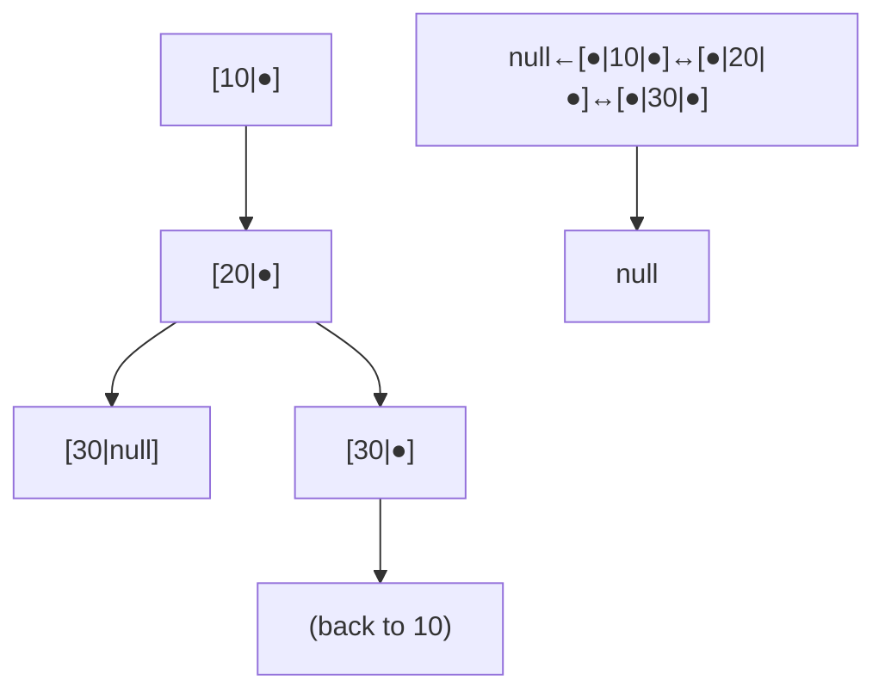
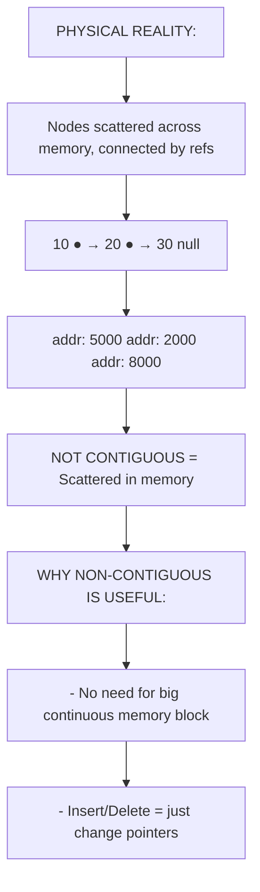
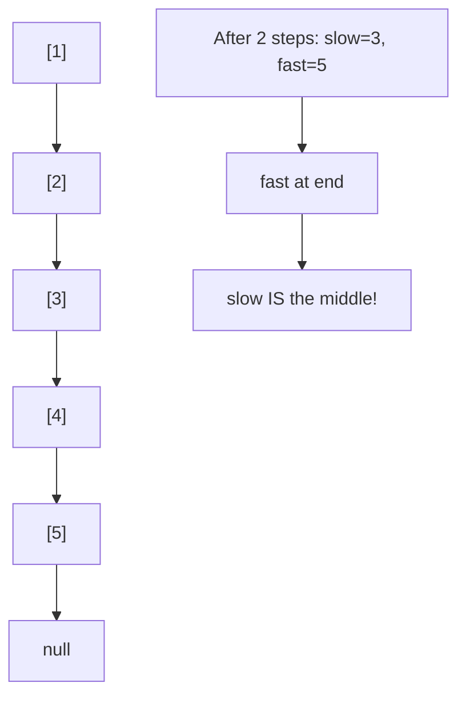
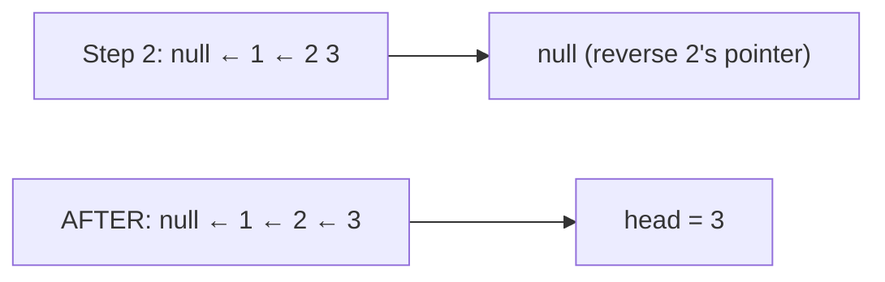
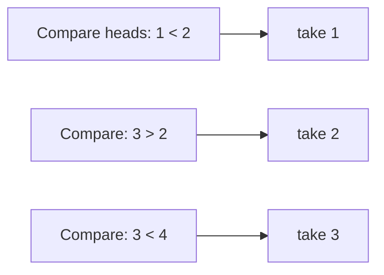

> **Navigation**: [< Previous Chapter](01b_Arrays.md) | [Back to Index](../00_MASTER_INDEX.md) | [Next Chapter >](01d_Stack_Queue.md)

---

# 🔗 Part 3: Linked List

### 5W1H: Deep Understanding

```
╔══════════════════════════════════════════════════════════════════════╗
║  WHAT: A linked list is a sequence of NODES where each node          ║
║        holds DATA and a POINTER (reference) to the next node.        ║
║        Nodes are SCATTERED in memory (not contiguous).               ║
║                                                                      ║
║  WHY:  Arrays have a fatal flaw: inserting/deleting at arbitrary     ║
║        positions requires SHIFTING all subsequent elements O(n).     ║
║        Linked lists solve this — insert/delete is O(1) pointer       ║
║        manipulation (if you have a reference to the position).       ║
║                                                                      ║
║  WHEN: Use when insertions/deletions dominate over random access.    ║
║        ✔ Implementing stacks, queues, hash table chaining            ║
║        ✔ Size unknown or changes frequently                          ║
║        ✔ LRU cache (doubly-linked list + HashMap)                    ║
║        ✘ Random access needed (use array)                            ║
║        ✘ Cache performance critical (nodes scatter in memory)        ║
║                                                                      ║
║  HOW (JVM internals):                                                ║
║  Each `new Node(data)` allocates on the Java HEAP:                   ║
║  • Object header: 12-16 bytes (mark word + klass pointer)            ║
║  • data field: 4 bytes (int) or 8 bytes (reference)                  ║
║  • next field: 4-8 bytes (compressed/uncompressed reference)         ║
║  • Total per node: ~32 bytes for a single int!                       ║
║  vs Array: 4 bytes per int (8x less memory!)                         ║
║                                                                      ║
║  GC IMPACT: Linked list nodes are scattered → harder for GC to       ║
║  traverse (poor GC locality). Pre-tenured nodes (old gen) cause      ║
║  longer full GC pauses than arrays in young gen.                     ║
║                                                                      ║
║  REAL-WORLD SYSTEM USAGE:                                            ║
║  • OS kernel: free memory blocks managed as a linked list            ║
║  • Java ConcurrentLinkedQueue: lock-free queue using CAS             ║
║  • Linux kernel: task_struct linked list for process management      ║
║  • Redis LRU: doubly-linked list for eviction ordering               ║
╚══════════════════════════════════════════════════════════════════════╝
```

## PART 0: COMPLETE UNDERSTANDING — The WHY Before the WHAT

### What Problem Does a Linked List Solve?

**The Fundamental Problem:** Arrays are **RIGID**. Once created, they sit in one contiguous memory block.
- Insert at the beginning? → Shift EVERYTHING right → **O(n)**
- Array is full? → Allocate bigger array, copy everything → **O(n)**

**Linked Lists exist because sometimes you need:**
- ✅ Frequent insertions/deletions (especially at front/middle)
- ✅ Unknown size that grows/shrinks dynamically
- ✅ No need for random access (you process sequentially)
- ✅ Building other structures (stacks, queues, graphs, hash chains)

### Who Invented It and Why?

**1955-1956:** Allen Newell, Cliff Shaw, and Herbert Simon at **RAND Corporation** needed to represent "thoughts" in an AI program called *Logic Theorist*. Thoughts connect to other thoughts — not a flat list — a **LINKED STRUCTURE**.

> 💡 **The revolutionary concept:** Each piece of data carries a *pointer* to the next piece. Until then, data was always stored in contiguous arrays.

**Impact — Linked lists became the foundation for:**
- **Stacks and Queues** (implemented via linked list)
- **Hash table chaining** (collision handling)
- **Graphs** (adjacency lists)
- **Memory allocation** (free lists in OS)
- **Undo systems**, playlists, browser history

### When to Use (and NOT Use) Linked Lists

**✅ USE Linked List when:**
- You frequently insert/delete at the **FRONT** → O(1) vs Array's O(n)
- You implement a **Stack or Queue** (LIFO/FIFO)
- You don't know the size in advance
- You're building **hash chains** (HashMap collision resolution)
- You need to merge/split lists efficiently

**❌ DO NOT USE when:**
- You need random access (`arr[i]`) → LinkedList is O(n)
- **Cache performance** matters → LinkedList has terrible cache locality
- You're mostly reading, rarely inserting → Array is better
- Memory is tight → Each node has pointer overhead (8-16 bytes extra)

### The Types at a Glance

```
SINGLY LINKED LIST:
  [10|●]→[20|●]→[30|null]
  - Each node: data + next pointer
  - Can only traverse FORWARD
  - Used in: Stack, simple queue, hash chaining

DOUBLY LINKED LIST:
  null←[●|10|●]↔[●|20|●]↔[●|30|●]→null
  - Each node: prev + data + next
  - Can traverse BOTH directions
  - Used in: LRU cache, browser history, text editors

CIRCULAR LINKED LIST:
  [10|●]→[20|●]→[30|●]→(back to 10)
  - Last node points back to first
  - No null at the end
  - Used in: Round-robin scheduling, multiplayer game turns
```

**Flow:**
- [10
- ↓
- ●]
- ↓
- [20
- ↓
- ●]
- ↓
- [20
- ↓
- ●]
- ↓
- [30
- ↓
- null]
- ↓
- null←[●
- ↓
- 10
- ↓
- ●]↔[●
- ↓
- 20
- ↓
- ●]↔[●
- ↓
- 30
- ↓
- ●]
- ↓
- null
- ↓
- [10
- ↓
- ●]
- ↓
- [20
- ↓
- ●]
- ↓
- [20
- ↓
- ●]
- ↓
- [30
- ↓
- ●]
- ↓
- [30
- ↓
- ●]
- ↓
- (back to 10)



### Mental Model: Train Cars

```
ARRAY = Subway train (fixed cars, all connected rigidly)
  [Car1][Car2][Car3][Car4][Car5]
  Adding a car in the middle? Impossible without rebuilding.

LINKED LIST = Cargo train (cars coupled by hooks)
  [Car1]--hook--[Car2]--hook--[Car3]
  Adding a car? Unhook at any point, hook new car in. DONE.
  Removing a car? Unhook from both sides, reconnect neighbors.
  
  But... to find car #500, you must walk from the locomotive
  through all 499 cars. No shortcuts! That's the O(n) access cost.
```

---


> 🔬 **Section Challenge — PART 0: COMPLETE UNDERSTANDING — The WHY Before the WHAT**

## 🧬 Nature & Behavior

### What is a Linked List?

```
PHYSICAL REALITY:
┌────────────────────────────────────────────────────┐
│ Nodes scattered across memory, connected by refs   │
│                                                    │
│  ┌────┬────┐    ┌────┬────┐    ┌────┬────┐         │
│  │ 10 │ ●──┼───→│ 20 │ ●──┼───→│ 30 │null│         │
│  └────┴────┘    └────┴────┘    └────┴────┘         │
│  addr: 5000     addr: 2000     addr: 8000          │
│                                                    │
│ NOT CONTIGUOUS = Scattered in memory               │
└────────────────────────────────────────────────────┘

WHY NON-CONTIGUOUS IS USEFUL:
- No need for big continuous memory block
- Insert/Delete = just change pointers
- Size can grow infinitely (until memory full)
```

**Flow:**
- PHYSICAL REALITY:
- ↓
- Nodes scattered across memory, connected by refs
- ↓
- 10 ●
- ↓
- 20 ●
- ↓
- 30 null
- ↓
- 10 ●
- ↓
- 20 ●
- ↓
- 30 null
- ↓
- addr: 5000 addr: 2000 addr: 8000
- ↓
- NOT CONTIGUOUS = Scattered in memory
- ↓
- WHY NON-CONTIGUOUS IS USEFUL:
- ↓
- - No need for big continuous memory block



### Linked List vs Array

| Operation        | Array  | LinkedList  | Winner     |
| ---------------- | ------ | ----------- | ---------- |
| Access by index  | O(1)   | O(n)        | Array      |
| Insert at start  | O(n)   | O(1)        | LinkedList |
| Insert at end    | O(1)\* | O(n)†       | Array      |
| Insert at middle | O(n)   | O(1)‡       | LinkedList |
| Memory usage     | Less   | More (refs) | Array      |
| Cache friendly   | Yes    | No          | Array      |

\*If space available  
†O(1) if tail pointer maintained  
‡O(1) if position known, O(n) to find position

### 🔴 Real-World Origin: Music Playlist (1980s)

**Problem (Early MP3 Players):**
- User creates playlist of **1,000 songs**
- User wants to add a song in the middle
- User wants to remove the current song

**With Array:** Adding song at position 500 means shifting 500 songs. On slow hardware: **2 seconds delay!** User experience: *terrible.*

**Solution — Linked List:**
- Each song points to next song
- Insert = change 2 pointers → **O(1)**
- Delete = change 1 pointer → **O(1)**

> 🎵 **Real Implementation:** iTunes (2001) used LinkedList for playlists. Spotify uses a **doubly-linked list**. The "Previous" and "Next" buttons are literally `prev` / `next` pointers!

## 💻 Implementation WITHOUT Collections

```java
public class MyLinkedList {

    // Node class (inner)
    private class Node {
        int data;
        Node next;

        Node(int data) {
            this.data = data;
            this.next = null;
        }
    }

    private Node head;
    private Node tail;
    private int size;

    public MyLinkedList() {
        head = null;
        tail = null;
        size = 0;
    }

    // ADD at end - O(1) with tail pointer
    public void add(int value) {
        Node newNode = new Node(value);
        if (head == null) {
            head = tail = newNode;
        } else {
            tail.next = newNode;
            tail = newNode;
        }
        size++;
    }

    // ADD at beginning - O(1)
    public void addFirst(int value) {
        Node newNode = new Node(value);
        newNode.next = head;
        head = newNode;
        if (tail == null) {
            tail = newNode;
        }
        size++;
    }

    // INSERT at index - O(n) to find, O(1) to insert
    public void insert(int index, int value) {
        if (index == 0) {
            addFirst(value);
            return;
        }

        Node current = head;
        for (int i = 0; i < index - 1; i++) {
            current = current.next;
        }

        Node newNode = new Node(value);
        newNode.next = current.next;
        current.next = newNode;

        if (newNode.next == null) {
            tail = newNode;
        }
        size++;
    }

    // GET - O(n)
    public int get(int index) {
        Node current = head;
        for (int i = 0; i < index; i++) {
            current = current.next;
        }
        return current.data;
    }

    // DELETE first - O(1)
    public int deleteFirst() {
        if (head == null) throw new RuntimeException("Empty list");
        int value = head.data;
        head = head.next;
        if (head == null) tail = null;
        size--;
        return value;
    }

    // DELETE at index - O(n)
    public int delete(int index) {
        if (index == 0) return deleteFirst();

        Node current = head;
        for (int i = 0; i < index - 1; i++) {
            current = current.next;
        }

        int value = current.next.data;
        current.next = current.next.next;

        if (current.next == null) {
            tail = current;
        }
        size--;
        return value;
    }

    // REVERSE - O(n) - IMPORTANT FOR INTERVIEWS!
    public void reverse() {
        Node prev = null;
        Node current = head;
        tail = head;  // Old head becomes new tail

        while (current != null) {
            Node next = current.next;  // Save next
            current.next = prev;       // Reverse pointer
            prev = current;            // Move prev forward
            current = next;            // Move current forward
        }

        head = prev;  // New head is last node
    }

    // DETECT CYCLE - Floyd's Algorithm
    public boolean hasCycle() {
        if (head == null) return false;

        Node slow = head;
        Node fast = head;

        while (fast != null && fast.next != null) {
            slow = slow.next;
            fast = fast.next.next;
            if (slow == fast) return true;
        }
        return false;
    }

    // FIND MIDDLE - O(n)
    public int findMiddle() {
        Node slow = head;
        Node fast = head;

        while (fast != null && fast.next != null) {
            slow = slow.next;
            fast = fast.next.next;
        }
        return slow.data;
    }

    public int size() {
        return size;
    }
}
```

## 🎯 LeetCode → Real-World Connection

### Problem: Reverse Linked List

> 🏛️ **Real-World Origin:** Undo Feature in Text Editors (1970s)

**Problem at Xerox PARC (1974):**
- Text editor needed an "Undo" feature
- Each edit stored as a node in a list
- Undo = go **backwards** through edits

**Initial Approach:** Singly linked list `Edit1 → Edit2 → Edit3`. But undo requires going backwards — and you *can't go backwards* in a singly linked list!

**Solution Options:**
1. Use **doubly linked list** (more memory)
2. **Reverse the list** when needed
3. Store in reverse order

> 💡 **Thinking Process:** "What if we could reverse the direction of arrows?"
> `Edit1 → Edit2 → Edit3` becomes `Edit1 ← Edit2 ← Edit3`

**Now used in:** Git (reverse commit history), Browser back button, Database transaction rollback

---

---

## 🏋️ Foundation Practice — LinkedList Basics

### 📦 Group A — Core Operations

**Q1 — Traverse and Print**
```java
Node curr = head;
while (curr != null) { System.out.print(curr.data + " "); curr = curr.next; }
```

**Q2 — Count Nodes**
```java
int count = 0;
Node curr = head;
while (curr != null) { count++; curr = curr.next; }
```

**Q3 — Search for a Value**
```java
// Linear Search — O(n) — optimal (no random access in LL)
Node curr = head;
while (curr != null) {
    if (curr.data == target) return true;
    curr = curr.next;
}
return false;
```

**Q4 — Find Middle Node** *(preview of Fast/Slow Pointers)*
```java
// Brute: count n, traverse n/2 — O(n) two passes
// Better: Fast/Slow pointer — O(n) ONE pass
Node slow = head, fast = head;
while (fast != null && fast.next != null) {
    slow = slow.next;
    fast = fast.next.next;
}
// slow is now at middle
```
> 💡 **This is your first taste of the Two Pointer (Slow/Fast) pattern!**
> You'll learn it fully in the next section.

**Q5 — Insert at Beginning** — O(1)
```java
Node newNode = new Node(value);
newNode.next = head;
head = newNode;
```

**Q6 — Insert at End** — O(n) without tail, O(1) with tail pointer
```java
Node newNode = new Node(value);
if (head == null) { head = tail = newNode; return; }
tail.next = newNode;
tail = newNode;
```

**Q7 — Delete by Value**
```java
if (head.data == value) { head = head.next; return; }
Node prev = head, curr = head.next;
while (curr != null) {
    if (curr.data == value) { prev.next = curr.next; return; }
    prev = curr; curr = curr.next;
}
```

---

### 🎯 Practice Problems — Foundation Level

| Problem | Platform | Difficulty | Concept |
|---------|----------|------------|---------|
| LC 206 — Reverse Linked List | LeetCode | ⭐ Easy | Pointer manipulation |
| LC 237 — Delete Node in LL | LeetCode | ⭐ Easy | Copy-and-skip trick |
| LC 83 — Remove Duplicates | LeetCode | ⭐ Easy | Single pass |
| LC 21 — Merge Two Sorted Lists | LeetCode | ⭐ Easy | Two pointer merge |

---

## 🧠 Interview Patterns — The 4 LinkedList Techniques You MUST Know

### Pattern 1: Two Pointers (Slow/Fast — "Tortoise and Hare")

**Use for:** Find middle, detect cycle, find nth from end

> 💡 **Why it works:** Fast moves at 2x speed → when fast reaches end, slow is at middle. If there's a cycle → fast will eventually "lap" slow.

```
             slow
              ↓
  [1] → [2] → [3] → [4] → [5] → null
                             ↑
                            fast

  After 2 steps: slow=3, fast=5 → fast at end → slow IS the middle!
```

**Flow:**
- [1]
- ↓
- [2]
- ↓
- [3]
- ↓
- [4]
- ↓
- [5]
- ↓
- null
- ↓
- After 2 steps: slow=3, fast=5
- ↓
- fast at end



```java
// Find Nth node from end (one-pass, O(1) space)
// WHY: advance fast by N first, then move both → when fast
//      hits null, slow is exactly N from the end
ListNode nthFromEnd(ListNode head, int n) {
    ListNode fast = head, slow = head;
    for (int i = 0; i < n; i++) fast = fast.next;  // Gap of N
    while (fast != null) {
        slow = slow.next;
        fast = fast.next;
    }
    return slow;
}
```

### Pattern 2: Reverse a Linked List (Iterative)

> 🏆 **This is the #1 interview technique** — appears in 10+ LeetCode problems directly. Also a sub-step in: palindrome check, reorder list, reverse K-group.

**Key Insight:** Change arrow direction one by one:

```
  BEFORE: 1 → 2 → 3 → null
  
  Step 1: null ← 1    2 → 3 → null   (reverse 1's pointer)
  Step 2: null ← 1 ← 2    3 → null   (reverse 2's pointer)
  Step 3: null ← 1 ← 2 ← 3           (reverse 3's pointer)
  
  AFTER:  null ← 1 ← 2 ← 3  →  head = 3
```

**Flow:**
- Step 2: null ← 1 ← 2 3
- ↓
- null (reverse 2's pointer)
- ↓
- AFTER: null ← 1 ← 2 ← 3
- ↓
- head = 3



### Pattern 3: Merge Two Sorted Lists

> **Foundation for merge sort on linked lists, and a common interview question.**

```
     L1: 1 → 3 → 5
     L2: 2 → 4 → 6
     
     Compare heads: 1 < 2 → take 1
     Compare: 3 > 2 → take 2
     Compare: 3 < 4 → take 3
     ...
     Result: 1 → 2 → 3 → 4 → 5 → 6
```

**Flow:**
- Compare heads: 1 < 2
- ↓
- take 1
- ↓
- Compare: 3 > 2
- ↓
- take 2
- ↓
- Compare: 3 < 4
- ↓
- take 3



### Pattern 4: Dummy Head Node

Avoids special-casing "what if the head changes?"

**Without dummy:**
```java
if (head meets condition) head = head.next;  // Special case!
else { /* ... find and remove ... */ }
```

**With dummy:**
```java
ListNode dummy = new ListNode(0);
dummy.next = head;
// ... process normally, head never needs special case ...
return dummy.next;  // The real head
```

> ✅ **Use when:** Deleting nodes, merging lists, partitioning

---

## ⚡ Quick Problem Walkthrough: Detect Cycle Start Point

**Problem:** Given a linked list that may have a cycle, find **WHERE** the cycle begins.

**Step 1 — Detect if cycle exists** (Floyd's algorithm):
Slow moves 1 step, fast moves 2 steps. If they meet → cycle exists.

**Step 2 — Find the start** (the mathematical trick):
Reset ONE pointer to head, keep the other at meeting point. Both move 1 step at a time → they meet at cycle **START**.

> 🧠 **Why this works (the math):**
> - Let distance from head to cycle start = **A**
> - Let distance from cycle start to meeting point = **B**
> - Let cycle length = **C**
> - When they meet: slow traveled `A + B`, fast traveled `A + B + C`
> - Since fast = 2 × slow: `A + B + C = 2(A + B)` → `C = A + B` → **`A = C - B`**
> - So distance from head to start (A) = distance from meeting to start (C - B)
> - Move both at same speed → **they meet at the start!**

```java
ListNode detectCycleStart(ListNode head) {
    ListNode slow = head, fast = head;
    
    // Phase 1: Detect cycle
    while (fast != null && fast.next != null) {
        slow = slow.next;
        fast = fast.next.next;
        if (slow == fast) break;
    }
    if (fast == null || fast.next == null) return null; // No cycle
    
    // Phase 2: Find start
    slow = head;
    while (slow != fast) {
        slow = slow.next;
        fast = fast.next;
    }
    return slow; // Cycle start node
}
```

---

---


> 🔬 **Section Challenge — ⚡ Quick Problem Walkthrough: Detect Cycle Start Point**

## ⚡ Advanced Patterns — LinkedList

### Pattern 5: Reverse K-Group

```java
// LC 25 — Reverse Nodes in k-Group
public ListNode reverseKGroup(ListNode head, int k) {
    ListNode curr = head;
    int count = 0;
    while (curr != null && count < k) { curr = curr.next; count++; }
    if (count < k) return head;           // less than k nodes remaining

    // Reverse k nodes
    ListNode prev = null; curr = head;
    for (int i = 0; i < k; i++) {
        ListNode next = curr.next;
        curr.next = prev;
        prev = curr; curr = next;
    }
    // head is now tail of reversed group — connect to next group
    head.next = reverseKGroup(curr, k);
    return prev;
}
```

### Pattern 6: Palindrome Check O(n) time O(1) space

```
Step 1: Find middle (slow/fast)
Step 2: Reverse second half
Step 3: Compare first and second halves
Step 4: Restore (optional but good practice)
```

```java
public boolean isPalindrome(ListNode head) {
    // Step 1: Find middle
    ListNode slow = head, fast = head;
    while (fast != null && fast.next != null) {
        slow = slow.next; fast = fast.next.next;
    }
    // Step 2: Reverse second half
    ListNode prev = null, curr = slow;
    while (curr != null) { ListNode t = curr.next; curr.next = prev; prev = curr; curr = t; }
    // Step 3: Compare
    ListNode left = head, right = prev;
    while (right != null) {
        if (left.val != right.val) return false;
        left = left.next; right = right.next;
    }
    return true;
}
```

---


> 🔬 **Section Challenge — ⚡ Advanced Patterns — LinkedList**

## 🎯 Full Problem Set — LinkedList

| # | Problem | Platform | Difficulty | Pattern |
|---|---------|----------|------------|---------|
| 1 | LC 206 — Reverse Linked List | LeetCode | ⭐ Easy | Reverse (iterative) |
| 2 | LC 21 — Merge Two Sorted Lists | LeetCode | ⭐ Easy | Dummy head + merge |
| 3 | LC 141 — Linked List Cycle | LeetCode | ⭐ Easy | Fast/Slow detect |
| 4 | LC 83 — Remove Duplicates | LeetCode | ⭐ Easy | Single pass |
| 5 | LC 19 — Remove Nth From End | LeetCode | ⭐⭐ Med | Fast/Slow gap of N |
| 6 | LC 142 — Cycle II — Find Start | LeetCode | ⭐⭐ Med | Floyd's math |
| 7 | LC 234 — Palindrome LL | LeetCode | ⭐⭐ Med | Reverse half |
| 8 | LC 148 — Sort List | LeetCode | ⭐⭐ Med | Merge sort on LL |
| 9 | LC 25 — Reverse K-Group | LeetCode | ⭐⭐⭐ Hard | Recursive reverse |
| 10 | CF 237B — Program for Tanya | Codeforces | Div2-B | LL simulation |

---


> 🔬 **Section Challenge — 🎯 Full Problem Set — LinkedList**

## 🧠 Pattern Fingerprint — LinkedList

```
SEE THESE WORDS → USE THIS PATTERN:
┌──────────────────────────────────────────────────────────────┐
│ "middle of linked list"           → Fast/Slow (O(n) 1 pass) │
│ "detect cycle"                    → Fast/Slow — Floyd's      │
│ "cycle start / entry point"       → Floyd's 2-phase math     │
│ "nth node from end"               → Gap of N (Fast/Slow)     │
│ "reverse linked list"             → 3 pointer iterative      │
│ "merge two sorted lists"          → Dummy head pointer       │
│ "palindrome linked list"          → Reverse half + compare   │
│ "head may change"                 → Use dummy head node      │
└──────────────────────────────────────────────────────────────┘
```

### 🚀 GO LEARN — When You Need More

| Need | Go Here |
|------|---------|
| Two Pointers concepts | 📖 [07_Two_Pointers_Complete.md](../04_Patterns_Templates/07_Two_Pointers_Complete.md) |
| LL + Two Pointers problems | 📖 [12_LinkedList_Plus_TwoPointers.md](../04_Patterns_Templates/12_LinkedList_Plus_TwoPointers.md) |
| Practice problems | 📖 [15_LinkedList.md](../05_Problem_Solving/15_LinkedList.md) |

### 📅 Revisit Tracker
- **Day 3:** Redo LC 206 (Reverse) + LC 141 (Cycle detect) from memory
- **Day 7:** Redo LC 142 (Cycle start) — recall the math proof

---

📖 **Related Files:**
- [14_Mental_Models/03_Graph_Tree_Thinking.md](../14_Mental_Models/03_Graph_Tree_Thinking.md) — Graph/tree mental models
- [04_Patterns_Templates/12_LinkedList_Plus_TwoPointers.md](../04_Patterns_Templates/12_LinkedList_Plus_TwoPointers.md) — LinkedList pattern problems
- [05_Problem_Solving/01_Intro_Checklist.md](../05_Problem_Solving/01_Intro_Checklist.md) — Practice problems


---

---


> 🔬 **Section Challenge — 🧠 Pattern Fingerprint — LinkedList**

## ✅ You Know Linked Lists — Now Practice! (JIT Study Path)

> **Step 1 — Basic Problems (Warm Up):**

| Problem | LC # | Pattern | Key Concept |
|---|---|---|---|
| Reverse Linked List | LC 206 | 3-pointer reversal | `prev=null; cur=head; save next; flip; advance` |
| Middle of Linked List | LC 876 | Fast & Slow | When fast=end, slow=middle |
| Linked List Cycle | LC 141 | Floyd's algorithm | fast catches slow inside cycle |
| Merge Two Sorted Lists | LC 21 | Dummy head | `dummy.next` = clean merge output |
| Remove Nth from End | LC 19 | Two-pass or 2-pointer gap | gap of N between fast and slow |

>
> **Step 2 — Hit a wall? Learn these patterns:**
> - Cycle / Middle → **[Fast & Slow Pointers](../04_Patterns_Templates/12_LinkedList_Plus_TwoPointers.md)**
> - Reversal → **[Two Pointers + LL Patterns](../04_Patterns_Templates/12_LinkedList_Plus_TwoPointers.md)**
>
> **Step 3 — Apply patterns on harder problems:**
> 👉 **[Go to LinkedList Problem Solving File →](../05_Problem_Solving/15_LinkedList.md)**
>
> **Step 4 — Competitive Practice:**

| CF Problem | Topic | Difficulty |
|---|---|---|
| [CF 25A — IQ Test](https://codeforces.com/problemset/problem/25/A) | List traversal | ⭐ Easy |
| [CF 863B — Mahmoud and Ehab and the bipartiteness](https://codeforces.com/problemset/problem/863/B) | Graph + LL concepts | ⭐⭐ Medium |

>
> 🌍 **Real-World Connections:**
> - **Git commit history** = doubly linked list (each commit points to parent)
> - **Browser back/forward** = doubly linked list of pages
> - **LRU Cache** = HashMap + Doubly Linked List (LC 146 — used in Redis, OS page cache)
> - **Java's LinkedHashMap** maintains insertion order using a doubly linked list internally

---


---

## 🏋️ Practice & Interview Questions — Linked Lists

### Predict / Trace
**Q1.** Trace: reverse a linked list `1→2→3→null` manually. Show prev/curr at each step.
<details><summary>Answer</summary>

Step 1: prev=null, curr=1 → 1.next=null, prev=1, curr=2
Step 2: prev=1, curr=2 → 2.next=1, prev=2, curr=3
Step 3: prev=2, curr=3 → 3.next=2, prev=3, curr=null
Result: 3→2→1→null
</details>

**Q2.** Floyd's cycle detection — if fast and slow both start at head, and list has no cycle, when does fast reach null?
<details><summary>Answer</summary>

Fast moves 2 steps per iteration. For odd length N: fast reaches null at step (N+1)/2. For even N: fast reaches null at step N/2.
</details>

### LeetCode / Coding
**Q3.** ⭐ Reverse a Linked List (iterative + recursive).
<details><summary>Solution</summary>

```java
// Iterative
ListNode prev=null, curr=head;
while(curr!=null){ ListNode next=curr.next; curr.next=prev; prev=curr; curr=next; }
return prev;

// Recursive
ListNode reverseList(ListNode head){
    if(head==null||head.next==null) return head;
    ListNode rest = reverseList(head.next);
    head.next.next = head; head.next = null;
    return rest;
}
```
</details>

**Q4.** ⭐ Detect cycle in LinkedList (Floyd's Algorithm).
<details><summary>Solution</summary>

```java
ListNode slow=head, fast=head;
while(fast!=null && fast.next!=null){
    slow=slow.next; fast=fast.next.next;
    if(slow==fast) return true;
}
return false;
```
</details>

**Q5.** ⭐ Find middle of LinkedList.
<details><summary>Solution</summary>

```java
ListNode slow=head, fast=head;
while(fast!=null && fast.next!=null){ slow=slow.next; fast=fast.next.next; }
return slow; // slow is at middle
```
</details>

**Q6.** ⭐ Merge two sorted linked lists.
<details><summary>Solution</summary>

```java
ListNode dummy=new ListNode(0), curr=dummy;
while(l1!=null && l2!=null){
    if(l1.val<=l2.val){ curr.next=l1; l1=l1.next; }
    else { curr.next=l2; l2=l2.next; }
    curr=curr.next;
}
curr.next = (l1!=null)?l1:l2;
return dummy.next;
```
</details>

**Q7.** ⭐⭐ Remove Nth node from end of list.
<details><summary>Solution</summary>

```java
ListNode dummy=new ListNode(0); dummy.next=head;
ListNode fast=dummy, slow=dummy;
for(int i=0;i<=n;i++) fast=fast.next;
while(fast!=null){ fast=fast.next; slow=slow.next; }
slow.next=slow.next.next;
return dummy.next;
```
</details>

**Q8.** ⭐⭐ Find the start of a cycle (Floyd's phase 2).
<details><summary>Solution</summary>

```java
// After meeting point found, reset slow to head
slow=head;
while(slow!=fast){ slow=slow.next; fast=fast.next; }
return slow; // start of cycle
```
</details>

**Q9.** ⭐⭐ LRU Cache — implement with O(1) get and put.
<details><summary>Solution</summary>

```java
// HashMap<key, Node> + Doubly Linked List
// Most recently used at tail, least recently used at head
// put: add to tail, if capacity exceeded remove head
// get: move accessed node to tail
class LRUCache {
    Map<Integer,Node> map = new HashMap<>();
    Node head, tail;
    int cap;
    // ... (standard doubly-linked list implementation)
}
```
</details>

**Q10.** ⭐⭐ Palindrome LinkedList — O(N) time, O(1) space.
<details><summary>Solution</summary>

```java
// 1. Find middle (slow/fast)
// 2. Reverse second half
// 3. Compare first and reversed second half
// 4. Restore list (optional)
```
</details>

**Q11.** ⭐⭐⭐ Merge K sorted lists — O(N log K) with PriorityQueue.
<details><summary>Solution</summary>

```java
PriorityQueue<ListNode> pq = new PriorityQueue<>((a,b)->a.val-b.val);
for(ListNode l:lists) if(l!=null) pq.offer(l);
ListNode dummy=new ListNode(0), curr=dummy;
while(!pq.isEmpty()){
    ListNode node=pq.poll(); curr.next=node; curr=curr.next;
    if(node.next!=null) pq.offer(node.next);
}
return dummy.next;
```
</details>

### Interview Questions
**Q12.** Why is deleting from the middle of a LinkedList O(1) if you have the node reference, but finding it is O(N)?
<details><summary>Answer</summary>

LinkedList nodes store next/prev pointers. Given a node reference: `prev.next = node.next` is O(1). But traversal from head to find the node is O(N) since there's no index-based access.
</details>

**Q13.** `ArrayList` vs `LinkedList` — when is LinkedList NEVER the right choice?
<details><summary>Answer</summary>

For random access (get by index), sorting, or bulk iteration — ArrayList wins due to cache locality. LinkedList's O(N) random access kills performance. In practice, ArrayList + ArrayDeque cover almost all use cases.
</details>

### MCQ Rapid Fire
| # | Question | Answer |
|---|---|---|
| 1 | Singly linked list deletion from tail | O(N) — must find second-to-last |
| 2 | Doubly linked list deletion from tail | O(1) — use tail.prev |
| 3 | Java LinkedList implements | List + Deque |
| 4 | addFirst() vs addLast() time complexity | O(1) both |
| 5 | Floyd's algorithm space complexity | O(1) |
| 6 | Reversing a linked list space complexity | O(1) iterative, O(N) recursive |
| 7 | Sentinel/dummy node purpose | Simplifies edge cases (empty list, single node) |
| 8 | Skip List uses linked lists for | O(log N) average search |


---

## 🧠 Deep Conceptual Questions — Linked Lists

**C1. Why does Java's `LinkedList` implement both `List` AND `Deque`?**
<details><summary>Deep Answer</summary>

A doubly-linked list naturally supports O(1) operations at BOTH ends: `addFirst`, `addLast`, `removeFirst`, `removeLast`. This makes it a perfect Deque (double-ended queue). Java's designers unified the implementations: one data structure, two contracts. `ArrayDeque` is usually faster for queue/stack operations due to cache locality, but LinkedList covers cases needing both List index access and queue behavior (theoretically — in practice, ArrayDeque + ArrayList cover all needs better).
</details>

**C2. Why is Floyd's cycle detection called "tortoise and hare"?**
<details><summary>Deep Answer</summary>

The slow pointer (tortoise) moves 1 step; fast pointer (hare) moves 2. If a cycle exists, the hare enters it first. The tortoise then enters. Since hare moves faster, it gradually gains on the tortoise inside the cycle. The "distance gap" between them decreases by 1 per step inside the cycle. They MUST meet within at most cycle_length steps after the tortoise enters. The meeting point is always WITHIN the cycle. Phase 2 (finding start): reset slow to head, both move 1 step → they meet at cycle start. This works due to modular arithmetic: the distance math works out to exactly the cycle start.
</details>

**C3. Why is `dummy.next = head` pattern so useful in linked list problems?**
<details><summary>Deep Answer</summary>

It eliminates the special case of modifying the head node. Without dummy: "what if I need to delete the head?" needs separate code. With dummy: the real head is just `dummy.next`. You can delete `dummy.next` using the same code as any other node (`prev.next = prev.next.next`). Same logic applies to insertion, merging. Dummy node costs O(1) extra space and saves significant code complexity and potential null-pointer bugs.
</details>

**C4. Reverse a linked list: what's the fundamental insight?**
<details><summary>Deep Answer</summary>

You need to change every `next` pointer from pointing forward to pointing backward. The problem: if you change `curr.next` to `prev`, you lose your reference to `curr.next` (the next node to process). Solution: always save `next` BEFORE changing the pointer. The 3-variable dance: `next = curr.next; curr.next = prev; prev = curr; curr = next`. The recursion version reverses from the tail backward — simpler to reason about (`head.next.next = head; head.next = null`) but uses O(N) stack space.
</details>

**C5. LRU Cache: why is a HashMap + Doubly Linked List the optimal data structure?**
<details><summary>Deep Answer</summary>

Requirements: O(1) get (by key) AND O(1) update order (move to "most recent"). HashMap alone: O(1) get but can't track recency order. LinkedList alone: O(N) get by key. Combined: HashMap maps key → node pointer in the doubly-linked list. Get: HashMap lookup = O(1) to find node, then O(1) pointer manipulation to move to tail. Evict: remove head (LRU) = O(1). Insert: add to tail = O(1). The doubly-linked nature is critical: moving a node requires updating BOTH its predecessor and successor, which requires O(1) access to both — only possible with `prev` pointer.
</details>

**C6. Why does the "find middle" technique use slow/fast instead of counting length then dividing?**
<details><summary>Deep Answer</summary>

Two reasons: (1) **Single pass**: length counting needs one full traversal, then half traversal = 1.5N operations. Slow/fast finds middle in N/2 steps — one pass. (2) **Cleaner integration**: in `palindrome check`, `sort linked list`, `split into halves` problems, you need the middle during traversal anyway. The slow/fast approach composes naturally into these algorithms without a separate counting phase.
</details>

**C7. Merge two sorted lists: why is the dummy node + two-pointer approach textbook?**
<details><summary>Deep Answer</summary>

It reduces the problem to: at each step, pick the smaller head from two lists and advance that pointer. The dummy node holds the result list start. This mirrors merge-sort's merge step exactly. The invariant: `curr` always points to the last node of the merged list, ready to accept the next smallest. Time O(M+N), space O(1) (just pointer manipulation, no new nodes). The final `curr.next = l1 != null ? l1 : l2` handles the remaining tail in O(1) — no loop needed since one list is already sorted.
</details>


> **Navigation**: [< Previous](01b_Arrays.md) | [Back to Index](../00_MASTER_INDEX.md) | [Next >](01d_Stack_Queue.md)