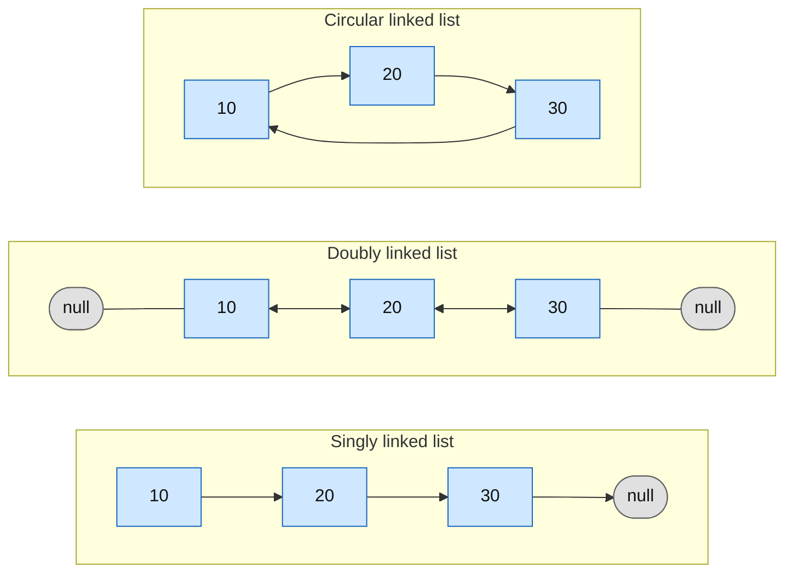
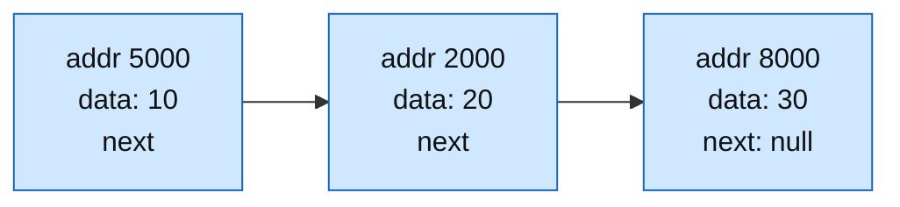

# PART 0: COMPLETE UNDERSTANDING — The WHY Before the WHAT

> **Navigation**: [Chapter overview](../01c_LinkedList.md) | [Implementation WITHOUT Collections →](02_implementation_without_collections.md)
> Page 1 of 4 in **Linked Lists**


## What Problem Does a Linked List Solve?

**The Fundamental Problem:** Arrays are **RIGID**. Once created, they sit in one contiguous memory block.

- Insert at the beginning? → Shift EVERYTHING right → **O(n)**
- Array is full? → Allocate bigger array, copy everything → **O(n)**

**Linked Lists exist because sometimes you need:**

- ✅ Frequent insertions/deletions (especially at front/middle)
- ✅ Unknown size that grows/shrinks dynamically
- ✅ No need for random access (you process sequentially)
- ✅ Building other structures (stacks, queues, graphs, hash chains)

## Who Invented It and Why?

**1955-1956:** Allen Newell, Cliff Shaw, and Herbert Simon at **RAND Corporation** needed to represent "thoughts" in an AI program called _Logic Theorist_. Thoughts connect to other thoughts — not a flat list — a **LINKED STRUCTURE**.

> 💡 **The revolutionary concept:** Each piece of data carries a _pointer_ to the next piece. Until then, data was always stored in contiguous arrays.

**Impact — Linked lists became the foundation for:**

- **Stacks and Queues** (implemented via linked list)
- **Hash table chaining** (collision handling)
- **Graphs** (adjacency lists)
- **Memory allocation** (free lists in OS)
- **Undo systems**, playlists, browser history

## When to Use (and NOT Use) Linked Lists

**✅ USE Linked List when:**

- You frequently insert/delete at the **FRONT** → O(1) vs Array's O(n)
- You implement a **Stack or Queue** (LIFO/FIFO)
- You don't know the size in advance
- You're building **hash chains** (HashMap collision resolution)
- You need to merge/split lists efficiently

**❌ DO NOT USE when:**

- You need random access (`arr[i]`) → LinkedList is O(n)
- **Cache performance** matters → LinkedList has terrible cache locality
- You're mostly reading, rarely inserting → Array is better
- Memory is tight → Each node has pointer overhead (8-16 bytes extra)

## The Types at a Glance



**How to read this diagram.** Each box is a node. Arrows are references; grey `null` marks the end of a list.

| Type | Node layout | Traversal | Used in |
| ---- | ----------- | --------- | ------- |
| **Singly** | data + `next` | Forward only | Stack, simple queue, hash chaining |
| **Doubly** | `prev` + data + `next` | Both directions | LRU cache, browser history, text editors |
| **Circular** | last node points back to the first (no `null` end) | Forward, wraps around | Round-robin scheduling, multiplayer game turns |

## Linked List Variants Comparison Table

| Variant             | Node Fields                     | Memory Overhead per Node             | Search (avg) | Insert/Delete (at known pos) | Cache Behavior               | When to Use                                                | Java/OpenJDK Representation                                                 |
| ------------------- | ------------------------------- | ------------------------------------ | ------------ | ---------------------------- | ---------------------------- | ---------------------------------------------------------- | --------------------------------------------------------------------------- |
| **Singly Linked**   | `data`, `next`                  | ~16-24 bytes (next ref)              | O(n)         | O(1) insert, O(n) delete\*   | Poor (scattered nodes)       | Stack, simple queues, hash chaining                        | `java.util.LinkedList` uses this internally for traversal                   |
| **Doubly Linked**   | `data`, `prev`, `next`          | ~24-32 bytes (2 refs)                | O(n)         | O(1) bidirectional           | Poor (scattered nodes)       | LRU cache, browser history, text editors                   | `java.util.LinkedList` is doubly-linked; `LinkedHashMap` uses this          |
| **Circular Singly** | `data`, `next`                  | ~16-24 bytes (next ref)              | O(n)         | O(1) with tail pointer       | Poor                         | Round-robin scheduling, multiplayer game turn order        | `java.util.concurrent.ConcurrentLinkedQueue` (CAS-based, circular)          |
| **Circular Doubly** | `data`, `prev`, `next`          | ~24-32 bytes (2 refs)                | O(n)         | O(1) bidirectional with wrap | Poor                         | Re-do/undo systems, circular buffers, music playlist loops | `java.util.LinkedHashMap` maintains circular references for iteration order |
| **Skip List**       | `data`, multiple `next` (level) | O(log n) refs per node (16-48 bytes) | O(log n)     | O(log n)                     | Moderate (leveled structure) | Concurrent sorted maps, `ConcurrentSkipListMap`            | `java.util.concurrent.ConcurrentSkipListMap` is skip list                   |
| **XOR Linked**      | `data`, `xor` (prev XOR next)   | ~12-20 bytes (1 field vs 2)          | O(n)         | O(n) (need both neighbors)   | Poor                         | Memory-constrained embedded systems                        | Not in standard JDK; requires pointer arithmetic in C/C++                   |

> **Key insight:** Memory overhead is the primary tradeoff. A doubly-linked list node for a single `int` costs ~32 bytes vs 4 bytes for an array element. Use an array when memory locality matters. Use a skip list when you need sorted access with better-than-linear search.

> **Invariant (Doubly-Linked List):** For every non-sentinel node `node` in a properly-formed doubly-linked list: `node.prev.next == node` and `node.next.prev == node`. Violation of this bidirectional invariant at any point indicates **list corruption** (a memory bug, dangling pointer, or concurrency race).

## Mental Model: Train Cars

```
ARRAY = Subway train (fixed cars, all connected rigidly)
  [Car1][Car2][Car3][Car4][Car5]
  Adding a car in the middle? Impossible without rebuilding.

LINKED LIST = Cargo train (cars coupled by hooks)
  [Car1]--hook--[Car2]--hook--[Car3]
  Adding a car? Unhook at any point, hook new car in. DONE.
  Removing a car? Unhook from both sides, reconnect neighbors.

  But... to find car #500, you must walk from the locomotive
  through all 499 cars. No shortcuts! That's the O(n) access cost.
```

---

> 🔬 **Section Challenge — PART 0: COMPLETE UNDERSTANDING — The WHY Before the WHAT**
>
> **Challenge 1 (Design):** You are designing the Undo/Redo history for a memory-constrained text editor. Why is a Doubly Linked List the optimal choice over a dynamic Array or a Singly Linked List?
>
> <details><summary>Answer</summary>
>
> **Scenario:** Managing state history with limited memory.
> **Trace:**
>
> 1. **Dynamic Array:** If the array gets full, it must allocate a new chunk of contiguous memory (often 2x the size) and copy everything. In a memory-constrained environment, finding a large contiguous block might fail (Heap Fragmentation), causing an OutOfMemory error.
> 2. **Singly Linked List:** You can undo (pop the head), but what if you want to cap the history at 100 states and drop the oldest state when state 101 arrives? Deleting the tail in a singly linked list requires an O(N) traversal.
> **Design Fix:** A **Doubly Linked List** (combined with a HashMap if it's an LRU cache) allows O(1) tail deletion and doesn't require contiguous memory. The extra 8 bytes for the `prev` pointer is a worthwhile tradeoff to prevent O(N) lag spikes during edits.
>  </details>

## 🧬 Nature & Behavior

### What is a Linked List?

**Physical reality:** nodes are scattered across memory and connected by references.



**How to read this diagram.** Each box is one node at its own address; the arrows are the `next` references. The addresses are *not* consecutive, so the list is **not contiguous**.

**Why non-contiguous is useful:**

- No need for one big contiguous memory block
- Insert/delete = just change pointers
- Size can grow until memory is full

### Linked List vs Array

| Operation        | Array  | LinkedList  | Winner     |
| ---------------- | ------ | ----------- | ---------- |
| Access by index  | O(1)   | O(n)        | Array      |
| Insert at start  | O(n)   | O(1)        | LinkedList |
| Insert at end    | O(1)\* | O(n)†       | Array      |
| Insert at middle | O(n)   | O(1)‡       | LinkedList |
| Memory usage     | Less   | More (refs) | Array      |
| Cache friendly   | Yes    | No          | Array      |

\*If space available  
†O(1) if tail pointer maintained  
‡O(1) if position known, O(n) to find position

### 🔴 Real-World Origin: Music Playlist (1980s)

**Problem (Early MP3 Players):**

- User creates playlist of **1,000 songs**
- User wants to add a song in the middle
- User wants to remove the current song

**With Array:** Adding song at position 500 means shifting 500 songs. On slow hardware: **2 seconds delay!** User experience: _terrible._

**Solution — Linked List:**

- Each song points to next song
- Insert = change 2 pointers → **O(1)**
- Delete = change 1 pointer → **O(1)**

> 🎵 **Real Implementation:** iTunes (2001) used LinkedList for playlists. Spotify uses a **doubly-linked list**. The "Previous" and "Next" buttons are literally `prev` / `next` pointers!

---

[Chapter overview](../01c_LinkedList.md) | [Implementation WITHOUT Collections →](02_implementation_without_collections.md)
