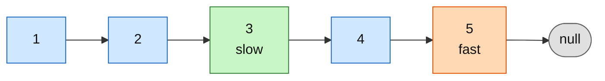

# 💻 Implementation WITHOUT Collections

> **Navigation**: [← COMPLETE UNDERSTANDING — The WHY Before the…](01_complete_understanding_the_why_before_the.md) | [Chapter overview](../01c_LinkedList.md) | [Production Failure Modes & Debugging →](03_production_failure_modes_debugging.md)
> Page 2 of 4 in **Linked Lists**


```java
public class MyLinkedList {

    // Node class (inner)
    private class Node {
        int data;
        Node next;

        Node(int data) {
            this.data = data;
            this.next = null;
        }
    }

    private Node head;
    private Node tail;
    private int size;

    public MyLinkedList() {
        head = null;
        tail = null;
        size = 0;
    }

    // ADD at end - O(1) with tail pointer
    public void add(int value) {
        Node newNode = new Node(value);
        if (head == null) {
            head = tail = newNode;
        } else {
            tail.next = newNode;
            tail = newNode;
        }
        size++;
    }

    // ADD at beginning - O(1)
    public void addFirst(int value) {
        Node newNode = new Node(value);
        newNode.next = head;
        head = newNode;
        if (tail == null) {
            tail = newNode;
        }
        size++;
    }

    // INSERT at index - O(n) to find, O(1) to insert
    public void insert(int index, int value) {
        if (index == 0) {
            addFirst(value);
            return;
        }

        Node current = head;
        for (int i = 0; i < index - 1; i++) {
            current = current.next;
        }

        Node newNode = new Node(value);
        newNode.next = current.next;
        current.next = newNode;

        if (newNode.next == null) {
            tail = newNode;
        }
        size++;
    }

    // GET - O(n)
    public int get(int index) {
        Node current = head;
        for (int i = 0; i < index; i++) {
            current = current.next;
        }
        return current.data;
    }

    // DELETE first - O(1)
    public int deleteFirst() {
        if (head == null) throw new RuntimeException("Empty list");
        int value = head.data;
        head = head.next;
        if (head == null) tail = null;
        size--;
        return value;
    }

    // DELETE at index - O(n)
    public int delete(int index) {
        if (index == 0) return deleteFirst();

        Node current = head;
        for (int i = 0; i < index - 1; i++) {
            current = current.next;
        }

        int value = current.next.data;
        current.next = current.next.next;

        if (current.next == null) {
            tail = current;
        }
        size--;
        return value;
    }

    // REVERSE - O(n) - IMPORTANT FOR INTERVIEWS!
    public void reverse() {
        Node prev = null;
        Node current = head;
        tail = head;  // Old head becomes new tail

        while (current != null) {
            Node next = current.next;  // Save next
            current.next = prev;       // Reverse pointer
            prev = current;            // Move prev forward
            current = next;            // Move current forward
        }

        head = prev;  // New head is last node
    }

    // DETECT CYCLE - Floyd's Algorithm
    public boolean hasCycle() {
        if (head == null) return false;

        Node slow = head;
        Node fast = head;

        while (fast != null && fast.next != null) {
            slow = slow.next;
            fast = fast.next.next;
            if (slow == fast) return true;
        }
        return false;
    }

    // FIND MIDDLE - O(n)
    public int findMiddle() {
        Node slow = head;
        Node fast = head;

        while (fast != null && fast.next != null) {
            slow = slow.next;
            fast = fast.next.next;
        }
        return slow.data;
    }

    public int size() {
        return size;
    }
}
```

## 🎯 LeetCode → Real-World Connection

### Problem: Reverse Linked List

> 🏛️ **Real-World Origin:** Undo Feature in Text Editors (1970s)

**Problem at Xerox PARC (1974):**

- Text editor needed an "Undo" feature
- Each edit stored as a node in a list
- Undo = go **backwards** through edits

**Initial Approach:** Singly linked list `Edit1 → Edit2 → Edit3`. But undo requires going backwards — and you _can't go backwards_ in a singly linked list!

**Solution Options:**

1. Use **doubly linked list** (more memory)
2. **Reverse the list** when needed
3. Store in reverse order

> 💡 **Thinking Process:** "What if we could reverse the direction of arrows?"
> `Edit1 → Edit2 → Edit3` becomes `Edit1 ← Edit2 ← Edit3`

**Now used in:** Git (reverse commit history), Browser back button, Database transaction rollback

---

---

## 🏋️ Foundation Practice — LinkedList Basics

### 📦 Group A — Core Operations

**Q1 — Traverse and Print**

```java
Node curr = head;
while (curr != null) { System.out.print(curr.data + " "); curr = curr.next; }
```

**Q2 — Count Nodes**

```java
int count = 0;
Node curr = head;
while (curr != null) { count++; curr = curr.next; }
```

**Q3 — Search for a Value**

```java
// Linear Search — O(n) — optimal (no random access in LL)
Node curr = head;
while (curr != null) {
    if (curr.data == target) return true;
    curr = curr.next;
}
return false;
```

**Q4 — Find Middle Node** _(preview of Fast/Slow Pointers)_

```java
// Brute: count n, traverse n/2 — O(n) two passes
// Better: Fast/Slow pointer — O(n) ONE pass
Node slow = head, fast = head;
while (fast != null && fast.next != null) {
    slow = slow.next;
    fast = fast.next.next;
}
// slow is now at middle
```

> 💡 **This is your first taste of the Two Pointer (Slow/Fast) pattern!**
> You'll learn it fully in the next section.

**Q5 — Insert at Beginning** — O(1)

```java
Node newNode = new Node(value);
newNode.next = head;
head = newNode;
```

**Q6 — Insert at End** — O(n) without tail, O(1) with tail pointer

```java
Node newNode = new Node(value);
if (head == null) { head = tail = newNode; return; }
tail.next = newNode;
tail = newNode;
```

**Q7 — Delete by Value**

```java
if (head.data == value) { head = head.next; return; }
Node prev = head, curr = head.next;
while (curr != null) {
    if (curr.data == value) { prev.next = curr.next; return; }
    prev = curr; curr = curr.next;
}
```

---

### 🎯 Practice Problems — Foundation Level

| Problem                        | Platform | Difficulty | Concept              |
| ------------------------------ | -------- | ---------- | -------------------- |
| LC 206 — Reverse Linked List   | LeetCode | ⭐ Easy    | Pointer manipulation |
| LC 237 — Delete Node in LL     | LeetCode | ⭐ Easy    | Copy-and-skip trick  |
| LC 83 — Remove Duplicates      | LeetCode | ⭐ Easy    | Single pass          |
| LC 21 — Merge Two Sorted Lists | LeetCode | ⭐ Easy    | Two pointer merge    |

---

## 🧠 Interview Patterns — The 4 LinkedList Techniques You MUST Know

### Pattern 1: Two Pointers (Slow/Fast — "Tortoise and Hare")

**Use for:** Find middle, detect cycle, find nth from end

> 💡 **Why it works:** Fast moves at 2x speed → when fast reaches end, slow is at middle. If there's a cycle → fast will eventually "lap" slow.



**How to read this diagram.** After 2 steps `slow` (green) is at node 3 and `fast` (orange) is at node 5, the end of the list. When `fast` reaches the end, `slow` **is** the middle.

```java
// Find Nth node from end (one-pass, O(1) space)
// WHY: advance fast by N first, then move both → when fast
//      hits null, slow is exactly N from the end
ListNode nthFromEnd(ListNode head, int n) {
    ListNode fast = head, slow = head;
    for (int i = 0; i < n; i++) fast = fast.next;  // Gap of N
    while (fast != null) {
        slow = slow.next;
        fast = fast.next;
    }
    return slow;
}
```

### Pattern 2: Reverse a Linked List (Iterative)

> 🏆 **This is the #1 interview technique** — appears in 10+ LeetCode problems directly. Also a sub-step in: palindrome check, reorder list, reverse K-group.

**Key Insight:** Change arrow direction one by one:

| Step | List state | What happened |
| ---- | ---------- | ------------- |
| Before | `1 → 2 → 3 → null` | original list |
| 1 | `null ← 1`   `2 → 3 → null` | reverse 1's pointer |
| 2 | `null ← 1 ← 2`   `3 → null` | reverse 2's pointer |
| 3 | `null ← 1 ← 2 ← 3` | reverse 3's pointer |
| After | `null ← 1 ← 2 ← 3` | `head = 3` |

### Pattern 3: Merge Two Sorted Lists

> **Foundation for merge sort on linked lists, and a common interview question.**

`L1: 1 → 3 → 5` and `L2: 2 → 4 → 6`

| Compare heads | Take | Result so far |
| ------------- | ---- | ------------- |
| 1 < 2 | 1 | `1` |
| 3 > 2 | 2 | `1 → 2` |
| 3 < 4 | 3 | `1 → 2 → 3` |
| ... | ... | ... |
| final | | `1 → 2 → 3 → 4 → 5 → 6` |

### Pattern 4: Dummy Head Node

Avoids special-casing "what if the head changes?"

**Without dummy:**

```java
if (head meets condition) head = head.next;  // Special case!
else { /* ... find and remove ... */ }
```

**With dummy:**

```java
ListNode dummy = new ListNode(0);
dummy.next = head;
// ... process normally, head never needs special case ...
return dummy.next;  // The real head
```

> ✅ **Use when:** Deleting nodes, merging lists, partitioning

---

## ⚡ Quick Problem Walkthrough: Detect Cycle Start Point

### 💬 Study-Partner View — Cycle Detection (Floyd's Tortoise and Hare)

**1. The bottom line:** Two pointers moving at different speeds must meet if there is a loop, and the meeting point lets you find where the loop starts.

**2. The textbook core:**

- **Phase 1:** `slow` moves 1 step, `fast` moves 2. If `fast` reaches `null`, there is no cycle; if they meet, there is one.
- **Phase 2:** reset `slow` to the head; move both 1 step at a time; they meet at the **cycle entry**.
- Time **O(n)**, space **O(1)** (a visited set would be O(n) space).
- Math: if the tail length is μ and the cycle length is C, they meet after fast has gone around a whole number of extra loops, so the distance from head to entry equals the distance from the meeting point to entry (mod C).

**3. The real-world analogy:** Two runners on a **circular track** with one running twice as fast: the faster runner laps the slower one and they must meet.

**4. Walkthrough:**

1. List `1 → 2 → 3 → 4 → 5 → 3` (5 points back to 3).
2. Phase 1: `slow` = 1, 2, 3, 4; `fast` = 1, 3, 5, 4 → they meet at node 4.
3. Phase 2: `slow` = 1, `fast` stays at 4; move both one step: (2, 5), (3, 3) → they meet.
4. The meeting node **3** is where the cycle begins.

> [!NOTE]
> **Quick check:** Why speed 2 specifically? *Any fixed relative speed of 1 step per round works; 2 is simplest and guarantees a meeting within one lap.*


**Problem:** Given a linked list that may have a cycle, find **WHERE** the cycle begins.

**Step 1 — Detect if cycle exists** (Floyd's algorithm):
Slow moves 1 step, fast moves 2 steps. If they meet → cycle exists.

**Step 2 — Find the start** (the mathematical trick):
Reset ONE pointer to head, keep the other at meeting point. Both move 1 step at a time → they meet at cycle **START**.

> 🧠 **Why this works (the math):**
>
> - Let distance from head to cycle start = **A**
> - Let distance from cycle start to meeting point = **B**
> - Let cycle length = **C**
> - When they meet: slow traveled `A + B`, fast traveled `A + B + C`
> - Since fast = 2 × slow: `A + B + C = 2(A + B)` → `C = A + B` → **`A = C - B`**
> - So distance from head to start (A) = distance from meeting to start (C - B)
> - Move both at same speed → **they meet at the start!**

```java
ListNode detectCycleStart(ListNode head) {
    ListNode slow = head, fast = head;

    // Phase 1: Detect cycle
    while (fast != null && fast.next != null) {
        slow = slow.next;
        fast = fast.next.next;
        if (slow == fast) break;
    }
    if (fast == null || fast.next == null) return null; // No cycle

    // Phase 2: Find start
    slow = head;
    while (slow != fast) {
        slow = slow.next;
        fast = fast.next;
    }
    return slow; // Cycle start node
}
```

---

---

> 🔬 **Section Challenge — ⚡ Quick Problem Walkthrough: Detect Cycle Start Point**
>
> **Challenge 1 (Trace):** You implement Floyd's cycle detection. Slow and Fast pointers meet at node `X`. Does node `X` represent the start of the cycle? Trace the mathematical reason why Phase 2 is required.
>
> <details><summary>Answer</summary>
>
> **Scenario:** Finding the cycle entry node.
> **Trace:** Node `X` is almost never the start of the cycle. It is simply the arbitrary node where Fast "lapped" Slow.
> **Reasoning:** Let the distance to the cycle start be `A`, and the distance from the cycle start to meeting point `X` be `B`. The remaining distance in the cycle is `C`.
>
> - Slow traveled `A + B`.
> - Fast traveled `A + B + C + B` (it completed a full cycle `C+B` inside).
> - Since Fast moves 2x as fast: `2(A + B) = A + 2B + C` → `2A + 2B = A + 2B + C` → `A = C`.
> **Debug:** The math proves that the distance from the Head to the cycle start (`A`) is exactly equal to the distance from `X` to the cycle start (`C`). Thus, we must put one pointer at the Head, leave one at `X`, and move both at 1x speed to find the start.
>   </details>

## ⚡ Advanced Patterns — LinkedList

### Pattern 5: Reverse K-Group

```java
// LC 25 — Reverse Nodes in k-Group
public ListNode reverseKGroup(ListNode head, int k) {
    ListNode curr = head;
    int count = 0;
    while (curr != null && count < k) { curr = curr.next; count++; }
    if (count < k) return head;           // less than k nodes remaining

    // Reverse k nodes
    ListNode prev = null; curr = head;
    for (int i = 0; i < k; i++) {
        ListNode next = curr.next;
        curr.next = prev;
        prev = curr; curr = next;
    }
    // head is now tail of reversed group — connect to next group
    head.next = reverseKGroup(curr, k);
    return prev;
}
```

### Pattern 6: Palindrome Check O(n) time O(1) space

```
Step 1: Find middle (slow/fast)
Step 2: Reverse second half
Step 3: Compare first and second halves
Step 4: Restore (optional but good practice)
```

```java
public boolean isPalindrome(ListNode head) {
    // Step 1: Find middle
    ListNode slow = head, fast = head;
    while (fast != null && fast.next != null) {
        slow = slow.next; fast = fast.next.next;
    }
    // Step 2: Reverse second half
    ListNode prev = null, curr = slow;
    while (curr != null) { ListNode t = curr.next; curr.next = prev; prev = curr; curr = t; }
    // Step 3: Compare
    ListNode left = head, right = prev;
    while (right != null) {
        if (left.val != right.val) return false;
        left = left.next; right = right.next;
    }
    return true;
}
```

---

> 🔬 **Section Challenge — ⚡ Advanced Patterns — LinkedList**
>
> **Challenge 1 (Reasoning):** To check if a LinkedList is a palindrome in O(N) time and O(1) space, you reversed the second half of the list. A code reviewer points out that mutating the input structure violates pure function principles and could break concurrent readers. How do you address this?
>
> <details><summary>Answer</summary>
>
> **Scenario:** Mutating inputs in O(1) space algorithms.
> **Trace:** The code reviewer is completely correct. While LeetCode accepts mutating the linked list, in production, reversing pointers in a shared data structure without a lock will cause race conditions for other threads trying to traverse the list.
> **Design Fix:** You must **restore** the list before returning.
>
> 1. Find the middle.
> 2. Reverse the second half.
> 3. Compare halves to determine if it is a palindrome.
> 4. **CRITICAL:** Call the reverse function AGAIN on the second half to restore the original pointer structure before returning the result. This keeps it O(N) time, O(1) space, and leaves the input pristine.
> </details>

## 🎯 Full Problem Set — LinkedList

| #   | Problem                        | Platform   | Difficulty  | Pattern             |
| --- | ------------------------------ | ---------- | ----------- | ------------------- |
| 1   | LC 206 — Reverse Linked List   | LeetCode   | ⭐ Easy     | Reverse (iterative) |
| 2   | LC 21 — Merge Two Sorted Lists | LeetCode   | ⭐ Easy     | Dummy head + merge  |
| 3   | LC 141 — Linked List Cycle     | LeetCode   | ⭐ Easy     | Fast/Slow detect    |
| 4   | LC 83 — Remove Duplicates      | LeetCode   | ⭐ Easy     | Single pass         |
| 5   | LC 19 — Remove Nth From End    | LeetCode   | ⭐⭐ Med    | Fast/Slow gap of N  |
| 6   | LC 142 — Cycle II — Find Start | LeetCode   | ⭐⭐ Med    | Floyd's math        |
| 7   | LC 234 — Palindrome LL         | LeetCode   | ⭐⭐ Med    | Reverse half        |
| 8   | LC 148 — Sort List             | LeetCode   | ⭐⭐ Med    | Merge sort on LL    |
| 9   | LC 25 — Reverse K-Group        | LeetCode   | ⭐⭐⭐ Hard | Recursive reverse   |
| 10  | CF 237B — Program for Tanya    | Codeforces | Div2-B      | LL simulation       |

---

> 🔬 **Section Challenge — 🎯 Full Problem Set — LinkedList**
>
> **Challenge 1 (Debug):** A junior developer writes `mergeTwoSortedLists` like this: `if (l1 == null) return l2; if (l2 == null) return l1; ListNode head = l1.val < l2.val ? l1 : l2;` and then writes 15 lines of nested `if/else` logic to initialize the head pointer. Why is this an anti-pattern?
>
> <details><summary>Answer</summary>
>
> **Scenario:** Handling empty states and head initialization in LinkedLists.
> **Trace:** Trying to manually determine which node becomes the "true" head forces you to handle edge cases before the main loop begins. This duplicates logic and increases the chance of NullPointerExceptions.
> **Debug/Fix:** Use the **Dummy Head Pattern**.
>
> ```java
> ListNode dummy = new ListNode(-1);
> ListNode tail = dummy;
> // ... main loop ...
> return dummy.next;
> ```
>
> By anchoring the new list to a throwaway `dummy` node, you completely eliminate the need to initialize the head conditionally. You just start appending to `dummy.next`.
>
> </details>

---

[← COMPLETE UNDERSTANDING — The WHY Before the…](01_complete_understanding_the_why_before_the.md) | [Chapter overview](../01c_LinkedList.md) | [Production Failure Modes & Debugging →](03_production_failure_modes_debugging.md)
