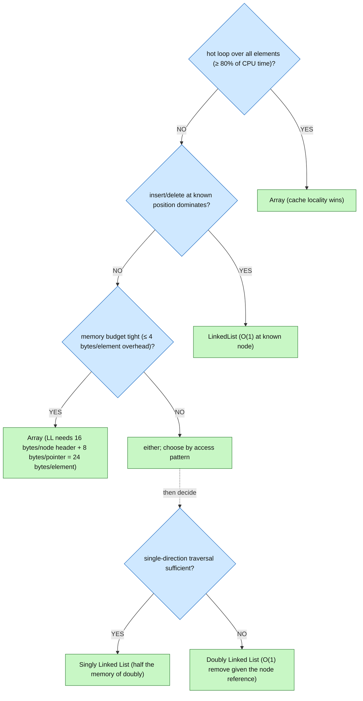

# 🔬 Proof Corner — Three Derivations from First Principles

> **Navigation**: [← Production Failure Modes & Debugging](03_production_failure_modes_debugging.md) | [Chapter overview](../01c_LinkedList.md)
> Page 4 of 4 in **Linked Lists**


## Derivation 1: The Contiguous-Memory Tradeoff — Why Linked Lists Must Exist

**The problem that forces the idea.** An array stores elements at addresses `base + i × sizeof(T)`. This formula gives O(1) random access — compute the address, dereference once. But it creates a structural constraint: **contiguity**. Every element must sit at its computed address, with no gaps.

**Why contiguity forces O(n) insert.** Suppose you insert element `x` at position `k` in an array of `n` elements. After the insert, element `k` must live at `base + k × sizeof(T)`, element `k+1` at `base + (k+1) × sizeof(T)`, and so on. But positions `k` through `n-1` are already occupied. The contiguity invariant forces a cascade:

```
Before:  [a₀][a₁]...[aₖ₋₁][aₖ][aₖ₊₁]...[aₙ₋₁]
                              ↓ insert x here
After:   [a₀][a₁]...[aₖ₋₁][ x ][aₖ][aₖ₊₁]...[aₙ₋₁]
                                  └── n-k elements shifted right
```

Shifting `n - k` elements costs Θ(n - k). For `k = 0` (insert at front), that's Θ(n). No algorithm can avoid this — the contiguity invariant is structural, not a limitation of any particular implementation.

**The linked list breaks contiguity.** Each node lives at an arbitrary heap address. There is no `base + i × sizeof(T)` formula — you can't compute a node's address from its index. But precisely because nodes aren't constrained to contiguous slots, inserting a new node requires only redirecting pointers:

```
Before:  prev → next_node
After:   prev → new_node → next_node    (2 pointer writes, O(1))
```

No element moves. No cascade. The tradeoff is exact: **you lose O(1) random access (no address formula) and gain O(1) interior insert/delete (no shifting invariant)**.

| Property | Array | Linked List | Root cause |
|----------|-------|-------------|------------|
| Access by index | O(1) | O(n) | Contiguous address formula vs pointer traversal |
| Insert at known position | O(n) | O(1) | Shifting to preserve contiguity vs pointer redirect |
| Cache behavior | Excellent | Poor | Sequential prefetch vs pointer-chasing |
| Memory per element | `sizeof(T)` | `sizeof(T) + 8–16` | No overhead vs pointer storage |

**The takeaway.** Linked lists don't exist because someone thought they were clever. They exist because the contiguous-memory invariant that makes arrays fast for reads makes them structurally incapable of fast interior writes. Every data structure is a tradeoff — this one trades the address formula for pointer freedom.

---

## Derivation 2: Floyd's Cycle Detection — Why Two Speeds Guarantee a Meeting

**The problem.** Given a linked list that might contain a cycle, detect the cycle using O(1) extra space. A visited-set approach uses O(n) space — can we do better?

**Step 1 — The relative-velocity insight.** Place two pointers at the head: `slow` moves 1 step per iteration, `fast` moves 2 steps. Consider what happens once both are inside the cycle (length C):

- After one iteration, `fast` is 1 step farther ahead of `slow` than before.
- The gap between them grows by 1 each step — equivalently, the gap *shrinks* by 1 in the other direction (modular arithmetic on a cycle of length C).

If the initial gap (once both are in the cycle) is `d`, they meet after exactly `C - d` more steps, when the gap has shrunk to 0. This is guaranteed: `C - d` is finite, and every iteration reduces the gap by exactly 1.

**Step 2 — Formal proof of meeting.**

```
Let μ = distance from head to cycle entry (the "tail" length).
Let C = cycle length.
Let n = μ + C (total nodes).

After k steps:
  slow is at position k (from head)
  fast is at position 2k (from head)

Both are inside the cycle when k ≥ μ.
Inside the cycle, positions wrap: slow is at (k - μ) mod C,
                                   fast is at (2k - μ) mod C.

They meet when: (2k - μ) mod C = (k - μ) mod C
              ⟺ k mod C = 0
              ⟺ k is a multiple of C.

The smallest k ≥ μ that is a multiple of C: k = ⌈μ/C⌉ × C.
Total iterations ≤ μ + C ≤ n. ∎
```

**Step 3 — Phase 2: finding the cycle entry (the non-obvious part).**

After `slow` and `fast` meet at some node `M` inside the cycle, how do you find where the cycle *starts*?

**Claim:** Reset `slow` to head. Move both `slow` and `fast` at speed 1. They meet at the cycle entry.

**Derivation.** At the meeting point, slow has traveled `k` steps, fast has traveled `2k` steps. Fast has gone around the cycle some number of times more than slow:

```
2k - k = k = m × C    (for some integer m ≥ 1)
```

Now reset `slow` to head. Both move at speed 1.

- After `μ` steps, `slow` reaches the cycle entry.
- After `μ` steps, `fast` (starting from the meeting point) has moved `μ` more steps.
  Fast's total distance from cycle entry: (meeting point offset) + μ.
  Meeting point offset from entry = (k - μ) mod C = (mC - μ) mod C = (-μ) mod C = C - (μ mod C).
  After μ more steps: C - (μ mod C) + μ = C + μ - (μ mod C).
  This is a multiple of C (since μ - (μ mod C) = ⌊μ/C⌋ × C).
  So fast is also at the cycle entry. ∎

**Worked trace.** List: `1 → 2 → 3 → 4 → 5 → 3` (cycle entry at node 3, μ = 2, C = 3).

| Phase | Step | `slow` | `fast` | Note |
| ----- | ---- | ------ | ------ | ---- |
| 1 (detect) | 0 | 1 | 1 | start |
| 1 | 1 | 2 | 3 | |
| 1 | 2 | 3 | 5 | |
| 1 | 3 | 4 | 4 | **meet** (both at node 4) |
| 2 (find entry) | reset | 1 | 4 | reset `slow` to head; both now move at speed 1 |
| 2 | 1 | 2 | 5 | |
| 2 | 2 | 3 | 3 | **meet at node 3 = cycle entry** ✓ |

**Why speed 2, specifically?** Any speed ratio where fast is exactly 1 step faster per iteration works — the gap decreases by 1 each step, guaranteeing a meeting within one full cycle. Speed 3 would make the gap decrease by 2, but then on a cycle of odd length, they could *skip* each other (gap goes from 1 to -1 mod C, never hitting 0). Speed 2 is the smallest speed that guarantees meeting for all cycle lengths.

---

## Derivation 3: The Sentinel Node Trick — Why It Eliminates Edge Cases

**The problem.** Write `insertAfter(prev, data)` for a singly-linked list. Without sentinels, you need this:

```java
void insertAfter(Node prev, int data) {
    Node n = new Node(data);
    if (prev == null) {          // Case 1: insert at head
        n.next = head;
        head = n;
    } else {                     // Case 2: insert after prev
        n.next = prev.next;
        prev.next = n;
    }
    size++;
}
```

Two branches. For `deleteNode`, it's worse — you need cases for (a) empty list, (b) deleting the head, (c) deleting the tail, (d) deleting a middle node. Four branches, four places for pointer bugs.

**The sentinel insight.** Create a dummy node that is always present and is never removed:

```java
Node sentinel = new Node(0);  // dummy — data is irrelevant
sentinel.next = null;          // empty list
```

Now "insert at head" is just "insert after sentinel." There is no special case:

```java
void insertAfter(Node prev, int data) {
    Node n = new Node(data);
    n.next = prev.next;
    prev.next = n;
    size++;
}
// To insert at head: insertAfter(sentinel, data)
// To insert at position k: walk k steps from sentinel, then insertAfter
```

**Why this works — the formal argument.** The sentinel statically guarantees invariant I1 (head is never null). With I1 always holding:

- "Insert at head" collapses into "insert after sentinel" — the `if (prev == null)` branch is dead code.
- "Delete head" collapses into "delete sentinel.next" — no special-case needed because `sentinel` is never the node being deleted.
- "Empty list" means `sentinel.next == null` — but `sentinel` itself exists, so code that accesses `head.next` (now `sentinel.next`) never throws NPE.

The case analysis shrinks from 4 branches to 1. Each eliminated branch is one fewer place for a pointer bug. In production code (Java's `LinkedList`, Linux kernel's `list_head`), sentinels are universal precisely because they convert a 4-case operation into a 1-case operation.

**The cost.** One extra node of memory (~32 bytes on JVM). The tradeoff is always worth it — 32 bytes to eliminate an entire class of null-pointer bugs.

---

## 🔄 Brute Force → Optimal: Linked List Motivation

> **The canonical case where LL wins**: operations requiring O(1) arbitrary-position insert/remove that arrays cannot match.

### Problem 1: LRU Cache — O(1) get and put

**Given**: cache with capacity c. `get(key)` returns value or -1. `put(key, val)` inserts; if at capacity, evicts the least-recently-used item.

**Brute force with ArrayList — O(n) per operation**:
```java
// On get: scan list for key O(n), move to front O(n shift)
// On put: scan for existing key O(n), add/shift O(n), evict tail O(1)
```
- Time: O(n) per operation. At c = 10⁶ entries and high throughput → unusable.

**The insight**: Need two things simultaneously — O(1) key lookup (HashMap) AND O(1) move-to-front / evict-tail. Only a doubly-linked list allows O(1) node removal given a pointer to the node. Combine both structures.

**Optimal — O(1) with HashMap + DoublyLinkedList**:
```java
Map<Integer, Node> map = new HashMap<>();
Node head, tail;  // sentinels

int get(int key) {
    if (!map.containsKey(key)) return -1;
    moveToHead(map.get(key));  // O(1): update 4 pointers
    return map.get(key).val;
}
void put(int key, int val) {
    if (map.containsKey(key)) { map.get(key).val = val; moveToHead(map.get(key)); return; }
    Node n = new Node(key, val); addToHead(n); map.put(key, n);
    if (map.size() > capacity) { map.remove(tail.prev.key); removeTail(); }
}
```

| Approach | get | put | Why |
|----------|-----|-----|-----|
| ArrayList linear scan | O(n) | O(n) | Shift on every move-to-front |
| **HashMap + DoubleLinkedList** | **O(1)** | **O(1)** | Pointer swap; no shifting |

**Why linked list, not deque/array**: only doubly-linked nodes with prev/next pointers allow O(1) removal at an arbitrary interior position (given a pointer). Arrays need O(n) shifting for interior removes.

---

### Problem 2: Iterator-based Insert — O(1) vs O(n)

**ArrayList.add(int index, E)** — O(n): shifts elements right of `index`.

**LinkedList.ListIterator.add(E)** — O(1): once the cursor is positioned, inserting before/after it is a pointer swap. Useful for building structures where you iterate and insert many times at the current position (e.g., interleaving two sorted streams without materializing both).

**Rule for choosing**: if insert/delete positions are discovered during iteration (cursor-based), LinkedList wins. If insert/delete positions are random indices, ArrayList wins (random access O(1) vs LL's O(n)).

---

## Constraint-First Decision Framework — When to Pick LL

Use a linked list when **all three** constraints hold:

```
1. Insert/delete at arbitrary position dominates the workload (≥ 50% of ops)
   AND
2. Random access is rare (≤ 5% of ops)
   AND
3. Cache locality is not critical (or n is small enough that misses don't matter)
```

If **any** constraint fails, prefer an array:

| Constraint Fails | Prefer Array | Why |
|---|---|---|
| Random access ≥ 5% | Array | O(1) vs O(n) per access; cache locality |
| Insert/delete at arbitrary position < 50% | Array | Amortized O(1) append beats LL O(1) but with worse cache |
| Cache locality critical (large n, hot loops) | Array | 16× more entries per cache line; sequential access dominates |

### Decision Tree



**How to read this diagram.** Start at the first blue question and follow the YES / NO edges; the green boxes are the recommended choice.

### Worked Example — ArrayList vs LinkedList in Hot Loops

**Setup:** Iterate over 10⁶ elements, summing them.

- **ArrayList:** 1 cache line per 16 elements = 62,500 cold misses × 100 ns = 6.25 ms
- **LinkedList:** 1 cache miss per element = 1,000,000 misses × 100 ns = 100 ms

**Result:** ArrayList is **16× faster** despite both being O(n). This is the canonical war story in `01a_Memory_Foundations.md` Section 0 Story 1. The lesson: pick arrays for hot loops, even when LL seems conceptually cleaner.

## When Linked Lists Break — Formal Failure Modes

### Break 1 — Cycle Introduction by Insertion

**Condition:** Inserting a node `n` such that `n.next` points back to a node earlier in the list, or such that the previous tail's `next` is not properly updated.

> [!CAUTION]
> **What breaks:** I3 violated → infinite loop on traversal. Concurrent modification can also introduce cycles if two threads insert simultaneously.

> [!TIP]
> **Defense:** Always update both `prev.next` and `tail.next` atomically. Use CAS (compare-and-swap) for lock-free LLs; the Java `ConcurrentLinkedQueue` does this.

### Break 2 — Lost Reference on Delete

**Condition:** Deleting a node `n` without first saving `n.next` (singly LL) or without first updating `n.prev.next` and `n.next.prev` (doubly LL).

> [!CAUTION]
> **What breaks:** The rest of the list becomes unreachable → memory leak. Worse, future iterations may or may not include the deleted node depending on which pointer was checked.

> [!TIP]
> **Defense:** Always capture `n.next` (and `n.prev` for doubly) before mutating `n`. In Java, save `iter.next()` before `iter.remove()`.

### Break 3 — Cache Miss Cascade

**Condition:** Iterating a LL with n nodes where n exceeds L1 cache (typically 32 KiB / 16 bytes per node = 2,048 nodes).

> [!CAUTION]
> **What breaks:** Every node access misses L1 → 100 ns latency per node. For n = 10⁶, that's 100 ms vs 6 ms for an array — a 16× slowdown.

**Invariant violated:** Spatial locality. LL nodes are heap-scattered; array elements are contiguous.

> [!TIP]
> **Defense:** Pool LL nodes to reduce fragmentation; use a `Deque<ArrayList<T>>` if the workload allows batching; or use `IntArrayList` for primitive data.

### Break 4 — Concurrent Modification

**Condition:** One thread iterates the LL while another inserts or deletes. Java's `LinkedList` uses a `modCount` field; `next()` checks `expectedModCount == modCount` and throws `ConcurrentModificationException` on mismatch.

> [!CAUTION]
> **What breaks:** `ConcurrentModificationException` is the friendly outcome. Without it (e.g., C++ `std::list` without a lock), iteration may see stale or duplicated nodes.

**Invariant violated:** Single-threaded mutation invariant. The LL is not thread-safe.

> [!TIP]
> **Defense:** Use `CopyOnWriteArrayList` for read-heavy workloads; `ConcurrentLinkedQueue` for FIFO; or external synchronization with `synchronized` blocks.

### Break 5 — Memory Leak from Static References

**Condition:** A static field holds a reference to a node in a long-lived LL.

> [!CAUTION]
> **What breaks:** The entire LL is reachable from GC roots → never collected → memory leak.

**Invariant violated:** Reachability. The LL is supposed to be reclaimable when no external references exist.

> [!TIP]
> **Defense:** Clear static references when done; use `WeakReference` for caches.

### Break 6 — Sentinel Misuse

**Condition:** A doubly LL uses sentinel nodes to mark head/tail. The sentinel is removed or repurposed.

> [!CAUTION]
> **What breaks:** Sentinel removal breaks I6 → iterator returns null when list is non-empty.

> [!TIP]
> **Defense:** Never expose sentinels via public API. Mark them `private static final`.

## Edge Cases — Always Check These

| # | Edge Case | What Can Break |
|---|---|---|
| 1 | **Empty list** (`head == null && size == 0`) | `head.next` NPE if not guarded; `removeFirst()` on empty throws `NoSuchElementException` |
| 2 | **Single node** (`head == tail`) | Insert at head and insert at tail both update the same node; off-by-one in size |
| 3 | **Two nodes** | Reverse swaps `head` and `tail` references; check both pointers |
| 4 | **All same data** | Cycle detection by value comparison returns false negative; use pointer equality |
| 5 | **Cycle at head** | `head.next == head`; tortoise-and-hare must handle this |
| 6 | **Cycle at tail** | `tail.next == head`; traversal terminates only via Floyd |
| 7 | **Self-loop** | `head.next == head`; infinite loop without Floyd |
| 8 | **Long list (n ≥ 10⁵)** | Recursive traversal hits stack limit; convert to iterative |
| 9 | **Insert at head when head is null** | Both `head` and `tail` must update to new node |
| 10 | **Delete last node** | `head == tail == null` after delete; subsequent `getFirst()` NPE |

## Formal Complexity Proofs — Linked List Operations

### Insertion at Known Position

Given a reference `prev` to the node before the insertion point:

```
T_insert(prev) = O(1)
  1. n = new Node(data)
  2. n.next = prev.next    // O(1)
  3. prev.next = n          // O(1)
  4. (if doubly) n.prev = prev; prev.next.prev = n
```

The find step (locating `prev`) is O(n) for singly LL — this is the cost that makes LL inferior to array for index-based access.

### Deletion at Known Position

Given a reference `prev` (singly) or `node` (doubly):

```
T_delete_singly(prev) = O(1)
  1. toDelete = prev.next
  2. prev.next = toDelete.next
  3. toDelete.next = null     // help GC
  return toDelete.data

T_delete_doubly(node) = O(1)
  1. node.prev.next = node.next
  2. node.next.prev = node.prev
  3. node.next = node.prev = null
  return node.data
```

Doubly LL deletion is O(1) without needing `prev` — but requires more memory (24 bytes vs 16 per node).

### Reverse Traversal (Doubly LL Only)

```
T_reverse_traversal_doubly(n) = O(n)
  for (node = tail; node != null; node = node.prev) { ... }
```

Singly LL reverse traversal is **O(n²)** because there is no `prev` pointer. To reverse in O(n), use the iterative three-pointer trick:

```java
Node prev = null, curr = head;
while (curr != null) {
    Node next = curr.next;  // save before mutation
    curr.next = prev;        // reverse pointer
    prev = curr;             // advance prev
    curr = next;             // advance curr
}
head = prev;
```

This is the classic interview problem (LC 206). The proof that it runs in O(n): each iteration does O(1) work and the loop runs n times. The proof that it's correct: at each step, `prev` points to the reversed prefix and `curr.next` is set to the previous reversed prefix — by induction on `k`, after `k` iterations, the first `k` nodes are reversed.

### Search

```
T_search(n, key) = O(n) worst case
                 = O(1) best case (head matches)
                 = O(n/2) average for uniform random key
```

LL search is always O(n); there is no shortcut. Compare to array: same O(n), but array has better cache behavior so constant factor is ~16× smaller.

## Cross-References

- **`01a_Memory_Foundations.md`** — cache miss analysis; pointer-chasing cost vs contiguous access.
- **`01b_Arrays.md`** — when arrays beat LL (hot loops, random access).
- **`01d_Stack_Queue.md`** — LL is the underlying structure for stack and queue implementations.
- **`01g_DS_Internals.md`** — `LinkedList` Java implementation; `ConcurrentLinkedQueue` lock-free design.
- **`02_PROBLEM_SETS.md`** — Floyd's cycle detection proof, reverse-LL proof, merge-two-sorted-LL proof.
- **`A1_DS_Correctness_Invariants.md`** — formal proofs of pointer integrity invariants I1–I7.

---

## 💥 When Linked List Breaks

> These are the exact failure modes that cause production bugs. Each one has a specific root cause and fix.

### 1. Cache Thrashing — 16× Slower Than Array for Sequential Access
**What breaks**: Iterating a linked list to compute a sum, find a max, or copy to another structure.
**Why**: Each node lives at an arbitrary heap address. The CPU prefetcher cannot predict the next address — every node access is a cache miss (~100ns vs ~4ns for array). At 500K nodes, this difference is measurable seconds.
**Fix**: If random access or sequential scan dominates, use `ArrayList`. Use `LinkedList` only when O(1) insertions/deletions at arbitrary positions via an iterator are the dominant operation.
**Production rule**: Java's `LinkedList` is rarely the right choice. `ArrayDeque` is faster for both stack and queue. `ArrayList` is faster for everything else.

📎 **Reference Anchor**: [OpenJDK LinkedList source](https://github.com/openjdk/jdk/blob/master/src/java.base/share/classes/java/util/LinkedList.java)
**Invariant learned**: `size` is maintained as a field — O(1) `size()` — but every structural modification increments `modCount` to detect `ConcurrentModificationException` during iteration.
**Constraint warning**: Java's `LinkedList` implements both `List` and `Deque` — but its `get(i)` is O(n) since it traverses from head or tail. Never use it as a `List` with index access.

### 2. Losing the Head Pointer During In-Place Reversal
**What breaks**: Reversing a linked list by moving `head` without saving the rest of the list first.
```java
// BUG — head.next is lost before it's saved:
head.next = prev;  // now we can't reach the rest of the list
```
**Fix**: Save `next` before severing the link:
```java
ListNode next = curr.next;  // save
curr.next = prev;            // reverse
prev = curr;
curr = next;                 // advance
```
**Invariant**: At the start of each iteration, `prev` points to the already-reversed portion and `curr` is the next node to process.

### 3. Infinite Loop Without Cycle Detection
**What breaks**: Traversing a corrupt or cyclic linked list without a visited-set or two-pointer check.
**Example**: A `next` pointer is accidentally set to an earlier node (common in LRU cache bugs or manual node manipulation). A naive `while (curr != null)` loop runs forever.
**Fix — Floyd's Tortoise and Hare**:
```java
ListNode slow = head, fast = head;
while (fast != null && fast.next != null) {
    slow = slow.next;
    fast = fast.next.next;
    if (slow == fast) return true;  // cycle detected
}
return false;
```
**Why it works**: If a cycle of length L exists, fast gains 1 step per iteration on slow → they meet in at most L iterations. If no cycle, fast reaches null in O(n) steps.

### 4. Memory Leak via Strong Reference Cycle (Java)
**What breaks**: An LRU cache or object pool backed by a custom linked list holds strong references to values. Even after "eviction," the GC cannot collect the node if it's referenced elsewhere.
**Fix**: Use `WeakReference<V>` for cache values, or use `LinkedHashMap` with `removeEldestEntry` override which Java GC handles correctly.

### 5. `ConcurrentModificationException` During Iteration
**What breaks**: Modifying the list (add/remove) while iterating via a `for-each` loop in Java.
**Root cause**: Iterator stores `expectedModCount` at construction; any structural change increments `modCount`; iterator checks on each `next()` call.
**Fix**: Use `Iterator.remove()` for safe remove during iteration, or collect nodes to remove in a separate list and remove after the loop.

---

## 📝 Exam-Style Problems (MIT 6.006 / KTH DD1352 style)

> **Instructions**: Work these on paper before checking the answer. These are the problems a university exam would ask.

---

**Problem 1 (Correctness — 8 min)**: Prove that Floyd's cycle detection algorithm terminates in O(n) time.

<details><summary>Model Answer</summary>

**Claim**: If a cycle exists, `slow` and `fast` meet within 2n steps.

**Proof**: Let the cycle start at position μ (distance from head) and have length L.
- After μ steps, slow is at the cycle entry; fast is at position 2μ mod L inside the cycle.
- Inside the cycle, fast gains exactly 1 step on slow per iteration (fast moves 2, slow moves 1).
- The gap between them is (2μ - μ) mod L = μ mod L. This gap decreases by 1 each iteration.
- They meet after at most L more iterations.
- Total: μ + L ≤ n + n = O(n) steps. ✓

If no cycle exists, fast reaches null after ⌈n/2⌉ steps. ✓

</details>

---

**Problem 2 (Invariant — 6 min)**: State the loop invariant for in-place linked-list reversal and prove it holds at termination.

<details><summary>Model Answer</summary>

**Invariant**: At the start of each iteration, `prev` is the head of the reversed portion (reversed in correct order), and `curr` is the first node of the unreversed portion.

- **Init**: `prev = null`, `curr = head`. Reversed portion is empty (trivially correct). ✓
- **Maintenance**: After each iteration, `curr.next` is set to `prev`, moving one node from unreversed to reversed. The invariant holds for the next iteration. ✓
- **Termination**: When `curr == null`, the entire list is in `prev`. Return `prev` as the new head. ✓

</details>

---

**Problem 3 (Complexity — 5 min)**: A singly-linked list of n nodes is stored with only a head pointer. What is the time complexity of each: (a) insert at head, (b) insert at tail, (c) delete a given node given a pointer to its predecessor, (d) search for a value k?

<details><summary>Model Answer</summary>

(a) **Insert at head**: O(1) — update new node's next to current head, update head pointer.
(b) **Insert at tail**: O(n) — must traverse from head to find the last node (no tail pointer). With a tail pointer: O(1).
(c) **Delete given predecessor**: O(1) — `pred.next = pred.next.next`.
(d) **Search**: O(n) — must traverse from head; no random access, no sorted structure to exploit.

</details>

---

**Problem 4 (Design — 10 min)**: Design an O(1) `getMin()` stack. Prove your solution is correct.

<details><summary>Model Answer</summary>

**Structure**: Maintain two stacks — `main` (all elements) and `minStack` (running minimums).
- `push(x)`: push x to main; push `min(x, minStack.peek())` to minStack.
- `pop()`: pop from both stacks.
- `getMin()`: return `minStack.peek()`.

**Correctness proof**: **Invariant** — `minStack.peek()` equals the minimum of all elements currently in `main`.
- Init: both stacks empty — vacuously true. ✓
- Maintenance on push(x): new min = `min(x, previous_min)` — pushed to minStack. ✓
- Maintenance on pop(): the popped element was the top of main. `minStack.peek()` was `min` of main including that element. After removing it, `minStack.pop()` removes that min and exposes the min of the remaining elements (which was correctly pushed when they were pushed). ✓
- Termination: holds after any sequence of push/pop. ✓

All operations O(1). ✓

</details>

---

[← Production Failure Modes & Debugging](03_production_failure_modes_debugging.md) | [Chapter overview](../01c_LinkedList.md)
