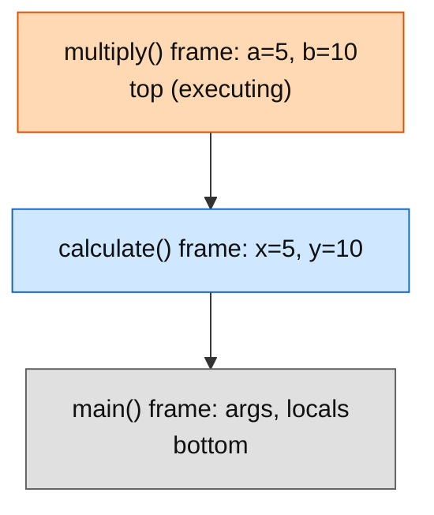
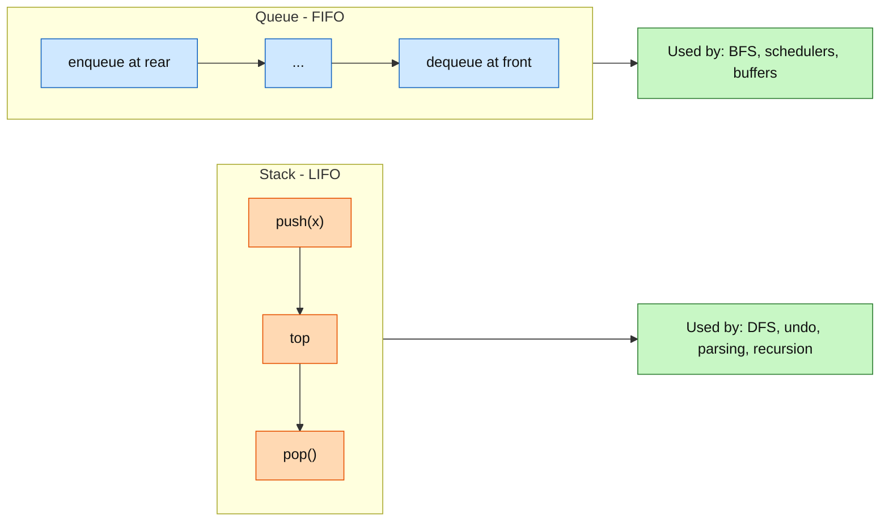
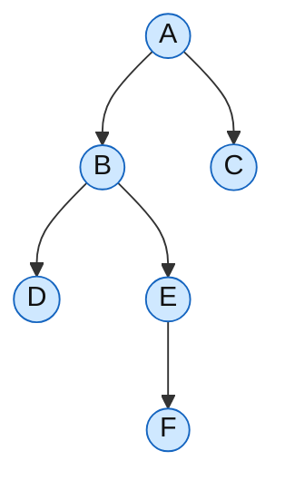

# 📚 Stacks & Queues

**Navigation**: [< Previous Chapter](01c_LinkedList.md) | [Back to Index](../00_MASTER_INDEX.md) | [Next Chapter >](01e_HashTable.md)

---

## 📚 Part 4: Stack & Queue

### 5W1H: Deep Understanding of Stack

> [!NOTE]
> **WHAT:** A Stack is a LIFO (Last In, First Out) data structure. Only the TOP element is accessible. Push/Pop are O(1).
>
> **WHY:** Many problems have a NESTING structure — what was opened LAST must be closed FIRST (parentheses, function calls, undo operations). LIFO naturally models this.
>
> **HOW THE JVM USES A STACK (Call Stack):** every Java thread has its own call stack. When you call a method, the JVM **pushes** a stack frame (see the diagram below). When the method returns, the JVM **pops** its frame. `StackOverflowError` = too many frames (infinite recursion). Default stack size: 512 KB – 1 MB per thread.
>
> **WHERE Stacks appear in production:**
>
> - JVM call stack (method invocation/return)
> - Browser back button (pages pushed, back = pop)
> - Ctrl+Z undo (actions pushed, undo = pop)
> - Expression evaluation (postfix, infix conversion)
> - DFS traversal (explicit or implicit via recursion)
> - Compiler: syntax parsing, bracket matching
>
> **WHEN to use a Stack:**
>
> - ✅ Matching/nesting problems (brackets, HTML tags)
> - ✅ Backtracking (maze solving, permutations)
> - ✅ Converting recursion to iteration
> - ✅ Monotonic problems (next greater element)
> - ❌ When you need FIFO order (use Queue)
> - ❌ When you need random access (use Array)

**How to read this diagram.** Frames are stacked in call order: `main()` at the bottom, `multiply()` on top because it is executing. Returning pops the top frame.

## 💬 Explain It Like a Study Partner — Stack & Queue

> [!TIP]
> **Ask yourself first:** *"What do the Undo button and a supermarket checkout line have in common, and how are they opposite?"*

### 1. The bottom line

A stack gives you the **newest** item first; a queue gives you the **oldest** item first. Limiting how you can touch the data is what makes every operation O(1).

### 2. The textbook core

- **Stack:** LIFO (last in, first out). Operations: `push`, `pop`, `peek`, all **O(1)**.
- **Queue:** FIFO (first in, first out). Operations: `enqueue`/`offer`, `dequeue`/`poll`, `peek`, all **O(1)** with a circular array or linked list.
- **Deque:** add/remove at both ends.
- Stacks power **DFS**, recursion, undo, expression parsing and bracket matching. Queues power **BFS**, schedulers and buffers.
- In Java prefer `ArrayDeque` for both, not the legacy `Stack` class.

### 3. The real-world analogy

A **stack of plates**: you put a plate on top and take from the top, so the last plate in is the first out. A **queue** is the checkout line: first person in line is served first.

### 4. Walkthrough: are the brackets in `({[]})` balanced?

1. Read `(` → push `(`. Stack: `(`
2. Read `{` → push. Stack: `( {`
3. Read `[` → push. Stack: `( { [`
4. Read `]` → pop `[`, it matches. Stack: `( {`
5. Read `}` → pop `{`, matches. Then read `)` → pop `(`, matches.
6. End of input and the stack is empty → **balanced**. If we had popped a mismatch, or the stack were non-empty, it would be unbalanced.

> [!NOTE]
> **Quick check:** which structure would you use to find the shortest path in an unweighted maze? *A queue (BFS), because it explores level by level.*

---

## ⚡ At a Glance — Stack & Queue

> [!NOTE]
> **Mental model:** both are *restricted-access lists*. A **stack** only touches one end (LIFO); a **queue** adds at one end and removes at the other (FIFO). Restricting access is what lets every operation be O(1).

**How to read this diagram.** Orange is the stack (one open end), blue is the queue (two ends, one for each direction), and green shows the algorithm each one powers.

| Operation | Stack | Queue / Deque | Java choice |
| --------- | ----- | ------------- | ----------- |
| Add | `push` O(1) | `offer`/`addLast` O(1) | `ArrayDeque` |
| Remove | `pop` O(1) | `poll`/`pollFirst` O(1) | `ArrayDeque` |
| Peek | O(1) | O(1) | `peek()` |
| Search | O(n) | O(n) | rarely needed |

> [!TIP]
> Prefer `ArrayDeque` over the legacy synchronized `Stack` class, and over `LinkedList`, for both stack and queue use.

---

## 🧬 Nature & Behavior

### What is a Stack?

## 📚 Topic Pages in This Chapter

This chapter is split into focused pages so each topic can be read on its own. Read them in order the first time; use the table to jump back later.

| # | Page | What is inside | Lines |
| --- | --- | --- | --- |
| 1 | [The Invention of the Stack & Queue (1960s)](01d_Stack_Queue/01_the_invention_of_the_stack_queue.md) | The Invention of the Stack & Queue (1960s) · Implementation WITHOUT Collections · LeetCode → Real-World Connection | 214 |
| 2 | [Queue](01d_Stack_Queue/02_queue.md) | Study-Partner View — Queues in Depth · 5W1H: Deep Understanding of Queue · Nature & Behavior · The Invention of the Stack & Queue (1960s) · Implementation WITHOUT Collections | 228 |
| 3 | [Production Failure Modes](01d_Stack_Queue/03_production_failure_modes.md) | Production Failure Modes · LeetCode → Real-World Connection | 148 |
| 4 | [Foundation Practice — Stack & Queue](01d_Stack_Queue/04_foundation_practice_stack_queue.md) | Foundation Practice — Stack & Queue · Full Problem Set — Stack & Queue · Pattern Fingerprint — Stack & Queue · You Know Stack & Queue — Now Practice! (JIT… · Stack and Queue Invariants | 262 |
| 5 | [Proof Corner — Three Derivations from First Principles](01d_Stack_Queue/05_proof_corner_three_derivations_from_first.md) | Proof Corner — Three Derivations from First… · Brute Force → Optimal: Stack / Queue… · Constraint-First Decision Framework — Stack… · When Stacks/Queues Break — Formal Failure… · Recursion-to-Iterative Conversion · … | 637 |

## 🔑 The Key Bridge: Stack → DFS · Queue → BFS

### 💬 Study-Partner View — Stack ⇄ DFS and Queue ⇄ BFS

**1. The bottom line:** DFS is "go deep, then back up" and a stack does exactly that; BFS is "explore closest first" and a queue does exactly that.

**2. The textbook core:**

- **DFS** uses a stack (explicit, or the call stack via recursion): visits a node, then its neighbours, always continuing from the most recently discovered node.
- **BFS** uses a queue: processes nodes in order of discovery, so nodes are visited by distance from the start.
- Both are O(V + E) on a graph (O(n) on a tree).
- BFS finds shortest paths in **unweighted** graphs; DFS is natural for exhaustive search, cycle detection and topological sort.

**3. The real-world analogy:** Exploring a **maze**: DFS is following one corridor to its end before trying another (leaving a ball of string to backtrack); BFS is sending a crowd to explore all corridors a step at a time.

**4. Walkthrough:**

1. Graph: `A–B`, `A–C`, `B–D`, `B–E`.
2. **BFS from A** (queue): `[A]` → visit A, enqueue B, C → visit B, enqueue D, E → visit C → D → E. Order: A B C D E.
3. **DFS from A** (stack): push A → pop A, push C then B → pop B, push E then D → pop D → pop E → pop C. Order: A B D E C.
4. Same graph, different frontier structure, different visiting order.

> [!NOTE]
> **Quick check:** Which one finds the fewest-hops path? *BFS, because it finishes all nodes at distance k before any at distance k+1.*

[!IMPORTANT]
This is the single most important connection in all of graph algorithms.
Understanding it rewires how you think about every traversal problem.

**How to read this diagram.** The same graph is explored two ways. A **stack** (DFS) goes deep first: `A → B → D → E → F` (backtrack) `→ C`. A **queue** (BFS) goes level by level: `A → B → C → D → E → F`.

| | **Stack (LIFO) → DFS** | **Queue (FIFO) → BFS** |
| --- | --- | --- |
| Idea | Explore the **deepest** path first; go deep, then backtrack | Explore the **closest** nodes first; spread outward level by level |
| Visit order | A → B → D → E → F → C | A → B → C → D → E → F |
| Frontier holds | Pushed neighbours; pop = the node pushed **last** (deepest) | Enqueued neighbours; poll = the node enqueued **first** (same level) |

**Why stack = DFS:**

- Push unvisited neighbours onto the stack.
- Pop always picks the node pushed *last* (the deepest path).
- Natural recursion is an implicit stack: the call stack is your explicit stack.

**Why queue = BFS:**

- Enqueue unvisited neighbours into the queue.
- Poll always picks the node enqueued *first* (earliest = same level).
- Level ordering means exploring in distance rings from the source.

**The Decision Rule:**

| If you need... | Use |
| -------------- | --- |
| Shortest path (fewest hops) | BFS (queue) |
| To explore all possibilities | DFS (stack / recursion) |
| Topological order | DFS postorder |
| Level-by-level output | BFS (queue) |

💡 **Analogy — Lost in a Maze:**

- **DFS (Stack):** Pick one direction, follow it to the dead end, then backtrack and try the next. Like following one path as far as it goes before giving up.
- **BFS (Queue):** Send scouts one step in all directions simultaneously. When any scout hits a dead end, they stop. When one reaches the exit — it took the **minimum** steps because all scouts moved equally.

🔬 **Section Challenge — Stack=DFS vs Queue=BFS**

**Challenge 1 (Reasoning):** You're solving "shortest path in a maze". A friend says "just use DFS, it's simpler". Why are they wrong?

Answer

DFS explores deep paths first — it might find a path of length 10 before ever checking the path of length 2. DFS guarantees it finds A path, not THE SHORTEST path (unless you exhaustively check all paths, which is O(2^N)). BFS is guaranteed to find the shortest path because it explores all 1-hop nodes before any 2-hop nodes — the first time it reaches the destination, it's via the minimum number of edges.

**Challenge 2 (Reasoning):** Both DFS and BFS are O(V+E). If complexity is the same, why does the CHOICE OF ALGORITHM still matter for "count all connected components"?

Answer

Same complexity but different behavior: DFS explores ONE component completely using recursion (simpler code, but risks StackOverflow on large graphs). BFS uses an explicit queue (no stack overflow risk). For counting components: both work, but DFS recursive is cleaner code. For shortest path between components: BFS is required. The algorithm choice determines CORRECTNESS, not just speed.

## Reality Check

> [!CAUTION]
> **Myth:** "A stack is a data structure; recursion is an algorithm"
>
> **Reality:** The call stack IS a stack data structure, managed by the OS/JVM. Every recursive call is a push onto the call stack (stack frame with local variables + return address). Every return is a pop. Iterative DFS with an explicit Stack<> replicates exactly what the call stack does — they have identical semantics, just different ownership of the stack.

> [!CAUTION]
> **Myth:** "A PriorityQueue is a type of Queue"
>
> **Reality:** It implements the `Queue` interface but violates queue's defining property: FIFO order. A `PriorityQueue` returns the *minimum* (or maximum) element regardless of insertion order. Calling it a "queue" misleads. It is a heap with a Queue interface grafted on.

> [!CAUTION]
> **Myth:** "Stack and Queue are just for CS theory — real code uses Lists"
>
> **Reality:** Monotonic stacks solve problems like "next greater element" and "largest rectangle in histogram" in O(n) that would be O(n²) with a list scan. Browser history (back/forward), undo/redo, expression evaluation, syntax validation (balanced parentheses) — all are stacks. BFS (shortest path in unweighted graphs) requires a queue, not a list.

> [!CAUTION]
> **Myth:** "Java's `Stack` class is the right stack to use"
>
> **Reality:** Java's `Stack` extends `Vector` (synchronized on every operation, from 1998). It is deprecated in practice. Use `ArrayDeque` as a stack: `push = addFirst`, `pop = removeFirst`, `peek = peekFirst`. It is unsynchronized and faster, with the same O(1) operations.

> [!CAUTION]
> **Myth:** "Circular buffer / ring buffer is just a deque"
>
> **Reality:** A circular buffer is a *fixed-capacity* deque backed by an array with head and tail pointers that wrap modulo capacity. It is O(1) for all operations and uses a single contiguous memory block. A dynamic deque (like `ArrayDeque` in Java) also uses a circular buffer internally but doubles in size when full — it is NOT fixed-capacity. For bounded producer-consumer queues (e.g., audio buffers, kernel ring buffers), fixed circular buffers are the standard implementation.
