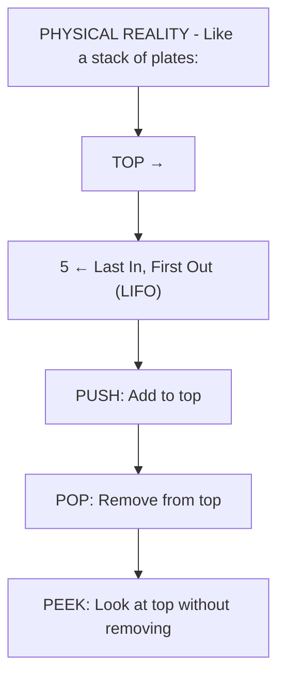
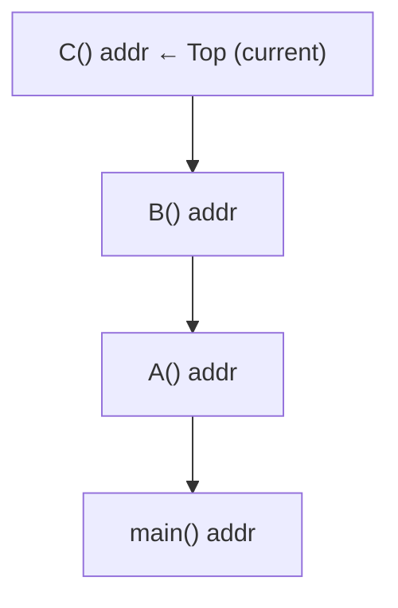
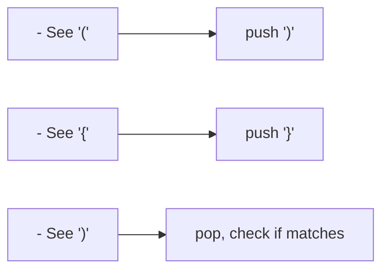
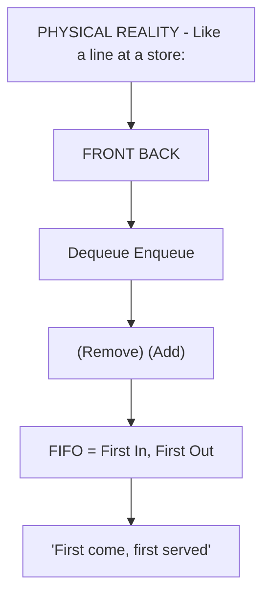
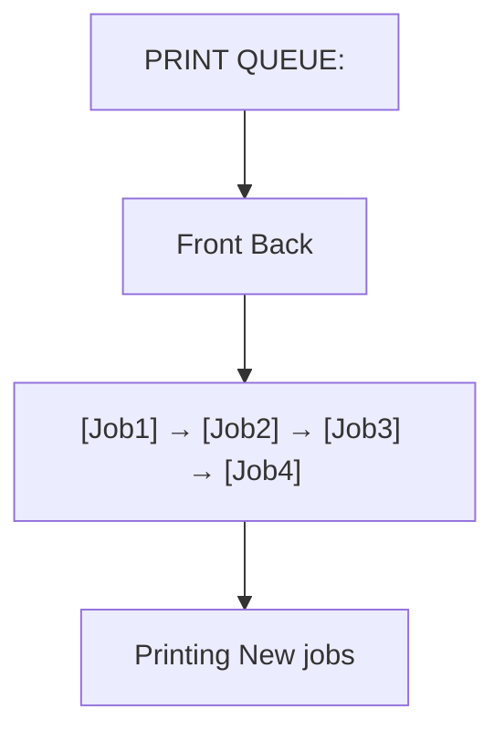

> **Navigation**: [< Previous Chapter](01c_LinkedList.md) | [Back to Index](../00_MASTER_INDEX.md) | [Next Chapter >](01e_HashTable.md)

---

# 📚 Part 4: Stack & Queue

### 5W1H: Deep Understanding of Stack

```
╔══════════════════════════════════════════════════════════════════════╗
║  WHAT: A Stack is a LIFO (Last In, First Out) data structure.        ║
║        Only the TOP element is accessible. Push/Pop are O(1).        ║
║                                                                      ║
║  WHY:  Many problems have a NESTING structure — what was opened      ║
║        LAST must be closed FIRST (parentheses, function calls,       ║
║        undo operations). LIFO naturally models this.                 ║
║                                                                      ║
║  HOW THE JVM USES A STACK (Call Stack):                              ║
║  Every Java THREAD has its own call stack.                           ║
║  When you call a method, JVM PUSHES a stack frame:                   ║
║  ┌─────────────────────────────────────────┐                         ║
║  │ main()     frame: { args, locals }      │ ← bottom                ║
║  │ calculate() frame: { x=5, y=10 }       │                          ║
║  │ multiply()  frame: { a=5, b=10 }       │ ← top (executing)        ║
║  └─────────────────────────────────────────┘                         ║
║  When multiply() returns, JVM POPS its frame.                        ║
║  StackOverflowError = too many frames (infinite recursion).          ║
║  Default stack size: 512KB - 1MB per thread.                         ║
║                                                                      ║
║  WHERE Stacks appear in production:                                  ║
║  • JVM call stack (method invocation/return)                         ║
║  • Browser back button (pages pushed, back = pop)                    ║
║  • Ctrl+Z undo (actions pushed, undo = pop)                          ║
║  • Expression evaluation (postfix, infix conversion)                 ║
║  • DFS traversal (explicit or implicit via recursion)                ║
║  • Compiler: syntax parsing, bracket matching                        ║
║                                                                      ║
║  WHEN to use a Stack:                                                ║
║  ✔ Matching/nesting problems (brackets, HTML tags)                   ║
║  ✔ Backtracking (maze solving, permutations)                         ║
║  ✔ Converting recursion to iteration                                 ║
║  ✔ Monotonic problems (next greater element)                         ║
║  ✘ When you need FIFO order (use Queue)                              ║
║  ✘ When you need random access (use Array)                           ║
╚══════════════════════════════════════════════════════════════════════╝
```

## 🧬 Nature & Behavior

### What is a Stack?

```
PHYSICAL REALITY - Like a stack of plates:
┌────────────────────────────────────────────────────┐
│                                                    │
│   TOP →  ┌─────┐                                   │
│          │  5  │  ← Last In, First Out (LIFO)      │
│          ├─────┤                                   │
│          │  4  │                                   │
│          ├─────┤                                   │
│          │  3  │                                   │
│          ├─────┤                                   │
│          │  2  │                                   │
│          ├─────┤                                   │
│          │  1  │                                   │
│          └─────┘                                   │
│                                                    │
│   PUSH: Add to top                                 │
│   POP: Remove from top                             │
│   PEEK: Look at top without removing               │
│                                                    │
└────────────────────────────────────────────────────┘
```

**Flow:**
- PHYSICAL REALITY - Like a stack of plates:
- ↓
- TOP
- ↓
- 5 ← Last In, First Out (LIFO)
- ↓
- PUSH: Add to top
- ↓
- POP: Remove from top
- ↓
- PEEK: Look at top without removing



### Stack Operations

| Operation    | Time | Description                 |
| ------------ | ---- | --------------------------- |
| push(x)      | O(1) | Add element to top          |
| pop()        | O(1) | Remove and return top       |
| peek()/top() | O(1) | Return top without removing |
| isEmpty()    | O(1) | Check if stack is empty     |
| size()       | O(1) | Return number of elements   |

### 🔴 Real-World Origin: Function Call Management (1960s)

**Problem (Early Computers):** Programs call functions, which call other functions. How do you remember where to return?

**Example:**
- `main()` calls `A()` → `A()` calls `B()` → `B()` calls `C()`
- `C()` returns to `B` → `B()` returns to `A` → `A()` returns to `main`

**Without Stack:** No way to track return addresses — programs would get lost!

**Solution — Call Stack:**
```
┌─────────────┐
│ C() addr    │ ← Top (current)
├─────────────┤
│ B() addr    │
├─────────────┤
│ A() addr    │
├─────────────┤
│ main() addr │
└─────────────┘
```

**Flow:**
- C() addr ← Top (current)
- ↓
- B() addr
- ↓
- A() addr
- ↓
- main() addr



When `C()` returns → pop → go to `B()`. When `B()` returns → pop → go to `A()`.

> 💡 **This is why:** `StackOverflowError` exists (too many calls), recursion works (each call pushed to stack), and debuggers show a "call stack".

## 💻 Implementation WITHOUT Collections

```java
public class MyStack {
    private int[] data;
    private int top;
    private int capacity;

    public MyStack(int capacity) {
        this.capacity = capacity;
        this.data = new int[capacity];
        this.top = -1;  // Empty stack
    }

    // PUSH - O(1)
    public void push(int value) {
        if (top == capacity - 1) {
            throw new RuntimeException("Stack Overflow!");
        }
        data[++top] = value;
    }

    // POP - O(1)
    public int pop() {
        if (isEmpty()) {
            throw new RuntimeException("Stack Underflow!");
        }
        return data[top--];
    }

    // PEEK - O(1)
    public int peek() {
        if (isEmpty()) {
            throw new RuntimeException("Stack is empty!");
        }
        return data[top];
    }

    // IS EMPTY - O(1)
    public boolean isEmpty() {
        return top == -1;
    }

    // SIZE - O(1)
    public int size() {
        return top + 1;
    }
}

// LINKED LIST BASED STACK (No size limit)
public class MyLinkedStack {
    private class Node {
        int data;
        Node next;
        Node(int data) { this.data = data; }
    }

    private Node top;
    private int size;

    public void push(int value) {
        Node newNode = new Node(value);
        newNode.next = top;
        top = newNode;
        size++;
    }

    public int pop() {
        if (top == null) throw new RuntimeException("Empty!");
        int value = top.data;
        top = top.next;
        size--;
        return value;
    }

    public int peek() {
        if (top == null) throw new RuntimeException("Empty!");
        return top.data;
    }

    public boolean isEmpty() {
        return top == null;
    }
}
```

## 🎯 LeetCode → Real-World Connection

### Problem: Valid Parentheses

```
REAL-WORLD ORIGIN: Compiler Design (1960s)

PROBLEM AT MIT (1962):
- Compilers need to parse code
- Code has nested structures: if { while { } }
- How to verify brackets match correctly?

BAD CODE:
if (x > 0 {    // Missing )
    while (y) }  // Wrong bracket
}

COMPILER NEEDS TO DETECT THIS!

SOLUTION THINKING:
1. "When I see '(', I expect ')' later"
2. "When I see '{', I expect '}' later"
3. "Most recent open bracket closes first"
4. "That's LIFO - use a STACK!"

ALGORITHM:
- See '(' → push ')'
- See '{' → push '}'
- See ')' → pop, check if matches
- End: stack should be empty

NOW USED IN:
- Every compiler (GCC, javac, clang)
- Every IDE (syntax highlighting)
- Every code editor (bracket matching)
- HTML validators
- JSON parsers
```

**Flow:**
- - See '('
- ↓
- push ')'
- ↓
- - See '{'
- ↓
- push '}'
- ↓
- - See ')'
- ↓
- pop, check if matches



---

## 🔑 The Key Bridge: Stack → DFS · Queue → BFS

> [!IMPORTANT]
> This is the single most important connection in all of graph algorithms.
> Understanding it rewires how you think about every traversal problem.

```
STACK (LIFO)                          QUEUE (FIFO)
════════════                          ════════════
Explore the DEEPEST path first        Explore closest paths first
 ↓ Go deep, then backtrack             → Spread outward level by level

        A                                      A
       / \                                    / \
      B   C       DFS visits:               B   C      BFS visits:
     / \           A→B→D→E                / \          A→B→C
    D   E          (backtrack)           D   E         →D→E→F
         \         →C→F                      \         →done
          F                                   F

Stack holds:  [A, C, B, D, E, F]     Queue holds: [A, B, C, D, E, F]
(push all,    process deepest first   (enqueue neighbors, process FIFO)
 pop = pick deepest unvisited)

WHY STACK = DFS:
  - Push unvisited neighbors onto stack
  - Pop = always picks the node pushed LAST (deepest path)
  - Natural recursion = implicit stack (call stack = your explicit stack)

WHY QUEUE = BFS:
  - Enqueue unvisited neighbors into queue
  - Poll = always picks the node enqueued FIRST (earliest = same level)
  - Level ordering = exploring in distance rings from source
```

**The Decision Rule:**
```
NEED SHORTEST PATH (fewest hops)?  → BFS (Queue)
NEED TO EXPLORE ALL POSSIBILITIES? → DFS (Stack/recursion)
NEED TOPOLOGICAL ORDER?            → DFS postorder
NEED LEVEL-BY-LEVEL OUTPUT?        → BFS (Queue)
```

> 💡 **Analogy — Lost in a Maze:**
> - **DFS (Stack):** Pick one direction, follow it to the dead end, then backtrack and try the next. Like following one path as far as it goes before giving up.
> - **BFS (Queue):** Send scouts one step in all directions simultaneously. When any scout hits a dead end, they stop. When one reaches the exit — it took the **minimum** steps because all scouts moved equally.

> 🔬 **Section Challenge — Stack=DFS vs Queue=BFS**
>
> **Challenge 1 (Reasoning):** You're solving "shortest path in a maze". A friend says "just use DFS, it's simpler". Why are they wrong?
> <details><summary>Answer</summary>
>
> DFS explores deep paths first — it might find a path of length 10 before ever checking the path of length 2. DFS guarantees it finds A path, not THE SHORTEST path (unless you exhaustively check all paths, which is O(2^N)). BFS is guaranteed to find the shortest path because it explores all 1-hop nodes before any 2-hop nodes — the first time it reaches the destination, it's via the minimum number of edges.
> </details>
>
> **Challenge 2 (Reasoning):** Both DFS and BFS are O(V+E). If complexity is the same, why does the CHOICE OF ALGORITHM still matter for "count all connected components"?
> <details><summary>Answer</summary>
>
> Same complexity but different behavior: DFS explores ONE component completely using recursion (simpler code, but risks StackOverflow on large graphs). BFS uses an explicit queue (no stack overflow risk). For counting components: both work, but DFS recursive is cleaner code. For shortest path between components: BFS is required. The algorithm choice determines CORRECTNESS, not just speed.
> </details>

# 📬 Part 5: Queue

## 🧬 Nature & Behavior

### What is a Queue?

```
PHYSICAL REALITY - Like a line at a store:
┌────────────────────────────────────────────────────┐
│                                                    │
│  FRONT                               BACK          │
│    ↓                                  ↓            │
│  ┌───┬───┬───┬───┬───┐                             │
│  │ 1 │ 2 │ 3 │ 4 │ 5 │                             │
│  └───┴───┴───┴───┴───┘                             │
│    ↑                 ↑                             │
│  Dequeue          Enqueue                          │
│  (Remove)         (Add)                            │
│                                                    │
│  FIFO = First In, First Out                        │
│  "First come, first served"                        │
│                                                    │
└────────────────────────────────────────────────────┘
```

**Flow:**
- PHYSICAL REALITY - Like a line at a store:
- ↓
- FRONT BACK
- ↓
- Dequeue Enqueue
- ↓
- (Remove) (Add)
- ↓
- FIFO = First In, First Out
- ↓
- 'First come, first served'



### Queue Operations

| Operation           | Time | Description       |
| ------------------- | ---- | ----------------- |
| enqueue(x)/offer(x) | O(1) | Add to back       |
| dequeue()/poll()    | O(1) | Remove from front |
| peek()/front()      | O(1) | See front element |
| isEmpty()           | O(1) | Check if empty    |

### 🔴 Real-World Origin: Print Spooler (1970s)

**Problem (Office with 1 printer, 50 computers):** Multiple users send print jobs, but the printer can only do one at a time. Who prints first?

**Without Queue:** Last person to click "Print" goes first — people who clicked earlier wait forever. *Unfair and chaotic!*

**Solution — Print Queue:** Jobs added to back, printer takes from front. First submitted = first printed.

```
PRINT QUEUE:
┌────────────────────────────────────────┐
│ Front                            Back  │
│ [Job1] → [Job2] → [Job3] → [Job4]      │
│   ↑                              ↑     │
│ Printing                    New jobs   │
└────────────────────────────────────────┘
```

**Flow:**
- PRINT QUEUE:
- ↓
- Front Back
- ↓
- [Job1]
- ↓
- [Job2]
- ↓
- [Job3]
- ↓
- [Job4]
- ↓
- [Job1]
- ↓
- [Job2]
- ↓
- [Job3]
- ↓
- [Job4]
- ↓
- Printing New jobs



> ✅ **Now used in:** OS task scheduling, web server request handling, message queues (Kafka, RabbitMQ), BFS algorithm

## 💻 Implementation WITHOUT Collections

```java
// CIRCULAR ARRAY QUEUE (Most efficient)
public class MyQueue {
    private int[] data;
    private int front;
    private int rear;
    private int size;
    private int capacity;

    public MyQueue(int capacity) {
        this.capacity = capacity;
        this.data = new int[capacity];
        this.front = 0;
        this.rear = -1;
        this.size = 0;
    }

    // ENQUEUE - O(1)
    public void enqueue(int value) {
        if (size == capacity) {
            throw new RuntimeException("Queue is full!");
        }
        rear = (rear + 1) % capacity;  // Circular
        data[rear] = value;
        size++;
    }

    // DEQUEUE - O(1)
    public int dequeue() {
        if (isEmpty()) {
            throw new RuntimeException("Queue is empty!");
        }
        int value = data[front];
        front = (front + 1) % capacity;  // Circular
        size--;
        return value;
    }

    // PEEK - O(1)
    public int peek() {
        if (isEmpty()) {
            throw new RuntimeException("Queue is empty!");
        }
        return data[front];
    }

    public boolean isEmpty() {
        return size == 0;
    }

    public int size() {
        return size;
    }
}

// WHY CIRCULAR?
/*
Without circular, after many operations:
[_, _, _, 5, 6, 7, _, _, _]
        ↑        ↑
      front    rear

Wasted space at beginning!

With circular, rear wraps around:
[8, 9, _, 5, 6, 7]
      ↑  ↑
    rear front

No wasted space!
*/
```

## 🎯 LeetCode → Real-World Connection

### Problem: Number of Islands (BFS with Queue)

> 🌍 **Real-World Origin:** Google Maps (2005)

**Problem:** Satellite images show land and water. Need to count distinct landmasses and identify boundaries of each island.

**Initial Approach:** Manual counting by humans — takes *weeks* for one region, costing *millions*.

**Solution — BFS:**
1. Find a land pixel
2. Use **queue** to explore all connected land
3. Mark as visited
4. Count increments by 1
5. Repeat for unexplored land

> ❓ **Why BFS (Queue) not DFS (Stack)?**
> BFS explores in "waves" from starting point — natural for geographic spreading. Won't get stuck in long narrow peninsulas.

> ✅ **Impact:** Automated island counting, ocean mapping, disease spread modeling (same algorithm!), network connectivity analysis

---

---

## 🏋️ Foundation Practice — Stack & Queue

### Stack Quick Questions
**Q1 — Balanced Parentheses** *(classic Stack application)*
```java
public boolean isBalanced(String s) {
    Deque<Character> stack = new ArrayDeque<>();
    for (char c : s.toCharArray()) {
        if (c == '(' || c == '{' || c == '[') stack.push(c);
        else {
            if (stack.isEmpty()) return false;
            char top = stack.pop();
            if (c == ')' && top != '(') return false;
            if (c == '}' && top != '{') return false;
            if (c == ']' && top != '[') return false;
        }
    }
    return stack.isEmpty();
}
// Time: O(n) | Space: O(n)  | LC 20 — Valid Parentheses
```

**Q2 — Min Stack** *(Stack with O(1) getMin)*
```java
class MinStack {
    Deque<Integer> stack = new ArrayDeque<>();
    Deque<Integer> minStack = new ArrayDeque<>();  // parallel min tracker

    public void push(int val) {
        stack.push(val);
        minStack.push(minStack.isEmpty() ? val : Math.min(minStack.peek(), val));
    }
    public void pop() { stack.pop(); minStack.pop(); }
    public int top() { return stack.peek(); }
    public int getMin() { return minStack.peek(); }
}
// Key: minStack always holds min so far → O(1) getMin | LC 155
```

### 🚀 GO LEARN — Monotonic Stack (You'll Need This)

> **STOP** — For "next greater element" pattern, you need Monotonic Stack.
>
> 📖 [11_Stack_Plus_MonotonicPattern.md](../04_Patterns_Templates/11_Stack_Plus_MonotonicPattern.md)
> 📖 [15_Monotonic_Stack_Queue_Complete.md](../03_Algorithms/15_Monotonic_Stack_Queue_Complete.md)
>
> ⬅️ **RETURN CHECKPOINT** — Apply below after studying.

### ✅ Apply: Next Greater Element — Monotonic Stack O(n)

```
Brute: For each element, scan right → O(n²)
Optimal: Monotonic decreasing stack → O(n)

IDEA: Maintain stack in decreasing order.
When we find a bigger element, it's the "next greater" for everything smaller in stack.
```

```java
public int[] nextGreaterElement(int[] arr) {
    int n = arr.length;
    int[] result = new int[n];
    Arrays.fill(result, -1);
    Deque<Integer> stack = new ArrayDeque<>();   // stores indices

    for (int i = 0; i < n; i++) {
        while (!stack.isEmpty() && arr[stack.peek()] < arr[i])
            result[stack.pop()] = arr[i];        // arr[i] is next greater
        stack.push(i);
    }
    return result;
}
// LC 496 — Next Greater Element I | LC 739 — Daily Temperatures
```

### Queue Quick Questions

**Q1 — BFS Template** *(Queue's most important use)*
```java
// Standard BFS — O(V + E) for graphs, O(n) for arrays
Queue<Integer> queue = new LinkedList<>();
boolean[] visited = new boolean[n];
queue.offer(start);
visited[start] = true;

while (!queue.isEmpty()) {
    int node = queue.poll();
    // process node
    for (int neighbor : getNeighbors(node))
        if (!visited[neighbor]) {
            visited[neighbor] = true;
            queue.offer(neighbor);
        }
}
```

**Q2 — Sliding Window Maximum — Deque O(n)**
```
Brute: Max of each window → O(n*k)
Optimal: Monotonic Deque → O(n) — maintains max at front
```
```java
public int[] maxSlidingWindow(int[] arr, int k) {
    int n = arr.length;
    int[] result = new int[n - k + 1];
    Deque<Integer> deque = new ArrayDeque<>();  // stores indices, front = max

    for (int i = 0; i < n; i++) {
        if (!deque.isEmpty() && deque.peekFirst() <= i - k) deque.pollFirst(); // out of window
        while (!deque.isEmpty() && arr[deque.peekLast()] <= arr[i]) deque.pollLast(); // smaller useless
        deque.offerLast(i);
        if (i >= k - 1) result[i - k + 1] = arr[deque.peekFirst()];
    }
    return result;
}
// LC 239 — Sliding Window Maximum
```

---

## 🎯 Full Problem Set — Stack & Queue

| # | Problem | Platform | Difficulty | Pattern |
|---|---------|----------|------------|---------|
| 1 | LC 20 — Valid Parentheses | LeetCode | ⭐ Easy | Stack matching |
| 2 | LC 155 — Min Stack | LeetCode | ⭐⭐ Med | Two stacks |
| 3 | LC 496 — Next Greater Element I | LeetCode | ⭐ Easy | Monotonic stack |
| 4 | LC 739 — Daily Temperatures | LeetCode | ⭐⭐ Med | Monotonic stack |
| 5 | LC 84 — Largest Rectangle in Histogram | LeetCode | ⭐⭐⭐ Hard | Monotonic stack |
| 6 | LC 239 — Sliding Window Maximum | LeetCode | ⭐⭐⭐ Hard | Monotonic deque |
| 7 | LC 232 — Implement Queue using Stacks | LeetCode | ⭐ Easy | Two stacks |
| 8 | LC 102 — Binary Tree Level Order | LeetCode | ⭐⭐ Med | BFS Queue |
| 9 | CF 82A — Double Cola | Codeforces | Div2-A | Queue simulation |

---


> 🔬 **Section Challenge — 🎯 Full Problem Set — Stack & Queue**
>
> **Challenge 1 (Reasoning):** Monotonic DECREASING stack — when you push a new element, which existing elements are popped and what information do those pops tell you?
> <details><summary>Answer</summary>
>
> In a decreasing stack (top is smallest), pushing element `x`: all elements smaller than `x` are popped. For each popped element `y`: `x` is the NEXT GREATER ELEMENT of `y`. This is the key insight: the pop event = answer event. Application: Daily Temperatures (next warmer day), Largest Rectangle in Histogram (right boundary), Next Greater Element. Each element is pushed and popped exactly once → O(N) total.
> </details>
>

## 🧠 Pattern Fingerprint — Stack & Queue

```
SEE THESE WORDS → USE THIS:
┌──────────────────────────────────────────────────────────────┐
│ "matching brackets / nesting"     → Stack (LIFO natural)    │
│ "next greater / smaller element"  → Monotonic Stack O(n)    │
│ "largest rectangle in histogram"  → Monotonic Stack         │
│ "BFS / level-by-level traversal"  → Queue                   │
│ "sliding window maximum"          → Monotonic Deque O(n)    │
│ "undo / redo"                     → Two Stacks              │
│ "evaluate expression"             → Two Stacks (ops+vals)   │
└──────────────────────────────────────────────────────────────┘
```

### 🚀 GO LEARN — When You Need More

| Topic | File |
|-------|------|
| Stack patterns deep dive | 📖 [11_Stack_Plus_MonotonicPattern.md](../04_Patterns_Templates/11_Stack_Plus_MonotonicPattern.md) |
| Practice problems Stack/Queue | 📖 [08_Stack_Queue.md](../05_Problem_Solving/08_Stack_Queue.md) |
| Monotonic complete guide | 📖 [15_Monotonic_Stack_Queue_Complete.md](../03_Algorithms/15_Monotonic_Stack_Queue_Complete.md) |

### 📅 Revisit Tracker
- **Day 3:** Redo LC 20 (Balanced) + LC 496 (Next Greater) from memory
- **Day 7:** Redo LC 739 (Daily Temperatures) — explain the monotonic stack logic

---

---


## ✅ You Know Stack & Queue — Now Practice! (JIT Study Path)

> **Step 1 — Basic Problems (Warm Up):**

| Problem | LC # | Pattern | Key Concept |
|---|---|---|---|
| Valid Parentheses | LC 20 | Stack matching | Push open, pop & match close |
| Min Stack | LC 155 | Auxiliary stack | Keep a parallel min-so-far stack |
| Implement Queue using Stacks | LC 232 | Two stacks | Input stack → output stack (lazy reverse) |
| Daily Temperatures | LC 739 | Monotonic Stack | Decreasing stack, pop when warmer found |
| Next Greater Element I | LC 496 | Monotonic Stack | Stack + HashMap for O(n) answer |

>
> **Step 2 — Hit a wall? Learn these patterns:**
> - Nearest greater/smaller → **[Monotonic Stack Guide](../04_Patterns_Templates/11_Stack_Plus_MonotonicPattern.md)**
> - BFS level-by-level → **[Graph Fundamentals](../03_Algorithms/05c_Graphs_Fundamentals.md)**
>
> **Step 3 — Apply patterns on harder problems:**
> 👉 **[Go to Stack/Queue Problem Solving File →](../05_Problem_Solving/08_Stack_Queue.md)**
>
> **Step 4 — Competitive Practice:**

| CF Problem | Topic | Difficulty |
|---|---|---|
| [CF 5C — Longest Regular Bracket Sequence](https://codeforces.com/problemset/problem/5/C) | Stack (brackets) | ⭐⭐ Medium |
| [CF 797C — Minimal String](https://codeforces.com/problemset/problem/797/C) | Greedy + Stack | ⭐⭐ Medium |
| [CF 1830C — Hyperflation](https://codeforces.com/problemset/problem/1830/C) | Monotonic Stack | ⭐⭐ Medium |

>
> 🌍 **Real-World Connections:**
> - **Undo/Redo** in every editor (VS Code, Word) = two stacks: undo stack + redo stack
> - **Browser history** = back button = stack of visited pages
> - **Call stack in JVM/V8** = stack frame pushed per function call, popped on return
> - **Message queues** (Kafka, RabbitMQ) = distributed queues at massive scale
> - **CPU instruction pipeline** = queue of instructions to execute

---


---

## 🏋️ Practice & Interview Questions — Stack & Queue

### Predict / Trace
**Q1.** Stack has [1,2,3] (3 is top). After pop(), pop(), push(5) — what's the stack?
<details><summary>Answer</summary>

[1, 5] — popped 3 and 2, pushed 5 on top of 1.
</details>

**Q2.** Evaluate postfix `3 4 + 2 *` using a stack — trace each step.
<details><summary>Answer</summary>

push 3 → [3]; push 4 → [3,4]; + → pop 3,4, push 7 → [7]; push 2 → [7,2]; * → pop 7,2, push 14 → [14]. Result: 14
</details>

### LeetCode / Coding
**Q3.** ⭐ Valid Parentheses — O(N).
<details><summary>Solution</summary>

```java
Deque<Character> stack = new ArrayDeque<>();
for(char c : s.toCharArray()){
    if(c=='('||c=='{'||c=='[') stack.push(c);
    else {
        if(stack.isEmpty()) return false;
        char top = stack.pop();
        if(c==')'&&top!='('||c=='}'&&top!='{'||c==']'&&top!='[') return false;
    }
}
return stack.isEmpty();
```
</details>

**Q4.** ⭐ Min Stack — O(1) getMin().
<details><summary>Solution</summary>

```java
Deque<Integer> stack=new ArrayDeque<>(), minStack=new ArrayDeque<>();
void push(int v){ stack.push(v); if(minStack.isEmpty()||v<=minStack.peek()) minStack.push(v); }
void pop(){ if(stack.pop().equals(minStack.peek())) minStack.pop(); }
int getMin(){ return minStack.peek(); }
```
</details>

**Q5.** ⭐⭐ Daily Temperatures — next warmer day for each day (monotonic stack).
<details><summary>Solution</summary>

```java
int[] res = new int[n]; Deque<Integer> stack = new ArrayDeque<>();
for(int i=0;i<n;i++){
    while(!stack.isEmpty()&&temperatures[i]>temperatures[stack.peek()])
        res[stack.peek()] = i - stack.pop();
    stack.push(i);
}
```
</details>

**Q6.** ⭐⭐ Largest Rectangle in Histogram (monotonic stack).
<details><summary>Solution</summary>

```java
Deque<Integer> stack = new ArrayDeque<>();
int maxArea = 0;
for(int i=0;i<=n;i++){
    int h = (i==n)?0:heights[i];
    while(!stack.isEmpty()&&h<heights[stack.peek()]){
        int height=heights[stack.pop()];
        int width=stack.isEmpty()?i:(i-stack.peek()-1);
        maxArea=Math.max(maxArea,height*width);
    }
    stack.push(i);
}
```
</details>

**Q7.** ⭐⭐ Implement Queue using 2 Stacks.
<details><summary>Solution</summary>

```java
// Two stacks: inbox (for push), outbox (for pop)
// Move inbox→outbox only when outbox is empty
void push(int x){ inbox.push(x); }
int pop(){ if(outbox.isEmpty()) while(!inbox.isEmpty()) outbox.push(inbox.pop()); return outbox.pop(); }
```
</details>

**Q8.** ⭐⭐ Decode String — `3[a2[bc]]` → `abcbcabcbcabcbc`.
<details><summary>Solution</summary>

```java
Deque<Integer> counts=new ArrayDeque<>();
Deque<StringBuilder> builders=new ArrayDeque<>();
StringBuilder curr=new StringBuilder(); int k=0;
for(char c:s.toCharArray()){
    if(Character.isDigit(c)) k=k*10+(c-'0');
    else if(c=='['){ counts.push(k); builders.push(curr); curr=new StringBuilder(); k=0; }
    else if(c==']'){ int times=counts.pop(); StringBuilder prev=builders.pop(); while(times-->0) prev.append(curr); curr=prev; }
    else curr.append(c);
}
return curr.toString();
```
</details>

### MCQ Rapid Fire
| # | Question | Answer |
|---|---|---|
| 1 | Stack LIFO/FIFO? | LIFO |
| 2 | Queue LIFO/FIFO? | FIFO |
| 3 | Java Stack class — recommended alternative? | Deque / ArrayDeque |
| 4 | ArrayDeque vs LinkedList for stack/queue | ArrayDeque (no boxing, cache-friendly) |
| 5 | Monotonic stack usage | Next greater/smaller element problems |
| 6 | BFS uses which data structure? | Queue |
| 7 | DFS (iterative) uses which structure? | Stack |
| 8 | peek() vs poll() on empty queue | peek()=null, poll()=null (no exception) |


---

## 🧠 Deep Conceptual Questions — Stack & Queue

**C1. Why is a monotonic stack called "monotonic" and what property does it maintain?**
<details><summary>Deep Answer</summary>

A monotonic stack maintains elements in **strictly increasing or decreasing order** from bottom to top. When a new element arrives that violates the monotonicity (e.g., a larger element in a decreasing stack), elements are popped until the property is restored, THEN the new element is pushed. The pop events are the answer events: when element X is popped because Y is larger, Y is the "next greater element" of X. This processes each element exactly once (each is pushed and popped at most once) → O(N) total.
</details>

**C2. Why use `ArrayDeque` instead of `Stack` class in Java?**
<details><summary>Deep Answer</summary>

Java's `Stack` extends `Vector` (legacy, synchronized). Every push/pop acquires a mutex lock — unnecessary for single-threaded stack use. `ArrayDeque` has zero synchronization overhead, pure array-backed, cache-friendly. Also: `Stack`'s interface allows index-based access and `insertElementAt` which shouldn't exist on a stack (breaks the abstraction). `ArrayDeque` implements `Deque` — clean stack interface (`push`, `pop`, `peek`). **Never use `Stack` in modern Java.**
</details>

**C3. BFS uses a Queue — what property of queues makes BFS work correctly?**
<details><summary>Deep Answer</summary>

BFS needs to process nodes **level by level** — explore all nodes at distance D before any node at distance D+1. Queue's FIFO property guarantees this: nodes enqueued at distance D are dequeued and processed before nodes at distance D+1 (which are enqueued during processing D). If you used a Stack (DFS): you'd go depth-first — immediately explore children of the first node before its siblings. The FIFO vs LIFO distinction is the entire algorithmic difference between BFS and DFS.
</details>

**C4. Why is the "largest rectangle in histogram" problem solved with a monotonic stack?**
<details><summary>Deep Answer</summary>

For each bar, the rectangle it forms extends left/right until a shorter bar is hit. A monotonic increasing stack maintains bars in increasing height. When a shorter bar arrives (say height 3 comes after [2,5,7]):
- Pop 7: rectangle with height 7, width determined by current index and stack top
- Pop 5: rectangle with height 5, wider width

The stack tells us: bars still in the stack haven't found their "right boundary" yet (no shorter bar has come). When they're finally popped, we know both their left and right boundaries. This is the key geometric insight: the stack holds "potential rectangles still growing."
</details>

**C5. Implement a Queue with O(1) amortized enqueue and dequeue — why is amortized important?**
<details><summary>Deep Answer</summary>

Two-stack queue: transfer from stack1 to stack2 only when stack2 is empty. Individual dequeue can be O(N) (transfer cost). But each element is transferred at most once. Over N operations: total transfer cost = N. Average = O(1). This is amortized O(1). Real-world relevance: Python's `queue.Queue` uses this pattern. Java's `ArrayDeque` achieves true O(1) with a circular array — amortized O(1) when resizing without transfer cost.
</details>

**C6. What is the call stack and how do recursive algorithms relate to it?**
<details><summary>Deep Answer</summary>

The **call stack** is a stack of stack frames. Each function call pushes a frame (local variables, return address, parameters). Return pops the frame. Recursive DFS naturally uses the call stack AS its traversal stack. Iterative DFS explicitly manages a stack in heap memory. Iterative is often preferred for: (1) avoiding stack overflow on deep recursion (JVM default: ~500-1000 frames), (2) more control over traversal order, (3) ability to pause/resume traversal.
</details>


> **Navigation**: [< Previous](01c_LinkedList.md) | [Back to Index](../00_MASTER_INDEX.md) | [Next >](01e_HashTable.md)