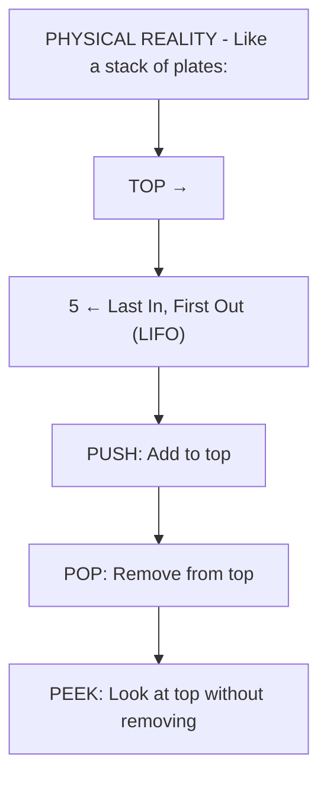
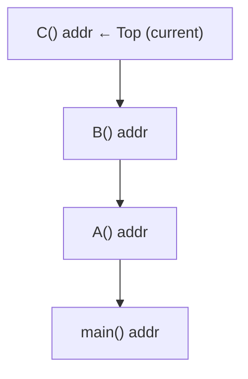
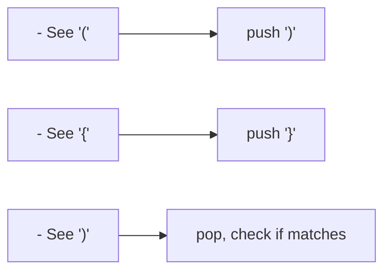
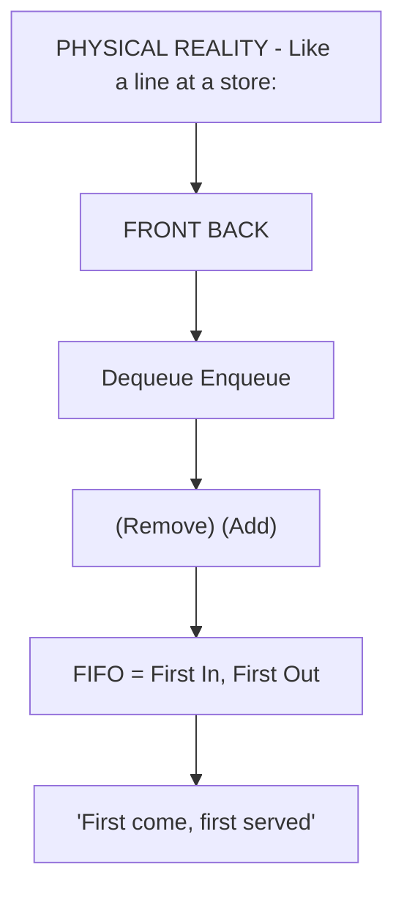
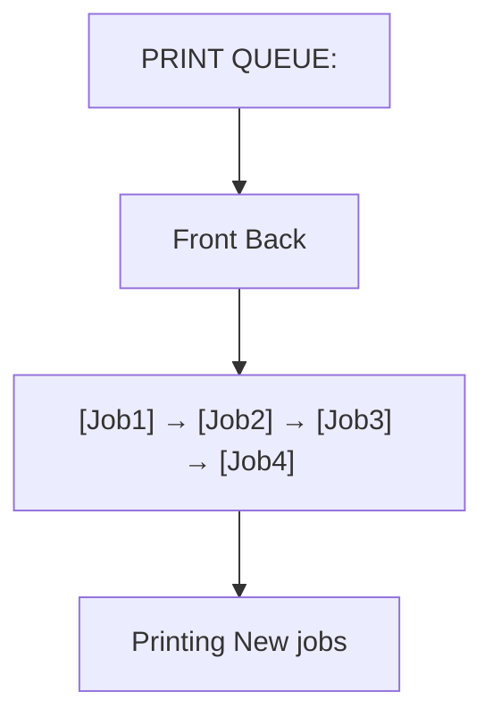

> **Navigation**: [< Previous Chapter](01c_LinkedList.md) | [Back to Index](../00_MASTER_INDEX.md) | [Next Chapter >](01e_HashTable.md)

---

# 📚 Part 4: Stack

## 🧬 Nature & Behavior

### What is a Stack?

```
PHYSICAL REALITY - Like a stack of plates:
┌────────────────────────────────────────────────────┐
│                                                    │
│   TOP →  ┌─────┐                                   │
│          │  5  │  ← Last In, First Out (LIFO)      │
│          ├─────┤                                   │
│          │  4  │                                   │
│          ├─────┤                                   │
│          │  3  │                                   │
│          ├─────┤                                   │
│          │  2  │                                   │
│          ├─────┤                                   │
│          │  1  │                                   │
│          └─────┘                                   │
│                                                    │
│   PUSH: Add to top                                 │
│   POP: Remove from top                             │
│   PEEK: Look at top without removing               │
│                                                    │
└────────────────────────────────────────────────────┘
```

> **Flow**: PHYSICAL REALITY - Like a stack of plates: → TOP → | TOP → → 5 ← Last In, First Out (LIFO) | 5 ← Last In, First Out (LIFO) → PUSH: Add to top | PUSH: Add to top → POP: Remove from top | POP: Remove from top → PEEK: Look at top without removing



### Stack Operations

| Operation    | Time | Description                 |
| ------------ | ---- | --------------------------- |
| push(x)      | O(1) | Add element to top          |
| pop()        | O(1) | Remove and return top       |
| peek()/top() | O(1) | Return top without removing |
| isEmpty()    | O(1) | Check if stack is empty     |
| size()       | O(1) | Return number of elements   |

### 🔴 Real-World Origin: Function Call Management (1960s)

**Problem (Early Computers):** Programs call functions, which call other functions. How do you remember where to return?

**Example:**
- `main()` calls `A()` → `A()` calls `B()` → `B()` calls `C()`
- `C()` returns to `B` → `B()` returns to `A` → `A()` returns to `main`

**Without Stack:** No way to track return addresses — programs would get lost!

**Solution — Call Stack:**
```
┌─────────────┐
│ C() addr    │ ← Top (current)
├─────────────┤
│ B() addr    │
├─────────────┤
│ A() addr    │
├─────────────┤
│ main() addr │
└─────────────┘
```

> **Flow**: C() addr ← Top (current) → B() addr | B() addr → A() addr | A() addr → main() addr



When `C()` returns → pop → go to `B()`. When `B()` returns → pop → go to `A()`.

> 💡 **This is why:** `StackOverflowError` exists (too many calls), recursion works (each call pushed to stack), and debuggers show a "call stack".

## 💻 Implementation WITHOUT Collections

```java
public class MyStack {
    private int[] data;
    private int top;
    private int capacity;

    public MyStack(int capacity) {
        this.capacity = capacity;
        this.data = new int[capacity];
        this.top = -1;  // Empty stack
    }

    // PUSH - O(1)
    public void push(int value) {
        if (top == capacity - 1) {
            throw new RuntimeException("Stack Overflow!");
        }
        data[++top] = value;
    }

    // POP - O(1)
    public int pop() {
        if (isEmpty()) {
            throw new RuntimeException("Stack Underflow!");
        }
        return data[top--];
    }

    // PEEK - O(1)
    public int peek() {
        if (isEmpty()) {
            throw new RuntimeException("Stack is empty!");
        }
        return data[top];
    }

    // IS EMPTY - O(1)
    public boolean isEmpty() {
        return top == -1;
    }

    // SIZE - O(1)
    public int size() {
        return top + 1;
    }
}

// LINKED LIST BASED STACK (No size limit)
public class MyLinkedStack {
    private class Node {
        int data;
        Node next;
        Node(int data) { this.data = data; }
    }

    private Node top;
    private int size;

    public void push(int value) {
        Node newNode = new Node(value);
        newNode.next = top;
        top = newNode;
        size++;
    }

    public int pop() {
        if (top == null) throw new RuntimeException("Empty!");
        int value = top.data;
        top = top.next;
        size--;
        return value;
    }

    public int peek() {
        if (top == null) throw new RuntimeException("Empty!");
        return top.data;
    }

    public boolean isEmpty() {
        return top == null;
    }
}
```

## 🎯 LeetCode → Real-World Connection

### Problem: Valid Parentheses

```
REAL-WORLD ORIGIN: Compiler Design (1960s)

PROBLEM AT MIT (1962):
- Compilers need to parse code
- Code has nested structures: if { while { } }
- How to verify brackets match correctly?

BAD CODE:
if (x > 0 {    // Missing )
    while (y) }  // Wrong bracket
}

COMPILER NEEDS TO DETECT THIS!

SOLUTION THINKING:
1. "When I see '(', I expect ')' later"
2. "When I see '{', I expect '}' later"
3. "Most recent open bracket closes first"
4. "That's LIFO - use a STACK!"

ALGORITHM:
- See '(' → push ')'
- See '{' → push '}'
- See ')' → pop, check if matches
- End: stack should be empty

NOW USED IN:
- Every compiler (GCC, javac, clang)
- Every IDE (syntax highlighting)
- Every code editor (bracket matching)
- HTML validators
- JSON parsers
```

> **Flow**: - See '(' → push ')' | - See '{' → push '}' | - See ')' → pop, check if matches



---

# 📬 Part 5: Queue

## 🧬 Nature & Behavior

### What is a Queue?

```
PHYSICAL REALITY - Like a line at a store:
┌────────────────────────────────────────────────────┐
│                                                    │
│  FRONT                               BACK          │
│    ↓                                  ↓            │
│  ┌───┬───┬───┬───┬───┐                             │
│  │ 1 │ 2 │ 3 │ 4 │ 5 │                             │
│  └───┴───┴───┴───┴───┘                             │
│    ↑                 ↑                             │
│  Dequeue          Enqueue                          │
│  (Remove)         (Add)                            │
│                                                    │
│  FIFO = First In, First Out                        │
│  "First come, first served"                        │
│                                                    │
└────────────────────────────────────────────────────┘
```

> **Flow**: PHYSICAL REALITY - Like a line at a store: → FRONT BACK | FRONT BACK → Dequeue Enqueue | Dequeue Enqueue → (Remove) (Add) | (Remove) (Add) → FIFO = First In, First Out | FIFO = First In, First Out → 'First come, first served'



### Queue Operations

| Operation           | Time | Description       |
| ------------------- | ---- | ----------------- |
| enqueue(x)/offer(x) | O(1) | Add to back       |
| dequeue()/poll()    | O(1) | Remove from front |
| peek()/front()      | O(1) | See front element |
| isEmpty()           | O(1) | Check if empty    |

### 🔴 Real-World Origin: Print Spooler (1970s)

**Problem (Office with 1 printer, 50 computers):** Multiple users send print jobs, but the printer can only do one at a time. Who prints first?

**Without Queue:** Last person to click "Print" goes first — people who clicked earlier wait forever. *Unfair and chaotic!*

**Solution — Print Queue:** Jobs added to back, printer takes from front. First submitted = first printed.

```
PRINT QUEUE:
┌────────────────────────────────────────┐
│ Front                            Back  │
│ [Job1] → [Job2] → [Job3] → [Job4]      │
│   ↑                              ↑     │
│ Printing                    New jobs   │
└────────────────────────────────────────┘
```

> **Flow**: PRINT QUEUE: → Front Back | Front Back → [Job1] → [Job2] → [Job3] → [Job4] | [Job1] → [Job2] → [Job3] → [Job4] → Printing New jobs



> ✅ **Now used in:** OS task scheduling, web server request handling, message queues (Kafka, RabbitMQ), BFS algorithm

## 💻 Implementation WITHOUT Collections

```java
// CIRCULAR ARRAY QUEUE (Most efficient)
public class MyQueue {
    private int[] data;
    private int front;
    private int rear;
    private int size;
    private int capacity;

    public MyQueue(int capacity) {
        this.capacity = capacity;
        this.data = new int[capacity];
        this.front = 0;
        this.rear = -1;
        this.size = 0;
    }

    // ENQUEUE - O(1)
    public void enqueue(int value) {
        if (size == capacity) {
            throw new RuntimeException("Queue is full!");
        }
        rear = (rear + 1) % capacity;  // Circular
        data[rear] = value;
        size++;
    }

    // DEQUEUE - O(1)
    public int dequeue() {
        if (isEmpty()) {
            throw new RuntimeException("Queue is empty!");
        }
        int value = data[front];
        front = (front + 1) % capacity;  // Circular
        size--;
        return value;
    }

    // PEEK - O(1)
    public int peek() {
        if (isEmpty()) {
            throw new RuntimeException("Queue is empty!");
        }
        return data[front];
    }

    public boolean isEmpty() {
        return size == 0;
    }

    public int size() {
        return size;
    }
}

// WHY CIRCULAR?
/*
Without circular, after many operations:
[_, _, _, 5, 6, 7, _, _, _]
        ↑        ↑
      front    rear

Wasted space at beginning!

With circular, rear wraps around:
[8, 9, _, 5, 6, 7]
      ↑  ↑
    rear front

No wasted space!
*/
```

## 🎯 LeetCode → Real-World Connection

### Problem: Number of Islands (BFS with Queue)

> 🌍 **Real-World Origin:** Google Maps (2005)

**Problem:** Satellite images show land and water. Need to count distinct landmasses and identify boundaries of each island.

**Initial Approach:** Manual counting by humans — takes *weeks* for one region, costing *millions*.

**Solution — BFS:**
1. Find a land pixel
2. Use **queue** to explore all connected land
3. Mark as visited
4. Count increments by 1
5. Repeat for unexplored land

> ❓ **Why BFS (Queue) not DFS (Stack)?**
> BFS explores in "waves" from starting point — natural for geographic spreading. Won't get stuck in long narrow peninsulas.

> ✅ **Impact:** Automated island counting, ocean mapping, disease spread modeling (same algorithm!), network connectivity analysis

---

> **Navigation**: [< Previous](01c_LinkedList.md) | [Back to Index](../00_MASTER_INDEX.md) | [Next >](01e_HashTable.md)