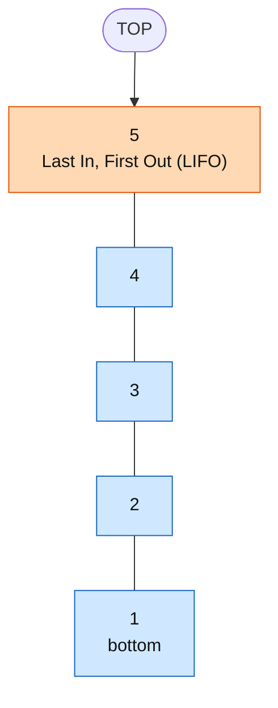
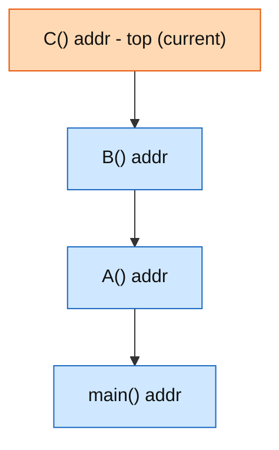

# The Invention of the Stack & Queue (1960s)

> **Navigation**: [Chapter overview](../01d_Stack_Queue.md) | [Queue →](02_queue.md)
> Page 1 of 5 in **Stacks & Queues**


Before compilers and managed runtimes existed, programmers manually calculated return addresses using GOTO. The stack was invented because ALGOL 60 required **recursive functions** — and recursion demands a LIFO call stack.

**Before 1955:** No formal call stack. Return addresses stored in fixed registers. No recursion possible.
**1961:** Burroughs B5000 — a production computer designed around a stack (Robert Barton, designed for ALGOL). The architecture pushed operands and addresses onto a stack, making recursion hardware-native.
**1960:** ALGOL 60 standardizes recursive functions. Every compiler must now implement a call stack.
**1965:** Dijkstra introduces semaphores (P/V) for process synchronisation; his THE multiprogramming system (1968) uses queues of waiting processes.
**1968:** Dijkstra's "Cooperating Sequential Processes" paper — semaphores + queue primitives for OS process synchronization.
**1970s–80s:** Stack-based languages: Forth (Charles H. Moore, c. 1970) and PostScript (Adobe, 1982).
**1973:** Unix pipes (Doug McIlroy and Ken Thompson): the `|` operator connects processes through a FIFO byte queue.
**1990s:** JVM (1995) and CLR (2002) formalize managed call stacks with hardware-guarded StackOverflowError semantics.
**2011:** LMAX Disruptor — a ring-buffer queue that let the LMAX exchange process millions of orders per second on a single thread.
**2010s:** async/await (C# 5 in 2012, Python 3.5 in 2015, JavaScript ES2017) — language-level suspendable functions.
**2020s:** Virtual threads (Java 21, JEP 444, 2023) — millions of lightweight threads, each with a virtual stack, multiplexed onto a small pool of OS carrier threads (their stack frames are stored on the heap while unmounted).

**Named Predecessors:**

- **Burroughs B5000 (1961)** — first stack machine, designed by Bob Barton. Needed because ALGOL required recursion.
- **Dijkstra's semaphore paper (1965/1968)** — formal queue primitive for OS scheduling.
- **LMAX Disruptor (2011)** — modern production queue at LMAX exchange, proving lock-free queues at 100M+ msg/sec.
- **Java virtual threads (JEP 444, 2023)** — millions of virtual stacks per process.

**Motivation by Era:**

- 1950s: Hardware needed to support recursion in scientific computing (Fortran's limitations exposed)
- 1960s: OS needed fair scheduling (Dijkstra's queue) and compiler design needed bracket matching
- 1970s-80s: Languages like Forth and PostScript embraced the stack as a computational model
- 1990s: Managed runtimes needed safety (stack overflow detection) and memory isolation
- 2010s-2020s: High-frequency trading and async programming exposed limits of OS-thread stacks → virtual threads and lock-free queues

**Physical reality** — like a stack of plates:



**How to read this diagram.** Only the top plate (orange) can be touched.

| Operation | Meaning |
| --------- | ------- |
| `push` | Add to top |
| `pop` | Remove from top |
| `peek` | Look at top without removing |

## Stack Operations

| Operation    | Time | Description                 |
| ------------ | ---- | --------------------------- |
| push(x)      | O(1) | Add element to top          |
| pop()        | O(1) | Remove and return top       |
| peek()/top() | O(1) | Return top without removing |
| isEmpty()    | O(1) | Check if stack is empty     |
| size()       | O(1) | Return number of elements   |

## 🔴 Real-World Origin: Function Call Management (1960s)

**Problem (Early Computers):** Programs call functions, which call other functions. How do you remember where to return?

**Example:**

- `main()` calls `A()` → `A()` calls `B()` → `B()` calls `C()`
- `C()` returns to `B` → `B()` returns to `A` → `A()` returns to `main`

**Without Stack:** No way to track return addresses — programs would get lost!

**Solution — Call Stack:**



**How to read this diagram.** Each method call pushes a frame; `C()` is running now, and returning pops back to `B()`.

When `C()` returns → pop → go to `B()`. When `B()` returns → pop → go to `A()`.

💡 **This is why:** `StackOverflowError` exists (too many calls), recursion works (each call pushed to stack), and debuggers show a "call stack".

## 💻 Implementation WITHOUT Collections

```java
public class MyStack {
    private int[] data;
    private int top;
    private int capacity;

    public MyStack(int capacity) {
        this.capacity = capacity;
        this.data = new int[capacity];
        this.top = -1;  // Empty stack
    }

    // PUSH - O(1)
    public void push(int value) {
        if (top == capacity - 1) {
            throw new RuntimeException("Stack Overflow!");
        }
        data[++top] = value;
    }

    // POP - O(1)
    public int pop() {
        if (isEmpty()) {
            throw new RuntimeException("Stack Underflow!");
        }
        return data[top--];
    }

    // PEEK - O(1)
    public int peek() {
        if (isEmpty()) {
            throw new RuntimeException("Stack is empty!");
        }
        return data[top];
    }

    // IS EMPTY - O(1)
    public boolean isEmpty() {
        return top == -1;
    }

    // SIZE - O(1)
    public int size() {
        return top + 1;
    }
}

// LINKED LIST BASED STACK (No size limit)
public class MyLinkedStack {
    private class Node {
        int data;
        Node next;
        Node(int data) { this.data = data; }
    }

    private Node top;
    private int size;

    public void push(int value) {
        Node newNode = new Node(value);
        newNode.next = top;
        top = newNode;
        size++;
    }

    public int pop() {
        if (top == null) throw new RuntimeException("Empty!");
        int value = top.data;
        top = top.next;
        size--;
        return value;
    }

    public int peek() {
        if (top == null) throw new RuntimeException("Empty!");
        return top.data;
    }

    public boolean isEmpty() {
        return top == null;
    }
}
```

## 🎯 LeetCode → Real-World Connection

### Problem: Valid Parentheses

**Real-world origin: compiler design (1960s).**

**Problem at MIT (1962):**

- Compilers need to parse code.
- Code has nested structures: `if { while { } }`.
- How do we verify that brackets match correctly?

```java
// BAD CODE
if (x > 0 {      // Missing )
    while (y) }  // Wrong bracket
}
```

The compiler needs to detect this!

**Solution thinking:**

1. "When I see `(`, I expect `)` later."
2. "When I see `{`, I expect `}` later."
3. "The most recent open bracket closes first."
4. "That's LIFO: use a **stack**!"

**Algorithm:**

- See `(` → push `)`
- See `{` → push `}`
- See `)` or `}` → pop, check that it matches
- At the end the stack should be empty

**Now used in:** every compiler (GCC, javac, clang), every IDE (syntax highlighting), every code editor (bracket matching), HTML validators and JSON parsers.

---

[Chapter overview](../01d_Stack_Queue.md) | [Queue →](02_queue.md)
