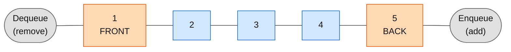
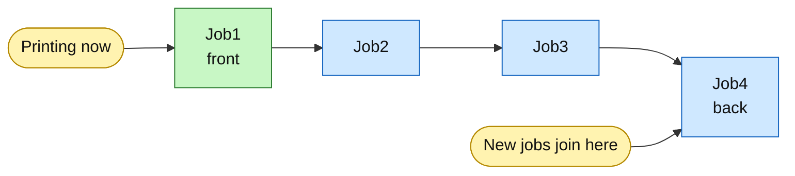

# 📬 Part 5: Queue

> **Navigation**: [← The Invention of the Stack & Queue (1960s)](01_the_invention_of_the_stack_queue.md) | [Chapter overview](../01d_Stack_Queue.md) | [Production Failure Modes →](03_production_failure_modes.md)
> Page 2 of 5 in **Stacks & Queues**


## 💬 Study-Partner View — Queues in Depth

**1. The bottom line:** A queue is a fair waiting line: first come, first served, and every operation is O(1) if you track both ends.

**2. The textbook core:**

- **FIFO:** `offer`/`enqueue` at the rear, `poll`/`dequeue` at the front, `peek` looks at the front.
- Implementations: linked list (two pointers), circular array (`front`, `rear`, modulo), `ArrayDeque`.
- Variants: **deque**, **priority queue** (heap-ordered, O(log n)), **blocking queue** (thread-safe producer–consumer).
- Queue via two stacks: push to `in`, move to `out` when `out` is empty → amortized O(1).

**3. The real-world analogy:** A **line at the bakery**: new customers join the back; the baker always serves whoever has been waiting longest.

**4. Walkthrough:**

1. Enqueue A, B, C → front `A`, rear `C`.
2. Dequeue → returns A; front is now `B`.
3. Enqueue D → queue is `B, C, D`.
4. Each step touched only one end, so each was O(1).

> [!NOTE]
> **Quick check:** When would you choose a priority queue instead? *When urgency, not arrival time, decides who goes next.*


## 5W1H: Deep Understanding of Queue

> [!NOTE]
> **WHAT:** A Queue is a FIFO (First In, First Out) data structure. Elements enter at the BACK and leave from the FRONT.
>
> **WHY:** We need a way to manage resources fairly or process data in the exact order it arrived. LIFO (Stack) is unfair for scheduling; FIFO guarantees order preservation.
>
> **WHO:** Systems programmers, backend engineers handling requests, and algorithm designers implementing BFS.
>
> **WHEN:** Use when order of arrival strictly dictates order of process.
>
> - ✅ Task scheduling (printer spoolers, CPU run queues)
> - ✅ Breadth-First Search (level-by-level traversal)
> - ✅ Asynchronous data transfer (IO buffers, pipes)
> - ❌ When you need LIFO (use Stack)
>
> **WHERE Queues appear in production:**
>
> - Thread pools (waiting tasks)
> - Message brokers (Kafka, RabbitMQ)
> - Network routers (packet queuing)
>
> **HOW:** Usually implemented via a Circular Array (for strict memory bounds and O(1) performance) or a Linked List (for unbounded growth).

## 🧬 Nature & Behavior

### What is a Queue?

## The Invention of the Stack & Queue (1960s)

Before compilers and managed runtimes existed, programmers manually calculated return addresses using GOTO. The stack was invented because ALGOL 60 required **recursive functions** — and recursion demands a LIFO call stack.

| Year | Event |
| --- | --- |
| Before 1955 | No formal call stack. Return addresses stored in fixed registers. No recursion possible. |
| 1961 | Burroughs B5000 — a production computer designed around a stack (Robert Barton, designed for ALGOL). The architecture pushed operands and addresses onto a stack, making recursion hardware-native. |
| 1960 | ALGOL 60 standardizes recursive functions. Every compiler must now implement a call stack. |
| 1965 | Dijkstra introduces semaphores (P/V) for process synchronisation; his THE multiprogramming system (1968) uses queues of waiting processes. |
| 1968 | Dijkstra's "Cooperating Sequential Processes" paper — semaphores + queue primitives for OS process synchronization. |
| 1970s–80s | Stack-based languages: Forth (Charles H. Moore, c. 1970) and PostScript (Adobe, 1982). |
| 1973 | Unix pipes (Doug McIlroy and Ken Thompson): the `\|` operator connects processes through a FIFO byte queue. |
| 1990s | JVM (1995) and CLR (2002) formalize managed call stacks with hardware-guarded StackOverflowError semantics. |
| 2011 | LMAX Disruptor — a ring-buffer queue that let the LMAX exchange process millions of orders per second on a single thread. |
| 2010s | async/await (C# 5 in 2012, Python 3.5 in 2015, JavaScript ES2017) — language-level suspendable functions. |
| 2020s | Virtual threads (Java 21, JEP 444, 2023) — millions of lightweight threads, each with a virtual stack, multiplexed onto a small pool of OS carrier threads (their stack frames are stored on the heap while unmounted). |

**Named Predecessors:**

- **Burroughs B5000 (1961)** — first stack machine, designed by Bob Barton. Needed because ALGOL required recursion.
- **Dijkstra's semaphore paper (1965/1968)** — formal queue primitive for OS scheduling.
- **LMAX Disruptor (2011)** — modern production queue at LMAX exchange, proving lock-free queues at 100M+ msg/sec.
- **Java virtual threads (JEP 444, 2023)** — millions of virtual stacks per process.

**Motivation by Era:**

- 1950s: Hardware needed to support recursion in scientific computing (Fortran's limitations exposed)
- 1960s: OS needed fair scheduling (Dijkstra's queue) and compiler design needed bracket matching
- 1970s-80s: Languages like Forth and PostScript embraced the stack as a computational model
- 1990s: Managed runtimes needed safety (stack overflow detection) and memory isolation
- 2010s-2020s: High-frequency trading and async programming exposed limits of OS-thread stacks → virtual threads and lock-free queues

**Physical reality** — like a line at a store:



**How to read this diagram.** Items leave from the front and join at the back.

> [!NOTE]
> **FIFO = First In, First Out** — "first come, first served".

### Queue Operations

| Operation           | Time | Description       |
| ------------------- | ---- | ----------------- |
| enqueue(x)/offer(x) | O(1) | Add to back       |
| dequeue()/poll()    | O(1) | Remove from front |
| peek()/front()      | O(1) | See front element |
| isEmpty()           | O(1) | Check if empty    |

### Stack & Queue Variants Comparison Table

| Structure                     | Order                  | Push/Enqueue         | Pop/Dequeue         | Blocking Behavior          | Use Case                             | Java Class                               |
| ----------------------------- | ---------------------- | -------------------- | ------------------- | -------------------------- | ------------------------------------ | ---------------------------------------- |
| Stack (LIFO)                  | Last In, First Out     | O(1) push            | O(1) pop            | No                         | Undo history, DFS, expression eval   | `Deque<Integer>` (not `Stack`)           |
| Queue (FIFO)                  | First In, First Out    | O(1) offer           | O(1) poll           | No                         | BFS, task scheduling, print spooler  | `Queue<Integer>`, `LinkedList`           |
| Deque (Double-ended)          | LIFO or FIFO both ends | O(1) offerFirst/Last | O(1) pollFirst/Last | No                         | Sliding window max, LRU cache        | `ArrayDeque`, `LinkedList`               |
| Priority Queue                | Heap-ordered           | O(log n) offer       | O(log n) poll       | No (but peek = min)        | Dijkstra, Top-K problems             | `PriorityQueue<E>`                       |
| Circular Buffer / Ring Buffer | FIFO wrap-around       | O(1) (fixed cap)     | O(1) (fixed cap)    | Optional                   | Producer-consumer, streaming buffers | `CircularByteBuffer` (nio)               |
| Blocking Queue                | FIFO + blocking        | O(1) / blocks        | O(1) / blocks       | YES — blocks on empty/full | Producer-consumer threads            | `BlockingQueue<E>`                       |
| Concurrent Stack (Treiber)    | LIFO + lock-free       | O(1) amortized       | O(1) amortized      | No (non-blocking)          | High-concurrency stack               | `ConcurrentLinkedDeque`                  |
| Virtual-thread-friendly Queue | FIFO                   | O(1)                 | O(1)                | Pinning-sensitive          | Virtual thread sync (Java 21+)       | `SynchronousQueue`, `ArrayBlockingQueue` |

> **Why `Deque` instead of `Stack`?** The legacy `Stack` class extends `Vector` (inheritance coupling), making it slower. `ArrayDeque` (resizable array, no sync overhead) is the recommended implementation for stacks in Java.

### 🔴 Real-World Origin: Print Spooler (1970s)

**Problem (Office with 1 printer, 50 computers):** Multiple users send print jobs, but the printer can only do one at a time. Who prints first?

**Without Queue:** Last person to click "Print" goes first — people who clicked earlier wait forever. _Unfair and chaotic!_

**Solution — Print Queue:** Jobs added to back, printer takes from front. First submitted = first printed.

**Print queue:**



**How to read this diagram.** The job at the front is being printed; new jobs are added at the back (FIFO).

✅ **Now used in:** OS task scheduling, web server request handling, message queues (Kafka, RabbitMQ), BFS algorithm

## 💻 Implementation WITHOUT Collections

```java
// CIRCULAR ARRAY QUEUE (Most efficient)
public class MyQueue {
    private int[] data;
    private int front;
    private int rear;
    private int size;
    private int capacity;

    public MyQueue(int capacity) {
        this.capacity = capacity;
        this.data = new int[capacity];
        this.front = 0;
        this.rear = -1;
        this.size = 0;
    }

    // ENQUEUE - O(1)
    public void enqueue(int value) {
        if (size == capacity) {
            throw new RuntimeException("Queue is full!");
        }
        rear = (rear + 1) % capacity;  // Circular
        data[rear] = value;
        size++;
    }

    // DEQUEUE - O(1)
    public int dequeue() {
        if (isEmpty()) {
            throw new RuntimeException("Queue is empty!");
        }
        int value = data[front];
        front = (front + 1) % capacity;  // Circular
        size--;
        return value;
    }

    // PEEK - O(1)
    public int peek() {
        if (isEmpty()) {
            throw new RuntimeException("Queue is empty!");
        }
        return data[front];
    }

    public boolean isEmpty() {
        return size == 0;
    }

    public int size() {
        return size;
    }
}

// WHY CIRCULAR?
/*
Without circular, after many operations:
[_, _, _, 5, 6, 7, _, _, _]
        ↑        ↑
      front    rear

Wasted space at beginning!

With circular, rear wraps around:
[8, 9, _, 5, 6, 7]
      ↑  ↑
    rear front

No wasted space!
*/
```

---

[← The Invention of the Stack & Queue (1960s)](01_the_invention_of_the_stack_queue.md) | [Chapter overview](../01d_Stack_Queue.md) | [Production Failure Modes →](03_production_failure_modes.md)
