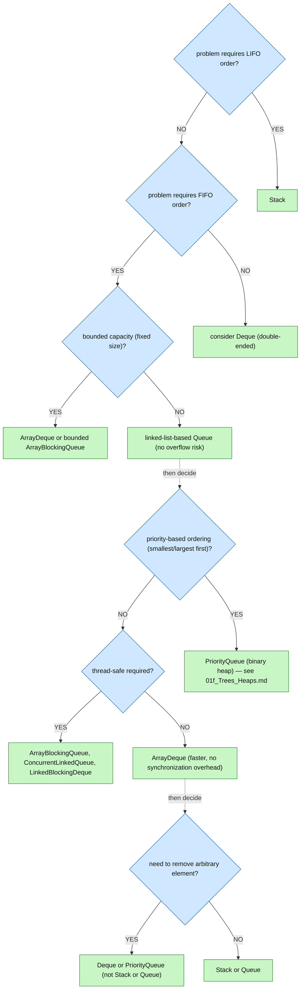

# 🔬 Proof Corner — Three Derivations from First Principles

> **Navigation**: [← Foundation Practice — Stack & Queue](04_foundation_practice_stack_queue.md) | [Chapter overview](../01d_Stack_Queue.md)
> Page 5 of 5 in **Stacks & Queues**


## Derivation 1: Two Stacks Make a Queue — Why Two Reversals Cancel Out

**The problem that forces the idea.** You have a language (or hardware) that provides only LIFO stacks. You need FIFO queue behavior. Can you build a queue from stacks without paying O(n) per operation?

**Step 1 — Why one stack fails.** A stack reverses insertion order: push `1, 2, 3`, pop gets `3, 2, 1`. A queue needs `1, 2, 3` out. One stack gives the wrong order.

**Step 2 — Two reversals cancel.** Push `1, 2, 3` onto stack S1. S1 top-to-bottom: `[3, 2, 1]`. Now pour S1 into S2 by popping each element and pushing it:

| Action | S1 (top → bottom) | S2 |
| ------ | ----------------- | -- |
| Start | `[3, 2, 1]` | empty |
| Pop 3 from S1, push to S2 | `[2, 1]` | `[3]` |
| Pop 2 from S1, push to S2 | `[1]` | `[2, 3]` |
| Pop 1 from S1, push to S2 | empty | `[1, 2, 3]` |

S2's top-to-bottom order is `[1, 2, 3]` — FIFO! The first reversal (push to S1) inverted the order; the second reversal (pour to S2) inverted it back. Two negations = identity.

**Step 3 — The lazy-transfer optimization.** Pouring on every dequeue costs O(n). The key insight: once elements are in S2, they're already in FIFO order. Don't pour again until S2 is empty. New enqueues go to S1; dequeues come from S2. Only when S2 is exhausted do we pour S1 → S2.

```java
Deque<Integer> s1 = new ArrayDeque<>();  // enqueue side
Deque<Integer> s2 = new ArrayDeque<>();  // dequeue side

void enqueue(int x) { s1.push(x); }

int dequeue() {
    if (s2.isEmpty()) {
        while (!s1.isEmpty()) s2.push(s1.pop());  // pour
    }
    return s2.pop();
}
```

**Step 4 — Amortized O(1) proof (banker's method).**

Assign each element 2 credits when it's enqueued (1 credit for the push to S1, 1 credit saved for the future transfer). When we pour S1 → S2:

- Each element uses its saved credit to pay for the pop-from-S1 and push-to-S2.
- The dequeue from S2 costs 1 credit, paid by the dequeue operation itself.

Total credits spent per element across its lifetime: 2 (enqueue) + 1 (dequeue) = 3 = O(1).

No operation borrows from future operations. Every operation is O(1) amortized.

**Equivalently, using a potential function:** Let Φ = |S1| (elements waiting to transfer).

| Operation | Actual cost | ΔΦ | Amortized = actual + ΔΦ |
|-----------|------------|-----|--------------------------|
| enqueue | 1 | +1 | 2 |
| dequeue (S2 non-empty) | 1 | 0 | 1 |
| dequeue (S2 empty, pour k) | k + 1 | −k | 1 |

Every operation is O(1) amortized. The expensive pour is paid for by the cheap enqueues that preceded it.

**Failure boundary.** *Worst-case* per-operation is still O(n) — a single dequeue after n enqueues pays the full pour cost. If you need O(1) *worst-case* (not just amortized), use a circular buffer instead.

---

## Derivation 2: Stack-Sortable Permutations — The 231-Avoidance Theorem

**The problem.** Given a permutation of `[1, 2, ..., n]` as input, you can push elements one at a time onto a stack and pop them to an output sequence. Which permutations can be sorted this way?

**Worked trace — sortable.** Input: `[2, 1, 3]`. Target output: `[1, 2, 3]`.

```
Input: [2, 1, 3]   Stack: []   Output: []
Push 2              Stack: [2]  Output: []
Push 1              Stack: [1,2] Output: []
Pop 1 (= next needed) Stack: [2]  Output: [1]
Pop 2 (= next needed) Stack: []   Output: [1,2]
Push 3              Stack: [3]  Output: [1,2]
Pop 3               Stack: []   Output: [1,2,3] ✓
```

**Worked trace — unsortable.** Input: `[2, 3, 1]`. Target output: `[1, 2, 3]`.

```
Input: [2, 3, 1]   Stack: []    Output: []
Push 2              Stack: [2]   Output: []
Push 3              Stack: [3,2] Output: []
  — Need 1 next, but top is 3. Can't pop 3 (would output 3 before 1).
  — Can't reach 1 without popping 3 first. Stuck. ✗
```

**The theorem (Knuth, 1968).** A permutation is stack-sortable if and only if it avoids the pattern **231**.

**Why 231 is fatal.** If three elements appear in the order `a, b, c` in the input where `c < a < b` (the 231 pattern): `b` must be pushed before `c` arrives, but `a` must be output before `b`. When `c` finally arrives, it needs to be output before `b`, but `b` is deeper in the stack under `a`'s position. The stack's LIFO constraint makes it impossible to extract `c` before `b`.

**The connection to Catalan numbers.** The number of stack-sortable permutations of length n is the nth Catalan number: `C(n) = (2n choose n) / (n+1)`. This is the same count as: valid parenthesizations, binary trees with n nodes, Dyck paths of length 2n. The bijection: each stack-sortable permutation corresponds to a sequence of push/pop decisions — and each such sequence is a Dyck word (balanced parentheses).

| n | Total permutations (n!) | Stack-sortable (Catalan) | Fraction |
|---|-------------------------|--------------------------|----------|
| 3 | 6 | 5 | 83% |
| 4 | 24 | 14 | 58% |
| 5 | 120 | 42 | 35% |
| 10 | 3628800 | 16796 | 0.46% |

As n grows, almost no permutations are stack-sortable. Two stacks in series can sort any permutation (equivalent to a queue), which is why the two-stack queue in Derivation 1 works.

---

## Derivation 3: Circular Buffer — Why Modular Arithmetic Preserves FIFO

**The problem that forces the idea.** A naive array-backed queue dequeues from `arr[0]` and shifts everything left — O(n) per dequeue. Alternatively, track a `head` index and just advance it — but then the array "walks" rightward, wasting space on the left.

**The insight.** Wrap around: when `head` or `tail` reaches the end of the array, jump back to index 0. The array becomes a logical ring.

```
Physical array: [_, _, _, _, _, _, _, _]  (capacity = 8)
                 0  1  2  3  4  5  6  7

After enqueue(A), enqueue(B), enqueue(C):
  head=0, tail=3: [A, B, C, _, _, _, _, _]

After dequeue(), dequeue():
  head=2, tail=3: [_, _, C, _, _, _, _, _]

After enqueue(D), ..., enqueue(H):  (tail wraps around)
  head=2, tail=2: [G, H, C, D, E, F, _, _]  ← wait, head==tail. Full or empty?
```

**Why `head == tail` is ambiguous.** Both "completely empty" and "completely full" produce `head == tail`. This is invariant Q4's violation. Three solutions exist; only one is correct without wasting a slot:

| Solution | Trade-off |
|----------|-----------|
| Waste one slot (always keep one empty) | Capacity is `n-1` for array of size `n`; simple |
| Maintain a `size` field | Full capacity; one extra variable |
| Use a `boolean isFull` flag | Full capacity; two-state flag |

The `size` field approach is cleanest — `isEmpty()` = `size == 0`, `isFull()` = `size == capacity`. No ambiguity.

**Formal FIFO preservation proof.** Define enqueue and dequeue:

```
enqueue(x):  arr[tail] = x;  tail = (tail + 1) % capacity;  size++
dequeue():   x = arr[head];  head = (head + 1) % capacity;  size--;  return x
```

**Claim:** The kth element dequeued is the kth element enqueued.

**Proof by induction on k.**
- Base case (k = 1): The first enqueue writes to `arr[initial_tail]`. The first dequeue reads from `arr[initial_head]`. Since `initial_head == initial_tail` (both start at 0 for an empty buffer), the first element dequeued is the first enqueued. ✓
- Inductive step: Assume the first k elements are dequeued in FIFO order. The (k+1)th enqueue writes to `arr[(initial_tail + k) % capacity]`. The (k+1)th dequeue reads from `arr[(initial_head + k) % capacity]`. Since enqueue and dequeue advance their indices at the same rate (mod capacity) and we never dequeue more than we enqueue (size ≥ 0), these addresses match in sequence. ✓

**The modular arithmetic is the entire mechanism.** The ring buffer's O(1) enqueue/dequeue comes from replacing "shift everything" with "advance an index mod capacity." The `%` operator converts a linear array into a circular one without any data movement.

The Linux kernel `kfifo` and the Java `ArrayBlockingQueue` both use this design.

---

## 🔄 Brute Force → Optimal: Stack / Queue Motivation

> **The university way**: show what breaks before introducing the data structure.

### Problem 1: Valid Parentheses — O(n²) Brute Force vs O(n) Stack

**Given**: string of `(`, `)`, `[`, `]`, `{`, `}`. Return true if all brackets are properly matched and closed.

**Brute force — O(n²)**: repeatedly scan the string, removing adjacent matching pairs until none remain or the string is non-empty:
```java
while (s.contains("()") || s.contains("[]") || s.contains("{}")) {
    s = s.replace("()", "").replace("[]", "").replace("{}", "");
}
return s.isEmpty();
```
- Time: O(n) per replacement pass, O(n) passes in worst case → O(n²).
- Space: O(n) new string each pass.
- **Also wrong** for inputs like `([)]` — the pair-removal order matters.

**The insight**: We only ever need to check if the MOST RECENTLY OPENED bracket is closed next. "Most recently opened" = LIFO = **stack**.

**Optimal — O(n) with stack**:
```java
Deque<Character> stack = new ArrayDeque<>();
for (char c : s.toCharArray()) {
    if (c == '(' || c == '[' || c == '{') { stack.push(c); continue; }
    if (stack.isEmpty()) return false;
    char top = stack.pop();
    if ((c==')' && top!='(') || (c==']' && top!='[') || (c=='}' && top!='{')) return false;
}
return stack.isEmpty();
```
- Time: O(n) — one pass.
- Space: O(n) — at most n/2 unmatched open brackets.

| Approach | Time | Space | Correct? |
|----------|------|-------|---------|
| String.replace loop | O(n²) | O(n) | No (order-sensitive bugs) |
| **Stack (LIFO)** | **O(n)** | O(n) | Yes |

**Stack pattern signal**: "most recent / deepest / innermost" → push on open, pop on close.

---

### Problem 2: Moving Window Maximum — O(nk) Brute Force vs O(n) Monotonic Deque

**Given**: array of n integers and window size k. Find the maximum in each sliding window.

**Brute force — O(nk)**: scan each window independently:
```java
for (int i = 0; i <= n-k; i++) {
    int max = arr[i];
    for (int j = i+1; j < i+k; j++) max = Math.max(max, arr[j]);
    result.add(max);
}
```
- Time: O(nk). For n=10⁶, k=1000 → 10⁹ operations.

**The insight**: Most elements are in multiple windows. The maximum from the previous window is still valid unless it slid out OR a larger element slid in. A **monotonic deque** keeps candidates in decreasing order; the front is always the current window maximum.

**Optimal — O(n) with monotonic deque**:
```java
Deque<Integer> dq = new ArrayDeque<>();  // stores indices, decreasing values
for (int i = 0; i < n; i++) {
    while (!dq.isEmpty() && dq.peekFirst() < i-k+1) dq.pollFirst(); // remove out-of-window
    while (!dq.isEmpty() && arr[dq.peekLast()] <= arr[i]) dq.pollLast(); // remove smaller
    dq.addLast(i);
    if (i >= k-1) result.add(arr[dq.peekFirst()]);
}
```
- Time: O(n) — each element added and removed from deque at most once.

| Approach | Time | Space |
|----------|------|-------|
| Brute force per window | O(nk) | O(1) |
| **Monotonic deque** | **O(n)** | O(k) |

**Deque signal**: "window max/min with efficient slide" → monotonic deque (decreasing for max, increasing for min).

---

## Constraint-First Decision Framework — Stack, Queue, Deque, or Priority Queue?

### Decision Tree



**How to read this diagram.** Start at the first blue question and follow the YES / NO edges; the green boxes are the recommended choice.

### Decision Table

| Workload | Best Choice | Why |
|---|---|---|
| Undo/redo, expression eval, DFS | Stack | LIFO matches natural ordering |
| BFS, task scheduling, message queue | Queue | FIFO matches temporal ordering |
| Sliding window max, work-stealing | Deque | Need both ends |
| Top-K, Dijkstra, merge-K-sorted | PriorityQueue | Need min/max at head |
| Producer-consumer (multi-thread) | ArrayBlockingQueue | Bounded + thread-safe |
| Producer-consumer (single-thread) | ArrayDeque | Fastest, no sync overhead |

### Worked Example — Picking Stack vs Queue for a Problem

**Problem:** Print a binary tree level by level (each level on its own line).

- **Constraint:** Output order is level 0, then level 1, then level 2 — temporal/FIFO order.
- **Choice:** Queue. Use BFS with a queue.
- **Algorithm:** Enqueue root; while queue non-empty, dequeue node, print, enqueue children.

**Common mistake:** Use a stack and get reverse level order (level 2, 1, 0). This is the bug the monotonic stack in the body of this chapter warns against.

## When Stacks/Queues Break — Formal Failure Modes

### Break 1 — Stack Overflow from Deep Recursion

**Condition:** Recursion depth exceeds the thread's stack size (default 1 MiB on HotSpot; ~10⁴ stack frames for typical Java methods, fewer for C++).

> [!CAUTION]
> **What breaks:** `StackOverflowError` thrown mid-call. The current frame's locals are partially initialized. If a `try { ... } finally { cleanup(); }` is in flight, the `finally` may not execute.

**Invariant violated:** S2 (top terminator). The runtime's stack guard page is hit.

> [!TIP]
> **Defense:** Convert recursion to iteration using an explicit stack (see below). Or increase thread stack size with `-Xss`. See `01a_Memory_Foundations.md` Break 1 and the production failure mode 1 in the body.

### Break 2 — Unbounded Queue Memory Exhaustion

**Condition:** Producer is faster than consumer for an unbounded queue (`LinkedList`-backed, no capacity limit).

> [!CAUTION]
> **What breaks:** Queue grows without bound → `OutOfMemoryError`. Production traffic can DDoS the JVM by simply POSTing faster than the worker can process.

**Invariant violated:** Q3 (size consistency). The queue's size grows without bound.

> [!TIP]
> **Defense:** Use a bounded queue (`ArrayBlockingQueue`) with a rejection policy (e.g., `AbortPolicy` throws, `CallerRunsPolicy` runs the producer thread synchronously to apply backpressure). See `13_Developer_Essentials/19_Concurrency_Models_Coroutines.md` for the full backpressure discussion.

### Break 3 — Queue Deadlock (BlockingQueue)

**Condition:** Two threads each hold a lock and wait for the other to release. Classic deadlock pattern: thread A holds lock X waiting for Y; thread B holds Y waiting for X.

> [!CAUTION]
> **What breaks:** Both threads block forever. The application hangs; health checks report OK until the heartbeat expires.

**Invariant violated:** Q1 (FIFO) cannot progress because no thread is consuming.

> [!TIP]
> **Defense:** Always use a timeout on `BlockingQueue.take()` (e.g., `poll(timeout, unit)`). Detect deadlocks via thread dumps. See production failure mode 2 in the body of this chapter.

### Break 4 — PriorityQueue Non-Determinism

**Condition:** Two elements compare equal in the `Comparator`. `PriorityQueue` does not guarantee any order for equal elements; the iteration order is implementation-dependent.

> [!CAUTION]
> **What breaks:** Non-deterministic behavior across JVM versions or platforms. A test passes locally, fails in CI, passes in production, fails again.

**Invariant violated:** Implicit — equal elements should have stable ordering. `PriorityQueue` does not provide this.

> [!TIP]
> **Defense:** Always use a tie-breaker in the comparator (e.g., `(a, b) -> Integer.compare(a.priority, b.priority) != 0 ? compare : Integer.compare(a.id, b.id)`).

### Break 5 — Circular Buffer head == tail Ambiguity

**Condition:** Using a circular buffer without a `size` field, trying to detect both empty and full with `head == tail`.

> [!CAUTION]
> **What breaks:** Cannot distinguish empty (size = 0) from full (size = capacity). Either the buffer overflows (no full detection) or refuses to enqueue when not full.

**Invariant violated:** Q4 (empty/full distinction).

> [!TIP]
> **Defense:** Always maintain a separate `size` field, or sacrifice one slot (`capacity - 1` usable).

### Break 6 — Stack Reallocation Invalidates References

**Condition:** Holding a reference to an internal array element of an array-backed stack. The stack grows and copies elements to a new array. The held reference now points to stale memory.

> [!CAUTION]
> **What breaks:** Use-after-free or stale read. In Java, this is mostly mitigated by GC, but the principle applies to `Iterator` semantics.

**Invariant violated:** S2 (top terminator). The stack's internal storage is replaced.

> [!TIP]
> **Defense:** Always re-fetch references after push operations that may trigger growth.

## Recursion-to-Iterative Conversion

Recursive algorithms use the call stack implicitly. Converting to iteration requires an explicit stack. The pattern is:

```
Recursive function f(n, state):
    if base_case(n):
        return base_value
    
    result1 = f(n-1, state1)
    result2 = f(n-2, state2)
    return combine(result1, result2)

Iterative version:
    stack = new Stack<(n, state)>
    stack.push((N, initial_state))
    result_stack = new Stack<Result>()
    
    while not stack.isEmpty():
        (n, state) = stack.pop()
        if base_case(n):
            result_stack.push(base_value)
            continue
        stack.push((n-1, state1))
        stack.push((n-2, state2))
    
    return combine_all(result_stack)
```

### Pitfalls

| Pitfall | What Goes Wrong | Fix |
|---|---|---|
| Stack order matters | If recursive call order matters (e.g., Fibonacci), pushing `f(n-1)` then `f(n-2)` gives wrong order | Track stack explicitly; use the same order as recursion |
| Shared mutable state | Multiple "branches" of recursion mutate the same state | Pass state through the stack frame, not via shared variable |
| Tail recursion | Compiler may not optimize; explicit loop may be cleaner | Use a `while` loop with accumulator instead of stack |
| Result accumulation | Iterative version may need to combine results in a specific order | Use a second stack or accumulate as you go |

### Worked Example — Fibonacci Recursive to Iterative

```java
// Recursive — O(2^n) due to recomputation, O(n) stack depth
long fibRecursive(int n) {
    if (n < 2) return n;
    return fibRecursive(n-1) + fibRecursive(n-2);
}

// Iterative — O(n) time, O(1) space
long fibIterative(int n) {
    if (n < 2) return n;
    long a = 0, b = 1;
    for (int i = 2; i <= n; i++) {
        long c = a + b;
        a = b;
        b = c;
    }
    return b;
}

// Iterative with explicit stack — preserves the recursion structure
// Useful when the recursive structure is harder to flatten
long fibExplicitStack(int n) {
    Deque<Integer> stack = new ArrayDeque<>();
    Deque<Long> results = new ArrayDeque<>();
    stack.push(n);
    while (!stack.isEmpty()) {
        int k = stack.pop();
        if (k < 2) {
            results.push((long) k);
        } else {
            stack.push(k - 1);
            stack.push(k - 2);
        }
    }
    // Combine results — note the stack reverses order
    long b = results.pop();
    long a = results.pop();
    while (!results.isEmpty()) {
        long next = a + b;
        a = b;
        b = next;
        // Pop old values if needed
    }
    return b;
}
```

The pure iterative version is preferred; explicit-stack version is useful when the recursion has shared state that is hard to flatten.

## Edge Cases — Always Check These

| # | Edge Case | What Can Break |
|---|---|---|
| 1 | **Empty stack/queue** | `pop()` / `dequeue()` on empty throws `NoSuchElementException`; check `isEmpty()` first |
| 2 | **Single element** | `peek()` / `front()` returns the only element |
| 3 | **Full bounded queue** | `add()` throws `IllegalStateException`; `offer()` returns false |
| 4 | **Capacity = 1** | Circular buffer degenerates; ensure size field present |
| 5 | **Concurrent enqueue/dequeue** | Race condition on `head`/`tail`; need CAS or lock |
| 6 | **Comparator returns 0** | PriorityQueue non-determinism |
| 7 | **Null elements in PriorityQueue** | NPE in `compareTo`; some comparators allow null but it's confusing |
| 8 | **Deep recursion (≥ 10⁴ frames)** | StackOverflowError; convert to iteration |
| 9 | **Large queue (≥ 10⁶ elements)** | Memory pressure; consider bounded queue + backpressure |
| 10 | **Pop from empty after concurrency** | Even with `isEmpty()` check, race condition possible; use thread-safe variant |

## Formal Complexity Proofs — Stack & Queue Operations

### Push / Pop (Array-Backed Stack)

```
T_push(s) = O(1) amortized
  1. if top == capacity - 1: grow by 1.5× → O(n) copy
  2. arr[++top] = data       → O(1)
  3. size++                  → O(1)

Amortized O(1) by geometric series: see 01g_DS_Internals.md Challenge 1.
```

### Enqueue / Dequeue (Circular Buffer)

```
T_enqueue(q) = O(1)
  1. if size == capacity: throw or return false
  2. arr[tail] = data
  3. tail = (tail + 1) mod capacity
  4. size++

T_dequeue(q) = O(1)
  1. if size == 0: throw or return null
  2. data = arr[head]
  3. arr[head] = null  // help GC
  4. head = (head + 1) mod capacity
  5. size--
  return data
```

Both are strict O(1), no amortization needed (no resize for bounded circular buffer).

### BFS Time Complexity

For a graph with V vertices and E edges:

```
T_BFS(s) = O(V + E)
  Each vertex is enqueued once and dequeued once → O(V)
  Each edge is examined twice (once from each endpoint) → O(E)
  Total: O(V + E)
```

The queue itself holds at most V elements, so space is O(V).

### Monotonic Stack Time Complexity

For an array of n elements, computing next-greater-element:

```
T_monotonic_stack(n) = O(n) amortized
  Each element is pushed once and popped at most once → 2n operations → O(n)
```

Despite nested-looking loops, the total work is O(n) because each element enters and exits the stack at most once. This is the *amortized* analysis.

## Cross-References

- **`01a_Memory_Foundations.md`** — stack frame mechanics; why deep recursion breaks; cache miss on stack-allocated arrays.
- **`01c_LinkedList.md`** — linked-list-backed stack/queue implementations; pointer invariants.
- **`01e_HashTable.md`** — `LinkedHashMap` uses a doubly-LL + hash table (related to stack/queue iteration order).
- **`01g_DS_Internals.md`** — `ArrayDeque` resize proof; `ArrayBlockingQueue` lock design.
- **`02_PROBLEM_SETS.md`** — exam-style monotonic-stack correctness proof; BFS shortest-path proof.
- **`13_Developer_Essentials/19_Concurrency_Models_Coroutines.md`** — backpressure and bounded queues in concurrency.

---

## 💥 When Stack / Queue Breaks

> These are the exact failure modes that bite production systems and trip up interviewers.

### 1. Stack Overflow — Unbounded Recursive Depth

- **What breaks**: Using an implicit call stack (DFS, parser, expression evaluator) on deep inputs. JVM default stack size ≈ 512KB–1MB → ~10,000 frames → `StackOverflowError` with no useful stack trace.
- **Trigger constraint**: Any graph with depth > 10K nodes, any JSON/XML with > 10K nesting levels.
- **Fix**: Convert to an explicit `ArrayDeque` stack (heap-allocated, no depth limit).

```java
// Instead of recursive DFS:
Deque<Node> stack = new ArrayDeque<>();
stack.push(root);
while (!stack.isEmpty()) { Node n = stack.pop(); ... }
```

### 2. Java's `Stack` Class — Wrong Tool

- **What breaks**: Using `java.util.Stack` in production code.
- **Why**: `Stack` extends `Vector`, which is fully `synchronized`. Every push/pop acquires a lock — 3–5× slower than `ArrayDeque` in single-threaded use.
- **Fix**: Always use `Deque<T> stack = new ArrayDeque<>()` instead. For thread-safe use: `ConcurrentLinkedDeque` or `LinkedBlockingDeque`.

- 📎 **Reference Anchor**: [OpenJDK ArrayDeque source](https://github.com/openjdk/jdk/blob/master/src/java.base/share/classes/java/util/ArrayDeque.java)
- **Invariant learned**: `ArrayDeque` doubles its backing array when full (same amortized O(1) as ArrayList). Head/tail pointers wrap around the circular array.
- **Constraint warning**: `ArrayDeque` does not allow null elements — it uses null as a sentinel internally. Use `null`-safe wrappers if nulls are required.

### 3. Monotonic Stack — Forgetting the Remaining Elements

**What breaks**: Processing only the elements that caused a pop during the main loop, forgetting that elements still in the stack after the loop represent "no right boundary found."
```java
// BUG — stack still has elements after the loop:
for (int i = 0; i < n; i++) {
    while (!stack.isEmpty() && arr[stack.peek()] < arr[i])
        result[stack.pop()] = i; // next greater found
    stack.push(i);
}
// MISSING: process remaining elements in stack
while (!stack.isEmpty()) result[stack.pop()] = -1; // no right boundary
```
**Invariant**: After the main loop, every index still in the stack has no greater element to its right → answer is -1 (or n, or ∞, depending on the problem).

### 4. Unbounded Queue → OutOfMemoryError

- **What breaks**: Using a `LinkedBlockingQueue` with no capacity limit (the default constructor in `LinkedBlockingQueue` is `Integer.MAX_VALUE` capacity) in a producer-consumer system where the producer is faster than the consumer. The queue grows without bound until OOM.
- **Fix**: Always specify capacity: `new LinkedBlockingQueue<>(1000)`. This creates natural backpressure — the producer blocks when the queue is full.
- **Production war story**: Java's `Executors.newFixedThreadPool()` uses an unbounded `LinkedBlockingQueue` for task queuing. If tasks are submitted faster than they complete, memory grows unboundedly. Use `ThreadPoolExecutor` with a bounded queue and a `RejectedExecutionHandler`.

### 5. Deque Used as Both Stack and Queue — Wrong-End Operations

**What breaks**: Using `addFirst`/`removeFirst` for one role and `addLast`/`removeFirst` for another in the same `ArrayDeque` — correct Java API but easy to confuse which end is which.
**Fix**: Use named roles explicitly: `push`/`pop` for stack semantics (both operate on head), `offer`/`poll` for queue semantics (offer at tail, poll from head).

---

## 📝 Exam-Style Problems (MIT 6.006 / KTH DD1352 style)

---

**Problem 1 (Correctness — 8 min)**: Prove that the monotonic decreasing stack computes the "next greater element" for every index correctly in O(n) total time.

<details><summary>Model Answer</summary>

**Invariant**: The stack, from bottom to top, contains indices of elements in strictly decreasing order. Every element in the stack has not yet found its "next greater element."

- **Init**: Stack empty — invariant holds vacuously. ✓
- **Maintenance**: When `arr[i] > arr[stack.peek()]`, we found the next greater element for `stack.peek()`. Pop until the invariant is restored, then push `i`. ✓
- **Termination**: After the loop, elements still in the stack have no greater element to their right → answer = -1. ✓

**Total O(n)**: Each index is pushed exactly once and popped at most once. Total push + pop ≤ 2n operations → O(n). ✓

</details>

---

**Problem 2 (Analysis — 6 min)**: A `Queue` is implemented using two stacks `S1` and `S2`. `enqueue` pushes to `S1`. `dequeue` pops from `S2`; if `S2` is empty, all elements are moved from `S1` to `S2` first. Prove that the amortised cost per `dequeue` is O(1).

<details><summary>Model Answer</summary>

**Potential function**: Φ = size of S1 (number of elements waiting to be transferred).

- **enqueue**: actual cost = 1; ΔΦ = +1; amortised = 1 + 1 = 2 = O(1). ✓
- **dequeue (S2 not empty)**: actual cost = 1; ΔΦ = 0 (S1 unchanged); amortised = 1 = O(1). ✓
- **dequeue (S2 empty, transfer k elements)**: actual cost = k + 1; ΔΦ = -k (S1 empties); amortised = (k+1) + (-k) = 1 = O(1). ✓

Every operation is O(1) amortised. ✓

</details>

---

**Problem 3 (Design — 10 min)**: Design a queue that supports `enqueue`, `dequeue`, and `getMax()` — all O(1) amortised.

<details><summary>Model Answer</summary>

**Structure**: Main queue + monotonic decreasing deque (max-deque).
- `enqueue(x)`: add x to main queue; pop from back of deque while `deque.back() < x`; push x to back of deque.
- `dequeue()`: remove from front of main queue; if front equals `deque.front()`, remove from front of deque too.
- `getMax()`: return `deque.front()`.

**Correctness**: The deque always holds, in decreasing order, the indices of elements that could still be the maximum (the "candidates"). Elements smaller than a newer element can never be max, so they're discarded. ✓

**Amortised O(1)**: Each element enters and exits the deque at most once → O(n) total deque operations for n enqueues. ✓

</details>

---

[← Foundation Practice — Stack & Queue](04_foundation_practice_stack_queue.md) | [Chapter overview](../01d_Stack_Queue.md)
