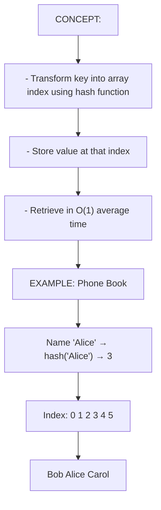
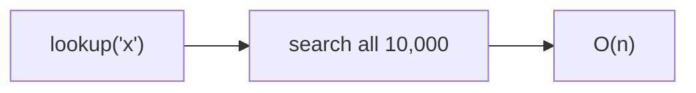
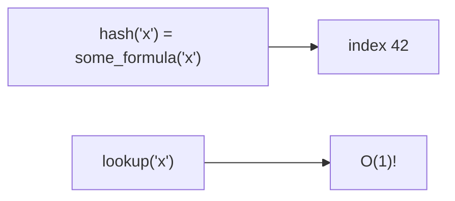
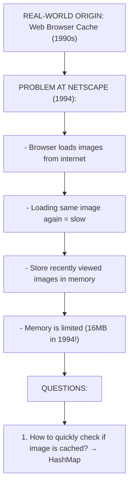

**Navigation**: [< Previous Chapter](01d_Stack_Queue.md) | [Back to Index](../00_MASTER_INDEX.md) | [Next Chapter >](01f_Trees_Heaps.md)

---

# #️⃣ Part 6: Hash Table

## PART 0: COMPLETE UNDERSTANDING — The WHY Before the WHAT

### What Problem Does a Hash Table Solve?

**The Lookup Problem:** "Given a key, find its value."

| Approach | Time Complexity |
|----------|----------------|
| Array lookup by index | O(1) — but you need an integer index! |
| Array lookup by value | O(n) — must scan everything |
| Sorted array + binary search | O(log n) — better, but not instant |
| **Hash Table** | **O(1)** — converts any key into an index! |

💡 **Hash Table Breakthrough:**
"What if we could CONVERT any key into an index?"
`hash("Alice") → 3` → `table[3] = Alice's data` → **O(1) lookup!**

Keys can be strings, objects, anything — the hash function handles it.

### Who Invented It and Why?

**1953: H.P. Luhn at IBM.** IBM's compilers had to look up variable names — with 10,000 variables, linear search meant 10,000 comparisons per lookup. Programs had thousands of lookups → **minutes to compile**.

💡 **Luhn's insight:** Use a mathematical function to *compute* the location directly.
`hash("myVariable") → index 4271 → O(1) direct access!`

**Impact:**
- Compilers went from **minutes to seconds**
- Databases became practical (hash indexes)
- Every modern language has built-in HashMap/Dictionary
- Used in: caching, deduplication, routing, spell checkers

### When to Use (and NOT Use) Hash Tables

**✅ USE Hash Table when:**
- You need **O(1) average** lookup, insert, delete
- You're counting frequencies ("how many times does X appear?")
- You're checking for existence ("have I seen X before?")
- You're grouping by key ("group all anagrams together")
- You need two-sum style "complement finding"

**❌ DO NOT USE when:**
- You need sorted/ordered data → Use **TreeMap** instead
- You need range queries ("all keys between A and B") → **TreeMap**
- Memory is very tight → Hash tables waste ~50% space
- You need **worst-case** O(1) → Hash tables are O(1) *average*, O(n) worst
- Input is very small (< 20 elements) → Simple array might be faster

### The Big Picture: How HashMap Works in Java

```java
HashMap<String, Integer> map = new HashMap<>();
map.put("Alice", 85);
```

**Step by Step:**
1. Compute hash: `"Alice".hashCode()` → `63650081`
2. Reduce to index: `63650081 % 16` → `1` (16 = default capacity)
3. Store at `buckets[1]`: `("Alice", 85)`

**Retrieval:** `map.get("Alice")` → hash → `1` → go to `buckets[1]` → found! Return `85`. Time: **O(1)**.

⚠️ **Collision handling:**
- **Java 8+:** If chain length > 8 → convert to **Red-Black Tree** → O(log n) worst case
- **Before Java 8:** Always linked list → O(n) worst case

### HashMap vs TreeMap vs LinkedHashMap — Decision Matrix

| Feature | HashMap | TreeMap | LinkedHashMap |
|---------|---------|---------|---------------|
| Lookup | O(1) avg | O(log n) | O(1) avg |
| Insert | O(1) avg | O(log n) | O(1) avg |
| Ordered | ❌ No | ✅ Sorted by key | ✅ Insertion order |
| Null key | ✅ 1 allowed | ❌ No | ✅ 1 allowed |
| Thread-safe | ❌ No | ❌ No | ❌ No |
| **Best for** | General lookup | Range queries | LRU cache |

🎯 **Interview rule of thumb:**
- "Need lookup?" → **HashMap**
- "Need sorted keys?" → **TreeMap**
- "Need insertion order?" → **LinkedHashMap**
- "Need thread safety?" → **ConcurrentHashMap**

### Mental Model: Library Card Catalog

**Hash Table = Card catalog in a library**

`Book title` → `Card catalog formula` → `Drawer number` → `Exact card`

- **"Harry Potter"** → formula → Drawer 42 → Card with shelf location
- **Collision** = Two books map to same drawer → Multiple cards in Drawer 42 → search within (chaining)
- **Load Factor** = How full the drawers are → Too full (>75%) → Time to get a bigger cabinet (resize/rehash)
- **Rehashing** = Moving all cards to a bigger cabinet → Drawer numbers change → Must recompute every card's position → Expensive O(n) but rare (amortized O(1) per insert)

🎲 **Birthday Paradox — Why Collisions Are Inevitable:**
In a room of 23 people, the probability that TWO share a birthday is already 50%. HashMap collision logic is identical — with even a good hash function, collisions start happening long before the table is full. This is why you NEED a load factor threshold and chaining: not because your hash function is bad, but because mathematics guarantees collisions sooner than you'd think.

**Why 0.75 specifically?**
It's a carefully researched balance between space efficiency and lookup performance. Below 0.5: too much empty space (memory wasted). Above 0.9: collision chains grow, O(1) degrades toward O(n). At 0.75: average chain length ≈ 1-2 entries (Poisson distribution with λ=0.75 → P(chain≥8) < 0.00006%). This is also why Java uses 8 as the treeification threshold — at load factor 0.75, having ≥8 items in ONE bucket has probability < 1 in a million under random hashing.

---


## 🧬 Nature & Behavior

### What is a Hash Table?

```
CONCEPT:
- Transform key into array index using hash function
- Store value at that index
- Retrieve in O(1) average time

EXAMPLE: Phone Book
┌────────────────────────────────────────────────────┐
│ Name "Alice" → hash("Alice") → 3                   │
│                                                    │
│ Index: 0      1      2      3      4      5        │
│      ┌──────┬──────┬──────┬──────┬──────┬──────┐   │
│      │      │ Bob  │      │Alice │      │Carol │   │
│      │      │555-  │      │555-  │      │555-  │   │
│      │      │1234  │      │5678  │      │9999  │   │
│      └──────┴──────┴──────┴──────┴──────┴──────┘   │
│                                                    │
│ get("Alice") → hash("Alice") → 3 → return 555-5678 │
│ Time: O(1)!                                        │
└────────────────────────────────────────────────────┘
```

**Flow:**
1. CONCEPT:
2. - Transform key into array index using hash function
3. - Store value at that index
4. - Retrieve in O(1) average time
5. EXAMPLE: Phone Book
6. Name 'Alice' hash('Alice')
7. 3
8. Index: 0 1 2 3 4 5



### Collision Handling

**Problem:** `hash("Alice") = 3` and `hash("David") = 3` — two keys hash to the same index!

**Solution 1: Chaining** (LinkedList at each index)
```
Index 3: Alice → David → null
```

**Solution 2: Open Addressing** (find next empty slot)
```
Index 3: Alice
Index 4: David (probed to next)
```

### 🔴 Real-World Origin: Symbol Tables in Compilers (1953)

**Problem (IBM 701 Compiler):** Program has thousands of variable names. Need to look up variable type/value quickly. Linear search through all variables: **TOO SLOW**.

**Before Hash Tables:**
```
variables = [
    {name: "x", type: "int"},
    {name: "y", type: "float"},
    ... 10,000 more ...
]
lookup("x") → search all 10,000 → O(n)
```

**Flow:**
1. lookup('x')
2. search all 10,000
3. O(n)



**Solution by H.P. Luhn (1953):** "What if we could *calculate* the position directly?"
```
hash("x") = some_formula("x") → index 42
variables[42] = {name: "x", type: "int"}
lookup("x") → O(1)!
```

**Flow:**
1. hash('x') = some_formula('x')
2. index 42 lookup('x')
3. O(1)!



✅ **Impact:** Compilers became **100x faster**, databases became possible, every modern language has HashMap.

## 💻 Implementation WITHOUT Collections

```java
public class MyHashMap {
    private class Entry {
        int key;
        int value;
        Entry next;  // For chaining

        Entry(int key, int value) {
            this.key = key;
            this.value = value;
        }
    }

    private Entry[] buckets;
    private int capacity;
    private int size;
    private static final double LOAD_FACTOR = 0.75;

    public MyHashMap() {
        this.capacity = 16;
        this.buckets = new Entry[capacity];
        this.size = 0;
    }

    // HASH FUNCTION
    private int hash(int key) {
        return Math.abs(key) % capacity;
    }

    // PUT - O(1) average
    public void put(int key, int value) {
        if ((double) size / capacity >= LOAD_FACTOR) {
            resize();
        }

        int index = hash(key);
        Entry current = buckets[index];

        // Check if key exists
        while (current != null) {
            if (current.key == key) {
                current.value = value;  // Update
                return;
            }
            current = current.next;
        }

        // Add new entry at head (O(1))
        Entry newEntry = new Entry(key, value);
        newEntry.next = buckets[index];
        buckets[index] = newEntry;
        size++;
    }

    // GET - O(1) average
    public int get(int key) {
        int index = hash(key);
        Entry current = buckets[index];

        while (current != null) {
            if (current.key == key) {
                return current.value;
            }
            current = current.next;
        }
        return -1;  // Not found
    }

    // REMOVE - O(1) average
    public void remove(int key) {
        int index = hash(key);
        Entry current = buckets[index];
        Entry prev = null;

        while (current != null) {
            if (current.key == key) {
                if (prev == null) {
                    buckets[index] = current.next;
                } else {
                    prev.next = current.next;
                }
                size--;
                return;
            }
            prev = current;
            current = current.next;
        }
    }

    // CONTAINS - O(1) average
    public boolean containsKey(int key) {
        return get(key) != -1;
    }

    // RESIZE - O(n) but rare
    private void resize() {
        Entry[] oldBuckets = buckets;
        capacity *= 2;
        buckets = new Entry[capacity];
        size = 0;

        for (Entry head : oldBuckets) {
            while (head != null) {
                put(head.key, head.value);
                head = head.next;
            }
        }
    }

    public int size() {
        return size;
    }
}
```

## 🎯 LeetCode → Real-World Connection

### Problem: LRU Cache

```
REAL-WORLD ORIGIN: Web Browser Cache (1990s)

PROBLEM AT NETSCAPE (1994):
- Browser loads images from internet
- Loading same image again = slow
- Store recently viewed images in memory
- Memory is limited (16MB in 1994!)

QUESTIONS:
1. How to quickly check if image is cached? → HashMap
2. Which image to remove when full? → Least Recently Used
3. How to track "recently used"? → Linked List

SOLUTION - HashMap + Doubly Linked List:
┌─────────────────────────────────────────────┐
│  HashMap: url → Node                        │
│  LinkedList: Most Recent ←→ ... ←→ Least    │
│                                             │
│  Access image:                              │
│  1. O(1) lookup in HashMap                  │
│  2. O(1) move to front of list              │
│                                             │
│  Cache full? Remove tail (LRU)              │
└─────────────────────────────────────────────┘

IMPACT:
- Every browser uses this
- Every database uses this
- Every CDN (Cloudflare, Akamai) uses this
- Redis, Memcached are based on this
```

**Flow:**
1. REAL-WORLD ORIGIN: Web Browser Cache (1990s)
2. PROBLEM AT NETSCAPE (1994):
3. - Browser loads images from internet
4. - Loading same image again = slow
5. - Store recently viewed images in memory
6. - Memory is limited (16MB in 1994!)
7. QUESTIONS:



---

## 🧠 Interview Patterns — The 5 HashMap Techniques You MUST Know

### Pattern 1: Frequency Counting

**Use for:** "How many times does each element appear?", "Find most/least frequent", "Check if anagrams"

```java
// General purpose
Map<T, Integer> freq = new HashMap<>();
for (T item : collection)
    freq.merge(item, 1, Integer::sum);

// For characters (faster)
int[] freq = new int[26];
for (char c : s.toCharArray()) freq[c - 'a']++;
```

### Pattern 2: Two-Sum (Complement Lookup)

**Use for:** "Find pair that sums to target", "Find pair with difference = k"

💡 **Why HashMap works:** For each number X, you need `target - X` to exist. Instead of scanning the whole array each time **O(n²)**, store what you've seen in a HashMap → check in **O(1)**.

```java
Map<Integer, Integer> seen = new HashMap<>();  // value → index
for (int i = 0; i < nums.length; i++) {
    int complement = target - nums[i];
    if (seen.containsKey(complement))
        return new int[]{seen.get(complement), i};
    seen.put(nums[i], i);
}
```

### Pattern 3: Grouping/Bucketing

**Use for:** "Group anagrams", "Group by category", "Bucket sort"

```java
Map<String, List<String>> groups = new HashMap<>();
for (String word : words) {
    char[] sorted = word.toCharArray();
    Arrays.sort(sorted);
    String key = new String(sorted);
    groups.computeIfAbsent(key, k -> new ArrayList<>()).add(word);
}
// "eat", "tea", "ate" → all have key "aet" → grouped together
```

### Pattern 4: Prefix Sum + HashMap

**Use for:** "Subarray sum equals K", "Contiguous array"

💡 **Why:** `prefix[j] - prefix[i] = K` means subarray `[i+1..j]` sums to K. For each j, check if `(prefix[j] - K)` exists in map.

```java
Map<Integer, Integer> prefixCount = new HashMap<>();
prefixCount.put(0, 1);  // Empty prefix
int sum = 0, count = 0;
for (int num : nums) {
    sum += num;
    count += prefixCount.getOrDefault(sum - k, 0);
    prefixCount.merge(sum, 1, Integer::sum);
}
```

### Pattern 5: Sliding Window + HashMap

**Use for:** "Longest substring without repeating characters", "Minimum window substring"

Map stores element → last seen index (or frequency in window). When window is invalid, shrink from left.

---

## ⚡ Quick Problem Walkthrough: Subarray Sum Equals K

**Problem:** Given array `[1, 2, 3, -1, 1, 2]` and `K = 3`, count subarrays that sum to exactly 3.

**Brute Force:** Check all O(n²) subarrays → too slow.

**Optimal (Prefix Sum + HashMap):** For each `prefix[j]`, count how many `prefix[i] = prefix[j] - K`:

| j | prefix | need (prefix-K) | map state | matches |
|---|--------|-----------------|-----------|---------|
| 0 | 1 | -2 | {0:1} | 0 |
| 1 | 3 | 0 | {0:1, 1:1} | **1** → subarray [0..1] |
| 2 | 6 | 3 | {0:1, 1:1, 3:1} | **1** → subarray [0..2] |
| 3 | 5 | 2 | {0:1, 1:1, 3:1, 6:1} | 0 |
| 4 | 6 | 3 | {0:1, 1:1, 3:1, 5:1, 6:1} | **1** |
| 5 | 8 | 5 | {0:1, 1:1, 3:1, 5:1, 6:2} | **1** |

✅ **Total: 4 subarrays** sum to 3: `[1,2]`, `[3]`, `[3,-1,1]`, `[1,2]`

---

---


🔬 **Section Challenge — ⚡ Quick Problem Walkthrough: Subarray Sum Equals K**
>

## 🎯 Full Problem Set — HashMap / HashTable

| # | Problem | Platform | Difficulty | Pattern |
|---|---------|----------|------------|---------|
| 1 | LC 1 — Two Sum | LeetCode | ⭐ Easy | Complement lookup |
| 2 | LC 242 — Valid Anagram | LeetCode | ⭐ Easy | Frequency count |
| 3 | LC 49 — Group Anagrams | LeetCode | ⭐⭐ Med | Sorted key grouping |
| 4 | LC 560 — Subarray Sum Equals K | LeetCode | ⭐⭐ Med | Prefix Sum + HashMap |
| 5 | LC 128 — Longest Consecutive Sequence | LeetCode | ⭐⭐ Med | HashSet O(n) |
| 6 | LC 347 — Top K Frequent Elements | LeetCode | ⭐⭐ Med | Freq + Heap |
| 7 | LC 146 — LRU Cache | LeetCode | ⭐⭐ Med | HashMap + DLL |
| 8 | LC 76 — Minimum Window Substring | LeetCode | ⭐⭐⭐ Hard | Sliding Window + Map |
| 9 | CF 4C — Registration System | Codeforces | Div2-C | HashMap counting |
| 10 | CF 525A — Slavic's Exam | Codeforces | Div2-A | Char frequency |

---


🔬 **Section Challenge — 🎯 Full Problem Set — HashMap / HashTable**

**Challenge 1 (Reasoning):** You insert 1000 entries into a HashMap with default capacity 16. How many resize operations happen?
<details><summary>Answer</summary>

Resize threshold = capacity × 0.75. Resizes at: 12 (16→32), 24 (32→64), 48 (64→128), 96 (128→256), 192 (256→512), 384 (512→1024). Total: 6 resizes. Each resize copies all entries to new bucket array. Pre-sizing: `new HashMap<>(1334)` (1000/0.75 ≈ 1334 → next power of 2 = 2048) avoids all resizes.
</details>

**Challenge 2 (Bug Hunt):** Two `Person` objects with same name and age. You override `equals()` to return true but not `hashCode()`. What happens when used as `HashMap` keys?
<details><summary>Answer</summary>

Both objects land in DIFFERENT buckets (different hashCodes → different bucket index). The HashMap doesn't check `equals()` across buckets — it goes straight to one bucket. So `map.get(person2)` returns NULL even though `person1.equals(person2)`. Overriding `equals` without `hashCode` violates the contract and breaks all hash-based collections. Always override both together.
</details>


## 🧠 Pattern Fingerprint — HashMap

```
SEE THESE WORDS → USE THIS:
┌──────────────────────────────────────────────────────────────┐
│ "find pair that sums to target"      → HashMap complement  │
│ "count frequency / occurrences"      → HashMap freq count  │
│ "group by key / group anagrams"      → HashMap<K, List<V>> │
│ "subarray sum equals K"              → Prefix Sum + HashMap │
│ "O(1) lookup by arbitrary key"       → HashMap             │
│ "sorted keys needed"                 → TreeMap O(log n)    │
│ "insertion order needed"             → LinkedHashMap       │
│ "LRU / eviction cache"               → LinkedHashMap / DLL │
└──────────────────────────────────────────────────────────────┘
```

### 🚀 GO LEARN — When You Need More

| Topic | File |
|-------|------|
| HashMap + counting problems | 📖 [10_HashMap_Plus_Counting.md](../04_Patterns_Templates/10_HashMap_Plus_Counting.md) |
| Practice problems | 📖 [17_HashMap_Hashing.md](../05_Problem_Solving/17_HashMap_Hashing.md) |
| Java Collections | 📖 [03_Collections_Java.md](03_Collections_Java.md) |

### 📅 Revisit Tracker
- **Day 3:** Redo LC 1 (Two Sum) + LC 49 (Group Anagrams) from memory
- **Day 7:** Redo LC 560 (Prefix Sum + HashMap) — write without hints

---

📖 **Related Files:**
- [04_Patterns_Templates/10_HashMap_Plus_Counting.md](../04_Patterns_Templates/10_HashMap_Plus_Counting.md) — HashMap pattern problems
- [14_Mental_Models/04_Array_String_Thinking.md](../14_Mental_Models/04_Array_String_Thinking.md) — Prefix sum mental model
- [03_Collections_Java.md](03_Collections_Java.md) — Java Collections framework


---

---


## ✅ You Know Hash Tables — Now Practice! (JIT Study Path)

**Step 1 — Basic Problems (Warm Up):**

| Problem | LC # | Pattern | Key Concept |
|---|---|---|---|
| Two Sum | LC 1 | Complement HashMap | Store num→index, look up target-num |
| Group Anagrams | LC 49 | Grouping by key | Sort chars as key, group by map |
| Top K Frequent Elements | LC 347 | Freq Map + Heap | Count then pick top K |
| Valid Anagram | LC 242 | Frequency Map | Count chars in both strings |
| Subarray Sum Equals K | LC 560 | Prefix Sum + HashMap | `prefixCount.get(sum - k)` |


**Step 2 — Hit a wall? Learn these patterns:**
- Prefix sum tracking → **[Prefix Sum Complete](../03_Algorithms/19_Prefix_Sum_Prefix_XOR_2D_Prefix_Java_Complete.md)**
- Frequency + Top-K → **[HashMap + Counting](../04_Patterns_Templates/10_HashMap_Plus_Counting.md)**

**Step 3 — Apply patterns on harder problems:**
👉 **[Go to HashMap Problem Solving File →](../05_Problem_Solving/17_HashMap_Hashing.md)**

**Step 4 — Competitive Practice:**

| CF Problem | Topic | Difficulty |
|---|---|---|
| [CF 1621C — Hidden Permutation](https://codeforces.com/problemset/problem/1621/C) | HashMap queries | ⭐⭐ Medium |
| [CF 1360D — Buying Shovels](https://codeforces.com/problemset/problem/1360/D) | Counting with map | ⭐ Easy |
| [CF 1399C — Boats Competition](https://codeforces.com/problemset/problem/1399/C) | Sorted + Two Pointer (compare with HashMap) | ⭐⭐ Medium |


🌍 **Real-World Connections:**
- **DNS Cache** = HashMap of domain → IP (with TTL expiry)
- **Git object store** = HashMap of SHA hash → file content (content-addressable storage)
- **Database indexes** = Hash index for exact lookups (B-Tree for range queries)
- **Java's HashMap** uses open-addressing (since Java 8: treeify at load factor 0.75)
- **Redis** is essentially a distributed HashMap — all its data structures are hash-based

---


---

## 🏋️ Practice & Interview Questions — Hash Tables

### Predict / Trace
**Q1.** HashMap with capacity 4. Insert keys: "a"(hash=1), "b"(hash=2), "c"(hash=5). Which bucket does "c" go into?
<details><summary>Answer</summary>

`5 % 4 = 1` → bucket 1. Collision with "a"! Resolved by chaining (Java: linked list / tree at bucket).
</details>

**Q2.** What's the load factor? If HashMap capacity=16 and size=13, is a resize triggered?
<details><summary>Answer</summary>

Default load factor = 0.75. Threshold = 16 × 0.75 = 12. Size 13 > 12 → YES, resize to capacity 32 was triggered when 13th element was inserted.
</details>

### LeetCode / Coding
**Q3.** ⭐ Two Sum with HashMap.
<details><summary>Solution</summary>

```java
Map<Integer,Integer> map=new HashMap<>();
for(int i=0;i<nums.length;i++){
    if(map.containsKey(target-nums[i])) return new int[]{map.get(target-nums[i]),i};
    map.put(nums[i],i);
}
```
</details>

**Q4.** ⭐ Group Anagrams — group strings that are anagrams of each other.
<details><summary>Solution</summary>

```java
Map<String,List<String>> map=new HashMap<>();
for(String s:strs){
    char[] c=s.toCharArray(); Arrays.sort(c);
    String key=new String(c);
    map.computeIfAbsent(key,k->new ArrayList<>()).add(s);
}
return new ArrayList<>(map.values());
```
</details>

**Q5.** ⭐ Valid Anagram — check if two strings are anagrams.
<details><summary>Solution</summary>

```java
if(s.length()!=t.length()) return false;
int[] count=new int[26];
for(char c:s.toCharArray()) count[c-'a']++;
for(char c:t.toCharArray()) if(--count[c-'a']<0) return false;
return true;
```
</details>

**Q6.** ⭐ Longest Consecutive Sequence — O(N).
<details><summary>Solution</summary>

```java
Set<Integer> set=new HashSet<>(Arrays.asList(nums));
int maxLen=0;
for(int n:set){
    if(!set.contains(n-1)){ // start of sequence
        int len=1; while(set.contains(n+len)) len++;
        maxLen=Math.max(maxLen,len);
    }
}
```
</details>

**Q7.** ⭐⭐ Top K Frequent Elements.
<details><summary>Solution</summary>

```java
Map<Integer,Integer> freq=new HashMap<>();
for(int n:nums) freq.merge(n,1,Integer::sum);
PriorityQueue<Integer> pq=new PriorityQueue<>((a,b)->freq.get(a)-freq.get(b));
for(int n:freq.keySet()){ pq.offer(n); if(pq.size()>k) pq.poll(); }
int[] res=new int[k]; for(int i=k-1;i>=0;i--) res[i]=pq.poll();
```
</details>

**Q8.** ⭐⭐ Subarray Sum Equals K (prefix sum + HashMap).
<details><summary>Solution</summary>

```java
Map<Integer,Integer> map=new HashMap<>(); map.put(0,1);
int sum=0, count=0;
for(int n:nums){ sum+=n; count+=map.getOrDefault(sum-k,0); map.merge(sum,1,Integer::sum); }
return count;
```
</details>

**Q9.** ⭐⭐ LFU Cache — Least Frequently Used eviction.
<details><summary>Key insight</summary>

Use: `HashMap<key→value>`, `HashMap<key→freq>`, `HashMap<freq→LinkedHashSet<key>>`, `int minFreq`. On get/put: update freq, move key to higher freq set, update minFreq.
</details>

### Interview Questions
**Q10.** How does Java's HashMap handle hash collisions?
<details><summary>Answer</summary>

Java 8+: Each bucket uses a linked list. If bucket size ≥ 8 AND total capacity ≥ 64: list converts to a Red-Black Tree (O(log N) worst case instead of O(N)).
</details>

**Q11.** Why must you override both `hashCode()` and `equals()` together?
<details><summary>Answer</summary>

HashMap first checks `hashCode()` to find the bucket, then `equals()` to find the exact key. If you override only `equals()`: two "equal" objects land in different buckets. If only `hashCode()`: bucket is found but equals() can't identify the right entry. Both must be consistent.
</details>

**Q12.** `ConcurrentHashMap` vs `Collections.synchronizedMap()` — why is CHM preferred?
<details><summary>Answer</summary>

`synchronizedMap`: wraps entire map with a single lock — every operation serialized. `ConcurrentHashMap`: segments/lock striping in Java 7, CAS + synchronized per-bucket in Java 8 — concurrent reads don't block at all, writes only lock individual buckets.
</details>

### MCQ Rapid Fire
| # | Question | Answer |
|---|---|---|
| 1 | Default HashMap capacity | 16 |
| 2 | Default load factor | 0.75 |
| 3 | HashMap.get() avg/worst | O(1) avg, O(N) worst (all collide) |
| 4 | HashMap maintains insertion order? | ❌ No — use LinkedHashMap |
| 5 | TreeMap ordering | Natural ordering (Red-Black Tree) |
| 6 | HashSet is backed by | HashMap (key only, value=dummy) |
| 7 | HashMap allows null key? | ✅ Yes, exactly one null key |
| 8 | HashMap thread-safe? | ❌ No — use ConcurrentHashMap |


---

## 🧠 Deep Conceptual Questions — Hash Tables

**C1. What makes a good hash function? Why do bad hash functions destroy performance?**
<details><summary>Deep Answer</summary>

A good hash function: (1) **uniform distribution** — spreads keys across all buckets evenly, minimizing collisions, (2) **deterministic** — same key always same hash, (3) **fast to compute** — O(1), (4) **avalanche effect** — small change in key → large change in hash. Bad example: `hashCode() { return 1; }` — all keys in one bucket → O(N) list → HashMap becomes a linked list. Java's `String.hashCode()` uses polynomial rolling hash: `s[0]*31^(n-1) + s[1]*31^(n-2) + ...`. The prime 31 exploits hardware optimization: `31*x = (x << 5) - x`. Open addressing vs chaining: Java uses chaining.
</details>

**C2. Why does Java's HashMap convert a bucket's linked list to a Red-Black Tree?**
<details><summary>Deep Answer</summary>

Without the tree conversion: if many keys hash to the same bucket (hash collision attack or bad hash), the bucket becomes a long linked list. Lookup in that bucket: O(N). An attacker could craft inputs that all hash to the same bucket → O(N) per lookup → denial of service on any HashMap-based server. Java 8+ converts to Red-Black Tree when bucket size ≥ 8 (and map size ≥ 64): worst-case drops to O(log N). Converts back to list when bucket shrinks below 6 (hysteresis prevents oscillation).
</details>

**C3. Why must `hashCode()` and `equals()` be consistent?**
<details><summary>Deep Answer</summary>

HashMap workflow: (1) compute `key.hashCode()` → find bucket index, (2) in that bucket, call `key.equals(candidate)` to find exact match. **Contract**: if `a.equals(b)` then `a.hashCode() == b.hashCode()`. Violation: override `equals()` without `hashCode()`. Two "equal" objects land in different buckets. `map.get(key2)` when `key2.equals(key1)` → goes to wrong bucket → returns null even though key1 is in the map. The reverse isn't required: two unequal objects CAN have the same hashCode (collision) — just hurts performance.
</details>

**C4. ConcurrentHashMap — how does it achieve thread safety without a global lock?**
<details><summary>Deep Answer</summary>

Java 8 ConcurrentHashMap: no single lock. Instead: **CAS (Compare-And-Swap)** for empty bucket slots — a single CPU instruction that atomically reads and conditionally writes, no lock needed. **Synchronized per-bucket** for non-empty buckets — only the specific bucket is locked, not the whole map. **Volatile head node** — readers always see the latest bucket head without a lock. Reads are completely lock-free. Result: 16x+ throughput improvement over `Hashtable` under contention.
</details>

**C5. What is "open addressing" and how does it differ from chaining?**
<details><summary>Deep Answer</summary>

**Chaining** (Java HashMap): each bucket holds a linked list of all colliding entries. Handles high load factors gracefully. Pointer overhead per entry. **Open addressing**: all entries stored in the array itself. On collision: probe for the next empty slot (linear, quadratic, or double-hashing probe sequence). Better cache performance (no pointer chasing). Degraded badly at high load factors (clustering). Python's dict uses open addressing — which is why Python dicts need deletion markers ("tombstones") to maintain probe sequences.
</details>

**C6. Why does `LinkedHashMap` maintain insertion order while `HashMap` doesn't?**
<details><summary>Deep Answer</summary>

`LinkedHashMap` adds a doubly-linked list through all entries in insertion order, on top of the regular HashMap structure. Each Entry node has `before` and `after` pointers. Iteration follows the linked list (insertion order) instead of scanning buckets. The HashMap part still handles O(1) get/put. Extra cost: 2 extra pointers per entry (16 bytes per object). `TreeMap` maintains sorted order via Red-Black Tree — O(log N) for all operations but ordered. Choice: HashMap (no order needed), LinkedHashMap (insertion order), TreeMap (sorted order).
</details>

**C7. Subarray Sum Equals K — why does the prefix sum + HashMap approach work?**
<details><summary>Deep Answer</summary>

Prefix sum: `prefix[i]` = sum of elements from index 0 to i. Sum of subarray [l, r] = `prefix[r] - prefix[l-1]`. If we want sum = k: `prefix[r] - prefix[l-1] = k` → `prefix[l-1] = prefix[r] - k`. As we compute prefix sums, we look up whether `current_prefix - k` was seen before. If yes, a subarray summing to k ends here. HashMap stores {prefix_sum → count_of_occurrences} to handle duplicate prefix sums (multiple subarrays). Initialize with `{0: 1}` to handle subarrays starting at index 0.
</details>


> **Navigation**: [< Previous](01d_Stack_Queue.md) | [Back to Index](../00_MASTER_INDEX.md) | [Next >](01f_Trees_Heaps.md)