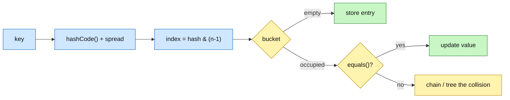

# #️⃣ Hash Tables

**Navigation**: [< Previous Chapter](01d_Stack_Queue.md) | [Back to Index](../00_MASTER_INDEX.md) | [Next Chapter >](01f_Trees_Heaps.md)

---

## #️⃣ Part 6: Hash Table

### 5W1H: Deep Understanding of Hash Table

> [!NOTE]
> **WHAT:** A Hash Table (or HashMap) is a data structure that maps keys to values for highly efficient lookups, using a hash function to compute an index into an array of buckets.
>
> **WHY:** Searching an array or linked list for a specific element is O(N). Binary search on a sorted array is O(log N). We need a way to find, insert, and delete data in O(1) time.
>
> **WHO:** Every software engineer. Hash tables are the most frequently used data structure in real-world application development.
>
> **WHEN:** Use when you need instant lookups by a unique identifier.
>
> - ✅ Caching (LRU, Memcached, Redis)
> - ✅ Counting frequencies (word counts, duplicates)
> - ✅ Fast pair finding (Two-Sum problem)
> - ❌ When you need data in sorted order (use TreeMap)
>
> **HOW:** Pass the key through a hash function (e.g., `hashCode()`) to get an integer, use modulo to find the bucket index, and handle collisions via chaining (linked lists) or probing.

## 💬 Explain It Like a Study Partner — Hash Tables

> [!TIP]
> **Ask yourself first:** *"How can a lookup among a million keys take about one step?"*

### 1. The bottom line

A hash table turns a key into a number that says **which bucket to look in**, so you go almost straight to the answer instead of searching.

### 2. The textbook core

- A **hash function** maps a key to an integer; the table uses it to pick a **bucket index** (in Java: `hash & (n - 1)`, with `n` a power of two).
- A **collision** happens when two keys land in the same bucket. Java chains them in a linked list, which becomes a red-black tree at 8+ entries.
- Average `get`/`put`/`remove` are **O(1)**; the worst case is O(n) (O(log n) with tree bins).
- The **load factor** (default 0.75) controls when the table doubles and rehashes.
- Contract: equal keys must have equal `hashCode`s, and keys must not change while stored.

### 3. The real-world analogy

A **coat check**: you hand over your coat and get ticket #37. Later, ticket #37 tells the attendant exactly which hook to check, with no need to look through every coat. If two coats share a hook, the attendant checks just those few.

### 4. Walkthrough: `put("Alice", 25)` then `get("Alice")`

1. Compute `h = "Alice".hashCode()`, then spread it: `h ^ (h >>> 16)`.
2. Pick the bucket: `index = hash & (16 - 1)`.
3. Bucket empty → store the entry there. (Bucket occupied → compare keys with `equals`; same key updates the value, different key is chained.)
4. `get("Alice")` repeats steps 1–2, goes to that bucket and compares keys, then returns `25`.
5. If the table passes 12 entries (16 × 0.75), it doubles to 32 buckets and re-places every entry.

> [!NOTE]
> **Quick check:** why must you override `hashCode` whenever you override `equals`? *Otherwise equal objects can hash to different buckets and `get` will never find them.*

---

## ⚡ At a Glance — Hash Tables

> [!NOTE]
> **Mental model:** a hash function turns a key into a bucket index, so lookup jumps straight to (nearly) the right slot instead of searching. Speed depends on keeping buckets short.

**How to read this diagram.** Blue steps are the deterministic part (hash → index). Yellow is where the table decides what to do on collision; green means the operation finished cheaply.

| Operation | Average | Worst case | Note |
| --------- | ------- | ---------- | ---- |
| `get` / `containsKey` | O(1) | O(n); O(log n) with Java 8+ tree bins | Needs a good `hashCode` |
| `put` | O(1) amortized | O(n) | Resize doubles capacity and rehashes |
| `remove` | O(1) | O(n) | |
| Iterate | O(capacity + n) | — | No guaranteed order (`HashMap`) |

> [!IMPORTANT]
> **Contract:** if `a.equals(b)` then `a.hashCode() == b.hashCode()`. Break it and equal keys land in different buckets, so lookups silently fail. Never mutate a key after inserting it.

---

## 📚 Topic Pages in This Chapter

This chapter is split into focused pages so each topic can be read on its own. Read them in order the first time; use the table to jump back later.

| # | Page | What is inside | Lines |
| --- | --- | --- | --- |
| 1 | [COMPLETE UNDERSTANDING — The WHY Before the WHAT](01e_HashTable/01_complete_understanding_the_why_before_the.md) | COMPLETE UNDERSTANDING — The WHY Before the… · University Proof Corner · Nature & Behavior | 292 |
| 2 | [Implementation WITHOUT Collections](01e_HashTable/02_implementation_without_collections.md) | Implementation WITHOUT Collections · LeetCode → Real-World Connection · Interview Patterns — The 5 HashMap Techniques… · Quick Problem Walkthrough: Subarray Sum… · Full Problem Set — HashMap / HashTable · … | 488 |
| 3 | [University-Level Addendum — Hash Tables as Formal Theory](01e_HashTable/03_university_level_addendum_hash_tables_as.md) | University-Level Addendum — Hash Tables as… | 432 |

## Reality Check

> [!CAUTION]
> **Myth:** "If I override equals(), I don't need to override hashCode()"
>
> **Reality:** Java's contract: objects that are `equals()` MUST have the same `hashCode()`. Breaking this makes your objects invisible in HashMaps: you `put(key, value)`, then `get(key)` with an equal key returns `null` because the two objects hash to different buckets. The compiler won't warn you. Always override both together.

> [!CAUTION]
> **Myth:** "HashMap preserves insertion order"
>
> **Reality:** `HashMap` makes NO order guarantee. `LinkedHashMap` preserves insertion order (uses a doubly-linked list alongside the hash table). `TreeMap` maintains sorted key order. Relying on HashMap order is a bug waiting to appear when the JVM version changes its hashing strategy.

> [!CAUTION]
> **Myth:** "A good hash function just needs to be fast"
>
> **Reality:** Speed matters but distribution is critical. A hash function that maps many keys to the same bucket degrades HashMap from O(1) to O(n) — or O(log n) with Java 8's tree-ification. For strings, Java's `hashCode()` uses a polynomial rolling hash (31 as the base). Simple hashes like `return length` or `return 0` are catastrophically bad.

> [!CAUTION]
> **Myth:** "HashSet is just a wrapper around a list that removes duplicates"
>
> **Reality:** `HashSet` is backed by a `HashMap` where each element is a key and the value is a constant dummy `Object`. Membership test is O(1) average, not O(n) like a list scan. For n = 1,000,000 elements, `set.contains(x)` is microseconds; `list.contains(x)` is milliseconds.

> [!CAUTION]
> **Myth:** "ConcurrentHashMap makes all compound operations thread-safe"
>
> **Reality:** `ConcurrentHashMap` makes individual operations (`get`, `put`, `remove`) thread-safe. But compound operations like "check then put" are NOT atomic: `if (!map.containsKey(k)) map.put(k, v)` has a race between the check and the put. Use `map.putIfAbsent(k, v)` or `map.computeIfAbsent(k, ...)` instead — these are single atomic operations.
