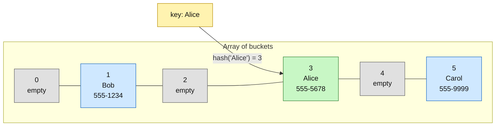

# PART 0: COMPLETE UNDERSTANDING — The WHY Before the WHAT

> **Navigation**: [Chapter overview](../01e_HashTable.md) | [Implementation WITHOUT Collections →](02_implementation_without_collections.md)
> Page 1 of 3 in **Hash Tables**


## What Problem Does a Hash Table Solve?

**The Lookup Problem:** "Given a key, find its value."

| Approach                     | Time Complexity                            |
| ---------------------------- | ------------------------------------------ |
| Array lookup by index        | O(1) — but you need an integer index!      |
| Array lookup by value        | O(n) — must scan everything                |
| Sorted array + binary search | O(log n) — better, but not instant         |
| **Hash Table**               | **O(1)** — converts any key into an index! |

💡 **Hash Table Breakthrough:**

"What if we could CONVERT any key into an index?"

`hash("Alice") → 3` → `table[3] = Alice's data` → **O(1) lookup!**

Keys can be strings, objects, anything — the hash function handles it.

## Who Invented It and Why?

**1953: H.P. Luhn at IBM.** IBM's compilers had to look up variable names — with 10,000 variables, linear search meant 10,000 comparisons per lookup. Programs had thousands of lookups → **minutes to compile**.

💡 **Luhn's insight:** Use a mathematical function to _compute_ the location directly.
`hash("myVariable") → index 4271 → O(1) direct access!`

**Impact:**

- Compilers went from **minutes to seconds**
- Databases became practical (hash indexes)
- Every modern language has built-in HashMap/Dictionary
- Used in: caching, deduplication, routing, spell checkers

## When to Use (and NOT Use) Hash Tables

**✅ USE Hash Table when:**

- You need **O(1) average** lookup, insert, delete
- You're counting frequencies ("how many times does X appear?")
- You're checking for existence ("have I seen X before?")
- You're grouping by key ("group all anagrams together")
- You need two-sum style "complement finding"

**❌ DO NOT USE when:**

- You need sorted/ordered data → Use **TreeMap** instead
- You need range queries ("all keys between A and B") → **TreeMap**
- Memory is very tight → Hash tables waste ~50% space
- You need **worst-case** O(1) → Hash tables are O(1) _average_, O(n) worst
- Input is very small (< 20 elements) → Simple array might be faster

## The Big Picture: How HashMap Works in Java

```java
HashMap<String, Integer> map = new HashMap<>();
map.put("Alice", 85);
```

**Step by Step:**

1. Compute hash: `"Alice".hashCode()` → `63650081`
2. Reduce to index: `63650081 % 16` → `1` (16 = default capacity)
3. Store at `buckets[1]`: `("Alice", 85)`

**Retrieval:** `map.get("Alice")` → hash → `1` → go to `buckets[1]` → found! Return `85`. Time: **O(1)**.

⚠️ **Collision handling:**

- **Java 8+:** If chain length > 8 → convert to **Red-Black Tree** → O(log n) worst case
- **Before Java 8:** Always linked list → O(n) worst case

## Why O(1) Is True — and the Honest Conditions Under Which It's a Lie

"Hash tables are O(1)" is the most-repeated and least-understood claim in data structures. The real statement has conditions, and a senior engineer knows all of them. Let's build the truth.

**The actual cost is O(1 + α), where α = load factor = n / (number of buckets).** A lookup does two things: (1) compute the hash and jump to a bucket — genuinely O(1); (2) scan that bucket's chain for the matching key — O(chain length). So the whole cost rides on **how long the chains are**, and the average chain length is exactly α.

Why is average chain length α? If you spread n keys across m buckets and the hash function scatters them *uniformly*, each bucket holds n/m keys on average — that's the definition of α. So:

- α = 0.5 → average half an element per bucket → lookups touch ~1 element → O(1).
- α = 5 → average 5 per bucket → every lookup scans ~5 → still constant, but 5× slower.
- α = n (one bucket, everything collides) → one chain of length n → **O(n).** The hash table has degenerated into a linked list.

**This is why resizing exists and isn't optional.** Java's HashMap watches α and, when it crosses **0.75**, doubles the bucket count and rehashes every entry into the bigger table. Doubling halves α, pulling chains back down to ~1. That rehash costs O(n) — but it happens rarely (only at 0.75, 1.5×0.75, …), so amortized over all the insertions it adds only O(1) per insert. (Exact same doubling/amortization argument as the dynamic array — [memory foundations](../01a_Memory_Foundations.md).) **Keeping α bounded is the whole job; lose that and O(1) evaporates.**

**Now the honest part — O(1) is a probabilistic claim, and it has enemies:**

1. **It assumes the hash function spreads keys uniformly.** That's an *assumption about the distribution of your keys vs. your hash function*, not a guarantee. A terrible `hashCode()` that returns the same value for every object dumps all n keys into one bucket → O(n), with no exception thrown, just mysterious slowness.

2. **An adversary can force the worst case (HashDoS).** If keys come from untrusted input (HTTP form fields, JSON keys) and the attacker knows your hash function, they can craft thousands of keys that *all hash to the same bucket* — turning your O(1) map into an O(n) chain and your O(n) request-processing loop into O(n²). This was a real, weaponized CVE across web frameworks around 2011. Two defenses, both shipped in production:
   - **Randomized/seeded hashing** so the attacker can't predict the bucket (used in many language runtimes).
   - **Treeify the bucket** — Java 8's fix: when a single chain exceeds 8 entries, convert that bucket from a linked list to a **red-black tree**, capping the worst case at **O(log n)** per bucket instead of O(n). So Java's true worst case is O(log n), not O(n), specifically because the designers refused to trust the uniformity assumption.

> **State it precisely, the way a staff engineer would:** hash-table operations are **O(1) _expected_, amortized over resizes, _assuming_ the hash function distributes keys uniformly across buckets.** Every word in that sentence is load-bearing. "Expected" (not guaranteed — depends on key distribution), "amortized" (individual inserts can trigger an O(n) resize), "assuming uniform" (a bad hashCode or an adversary breaks it). The interview answer "O(1)" is the *headline*; this sentence is the *article*.

## HashMap vs TreeMap vs LinkedHashMap — Decision Matrix

| Feature      | HashMap        | TreeMap          | LinkedHashMap      |
| ------------ | -------------- | ---------------- | ------------------ |
| Lookup       | O(1) avg       | O(log n)         | O(1) avg           |
| Insert       | O(1) avg       | O(log n)         | O(1) avg           |
| Ordered      | ❌ No          | ✅ Sorted by key | ✅ Insertion order |
| Null key     | ✅ 1 allowed   | ❌ No            | ✅ 1 allowed       |
| Thread-safe  | ❌ No          | ❌ No            | ❌ No              |
| **Best for** | General lookup | Range queries    | LRU cache          |

🎯 **Interview rule of thumb:**

- "Need lookup?" → **HashMap**
- "Need sorted keys?" → **TreeMap**
- "Need insertion order?" → **LinkedHashMap**
- "Need thread safety?" → **ConcurrentHashMap**

## Hash Table Variants & Trade-offs

Not all hash maps are created equal. Different implementations make different trade-offs across thread-safety, ordering, memory, and lookup guarantees. This table captures the key dimensions.

| Variant                  | Structure                       | Key Equality                 | Thread-Safety               | Memory Overhead           | Lookup Complexity              | Use Case                                  |
| ------------------------ | ------------------------------- | ---------------------------- | --------------------------- | ------------------------- | ------------------------------ | ----------------------------------------- |
| **HashMap** (Java)       | Array + linked list / red-black tree | `equals()`              | None                        | ~40% empty (0.75 LF)      | O(1) avg / O(log n) worst      | General-purpose lookups                   |
| **LinkedHashMap**        | HashMap + Doubly DLL            | `equals()`                   | None                        | +2 pointers per entry     | O(1) avg                       | LRU cache, insertion-order iteration      |
| **TreeMap**              | Red-Black Tree                  | `compareTo()` / `Comparator` | None                        | O(log n) per node         | O(log n)                       | Sorted keys, range queries                |
| **Hashtable** (legacy)   | Array + linked list             | `equals()`                   | Synchronized (full lock)    | High (full sync)          | O(1) avg                       | Legacy code compatibility                 |
| **ConcurrentHashMap**    | Segment array + CAS             | `equals()`                   | Lock striping (16 segments) | Moderate                  | O(1) avg (read), O(n/16) worst | High-concurrency production use           |
| **WeakHashMap**          | HashMap with `WeakReference<K>` | `equals()`                   | None                        | Low                       | O(1) avg                       | Cache entries that don't prevent GC       |
| **IdentityHashMap**      | Open-addressing array           | `==` (reference equality)    | None                        | Minimal                   | O(1) avg                       | Security managers, system-level interning |
| **EnumMap**              | Dense `Object[]` array          | Ordinal index                | None                        | Very low (no hash)        | O(1) constant                  | Enum-keyed maps (most efficient possible) |
| **ImmutableMap** (Guava) | Hash array (copied on write)    | `equals()`                   | Immutable by design         | Moderate (copy on write)  | O(1) avg                       | Config objects, DTOs, defensive copying   |
| **Caffeine**             | W-TinyLFU + LIRS + LRU          | `equals()`                   | Optional (async)            | Tunable (weigher, expiry) | O(1) amortized                 | High-performance in-memory cache          |

> **Trade-off Discussion:** Choosing a hash map variant means choosing which axis to optimize:
>
> - **Memory vs. Speed:** Open-addressing (IdentityHashMap) uses less memory than chaining but degrades faster under high load. EnumMap has the lowest memory footprint of all — no hash computation needed, just ordinal indexing.
> - **Thread-Safety vs. Performance:** `Hashtable` synchronizes every operation with a full lock — safe but slow under contention. `ConcurrentHashMap` uses lock striping (16 segments in JDK 8) so concurrent reads are lock-free and only writes that touch the same segment block each other. For single-threaded code, plain `HashMap` is always faster.
> - **Sorted vs. Unsorted:** `TreeMap` maintains keys in sorted order (O(log n) for all operations) at the cost of a more complex structure. Use `TreeMap` only when you need `subMap()`, `firstKey()`, or range queries. Never use it for simple lookups.
> - **Weak References vs. Strong:** `WeakHashMap` allows the GC to collect entries when the only remaining reference to the key is from within the map itself. This is ideal for canonicalization caches or memoization where you don't want long-lived map entries to prevent GC of the underlying objects. But beware: storing a strong reference to the key from the value (e.g., `map.put(key, new StrongRefToKey(key))`) resurrects the key and defeats the weak semantics entirely.

---

## Mental Model: Library Card Catalog

**Hash Table = Card catalog in a library**

`Book title` → `Card catalog formula` → `Drawer number` → `Exact card`

- **"Harry Potter"** → formula → Drawer 42 → Card with shelf location
- **Collision** = Two books map to same drawer → Multiple cards in Drawer 42 → search within (chaining)
- **Load Factor** = How full the drawers are → Too full (>75%) → Time to get a bigger cabinet (resize/rehash)
- **Rehashing** = Moving all cards to a bigger cabinet → Drawer numbers change → Must recompute every card's position → Expensive O(n) but rare (amortized O(1) per insert)

🎲 **Birthday Paradox — Why Collisions Are Inevitable:**
In a room of 23 people, the probability that TWO share a birthday is already 50%. HashMap collision logic is identical — with even a good hash function, collisions start happening long before the table is full. This is why you NEED a load factor threshold and chaining: not because your hash function is bad, but because mathematics guarantees collisions sooner than you'd think.

**Why 0.75 specifically?**
It's a carefully researched balance between space efficiency and lookup performance. Below 0.5: too much empty space (memory wasted). Above 0.9: collision chains grow, O(1) degrades toward O(n). At 0.75: average chain length ≈ 1-2 entries (Poisson distribution with λ=0.75 → P(chain≥8) < 0.00006%). This is also why Java uses 8 as the treeification threshold — at load factor 0.75, having ≥8 items in ONE bucket has probability < 1 in a million under random hashing.

---

## Explicit Invariants — What Must Always Be True

Understanding invariants clarifies WHY hash tables work and WHY they break.

> **Invariant 1 — HashMap Load Factor:**
> `loadFactor = size / capacity` must stay ≤ `DEFAULT_LOAD_FACTOR (0.75)`. A resize is triggered when `(size + 1) > threshold` (where `threshold = capacity × loadFactor`). This guarantees average chain length stays O(1).

> **Invariant 2 — Hash Table Collision Bound:**
> Under **uniform hashing** (all keys equally likely across all bucket indices), the expected chain length is O(1). Pathological inputs that all hash to the same bucket break this invariant — chains grow to O(n), degrading all operations.

> **Invariant 3 — Java String hashCode Determinism:**
> `s.hashCode()` is deterministic: calling it twice on the same `String s` always returns the same int. This is guaranteed by the JLS. The same string always maps to the same bucket. This is why HashMap keys must produce consistent hash codes across all operations.

> **Invariant 4 — equals() / hashCode() Contract:**
> If `a.equals(b)` is true, then `a.hashCode() == b.hashCode()` must be true. Violating this breaks HashMap's bucket-based lookup entirely — objects that are equal may land in different buckets, making `containsKey()` and `get()` unreliable.

---

## 🎓 University Proof Corner

> **MIT 6.006 L8 / RWTH Aachen Algo I layer** — Why hash tables give correct lookups, why they break down with bad hash functions, and why universal hashing makes O(1) a guarantee against any adversary.

### Correctness: `get(k)` Returns the Right Value

**Invariant**: After any sequence of `put(k, v)` and `remove(k)` operations, for every key `k'`, the chain at bucket `h(k')` contains exactly the live entries whose key equals `k'`.

**Proof by induction on operation count**:

- **Base case (empty table)**: All chains empty. Invariant holds vacuously. ✓
- **Maintenance — `put(k, v)`**: Locate bucket `h(k)`. Walk the chain to find any existing entry with key `k`. If found, replace its value. If not, prepend a new entry `(k, v)`. Either way, the chain has exactly the live entries for `k` (plus any other keys that happen to hash to this bucket). ✓
- **Maintenance — `remove(k)`**: Locate bucket `h(k)`. Walk chain; remove the entry with key `k`. The chain now has exactly the live entries (without `k`). ✓
- **Termination**: `get(k)` walks the chain at `h(k)` and returns the value of the entry with key `k`, or `null` if none. By the invariant, this is exactly the live value (or absent). ✓

### Why a Fixed Hash Function is Vulnerable

For any fixed `h`, an adversary who knows `h` can construct `n` keys `k₁, ..., kₙ` that all hash to the same bucket. Then:

- `put` of all n keys: O(n) per insert (chain traversal) → O(n²) total
- `get` of any key: O(n) worst case

This is the **HashDoS attack** — demonstrated in 2011 against PHP, Python, Ruby, Java (pre-7u6), and ASP.NET. A single HTTP request with crafted keys consumed minutes of CPU.

### Why Universal Hashing Defeats the Adversary

**Universal family H**: For any two distinct keys `x ≠ y`: Pr_{h∈H}[h(x) = h(y)] ≤ 1/m.

**Standard construction**: `h_{a,b}(x) = ((a·x + b) mod p) mod m` for prime `p > |U|`, random `a ∈ {1, ..., p−1}`, random `b ∈ {0, ..., p−1}`.

**Expected chain length**: For n keys and m ≥ n buckets:
  E[chain at any bucket] = Σ_{y ≠ x} Pr[h(y) = h(x)] ≤ (n−1)/m ≤ 1

So expected lookup = O(1) **regardless of input** — the adversary cannot construct a worst case because they cannot predict the random `a, b`.

**In practice**: Java 7u6+, Python 3.3+, Ruby 1.9+ all randomize the hash seed per JVM/process. This is universal hashing against an external adversary — and the only reason HashDoS is no longer a single-request DoS.

> Full proofs: [A4 — Randomized Data Structures](../A4_Randomized_Data_Structures.md) · [A2 — DS Complexity](../A2_DS_Complexity_FirstPrinciples.md)

---

## 🧬 Nature & Behavior

### What is a Hash Table?

**Concept:**

- Transform the key into an array index using a hash function
- Store the value at that index
- Retrieve in O(1) average time

**Example: phone book.** `"Alice"` → `hash("Alice")` → index `3`.



**How to read this diagram.** The key is hashed to an index (here 3), and we jump straight to that bucket (green).

`get("Alice")` → `hash("Alice")` → 3 → return `555-5678`. Time: **O(1)**.

### Collision Handling

**Problem:** `hash("Alice") = 3` and `hash("David") = 3` — two keys hash to the same index!

**Solution 1: Chaining** (LinkedList at each index)

```
Index 3: Alice → David → null
```

**Solution 2: Open Addressing** (find next empty slot)

```
Index 3: Alice
Index 4: David (probed to next)
```

### 🔴 Real-World Origin: Symbol Tables in Compilers (1953)

**Problem (IBM 701 Compiler):** Program has thousands of variable names. Need to look up variable type/value quickly. Linear search through all variables: **TOO SLOW**.

**Before Hash Tables:**

```
variables = [
    {name: "x", type: "int"},
    {name: "y", type: "float"},
    ... 10,000 more ...
]
lookup("x") → search all 10,000 → O(n)
```

**Solution by H.P. Luhn (1953):** "What if we could _calculate_ the position directly?"

```
hash("x") = some_formula("x") → index 42
variables[42] = {name: "x", type: "int"}
lookup("x") → O(1)!
```

✅ **Impact:** Compilers became **100x faster**, databases became possible, every modern language has HashMap.

---

[Chapter overview](../01e_HashTable.md) | [Implementation WITHOUT Collections →](02_implementation_without_collections.md)
