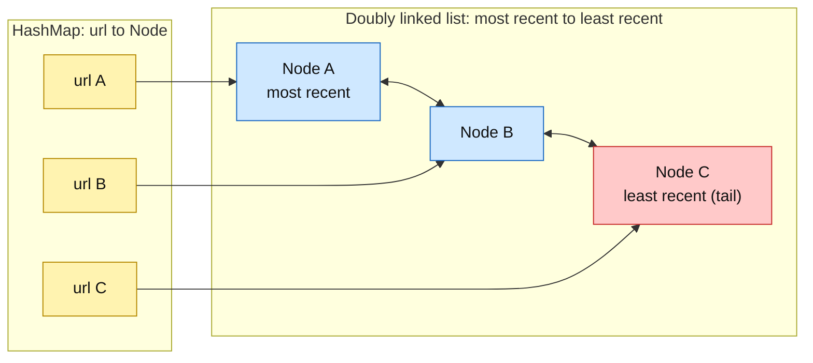

# 💻 Implementation WITHOUT Collections

> **Navigation**: [← COMPLETE UNDERSTANDING — The WHY Before the…](01_complete_understanding_the_why_before_the.md) | [Chapter overview](../01e_HashTable.md) | [University-Level Addendum — Hash Tables as… →](03_university_level_addendum_hash_tables_as.md)
> Page 2 of 3 in **Hash Tables**


```java
public class MyHashMap {
    private class Entry {
        int key;
        int value;
        Entry next;  // For chaining

        Entry(int key, int value) {
            this.key = key;
            this.value = value;
        }
    }

    private Entry[] buckets;
    private int capacity;
    private int size;
    private static final double LOAD_FACTOR = 0.75;

    public MyHashMap() {
        this.capacity = 16;
        this.buckets = new Entry[capacity];
        this.size = 0;
    }

    // HASH FUNCTION
    private int hash(int key) {
        return Math.abs(key) % capacity;
    }

    // PUT - O(1) average
    public void put(int key, int value) {
        if ((double) size / capacity >= LOAD_FACTOR) {
            resize();
        }

        int index = hash(key);
        Entry current = buckets[index];

        // Check if key exists
        while (current != null) {
            if (current.key == key) {
                current.value = value;  // Update
                return;
            }
            current = current.next;
        }

        // Add new entry at head (O(1))
        Entry newEntry = new Entry(key, value);
        newEntry.next = buckets[index];
        buckets[index] = newEntry;
        size++;
    }

    // GET - O(1) average
    public int get(int key) {
        int index = hash(key);
        Entry current = buckets[index];

        while (current != null) {
            if (current.key == key) {
                return current.value;
            }
            current = current.next;
        }
        return -1;  // Not found
    }

    // REMOVE - O(1) average
    public void remove(int key) {
        int index = hash(key);
        Entry current = buckets[index];
        Entry prev = null;

        while (current != null) {
            if (current.key == key) {
                if (prev == null) {
                    buckets[index] = current.next;
                } else {
                    prev.next = current.next;
                }
                size--;
                return;
            }
            prev = current;
            current = current.next;
        }
    }

    // CONTAINS - O(1) average
    public boolean containsKey(int key) {
        return get(key) != -1;
    }

    // RESIZE - O(n) but rare
    private void resize() {
        Entry[] oldBuckets = buckets;
        capacity *= 2;
        buckets = new Entry[capacity];
        size = 0;

        for (Entry head : oldBuckets) {
            while (head != null) {
                put(head.key, head.value);
                head = head.next;
            }
        }
    }

    public int size() {
        return size;
    }
}
```

## Production Failure Modes & Debugging

Hash tables are battle-tested, but they have sharp edges in production. These failure modes have caused real outages.

### Failure 1: Hash Collision DoS Attack (2011)

**Mechanism:** An attacker submits keys designed to produce the same hash bucket. In Java's original `HashMap`, all colliding keys land in the same chain → every `get()` degenerates to O(n). With enough crafted keys, an attacker can freeze a server by forcing it into O(n²) hash lookups per request.

**Root Cause:** Before JDK 7u6 (2012), `String.hashCode()` was deterministic with no per-JVM randomization. The same string always produced the same hash, so an attacker could pre-compute colliding keys.

> [!TIP]
> **Fix:** JDK 8 switched to a randomized hash seed (`-XX:StringTableSize` or the internal `hashSeed` in `Hashtable`). Each JVM instance computes a random seed at startup, making pre-computed collisions useless.

**Debugging:** Use `-XX:+PrintStringTableStatistics` to monitor string table size; `jmap -histo:live <pid>` to spot abnormally large bucket chains. CPU spike with no obvious code cause → suspect hash collision DoS.

### Failure 2: HashMap Resize Storm

**Mechanism:** With high-cardinality keys (e.g., user IDs, session tokens), a HashMap that starts at capacity 16 repeatedly resizes: 16 → 32 → 64 → ... Each resize is O(n) (all entries rehashed). Under high write throughput, repeated resizes cause CPU spikes and GC pressure.

**Root Cause:** Failing to pre-size the HashMap when the expected size is known. Each resize doubles capacity and re-hashes every entry — an O(n) operation that blocks the thread.

> [!TIP]
> **Fix:** Pre-size: `new HashMap<>(expectedSize / 0.75 + 1)` or Guava's `Maps.newHashMapWithExpectedSize(1000)`. This allocates the correct capacity upfront, avoiding all resizes.

**Debugging:** `jstack <pid>` during a spike will show threads in `HashMap.resize()` or `TransferData`. Add `-XX:HashMapInitCapacity=<N>` logging. Profile with `async-profiler` to find which `put()` calls dominate.

### Failure 3: WeakHashMap Entry Resurrection

**Mechanism:** `WeakHashMap` uses `WeakReference` for keys — entries are eligible for GC when no other strong reference exists. However, if the **value** object holds a strong reference back to the key, the key is kept alive and the entry is never removed. The map appears to "leak" entries.

```java
// WRONG — value holds strong ref to key
WeakHashMap<Key, Value> map = new WeakHashMap<>();
map.put(new Key("session_1"), new Value(keyRef -> { /* captures key! */ }));
// Key is never GC'd because Value captures it in a lambda closure!
```

**Debugging:** Use `jmap -histo:live <pid>` before and after `System.gc()` to see if WeakHashMap entries persist. If they do, check value objects for hidden key references in closures, inner classes, or caches.

### Failure 4: ConcurrentModificationException on HashMap Iteration

**Mechanism:** Modifying a `HashMap` while iterating over it (via `entrySet()`, `keySet()`, or `values()`) throws `ConcurrentModificationException`. This is fail-fast: the iterator maintains a `modCount` and detects concurrent modification.

```java
Map<Integer, String> map = new HashMap<>();
map.put(1, "one");
for (Map.Entry<Integer, String> e : map.entrySet()) {
    map.remove(e.getKey()); // throws CME!
}
```

> [!TIP]
> **Fix:** Use the iterator's own `remove()`: `Iterator<Map.Entry<Integer, String>> it = map.entrySet().iterator(); while (it.hasNext()) { it.remove(); }`. Or use `ConcurrentHashMap` which supports safe concurrent iteration.

**Debugging:** `jstack <pid>` will show the `ConcurrentModificationException` stack trace pointing to the failing loop.

---

**Challenge (Real-World Reasoning):** In 2011, the hash collision DoS attack forced Java (and Ruby, PHP, Python) to switch to randomized hash seeds. Explain WHY this fix works, WHY it was necessary, and what the trade-off was. What other design decisions in `HashMap` (Java 8+) help mitigate similar attacks today?

<details><summary>Answer</summary>

**Why randomized seeds work:** Before randomization, `hash("foo")` was always the same integer across all JVMs. An attacker could pre-compute 100,000 strings that all hash to the same bucket and submit them as request parameters. Each lookup degenerates to O(n) → total O(n²) per request → server freeze. With a random seed S added to the hash (`hash = S ^ stringHashCode`), the attacker cannot pre-compute collisions — each JVM has a different S, so their colliding keys scatter unpredictably across buckets on each deployment.

**Why it was necessary:** The O(n) lookup per collision means N colliding keys cause N² total work on a single request. At N=100,000, this is catastrophic even on modern hardware.

**Trade-off:** The seed makes performance non-deterministic across JVM restarts (same input → different bucket). This breaks some unit tests that rely on hash order. More importantly, it means the same hash map state cannot be replicated exactly across machines without sharing the seed (a security risk). The seed is stored in `Hashtable.hashSeed` (not `HashMap`, since `HashMap` was always vulnerable).

**Java 8+ mitigations beyond seeds:**

1. **Treeification at chain length 8:** Even if collisions occur, the worst case is O(log n) per lookup (Red-Black tree), not O(n). This limits the attack's damage — N colliding keys cause O(N log N) total work, not O(N²).
2. **Randomized seed** in `Hashtable` (JDK 6u26+) and `HashMap` (JDK 7u6+)
3. **`-Djdk.map.althashing.threshold`** to disable alternate hashing entirely for trusted input

The combination means the DoS attack surface is much smaller today — but not zero. Applications that accept arbitrary user strings as HashMap keys should still sanitize or limit input length.

</details>

## 🎯 LeetCode → Real-World Connection

### Problem: LRU Cache

**Real-world origin: web browser cache (1990s).**

**Problem at Netscape (1994):**

- The browser loads images from the internet.
- Loading the same image again is slow.
- Store recently viewed images in memory.
- Memory is limited (16 MB in 1994!).

**Questions:**

1. How do we quickly check if an image is cached? → **HashMap**
2. Which image do we remove when full? → **Least Recently Used**
3. How do we track "recently used"? → **Linked list**

**Solution: HashMap + doubly linked list**



**How to read this diagram.** The map jumps straight to a node by key (O(1)); the list keeps nodes ordered by recency, so moving a node to the front is O(1) and the tail (red) is always the next eviction.

| Step | Cost |
| ---- | ---- |
| Look up the image in the HashMap | O(1) |
| Move its node to the front of the list | O(1) |
| Cache full? Remove the tail (LRU) | O(1) |

**Impact:** every browser, every database, every CDN (Cloudflare, Akamai) uses variants of this idea; Redis and Memcached eviction are built on the same principle.

---

## 🧠 Interview Patterns — The 5 HashMap Techniques You MUST Know

### Pattern 1: Frequency Counting

**Use for:** "How many times does each element appear?", "Find most/least frequent", "Check if anagrams"

```java
// General purpose
Map<T, Integer> freq = new HashMap<>();
for (T item : collection)
    freq.merge(item, 1, Integer::sum);

// For characters (faster)
int[] freq = new int[26];
for (char c : s.toCharArray()) freq[c - 'a']++;
```

### Pattern 2: Two-Sum (Complement Lookup)

**Use for:** "Find pair that sums to target", "Find pair with difference = k"

💡 **Why HashMap works:** For each number X, you need `target - X` to exist. Instead of scanning the whole array each time **O(n²)**, store what you've seen in a HashMap → check in **O(1)**.

```java
Map<Integer, Integer> seen = new HashMap<>();  // value → index
for (int i = 0; i < nums.length; i++) {
    int complement = target - nums[i];
    if (seen.containsKey(complement))
        return new int[]{seen.get(complement), i};
    seen.put(nums[i], i);
}
```

### Pattern 3: Grouping/Bucketing

**Use for:** "Group anagrams", "Group by category", "Bucket sort"

```java
Map<String, List<String>> groups = new HashMap<>();
for (String word : words) {
    char[] sorted = word.toCharArray();
    Arrays.sort(sorted);
    String key = new String(sorted);
    groups.computeIfAbsent(key, k -> new ArrayList<>()).add(word);
}
// "eat", "tea", "ate" → all have key "aet" → grouped together
```

### Pattern 4: Prefix Sum + HashMap

**Use for:** "Subarray sum equals K", "Contiguous array"

💡 **Why:** `prefix[j] - prefix[i] = K` means subarray `[i+1..j]` sums to K. For each j, check if `(prefix[j] - K)` exists in map.

```java
Map<Integer, Integer> prefixCount = new HashMap<>();
prefixCount.put(0, 1);  // Empty prefix
int sum = 0, count = 0;
for (int num : nums) {
    sum += num;
    count += prefixCount.getOrDefault(sum - k, 0);
    prefixCount.merge(sum, 1, Integer::sum);
}
```

### Pattern 5: Sliding Window + HashMap

**Use for:** "Longest substring without repeating characters", "Minimum window substring"

Map stores element → last seen index (or frequency in window). When window is invalid, shrink from left.

---

## ⚡ Quick Problem Walkthrough: Subarray Sum Equals K

### 💬 Study-Partner View — Subarray Sum Equals K (Prefix Sum + HashMap)

**1. The bottom line:** Instead of checking every slice, remember the running totals you have seen: a slice sums to K exactly when two running totals differ by K.

**2. The textbook core:**

- Let `prefix[i]` = sum of the first `i` elements. Sum of `nums[j..i-1]` = `prefix[i] - prefix[j]`.
- So a slice ending at `i` with sum K exists when `prefix[i] - K` has been seen before.
- Store `prefix → count` in a HashMap (start with `{0: 1}` for the empty prefix).
- Time **O(n)**, space O(n); brute force is O(n²).

**3. The real-world analogy:** Tracking your **bank balance**: if your balance is now 150 and it was 100 some days ago, you have gained 50 since then. To ask "did I ever gain exactly K?", just look up whether balance minus K appeared before.

**4. Walkthrough:**

1. `nums = [1, 2, 3]`, `K = 3`. Map starts `{0: 1}`, `sum = 0`, `count = 0`.
2. Read 1 → `sum = 1`; `1 - 3 = -2` not in map; store `{0:1, 1:1}`.
3. Read 2 → `sum = 3`; `3 - 3 = 0` is in map (count 1) → `count = 1` (slice `[1,2]`); store 3.
4. Read 3 → `sum = 6`; `6 - 3 = 3` is in map → `count = 2` (slice `[3]`). Answer: **2**.

> [!NOTE]
> **Quick check:** Why seed the map with `{0: 1}`? *So slices that start at index 0 (prefix equals K) are counted.*


**Problem:** Given array `[1, 2, 3, -1, 1, 2]` and `K = 3`, count subarrays that sum to exactly 3.

**Brute Force:** Check all O(n²) subarrays → too slow.

**Optimal (Prefix Sum + HashMap):** For each `prefix[j]`, count how many `prefix[i] = prefix[j] - K`:

| j   | prefix | need (prefix-K) | map state                 | matches                 |
| --- | ------ | --------------- | ------------------------- | ----------------------- |
| 0   | 1      | -2              | {0:1}                     | 0                       |
| 1   | 3      | 0               | {0:1, 1:1}                | **1** → subarray [0..1] |
| 2   | 6      | 3               | {0:1, 1:1, 3:1}           | **1** → subarray [0..2] |
| 3   | 5      | 2               | {0:1, 1:1, 3:1, 6:1}      | 0                       |
| 4   | 6      | 3               | {0:1, 1:1, 3:1, 5:1, 6:1} | **1**                   |
| 5   | 8      | 5               | {0:1, 1:1, 3:1, 5:1, 6:2} | **1**                   |

✅ **Total: 4 subarrays** sum to 3: `[1,2]`, `[3]`, `[3,-1,1]`, `[1,2]`

---

---

🔬 **Section Challenge — ⚡ Quick Problem Walkthrough: Subarray Sum Equals K**

**Challenge 1 (Reasoning):** In the prefix sum approach, you initialize the map with `prefixCount.put(0, 1)`. Why is this necessary? What case does it handle that would be missed otherwise?

<details><summary>Answer</summary>

It handles subarrays that start at index 0. When `prefix[j] - K = 0`, it means the subarray `[0..j]` itself sums to K. Without the initial `(0, 1)` entry, this match wouldn't be found because the map would have no entry for prefix sum = 0. Example: array `[3]`, K = 3. After processing index 0: prefix = 3, need = 3 - 3 = 0. Without `(0,1)` in the map → count = 0 (wrong!). With `(0,1)` → count = 1 (correct — the subarray `[3]` sums to 3). This "seed" value represents the empty prefix before the array begins.

</details>

## 🎯 Full Problem Set — HashMap / HashTable

| #   | Problem                               | Platform   | Difficulty  | Pattern              |
| --- | ------------------------------------- | ---------- | ----------- | -------------------- |
| 1   | LC 1 — Two Sum                        | LeetCode   | ⭐ Easy     | Complement lookup    |
| 2   | LC 242 — Valid Anagram                | LeetCode   | ⭐ Easy     | Frequency count      |
| 3   | LC 49 — Group Anagrams                | LeetCode   | ⭐⭐ Med    | Sorted key grouping  |
| 4   | LC 560 — Subarray Sum Equals K        | LeetCode   | ⭐⭐ Med    | Prefix Sum + HashMap |
| 5   | LC 128 — Longest Consecutive Sequence | LeetCode   | ⭐⭐ Med    | HashSet O(n)         |
| 6   | LC 347 — Top K Frequent Elements      | LeetCode   | ⭐⭐ Med    | Freq + Heap          |
| 7   | LC 146 — LRU Cache                    | LeetCode   | ⭐⭐ Med    | HashMap + DLL        |
| 8   | LC 76 — Minimum Window Substring      | LeetCode   | ⭐⭐⭐ Hard | Sliding Window + Map |
| 9   | CF 4C — Registration System           | Codeforces | Div2-C      | HashMap counting     |
| 10  | CF 525A — Slavic's Exam               | Codeforces | Div2-A      | Char frequency       |

---

## 🧠 Pattern Fingerprint — HashMap

**See these words → use this technique:**

| If the problem says... | Use |
| ---------------------- | --- |
| "find pair that sums to target" | HashMap complement |
| "count frequency / occurrences" | HashMap freq count |
| "group by key / group anagrams" | HashMap<K, List<V>> |
| "subarray sum equals K" | Prefix Sum + HashMap |
| "O(1) lookup by arbitrary key" | HashMap |
| "sorted keys needed" | TreeMap O(log n) |
| "insertion order needed" | LinkedHashMap |
| "LRU / eviction cache" | LinkedHashMap / DLL |

### 🚀 GO LEARN — When You Need More

| Topic                       | File                                                                                   |
| --------------------------- | -------------------------------------------------------------------------------------- |
| HashMap + counting problems | 📖 [10_HashMap_Plus_Counting.md](../../04_Patterns_Templates/10_HashMap_Plus_Counting.md) |
| Practice problems           | 📖 [17_HashMap_Hashing.md](../../05_Problem_Solving/17_HashMap_Hashing.md)                |
| Java Collections            | 📖 [03_Collections_Java.md](../03_Collections_Java.md)                                    |

### 📅 Revisit Tracker

- **Day 3:** Redo LC 1 (Two Sum) + LC 49 (Group Anagrams) from memory
- **Day 7:** Redo LC 560 (Prefix Sum + HashMap) — write without hints

---

📖 **Related Files:**

- [04_Patterns_Templates/10_HashMap_Plus_Counting.md](../../04_Patterns_Templates/10_HashMap_Plus_Counting.md) — HashMap pattern problems
- [14_Mental_Models/04_Array_String_Thinking.md](../../14_Mental_Models/04_Array_String_Thinking.md) — Prefix sum mental model
- [03_Collections_Java.md](../03_Collections_Java.md) — Java Collections framework

---

---

## ✅ You Know Hash Tables — Now Practice! (JIT Study Path)

**Step 1 — Basic Problems (Warm Up):**

| Problem                 | LC #   | Pattern              | Key Concept                         |
| ----------------------- | ------ | -------------------- | ----------------------------------- |
| Two Sum                 | LC 1   | Complement HashMap   | Store num→index, look up target-num |
| Group Anagrams          | LC 49  | Grouping by key      | Sort chars as key, group by map     |
| Top K Frequent Elements | LC 347 | Freq Map + Heap      | Count then pick top K               |
| Valid Anagram           | LC 242 | Frequency Map        | Count chars in both strings         |
| Subarray Sum Equals K   | LC 560 | Prefix Sum + HashMap | `prefixCount.get(sum - k)`          |

**Step 2 — Hit a wall? Learn these patterns:**

- Prefix sum tracking → **[Prefix Sum Complete](../../03_Algorithms/19_Prefix_Sum_Prefix_XOR_2D_Prefix_Java_Complete.md)**
- Frequency + Top-K → **[HashMap + Counting](../../04_Patterns_Templates/10_HashMap_Plus_Counting.md)**

**Step 3 — Apply patterns on harder problems:**
👉 **[Go to HashMap Problem Solving File →](../../05_Problem_Solving/17_HashMap_Hashing.md)**

**Step 4 — Competitive Practice:**

| CF Problem                                                                        | Topic                                       | Difficulty  |
| --------------------------------------------------------------------------------- | ------------------------------------------- | ----------- |
| [CF 1621C — Hidden Permutation](https://codeforces.com/problemset/problem/1621/C) | HashMap queries                             | ⭐⭐ Medium |
| [CF 1360D — Buying Shovels](https://codeforces.com/problemset/problem/1360/D)     | Counting with map                           | ⭐ Easy     |
| [CF 1399C — Boats Competition](https://codeforces.com/problemset/problem/1399/C)  | Sorted + Two Pointer (compare with HashMap) | ⭐⭐ Medium |

🌍 **Real-World Connections:**

- **DNS Cache** = HashMap of domain → IP (with TTL expiry)
- **Git object store** = HashMap of SHA hash → file content (content-addressable storage)
- **Database indexes** = Hash index for exact lookups (B-Tree for range queries)
- **Java's HashMap** uses open-addressing (since Java 8: treeify at load factor 0.75)
- **Redis** is essentially a distributed HashMap — all its data structures are hash-based

---

[← COMPLETE UNDERSTANDING — The WHY Before the…](01_complete_understanding_the_why_before_the.md) | [Chapter overview](../01e_HashTable.md) | [University-Level Addendum — Hash Tables as… →](03_university_level_addendum_hash_tables_as.md)
