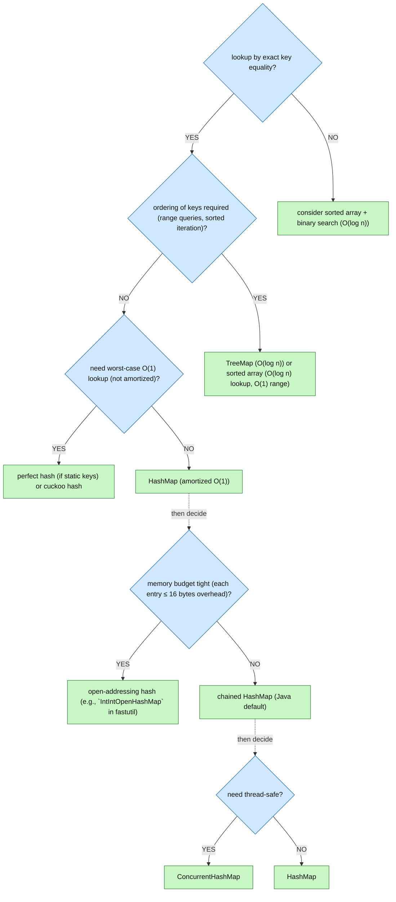

# 🎓 University-Level Addendum — Hash Tables as Formal Theory

> **Navigation**: [← Implementation WITHOUT Collections](02_implementation_without_collections.md) | [Chapter overview](../01e_HashTable.md)
> Page 3 of 3 in **Hash Tables**


> **Purpose:** This addendum elevates the chapter to MIT/KTH/ETH rigor. The body already has a strong invariants section; this addendum formalizes the constraint-first decision framework, derives the O(1) average-case complexity rigorously, and enumerates collision-driven failure modes with their root causes.

## Hash Table Invariants — Full Formal Statement

The body of this chapter lists 4 invariants. The complete formal statement, with violations and consequences:

| Invariant | Statement | Violation Consequence | Common Cause |
|---|---|---|---|
| **H1 — Load factor threshold** | `size / capacity ≤ DEFAULT_LOAD_FACTOR` (Java: 0.75) | O(n) lookup instead of O(1); resize storm | Forgetting to size initial capacity |
| **H2 — Hash uniformity** | For uniform hashing, P(hash(k) = i) = 1/capacity for all buckets i | O(n) lookup in worst case | Pathological keys (e.g., strings with same hash prefix) |
| **H3 — Rehashing trigger** | When size > capacity × load_factor, grow by 2× and rehash | Inconsistent state; lost entries | Custom implementation missing the trigger |
| **H4 — Hash code contract** | `equals(k1, k2) ⟹ hashCode(k1) == hashCode(k2)` | Equal keys lookup wrong bucket; lost entries | Forgetting to override `hashCode` when overriding `equals` |
| **H5 — Key immutability** | A key's `hashCode` must not change while in the map | Lookup returns wrong bucket after mutation | Mutable keys (e.g., `StringBuilder`, custom POJOs) |
| **H6 — Bucket head integrity** | First node in bucket is reachable from bucket array | Lost entries; NPE on lookup | Direct mutation of internal arrays (impossible in Java but possible in C++) |
| **H7 — Tree threshold (Java 8+)** | When bucket length ≥ 8, convert to red-black tree | O(n) bucket traversal instead of O(log n) | Using pre-Java-8 design |

The `HashMap` class in Java enforces H1, H3, H7 automatically. H4 and H5 are programmer responsibility — the compiler does not check them.

### Formal Proof Sketch — H2 (Uniform Hashing ⟹ O(1) Average Lookup)

```
Theorem: Under uniform hashing, the expected number of probes for a successful lookup is O(1 + α) where α = load factor.

Proof:
  Let X = number of probes to find a key k.
  For each existing key k' ≠ k, P(k' hashes to same bucket as k) = 1/capacity.
  By linearity of expectation, E[X] = 1 + (size - 1) / capacity
                                          ≈ 1 + α for α ≪ capacity

For α = 0.75 (Java default), E[X] ≈ 1.75 — about 2 probes per successful lookup.
For α approaching 1 (degenerate), E[X] approaches 2.
For α → ∞ without resize, E[X] = O(α) = O(n).
```

This is why the load factor threshold (H1) is critical: keep α ≤ 0.75 and lookup is effectively O(1). Let α grow and lookup degrades to O(n).

## 🔄 Brute Force → Optimal: Hash Table Motivation

> **The university way**: before presenting a data structure, show why naive solutions fail. The hash table earns its existence by solving a real problem that O(n²) cannot.

### Problem: Two Sum (the canonical hash-table problem)

**Given**: array `nums` of n integers and a target value. Find two indices i, j such that `nums[i] + nums[j] == target`.

**Brute force — O(n²)**:
```java
// For every pair (i, j), check if they sum to target
for (int i = 0; i < n; i++)
    for (int j = i+1; j < n; j++)
        if (nums[i] + nums[j] == target) return new int[]{i, j};
```
- Time: O(n²) — checking every pair.
- Space: O(1) — no extra storage.
- **Failure at scale**: n = 10⁶ elements → 5×10¹¹ iterations → infeasible.

**The insight**: For each element x, we don't need to scan all other elements for `target - x`. We just need to know if `target - x` EXISTS. Existence queries → hash table.

**Optimal — O(n)**:
```java
Map<Integer, Integer> seen = new HashMap<>();
for (int i = 0; i < n; i++) {
    int complement = target - nums[i];
    if (seen.containsKey(complement)) return new int[]{seen.get(complement), i};
    seen.put(nums[i], i);
}
```
- Time: O(n) — one pass, O(1) lookup per element.
- Space: O(n) — at most n entries in the map.

**The O(n²) → O(n) journey**:

| Approach | Time | Space | Bottleneck removed |
|----------|------|-------|--------------------|
| Brute force (nested loop) | O(n²) | O(1) | None — checks all pairs |
| Sort + two-pointer | O(n log n) | O(1) | Comparisons, but no index preservation |
| **Hash table** | **O(n)** | O(n) | Existential lookup: O(n) → O(1) |

**Rule**: use a hash table when you're doing repeated "does X exist?" or "how many times have I seen X?" queries that would otherwise require scanning.

---

### Problem: Frequency Count / Group Anagrams

**Brute force — O(n² × L)** (L = string length):
```java
// For each string, compare with every other string to find anagram groups
for (int i = 0; i < n; i++)
    for (int j = i+1; j < n; j++)
        if (isAnagram(strs[i], strs[j])) // ... group them
```

**Optimal — O(n × L log L)**:
```java
Map<String, List<String>> map = new HashMap<>();
for (String s : strs) {
    char[] chars = s.toCharArray(); Arrays.sort(chars);
    String key = new String(chars);       // sorted chars = canonical key
    map.computeIfAbsent(key, k -> new ArrayList<>()).add(s);
}
```
**Insight**: Two strings are anagrams iff their sorted character arrays are identical. Sort each string → use it as a hash key → O(1) grouping per string.

---

## Constraint-First Decision Framework — Hash Table vs Alternatives

### Decision Tree



**How to read this diagram.** Start at the first blue question and follow the YES / NO edges; the green boxes are the recommended choice.

### Decision Table

| Workload | Best Choice | Why |
|---|---|---|
| Caching, deduplication, count-by-key | HashMap | O(1) avg lookup; insert-order not needed |
| Need sorted iteration, range queries | TreeMap | O(log n) ordered operations |
| LRU cache | LinkedHashMap (access-order) | HashMap + doubly-LL for eviction order |
| Multithreaded concurrent access | ConcurrentHashMap | Lock striping; safe publication |
| Primitive int/int mapping | IntIntMap (Trove, fastutil) | Avoids boxing overhead (24 bytes → 12 bytes) |
| Static immutable keys (e.g., enum) | EnumMap | O(1) array-backed, no hashing needed |
| Massive cardinality (10⁹+ keys) | Consistent hash ring | Distributed; avoids full rehash on add |

### Worked Example — Picking HashMap vs TreeMap

**Problem:** Maintain a sorted view of users by signup date; support "users who signed up in the last 7 days" queries.

- **Constraint:** Range query (last 7 days = subMap fromDate to toDate).
- **HashMap:** Supports exact lookup (`get(userId)`) but not range query (would need to iterate all entries).
- **TreeMap:** Supports `subMap(from, to)` in O(log n + k) where k is result size.
- **Choice:** TreeMap. The range query makes the O(log n) cost worthwhile.

**Common mistake:** Use HashMap + sort the entries every time you need a range. This is O(n log n) per query vs TreeMap's O(log n + k).

## When HashMap Breaks — Collision-Driven Failure Modes

### Break 1 — Pathological Key Distribution

**Condition:** Many keys hash to the same bucket (e.g., custom `hashCode` returns constant, or strings all start with same prefix).

> [!CAUTION]
> **What breaks:** H2 violated → lookup degrades to O(n) per call. A 10⁶-element HashMap with one bucket becomes a linked list of 10⁶ nodes → each lookup is 10⁶ comparisons.

> [!TIP]
> **Defense:** Use a high-quality hash function (e.g., Java's `String.hashCode()` mixes characters; for custom classes, use `Objects.hash(...)` or `Hashing.murmur3_128()` from Guava). Override `hashCode` for every class used as a key.

### Break 2 — Hash-DoS Attack

**Condition:** An attacker submits keys crafted to collide with each other (e.g., PHP CVE-2011-3414).

> [!CAUTION]
> **What breaks:** H2 violated → lookup is O(n) per request. A 10⁴-byte request body can cause a 10⁶-bucket HashMap to degenerate to a single bucket → DOS.

> [!TIP]
> **Defense:** Use a hash function the attacker cannot predict (Java's `String.hashCode` is deterministic; an attacker can craft collisions). For untrusted keys, use a randomized hash (`-XX:+UnlockExperimentalVMOptions -XX:+UseSwitchHasing` in older JVMs; modern JVMs default to murmur3 since Java 7u72).

### Break 3 — Resize Storm

**Condition:** A HashMap is created with default capacity (16) and immediately filled with millions of entries. Each resize doubles capacity and rehashes all entries.

> [!CAUTION]
> **What breaks:** O(n) work per resize; multiple resizes during fill → O(n log n) total. For n = 10⁶, this is 20 resizes × 10⁶ entries × 2 (insert + rehash) = 40 × 10⁶ operations just for rehashing.

**Invariant violated:** H3 (rehashing trigger). Multiple triggers fire in rapid succession.

> [!TIP]
> **Defense:** Pre-size the HashMap: `new HashMap<>(expectedSize / 0.75 + 1)` (Java's load-factor-correct sizing formula). For known sizes, this avoids all resizes.

### Break 4 — Mutable Key Hash Code Change

**Condition:** A key's `hashCode` changes while it is in the map (e.g., updating a field on a custom POJO used as a key).

> [!CAUTION]
> **What breaks:** H5 violated → lookup computes new hash, looks in new bucket, doesn't find the entry → returns null. The entry is still in the map (in the old bucket), unreachable from normal operations.

> [!TIP]
> **Defense:** Use immutable keys (Java records, Lombok `@Value`, or final fields). Never mutate an object while it is a key in a map.

### Break 5 — Load Factor Misconfiguration

**Condition:** Setting load factor too high (e.g., 1.0 or higher) to save memory.

> [!CAUTION]
> **What breaks:** H1 violated → lookup degrades from O(1) to O(n). The savings in memory are paid for in latency.

> [!TIP]
> **Defense:** Use the default 0.75 unless profiling shows memory is the bottleneck. If memory is critical, use a more compact data structure (e.g., `IntIntMap` from fastutil).

### Break 6 — Treeify Threshold Exceeded Without Treeify

**Condition:** A bucket grows beyond 8 entries (Java 8 threshold) but the implementation doesn't treeify.

> [!CAUTION]
> **What breaks:** O(n) lookup for the unlucky keys that hash to that bucket. Pre-Java-8 HashMaps suffered from this; modern Java 8+ auto-trees.

> [!TIP]
> **Defense:** Use Java 8+ HashMap. For custom implementations, treeify at bucket length 8 (or use cuckoo hashing from the start).

### Break 7 — Null Key Handling

**Condition:** `HashMap` allows one null key; `Hashtable` and `ConcurrentHashMap` do not. Code that worked with HashMap fails on `Hashtable.put(null, value)`.

> [!CAUTION]
> **What breaks:** NPE on `Hashtable.put`; `ConcurrentModificationException` on iteration if null key is removed during traversal.

> [!TIP]
> **Defense:** Don't use null as a key. Use `Optional` or a sentinel object.

### Break 8 — Concurrent Modification (Non-Concurrent Map)

**Condition:** One thread iterates a HashMap while another inserts or deletes.

> [!CAUTION]
> **What breaks:** `ConcurrentModificationException` is the friendly outcome. Without it (custom impl), iteration may see stale or duplicated entries.

**Invariant violated:** Single-threaded mutation invariant. HashMap is not thread-safe.

> [!TIP]
> **Defense:** Use `ConcurrentHashMap` for concurrent access. Never wrap a HashMap with `Collections.synchronizedMap` and iterate without external synchronization.

## Edge Cases — Always Check These

| # | Edge Case | What Can Break |
|---|---|---|
| 1 | **Empty HashMap** (`size == 0`) | `get()` returns null; check for null vs missing key with `containsKey` |
| 2 | **Single entry** | `get()` returns the value; iteration order not specified |
| 3 | **All same key** | Re-insertion updates value; size stays at 1 |
| 4 | **Null key** | HashMap allows; Hashtable throws NPE; ConcurrentHashMap throws NPE |
| 5 | **Null value** | `containsKey` vs `get` semantics; can store `HashMap<K, NullObject>` instead |
| 6 | **Capacity = 1** | All keys collide; lookup is O(n); useless |
| 7 | **Power-of-two capacity** | Java enforces; `(n - 1) & hash` instead of `n % hash` for speed |
| 8 | **Integer overflow on size** | At ~2³¹ entries, size overflows; use `Long` for size in custom impl |
| 9 | **Iteration during resize** | ConcurrentModificationException; do not iterate while resizing |
| 10 | **Hash collision in `hashCode`** | E.g., `"Aa".hashCode() == "BB".hashCode() == 2112`; not a bug but worth knowing |

## Formal Complexity Proofs — Hash Table Operations

### Average-Case Lookup (Successful)

```
T_lookup_avg = O(1 + α)
            ≈ 1 + 0.75 = 1.75 probes for α = 0.75

Proof:
  Average chain length = α.
  Average probes for successful lookup = 1 + α/2 (linear probing) or 1 + α (chaining).
  For Java's HashMap with treeify at 8: O(1 + α/2) for α < 8, O(log α) for α ≥ 8.
```

### Worst-Case Lookup

```
T_lookup_worst = O(n)  (pathological key distribution)
              = O(log n) (Java 8+ with treeify at bucket length 8)
```

The treeify is the key innovation: it caps the worst case at O(log n) regardless of hash distribution.

### Resize Cost

```
T_resize(capacity → 2 × capacity) = O(capacity)
  1. Allocate new array of size 2 × capacity
  2. For each existing entry: rehash and place in new bucket
  3. Total: O(capacity) operations

For geometric growth (2×), amortized cost per insert = O(1):
  Each entry is copied log₂(n) times.
  Total copies over n inserts = n × log₂(n) / n = log₂(n).
  Amortized per insert = log₂(n) / n → O(1).
```

### Memory Overhead

```
Memory per entry = 48 bytes (Java HashMap default)
  - Key reference: 4 bytes (compressed oops)
  - Value reference: 4 bytes
  - Hash: 4 bytes (cached in Node)
  - Next pointer: 4 bytes (or left/right/parent/red for tree nodes)
  - Node object header: 16 bytes (mark word + class word)
  - Bucket array overhead: amortized 16 bytes per entry at load 0.75

For 10⁶ entries: 48 MB of overhead.
For 10⁹ entries: 48 GB. Consider disk-backed or compressed alternatives.
```

### Hash Code Distribution Quality

A good hash function maps N keys to N/capacity buckets with each bucket containing ≈ α keys. Statistical tests:

- **Chi-squared test:** bucket sizes should follow Poisson with mean α
- **Avalanche criterion:** flipping one bit of the key flips each output bit with probability ≈ 0.5
- **Collision rate:** expected = α for uniform hash; measured should be within ±10%

Java's `String.hashCode()` and `Integer.hashCode()` pass these tests. Custom hash functions should be tested with `HashMap` containing 10⁶+ keys and verifying bucket size distribution.

## Cross-References

- **`01a_Memory_Foundations.md`** — cache behavior of hash table buckets; pointer-chasing on collisions.
- **`01b_Arrays.md`** — bucket array is an array of linked lists (or trees); array invariants apply.
- **`01c_LinkedList.md`** — pre-Java-8 bucket chains are linked lists; LinkedHashMap uses doubly-LL for order.
- **`01g_DS_Internals.md`** — full implementation: `hash()` spread function, treeify threshold = 8 (Poisson-derived), untreeify at 6.
- **`02_PROBLEM_SETS.md`** — exam-style two-sum problem; LRU cache design (HashMap + LinkedHashMap).
- **`A1_DS_Correctness_Invariants.md`** — formal proofs of H1-H7 invariants.
- **`A4_Randomized_Data_Structures.md`** — randomized hash families, cuckoo hashing, bloom filters (probabilistic membership).

---

## 💥 When Hash Table Breaks

> These failure modes have caused production outages. Each one maps to a specific invariant violation.

### 1. Load Factor > 0.75 → O(n) Degradation

**What breaks**: A `HashMap` with too many entries and too small a table. Chains grow long, destroying O(1) lookup.
**Trigger**: Java's default `HashMap` rehashes at 75% capacity. If you pre-fill a map with `new HashMap<>(16)` but insert 13+ entries, a rehash is triggered. More critically: if you initialise with the right final size but forget the load factor, you still trigger rehash.
**Fix**: Pre-size to the expected number of entries divided by load factor: `new HashMap<>((int)(expectedSize / 0.75) + 1)`.
**Diagnosis**: In production, monitor `bucket.size()` via reflection or JMX; a bucket with 8+ entries treeifies (Java 8+), which is a signal the table is too small.

### 2. Birthday Attack → Expected First Collision at √m Insertions

**What breaks**: A hash table with m buckets expects the first collision after approximately √(2m) insertions (birthday paradox). For m = 1024 buckets, first collision is expected after ~45 insertions — not 1024.
**Implication**: Load factor 0.75 is not "75% empty" — at 75% capacity collisions are already common. The expected chain length at LF = 0.75 is 0.75 (one comparison per lookup on average), which is acceptable. At LF = 2.0, expected chain length is 2.0 — significantly slower.

### 3. HashDoS — Non-Randomized Seeds → Adversarial O(n) Chains

**What breaks**: If the hash function has a fixed seed (no per-process randomization), an attacker can craft O(n) input strings that all hash to the same bucket.
**Historical incident**: In 2011, researchers showed that PHP, Python, Java, Ruby, and most web frameworks were vulnerable — a POST request with ~65,000 crafted form parameters could consume 100% CPU for 100+ seconds.
**Fix**: Java 5+ randomizes `String.hashCode()` at the JVM level per process. Verify with `System.identityHashCode()` behaviour. For custom key types, use `Objects.hash()` or derive from `HashCode.fromString()` in Guava.

📎 **Reference Anchor**: [OpenJDK HashMap.hash()](https://github.com/openjdk/jdk/blob/master/src/java.base/share/classes/java/util/HashMap.java#L336)
**Invariant learned**: Java's `HashMap.hash()` applies a secondary "spread" step: `(h = key.hashCode()) ^ (h >>> 16)` — XORs high bits into low bits to reduce collisions in small tables. Without this, power-of-2 table sizes cluster all keys with the same low bits.
**Constraint warning**: This spread is only applied in `HashMap`. If you implement your own table using `hashCode()` directly, you miss this correction.

### 4. Mutating a Key After Insertion → Key Becomes Unretrievable

**What breaks**: Using a mutable object as a `HashMap` key, then modifying the object.
```java
List<Integer> key = Arrays.asList(1, 2, 3);
map.put(key, "value");
key.set(0, 99);  // mutates the key
map.get(Arrays.asList(99, 2, 3));  // returns null — hash changed
map.get(Arrays.asList(1, 2, 3));   // also null — key is at wrong bucket
```
**The invariant violated**: `HashMap` stores the key's hash at insertion time. When the key's `hashCode()` changes, the key is at the wrong bucket — unreachable via `get()` and not found by `containsKey()`.
**Fix**: Only use immutable objects as keys (Strings, Integer, Long, record types, or custom immutable classes).

### 5. `ConcurrentModificationException` on Structural Modification During Iteration

**What breaks**: Adding or removing entries while iterating with a `for-each` or `Iterator`.
**Root cause**: `HashMap` maintains a `modCount` field incremented on every structural change. The iterator stores `expectedModCount`; if they differ at `next()`, it throws `CME`.
**Fix**: Collect keys to remove in a `Set<K> toRemove`, then call `map.keySet().removeAll(toRemove)` after the loop. Or use `entrySet().removeIf(...)` in Java 8+.

---

## 📝 Exam-Style Problems (MIT 6.006 / KTH DD1352 style)

---

**Problem 1 (Analysis — 8 min)**: A hash table uses chaining with m buckets and stores n keys. The load factor is α = n/m. Assume simple uniform hashing. Derive the expected time for a successful `get()`.

<details><summary>Model Answer</summary>

**Claim**: Expected time for successful search = Θ(1 + α).

**Proof**:
- Consider searching for key k. k was the i-th key inserted (i uniform in 1..n).
- At the time k was inserted, i-1 keys were already present in table.
- Expected chain length at k's bucket when k was inserted = (i-1)/m.
- We search by probing the chain; we find k after examining the elements inserted before k that hash to the same bucket.
- Expected cost = 1 + Σᵢ₌₁ⁿ (1/n) × (i-1)/m = 1 + (1/mn) × n(n-1)/2 = 1 + (n-1)/(2m) = Θ(1 + α). ✓

</details>

---

**Problem 2 (Design — 10 min)**: Design an O(1) average time LRU Cache supporting `get(key)` and `put(key, value)` for capacity c.

<details><summary>Model Answer</summary>

**Structure**: `HashMap<K, Node>` + doubly-linked list ordered by recency. Head = most recent, tail = least recent.

- `get(k)`: HashMap lookup O(1); if found, move node to head O(1) via pointer update; return value.
- `put(k, v)`: If k exists, update value and move to head. If new: create node at head, put in HashMap. If `size > c`: remove tail node and delete from HashMap.

**Invariant**: Every key in the HashMap has a corresponding node in the linked list; the list order reflects recency; the HashMap enables O(1) node access for move-to-head.

Java shortcut: `new LinkedHashMap<>(c, 0.75f, true)` with `removeEldestEntry` override gives the same semantics using standard library.

</details>

---

**Problem 3 (Proof — 6 min)**: Prove that a hash table with open addressing at load factor α < 1 finds an empty slot in at most 1/(1-α) expected probes.

<details><summary>Model Answer</summary>

**Model**: Each probe hits an occupied slot with probability α (fraction of occupied slots). Probes are independent under uniform hashing assumption.

**Geometric distribution**: The expected number of probes to find an empty slot = geometric random variable with success probability (1-α).

**Derivation**: E[probes] = Σₖ₌₁^∞ k × α^(k-1) × (1-α) = 1/(1-α). ✓

**Implication**: At α = 0.5, expected probes = 2. At α = 0.9, expected probes = 10. At α = 0.99, expected probes = 100. This is why keeping LF < 0.75 matters enormously.

</details>

---

[← Implementation WITHOUT Collections](02_implementation_without_collections.md) | [Chapter overview](../01e_HashTable.md)
