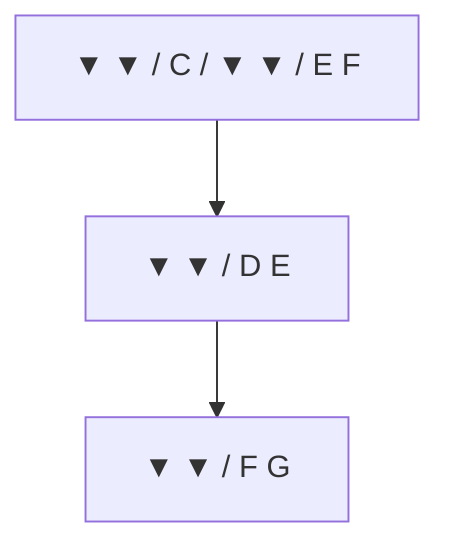
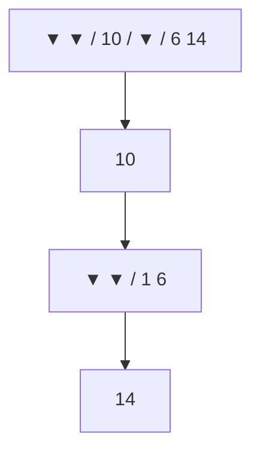
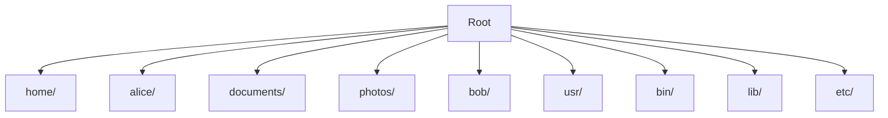
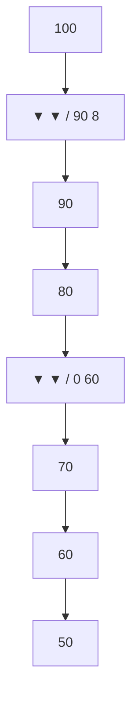

> **Navigation**: [< Previous Chapter](01e_HashTable.md) | [Back to Index](../00_MASTER_INDEX.md) | [Next Chapter >](01g_DS_Internals.md)

---

# 🌳 Part 7: Trees

## PART 0: COMPLETE UNDERSTANDING — The WHY Before the WHAT

### Why Trees Matter — The Hierarchy Problem

Arrays and linked lists are **linear** — they model sequences. But the real world is full of **hierarchical relationships**: file systems, organization charts, family trees, HTML/DOM, abstract syntax trees in compilers. A tree naturally represents "parent-child" relationships where one entity contains or manages multiple sub-entities.

#### Why BSTs Give O(log n) — The Power of Halving

A BST's invariant (`left < root < right`) is powerful because at each node, you eliminate **half the remaining candidates**. Starting at the root, one comparison tells you which subtree to explore — you never look at the other. With n nodes in a balanced BST, the height is log₂(n), so search takes at most log₂(n) comparisons.

**But this only works if the tree is balanced.** An unbalanced BST (imagine inserting 1, 2, 3, 4, 5 in order) degenerates into a linked list with O(n) height. This is why self-balancing trees (AVL, Red-Black) exist — they guarantee the height stays O(log n) after every insertion/deletion.

#### Why Heaps Store as Arrays — The Complete Binary Tree Trick

A heap is a **complete binary tree** — every level is full except possibly the last, which fills left-to-right. This structure maps perfectly to an array using index arithmetic:
- Parent of node `i`: `(i-1)/2`
- Left child: `2*i + 1`
- Right child: `2*i + 2`

No pointers needed! This makes heaps extremely cache-friendly (contiguous memory) and space-efficient compared to pointer-based trees. The heap property (min or max at root) ensures O(1) access to the extreme element, while bubbling up/down takes O(log n) — the height of a complete binary tree with n elements.

#### When to Use Each Tree Variant

| Structure | Search | Insert | Use When |
|-----------|--------|--------|----------|
| BST (unbalanced) | O(n) worst | O(n) worst | Teaching, not production |
| BST (balanced: AVL/RB) | O(log n) | O(log n) | Sorted data with frequent access |
| Heap / PriorityQueue | O(n) | O(log n) | Need min/max quickly |
| Trie | O(m) key length | O(m) | Prefix-based string operations |

---

## 🧬 Nature & Behavior

### What is a Tree?

```
HIERARCHICAL STRUCTURE:
┌────────────────────────────────────────────────────┐
│                                                    │
│              ┌───┐                                 │
│              │ A │  ← Root                         │
│              └─┬─┘                                 │
│         ┌─────┴─────┐                              │
│         ▼           ▼                              │
│      ┌───┐       ┌───┐                             │
│      │ B │       │ C │  ← Children of A            │
│      └─┬─┘       └─┬─┘                             │
│     ┌──┴──┐     ┌──┴──┐                            │
│     ▼     ▼     ▼     ▼                            │
│   ┌───┐ ┌───┐ ┌───┐ ┌───┐                          │
│   │ D │ │ E │ │ F │ │ G │  ← Leaves                │
│   └───┘ └───┘ └───┘ └───┘                          │
│                                                    │
│ Properties:                                        │
│ - One root node                                    │
│ - Each node has 0+ children                        │
│ - No cycles                                        │
│ - One path from root to any node                   │
│                                                    │
└────────────────────────────────────────────────────┘
```

> **Flow**: ▼ ▼ / C / ▼ ▼ / E F → ▼ ▼ / D E | ▼ ▼ / D E → ▼ ▼ / F G



### Binary Search Tree (BST)

```
BST PROPERTY:
- Left subtree: all values < node
- Right subtree: all values > node

          ┌───┐
          │ 8 │
          └─┬─┘
      ┌────┴────┐
      ▼         ▼
   ┌───┐     ┌───┐
   │ 3 │     │10 │
   └─┬─┘     └─┬─┘
  ┌──┴──┐     └──┐
  ▼     ▼        ▼
┌───┐ ┌───┐   ┌───┐
│ 1 │ │ 6 │   │14 │
└───┘ └───┘   └───┘

Search for 6:
8 → 6 < 8 → go left
3 → 6 > 3 → go right
6 → FOUND!

Time: O(log n) for balanced tree
```

> **Flow**: ▼ ▼ / 10 / ▼ / 6 14 → 10 | 10 → ▼ ▼ / 1 6 | ▼ ▼ / 1 6 → 14



### 🔴 Real-World Origin: File Systems (1965)

**Problem (UNIX, 1969):** Computers need to organize thousands of files with hierarchical structure (folders in folders) and fast file lookup.

**Solution — Tree Structure:**
```
/
├── home/
│   ├── alice/
│   │   ├── documents/
│   │   └── photos/
│   └── bob/
├── usr/
│   ├── bin/
│   └── lib/
└── etc/
```

> **Flow**: Root → home/ | Root → alice/ | Root → documents/ | Root → photos/ | Root → bob/ | Root → usr/ | ...+3 more



**Why Tree?** Natural hierarchy (parent-child), path from root to any file, easy to navigate (`cd`, `ls` commands).

> ✅ **Impact:** Every OS uses trees for files, every URL is a tree path, every org chart is a tree, every family tree is... a tree!

## 💻 Implementation WITHOUT Collections

```java
public class MyBinaryTree {

    private class TreeNode {
        int value;
        TreeNode left;
        TreeNode right;

        TreeNode(int value) {
            this.value = value;
        }
    }

    private TreeNode root;

    // INSERT (BST) - O(log n) average
    public void insert(int value) {
        root = insertRecursive(root, value);
    }

    private TreeNode insertRecursive(TreeNode node, int value) {
        if (node == null) {
            return new TreeNode(value);
        }

        if (value < node.value) {
            node.left = insertRecursive(node.left, value);
        } else if (value > node.value) {
            node.right = insertRecursive(node.right, value);
        }

        return node;
    }

    // SEARCH - O(log n) average
    public boolean search(int value) {
        return searchRecursive(root, value);
    }

    private boolean searchRecursive(TreeNode node, int value) {
        if (node == null) return false;
        if (node.value == value) return true;

        if (value < node.value) {
            return searchRecursive(node.left, value);
        } else {
            return searchRecursive(node.right, value);
        }
    }

    // INORDER TRAVERSAL (Left, Root, Right) - Gives sorted order!
    public void inorder() {
        inorderRecursive(root);
    }

    private void inorderRecursive(TreeNode node) {
        if (node == null) return;
        inorderRecursive(node.left);
        System.out.print(node.value + " ");
        inorderRecursive(node.right);
    }

    // PREORDER TRAVERSAL (Root, Left, Right)
    public void preorder() {
        preorderRecursive(root);
    }

    private void preorderRecursive(TreeNode node) {
        if (node == null) return;
        System.out.print(node.value + " ");
        preorderRecursive(node.left);
        preorderRecursive(node.right);
    }

    // POSTORDER TRAVERSAL (Left, Right, Root)
    public void postorder() {
        postorderRecursive(root);
    }

    private void postorderRecursive(TreeNode node) {
        if (node == null) return;
        postorderRecursive(node.left);
        postorderRecursive(node.right);
        System.out.print(node.value + " ");
    }

    // HEIGHT - O(n)
    public int height() {
        return heightRecursive(root);
    }

    private int heightRecursive(TreeNode node) {
        if (node == null) return 0;
        int leftHeight = heightRecursive(node.left);
        int rightHeight = heightRecursive(node.right);
        return 1 + Math.max(leftHeight, rightHeight);
    }

    // DELETE - O(log n) average
    public void delete(int value) {
        root = deleteRecursive(root, value);
    }

    private TreeNode deleteRecursive(TreeNode node, int value) {
        if (node == null) return null;

        if (value < node.value) {
            node.left = deleteRecursive(node.left, value);
        } else if (value > node.value) {
            node.right = deleteRecursive(node.right, value);
        } else {
            // Found node to delete

            // Case 1: Leaf node
            if (node.left == null && node.right == null) {
                return null;
            }

            // Case 2: One child
            if (node.left == null) return node.right;
            if (node.right == null) return node.left;

            // Case 3: Two children
            // Find inorder successor (smallest in right subtree)
            TreeNode successor = findMin(node.right);
            node.value = successor.value;
            node.right = deleteRecursive(node.right, successor.value);
        }

        return node;
    }

    private TreeNode findMin(TreeNode node) {
        while (node.left != null) {
            node = node.left;
        }
        return node;
    }
}
```

---

# 📦 Part 8: Heaps (priority Queue)

## 🧬 Nature & Behavior

### What is a Heap?

```
HEAP = Complete Binary Tree with Heap Property

MAX HEAP: Parent ≥ Children
          ┌───┐
          │100│
          └─┬─┘
       ┌───┴───┐
       ▼       ▼
     ┌───┐   ┌───┐
     │ 90│   │ 80│
     └─┬─┘   └─┬─┘
    ┌──┴──┐  ┌─┘
    ▼     ▼  ▼
  ┌───┐┌───┐┌───┐
  │70 ││60 ││50 │
  └───┘└───┘└───┘

MIN HEAP: Parent ≤ Children
(Root is smallest)

STORED AS ARRAY (Level order):
[100, 90, 80, 70, 60, 50]
  0   1   2   3   4   5

Parent of i: (i-1)/2
Left child of i: 2*i + 1
Right child of i: 2*i + 2
```

> **Flow**: 100 → ▼ ▼ / 90 8 | ▼ ▼ / 90 8 → 90 | 90 → 80 | 80 → ▼ ▼ / 0 60 | ▼ ▼ / 0 60 → 70 | 70 → 60 | ...+1 more



### 🔴 Real-World Origin: Emergency Room Triage (1970s)

**Problem in Hospitals:** Patients arrive randomly — some critical, some minor. Need to treat the most urgent first, **NOT** first-come-first-served!

**Without Priority Queue:** Check all patients to find most urgent → **O(n)** for each decision. Lives lost due to delay!

**With Heap (Priority Queue):**

| Operation | Time |
|-----------|------|
| Insert patient with priority | O(log n) |
| Get most urgent | **O(1)** |
| Remove most urgent | O(log n) |

**Example:**
```
Patient arrives: priority 5 (medium)
Patient arrives: priority 9 (critical)
Patient arrives: priority 3 (minor)

Heap: [9, 5, 3]
Next to treat: 9 (critical) - O(1)!
```

> ✅ **Now used in:** OS process scheduling, network packet prioritization, Dijkstra's shortest path, event-driven simulations

## 💻 Implementation WITHOUT Collections

```java
public class MyMinHeap {
    private int[] heap;
    private int size;
    private int capacity;

    public MyMinHeap(int capacity) {
        this.capacity = capacity;
        this.heap = new int[capacity];
        this.size = 0;
    }

    // PARENT INDEX
    private int parent(int i) { return (i - 1) / 2; }

    // LEFT CHILD INDEX
    private int leftChild(int i) { return 2 * i + 1; }

    // RIGHT CHILD INDEX
    private int rightChild(int i) { return 2 * i + 2; }

    // SWAP
    private void swap(int i, int j) {
        int temp = heap[i];
        heap[i] = heap[j];
        heap[j] = temp;
    }

    // INSERT - O(log n)
    public void insert(int value) {
        if (size == capacity) {
            throw new RuntimeException("Heap is full!");
        }

        // Add at end
        heap[size] = value;
        int current = size;
        size++;

        // Bubble up
        while (current > 0 && heap[current] < heap[parent(current)]) {
            swap(current, parent(current));
            current = parent(current);
        }
    }

    // PEEK (Get min) - O(1)
    public int peek() {
        if (size == 0) throw new RuntimeException("Heap is empty!");
        return heap[0];
    }

    // EXTRACT MIN - O(log n)
    public int extractMin() {
        if (size == 0) throw new RuntimeException("Heap is empty!");

        int min = heap[0];

        // Move last element to root
        heap[0] = heap[size - 1];
        size--;

        // Bubble down
        heapifyDown(0);

        return min;
    }

    // HEAPIFY DOWN
    private void heapifyDown(int i) {
        int smallest = i;
        int left = leftChild(i);
        int right = rightChild(i);

        if (left < size && heap[left] < heap[smallest]) {
            smallest = left;
        }

        if (right < size && heap[right] < heap[smallest]) {
            smallest = right;
        }

        if (smallest != i) {
            swap(i, smallest);
            heapifyDown(smallest);
        }
    }

    // BUILD HEAP from array - O(n)
    public void buildHeap(int[] arr) {
        size = arr.length;
        heap = arr.clone();

        // Start from last non-leaf node
        for (int i = size / 2 - 1; i >= 0; i--) {
            heapifyDown(i);
        }
    }

    public int size() {
        return size;
    }

    public boolean isEmpty() {
        return size == 0;
    }
}
```

---

> **Navigation**: [< Previous](01e_HashTable.md) | [Back to Index](../00_MASTER_INDEX.md) | [Next >](01g_DS_Internals.md)