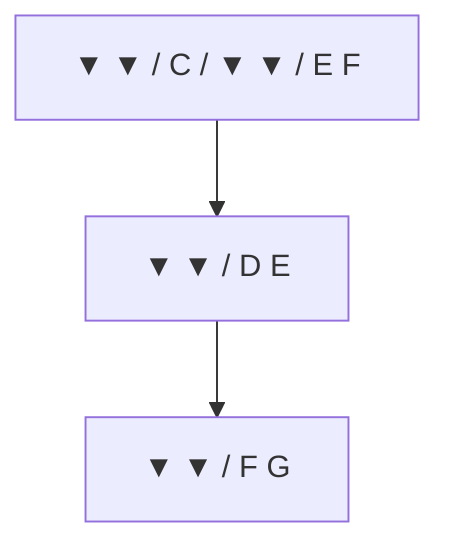
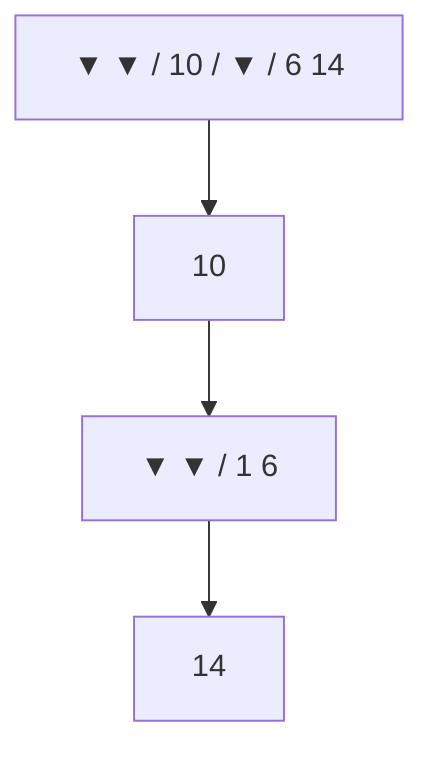
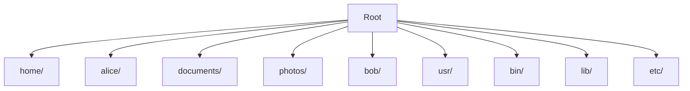
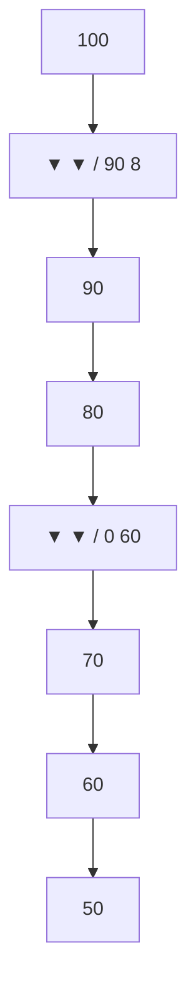

> **Navigation**: [< Previous Chapter](01e_HashTable.md) | [Back to Index](../00_MASTER_INDEX.md) | [Next Chapter >](01g_DS_Internals.md)

---

# 🌳 Part 7: Trees

## PART 0: COMPLETE UNDERSTANDING — The WHY Before the WHAT

### Why Trees Matter — The Hierarchy Problem

Arrays and linked lists are **linear** — they model sequences. But the real world is full of **hierarchical relationships**: file systems, organization charts, family trees, HTML/DOM, abstract syntax trees in compilers. A tree naturally represents "parent-child" relationships where one entity contains or manages multiple sub-entities.

#### Why BSTs Give O(log n) — The Power of Halving

A BST's invariant (`left < root < right`) is powerful because at each node, you eliminate **half the remaining candidates**. Starting at the root, one comparison tells you which subtree to explore — you never look at the other. With n nodes in a balanced BST, the height is log₂(n), so search takes at most log₂(n) comparisons.

**But this only works if the tree is balanced.** An unbalanced BST (imagine inserting 1, 2, 3, 4, 5 in order) degenerates into a linked list with O(n) height. This is why self-balancing trees (AVL, Red-Black) exist — they guarantee the height stays O(log n) after every insertion/deletion.

#### Why Heaps Store as Arrays — The Complete Binary Tree Trick

A heap is a **complete binary tree** — every level is full except possibly the last, which fills left-to-right. This structure maps perfectly to an array using index arithmetic:
- Parent of node `i`: `(i-1)/2`
- Left child: `2*i + 1`
- Right child: `2*i + 2`

No pointers needed! This makes heaps extremely cache-friendly (contiguous memory) and space-efficient compared to pointer-based trees. The heap property (min or max at root) ensures O(1) access to the extreme element, while bubbling up/down takes O(log n) — the height of a complete binary tree with n elements.

#### When to Use Each Tree Variant

| Structure | Search | Insert | Use When |
|-----------|--------|--------|----------|
| BST (unbalanced) | O(n) worst | O(n) worst | Teaching, not production |
| BST (balanced: AVL/RB) | O(log n) | O(log n) | Sorted data with frequent access |
| Heap / PriorityQueue | O(n) | O(log n) | Need min/max quickly |
| Trie | O(m) key length | O(m) | Prefix-based string operations |

---


> 🔬 **Section Challenge — PART 0: COMPLETE UNDERSTANDING — The WHY Before the WHAT**

## 🧬 Nature & Behavior

### What is a Tree?

```
HIERARCHICAL STRUCTURE:
┌────────────────────────────────────────────────────┐
│                                                    │
│              ┌───┐                                 │
│              │ A │  ← Root                         │
│              └─┬─┘                                 │
│         ┌─────┴─────┐                              │
│         ▼           ▼                              │
│      ┌───┐       ┌───┐                             │
│      │ B │       │ C │  ← Children of A            │
│      └─┬─┘       └─┬─┘                             │
│     ┌──┴──┐     ┌──┴──┐                            │
│     ▼     ▼     ▼     ▼                            │
│   ┌───┐ ┌───┐ ┌───┐ ┌───┐                          │
│   │ D │ │ E │ │ F │ │ G │  ← Leaves                │
│   └───┘ └───┘ └───┘ └───┘                          │
│                                                    │
│ Properties:                                        │
│ - One root node                                    │
│ - Each node has 0+ children                        │
│ - No cycles                                        │
│ - One path from root to any node                   │
│                                                    │
└────────────────────────────────────────────────────┘
```

**Flow:**
1. ▼ ▼ / C / ▼ ▼ / E F
2. ▼ ▼ / D E
3. ▼ ▼ / F G



### Binary Search Tree (BST)

```
BST PROPERTY:
- Left subtree: all values < node
- Right subtree: all values > node

          ┌───┐
          │ 8 │
          └─┬─┘
      ┌────┴────┐
      ▼         ▼
   ┌───┐     ┌───┐
   │ 3 │     │10 │
   └─┬─┘     └─┬─┘
  ┌──┴──┐     └──┐
  ▼     ▼        ▼
┌───┐ ┌───┐   ┌───┐
│ 1 │ │ 6 │   │14 │
└───┘ └───┘   └───┘

Search for 6:
8 → 6 < 8 → go left
3 → 6 > 3 → go right
6 → FOUND!

Time: O(log n) for balanced tree
```

**Flow:**
1. ▼ ▼ / 10 / ▼ / 6 14 10
2. ▼ ▼ / 1 6 14



### 🔴 Real-World Origin: File Systems (1965)

**Problem (UNIX, 1969):** Computers need to organize thousands of files with hierarchical structure (folders in folders) and fast file lookup.

**Solution — Tree Structure:**
```
/
├── home/
│   ├── alice/
│   │   ├── documents/
│   │   └── photos/
│   └── bob/
├── usr/
│   ├── bin/
│   └── lib/
└── etc/
```

**Flow:**
1. Root home/
2. Root alice/
3. Root documents/
4. Root photos/
5. Root bob/
6. Root usr/



**Why Tree?** Natural hierarchy (parent-child), path from root to any file, easy to navigate (`cd`, `ls` commands).

> ✅ **Impact:** Every OS uses trees for files, every URL is a tree path, every org chart is a tree, every family tree is... a tree!

## 💻 Implementation WITHOUT Collections

```java
public class MyBinaryTree {

    private class TreeNode {
        int value;
        TreeNode left;
        TreeNode right;

        TreeNode(int value) {
            this.value = value;
        }
    }

    private TreeNode root;

    // INSERT (BST) - O(log n) average
    public void insert(int value) {
        root = insertRecursive(root, value);
    }

    private TreeNode insertRecursive(TreeNode node, int value) {
        if (node == null) {
            return new TreeNode(value);
        }

        if (value < node.value) {
            node.left = insertRecursive(node.left, value);
        } else if (value > node.value) {
            node.right = insertRecursive(node.right, value);
        }

        return node;
    }

    // SEARCH - O(log n) average
    public boolean search(int value) {
        return searchRecursive(root, value);
    }

    private boolean searchRecursive(TreeNode node, int value) {
        if (node == null) return false;
        if (node.value == value) return true;

        if (value < node.value) {
            return searchRecursive(node.left, value);
        } else {
            return searchRecursive(node.right, value);
        }
    }

    // INORDER TRAVERSAL (Left, Root, Right) - Gives sorted order!
    public void inorder() {
        inorderRecursive(root);
    }

    private void inorderRecursive(TreeNode node) {
        if (node == null) return;
        inorderRecursive(node.left);
        System.out.print(node.value + " ");
        inorderRecursive(node.right);
    }

    // PREORDER TRAVERSAL (Root, Left, Right)
    public void preorder() {
        preorderRecursive(root);
    }

    private void preorderRecursive(TreeNode node) {
        if (node == null) return;
        System.out.print(node.value + " ");
        preorderRecursive(node.left);
        preorderRecursive(node.right);
    }

    // POSTORDER TRAVERSAL (Left, Right, Root)
    public void postorder() {
        postorderRecursive(root);
    }

    private void postorderRecursive(TreeNode node) {
        if (node == null) return;
        postorderRecursive(node.left);
        postorderRecursive(node.right);
        System.out.print(node.value + " ");
    }

    // HEIGHT - O(n)
    public int height() {
        return heightRecursive(root);
    }

    private int heightRecursive(TreeNode node) {
        if (node == null) return 0;
        int leftHeight = heightRecursive(node.left);
        int rightHeight = heightRecursive(node.right);
        return 1 + Math.max(leftHeight, rightHeight);
    }

    // DELETE - O(log n) average
    public void delete(int value) {
        root = deleteRecursive(root, value);
    }

    private TreeNode deleteRecursive(TreeNode node, int value) {
        if (node == null) return null;

        if (value < node.value) {
            node.left = deleteRecursive(node.left, value);
        } else if (value > node.value) {
            node.right = deleteRecursive(node.right, value);
        } else {
            // Found node to delete

            // Case 1: Leaf node
            if (node.left == null && node.right == null) {
                return null;
            }

            // Case 2: One child
            if (node.left == null) return node.right;
            if (node.right == null) return node.left;

            // Case 3: Two children
            // Find inorder successor (smallest in right subtree)
            TreeNode successor = findMin(node.right);
            node.value = successor.value;
            node.right = deleteRecursive(node.right, successor.value);
        }

        return node;
    }

    private TreeNode findMin(TreeNode node) {
        while (node.left != null) {
            node = node.left;
        }
        return node;
    }
}
```

---

# 📦 Part 8: Heaps (priority Queue)

## 🧬 Nature & Behavior

### What is a Heap?

```
HEAP = Complete Binary Tree with Heap Property

MAX HEAP: Parent ≥ Children
          ┌───┐
          │100│
          └─┬─┘
       ┌───┴───┐
       ▼       ▼
     ┌───┐   ┌───┐
     │ 90│   │ 80│
     └─┬─┘   └─┬─┘
    ┌──┴──┐  ┌─┘
    ▼     ▼  ▼
  ┌───┐┌───┐┌───┐
  │70 ││60 ││50 │
  └───┘└───┘└───┘

MIN HEAP: Parent ≤ Children
(Root is smallest)

STORED AS ARRAY (Level order):
[100, 90, 80, 70, 60, 50]
  0   1   2   3   4   5

Parent of i: (i-1)/2
Left child of i: 2*i + 1
Right child of i: 2*i + 2
```

**Flow:**
1. 100
2. ▼ ▼ / 90 8 90 80
3. ▼ ▼ / 0 60 70 60



### 🔴 Real-World Origin: Emergency Room Triage (1970s)

**Problem in Hospitals:** Patients arrive randomly — some critical, some minor. Need to treat the most urgent first, **NOT** first-come-first-served!

**Without Priority Queue:** Check all patients to find most urgent → **O(n)** for each decision. Lives lost due to delay!

**With Heap (Priority Queue):**

| Operation | Time |
|-----------|------|
| Insert patient with priority | O(log n) |
| Get most urgent | **O(1)** |
| Remove most urgent | O(log n) |

**Example:**
```
Patient arrives: priority 5 (medium)
Patient arrives: priority 9 (critical)
Patient arrives: priority 3 (minor)

Heap: [9, 5, 3]
Next to treat: 9 (critical) - O(1)!
```

> ✅ **Now used in:** OS process scheduling, network packet prioritization, Dijkstra's shortest path, event-driven simulations

## 💻 Implementation WITHOUT Collections

```java
public class MyMinHeap {
    private int[] heap;
    private int size;
    private int capacity;

    public MyMinHeap(int capacity) {
        this.capacity = capacity;
        this.heap = new int[capacity];
        this.size = 0;
    }

    // PARENT INDEX
    private int parent(int i) { return (i - 1) / 2; }

    // LEFT CHILD INDEX
    private int leftChild(int i) { return 2 * i + 1; }

    // RIGHT CHILD INDEX
    private int rightChild(int i) { return 2 * i + 2; }

    // SWAP
    private void swap(int i, int j) {
        int temp = heap[i];
        heap[i] = heap[j];
        heap[j] = temp;
    }

    // INSERT - O(log n)
    public void insert(int value) {
        if (size == capacity) {
            throw new RuntimeException("Heap is full!");
        }

        // Add at end
        heap[size] = value;
        int current = size;
        size++;

        // Bubble up
        while (current > 0 && heap[current] < heap[parent(current)]) {
            swap(current, parent(current));
            current = parent(current);
        }
    }

    // PEEK (Get min) - O(1)
    public int peek() {
        if (size == 0) throw new RuntimeException("Heap is empty!");
        return heap[0];
    }

    // EXTRACT MIN - O(log n)
    public int extractMin() {
        if (size == 0) throw new RuntimeException("Heap is empty!");

        int min = heap[0];

        // Move last element to root
        heap[0] = heap[size - 1];
        size--;

        // Bubble down
        heapifyDown(0);

        return min;
    }

    // HEAPIFY DOWN
    private void heapifyDown(int i) {
        int smallest = i;
        int left = leftChild(i);
        int right = rightChild(i);

        if (left < size && heap[left] < heap[smallest]) {
            smallest = left;
        }

        if (right < size && heap[right] < heap[smallest]) {
            smallest = right;
        }

        if (smallest != i) {
            swap(i, smallest);
            heapifyDown(smallest);
        }
    }

    // BUILD HEAP from array - O(n)
    public void buildHeap(int[] arr) {
        size = arr.length;
        heap = arr.clone();

        // Start from last non-leaf node
        for (int i = size / 2 - 1; i >= 0; i--) {
            heapifyDown(i);
        }
    }

    public int size() {
        return size;
    }

    public boolean isEmpty() {
        return size == 0;
    }
}
```

---

## 🧭 Traversal Decision Guide — Which to Use When?

```
INORDER   (Left → Root → Right):
  ✅ Get BST elements in SORTED order
  ✅ Check if tree is valid BST

PREORDER  (Root → Left → Right):
  ✅ Copy/serialize a tree
  ✅ Print directory structure (root before children)

POSTORDER (Left → Right → Root):
  ✅ Delete a tree (delete children before parent)
  ✅ Evaluate expression trees
  ✅ Calculate subtree sizes

LEVEL ORDER (BFS — Queue):
  ✅ Level-by-level processing
  ✅ Find minimum depth
  ✅ Connect nodes at same level
  ✅ Zigzag traversal
```

## 🏋️ Foundation Practice + Pattern Application

### Tree Patterns with GO LEARN Links

**Pattern: DFS (Depth First Search)**
```java
// Use for: height, path sum, validate BST, symmetric check
// Template:
public int dfs(TreeNode node) {
    if (node == null) return BASE_CASE;
    int left  = dfs(node.left);
    int right = dfs(node.right);
    return COMBINE(left, right, node.val);
}
```
> 📖 GO DEEPER: [13_Tree_Plus_DFS_BFS.md](../04_Patterns_Templates/13_Tree_Plus_DFS_BFS.md)

**Pattern: BFS Level Order**
```java
// Use for: level-by-level, min depth, right-side view
Queue<TreeNode> q = new LinkedList<>();
q.offer(root);
while (!q.isEmpty()) {
    int size = q.size();        // ← size = nodes at current level
    for (int i = 0; i < size; i++) {
        TreeNode node = q.poll();
        if (node.left  != null) q.offer(node.left);
        if (node.right != null) q.offer(node.right);
    }
}
```

**Heap Pattern: Top K Elements**
```java
// Brute: sort entire array O(n log n)
// Better: Min-Heap of size k O(n log k)
PriorityQueue<Integer> minHeap = new PriorityQueue<>();
for (int num : arr) {
    minHeap.offer(num);
    if (minHeap.size() > k) minHeap.poll();   // remove smallest if > k
}
// minHeap now has k largest elements | LC 215
```

**Heap Pattern: Merge K Sorted Lists**
```java
// O(n log k) — classic heap use
PriorityQueue<int[]> pq = new PriorityQueue<>((a,b) -> a[0]-b[0]);
// Push first element from each list, then pull min and push next
```

---

## 🎯 Full Problem Set — Trees & Heaps

| # | Problem | Platform | Difficulty | Pattern |
|---|---------|----------|------------|---------|
| 1 | LC 104 — Max Depth of Binary Tree | LeetCode | ⭐ Easy | DFS |
| 2 | LC 226 — Invert Binary Tree | LeetCode | ⭐ Easy | DFS |
| 3 | LC 94 — Inorder Traversal | LeetCode | ⭐ Easy | Iterative/Recursive |
| 4 | LC 102 — Level Order Traversal | LeetCode | ⭐⭐ Med | BFS Queue |
| 5 | LC 98 — Validate BST | LeetCode | ⭐⭐ Med | DFS with limits |
| 6 | LC 112 — Path Sum | LeetCode | ⭐ Easy | DFS |
| 7 | LC 235 — LCA of BST | LeetCode | ⭐⭐ Med | BST property |
| 8 | LC 543 — Diameter of Binary Tree | LeetCode | ⭐ Easy | DFS postorder |
| 9 | LC 215 — Kth Largest Element | LeetCode | ⭐⭐ Med | Min-Heap size k |
| 10 | LC 347 — Top K Frequent Elements | LeetCode | ⭐⭐ Med | Freq + Heap |
| 11 | LC 23 — Merge K Sorted Lists | LeetCode | ⭐⭐⭐ Hard | Min-Heap |
| 12 | CF 427C — Checkposts | Codeforces | Div2-C | Tree + DP |

---

## 🧠 Pattern Fingerprint — Trees & Heaps

```
SEE THESE WORDS → USE THIS:
┌──────────────────────────────────────────────────────────────┐
│ "height / depth of tree"            → DFS postorder         │
│ "path sum / root to leaf"           → DFS preorder          │
│ "level order / level by level"      → BFS Queue             │
│ "validate BST"                      → DFS with [min,max]    │
│ "lowest common ancestor"            → DFS LCA               │
│ "kth largest / smallest"            → Min-Heap size k       │
│ "top K frequent elements"           → Freq map + Heap       │
│ "merge K sorted lists"              → Min-Heap              │
│ "sorted order from BST"             → Inorder traversal     │
│ "serialize / deserialize tree"      → Preorder + null marks │
└──────────────────────────────────────────────────────────────┘
```

### 🚀 GO LEARN — When You Need More

| Topic | File |
|-------|------|
| Tree algorithms (DFS/BFS deep dive) | 📖 [05_Trees.md](../03_Algorithms/05_Trees.md) |
| Tree patterns | 📖 [13_Tree_Plus_DFS_BFS.md](../04_Patterns_Templates/13_Tree_Plus_DFS_BFS.md) |
| Tree practice | 📖 [09_Trees.md](../05_Problem_Solving/09_Trees.md) |
| Heap practice | 📖 [16_Heap.md](../05_Problem_Solving/16_Heap.md) |

### 📅 Revisit Tracker
- **Day 3:** Redo LC 104 (Max Depth) + LC 102 (Level Order) from memory
- **Day 7:** Redo LC 98 (Validate BST) — recall the min/max bound trick

---

### 🔗 Cross-References — Navigate the Ecosystem

| Topic | Related Content |
|---|---|
| Tree algorithms (DFS/BFS) | [Tree Algorithms](../03_Algorithms/05_Trees.md) |
| Tree + DFS/BFS patterns | [Tree Patterns](../04_Patterns_Templates/13_Tree_Plus_DFS_BFS.md) |
| Tree practice problems | [Problem Solving — Trees](../05_Problem_Solving/09_Trees.md) |
| Heap / PQ problems | [Problem Solving — Heaps](../05_Problem_Solving/08_Heaps_PQ.md) |
| Graph algorithms (trees are graphs) | [Graphs Fundamentals](../03_Algorithms/05c_Graphs_Fundamentals.md) |
| Decision Trees in ML | [ML Algorithms](../21_Python_ML_DL_NLP/06_ML_Algorithms.md) |
| Virtual DOM tree (React) | [React Fundamentals](../15_React_Frontend/01_React_Fundamentals.md) |

---

---


> 🔬 **Section Challenge — 🧠 Pattern Fingerprint — Trees & Heaps**

## ✅ You Know Trees & Heaps — Now Practice! (JIT Study Path)

> **Step 1 — Basic Problems (Trees):**

| Problem | LC # | Pattern | Key Concept |
|---|---|---|---|
| Maximum Depth of Binary Tree | LC 104 | DFS postorder | `1 + max(left, right)` |
| Invert Binary Tree | LC 226 | DFS preorder | Swap left/right at every node |
| Symmetric Tree | LC 101 | DFS mirror check | Compare left.left with right.right |
| Binary Tree Level Order | LC 102 | BFS Queue | Poll node, add children, track level |
| Validate BST | LC 98 | DFS with bounds | Pass [min, max] range to each node |

>
> **Step 1B — Basic Problems (Heaps):**

| Problem | LC # | Pattern | Key Concept |
|---|---|---|---|
| Kth Largest Element | LC 215 | Min-heap of size K | Keep K-size heap, root = Kth largest |
| Top K Frequent Words | LC 692 | Freq + Min-heap | Count then heapify by freq |
| Meeting Rooms II | LC 253 | Sort + Min-heap | Min-heap of end times |

>
> **Step 2 — Hit a wall? Learn these patterns:**
> - Tree traversals → **[Tree + DFS/BFS Patterns](../04_Patterns_Templates/13_Tree_Plus_DFS_BFS.md)**
> - Top-K / Two-Heap → **[Heap Patterns](../04_Patterns_Templates/15_Heap_Plus_GreedySelection.md)**
>
> **Step 3 — Apply patterns on harder problems:**
> 👉 **[Go to Trees Problem Solving →](../05_Problem_Solving/09_Trees.md)**
> 👉 **[Go to Heap Problem Solving →](../05_Problem_Solving/16_Heap.md)**
>
> **Step 4 — Competitive Practice:**

| CF Problem | Topic | Difficulty |
|---|---|---|
| [CF 339D — Xenia and Tree](https://codeforces.com/problemset/problem/339/D) | Tree + LCA | ⭐⭐⭐ Hard |
| [CF 1442C — Graph Transpositions](https://codeforces.com/problemset/problem/1442/C) | Tree DP | ⭐⭐ Medium |
| [CF 1526C — Potions](https://codeforces.com/problemset/problem/1526/C) | Greedy + Heap | ⭐⭐ Medium |

>
> 🌍 **Real-World Connections:**
> - **File system** (ext4, APFS, NTFS) = B-Tree of directories and files
> - **HTML/DOM** = tree; React re-renders using virtual DOM tree diffing
> - **Compiler AST** (Abstract Syntax Tree) = your Java code parsed into a tree
> - **Java's PriorityQueue** = Min-Heap; used in Dijkstra, task schedulers, event loops
> - **OS process scheduler** = heap by priority; highest-priority process runs next

---


---

## 🏋️ Practice & Interview Questions — Trees & Heaps

### Predict / Trace
**Q1.** BST insert 5,3,7,1,4. Draw the tree. What is inorder traversal?
<details><summary>Answer</summary>

```
      5
     / \
    3   7
   / \
  1   4
```
Inorder: 1, 3, 4, 5, 7 (always sorted for BST!)
</details>

**Q2.** PriorityQueue in Java — is it a min-heap or max-heap by default?
<details><summary>Answer</summary>

**Min-heap** by default (`poll()` returns the minimum). For max-heap: `new PriorityQueue<>(Comparator.reverseOrder())`.
</details>

### LeetCode / Coding
**Q3.** ⭐ Maximum Depth of Binary Tree.
<details><summary>Solution</summary>

```java
int maxDepth(TreeNode root){
    if(root==null) return 0;
    return 1 + Math.max(maxDepth(root.left), maxDepth(root.right));
}
```
</details>

**Q4.** ⭐ Invert Binary Tree.
<details><summary>Solution</summary>

```java
TreeNode invertTree(TreeNode root){
    if(root==null) return null;
    TreeNode tmp=root.left; root.left=root.right; root.right=tmp;
    invertTree(root.left); invertTree(root.right);
    return root;
}
```
</details>

**Q5.** ⭐ Validate Binary Search Tree.
<details><summary>Solution</summary>

```java
boolean validate(TreeNode node, long min, long max){
    if(node==null) return true;
    if(node.val<=min||node.val>=max) return false;
    return validate(node.left,min,node.val)&&validate(node.right,node.val,max);
}
// call: validate(root, Long.MIN_VALUE, Long.MAX_VALUE)
```
</details>

**Q6.** ⭐ Level Order Traversal (BFS with Queue).
<details><summary>Solution</summary>

```java
Queue<TreeNode> q=new LinkedList<>(); q.offer(root);
while(!q.isEmpty()){
    int size=q.size();
    for(int i=0;i<size;i++){
        TreeNode n=q.poll(); process(n);
        if(n.left!=null) q.offer(n.left);
        if(n.right!=null) q.offer(n.right);
    }
}
```
</details>

**Q7.** ⭐ Lowest Common Ancestor of BST.
<details><summary>Solution</summary>

```java
TreeNode lca(TreeNode root, TreeNode p, TreeNode q){
    if(p.val<root.val&&q.val<root.val) return lca(root.left,p,q);
    if(p.val>root.val&&q.val>root.val) return lca(root.right,p,q);
    return root; // split point = LCA
}
```
</details>

**Q8.** ⭐⭐ Binary Tree Right Side View.
<details><summary>Solution</summary>

```java
// BFS, take last element of each level
// or DFS: track level, add to result only when level==result.size()
void dfs(TreeNode node, int level){
    if(node==null) return;
    if(level==res.size()) res.add(node.val);
    dfs(node.right,level+1); dfs(node.left,level+1);
}
```
</details>

**Q9.** ⭐⭐ Kth Smallest Element in BST.
<details><summary>Solution</summary>

```java
// Inorder traversal is sorted — take kth element
int k, result;
void inorder(TreeNode node){
    if(node==null) return;
    inorder(node.left);
    if(--k==0){ result=node.val; return; }
    inorder(node.right);
}
```
</details>

**Q10.** ⭐⭐ Serialize and Deserialize Binary Tree.
<details><summary>Key approach</summary>

BFS level-order with null markers. Serialize: `1,2,3,null,null,4,5`. Deserialize: queue-based reconstruction level by level.
</details>

**Q11.** ⭐⭐⭐ Binary Tree Maximum Path Sum.
<details><summary>Solution</summary>

```java
int maxSum = Integer.MIN_VALUE;
int dfs(TreeNode node){
    if(node==null) return 0;
    int left=Math.max(0,dfs(node.left)), right=Math.max(0,dfs(node.right));
    maxSum=Math.max(maxSum, node.val+left+right); // path through this node
    return node.val+Math.max(left,right); // return single path
}
```
</details>

### Heap / Priority Queue Problems
**Q12.** ⭐ Kth Largest Element in Array.
<details><summary>Solution</summary>

```java
PriorityQueue<Integer> minHeap=new PriorityQueue<>();
for(int n:nums){ minHeap.offer(n); if(minHeap.size()>k) minHeap.poll(); }
return minHeap.peek(); // kth largest
```
</details>

**Q13.** ⭐⭐ Median from Data Stream (two heaps).
<details><summary>Solution</summary>

```java
PriorityQueue<Integer> lo=new PriorityQueue<>(Comparator.reverseOrder()); // max-heap
PriorityQueue<Integer> hi=new PriorityQueue<>(); // min-heap
void addNum(int n){
    lo.offer(n);
    hi.offer(lo.poll());
    if(lo.size()<hi.size()) lo.offer(hi.poll());
}
double findMedian(){ return lo.size()>hi.size()?lo.peek():(lo.peek()+hi.peek())/2.0; }
```
</details>

### MCQ Rapid Fire
| # | Question | Answer |
|---|---|---|
| 1 | BST search avg/worst | O(log N) avg, O(N) worst (degenerate) |
| 2 | Complete binary tree with N nodes height | O(log N) |
| 3 | Heap insertHeapify direction | Bubble up |
| 4 | Heap extractMin direction | Bubble down (sift down) |
| 5 | Java PriorityQueue poll() time | O(log N) |
| 6 | Tree DFS pre/in/post order uses | Stack (or recursion) |
| 7 | Tree BFS uses | Queue |
| 8 | Red-Black Tree guarantee | O(log N) worst case for search/insert/delete |


---

## 🧠 Deep Conceptual Questions — Trees & Heaps

**C1. Why is the inorder traversal of a BST always sorted?**
<details><summary>Deep Answer</summary>

BST invariant: every node's left subtree contains ONLY values less than the node, right subtree ONLY values greater. Inorder traversal visits: left subtree (all smaller) → root → right subtree (all larger). Applied recursively at every node, this produces values in ascending order. This is the defining property that makes BST useful: O(log N) search because at each step, half the tree is eliminated. Broken BST (invariant violated) → inorder not sorted → BST operations return wrong results. That's why "Validate BST" is a fundamental problem.
</details>

**C2. Why does heap not support O(log N) arbitrary deletion (only min/max removal)?**
<details><summary>Deep Answer</summary>

Heap invariant: parent ≤ children (min-heap). When you remove the minimum (root): replace with last element, sift down — O(log N). But for an arbitrary element: you'd need to FIND it first (O(N) scan — heap has no lookup index), then restore the heap property. Without indexing, you can't efficiently locate an element. **d-ary heaps** exist, and indexed heaps (priority queues with decrease-key, like Fibonacci heap) support O(log N) arbitrary deletion — but Java's PriorityQueue doesn't. Dijkstra's with "lazy deletion" (add stale entries, skip when popped) works around this.
</details>

**C3. Why is tree height critical for BST operations?**
<details><summary>Deep Answer</summary>

BST search = walk from root to target, one comparison per level. Operations: O(height). **Balanced BST** (AVL, Red-Black): height = O(log N) → operations O(log N). **Degenerate BST** (insert sorted data: 1,2,3,4,5): each node has only right child → height = N → operations O(N) = linked list performance! This is why TreeMap uses Red-Black Tree (self-balancing): guarantees height ≤ 2*log(N) regardless of insertion order. Red-Black Tree balance condition is weaker than AVL (allows "approximately balanced") but cheaper to maintain: at most 3 rotations per insert (AVL: potentially O(log N)).
</details>

**C4. Why does BFS on a tree need a Queue but DFS needs a Stack (or recursion)?**
<details><summary>Deep Answer</summary>

BFS explores level by level: all children of current nodes must be processed before their children. Queue's FIFO ensures: nodes added to queue at level L are processed before level L+1 nodes (which are added during L's processing). DFS explores as deep as possible before backtracking. Stack's LIFO ensures: the most recently discovered (deepest) node is explored next. Recursive DFS implicitly uses the call stack — each recursive call IS a stack frame push. Iterative DFS when chosen over recursive: avoids stack overflow for very deep trees (N deep right-skewed tree → N recursion levels → StackOverflowError).
</details>

**C5. Lowest Common Ancestor — why does the recursive approach work in O(N)?**
<details><summary>Deep Answer</summary>

The recursive logic: `lca(node, p, q)` returns the LCA if it exists in the subtree of `node`, or p/q if one is found but not the other, or null if neither found. At each node: check left subtree and right subtree results. If BOTH return non-null: this node is the LCA (p is in one subtree, q in another — this is the split point). If only one: that subtree contains both (one is ancestor of the other). The algorithm visits each node once → O(N). For BST: we can do O(log N) by comparing values (if both < node: go left; both > node: go right; one each side: node is LCA).
</details>

**C6. Why is heap built in O(N) time but inserting N elements one-by-one takes O(N log N)?**
<details><summary>Deep Answer</summary>

**Bottom-up `heapify`**: Only nodes with children need sifting-down. Bottom half are leaves (no children) — zero work. Next level: height-1 sift-down each. Total work = Σ(height * nodes at that height) = O(N) (geometric series). **N individual inserts**: each can trigger O(log N) sift-up. Total = O(N log N). The bottom-up approach is 2x faster in practice. Java's `PriorityQueue(Collection)` constructor uses O(N) heapify. `Arrays.stream().forEach(pq::add)` is O(N log N). When converting an array to a heap, always prefer the constructor form.
</details>

**C7. Binary Tree Maximum Path Sum — why can a node contribute ONE branch to its parent but TWO internally?**
<details><summary>Deep Answer</summary>

A path cannot branch twice — if you go left and right from a node, the path "bends" at that node and can't continue upward (a path is a sequence of nodes with edges between them, no branching). So: **to a parent**: this node contributes max(left_gain, right_gain, 0) + node.val — choose the better single branch. **For the global answer**: the path could USE this node as the "bend" — include left_gain + node.val + right_gain. This might be the overall maximum even if it can't be passed upward. The DFS returns the single-branch value to parent but updates the global max with the bend value at each node.
</details>

**C8. Two-heap approach for median — why one max-heap and one min-heap?**
<details><summary>Deep Answer</summary>

Maintain two properties: (1) bottom half of numbers in a max-heap (quick access to max of lower half), (2) top half in a min-heap (quick access to min of upper half). Median = either the top of one heap (odd total) or average of both tops (even total). Invariant: max-heap size ≥ min-heap size, and max-heap.top ≤ min-heap.top. Adding a number: if > min-heap.top → it's in the top half → add to min-heap; else bottom half → add to max-heap. Then rebalance if sizes differ by 2. Both heaps stay O(log N) operations per insert. This pattern generalizes: ANY running statistic that needs the "boundary" between two halves uses this two-heap technique.
</details>


> **Navigation**: [< Previous](01e_HashTable.md) | [Back to Index](../00_MASTER_INDEX.md) | [Next >](01g_DS_Internals.md)