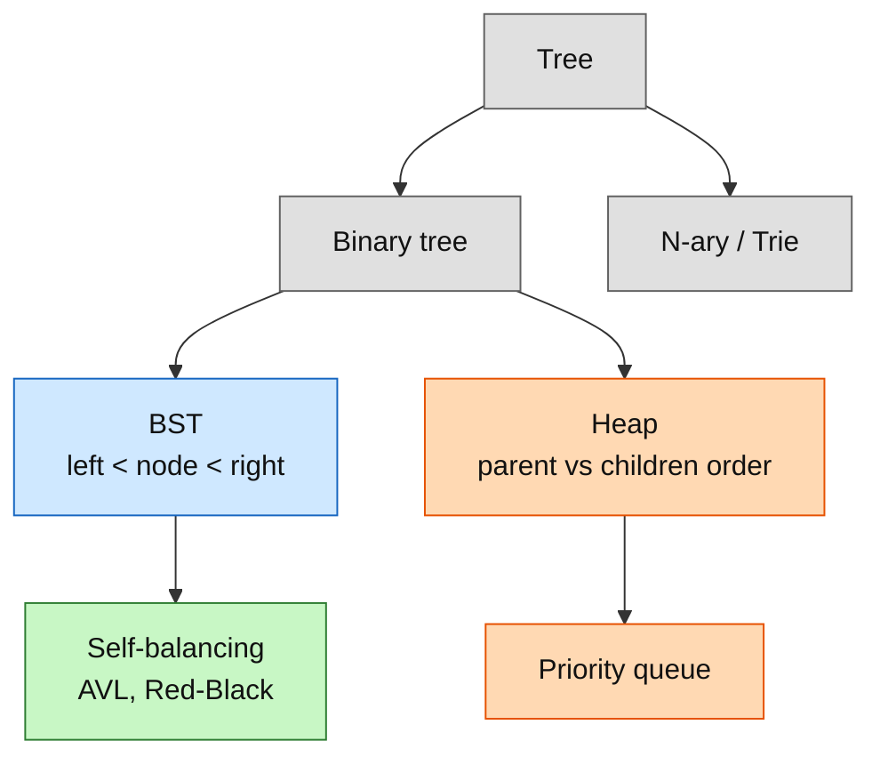

# 🌳 Trees & Heaps

> **Navigation**: [← Hash Tables](01e_HashTable.md) | [Chapter index](00_INDEX.md) | [Data Structure Internals — CPU &… →](01g_DS_Internals.md)

---

## 🌳 Part 7: Trees

### 5W1H: Deep Understanding of Trees

> [!NOTE]
> **WHAT:** A Tree is a hierarchical data structure consisting of nodes connected by edges, starting from a single root node.
>
> **WHY:** Linear structures (arrays, lists) only represent sequences. Trees represent hierarchies (parent-child). Furthermore, balanced trees enable O(log N) operations by eliminating half the remaining search space at every step.
>
> **WHO:** Engineers working with databases, file systems, compilers, and DOM rendering (browsers).
>
> **WHEN:** Use when data has natural hierarchy or requires sorted access.
>
> - ✅ HTML DOM / File Systems (general trees)
> - ✅ Databases (B-Trees)
> - ✅ Autocomplete / dictionaries (Tries)
> - ✅ Priority Queues (Heaps)
> - ❌ When you need O(1) exact match lookup (use HashMap)
>
> **HOW:** Pointers! A node contains data and references (left, right) to its children. Operations often use recursion (DFS) or a queue (BFS) to traverse the structure.

## 💬 Explain It Like a Study Partner — Trees & Heaps

> [!TIP]
> **Ask yourself first:** *"How does a phone book let you find a name among a million in about 20 looks?"*

### 1. The bottom line

A tree arranges data so that every comparison throws away about **half** of what is left; a heap arranges data so the **best item is always on top**.

### 2. The textbook core

- A **tree** has one root; each node has children; there are no cycles. **Height** is the longest root-to-leaf path.
- A **binary search tree (BST)** keeps left < node < right, so search/insert/delete cost O(height). Balanced trees (AVL, red-black) keep height ≈ log n, so operations are **O(log n)**.
- A **binary heap** is a complete binary tree with the heap property (min-heap: parent ≤ children), stored in an array: parent `(i-1)/2`, children `2i+1` and `2i+2`.
- Heap: `peek` O(1), `insert`/`poll` O(log n), build from an array O(n).

### 3. The real-world analogy

A BST is the **"higher or lower?" guessing game**: each guess rules out half the numbers. A heap is a **tournament bracket** where the champion is always at the top: when the champion leaves, a quick re-match chain decides the next one.

### 4. Walkthrough: find 6 in the BST `8 → (3 → (1, 6), 10 → (·, 14))`

1. Start at `8`. 6 < 8, so go left.
2. At `3`. 6 > 3, so go right.
3. At `6`. Found it, after 3 comparisons for a tree of 6 nodes.
4. In a balanced tree of 1,000,000 nodes this takes about 20 steps. In a degenerate (sorted-insert) BST it could take 1,000,000.

> [!NOTE]
> **Quick check:** why use a heap instead of a sorted array for a priority queue? *Insert is O(log n) in a heap but O(n) in a sorted array (shifting).*

---

## ⚡ At a Glance — Trees & Heaps

> [!NOTE]
> **Mental model:** a tree organises data by *hierarchy*; adding an ordering rule turns it into a search structure (BST) or a priority structure (heap). Balanced trees keep height ≈ log n, which is where the O(log n) comes from.

**How to read this diagram.** Blue is the "find by order" branch, orange is the "get the best element" branch, green is the guarantee you want in production (balance).

| Structure | Search | Insert | Delete | Peek min/max | Order |
| --------- | ------ | ------ | ------ | ------------ | ----- |
| BST (unbalanced) | O(n) worst | O(n) worst | O(n) worst | O(h) | sorted in-order |
| AVL / Red-Black | O(log n) | O(log n) | O(log n) | O(log n) | sorted in-order |
| Binary heap | O(n) | O(log n) | O(log n) (top) | O(1) | partial only |
| Build heap from array | — | O(n) | — | — | — |

> [!WARNING]
> A plain BST fed sorted input degenerates into a linked list (O(n)). Use a balanced tree (`TreeMap`) when order matters and input is not random.

---

## Historical Evolution of Tree Data Structures

Trees are not a single invention — they are a **50-year family of solutions**, each invented to fix a specific weakness of its predecessor. Understanding the _why_ behind each variant transforms memorization into genuine insight.

---

## 📚 Topic Pages in This Chapter

This chapter is split into focused pages so each topic can be read on its own. Read them in order the first time; use the table to jump back later.

| # | Page | What is inside | Lines |
| --- | --- | --- | --- |
| 1 | [University Proof Corner](01f_Trees_Heaps/01_university_proof_corner.md) | University Proof Corner · COMPLETE UNDERSTANDING — The WHY Before the… · Nature & Behavior | 329 |
| 2 | [Implementation WITHOUT Collections](01f_Trees_Heaps/02_implementation_without_collections.md) | Implementation WITHOUT Collections | 145 |
| 3 | [Heaps (priority Queue)](01f_Trees_Heaps/03_heaps_priority_queue.md) | Heaps (priority Queue) | 484 |
| 4 | [University-Level Addendum — Trees & Heaps as Formal Theory](01f_Trees_Heaps/04_university_level_addendum_trees_heaps_as.md) | University-Level Addendum — Trees & Heaps as… | 525 |

## Reality Check

> [!CAUTION]
> **Myth:** "A Binary Search Tree is always balanced"
>
> **Reality:** A plain BST has NO self-balancing guarantee. Insert sorted data (1, 2, 3, 4, 5...) into a BST and it degrades to a linked list — every operation becomes O(n). Self-balancing BSTs (AVL, Red-Black) pay a small constant rotation cost to guarantee O(log n). Java's `TreeMap` uses a Red-Black tree. Never use a plain BST for production — use a self-balancing variant or a library.

> [!CAUTION]
> **Myth:** "A heap is a type of tree you build like a BST"
>
> **Reality:** A heap satisfies the *heap property* (parent ≥ all children for max-heap) but NOT BST ordering (left child < parent < right child). You cannot binary-search a heap. A heap's power is O(1) peek-max and O(log n) extract-max. It is stored as an array (index math: left child = 2i+1, right = 2i+2) with no pointers — cache-friendly and compact.

> [!CAUTION]
> **Myth:** "Building a heap from n elements takes O(n log n)"
>
> **Reality:** `heapify` (Floyd's algorithm, bottom-up) takes **O(n)**, not O(n log n). The math: most nodes are near the bottom (leaves) and need 0 or 1 swaps. The height-weighted sum converges to O(n). This is why `heapq.heapify(list)` in Python and `PriorityQueue(collection)` in Java are O(n), while repeatedly calling `add()` n times is O(n log n).

> [!CAUTION]
> **Myth:** "Tree height and tree depth mean the same thing"
>
> **Reality:** Height of a *node*: length of the longest path FROM that node TO a leaf. Height of a tree = height of the root. Depth of a *node*: length of the path FROM the root TO that node. Depth of root = 0. They are complementary, not synonymous. Many textbooks and problems use them interchangeably — always check the definition given.

> [!CAUTION]
> **Myth:** "Inorder traversal of any binary tree gives sorted output"
>
> **Reality:** Inorder (Left, Root, Right) gives sorted output ONLY for a Binary SEARCH Tree. For a generic binary tree or a heap, inorder traversal gives no meaningful order guarantee.
