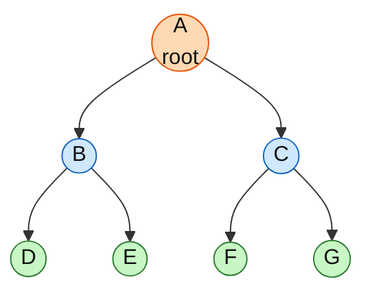
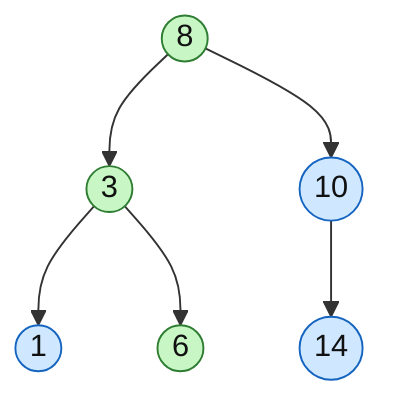

# 🎓 University Proof Corner

> **Navigation**: [Chapter overview](../01f_Trees_Heaps.md) | [Implementation WITHOUT Collections →](02_implementation_without_collections.md)
> Page 1 of 4 in **Trees & Heaps**


> **MIT 6.006 L10–L12 / KTH DD1352 / RWTH Aachen Algo I layer** — Why BST search returns the right answer, why AVL rotations preserve correctness, and why heap extract-min returns the minimum.

## BST Correctness — Search Finds the Key iff It Exists

**Invariant** (BST property): For every node `n`: all keys in `n.left` < `n.key` < all keys in `n.right`.

**Search proof** (by induction on tree depth):
- **Base case (null node)**: Return "not found". Correct. ✓
- **Recursive case**: At node `n`, compare target `k` to `n.key`:
  - If `k < n.key`: by invariant, `k` can only be in `n.left`. Recurse.
  - If `k > n.key`: by invariant, `k` can only be in `n.right`. Recurse.
  - If `k == n.key`: return `n`. Found.

Each step shrinks the search space by the invariant. If `k` exists, we find it; if not, we exhaust the tree. ✓

**Why insert preserves the BST property**: Recursively descend by the same comparison; insert the new leaf in the only position that satisfies the invariant for the path. The new leaf is the only node changed; the invariant holds for every ancestor by the comparison. ✓

**Why delete is the hardest operation**: Two cases:
1. **Leaf or single-child node**: Replace with the only child (or null). Invariant holds trivially.
2. **Two-child node**: Replace with in-order successor (min of right subtree). The successor is a leaf or single-child, so case 1 applies to remove it. Invariant holds because the successor is greater than all left-subtree keys and less than all right-subtree keys beyond it.

## Heap Property — Extract-Min Returns the Minimum

**Invariant** (heap-order): For every node `n`, `n.key` ≤ `n.left.key` and `n.key` ≤ `n.right.key`.

**`extract-min` proof**:
1. Save root value (the minimum, by invariant).
2. Move last element of array to root.
3. `siftDown(root)`: while either child is smaller, swap with the smaller child.

**SiftDown invariant**: After each swap, the subtree rooted at the new position is heap-ordered (the swapped value is ≤ both its new children). The path of swaps follows the unique path where the smallest element must end up. When siftDown reaches a leaf or a position where the value is ≤ both children, the heap property is restored. ✓

## AVL Rotations Preserve the BST Property

After a rotation, the **in-order traversal** of the rotated subtree is unchanged. Since the BST property is exactly "in-order traversal gives sorted keys", any rotation preserves the BST property by definition.

**Balance invariant** (AVL): For every node, `|height(left) − height(right)| ≤ 1`.

After a single insertion, at most one node on the path back to root has balance factor 2 (or −2). The rotation that fixes it restores balance locally. By induction up the path, the whole tree is balanced again. Height remains O(log n). ✓

> Full proofs: [A1 — DS Correctness Invariants](../A1_DS_Correctness_Invariants.md) (Sections 6, 7)

## Timeline: 1960s–2020s

| Year    | Milestone                                      | Inventor                     | Motivation                                                                                                                                                                                                                          |
| ------- | ---------------------------------------------- | ---------------------------- | ----------------------------------------------------------------------------------------------------------------------------------------------------------------------------------------------------------------------------------- |
| 1962    | **AVL Trees** — first self-balancing BST       | Adelson-Velsky & Landis      | They proved that keeping left/right subtree heights within 1 guarantees `O(log N)` operations                                                                                              |
| 1970–72 | **B-Trees** for external storage | Bayer & McCreight (Boeing) | Disk I/O cost dominated memory cost. B-trees maximize fan-out per page (typically 4 KB pages), reducing disk seeks compared with binary trees |
| mid-1970s | B-trees in IBM System R and early relational databases | IBM Research | B-tree indexes became the backbone of relational databases |
| 1978    | **Red-Black Trees** formalized                 | Guibas & Sedgewick           | Needed a simpler rebalancing color scheme than AVL (fewer rotations on insert); adopted by JDK `TreeMap` (stable permalink: [OpenJDK TreeMap.java](https://github.com/openjdk/jdk/blob/jdk17/src/java.base/java/util/TreeMap.java)) |
| 1985    | **Splay Trees** — self-adjusting BST | Sleator & Tarjan | Frequently accessed nodes "splay" to the root; amortized `O(log N)` without explicit balance bookkeeping; the paper also proves the working-set property |
| 1990    | **Skip lists** (Pugh) | William Pugh | A randomized alternative to balanced trees with simpler code and easy concurrency |
| 1996    | **LSM-Trees** (Log-Structured Merge-Tree) | O'Neil, Cheng, Gawlick, O'Neil | Random in-place B-tree writes are expensive on disks; LSM trees batch writes into sequential, sorted runs, trading read cost and write amplification for write throughput |
| 2000    | **Cache-Oblivious B-Trees** | Bender, Demaine & Farach-Colton | Optimal performance across all cache levels without knowing cache parameters |
| 2003–12 | **Bε-trees (2003), Masstree (2012)** | Brodal & Fagin; Mao, Kohler & Morris | Write-optimised and cache-conscious tree designs for modern storage and memory |
| 2010s   | **Bw-Trees**                                   | Microsoft (2013)             | Latch-free B-tree variant for high-concurrency OLTP; used in Microsoft SQL Server Hekaton                                                                                                                                           |
| 2015+   | **B-tree variants in distributed SQL** | e.g. CockroachDB, Spanner-like systems | Range-partitioned ordered storage with replicated consensus on each range (many use LSM engines underneath) |
| 2017+   | **Learned Indexes** (SageDB)                   | Kraska et al.                | Replace B-tree index structures with ML models; B-tree lookup becomes model inference                                                                                                                                               |

## Named Predecessors — The Chain of Reasoning

```
Linear Search → Binary Search → BST → AVL → Red-Black → B-Tree → B+Tree → LSM-Tree
    ↓              ↓           ↓       ↓         ↓          ↓         ↓          ↓
 Sequential   Divide by 2   Pointer  Height    Color     Disk page  Leaf-only  Immutable
 comparison   on sorted      chain   bound     labels    fan-out    linked     SST files
               array        needed  enforced  enforced   per node   list only
```

- **Why AVL was invented (1962):** The unbalancing problem in BSTs was known. A naive BST with sequential insertion (1, 2, 3...) becomes a linked list with `O(N)` operations. AVL trees enforce `|height(left) − height(right)| ≤ 1`, keeping worst-case height at `1.44 log N`.

- **Why B-trees were invented (1970):** The problem was _disk I/O_, not computation. On a 1 TB dataset with 4 KB pages, a BST would need `log₂(100M) ≈ 27` random disk seeks. A B-tree with `m = 100` children per node needs only `log₁₀₀(100M) ≈ 3` disk reads. This 9x reduction in disk I/O made databases viable.

- **Why LSM-trees were invented (1996):** SSDs cannot overwrite data in-place — they must erase and rewrite entire blocks. B-trees cause random writes on every insert (dirtying pages). LSM trees write only _sequentially_ to immutable SST files, reducing write amplification from `O(m)` to `O(log N)`. The tradeoff: reads now require checking multiple SST files (read amplification).

## Modern Practice Anchors

| System                     | Tree Used                               | Why                                                                |
| -------------------------- | --------------------------------------- | ------------------------------------------------------------------ |
| **PostgreSQL** indexes     | B-Tree (default index type)               | Default index type; optimal for range queries on disk              |
| **Java TreeMap / TreeSet** | Red-Black Tree (OpenJDK `TreeMap.java`) | `O(log N)` guaranteed; rebalancing rotations are `O(1)`            |
| **Apache Cassandra**       | LSM-Tree (since 2008)                   | Write-heavy workloads; sequential SST file compaction              |
| **RocksDB / LevelDB**      | LSM-Tree variant                        | Embedded KV store; LevelDB 2011 pioneered multi-level compaction   |
| **SQLite**                 | B+Tree (default)                        | Leaf nodes linked; range scans via sequential leaf traversal       |
| **MySQL InnoDB**           | B+Tree                                  | Clustered index on primary key; leaf pages form doubly-linked list |

---

## PART 0: COMPLETE UNDERSTANDING — The WHY Before the WHAT

### Why Trees Matter — The Hierarchy Problem

Arrays and linked lists are **linear** — they model sequences. But the real world is full of **hierarchical relationships**: file systems, organization charts, family trees, HTML/DOM, abstract syntax trees in compilers. A tree naturally represents "parent-child" relationships where one entity contains or manages multiple sub-entities.

#### Why BSTs Give O(log n) — The Power of Halving

#### Formal Invariant Statements

Understanding each tree variant requires mastering its **invariants** — the properties that never change and guarantee the performance.

- **BST invariant:** For any node `N`, all keys in the left subtree `< N.key` and all keys in the right subtree `> N.key`. This guarantees binary search correctness.
- **Heap invariant (min-heap):** For every node `N`, `N.key ≤ all keys in N's children`. The root is always the minimum. The array representation maps parent(i) → `(i-1)/2`, left child → `2*i + 1`, right child → `2*i + 2`.
- **B-tree invariant:** Each internal node has between `⌈m/2⌉` and `m` children (where `m` is the tree order). All leaf nodes are at the same depth. This guarantees the tree stays short and wide, minimizing disk I/O.
- **Red-Black invariant:** Every node is red or black. The root is black. All leaves (NIL) are black. Red nodes have black children. Every path from any node to its NIL descendants has the same black-height. These 4 rules guarantee height ≤ `2 log₂(N+1)`.

---

A BST's invariant (`left < root < right`) is powerful because at each node, you eliminate **half the remaining candidates**. Starting at the root, one comparison tells you which subtree to explore — you never look at the other. With n nodes in a balanced BST, the height is log₂(n), so search takes at most log₂(n) comparisons.

**But this only works if the tree is balanced.** An unbalanced BST (imagine inserting 1, 2, 3, 4, 5 in order) degenerates into a linked list with O(n) height. This is why self-balancing trees (AVL, Red-Black) exist — they guarantee the height stays O(log n) after every insertion/deletion.

#### Why Heaps Store as Arrays — The Complete Binary Tree Trick

A heap is a **complete binary tree** — every level is full except possibly the last, which fills left-to-right. This structure maps perfectly to an array using index arithmetic:

- Parent of node `i`: `(i-1)/2`
- Left child: `2*i + 1`
- Right child: `2*i + 2`

No pointers needed! This makes heaps extremely cache-friendly (contiguous memory) and space-efficient compared to pointer-based trees. The heap property (min or max at root) ensures O(1) access to the extreme element, while bubbling up/down takes O(log n) — the height of a complete binary tree with n elements.

#### When to Use Each Tree Variant

### Tree Variants Comparison Table

| Structure          | Year  | Balance Invariant                                   | Search                       | Insert          | Primary Use Case                              | Cache Behavior                                 |
| ------------------ | ----- | --------------------------------------------------- | ---------------------------- | --------------- | --------------------------------------------- | ---------------------------------------------- |
| BST (unbalanced)   | 1960s | None                                                | O(n) worst                   | O(n) worst      | Teaching only                                 | Pointer-chasing, poor locality                 |
| AVL Tree           | 1962  | `\|height(left) − height(right)\| ≤ 1`              | O(log n)                     | O(log n)        | Read-heavy DB indexes                         | Good; strictly balanced                        |
| Red-Black Tree     | 1978  | 4 color rules → height ≤ 2 log₂(N+1)                | O(log n)                     | O(log n)        | In-memory maps (Java TreeMap, C++ `std::map`) | Good; less rigid than AVL                      |
| B-Tree             | 1970  | `⌈m/2⌉ ≤ children ≤ m`; all leaves same depth       | O(log_m N)                   | O(log_m N)      | Database disk indexes                         | Excellent; high fan-out, few page faults       |
| B+Tree             | 1970s | B-tree + all data in linked leaf nodes              | O(log_m N)                   | O(log_m N)      | SQL indexes (MySQL, PostgreSQL, Oracle)       | Best; sequential leaf scan for range queries   |
| Splay Tree         | 1985  | No explicit invariant; accessed nodes splay to root | Amort. O(log n)              | Amort. O(log n) | Cache-conscious access patterns               | Excellent for temporal locality                |
| LSM-Tree           | 1996  | Immutable SST files merged in levels                | O(log N) write + read ampl.  | O(1) write      | Write-heavy KV stores (Cassandra, RocksDB)    | Sequential writes; read checks multiple levels |
| Trie (Prefix Tree) | 1960s | Key characters at each edge                         | O(m) where m = key length    | O(m)            | Autocomplete, IP routing, spell-checkers      | Excellent; no key comparison                   |

#### Tree Selection Criteria — Which Tree for Which Workload?

- **Range queries dominate?** → B+Tree. The linked leaf nodes enable sequential scan without traversing the tree again.
- **Inserts dominate (writes more than reads)?** → LSM-Tree. Sequential SST file writes are order-of-magnitude faster on SSDs.
- **In-memory map (Java `TreeMap`, `HashMap` fallback)?** → Red-Black Tree. Guaranteed `O(log N)` without the overhead of B-tree disk-page management.
- **String prefix operations (autocomplete, routing)?** → Trie. Eliminates key comparison entirely; `O(m)` where `m` is key length, not `N`.
- **Need minimum/maximum element frequently?** → Heap. `O(1)` peek, `O(log N)` insert/extract — optimal for priority queues.
- **Read-heavy, rarely modified?** → AVL Tree. Tighter balance than Red-Black gives ~10% better search performance.

---

### Production Failure Modes — What Can Go Wrong in Production

Trees are used in the most critical hot paths of production systems. A misconfigured index or unanticipated workload pattern can cause catastrophic failures.

#### Failure 1: B-Tree Page Split Storm During Bulk Insert

**Name:** B-tree page split storm (also called _split bottleneck_)

**Mechanism:** When loading a large dataset in sorted order (e.g., bulk-inserting `INSERT ... ORDER BY` from a CSV), every new key belongs to the rightmost leaf page. If the fill-factor is high (e.g., PostgreSQL default `fillfactor = 100`), each leaf page fills to capacity before splitting. Repeated splits at the rightmost edge generate excessive **random I/O** and **WAL (Write-Ahead Log)** writes. The symptom in PostgreSQL:

```
LOG:  checkpoint complete: wrote 0 buffers (0.0%); 0 WAL file(s) added, 0 removed, 1 recycled
ERROR:  could not extend relation "pg_class": ERROR:  could not write block %u of relation %u/%u/%u
HINT:  Check free disk space and available memory.
```

**Debugging:**

```sql
-- Check btree index bloat (PostgreSQL)
SELECT relname, pg_size_pretty(pg_total_relation_size(oid)) AS total_size,
       pg_size_pretty(pg_relation_size(oid)) AS table_size
FROM pg_class WHERE relkind = 'r' ORDER BY pg_total_relation_size(oid) DESC LIMIT 10;
```

**Fix:**

1. Lower `fillfactor` to 50–70% for B-tree indexes that receive bulk inserts: `CREATE INDEX idx ON tbl(col) WITH (fillfactor=70);`
2. Use `DISABLE_PAGE_SKIPPING` for bulk loads in PostgreSQL.
3. Consider `COPY` over `INSERT` for bulk loads — it bypasses B-tree index maintenance during the load, then builds the index in a single pass.

---

#### Failure 2: LSM-Tree Compaction Lag Causing Read Amplification

**Name:** LSM-tree compaction lag / read amplification storm

**Mechanism:** LSM-trees accumulate writes in memory (MemTable), then flush to immutable SST files on disk. A background compaction process merges SST files across levels. If the write throughput exceeds the compaction throughput (common during a traffic spike), the number of SST files grows unbounded. Each read must now check many SST files (e.g., LevelDB looks in all `L` levels = `O(L)` reads). Cassandra exposes this via:

```
WARN  [CompactionExecutor:1234] 2024-03-15 02:14:33,678  CompactionTask.java:156
  - Compaction gap detected: expected 200MB/s, getting 45MB/s. Heap usage at 87%.
```

```bash
# Cassandra metric: check read latency spikes correlated with compaction
nodetool tablestats keyspace1.standard1 | grep -E "Read Latency|Compaction| SSTables per query"
# SSTables per query > 10 indicates severe read amplification
```

**Debugging:**

1. Monitor `CompactionHistory` and `PendingCompactions` in Cassandra:
   ```bash
   nodetool compactionhistory
   nodetool compactionstats
   ```
2. Check for write stalls: `nodetool proxyhistograms | grep WRITE`
3. Alert threshold: if `SSTables per query` > 3 consistently, compaction is lagging.

**Fix:**

1. Increase compaction throughput: `ALTER TABLE ... WITH compaction = {'class': 'LeveledCompactionStrategy', 'compaction_throughput_mb_per_sec': 100};`
2. Tune bloom filters: `bloom_filter_fp_chance = 0.01` (higher false-positive rate = fewer SST file checks).
3. Pre-compact before traffic spikes using `nodetough compact`.

---

> 🔬 **Section Challenge — PART 0: COMPLETE UNDERSTANDING — The WHY Before the WHAT**
>
> **Challenge 1 (Trace):** Why is an un-balanced Binary Search Tree (BST) considered a potential Denial of Service (DoS) vulnerability if used to index sequential user inputs?
>
> <details><summary>Answer</summary>
>
> **Scenario:** Processing sequentially generated keys (like timestamps or auto-incrementing IDs) in a naive BST.
> **Trace:** If a user sends keys in strictly increasing order (e.g., `1, 2, 3, 4...`), a naive BST inserts each node as the right child of the previous node. The tree degenerates completely into a **linked list**.
> **Debug/Impact:** Because the tree height is now `N` instead of `log N`, all operations (search, insert, delete) degrade to `O(N)`. If a malicious actor sends 1 million sequential requests, the server will take `O(N)` time per request, exhausting CPU resources. This is why production systems _always_ use self-balancing trees like **Red-Black Trees** (Java's `TreeMap`) or **B-Trees** (Databases), which mathematically enforce `O(log N)` height regardless of insertion order.
>
> </details>

> 🔬 **Section Challenge — Production Realities**
>
> **Challenge 2 (Disk I/O):** Compare the disk I/O cost of a B-tree lookup vs a BST lookup for 100 million records on a 1 TB dataset with 4 KB pages. Assume B-tree order `m = 100` children per node and BST is stored as individual nodes (no page grouping). Why does B-tree win by orders of magnitude?
>
> <details><summary>Answer</summary>
>
> **Setup:** 1 TB = `10¹²` bytes, 4 KB per page = `2¹²` bytes → ~244 million pages. 100 million records.
>
> **BST lookup:** Each node is one 4 KB page. A 100-million-record BST has height `log₂(10⁸) ≈ 27`. Each comparison requires a random disk seek to fetch the next node's page. Worst case: **27 random disk seeks** — and each seek on a spinning disk costs ~10 ms (mechanical latency), giving **~270 ms per lookup**.
>
> **B-tree lookup:** Each internal node stores up to `m = 100` keys and 101 child pointers in one 4 KB page. Height = `log₁₀₀(10⁸) ≈ 4`. Each step processes an entire page (which stays in memory). Worst case: **4 disk seeks** (~40 ms) and 4 x O(1) in-memory binary searches.
>
> **The win:** B-tree uses **high fan-out** (100 children per node) to make the tree **short and wide**. The tree height drops from 27 to 4 — a **7x reduction** in disk seeks. On SSDs the latency difference is smaller, but the I/O bandwidth difference (4-page reads vs 27-page reads) still gives B-tree a 6–7x throughput advantage. For sorted range scans, B+Tree's linked leaf nodes avoid re-traversing the tree entirely.
>
> **Rule of thumb:** Every factor of 10 increase in fan-out reduces tree height by 1 level. B-trees with `m = 100–1000` keep height ≤ 4 for datasets up to billions of records.
>
> </details>

## 🧬 Nature & Behavior

### What is a Tree?



**How to read this diagram.** Orange is the root, blue are the children of A, green are the leaves (nodes with no children).

**Properties:**

- One root node
- Each node has 0 or more children
- No cycles
- Exactly one path from the root to any node

### Binary Search Tree (BST)

**BST property:**

- Left subtree: all values **<** node
- Right subtree: all values **>** node



**How to read this diagram.** Green nodes are the search path for `6`.

**Search for 6:**

1. `8` → 6 < 8 → go left
2. `3` → 6 > 3 → go right
3. `6` → **FOUND!**

Time: O(log n) for a balanced tree.

### 🔴 Real-World Origin: File Systems (1965)

**Problem (UNIX, 1969):** Computers need to organize thousands of files with hierarchical structure (folders in folders) and fast file lookup.

**Solution — Tree Structure:**

```
/
├── home/
│   ├── alice/
│   │   ├── documents/
│   │   └── photos/
│   └── bob/
├── usr/
│   ├── bin/
│   └── lib/
└── etc/
```

**Why Tree?** Natural hierarchy (parent-child), path from root to any file, easy to navigate (`cd`, `ls` commands).

> ✅ **Impact:** Every OS uses trees for files, every URL is a tree path, every org chart is a tree, every family tree is... a tree!

---

[Chapter overview](../01f_Trees_Heaps.md) | [Implementation WITHOUT Collections →](02_implementation_without_collections.md)
