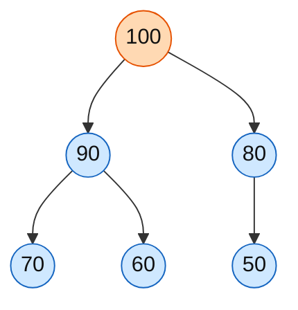
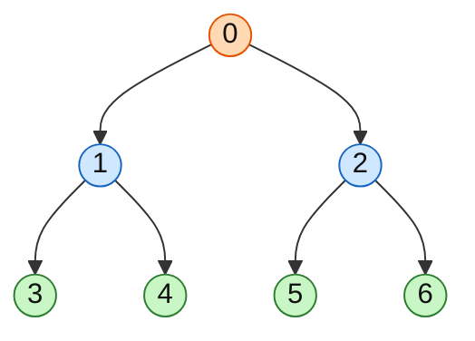

# 📦 Part 8: Heaps (priority Queue)

> **Navigation**: [← Implementation WITHOUT Collections](02_implementation_without_collections.md) | [Chapter overview](../01f_Trees_Heaps.md) | [University-Level Addendum — Trees & Heaps… →](04_university_level_addendum_trees_heaps_as.md)
> Page 3 of 4 in **Trees & Heaps**


## 🧬 Nature & Behavior

### What is a Heap?

**Heap = complete binary tree with the heap property.**

**Max heap** (parent ≥ children):



**How to read this diagram.** Every parent is at least as large as its children, so the maximum (orange) is always at the root. In a **min heap** the rule flips (parent ≤ children) and the root is the smallest.

**Stored as an array (level order):**

| Index | 0 | 1 | 2 | 3 | 4 | 5 |
| ----- | - | - | - | - | - | - |
| Value | 100 | 90 | 80 | 70 | 60 | 50 |

- Parent of `i`: `(i-1)/2`
- Left child of `i`: `2*i + 1`
- Right child of `i`: `2*i + 2`

### Why a Tree Fits in a Flat Array With No Pointers

That index arithmetic isn't a coincidence to memorize — it falls out of one fact: **a heap is a _complete_ binary tree** (every level full, except possibly the last, which fills left-to-right). Completeness is what lets you throw away pointers entirely.

Number the nodes in level order — row by row, left to right — starting at 0:



**How to read this diagram.** Node labels are array indices. Level 0 is index 0 (orange), level 1 holds indices 1–2 (blue), level 2 holds indices 3–6 (green).

Now stare at any node `i` and its children. Node 1's children are 3 and 4. Node 2's children are 5 and 6. The pattern `left = 2i+1, right = 2i+2` is *forced* by completeness: before node `i`'s children appear, every node to `i`'s left on the same row has already placed its two children, and all earlier rows are full. Count them and the arithmetic is exact — there are no gaps to throw it off, precisely because a complete tree has no holes. Lose completeness (allow gaps) and the formula breaks, which is *why* heaps insist on it.

This is a genuine win, not a trick: **O(1) navigation, zero pointer overhead, perfect cache locality** (the whole tree is one contiguous block, so a parent and its children often sit on the same cache line). A pointer-based tree scatters nodes across the heap and chases references; the array heap walks multiplication. That's the real reason library priority queues (`java.util.PriorityQueue`) are backed by an array, not a linked tree.

### Why Building a Heap Is O(n), Not O(n log n) — The Surprising One

Here's a result that trips up almost everyone. To build a heap from an unordered array, you "sift down" each non-leaf node. Each sift-down is O(log n). There are ~n/2 non-leaves. So the build is n/2 × log n = **O(n log n)**, right?

**Wrong — it's O(n).** And the reason is the single most important insight about heaps.

The flaw in the n log n estimate is assuming *every* node can sift down a full log n levels. It can't. **A node's sift-down cost is bounded by its _height_ (distance to the bottom), not the tree's height.** And in a complete binary tree, the overwhelming majority of nodes are *near the bottom*, where height is tiny:

```
Height of node   # of nodes at that height   sift-down cost each
       0  (leaves)        n/2                       0   ← half the nodes do NOTHING
       1                  n/4                        1
       2                  n/8                        2
       3                  n/16                       3
       ...                ...                       ...
   log n (root)            1                      log n  ← only ONE node pays full price
```

The expensive nodes (high up, big sift-down) are *rare*; the cheap nodes (near the bottom, tiny sift-down) are *most* of the tree. Total work is the sum:

```
Total = Σ (number of nodes at height h) × h
      = Σ (n / 2^(h+1)) × h
      = (n/2) · Σ  h / 2^h        for h = 0,1,2,...
                  └──────────┘
            this sum converges to 2 (a fixed constant, not growing with n)
      = (n/2) · 2  =  O(n)
```

The series `Σ h/2^h = 0/1 + 1/2 + 2/4 + 3/8 + … = 2` converges because the node count halves each level *faster* than the cost grows. So the whole build is linear.

> **The lesson, felt:** "n/2 nodes × O(log n) each" overcounts wildly because it pretends every node is the worst case. The truth — *most nodes live near the bottom and barely move* — is why **`heapify` builds a heap in O(n)**, beating the O(n log n) you'd get from inserting elements one at a time. (This is also why heapsort's build phase is free relative to its O(n log n) extraction phase.)

### 🔴 Real-World Origin: Emergency Room Triage (1970s)

**Problem in Hospitals:** Patients arrive randomly — some critical, some minor. Need to treat the most urgent first, **NOT** first-come-first-served!

**Without Priority Queue:** Check all patients to find most urgent → **O(n)** for each decision. Lives lost due to delay!

**With Heap (Priority Queue):**

| Operation                    | Time     |
| ---------------------------- | -------- |
| Insert patient with priority | O(log n) |
| Get most urgent              | **O(1)** |
| Remove most urgent           | O(log n) |

**Example:**

```
Patient arrives: priority 5 (medium)
Patient arrives: priority 9 (critical)
Patient arrives: priority 3 (minor)

Heap: [9, 5, 3]
Next to treat: 9 (critical) - O(1)!
```

> ✅ **Now used in:** OS process scheduling, network packet prioritization, Dijkstra's shortest path, event-driven simulations

## 💻 Implementation WITHOUT Collections

```java
public class MyMinHeap {
    private int[] heap;
    private int size;
    private int capacity;

    public MyMinHeap(int capacity) {
        this.capacity = capacity;
        this.heap = new int[capacity];
        this.size = 0;
    }

    // PARENT INDEX
    private int parent(int i) { return (i - 1) / 2; }

    // LEFT CHILD INDEX
    private int leftChild(int i) { return 2 * i + 1; }

    // RIGHT CHILD INDEX
    private int rightChild(int i) { return 2 * i + 2; }

    // SWAP
    private void swap(int i, int j) {
        int temp = heap[i];
        heap[i] = heap[j];
        heap[j] = temp;
    }

    // INSERT - O(log n)
    public void insert(int value) {
        if (size == capacity) {
            throw new RuntimeException("Heap is full!");
        }

        // Add at end
        heap[size] = value;
        int current = size;
        size++;

        // Bubble up
        while (current > 0 && heap[current] < heap[parent(current)]) {
            swap(current, parent(current));
            current = parent(current);
        }
    }

    // PEEK (Get min) - O(1)
    public int peek() {
        if (size == 0) throw new RuntimeException("Heap is empty!");
        return heap[0];
    }

    // EXTRACT MIN - O(log n)
    public int extractMin() {
        if (size == 0) throw new RuntimeException("Heap is empty!");

        int min = heap[0];

        // Move last element to root
        heap[0] = heap[size - 1];
        size--;

        // Bubble down
        heapifyDown(0);

        return min;
    }

    // HEAPIFY DOWN
    private void heapifyDown(int i) {
        int smallest = i;
        int left = leftChild(i);
        int right = rightChild(i);

        if (left < size && heap[left] < heap[smallest]) {
            smallest = left;
        }

        if (right < size && heap[right] < heap[smallest]) {
            smallest = right;
        }

        if (smallest != i) {
            swap(i, smallest);
            heapifyDown(smallest);
        }
    }

    // BUILD HEAP from array - O(n)
    public void buildHeap(int[] arr) {
        size = arr.length;
        heap = arr.clone();

        // Start from last non-leaf node
        for (int i = size / 2 - 1; i >= 0; i--) {
            heapifyDown(i);
        }
    }

    public int size() {
        return size;
    }

    public boolean isEmpty() {
        return size == 0;
    }
}
```

🔬 **Section Challenge — Heap Construction Mechanics**

**Challenge 1 (Algorithmic Complexity):** If you are given an array of `N` random integers and need to turn it into a valid Min-Heap, you have two options: 1) Insert them one by one into an empty heap using `insert()`. 2) Use Floyd's `buildHeap()` algorithm. Explain the exact time complexity of both approaches and why Floyd's algorithm mathematically outperforms sequential insertion.

<details><summary>Answer</summary>

**Approach 1: Sequential Insertion `O(N log N)`**
Inserting an element takes `O(log N)` because it might bubble _up_ from a leaf to the root. In a tree, the vast majority of nodes are at the bottom leaves. Therefore, most of the `N` elements you insert will have to bubble up through the entire height of the tree `O(log N)`. Summing this up gives `O(N log N)`.

**Approach 2: Floyd's `buildHeap` `O(N)`**

Floyd's algorithm treats the unsorted array as a complete binary tree and calls `heapifyDown()` starting from the lowest non-leaf nodes up to the root. `heapifyDown` pushes nodes _down_.

The mathematical trick: the majority of nodes (the leaves, `N/2` nodes) are already at the bottom, so they move 0 steps! `N/4` nodes move at most 1 step. `N/8` nodes move at most 2 steps. Only the single root node moves `log N` steps. The work is proportional to the node's height, not its depth. The sum of this series `(N/2 * 0) + (N/4 * 1) + (N/8 * 2) + ...` converges to exactly `O(N)`.

</details>

---

## 🧭 Traversal Decision Guide — Which to Use When?

### 💬 Study-Partner View — Tree Traversals

**1. The bottom line:** A traversal is a rule for visiting every node exactly once; which rule you pick depends on what order you need.

**2. The textbook core:**

- **Pre-order** (node, left, right): copy/serialize a tree. **In-order** (left, node, right): yields a BST in **sorted** order. **Post-order** (left, right, node): delete a tree, compute subtree results. **Level-order** (BFS with a queue): shortest depth, level by level.
- DFS orders use recursion or an explicit stack; level-order uses a queue.
- All are **O(n)** time; space is O(h) for DFS and O(width) for BFS.
- Morris traversal gets O(1) extra space by temporarily threading the tree.

**3. The real-world analogy:** Touring a **museum**: pre-order is looking at the exhibit before its sub-rooms, post-order is visiting sub-rooms first, level-order is seeing every ground-floor room before going upstairs.

**4. Walkthrough:**

1. Tree: root 2, left 1, right 3.
2. Pre-order: 2, 1, 3. In-order: 1, 2, 3 (sorted!). Post-order: 1, 3, 2.
3. Level-order: queue `[2]` → visit 2, enqueue 1, 3 → visit 1 → visit 3 → 2, 1, 3.

> [!NOTE]
> **Quick check:** Which traversal gives sorted output for a BST? *In-order.*


```
INORDER   (Left → Root → Right):
  ✅ Get BST elements in SORTED order
  ✅ Check if tree is valid BST

PREORDER  (Root → Left → Right):
  ✅ Copy/serialize a tree
  ✅ Print directory structure (root before children)

POSTORDER (Left → Right → Root):
  ✅ Delete a tree (delete children before parent)
  ✅ Evaluate expression trees
  ✅ Calculate subtree sizes

LEVEL ORDER (BFS — Queue):
  ✅ Level-by-level processing
  ✅ Find minimum depth
  ✅ Connect nodes at same level
  ✅ Zigzag traversal
```

## 🏋️ Foundation Practice + Pattern Application

### Tree Patterns with GO LEARN Links

**Pattern: DFS (Depth First Search)**

```java
// Use for: height, path sum, validate BST, symmetric check
// Template:
public int dfs(TreeNode node) {
    if (node == null) return BASE_CASE;
    int left  = dfs(node.left);
    int right = dfs(node.right);
    return COMBINE(left, right, node.val);
}
```

> 📖 GO DEEPER: [13_Tree_Plus_DFS_BFS.md](../../04_Patterns_Templates/13_Tree_Plus_DFS_BFS.md)

**Pattern: BFS Level Order**

```java
// Use for: level-by-level, min depth, right-side view
Queue<TreeNode> q = new LinkedList<>();
q.offer(root);
while (!q.isEmpty()) {
    int size = q.size();        // ← size = nodes at current level
    for (int i = 0; i < size; i++) {
        TreeNode node = q.poll();
        if (node.left  != null) q.offer(node.left);
        if (node.right != null) q.offer(node.right);
    }
}
```

**Heap Pattern: Top K Elements**

```java
// Brute: sort entire array O(n log n)
// Better: Min-Heap of size k O(n log k)
PriorityQueue<Integer> minHeap = new PriorityQueue<>();
for (int num : arr) {
    minHeap.offer(num);
    if (minHeap.size() > k) minHeap.poll();   // remove smallest if > k
}
// minHeap now has k largest elements | LC 215
```

**Heap Pattern: Merge K Sorted Lists**

```java
// O(n log k) — classic heap use
PriorityQueue<int[]> pq = new PriorityQueue<>((a,b) -> a[0]-b[0]);
// Push first element from each list, then pull min and push next
```

---

## 🎯 Full Problem Set — Trees & Heaps

| #   | Problem                           | Platform   | Difficulty  | Pattern             |
| --- | --------------------------------- | ---------- | ----------- | ------------------- |
| 1   | LC 104 — Max Depth of Binary Tree | LeetCode   | ⭐ Easy     | DFS                 |
| 2   | LC 226 — Invert Binary Tree       | LeetCode   | ⭐ Easy     | DFS                 |
| 3   | LC 94 — Inorder Traversal         | LeetCode   | ⭐ Easy     | Iterative/Recursive |
| 4   | LC 102 — Level Order Traversal    | LeetCode   | ⭐⭐ Med    | BFS Queue           |
| 5   | LC 98 — Validate BST              | LeetCode   | ⭐⭐ Med    | DFS with limits     |
| 6   | LC 112 — Path Sum                 | LeetCode   | ⭐ Easy     | DFS                 |
| 7   | LC 235 — LCA of BST               | LeetCode   | ⭐⭐ Med    | BST property        |
| 8   | LC 543 — Diameter of Binary Tree  | LeetCode   | ⭐ Easy     | DFS postorder       |
| 9   | LC 215 — Kth Largest Element      | LeetCode   | ⭐⭐ Med    | Min-Heap size k     |
| 10  | LC 347 — Top K Frequent Elements  | LeetCode   | ⭐⭐ Med    | Freq + Heap         |
| 11  | LC 23 — Merge K Sorted Lists      | LeetCode   | ⭐⭐⭐ Hard | Min-Heap            |
| 12  | CF 427C — Checkposts              | Codeforces | Div2-C      | Tree + DP           |

---

## 🧠 Pattern Fingerprint — Trees & Heaps

**See these words → use this technique:**

| If the problem says... | Use |
| ---------------------- | --- |
| "height / depth of tree" | DFS postorder |
| "path sum / root to leaf" | DFS preorder |
| "level order / level by level" | BFS Queue |
| "validate BST" | DFS with [min,max] |
| "lowest common ancestor" | DFS LCA |
| "kth largest / smallest" | Min-Heap size k |
| "top K frequent elements" | Freq map + Heap |
| "merge K sorted lists" | Min-Heap |
| "sorted order from BST" | Inorder traversal |
| "serialize / deserialize tree" | Preorder + null marks |

### 🚀 GO LEARN — When You Need More

| Topic                               | File                                                                           |
| ----------------------------------- | ------------------------------------------------------------------------------ |
| Tree algorithms (DFS/BFS deep dive) | 📖 [05_Trees.md](../../03_Algorithms/05_Trees.md)                                 |
| Tree patterns                       | 📖 [13_Tree_Plus_DFS_BFS.md](../../04_Patterns_Templates/13_Tree_Plus_DFS_BFS.md) |
| Tree practice                       | 📖 [09_Trees.md](../../05_Problem_Solving/09_Trees.md)                            |
| Heap practice                       | 📖 [16_Heap.md](../../05_Problem_Solving/16_Heap.md)                              |

### 📅 Revisit Tracker

- **Day 3:** Redo LC 104 (Max Depth) + LC 102 (Level Order) from memory
- **Day 7:** Redo LC 98 (Validate BST) — recall the min/max bound trick

---

### 🔗 Cross-References — Navigate the Ecosystem

| Topic                               | Related Content                                                     |
| ----------------------------------- | ------------------------------------------------------------------- |
| Tree algorithms (DFS/BFS)           | [Tree Algorithms](../../03_Algorithms/05_Trees.md)                     |
| Tree + DFS/BFS patterns             | [Tree Patterns](../../04_Patterns_Templates/13_Tree_Plus_DFS_BFS.md)   |
| Tree practice problems              | [Problem Solving — Trees](../../05_Problem_Solving/09_Trees.md)        |
| Heap / PQ problems                  | [Problem Solving — Heaps](../../05_Problem_Solving/16_Heap.md)     |
| Graph algorithms (trees are graphs) | [Graphs Fundamentals](../../03_Algorithms/05c_Graphs_Fundamentals.md)  |
| Decision Trees in ML                | [ML Algorithms](../../25_Python_ML_DL_NLP/06_ML_Algorithms.md)         |
| Virtual DOM tree (React)            | [React Fundamentals](../../15_React_Frontend/01_React_Fundamentals.md) |

---

---

> 🔬 **Section Challenge — 🧠 Pattern Fingerprint — Trees & Heaps**
>
> **Challenge 1 (Reasoning):** A problem asks you to find the "Top K Frequent Elements" from an array of N items. You have two options: build a Max-Heap of all N items, or maintain a Min-Heap of size K. Trace the time/space complexity difference. Which is better and why?
>
> <details><summary>Answer</summary>
>
> **Scenario:** Choosing the correct heap pattern for "Top K" algorithms.
> **Trace:**
>
> 1. **Max-Heap of size N:** You push all `N` elements into the heap `O(N log N)`, then pop the top `K` times `O(K log N)`. Memory required is `O(N)`.
> 2. **Min-Heap of size K:** You push elements into the Min-Heap. If the heap size exceeds `K`, you immediately pop the _smallest_ element. The heap only ever holds `K` items. Time complexity: `O(N log K)`. Space required: `O(K)`.
> **Design Fix:** The **Min-Heap of size K** is vastly superior. If you process 1 billion server logs (`N = 1,000,000,000`) to find the top 10 error IPs (`K = 10`), the Max-Heap will crash the server with an OutOfMemory error. The Min-Heap will use virtually zero memory `O(10)` and run nearly in `O(N)` time since `log 10` is a constant.
> </details>

## ✅ You Know Trees & Heaps — Now Practice! (JIT Study Path)

> **Step 1 — Basic Problems (Trees):**

| Problem                      | LC #   | Pattern          | Key Concept                          |
| ---------------------------- | ------ | ---------------- | ------------------------------------ |
| Maximum Depth of Binary Tree | LC 104 | DFS postorder    | `1 + max(left, right)`               |
| Invert Binary Tree           | LC 226 | DFS preorder     | Swap left/right at every node        |
| Symmetric Tree               | LC 101 | DFS mirror check | Compare left.left with right.right   |
| Binary Tree Level Order      | LC 102 | BFS Queue        | Poll node, add children, track level |
| Validate BST                 | LC 98  | DFS with bounds  | Pass [min, max] range to each node   |

> **Step 1B — Basic Problems (Heaps):**

| Problem              | LC #   | Pattern            | Key Concept                          |
| -------------------- | ------ | ------------------ | ------------------------------------ |
| Kth Largest Element  | LC 215 | Min-heap of size K | Keep K-size heap, root = Kth largest |
| Top K Frequent Words | LC 692 | Freq + Min-heap    | Count then heapify by freq           |
| Meeting Rooms II     | LC 253 | Sort + Min-heap    | Min-heap of end times                |

> **Step 2 — Hit a wall? Learn these patterns:**
>
> - Tree traversals → **[Tree + DFS/BFS Patterns](../../04_Patterns_Templates/13_Tree_Plus_DFS_BFS.md)**
> - Top-K / Two-Heap → **[Heap Patterns](../../04_Patterns_Templates/15_Heap_Plus_GreedySelection.md)**
>
> **Step 3 — Apply patterns on harder problems:**
> 👉 **[Go to Trees Problem Solving →](../../05_Problem_Solving/09_Trees.md)**
> 👉 **[Go to Heap Problem Solving →](../../05_Problem_Solving/16_Heap.md)**
>
> **Step 4 — Competitive Practice:**

| CF Problem                                                                          | Topic         | Difficulty  |
| ----------------------------------------------------------------------------------- | ------------- | ----------- |
| [CF 339D — Xenia and Tree](https://codeforces.com/problemset/problem/339/D)         | Tree + LCA    | ⭐⭐⭐ Hard |
| [CF 1442C — Graph Transpositions](https://codeforces.com/problemset/problem/1442/C) | Tree DP       | ⭐⭐ Medium |
| [CF 1526C — Potions](https://codeforces.com/problemset/problem/1526/C)              | Greedy + Heap | ⭐⭐ Medium |

> 🌍 **Real-World Connections:**
>
> - **File system** (ext4, APFS, NTFS) = B-Tree of directories and files
> - **HTML/DOM** = tree; React re-renders using virtual DOM tree diffing
> - **Compiler AST** (Abstract Syntax Tree) = your Java code parsed into a tree
> - **Java's PriorityQueue** = Min-Heap; used in Dijkstra, task schedulers, event loops
> - **OS process scheduler** = heap by priority; highest-priority process runs next

---

[← Implementation WITHOUT Collections](02_implementation_without_collections.md) | [Chapter overview](../01f_Trees_Heaps.md) | [University-Level Addendum — Trees & Heaps… →](04_university_level_addendum_trees_heaps_as.md)
