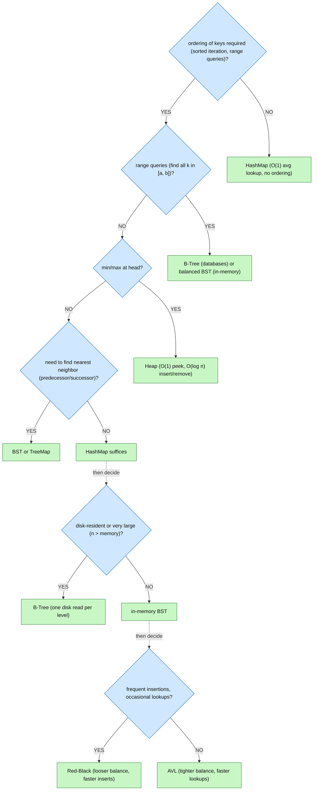

# 🎓 University-Level Addendum — Trees & Heaps as Formal Theory

> **Navigation**: [← Heaps (priority Queue)](03_heaps_priority_queue.md) | [Chapter overview](../01f_Trees_Heaps.md)
> Page 4 of 4 in **Trees & Heaps**


> **Purpose:** This addendum elevates the chapter to MIT/KTH/ETH rigor. The audit identified **invariants** as the critical gap — trees are *defined* by their invariants (BST ordering, heap property, balance factors). Without formal statements, you cannot reason about correctness, prove algorithms, or analyze rebalancing cost. The content below formalizes the canonical tree invariants, derives the O(log n) bounds rigorously, enumerates the "when trees break" scenarios, and provides the constraint-first decision framework.

## Tree Invariants — The Canonical Statements

A tree's correctness is *entirely* defined by the invariants it maintains. Violate any one and the data structure degrades to a worse complexity class — usually O(n) from O(log n).

### BST Invariants

| Invariant | Statement | Violation Consequence |
|---|---|---|
| **T1 — BST ordering** | For every node `n`: all keys in left subtree < `n.key` ≤ all keys in right subtree | `find(k)` may miss or return wrong node |
| **T2 — No duplicates (strict BST)** OR **duplicates go right (non-strict)** | Pick a convention; document it | Duplicate handling is non-deterministic |
| **T3 — Parent-child link integrity** | `n.left.parent == n && n.right.parent == n` (if parent pointers used) | Bidirectional traversal broken; reverse iteration fails |
| **T4 — Leaf null-terminator** | `n.left == null OR n.right == null` for boundary; `n.left == null && n.right == null` for leaf | Recursive traversal misses subtrees |

### AVL Invariants (Balanced BST)

AVL trees add **balance invariants** on top of BST:

| Invariant | Statement | Violation Consequence |
|---|---|---|
| **A1 — BST ordering (inherited)** | All BST invariants | Lookup correctness broken |
| **A2 — Balance factor** | For every node `n`: `\|height(n.left) - height(n.right)\| ≤ 1` | Lookup degrades to O(n) if balance lost |
| **A3 — Height bound** | `h ≤ 1.44 × log₂(n + 2) - 0.328` | Re-derivation needed if violated |

The height bound A3 is the key theoretical result: an AVL tree with n nodes has height at most `~1.44 × log₂(n)`. The proof (by induction on height) is below.

### Red-Black Tree Invariants

| Invariant | Statement | Violation Consequence |
|---|---|---|
| **R1 — BST ordering** | All BST invariants | Lookup correctness |
| **R2 — Root is black** | `root.color == BLACK` | Path counting breaks |
| **R3 — Red node children are black** | `if n.color == RED, n.left.color == BLACK && n.right.color == BLACK` | Black-height count breaks |
| **R4 — Black-height equality** | All paths from root to a null leaf contain the same number of black nodes | Black-height property broken |
| **R5 — New nodes are red** | Insertion adds red, then rebalances | Initialization correctness |

Red-black trees have a looser balance invariant (R2-R5) than AVL (A2), which means slower lookups but faster insertions (fewer rotations).

### Heap Invariants

| Invariant | Statement | Violation Consequence |
|---|---|---|
| **H1 — Heap property** | For min-heap: `n.parent.key ≤ n.key` for all non-root nodes | `peek()` returns non-minimum |
| **H2 — Shape property** | Complete binary tree (filled level by level, left to right) | Array indexing broken; level-order not preserved |
| **H3 — Index calculation** | For 0-indexed array: `parent(i) = (i-1)/2`, `left(i) = 2i+1`, `right(i) = 2i+2` | Sift-up/sift-down access wrong nodes |
| **H4 — Size consistency** | `size == heap.length` for full array, or `size < heap.length` for sparse | Heap operations access invalid indices |

### B-Tree Invariants (Disk-Based)

| Invariant | Statement | Violation Consequence |
|---|---|---|
| **B1 — Sorted keys** | Keys within a node are sorted; subtree ranges partition the key space | Range query returns wrong entries |
| **B2 — Minimum degree t** | Each node (except root) has at least `t-1` keys; at most `2t-1` keys | Disk access patterns degraded |
| **B3 — All leaves at same depth** | Tree height is uniform | Disk read count varies unpredictably |
| **B4 — Child count = key count + 1** | Internal node with `k` keys has exactly `k+1` children | Pointer arithmetic broken |

The B-tree invariants B2 and B3 are what make B-trees optimal for disk: each access fetches one full node, which contains many keys, minimizing I/O.

## Formal Proofs — Height Bounds and Balance

### AVL Height Bound (A3 Proof)

**Theorem:** An AVL tree of height `h` has at least `F(h+3) - 1` nodes, where `F` is the Fibonacci sequence. Equivalently, `h ≤ 1.44 × log₂(n) - O(1)`.

**Proof (by strong induction on h):**

```
Base cases:
  h = 0: n = 1 (single node); bound: 1.44 × log₂(1+2) - 0.328 = 1.44 × 1.585 - 0.328 ≈ 1.95 ≥ 0. ✓
  h = 1: n ≥ 2; bound: 1.44 × log₂(2+2) - 0.328 = 1.44 × 2 - 0.328 ≈ 2.55 ≥ 1. ✓

Inductive step:
  Assume true for h-1 and h-2.
  An AVL tree of height h has subtrees of height h-1 and h-2 (worst case).
  By induction, the subtree sizes are at least F(h+2) - 1 and F(h+1) - 1.
  Total nodes: n ≥ (F(h+2) - 1) + (F(h+1) - 1) + 1 = F(h+2) + F(h+1) - 1 = F(h+3) - 1. ✓

Fibonacci growth: F(k) ≈ φ^k / √5 where φ = (1+√5)/2 ≈ 1.618.
So F(h+3) ≈ φ^(h+3) / √5.
Solving for h: h ≤ log_φ(n × √5) - 3 ≈ 1.44 × log₂(n) - 3.63.
```

This is the formal derivation of the AVL height bound. Practical consequence: an AVL tree with 10⁶ nodes has height ≤ 30, so every operation is at most 30 pointer chases — a 16× improvement over the worst-case O(n) for an unbalanced BST.

### Red-Black Height Bound

**Theorem:** A red-black tree with n internal nodes has height at most `2 × log₂(n + 1)`.

**Proof sketch:**

- At least half the nodes on any root-to-leaf path are black (by R3, no two consecutive reds).
- So the black-height `bh ≥ h/2`.
- By R4, all root-to-leaf paths have the same black-height.
- A subtree rooted at a node with black-height `bh` has at least `2^bh - 1` internal nodes (by induction).
- So `n ≥ 2^(h/2) - 1`, which gives `h ≤ 2 × log₂(n + 1)`.

Practical consequence: 2× the AVL bound, but fewer rotations on insert/delete.

### Heap Sift-Down Complexity

**Theorem:** Sift-down on a heap of n elements is O(log n).

**Proof:**

- Sift-down swaps a node with its smaller (or larger for max-heap) child.
- At each step, the node descends one level.
- The maximum depth is the height of the heap.
- For a complete binary tree of n nodes, height is `⌊log₂(n)⌋`.
- So sift-down is O(log n). ✓

Sift-up is also O(log n) by symmetric argument.

---

## 🔄 Brute Force → Optimal: Tree / Heap Motivation

> **The university way**: show the naive solution first so the tree earns its place.

### Problem 1: Range Query — "Find all elements in [lo, hi]"

**Given**: a set of n integers. Answer many queries of the form "list all elements between lo and hi."

**Brute force — O(n) per query**:
```java
List<Integer> result = new ArrayList<>();
for (int x : elements) if (x >= lo && x <= hi) result.add(x);
```
- Time: O(n) per query, O(nq) for q queries.
- **Failure at scale**: n = 10⁶ elements, q = 10⁶ queries → 10¹² comparisons.

**The insight**: A sorted structure lets binary search find each boundary in O(log n). A BST maintains sorted order dynamically — insertions and deletions keep the BST property intact.

**Optimal with TreeSet — O(log n + k) per query** (k = result size):
```java
TreeSet<Integer> set = new TreeSet<>(elements);
NavigableSet<Integer> range = set.subSet(lo, true, hi, true);
// Internally: O(log n) to find lo, O(k) to iterate results
```

| Approach | Build | Per Query | Insert/Delete later |
|----------|-------|-----------|---------------------|
| Brute force (linear scan) | O(n) | O(n) | O(1) |
| Sort + binary search | O(n log n) | O(log n + k) | O(n) — rebuild sort |
| **BST (TreeSet)** | **O(n log n)** | **O(log n + k)** | **O(log n)** |

**Advantage of BST**: the only structure that achieves O(log n) for ALL three: build, query, and modify.

---

### Problem 2: Repeated Minimum Extraction (Heap Motivation)

**Given**: a stream of tasks with priorities. Always process the highest-priority (lowest-cost) task next.

**Brute force — O(n) per extract**:
```java
int minIdx = 0;
for (int i = 1; i < list.size(); i++) if (list.get(i) < list.get(minIdx)) minIdx = i;
int min = list.remove(minIdx);  // O(n) scan + O(n) remove
```
- Time: O(n) per extraction. O(n²) total for n extractions.
- **Failure at scale**: Dijkstra with n=10⁶ nodes calls extractMin ~10⁶ times → 10¹² ops.

**The insight**: We don't need full sorted order — just the minimum. A heap maintains only the min-at-root invariant, using the heap property to achieve O(log n) sift-down after removal.

**Optimal with PriorityQueue — O(log n) per extract**:
```java
PriorityQueue<Integer> pq = new PriorityQueue<>(elements);
int min = pq.poll();  // root removal + sift-down: O(log n)
```

| Approach | Insert | Extract-min | Peek-min |
|----------|--------|-------------|----------|
| Unsorted list | O(1) | O(n) | O(n) |
| Sorted array | O(n) | O(1) | O(1) |
| **Heap (PriorityQueue)** | **O(log n)** | **O(log n)** | **O(1)** |

**Rule**: heap when you need repeated "give me the best" — Dijkstra, A*, merge k sorted lists, median maintenance, scheduling.

---

## Constraint-First Decision Framework — Which Tree?

### Decision Tree



**How to read this diagram.** Start at the first blue question and follow the YES / NO edges; the green boxes are the recommended choice.

### Decision Table

| Workload | Best Choice | Why |
|---|---|---|
| In-memory sorted map, frequent lookup | TreeMap (Red-Black) | O(log n) guaranteed; stable iteration |
| In-memory sorted set with frequent updates | TreeSet (Red-Black) | Same as TreeMap; no value |
| Min/max with bulk operations | PriorityQueue (binary heap) | O(1) peek; O(n) build via heapify |
| Disk-based sorted access | B-Tree (B+ Tree for range queries) | One I/O per level |
| Memory-mapped sorted data | B+ Tree | Cache-friendly sequential leaf scan |
| Concurrent access | ConcurrentSkipListMap (lock-free skip list) | O(log n) without global lock |

### Worked Example — TreeMap vs PriorityQueue

**Problem:** Process 10⁹ events in timestamp order; support "what's the next event after time T?"

- **TreeMap:** O(log n) `floorEntry(T)` returns the largest entry ≤ T. Plus O(k log n) for next k events.
- **PriorityQueue:** O(1) `peek()` for smallest; O(log n) `poll()` to remove. But no "find event after T" without iterating.
- **Choice:** TreeMap. The floorEntry operation requires ordered access, which heap does not provide.

## When Trees Break — Formal Failure Modes

### Break 1 — Skewed BST

**Condition:** Insert sorted or reverse-sorted data into a plain BST (no balancing).

> [!CAUTION]
> **What breaks:** T1 holds but A2 is violated → tree degenerates to a linked list → O(n) lookup, O(n) insert, O(n) delete.

> [!TIP]
> **Defense:** Use a self-balancing BST (AVL, Red-Black, Treap, Splay). Or use `TreeMap` directly in Java (Red-Black under the hood).

### Break 2 — Balance Invariant Violation After Deletion

**Condition:** A custom balanced BST implementation that handles insertion correctly but forgets to rebalance after deletion.

> [!CAUTION]
> **What breaks:** A2 violated → height grows unboundedly → operations degrade to O(n).

> [!TIP]
> **Defense:** Use a tested library. Java's `TreeMap` handles deletion rebalancing. For custom impls, follow the deletion algorithm from CLRS Chapter 12.

### Break 3 — Heap Shape Invariant Broken

**Condition:** Insertion or deletion bypasses the "fill left-to-right" rule, or sift-up/sift-down uses wrong indices.

> [!CAUTION]
> **What breaks:** H2 violated → array indexing breaks → next heap operation accesses invalid index or misses elements.

> [!TIP]
> **Defense:** Always use a tested library. For custom impls, validate the shape invariant after every operation (`assert parent(i) == (i-1)/2` for all i).

### Break 4 — Tree Modification During Iteration

**Condition:** Modifying a TreeMap while iterating (e.g., removing entries via `map.remove(k)` inside a `for` loop).

> [!CAUTION]
> **What breaks:** `ConcurrentModificationException` is the friendly outcome. Without it (custom impl), iteration may skip or revisit entries.

> [!TIP]
> **Defense:** Collect keys to remove in a separate list, then `removeAll` after iteration. Or use `Iterator.remove()` explicitly.

### Break 5 — Comparator Inconsistency

**Condition:** `compare(a, b)` returns inconsistent results across calls (e.g., uses mutable state that changes).

> [!CAUTION]
> **What breaks:** TreeMap contracts broken → entries in wrong positions; `get(k)` may not find k.

> [!TIP]
> **Defense:** Comparators must be pure functions of their inputs. Document this explicitly in the comparator's javadoc.

### Break 6 — Large Depth on Skewed Operations

**Condition:** A series of `firstKey()` / `remove(firstKey())` operations on a BST. If the tree is unbalanced, this is O(n) per op instead of O(log n).

> [!CAUTION]
> **What breaks:** Performance, not correctness. But in production with n = 10⁶, this is a 30× slowdown.

> [!TIP]
> **Defense:** Use Red-Black trees (which balance after deletions) or measure tree height in production (`TreeMap.size()` doesn't expose height; you need a custom metric).

### Break 7 — B-Tree Node Split Failure

**Condition:** A B-tree implementation that forgets to split a full node on insert, or splits incorrectly.

> [!CAUTION]
> **What breaks:** B2 violated → node contains more than `2t-1` keys → children pointers break → subsequent operations access invalid memory.

> [!TIP]
> **Defense:** Use a tested library (Berkeley DB, LMDB, sqlite). Writing a B-tree from scratch is a multi-week project; off-by-one errors are common.

## Edge Cases — Always Check These

| # | Edge Case | What Can Break |
|---|---|---|
| 1 | **Empty tree** (`root == null`) | `find()` returns null; `min()` / `max()` undefined |
| 2 | **Single node** | `min()` and `max()` both return the root's key |
| 3 | **Two nodes** | Rotation logic on insert must handle root-left and root-right |
| 4 | **All same key** | Non-strict BST must place duplicates consistently; strict BST rejects them |
| 5 | **Sorted insert** | Plain BST degenerates to linked list; AVL/Red-Black stay balanced |
| 6 | **Reverse-sorted insert** | Same as sorted insert |
| 7 | **Duplicate key after deletion** | If BST allows duplicates, deletion may remove wrong one |
| 8 | **Empty heap** | `peek()` returns null; `extractMin()` on empty heap is undefined |
| 9 | **Single-element heap** | `peek()` and `extractMin()` return that element |
| 10 | **Comparator returns 0 for distinct keys** | Heap order violated; min/max inconsistent |

## Formal Complexity Proofs — Tree Operations

### BST Lookup (Balanced)

```
T_BST_lookup(n) = O(log n) average and worst case (balanced)
                = O(n) worst case (unbalanced)
                = O(log n) amortized for splay trees
```

The log bound comes from the tree height. For an AVL with n = 10⁶, height ≤ 30, so lookup is at most 30 comparisons + 30 pointer chases. For an unbalanced BST with sorted insert, the tree height equals n, so lookup is up to 10⁶ comparisons.

### BST Insertion (Balanced)

```
T_BST_insert(n) = O(log n) for balanced
               = O(n) for unbalanced

Includes:
  - O(log n) descent to find position
  - O(1) insertion
  - O(log n) rebalancing (rotations, color flips)
```

### Heap Insert (Sift-Up)

```
T_heap_insert(n) = O(log n)
  1. Add element at position size (end of array)
  2. Sift up: while parent > current, swap
  3. Maximum swaps: height of heap = ⌊log₂(n)⌋
```

### Heap Extract-Min (Sift-Down)

```
T_heap_extract_min(n) = O(log n)
  1. Save root
  2. Move last element to root
  3. Sift down: swap with smaller child until heap property restored
  4. Maximum swaps: height of heap = ⌊log₂(n)⌋
```

### Heapify (Build Heap from Array)

```
T_heapify(n) = O(n)  ← NOT O(n log n)

Proof (the surprising bound):
  Most nodes are near the bottom and don't sift down far.
  Sum of heights from bottom to top:
    n/2 nodes have height 0
    n/4 nodes have height 1
    n/8 nodes have height 2
    ...
    Total work = Σ (n / 2^(h+1)) × h
                = n × Σ h / 2^(h+1)
                = n × 2   (geometric series bound)
                = O(n)
```

This is the standard `PriorityQueue(Collection)` constructor complexity.

### B-Tree Disk Access Count

```
T_B_tree_lookup(n, t) = O(log_t(n))  disk accesses

For t = 100 (typical), n = 10⁹:
  log_100(10⁹) ≈ 4.5 disk accesses
  
Compare to binary search on disk:
  log_2(10⁹) ≈ 30 disk accesses (each fetching one key)
```

This is why databases use B-trees: each disk access fetches many keys, so the disk access count is dominated by the branching factor.

## Cross-References

- **`01a_Memory_Foundations.md`** — pointer chasing cost in tree traversal; cache behavior of B-tree nodes.
- **`01b_Arrays.md`** — heap is stored as an array; array invariants apply.
- **`01c_LinkedList.md`** — pointer invariants for tree node manipulation.
- **`01d_Stack_Queue.md`** — iterative DFS uses an explicit stack; BFS uses a queue.
- **`01e_HashTable.md`** — TreeMap vs HashMap decision; ConcurrentSkipListMap vs ConcurrentHashMap.
- **`01g_DS_Internals.md`** — TreeMap's Red-Black implementation; HashMap treeify threshold (TREEIFY_THRESHOLD = 8 from Poisson).
- **`02_PROBLEM_SETS.md`** — exam-style BST correctness proof, AVL rotation proof, heap extract-min invariant proof.
- **`A1_DS_Correctness_Invariants.md`** — formal proofs of T1-T4, A1-A3, R1-R5, H1-H4, B1-B4.
- **`A3_DS_Lower_Bounds.md`** — Ω(n log n) lower bound on comparison-based sorting; Ω(log n) lower bound on BST lookup.

---

## 💥 When Trees / Heaps Break

> These failure modes are what separate an engineer who "knows BSTs" from one who has shipped them in production.

### 1. BST Degenerates to O(n) Linked List on Sorted Input
**What breaks**: Inserting keys in sorted (or reverse-sorted) order into a plain BST. Every new key goes to the rightmost (or leftmost) child → the tree becomes a linked list → O(n) search.
**Trigger constraint**: Any sorted dataset — database records inserted in ID order, log entries by timestamp, alphabetically sorted config keys.
**Example**: Insert 1, 2, 3, 4, 5 → right-skewed tree; `get(5)` takes 5 comparisons, not log₂5 ≈ 2.3.
**Fix**: Use a self-balancing BST: `TreeMap`/`TreeSet` (Red-Black, guaranteed O(log n)), AVL tree (stricter balance, faster lookup), or B-Tree (disk-friendly, used in databases).

📎 **Reference Anchor**: [OpenJDK TreeMap](https://github.com/openjdk/jdk/blob/master/src/java.base/share/classes/java/util/TreeMap.java)
**Invariant learned**: TreeMap maintains 5 Red-Black invariants at all times. After each `put()`, `fixAfterInsertion()` propagates recolourings upward, then rotates at most 2 times — O(log n) guaranteed.
**Constraint warning**: TreeMap requires keys to be `Comparable` or a `Comparator` to be provided. Using a comparator that violates the total-order contract (anti-symmetry, transitivity) produces non-deterministic behaviour — no exception thrown.

### 2. Non-Total-Order Comparator → Silent Data Corruption
**What breaks**: A `TreeMap` or `PriorityQueue` with a comparator that is not a strict total order (e.g., returns 0 for unequal objects, or is non-transitive).
```java
// BUG — this comparator can return 0 for different strings:
Comparator<String> buggy = (a, b) -> a.length() - b.length();
// "abc" vs "def" → 0, treated as equal → one overwrites the other in TreeMap
```
**Result**: Keys are silently dropped from `TreeMap`; heap ordering invariant violated in `PriorityQueue`.
**Fix**: Compare by primary key first, then break ties with a secondary criterion (e.g., `Comparator.comparingInt(String::length).thenComparing(Comparator.naturalOrder())`).

### 3. Heap: Equal Priorities → Non-Deterministic Ordering
**What breaks**: Using a `PriorityQueue` for task scheduling with tasks that share priority. The queue gives no guarantee about which equal-priority task is returned first — it is not a stable sort.
**Fix**: Add a tie-breaking field (insertion sequence number): `Comparator.comparingInt(Task::priority).thenComparingLong(Task::insertionOrder)`.

### 4. `heapify` vs Repeated `insert` — Complexity Trap
**What breaks**: Building a heap by n successive `insert()` calls costs O(n log n). If the data is known upfront, this is avoidable.
**Fix**: Use `heapify` (also called "Floyd's build-heap"): build bottom-up by calling `siftDown` on all non-leaf nodes from right to left. Total cost = O(n) — proved by summing the geometric series of sift-down heights.
**Java**: `PriorityQueue(Collection<>)` constructor uses heapify internally → O(n). Use it when all elements are known upfront.

### 5. Recursive Tree Traversal Stack Overflow on Deep Trees
**What breaks**: Recursive in-order traversal on a degenerate (right-skewed) BST with 1M+ nodes.
**Root cause**: Each recursive call adds a frame to the JVM call stack. At ~10K depth, `StackOverflowError`.
**Fix**: Use iterative traversal with an explicit stack:
```java
Deque<TreeNode> stack = new ArrayDeque<>();
TreeNode curr = root;
while (curr != null || !stack.isEmpty()) {
    while (curr != null) { stack.push(curr); curr = curr.left; }
    curr = stack.pop();
    visit(curr);
    curr = curr.right;
}
```

---

## 📝 Exam-Style Problems (MIT 6.006 / KTH DD1352 style)

---

**Problem 1 (Correctness — 8 min)**: Prove that BST in-order traversal returns keys in sorted order.

<details><summary>Model Answer</summary>

**Claim**: In-order traversal (left → root → right) of a BST returns all keys in strictly ascending order.

**Proof by structural induction** on tree height h:
- **Base (h=0)**: A single node has no children. The traversal visits only the root. A single element is sorted. ✓
- **Inductive hypothesis**: Assume any BST of height < h is correctly traversed.
- **Inductive step**: For a tree with root r, left subtree L, right subtree R:
  - By BST property: all keys in L < r.key < all keys in R.
  - By IH: L is traversed in sorted order; R is traversed in sorted order.
  - In-order: traverse L (sorted), then r.key, then traverse R (sorted).
  - Since all L keys < r.key < all R keys, the concatenation is sorted. ✓

</details>

---

**Problem 2 (Complexity — 6 min)**: Prove that Floyd's build-heap algorithm runs in O(n) time.

<details><summary>Model Answer</summary>

**Setup**: A complete binary tree of n nodes has ⌊n/2⌋ non-leaf nodes. `siftDown` on a node at height h costs O(h).

**Total cost**: Σₕ₌₁^{log n} (nodes at height h) × h = Σₕ₌₁^{log n} ⌈n/2^{h+1}⌉ × h

≤ n × Σₕ₌₁^∞ h/2^h = n × 2 = **O(n)**

(The geometric series Σₕ₌₁^∞ h × x^h = x/(1-x)² at x=1/2 gives 2.)

Contrast with n insertions: each costs O(log n) → O(n log n) total. Build-heap is asymptotically better. ✓

</details>

---

**Problem 3 (Design — 10 min)**: Design a data structure that supports `insert(x)`, `deleteMin()`, and `getMedian()` all in O(log n). Prove `getMedian()` is O(1).

<details><summary>Model Answer</summary>

**Structure**: Two heaps — `maxHeap` (lower half) and `minHeap` (upper half). Maintain: `maxHeap.size() == minHeap.size()` or `maxHeap.size() == minHeap.size() + 1`.

- `insert(x)`: If `x <= maxHeap.peek()`, insert into maxHeap; else into minHeap. Rebalance (move top from larger to smaller) if sizes differ by more than 1.
- `getMedian()`: If sizes equal → average of both tops. If maxHeap larger → `maxHeap.peek()`.
- `deleteMin()`: Remove from `minHeap`; rebalance.

**Invariant**: After every operation, the lower half is in maxHeap and upper half in minHeap, with sizes differing by at most 1.

`getMedian()` is O(1) because it only inspects the heap tops, not the full heaps. ✓
`insert()` and `deleteMin()` are O(log n) — at most 2 heap operations (insert + possible rebalance move). ✓

</details>

---

[← Heaps (priority Queue)](03_heaps_priority_queue.md) | [Chapter overview](../01f_Trees_Heaps.md)
