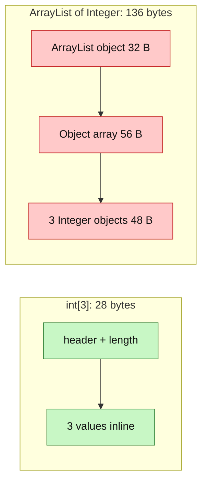

# 🔬 Data Structure Internals — CPU & Memory Level

> **Navigation**: [← Trees & Heaps](01f_Trees_Heaps.md) | [Chapter index](00_INDEX.md) | [Data Structures: ALL VARIANTS →](02a_DS_Variants_Core.md)

---

## 🔬 PART 10A: DEEP INTERNALS - EVERY DATA STRUCTURE AT CPU/MEMORY LEVEL

### 5W1H: Deep Understanding of Data Structure Internals

> [!NOTE]
> **WHAT:** An uncompromising look at how Java data structures actually exist in memory (byte-by-byte) and execute on the CPU.
>
> **WHY:** Big-O notation lies. Two structures can be O(1) mathematically but have a 100x performance difference in reality due to hardware architecture (CPU Cache Lines and memory locality).
>
> **WHO:** Senior/Staff engineers who need to squeeze every ounce of performance out of high-throughput systems or avoid subtle memory leaks and GC pressure.
>
> **WHEN:** Use this mental model when designing systems processing millions of elements, or when diagnosing mysterious latency spikes caused by cache misses or garbage collection pauses.
>
> **HOW:** By examining JVM object headers, pointers, continuous vs. scattered heap allocations, and tracing exact x86 assembly instructions generated by the JIT compiler.

## 💬 Explain It Like a Study Partner — DS Internals

> [!TIP]
> **Ask yourself first:** *"Three numbers in an `ArrayList<Integer>` cost 136 bytes. Where did all those bytes go?"*

### 1. The bottom line

The collections you use every day are made of real objects with headers, padding and pointers, and those hidden bytes decide speed and memory more than Big-O does.

### 2. The textbook core

- Every Java object has an **object header** (mark word + class pointer, about 12 bytes with compressed oops) and is **padded** to a multiple of 8 bytes.
- `ArrayList` wraps an `Object[]` of **references**; each `Integer` is a separate heap object (**boxing**).
- `HashMap` is a `Node[]` of buckets; entries are `Node` objects (32 bytes) that become `TreeNode`s (48 bytes) when a bucket treeifies.
- `LinkedList` allocates one node per element; `ArrayDeque` and `PriorityQueue` use contiguous arrays.
- **Escape analysis** lets the JIT avoid heap allocation for objects that never leave a method.

### 3. The real-world analogy

Shipping goods: a primitive `int[]` is **a pallet of items packed tightly**. A `List<Integer>` is **each item in its own box, each box with a label, plus a manifest listing where every box is stored**. You ship the same goods, but with far more packaging, and it takes longer to unpack.

### 4. Walkthrough: why 3 integers cost 136 bytes in an ArrayList

1. The `ArrayList` object itself: 32 bytes (header, `elementData`, `size`, `modCount`, padding).
2. Its backing `Object[10]` array (default capacity 10): 56 bytes.
3. Three `Integer` objects at 16 bytes each: 48 bytes.
4. Total: 32 + 56 + 48 = **136 bytes**, versus **28 bytes** for `int[3]`. That is about 4.8× more memory and three extra pointer hops.

> [!NOTE]
> **Quick check:** when is `HashMap` slower than its Big-O suggests? *When keys collide heavily or when each lookup misses the cache on the bucket, the node and the key.*

---

## ⚡ At a Glance — What the JVM Actually Does

> [!NOTE]
> **Mental model:** Big-O counts operations; this chapter counts *bytes and cache misses*. Two structures with identical complexity can differ by 5–50× because of object headers, pointer chasing and boxing.

**How to read this diagram.** The same three numbers cost 28 bytes in a primitive array and 136 bytes boxed in an `ArrayList` (≈4.8×), because each element is a separate heap object reached through a reference.

| Structure | Internal layout | Cache behaviour |
| --------- | --------------- | --------------- |
| `ArrayList` | Object array of references | References contiguous; the objects they point to are scattered |
| `HashMap` | Bucket array + `Node` chains (trees at 8+) | One miss for the bucket, more for each chain node |
| `LinkedList` | One 32-byte node per element | Every hop is likely a miss |
| `ArrayDeque` | Circular array | Contiguous, very friendly |
| `TreeMap` | Red-black `Entry` nodes | One miss per level |
| `PriorityQueue` | Binary heap in an array | Parent/child by index math, friendly |

> [!TIP]
> Use primitive arrays or specialised primitive collections in hot loops to avoid boxing.

---

## 📚 Topic Pages in This Chapter

This chapter is split into focused pages so each topic can be read on its own. Read them in order the first time; use the table to jump back later.

| # | Page | What is inside | Lines |
| --- | --- | --- | --- |
| 1 | [Evolution of Data Structure Internals (1945-2020)](01g_DS_Internals/01_evolution_of_data_structure_internals_1945.md) | Evolution of Data Structure Internals… · Key DS Internals Invariants · 1. Arraylist Deep Internals · Arraylist - Complete Internal View · Arraylist.Get() - What Actually Happens · … | 755 |
| 2 | [Hashmap Collision Handling - Deep View](01g_DS_Internals/02_hashmap_collision_handling_deep_view.md) | Hashmap Collision Handling - Deep View · 3. Linkedlist Deep Internals | 251 |
| 3 | [Stack - Complete Internal View](01g_DS_Internals/03_stack_complete_internal_view.md) | Stack - Complete Internal View · 5. Binary Tree / Bst Deep Internals · Binary Search Tree - Complete Internal View · 6. Heap / Priority Queue Deep Internals · Heap (Priority Queue) - Complete Internal View · … | 454 |
| 4 | [JAVA COLLECTIONS FRAMEWORK - INTERNAL ARCHITECTURE](01g_DS_Internals/04_java_collections_framework_internal_architecture.md) | JAVA COLLECTIONS FRAMEWORK - INTERNAL… | 133 |
| 5 | [PERFORMANCE COMPARISON - ALL DATA STRUCTURES](01g_DS_Internals/05_performance_comparison_all_data_structures.md) | PERFORMANCE COMPARISON - ALL DATA STRUCTURES | 172 |
| 6 | [University-Level Addendum — DS Internals as Formal Theory](01g_DS_Internals/06_university_level_addendum_ds_internals_as.md) | University-Level Addendum — DS Internals as… | 413 |

## 📚 4. Stack Deep Internals

## Reality Check

> [!CAUTION]
> **Myth:** "Data structure choice is just a performance micro-optimisation"
>
> **Reality:** Data structure choice determines the *asymptotic complexity class* of your algorithm. Choosing a list where a set is needed turns O(n) membership tests; choosing HashMap where TreeMap is needed loses sorted order. These are correctness and scalability differences, not tweaks.

> [!CAUTION]
> **Myth:** "Amortized O(1) and worst-case O(1) are both 'constant time'"
>
> **Reality:** Worst-case O(1): every single operation takes constant time (array index access). Amortized O(1): the *average* over a sequence of operations is constant, but individual operations may spike (ArrayList resize: O(n) for that single call). For real-time systems or latency-sensitive paths, the occasional O(n) spike from amortized structures is unacceptable. Use fixed-capacity ring buffers or pre-sized structures instead.

> [!CAUTION]
> **Myth:** "The JVM always lays objects out the way you declare fields"
>
> **Reality:** The JVM can reorder fields for alignment and padding. A class with `byte b; long l; byte b2;` may be laid out as `b, b2, [6 padding bytes], l` to align `long` on an 8-byte boundary. Object header on HotSpot JVM: 12–16 bytes (mark word + class pointer). Every small Java object carries this overhead regardless of fields.

> [!CAUTION]
> **Myth:** "More memory = always worse"
>
> **Reality:** The time-space tradeoff is fundamental. Memoization (DP) and caching trade memory for speed. Hash tables trade memory (load factor < 1 → wasted buckets) for O(1) access. Precomputed lookup tables trade memory for computation time. The right choice depends on which resource is the bottleneck.

> [!CAUTION]
> **Myth:** "Thread-safe data structures are always safe to use from multiple threads"
>
> **Reality:** Thread-safe (synchronized) means individual operations are atomic. But compound operations across two thread-safe calls are NOT atomic: `if (queue.isEmpty()) queue.poll()` has a TOCTOU (time-of-check-time-of-use) race even if both methods are synchronized. Use `ConcurrentLinkedQueue.poll()` which returns null on empty — one atomic operation.
