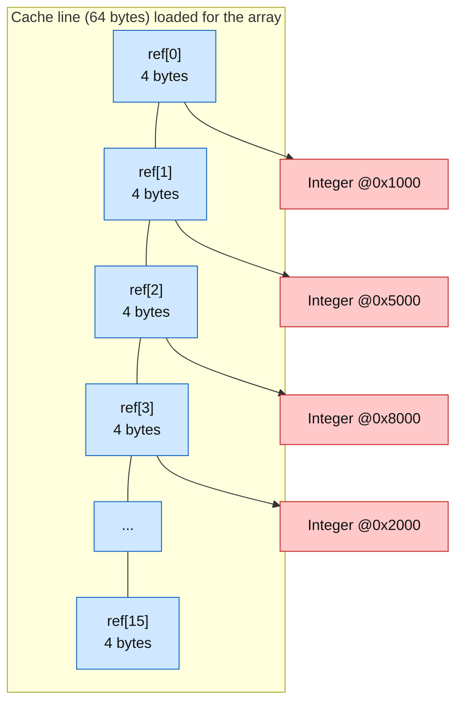

# Evolution of Data Structure Internals (1945-2020)

> **Navigation**: [Chapter overview](../01g_DS_Internals.md) | [Hashmap Collision Handling - Deep View →](02_hashmap_collision_handling_deep_view.md)
> Page 1 of 6 in **Data Structure Internals — CPU & Memory Level**


## Why History Matters Here

Every data structure in this chapter exists because of a _specific historical problem_ that earlier designs could not solve. Understanding the evolution is not academic trivia — it tells you when to reach for which structure. A `HashMap` in 2024 is a product of: drum memory limitations (1950s), collision-resolution research (1960s), LISP garbage collection (1970s), Java's managed memory model (1995), and 40 years of JDK engineering refinement. The internals encode these decisions. If you don't know why the design exists, you will misapply it.

## Timeline Table

| Era       | Milestone                                                                                | Why It Matters for DS Internals                                                                                                                                                                                                                                                                                                                                   |
| --------- | ---------------------------------------------------------------------------------------- | ----------------------------------------------------------------------------------------------------------------------------------------------------------------------------------------------------------------------------------------------------------------------------------------------------------------------------------------------------------------- |
| **1945**  | **Von Neumann architecture** (John von Neumann, *First Draft of a Report on the EDVAC*) | Described the stored-program design in which data and instructions share one memory. The shared path between processor and memory is the root of the "Von Neumann bottleneck" that shows up in every structure here. Memory is a shared highway, not an infinite ocean. |
| **1950s** | **Drum, core and disk storage** (MIT Whirlwind core memory 1953, IBM 305 RAMAC disk 1956) | Physical storage was dramatically slower than the CPU. The idea of _hierarchical memory_ (fast/small close to the CPU, slow/large further away) took shape here, and every modern cache hierarchy descends from it. |
| **1956**  | **Linked Lists** (Allen Newell, Cliff Shaw, Herbert Simon — RAND Corporation)            | First dynamic data structure where elements could be scattered in memory and linked by pointers. The _pointer_ as a first-class data abstraction was invented here. This eliminated the need to pre-allocate fixed-size arrays at the cost of pointer-chasing cache penalties that we still pay today.                                                            |
| **1962**  | **AVL trees** (Adelson-Velsky and Landis) | First self-balancing binary search tree: height difference of subtrees ≤ 1 guarantees O(log n) worst case. Red-black trees (Guibas and Sedgewick, 1978) later became the choice for library maps such as Java's `TreeMap`. |
| **1967**  | **Simula 67** (Ole-Johan Dahl, Kristen Nygaard, Norwegian Computing Center) | Introduced classes and objects (Simula I, 1962–65, was the first version). Objects as heap-allocated records with a hidden header — an idea that later object-oriented languages, including Java, carry forward. |
| **1972**  | **C and pointer arithmetic** (Dennis Ritchie, Bell Labs) | Data structure internals became _explicitly visible_ to programmers: `malloc`, pointer arithmetic, and struct layout let you control memory directly. |
| **1977**  | **Universal hashing** (Carter and Wegman, IBM) | Carter and Wegman's universal hashing (STOC 1977; journal version 1979) gave the theoretical foundation for why hash tables work under adversarial input: pick the hash function at random from a family. |
| **1995–96** | **Java 1.0** (Sun Microsystems; announced 1995, released January 1996)                                                          | Introduced _managed memory_ — no manual `free()`, no dangling pointers. Object headers became mandatory (Mark Word + Class Pointer). The GC pressure that this chapter traces through every structure was an explicit design trade-off: safety and programmer productivity over raw control.                                                                      |
| **2004**  | **Java 5 generics and concurrent collections** (Java Tiger)                              | Generics eliminated raw `Object`-casting, but changed memory layout: type information at compile time means elementData became `Object[]` instead of `Object`. ConcurrentHashMap (Java 5) introduced lock-striping — segment-level locking instead of global locking — a design still used today.                                                                 |
| **2012**  | **G1 Garbage Collector** (Java 7u4)                                                      | G1 replaced CMS as the default in Java 9 (2017). G1 divides the heap into fixed-size regions and collects in concurrent phases, drastically reducing stop-the-world pauses. For DS internals, G1 changed how object headers are interpreted and how large objects are handled (Humongous Regions).                                                                |
| **2014**  | **Java 8 Nashorn / Lambda expressions**                                                  | Lambda expressions introduced _invokedynamic_ bytecode, changing how closures capture state. For DS internals, this meant lambda-heavy collections (Streams over large datasets) became a real production concern: closures capture by reference, keeping objects alive longer and increasing GC pressure.                                                        |
| **2014**  | **`@Contended`** (JEP 142, Java 8) | The annotation adds padding around fields to reduce false sharing between cache lines. The JDK uses it internally (for example in `Thread` and `ConcurrentHashMap`'s counter cells). It shows how adjacent fields written by different threads cause cache-line ping-ponging. |
| **2019–22** | **Persistent memory (Intel Optane, discontinued 2022)** | Byte-addressable non-volatile memory blurred the line between storage and RAM and forced data structures to think about durability as well as speed. The product line ended, but the ideas continue in CXL-attached and NVMe-based designs. |
| **2020**  | **ZGC and Shenandoah** (Java 15+ production-ready)                                       | Sub-millisecond pause times regardless of heap size. Both collectors use colored pointers (load barriers) to allow concurrent marking without stop-the-world pauses. This changes what the Mark Word contains — it now carries GC state bits alongside lock state. The object header diagrams in this chapter are a simplification; real headers are even richer. |

## Named Predecessors for Modern Internals Concepts

Understanding the named ancestor of each concept grounds the "why" of every design decision in this chapter:

**1. Von Neumann architecture (1945) → modern memory hierarchy**

The Von Neumann bottleneck — the single bus shared by code and data — is the _root cause_ of every cache-performance difference between structures in this chapter. ArrayList is fast because it packs data contiguously, avoiding repeated bus traversals. LinkedList is slow because each node traversal is a separate memory read. This was not a design choice; it was a physical constraint of the 1945 architecture, and we still live with it today.

**2. Drum memory → core memory → DRAM → modern cache hierarchy**

The evolution from drum (slow rotating storage) to core (magnetic rings) to DRAM (transistors) to SRAM (transistors in a different topology) produced the modern memory hierarchy: L1/L2/L3 caches between CPU and RAM. Each layer is ~10x faster and ~10x smaller than the layer below it. The 64-byte cache line (the minimum transfer unit between RAM and cache) is a physical property of modern SRAM and bus architecture. This is why _spatial locality_ — accessing nearby bytes — is the single most important factor in DS performance.

**3. Pointer machines (1960s LISP) → modern GC roots**

LISP's cons cells (the first linked list implementation) introduced the _traced heap_: memory is not explicitly freed; the runtime follows pointer chains from root references to find live objects. Modern Java GC (G1, ZGC, Shenandoah) is a direct descendant. The "GC pressure" discussed in every section of this chapter — from ArrayList's object header overhead to TreeMap's parent pointers keeping nodes alive — is a direct consequence of the GC having to trace and traverse these pointer structures.

**4. Compacting GC (LISP, 1960s) → modern generational GC**

McCarthy and Reynolds' LISP garbage collector (1960) introduced the idea of _compacting_ memory — sliding live objects together to eliminate fragmentation. This is why Java uses generational collectors: young objects die young, so copying them is cheap. Old objects are promoted less frequently. The "young generation" vs "old generation" heap split exists because compacting GC taught us that most objects are short-lived.

**5. Escape analysis (1990s research) → JIT scalar replacement**

The HotSpot JIT compiler's escape analysis (research by G. A. D. H. Cholnoky and others, production in Java 6u23) can determine that an object allocated inside a method never escapes that method's scope. When this is provable, the JIT _eliminates the allocation entirely_ and places the object's fields in CPU registers or on the stack. This is why `ArrayList<Integer>` with _hot_ access patterns can sometimes approach `int[]` speed — the Integer objects may not exist on the heap at all if the JIT proves they never escape. This is the future of DS performance: not choosing the right structure, but enabling the JIT to restructure the computation.

## Motivation Paragraphs: Why Each Evolution Happened

**Why Java added G1 GC in 2009, not earlier:**
CMS (Concurrent Mark Sweep) was the default from Java 5 (2004). CMS had a fundamental flaw — it could not compact the old generation concurrently. Long-running applications suffered from _old-generation fragmentation_: no single large-enough contiguous block for a promotion, triggering a full stop-the-world GC. G1 (JEP 291, integrated in Java 9) solved this by dividing the heap into fixed-size regions (typically 1MB each) that can be collected incrementally. G1's "remembered sets" track which regions contain references to which other regions, enabling parallel and concurrent collection without a global stop. The design decision was driven by production incidents: JVM pauses of 5-30 seconds in large heaps (>16GB) were killing latency-sensitive services.

**Why Netty introduced off-heap memory (DirectByteBuffer) around 2010:**
Netty's NIO layer uses `java.nio.DirectByteBuffer` (off-heap memory allocated via `ByteBuffer.allocateDirect()`) to avoid the JVM heap for I/O buffers. The motivation: when data arrives from the network, the OS writes it to a kernel buffer first, then copies it to the JVM heap. For high-throughput systems (100,000+ connections), this copy is expensive and triggers frequent GC of temporary ByteBuffers. DirectByteBuffer uses _native memory_ (malloc'd outside the JVM heap), so the OS can read into it directly and the JVM can access it via JNI without a copy. The cost: native memory is not managed by the GC, so DirectByteBuffer leaks are silent and devastating. Netty's `PooledByteBufAllocator` was introduced to manage this lifecycle explicitly.

**Why G1 became the default in Java 9 (2017):**
ZGC and Shenandoah were not production-ready until Java 11-15. G1 was the only GC that offered predictable pause times for large heaps at reasonable throughput. The design decision was an explicit trade-off: G1's pause times are bounded (you can set a target via `-XX:MaxGCPauseMillis=200`), which matters for user-facing latency. The cost is reduced throughput (G1 does more work to maintain this guarantee) and complexity (the user must tune region size, young/old ratio, and collection frequency).

**Why Intel added AVX-512 in 2016 and why it matters for DS internals:**
AVX-512 (Advanced Vector Extensions, 512-bit registers) allows the CPU to process 16 32-bit integers simultaneously. For data structure operations, this means `System.arraycopy()`, `Arrays.copyOf()`, and bulk memory initialization are _vectorized_: 16 elements per instruction cycle instead of 1. This is why ArrayList resize (which uses `System.arraycopy()`) is amortized O(1) even though it copies O(n) bytes — the SIMD vector unit saturates the memory bus, and the copy is bottlenecked by RAM bandwidth, not CPU cycles. If you are copying 1MB of memory, AVX-512 processes it at memory speed, not CPU speed.

## Connection to the Von Neumann Bottleneck

All of the above evolution leads to the single most important insight in this chapter: **the Von Neumann bottleneck means that data structure performance is primarily determined by how often you cross the CPU-RAM boundary.** Every structure in this chapter makes an explicit trade-off along this axis:

- Arrays: cross the boundary once, fetch everything at once (best locality)
- Linked Lists: cross the boundary once per node (worst locality)
- HashMaps: cross once per bucket, but buckets are small (moderate locality)
- Trees: cross once per level, and levels are scattered (moderate-to-poor locality)
- Heaps (array-based): cross once per level, but levels are contiguous (good locality)

The historical evolution is the story of how we got to this understanding — from the first pointer machine to modern memory-mapped I/O — and how each generation of hardware forced a new generation of data structure design.

---

THE COMPLETE INTERNAL VIEW - HOW DATA STRUCTURES ACTUALLY WORK

This section shows what REALLY happens when you use each data structure:

- Exact memory layout (byte by byte)
- CPU instructions executed
- Cache behavior and performance
- JVM object overhead
- Real assembly/bytecode operations

## 🧠 Theory Lens: Hardware Architecture vs Memory Geometry

Before diving into the bytes of lists and trees, you must understand **why** data structures perform differently from a theoretical, hardware-first perspective.

1. **The Von Neumann Bottleneck**: Modern CPUs execute instructions in less than 1 nanosecond, but main memory (RAM) takes ~100 nanoseconds to fetch data. The CPU spends most of its life waiting, starved for data.
2. **The Cache Line Reality**: To solve this starving, CPUs _never_ load memory byte-by-byte. They pull 64-byte blocks (Cache Lines) directly into the ultra-fast L1 cache.
3. **Contiguous = Free Speed, Disjointed = Death**: If your data structure packs elements side-by-side (like Arrays), when the CPU asks for index `0`, indexes `1` through `15` are fetched _for free_ inside that 64-byte cache line. If your structure uses random memory pointers (like Linked Lists), every single node traversal requires a fresh trip to RAM (a Cache Miss), making it effectively 100x slower in real wall-clock time despite identical Big O notation.
4. **The Ultimate Trade-off**: All structural operations are a compromise between **Cache Locality** (cost of reading sequential bytes) and **Write Complexity** (cost of expanding or shifting bytes). A Data Structure is just a mathematical formalization of this trade-off.

---

## Key DS Internals Invariants

An _invariant_ is a property that must hold true before and after every operation on a data structure. If an invariant is violated, the data structure is corrupted and all bets are off. These are the non-negotiable contracts that every correct implementation must maintain.

### Hash Table Invariants

> **Invariant 1:** _Hash table invariants: load factor stays in [0.25, 0.75] after resize; bucket chain length stays O(1) average._

The load factor `threshold = capacity × loadFactor` determines when the table resizes. In OpenJDK, the default load factor is 0.75 ([source: `HashMap.java` DEFAULT_LOAD_FACTOR](https://github.com/openjdk/jdk/blob/jdk-21-ga/src/java.base/share/classes/java/util/HashMap.java#L117)). Why 0.75 and not 0.5 or 1.0? The trade-off: a lower load factor means more empty buckets (better cache locality per bucket, lower collision probability) but wastes memory. A higher load factor uses memory efficiently but causes longer chains and more collisions. The 0.75 value was chosen empirically as the sweet spot for typical hash functions.

```java
// OpenJDK HashMap.java, lines 117-120
static final float DEFAULT_LOAD_FACTOR = 0.75f;

// Treeify threshold: when a chain has 8+ nodes, convert to Red-Black Tree
// This threshold is derived from Poisson distribution analysis
static final int TREEIFY_THRESHOLD = 8;
static final int UNTREEIFY_THRESHOLD = 6;  // hysteresis: don't oscillate
```

The `TREEIFY_THRESHOLD = 8` is not an arbitrary number — it is derived from the **Poisson distribution**. Under a good hash function with load factor 0.75, the probability of a bucket having k entries is:
`P(k) = (λ^k × e^(-λ)) / k!` where `λ ≈ 0.5` (average chain length)
`P(k ≥ 8) ≈ 6 × 10^(-8)` — roughly 1 in 16 million buckets. This means treeifying at 8 entries catches the genuinely pathological cases without converting for minor collisions. The inverse (`UNTREEIFY_THRESHOLD = 6`) prevents oscillation between tree and list when the bucket hovers around 7 entries.

> **Invariant 2:** _For any key K, if `map.containsKey(K)` returns true, then `map.get(K)` returns a non-null value and K.equals(key) must hold for the matching entry._

This is the hashCode/equals contract. OpenJDK enforces this via the lookup logic: `hash == e.hash && (k == e.key || k.equals(e.key))` ([source: `HashMap.java` find() method](https://github.com/openjdk/jdk/blob/jdk-21-ga/src/java.base/share/classes/java/util/HashMap.java#L334)). The hash comparison is a fast rejection — if hashes differ, equals() is never called. If they match, equals() confirms identity.

**Why it must hold:** If two objects are equal by equals() but have different hashCodes, they will land in different buckets. A `containsKey()` check may return false for an object that is semantically equal to a stored key — the HashMap never finds it because it only looks in one bucket.

### Binary Heap Invariants

> **Invariant 1:** _Binary heap invariant (min-heap): for every node at index i, `arr[parent(i)] <= arr[i]`. For max-heap: `arr[parent(i)] >= arr[i]`._

The parent-child relationship is defined by array arithmetic — no pointers needed:

- `parent(i) = (i - 1) / 2` (integer division, floor)
- `left(i) = 2 * i + 1`
- `right(i) = 2 * i + 2`

This is the complete binary tree property: all levels are filled except possibly the last, and the last level is filled left-to-right. This property guarantees that the tree has height `⌊log₂ n⌋`, which is why heap operations are O(log n).

```java
// OpenJDK PriorityQueue.java, lines 260-290 — siftUp and siftDown
// These operations maintain the heap invariant after insert/poll
private void siftUp(int k, E x) {
    if (comparator != null)
        siftUpUsingComparator(k, x);
    else
        siftUpUsingComparator(k, x);
    // After siftUp: arr[parent(k)] <= arr[k] holds
}
```

**Why it must hold:** The heap property is what makes `peek()` O(1) — the minimum/maximum is always at index 0. If the property is violated, the structure is no longer a valid heap, and `poll()` may return the wrong element.

> **Invariant 2:** _The array representation of a binary heap is always contiguous. No null gaps exist between element positions 0 and size-1._

This is the _completeness_ property. It guarantees that `peek()` at index 0 is always the root. It also guarantees that `siftDown()` during `poll()` traverses the tree in the fewest possible levels.

**Why it must hold:** The heap builds from the ground up using `heapify()` in O(n). This linear-time construction relies on the property that every node's children are at predictable indices. If there were null gaps, the parent-child arithmetic would produce wrong indices.

### B-Tree / TreeMap Invariants

> **Invariant:** _In a B-Tree of order m: (1) all leaves are at the same depth; (2) each node has between ⌈m/2⌉ and m children (except the root); (3) the root has at least 2 children if it is not a leaf._

Java's `TreeMap` uses a Red-Black tree (a binary B-Tree variant). The B-Tree invariants guarantee logarithmic height:

- Height h satisfies: `h <= log₂(n+1)` for a balanced binary search tree
- For a B-Tree of order m: height h satisfies: `h <= log_{⌈m/2⌉}((n+1)/2)`

The **Black-height invariant** of Red-Black trees (every path from a node to its descendant null pointers has the same number of black nodes) is what keeps the tree height ≤ 2 × log₂(n+1). This is the invariant that Java's TreeMap maintains after every `put()` and `remove()` operation.

```java
// OpenJDK TreeMap.java — RBTree invariants
// Source: https://github.com/openjdk/jdk/blob/jdk-21-ga/src/java.base/share/classes/java/util/TreeMap.java
// Key invariant: root is black, red nodes have black children, black-height uniform
static final boolean RED = false;
static final boolean BLACK = true;

// After every rotation/insertion: fixup() restores:
// 1. root is black
// 2. red node has black children (no consecutive reds)
// 3. black-height is uniform on all paths
```

**Why it must hold:** The Red-Black invariants are what make `get()`, `put()`, and `remove()` all O(log n). If the tree became unbalanced, operations would degrade to O(n) (the BST worst case that caused the original TreeMap DoS vulnerability). The self-balancing rotations happen in the `fixAfterDeletion()` and `fixAfterInsertion()` methods — these are the "price" paid to maintain the invariant, and that price is bounded.

### Invariant Preservation as the Design Constraint

Every data structure's internal design is a _machine for preserving its invariants_. When you call `put()` on a HashMap, the hash spreading, collision handling, and potential treeification are all in service of preserving the load factor and lookup invariants. When you call `poll()` on a PriorityQueue, the bubble-down operation is in service of the heap property. When you call `put()` on a TreeMap, the rotations are in service of the Red-Black invariants.

The invariant tells you what the structure _must_ guarantee. The implementation tells you _how_ it guarantees it at minimum cost. Understanding both is what separates the engineer who applies a structure correctly from the one who discovers its failure mode in production.

---

## 📊 1. Arraylist Deep Internals

### 💬 Study-Partner View — ArrayList Internals

**1. The bottom line:** An `ArrayList` is a thin wrapper around an `Object[]` that doubles as it fills, and each element is a separate object if you store boxed types.

**2. The textbook core:**

- Fields: `elementData` (the array), `size`, `modCount`.
- Default capacity 10 (lazily allocated); growth `newCap = oldCap + (oldCap >> 1)` (≈1.5×).
- `get(i)`: range check then array read, O(1). `add(x)`: amortized O(1). `add(i, x)`/`remove(i)`: `System.arraycopy`, O(n).
- `ArrayList<Integer>` stores references to `Integer` objects (16 bytes each plus a reference).

**3. The real-world analogy:** A **bookshelf that gets replaced by a bigger one** when it is full: you move every book across once, but you do it rarely.

**4. Walkthrough:**

1. `new ArrayList<>()`; add 11 integers.
2. The first add allocates capacity 10; the 11th add triggers growth to 15.
3. `Arrays.copyOf` copies 10 references into the new array.
4. The old array is garbage; `size = 11`, capacity 15.

> [!NOTE]
> **Quick check:** What does `modCount` do? *It lets iterators detect structural changes and throw `ConcurrentModificationException`.*


**Challenge 2 (Design):** You need to frequently add/remove from both ends of a list AND access by index. Which collection?

<details><summary>Answer</summary>

None of the standard ones do all three efficiently. Tradeoffs: `ArrayList`: O(1) index access, O(N) front insert/delete. `LinkedList`/`ArrayDeque`: O(1) front/back, O(N) index access. Real solution: if index access can be avoided, use `ArrayDeque`. If all 3 are needed constantly, consider a skip list or re-examine your design.

</details>

## Arraylist - Complete Internal View

```java
ArrayList<Integer> list = new ArrayList<>();
list.add(42);
list.add(99);
list.add(15);
```

**Memory layout** (JVM HotSpot, 64-bit, compressed oops):

**ArrayList object (heap):**

| OFFSET | SIZE | FIELD | VALUE |
| ------ | ---- | ----- | ----- |
| 0 | 8 | Mark Word | 0x00000001 (unlocked) |
| 8 | 4 | Class Pointer | → ArrayList.class |
| 12 | 4 | padding | (alignment) |
| 16 | 4 | elementData (ref) | 0x00ABC000 → Object[] |
| 20 | 4 | size | 3 |
| 24 | 4 | modCount | 3 (modification counter) |
| 28 | 4 | padding | |

**Total**: 32 bytes for the ArrayList object itself.

**`Object[] elementData` (at 0x00ABC000):**

| OFFSET | SIZE | CONTENT | VALUE |
| ------ | ---- | ------- | ----- |
| 0 | 8 | Mark Word | 0x00000001 |
| 8 | 4 | Class Pointer | → Object[].class |
| 12 | 4 | Array Length | 10 (default capacity) |
| 16 | 4 | element[0] ref | 0x00DEF000 → Integer(42) |
| 20 | 4 | element[1] ref | 0x00DEF010 → Integer(99) |
| 24 | 4 | element[2] ref | 0x00DEF020 → Integer(15) |
| 28 | 4 | element[3] ref | null (empty slot) |
| ... | ... | ... | null |
| 52 | 4 | element[9] ref | null |

**Total**: 56 bytes for `Object[10]`.

**`Integer` object (at 0x00DEF000, for value 42):**

| OFFSET | SIZE | FIELD | VALUE |
| ------ | ---- | ----- | ----- |
| 0 | 8 | Mark Word | 0x00000001 |
| 8 | 4 | Class Pointer | → Integer.class |
| 12 | 4 | value | 42 |

**Total**: 16 bytes per Integer object!

**Total memory for 3 Integers:**

- ArrayList object: 32 bytes
- Object[] array: 56 bytes
- 3 Integer objects: 48 bytes (16 × 3)

**Total**: 136 bytes!

Compare to:

```java
int[] arr = {42, 99, 15};   // 28 bytes (12 header + 4 length + 3×4 values)
```

ArrayList uses 4.8x MORE memory than a primitive array!

🔬 **Section Challenge — Arraylist - Complete Internal View**

**Challenge 1 (Reasoning):** An `ArrayList<Integer>` with 3 elements uses 136 bytes, but an `int[3]` uses only 28 bytes (4.8x difference). Where exactly does the overhead come from? Break it down.

<details><summary>Answer</summary>

Three layers of overhead: (1) ArrayList object itself: 32 bytes (Mark Word 8 + Class Pointer 4 + padding 4 + elementData ref 4 + size 4 + modCount 4 + padding 4). (2) Backing Object[10] array: 56 bytes (12 header + 4 length + 10×4 reference slots — default capacity is 10, not 3!). (3) Each Integer object: 16 bytes (8 Mark Word + 4 Class Pointer + 4 value). Three Integers = 48 bytes. Total: 32 + 56 + 48 = 136 bytes. The `int[3]` avoids ALL of this: 12 header + 4 length + 12 data = 28 bytes. Key insight: autoboxing (`int` → `Integer`) creates a new heap object per element, which is why `int[]` is drastically more memory efficient.

</details>

## Arraylist.Get() - What Actually Happens

```java
int value = list.get(1);  // Get element at index 1
```

**Java source (simplified):**

```java
public E get(int index) {
    rangeCheck(index);
    return elementData(index);
}
```

**Bytecode (actual JVM instructions):**

```text
aload_1                // Load 'list' reference onto stack
iconst_1               // Push constant 1 (index) onto stack
invokevirtual #4       // Method ArrayList.get:(I)Ljava/lang/Object;
```

Inside `get()`:

```text
iload_1                // Load index parameter
aload_0                // Load 'this' reference
getfield #2            // Field elementData:[Ljava/lang/Object;
iload_1                // Load index again
aaload                 // Load element from array (THE KEY OPERATION!)
areturn                // Return object reference
```

**Assembly (x86-64, after JIT compilation):**

```asm
; Bounds check (usually eliminated by JIT if in loop)
cmp  edx, [rax+0x10]        ; Compare index with array length
jae  THROW_EXCEPTION        ; Jump if index >= length

; Calculate element address
movsxd rdx, edx             ; Sign-extend index to 64-bit
mov  rax, [rax+0x18+rdx*4]  ; Load element reference from array
; rax now contains reference to Integer object
```

**Cpu Cycles Breakdown**:

1. bounds check: ~1 cycle (comparison)
2. address calc: ~1 cycle (multiply-add)
3. memory load: ~4 cycles (L1 hit) or ~200 cycles (cache miss)
4. method overhead: ~15-25 cycles (if not inlined by JIT)

**Best Case**: ~5-10 cycles (JIT inlined, L1 cache hit)

**Worst Case**: ~200+ cycles (cache miss on array or object)

**Cache Behavior**:
When you access `list.get(0)`:

- CPU loads cache line containing array reference pointers
- Adjacent elements (indices 1, 2, 3...) also loaded!
- But actual Integer objects are scattered in heap
- Each Integer object access may be a CACHE MISS



**How to read this diagram.** The 16 references load together in one cache line (blue), but each `Integer` they point to is scattered across the heap (red), so every dereference is likely a cache miss.

🔬 **Section Challenge — Arraylist.Get() - What Actually Happens**

**Challenge 1 (Reasoning):** `ArrayList.get(0)` loads a cache line containing references `ref[0]` through `ref[15]`. But each `Integer` object those references point to is scattered across the heap. Why does this make iterating an `ArrayList<Integer>` fundamentally slower than iterating an `int[]`?

<details><summary>Answer</summary>

Two levels of indirection with opposite cache behavior. Level 1 (reference array): sequential, cache-friendly — one cache line loads 16 adjacent references for free. Level 2 (Integer objects): random heap locations — EACH `Integer` dereference is a potential cache miss (~200 CPU cycles). With `int[]`, there's only ONE level — the values ARE the data, contiguously packed. For 1M elements: `int[]` iteration ≈ 0.3ms, `ArrayList<Integer>` ≈ 0.8ms (2.5x slower) due to pointer chasing. This is why JIT-compiled code using primitive arrays can approach bare-metal C speed.

</details>

## Arraylist Resize - What Actually Happens

When the ArrayList is full and you add another element:

```java
list.add(newElement);
```

**Step 1: Allocate new array (1.5x size)**

```java
int newCapacity = oldCapacity + (oldCapacity >> 1);  // 10 → 15
Object[] newElementData = new Object[newCapacity];
```

Memory: request 15 × 8 = 120 bytes (+ header) from the heap.
**JVM**: finds free space, potentially triggering GC if the heap is full.

**Step 2: Copy all elements**

```java
System.arraycopy(oldArray, 0, newArray, 0, size);
```

What `System.arraycopy` actually does:

- Uses CPU SIMD instructions (SSE/AVX) for bulk memory copy
- Can copy 32-64 bytes per cycle using vector registers
- Much faster than a manual loop!

Assembly (AVX-256 enabled):

```asm
vmovdqu ymm0, [rsi]    ; Load 32 bytes from source
vmovdqu [rdi], ymm0    ; Store 32 bytes to destination
add     rsi, 32        ; Advance source pointer
add     rdi, 32        ; Advance destination pointer
; Repeat until all copied
```

**Step 3: Update reference**

```java
this.elementData = newElementData;
// Old array becomes garbage → collected later by GC
```

**Time Complexity Analysis**:

- Single `add()` with resize: O(n) — must copy n elements
- But resize happens rarely! After n adds, how many total copies?
  - 10 elements → 10 copies (resize from 10 to 15)
  - 15 elements → 15 copies (resize from 15 to 22)
  - 22 elements → 22 copies (resize from 22 to 33)
  - ...
- Total copies ≈ n + n/1.5 + n/1.5² + ... ≈ 3n
- Average per add = 3n / n = 3 = O(1) AMORTIZED!

🔬 **Section Challenge — Arraylist Resize - What Actually Happens**

**Challenge 1 (Reasoning):** ArrayList grows by 1.5x on each resize. After `n` total `add()` calls, prove that the amortized cost per add is O(1) even though individual resizes are O(n).

<details><summary>Answer</summary>

Use the geometric series argument. After `n` adds starting from capacity 10, total copies across all resizes = `10 + 15 + 22 + 33 + ...` (each term is 1.5x the previous). This is a geometric series with ratio 2/3, summing to approximately `3n`. So total work = `n` (insertions) + `3n` (copies) = `4n` → amortized cost = `4n / n = O(1)`. The 1.5x growth factor is a deliberate trade-off: 2x wastes ~50% memory, 1.25x causes more frequent resizes. Java chose 1.5x (`oldCapacity + (oldCapacity >> 1)`) as the sweet spot. Key insight: `System.arraycopy()` uses SIMD (AVX-256) to copy 32 bytes per cycle, making the actual wall-clock cost of resizes much lower than the theoretical O(n) suggests.

</details>

## #️⃣ 2. Hashmap Deep Internals

### 💬 Study-Partner View — HashMap Internals

**1. The bottom line:** A `HashMap` is an array of buckets; each key is spread, masked into a bucket, and collisions are chained (and treeified when long).

**2. The textbook core:**

- `hash = h ^ (h >>> 16)`, `index = hash & (n - 1)`; `n` is always a power of two.
- Buckets hold `Node`s (chains); at ≥ 8 entries (and table ≥ 64) a bucket becomes a red-black tree; it reverts at ≤ 6.
- Resize when `size > capacity × 0.75`: capacity doubles and each node goes to its old index or old index + oldCapacity.
- `get`/`put` average O(1); worst O(log n) with tree bins.

**3. The real-world analogy:** A **post-office wall of pigeonholes**: the address decides the pigeonhole; if too many letters pile into one, they are sorted into a tidy tree inside it.

**4. Walkthrough:**

1. `put("Alice", 25)` in a 16-bucket table.
2. `hash("Alice")` spread → `index = hash & 15`.
3. Bucket empty → store `Node(hash, "Alice", 25, null)`; `size = 1`.
4. When `size` reaches 13 (> 12), resize to 32 and redistribute.

> [!NOTE]
> **Quick check:** Why a power-of-two capacity? *So `hash & (n-1)` replaces a slow modulo.*


**Challenge 3 (Tracing):** Trace a HashMap resize operation: starting with 16 buckets and 12 entries at load factor 0.75, what is the new bucket count and the rehashing pattern? Show which entries move to a different bucket index after resize.

<details><summary>Answer</summary>

**Step 1: Determine new bucket count**
Threshold = 16 × 0.75 = 12. The 12th insertion triggers resize immediately after insertion. New capacity = 16 × 2 = 32 buckets.

**Step 2: Understand the bit-width change**
The key transformation: before resize, bucket index = `hash & 15` (mask = `0b1111`, 4 bits). After resize, bucket index = `hash & 31` (mask = `0b11111`, 5 bits). The new high bit (bit 4) can now be 0 or 1.

**Step 3: Trace the 12 entries**
Let the 12 entries have hash codes whose `h ^ (h >>> 16)` folded values, when masked with 4 bits, distributed across buckets 0-15. After resize, each entry's new index = `folded_hash & 31`. Entries move to a different bucket if and only if bit 4 of `folded_hash` is 1 (because `31 = 15 | 0b10000`). If bit 4 is 0, the entry lands in the same bucket (15 is a prefix of 31 in binary).

**Step 4: Bucket distribution (illustrative hash codes)**

- Key 0: folded `0x00010000` → old: 0 → new: 16 → MOVES (+16)
- Key 1: folded `0x00010001` → old: 1 → new: 17 → MOVES (+16)
- Key 2: folded `0x00010002` → old: 2 → new: 2 → STAYS
- Key 3: folded `0x00010003` → old: 3 → new: 3 → STAYS
- Key 4: folded `0x00010008` → old: 8 → new: 8 → STAYS
- Key 5: folded `0x00010009` → old: 9 → new: 9 → STAYS
- Key 6: folded `0x0001000C` → old: 12 → new: 12 → STAYS
- Key 7: folded `0x0001000D` → old: 13 → new: 13 → STAYS
- Key 8: folded `0x00010010` → old: 0 → new: 16 → MOVES (+16)
- Key 9: folded `0x00010011` → old: 1 → new: 17 → MOVES (+16)
- Key 10: folded `0x00010014` → old: 4 → new: 20 → MOVES (+16)
- Key 11: folded `0x00010015` → old: 5 → new: 21 → MOVES (+16)

**Result:** 6 entries move to new bucket indices (oldIndex + 16). 6 entries stay in the same bucket. The new bucket array is now half-empty (16 of 32 buckets are used), and the load factor drops from 0.75 to 0.375.

> [!TIP]
> **Key insight:** Not every entry is re-distributed uniformly. Only entries whose folded hash has bit 4 = 1 move, and they move to `oldIndex + 16`. This is why resize is O(n) but not as bad as random redistribution — entries stay in a predictable range. The JIT will often optimize this with a conditional move (`cmov`) instruction rather than a branch.

</details>

## Hashmap - Complete Internal View

```java
HashMap<String, Integer> map = new HashMap<>();
map.put("Alice", 25);
map.put("Bob", 30);
map.put("Charlie", 35);
```

**Memory layout** (Java 8+, 64-bit JVM):

**HashMap object:**

| OFFSET | SIZE | FIELD | VALUE |
| ------ | ---- | ----- | ----- |
| 0 | 8 | Mark Word | 0x00000001 |
| 8 | 4 | Class Pointer | → HashMap.class |
| 12 | 4 | padding | |
| 16 | 4 | table (ref) | 0x00AA0000 → Node[] |
| 20 | 4 | size | 3 |
| 24 | 4 | modCount | 3 |
| 28 | 4 | threshold | 12 (capacity × loadFactor) |
| 32 | 4 | loadFactor | 0.75f (as int bits) |
| 36 | 4 | padding | |

**Total**: 40 bytes for the HashMap object.

**`Node[] table` (bucket array, at 0x00AA0000):**

| INDEX | CONTENT |
| ----- | ------- |
| [0] | null |
| [1] | null |
| [2] | 0x00BB0000 → Node("Alice", 25, null) |
| [3] | null |
| [4] | 0x00BB0040 → Node("Bob", 30, null) |
| [5] | null |
| [6] | null |
| [7] | 0x00BB0080 → Node("Charlie", 35, null) |
| ... | null |
| [15] | null |

**Total**: 16 + (16 × 4) = 80 bytes for `Node[16]`.

**`Node` object (at 0x00BB0000, for "Alice"):**

| OFFSET | SIZE | FIELD | VALUE |
| ------ | ---- | ----- | ----- |
| 0 | 8 | Mark Word | 0x00000001 |
| 8 | 4 | Class Pointer | → HashMap$Node.class |
| 12 | 4 | hash | 63479193 (cached hash) |
| 16 | 4 | key (ref) | 0x00CC0000 → "Alice" |
| 20 | 4 | value (ref) | 0x00DD0000 → Integer(25) |
| 24 | 4 | next (ref) | null (no collision) |
| 28 | 4 | padding | |

**Total**: 32 bytes per Node.

## Hashmap.Put() - What Actually Happens

```java
map.put("Alice", 25);
```

**Step 1: Calculate hash**

```java
int h = key.hashCode();      // "Alice".hashCode() = 63479193
int hash = h ^ (h >>> 16);   // Spread high bits to low bits
```

Why XOR with right shift?

```text
Original:  h        = 0011_1100_0110_0100_0000_0000_1001_1001
Shifted:   h >>> 16 = 0000_0000_0000_0000_0011_1100_0110_0100
XOR:       hash     = 0011_1100_0110_0100_0011_1100_1111_1101
```

This makes the low bits depend on the high bits, giving better distribution!

**Step 2: Calculate bucket index**

```java
int index = hash & (n - 1);  // n = 16 (power of 2)
```

Why AND with `(n-1)`?

```text
n     = 16 = 0001_0000
n - 1 = 15 = 0000_1111
hash & 15  = extracts the last 4 bits = index 0-15
```

This is FASTER than modulo:

- `hash % n` → ~20-80 CPU cycles (division)
- `hash & (n-1)` → 1 CPU cycle (bitwise AND)

**Step 3: Insert into bucket**

```java
if (table[index] == null) {
    table[index] = new Node(hash, key, value, null);
} else {
    // Collision! Walk the chain or convert to tree
    Node e = table[index];
    while (e != null) {
        if (e.hash == hash && e.key.equals(key)) {
            e.value = value;  // Update existing
            return;
        }
        e = e.next;
    }
    // Add at end of chain
}
```

**Step 4: Check for tree conversion (Java 8+)**

```java
if (chainLength >= 8 && tableSize >= 64) {
    treeifyBin(table, index);  // Convert chain to Red-Black Tree
}
```

Why threshold = 8?

- Probability of 8 collisions under a random hash is 0.00000006
- Tree overhead (48 bytes/node) is only worthwhile for long chains
- Tree: O(log n) search vs chain: O(n) search

🔬 **Section Challenge — Hashmap.Put() - What Actually Happens**

**Challenge 1 (Reasoning):** Java's HashMap computes the bucket index as `hash & (n-1)` instead of `hash % n`. Why is this faster AND why does it require the capacity to be a power of 2?

<details><summary>Answer</summary>

Bitwise AND is 1 CPU cycle; integer modulo (division) is 20-80 cycles. For this optimization to work, `n` MUST be a power of 2. When `n = 2^k`, then `n-1` = all 1s in binary (e.g., 16-1 = 15 = `0000_1111`). `hash & 0000_1111` extracts the last 4 bits — equivalent to `hash % 16` but 20-80x faster. If `n` were NOT a power of 2, e.g., `n=10`, then `n-1=9=1001` in binary, and `hash & 9` would NOT produce a uniform distribution across indices 0-9. This is also why HashMap additionally XORs `h ^ (h >>> 16)` — it folds the high 16 bits into the low 16 bits, ensuring that keys differing only in high bits still spread across buckets.

</details>

**Challenge 2 (Security):** An attacker sends HTTP requests with carefully crafted parameter names that ALL hash to the same bucket. Explain the attack and Java 8's defense.

<details><summary>Answer</summary>

Hash-DoS attack (CVE-2011-4858): strings like `"Aa"` and `"BB"` have identical hashCodes (2112). An attacker constructs thousands of such colliding keys as HTTP parameters. All entries pile into ONE bucket → every `HashMap.get()` becomes O(n) → server CPU spikes → denial of service. Java 8's defense: when a bucket chain reaches length 8 (and table size ≥ 64), it converts the chain to a Red-Black Tree. Worst-case lookup drops from O(n) to O(log n). It converts back to a list when the bucket shrinks below 6 entries (hysteresis prevents oscillation between list and tree).

</details>

📎 **Reference Anchor:** [OpenJDK `HashMap.java` — `hash()` and `TREEIFY_THRESHOLD`](https://github.com/openjdk/jdk/blob/jdk-21-ga/src/java.base/share/classes/java/util/HashMap.java#L274-L340)  
**Invariant learned:** `TREEIFY_THRESHOLD = 8` is chosen using the **Poisson distribution**: under a good hash function with load factor 0.75, the probability of a bucket having ≥ 8 entries is ~0.00000006 (6 in 100 million). The `hash()` spreading function (`h ^ (h >>> 16)`) folds high bits into low bits so that keys differing only in high bits don't all land in bucket 0.  
**Local rewrite:** See Challenge 1 (bucket index via `hash & (n-1)`) above. The Java source comment in `HashMap.java` line 287 explicitly cites Poisson distribution — this is why the threshold is 8 and not 4 or 16.  
**Constraint warning:** This is the OpenJDK HotSpot implementation. Android's `java.util.HashMap` (ART runtime) uses a different internal layout. The Poisson-distribution reasoning only holds for **uniformly distributed** hash functions. If you override `hashCode()` to return a constant, every entry collides — treeification fires immediately at 8 entries regardless of table size.

## Hashmap.Get() - Cpu Instruction Level

```java
Integer age = map.get("Alice");
```

**Bytecode**:

```text
aload_1              // Load map reference
ldc "Alice"          // Push string constant
invokevirtual #5     // HashMap.get(Object)Object
checkcast #6         // Cast to Integer
invokevirtual #7     // Integer.intValue()
istore_2             // Store in local variable
```

**Inside `HashMap.get()` — JIT compiled x86-64:**

```asm
; rdi = this (HashMap), rsi = key ("Alice")

; Step 1: Get hash
mov  eax, [rsi+0x08]        ; Load cached hashCode from String
mov  edx, eax               ; Copy hash
shr  edx, 16                ; h >>> 16
xor  eax, edx               ; h ^ (h >>> 16)

; Step 2: Get table and index
mov  rcx, [rdi+0x10]        ; Load table reference
mov  r8d, [rcx+0x0C]        ; Load table.length
sub  r8d, 1                 ; n - 1
and  eax, r8d               ; hash & (n-1) = index

; Step 3: Get bucket
mov  rcx, [rcx+0x10+rax*8]  ; Load table[index] (Node reference)
test rcx, rcx               ; Check if null
jz   NOT_FOUND              ; Return null if empty bucket

; Step 4: Check node
LOOP:
cmp  [rcx+0x0C], eax        ; Compare cached hash
jne  NEXT_NODE              ; Skip if hash different
mov  rdi, [rcx+0x10]        ; Load node.key
call String.equals          ; Compare keys
test al, al                 ; Check result
jz   NEXT_NODE              ; Continue if not equal
mov  rax, [rcx+0x14]        ; Load node.value - FOUND!
ret

NEXT_NODE:
mov  rcx, [rcx+0x18]        ; Load node.next
test rcx, rcx               ; Check if null
jnz  LOOP                   ; Continue if more nodes

NOT_FOUND:
xor  eax, eax               ; Return null
ret
```

**CPU cycles (no collision, L1 cache hit):**

- Hash calculation: ~5 cycles
- Index calculation: ~2 cycles
- Memory loads: ~12 cycles (3 loads × 4 cycles)
- Method call: ~20 cycles (if not fully inlined)

**Total**: ~40 cycles ≈ 15 nanoseconds @ 3GHz

With a cache miss: add ~200 cycles per miss!

---

[Chapter overview](../01g_DS_Internals.md) | [Hashmap Collision Handling - Deep View →](02_hashmap_collision_handling_deep_view.md)
