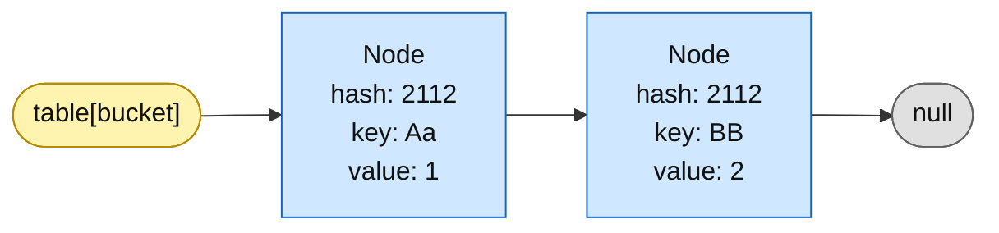
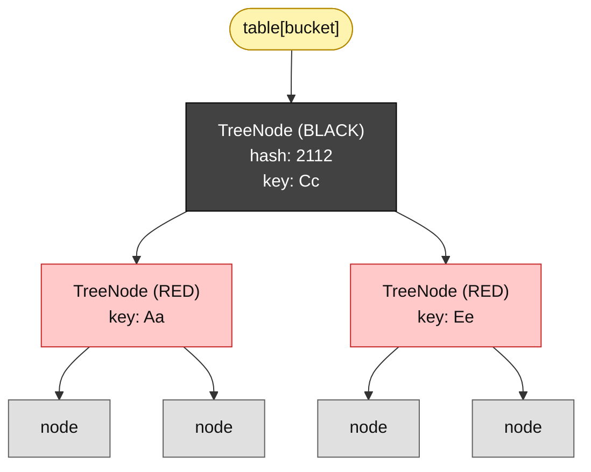
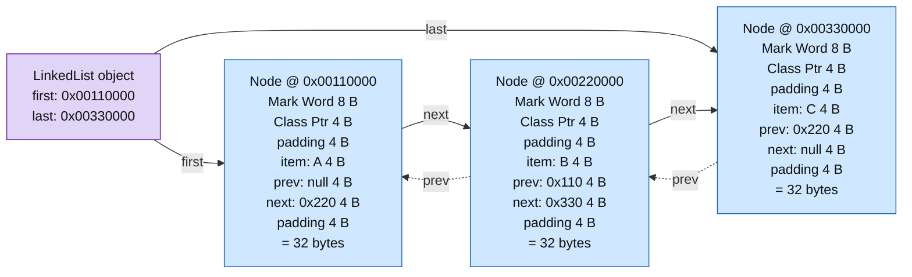
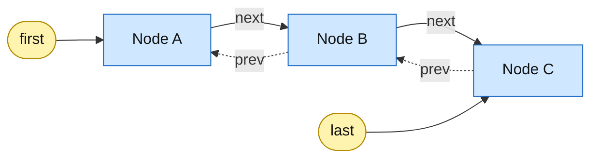
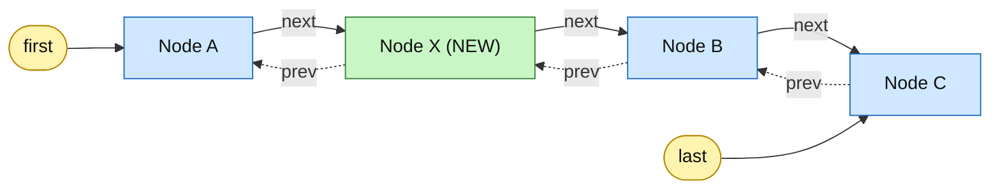

# Hashmap Collision Handling - Deep View

> **Navigation**: [← Evolution of Data Structure Internals…](01_evolution_of_data_structure_internals_1945.md) | [Chapter overview](../01g_DS_Internals.md) | [Stack - Complete Internal View →](03_stack_complete_internal_view.md)
> Page 2 of 6 in **Data Structure Internals — CPU & Memory Level**


**Scenario**: two keys with the same bucket index.

```java
map.put("Aa", 1);  // "Aa".hashCode() = 2112
map.put("BB", 2);  // "BB".hashCode() = 2112 (SAME HASH!)
```

This happens because:

```text
'A' = 65, 'a' = 97, 'B' = 66
"Aa" = 31 × 65 + 97 = 2015 + 97 = 2112
"BB" = 31 × 66 + 66 = 2046 + 66 = 2112
```

**Linked-list collision chain (before 8 nodes):**



**How to read this diagram.** Both keys hash to 2112, so they share one bucket and are chained through `next`.

`get("BB")` requires:

1. Hash calculation → 2112
2. Bucket lookup → `table[2112 & 15]`
3. Check "Aa" hash (2112) and `equals()` → NOT MATCH
4. Follow next pointer
5. Check "BB" hash (2112) and `equals()` → MATCH!

Time: O(n) where n = chain length.

**Red-Black tree (after 8 nodes in the same bucket, Java 8+):**



**How to read this diagram.** After 8 nodes land in one bucket, Java 8+ converts the chain into a red-black tree (black root, red children), so lookup becomes O(log n).

Tree lookup: O(log n) instead of O(n)!
8 nodes: 3 comparisons instead of 8.

**TreeNode memory (MORE than a regular Node):**

| OFFSET | SIZE | FIELD | VALUE |
| ------ | ---- | ----- | ----- |
| 0 | 8 | Mark Word | |
| 8 | 4 | Class Pointer | |
| 12 | 4 | hash | |
| 16 | 4 | key | |
| 20 | 4 | value | |
| 24 | 4 | next | (for iteration) |
| 28 | 4 | parent | (tree structure) |
| 32 | 4 | left | (tree structure) |
| 36 | 4 | right | (tree structure) |
| 40 | 1 | red (boolean) | (color flag) |
| 41 | 7 | padding | |

**Total**: 48 bytes vs 32 bytes for a regular Node (50% more memory).

## 🔬 3. Linkedlist Deep Internals

### 💬 Study-Partner View — LinkedList Internals

**1. The bottom line:** Each `LinkedList` element is its own 32-byte node, so every hop is a likely cache miss.

**2. The textbook core:**

- `LinkedList` keeps `first`, `last`, `size`; each `Node` holds `item`, `next`, `prev`.
- `add(i, x)` first finds the position (O(n), starting from the nearer end), then relinks 4 pointers (O(1)).
- Memory: ~32 bytes per node plus the boxed value, versus 4 bytes per `int` in an array.
- Better choices for queue/stack: `ArrayDeque`.

**3. The real-world analogy:** A **treasure hunt** where every clue is hidden somewhere else in town: following the chain costs travel time even though each step is simple.

**4. Walkthrough:**

1. `list.add(1, "X")` on `[A, B, C]`.
2. Index 1 < size/2 → start at `first`, walk 1 step to `B`.
3. Create `X`; set `X.prev = A`, `X.next = B`, `A.next = X`, `B.prev = X`.
4. Result `[A, X, B, C]`; pointer updates were O(1), finding the spot was O(n).

> [!NOTE]
> **Quick check:** Why can `LinkedList.get(i)` start from either end? *It is doubly linked, so it picks the nearer end.*


### LinkedList — complete internal view

```java
LinkedList<String> list = new LinkedList<>();
list.add("A");
list.add("B");
list.add("C");
```

**`LinkedList` object:**

| OFFSET | SIZE | FIELD | VALUE |
| ------ | ---- | ----- | ----- |
| 0 | 8 | Mark Word | 0x00000001 |
| 8 | 4 | Class Pointer | → LinkedList.class |
| 12 | 4 | padding | |
| 16 | 4 | first (ref) | 0x00110000 → Node("A") |
| 20 | 4 | last (ref) | 0x00330000 → Node("C") |
| 24 | 4 | size | 3 |
| 28 | 4 | modCount | 3 |

**Total**: 32 bytes.

**Node objects (scattered in the heap, not contiguous!):**



**How to read this diagram.** The `LinkedList` object (purple) only stores `first`, `last` and `size`. Each node (blue) is a separate 32-byte heap object with `prev` and `next` references. Solid arrows are `next`, dotted arrows are `prev`.

**Memory layout in the heap (reality):**

| Address | Content |
| ------- | ------- |
| 0x00110 | [Node A] |
| 0x00120 | [Some other object...] |
| 0x00150 | [Some other object...] |
| 0x00220 | [Node B] ← FAR from Node A! |
| 0x00250 | [Some other object...] |
| 0x00330 | [Node C] ← FAR from Node B! |

> [!CAUTION]
> **This is why LinkedList has poor cache performance.** Each node access is likely a cache miss (~200 cycles penalty).

### LinkedList.add(index, element) — internal view

```java
list.add(1, "X");   // Insert "X" at index 1
```

**Before:**



**How to read this diagram.** Before the insert, `A`, `B` and `C` are linked in both directions; `first` and `last` point to the two ends.

**Step 1: find the position (O(n) traversal)**

```java
if (index < size/2) {
    // Start from HEAD (index 1 < 3/2, so start from head)
    Node node = first;
    for (int i = 0; i < index; i++)
        node = node.next;
} else {
    // Start from TAIL (optimization for the second half)
    Node node = last;
    for (int i = size - 1; i > index; i--)
        node = node.prev;
}
```

**Step 2: create the new node and relink (O(1))**

```java
Node newNode = new Node("X");   // Allocate 32 bytes on heap
Node succ = node;               // successor = Node B
Node pred = node.prev;          // predecessor = Node A

// Relink pointers (4 pointer updates)
newNode.prev = pred;            // X.prev = A
newNode.next = succ;            // X.next = B
pred.next = newNode;            // A.next = X
succ.prev = newNode;            // B.prev = X
```

**After:**



**How to read these diagrams.** Solid arrows are `next`, dotted arrows are `prev`. Inserting `X` (green) only rewrites four pointers; no existing node moves.

**Assembly for the pointer update:**

```asm
; pred.next = newNode
mov  [rax+0x18], rcx    ; Store newNode reference in pred.next

; succ.prev = newNode
mov  [rbx+0x14], rcx    ; Store newNode reference in succ.prev
```

Each pointer update costs 1 CPU cycle (just a memory store), but **finding the position** is O(n) memory accesses with cache misses.

---

[← Evolution of Data Structure Internals…](01_evolution_of_data_structure_internals_1945.md) | [Chapter overview](../01g_DS_Internals.md) | [Stack - Complete Internal View →](03_stack_complete_internal_view.md)
