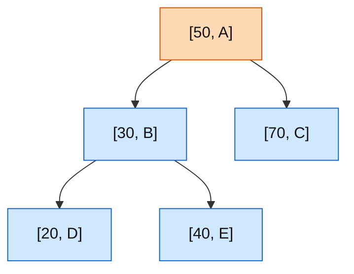
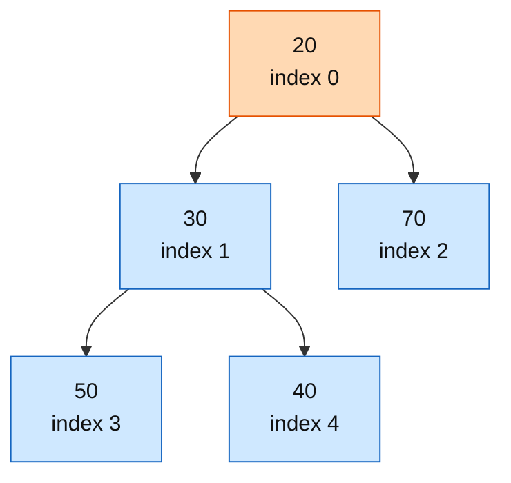
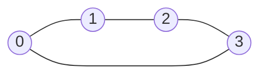

# Stack - Complete Internal View

> **Navigation**: [← Hashmap Collision Handling - Deep View](02_hashmap_collision_handling_deep_view.md) | [Chapter overview](../01g_DS_Internals.md) | [JAVA COLLECTIONS FRAMEWORK - INTERNAL… →](04_java_collections_framework_internal_architecture.md)
> Page 3 of 6 in **Data Structure Internals — CPU & Memory Level**


Java's `Stack` class extends `Vector` (legacy, synchronized).
Modern alternative: `Deque<E> stack = new ArrayDeque<>();`

**ArrayDeque as a stack — memory layout:**

```java
ArrayDeque<Integer> stack = new ArrayDeque<>();
stack.push(10);
stack.push(20);
stack.push(30);
```

**ArrayDeque object:**

| OFFSET | SIZE | FIELD | VALUE |
| ------ | ---- | ----- | ----- |
| 0 | 8 | Mark Word | 0x00000001 |
| 8 | 4 | Class Pointer | → ArrayDeque.class |
| 12 | 4 | padding | |
| 16 | 4 | elements (ref) | → Object[16] |
| 20 | 4 | head | 13 (index of first element) |
| 24 | 4 | tail | 0 (index after last element) |

**Circular buffer (elements array):**

| Index | 0 | 1 | ... | 13 | 14 | 15 |
| ----- | - | - | --- | -- | -- | -- |
| Value | null | null | ... | 30 | 20 | 10 |
| Marker | tail | | | head (TOP) | | BOTTOM |

- `push()` grows towards index 0 (head decrements)
- `pop()` shrinks from head (head increments)

**Push operation — CPU level:**

```java
stack.push(40);

head = (head - 1) & (elements.length - 1);  // 13-1 = 12
elements[head] = element;
```

Bytecode:

```text
aload_0              // Load 'this'
aload_0              // Load 'this' again
getfield #2          // Get head
iconst_1             // Push 1
isub                 // head - 1
aload_0              // Load 'this'
getfield #3          // Get elements.length
iconst_1             // Push 1
isub                 // length - 1
iand                 // & (circular wrap)
dup                  // Duplicate for store
putfield #2          // Store new head
aload_0              // Load 'this'
getfield #4          // Get elements array
swap                 // Swap index and array ref
aload_1              // Load element
aastore              // Store in array
```

CPU cycles: ~15-20 (if JIT inlined and cache hit).

## 🌳 5. Binary Tree / Bst Deep Internals

### 💬 Study-Partner View — TreeMap (Red-Black Tree) Internals

**1. The bottom line:** `TreeMap` stores each entry in a red-black tree node, which keeps keys sorted at the cost of one pointer-hop (and likely cache miss) per level.

**2. The textbook core:**

- `TreeMap.Entry` holds `key`, `value`, `left`, `right`, `parent`, `color` (~40 bytes).
- Search/insert/delete **O(log n)**, height ≤ 2·log₂(n+1).
- Extra operations: `firstKey`, `floorKey`, `ceilingKey`, `subMap`, `headMap`, `tailMap`.
- Compared with `HashMap`: slower point lookups, but sorted order and range queries.

**3. The real-world analogy:** Looking up a word in a **printed dictionary**: you flip to the middle, decide left or right, and repeat, a few page flips, each to a different page.

**4. Walkthrough:**

1. Find key 40 in the tree with root 50 (left 30 → right 40).
2. Visit 50: 40 < 50 → left.
3. Visit 30: 40 > 30 → right.
4. Visit 40: found after 3 node visits (3 potential cache misses).

> [!NOTE]
> **Quick check:** When would you choose `TreeMap` over `HashMap`? *When you need sorted keys or range/nearest-key queries.*


## Binary Search Tree - Complete Internal View

```java
TreeMap<Integer, String> tree = new TreeMap<>();
tree.put(50, "A");
tree.put(30, "B");
tree.put(70, "C");
tree.put(20, "D");
tree.put(40, "E");
```

**Tree structure**:



**How to read this diagram.** Each node is a `[key, value]` pair; keys smaller than a node go left, larger go right.

**Red-Black tree node (`TreeMap.Entry`):**

| OFFSET | SIZE | FIELD | VALUE |
| ------ | ---- | ----- | ----- |
| 0 | 8 | Mark Word | 0x00000001 |
| 8 | 4 | Class Pointer | → TreeMap$Entry.class |
| 12 | 4 | key (ref) | → Integer(50) |
| 16 | 4 | value (ref) | → "A" |
| 20 | 4 | left (ref) | → Entry(30) |
| 24 | 4 | right (ref) | → Entry(70) |
| 28 | 4 | parent (ref) | null (root) |
| 32 | 1 | color (boolean) | BLACK |
| 33 | 7 | padding | |

**Total**: 40 bytes per Entry.

**Tree traversal — CPU level (find key 40):**

```java
Integer key = 40;
Entry<K,V> p = root;            // Start at root (50)
while (p != null) {
    int cmp = key.compareTo(p.key);
    if (cmp < 0)
        p = p.left;
    else if (cmp > 0)
        p = p.right;
    else
        return p;               // Found!
}
```

```text
Iteration 1: key=40, node=50 → 40 < 50 → go left
Iteration 2: key=40, node=30 → 40 > 30 → go right
Iteration 3: key=40, node=40 → FOUND!

Total: 3 comparisons, 3 memory accesses
For n nodes: O(log n) comparisons in a balanced tree
```

**Memory access pattern**:

```text
Access 1: Load Entry(50) from RAM
          → CACHE MISS (200 cycles)
          → Also loads Entry(50).left and right pointers
Access 2: Load Entry(30) from RAM
          → CACHE MISS (200 cycles) - different memory location
Access 3: Load Entry(40) from RAM
          → CACHE MISS (200 cycles) - different memory location
```

**Total**: ~600 cycles just for memory access!
Compare to an array: 3 accesses in the same cache line = ~12 cycles.

**Why Trees Are Still Useful**:

- Sorted order guaranteed
- Range queries: O(log n + k) where k = results
- Insert/Delete: O(log n) vs O(n) for a sorted array
- No resize needed like HashMap

🔬 **Section Challenge — Binary Search Tree - Complete Internal View**

**Challenge 1 (Reasoning):** The internals section shows that a BST lookup of 3 nodes incurs ~600 CPU cycles (3 cache misses × 200 cycles each), while an array-based binary search over the same data would take ~12 cycles. Given this 50x penalty, why does TreeMap still exist? When is the cache penalty worth paying?

<details><summary>Answer</summary>

TreeMap pays the cache penalty to gain capabilities that arrays CAN'T provide efficiently: (1) **O(log n) insert/delete** — sorted arrays require O(n) shifts to insert. For dynamic data that changes frequently, TreeMap wins. (2) **Range queries** — `subMap(10, 50)` returns all entries with keys 10-50 in O(log n + k) where k = results. Arrays require binary search + linear scan. (3) **Floor/ceiling operations** — `floorKey(42)` finds the largest key ≤ 42 in O(log n). (4) **NavigableMap API** — first/last key, iterators in sorted order. Rule: if your data is static and you just need search, use `Arrays.binarySearch()`. If data is dynamic (inserts/deletes) and you need ordered access, accept the cache penalty and use TreeMap.

</details>

**Challenge 2 (Reasoning):** A TreeMap.Entry node is 40 bytes (vs 32 for a HashMap.Node). Where do the extra 8 bytes come from, and why are they necessary?

<details><summary>Answer</summary>

TreeMap.Entry has 5 reference fields (key, value, left, right, parent) + 1 boolean (color) + header. HashMap.Node has 4 fields (hash int, key, value, next). The extra fields: `parent` pointer (4 bytes) enables O(1) upward traversal needed for Red-Black Tree rebalancing after insert/delete, and `color` boolean (1 byte + 7 padding) tracks Red-Black tree invariants. Without the parent pointer, rebalancing would require maintaining a stack of ancestors during traversal — trading 4 bytes per node for algorithmic simplicity and constant-factor speed.

</details>

## 📦 6. Heap / Priority Queue Deep Internals

### 💬 Study-Partner View — PriorityQueue Internals

**1. The bottom line:** `PriorityQueue` is a binary min-heap stored in a plain array, using index arithmetic instead of pointers.

**2. The textbook core:**

- Array `queue[]`; parent of `i` is `(i-1)/2`, children `2i+1` and `2i+2`.
- `offer`: append then sift-up, O(log n). `poll`: take the root, move the last element to the root, sift-down, O(log n). `peek`: O(1).
- Contiguous layout → good cache behaviour.
- Iteration order is the array order, **not** sorted.

**3. The real-world analogy:** A **hospital triage board**: the most urgent patient is always at the top; when they leave, the board quickly reshuffles.

**4. Walkthrough:**

1. Heap `[20, 30, 70, 50, 40]`; `offer(10)`.
2. Append at index 5; parent is index 2 (70) → swap.
3. Now at index 2; parent is index 0 (20) → swap.
4. Heap `[10, 30, 20, 50, 40, 70]`; root is 10.

> [!NOTE]
> **Quick check:** Why does `poll` move the last element to the root? *It keeps the tree complete (no holes) before sifting down.*


## Heap (Priority Queue) - Complete Internal View

```java
PriorityQueue<Integer> heap = new PriorityQueue<>();
heap.offer(50); heap.offer(30); heap.offer(70);
heap.offer(20); heap.offer(40);
```

**Heap structure (min-heap):**



**How to read this diagram.** A min-heap: every parent is smaller than its children, so the minimum (20) is at index 0.

**Stored as an array (contiguous — cache friendly!):**

| Index | 0 | 1 | 2 | 3 | 4 | 5 | 6 | ... |
| ----- | - | - | - | - | - | - | - | --- |
| Value | 20 | 30 | 70 | 50 | 40 | null | null | ... |

**Parent-child relationship (no pointers needed!):**

- Parent of index `i`: `(i - 1) / 2`
- Left child of `i`: `2 * i + 1`
- Right child of `i`: `2 * i + 2`

Example: node at index 1 (value 30)

- Parent: `(1-1)/2 = 0` → value 20 ✓
- Left: `2*1+1 = 3` → value 50 ✓
- Right: `2*1+2 = 4` → value 40 ✓

**Why Array Is Brilliant For Heap**:

1. No pointer overhead (saves memory)
2. All nodes in contiguous memory (cache friendly)
3. Parent/child calculation: just arithmetic (fast!)
4. Complete binary tree guaranteed by structure

**Heapify up (after insert) — CPU level:**

```java
heap.offer(10);  // Insert 10 (smaller than root!)
```

Step 1: add at the end

| Index | 0 | 1 | 2 | 3 | 4 | 5 |
| ----- | - | - | - | - | - | - |
| Value | 20 | 30 | 70 | 50 | 40 | 10 ← NEW |

Step 2: bubble up (swap with parent if smaller)

- index=5, parent=(5-1)/2=2, `arr[5]=10 < arr[2]=70` → SWAP

  | Index | 0 | 1 | 2 | 3 | 4 | 5 |
  | ----- | - | - | - | - | - | - |
  | Value | 20 | 30 | 10 | 50 | 40 | 70 |

- index=2, parent=(2-1)/2=0, `arr[2]=10 < arr[0]=20` → SWAP

  | Index | 0 | 1 | 2 | 3 | 4 | 5 |
  | ----- | - | - | - | - | - | - |
  | Value | 10 | 30 | 20 | 50 | 40 | 70 |

  ← FINAL

Assembly for parent calculation:

```asm
mov  eax, edi    ; eax = index
sub  eax, 1      ; eax = index - 1
sar  eax, 1      ; eax = (index-1) >> 1 (signed right shift)
; Only 3 CPU cycles!
```

**Complexity Analysis**:

- `offer()` / `add()`: O(log n) — bubble up at most log n levels
- `poll()` / `remove()`: O(log n) — bubble down at most log n levels
- `peek()`: O(1) — just return `arr[0]`
- heapify array: O(n) — bottom-up construction (not O(n log n)!)

**Cache performance vs tree** (for `poll()` traversing 3 levels):

- **Heap (array):** all nodes likely in the same cache line: ~4 cycles per access → total ~12 cycles
- **Tree (pointers):** each node in a different cache line: ~200 cycles per access → total ~600 cycles

HEAP IS 50x FASTER due to cache locality!

## 🕸️ 7. Graph Representation Deep Internals

🔬 **Section Challenge — 🕸️ 7. Graph Representation Deep Internals**

**Challenge 1 (Reasoning):** For a social network with 1 billion users where each user has ~200 friends on average, would you use an adjacency matrix or adjacency list? Justify with concrete memory numbers.

<details><summary>Answer</summary>

Adjacency list, overwhelmingly. Matrix: 10^9 × 10^9 × 1 bit = 10^18 bits ≈ 125 petabytes — physically impossible. Adjacency list: each user stores ~200 neighbor IDs (4 bytes each) = 800 bytes/user × 10^9 users = 800 GB — fits in a distributed system. The graph is extremely sparse (200 / 10^9 ≈ 0.00000002% density), so the matrix would be 99.99999998% zeros. Rule: matrix only makes sense for dense graphs (density > 50%) or when you need O(1) edge existence checks on small graphs (V < 10,000).

</details>

## Graph - Complete Internal View

**Graph**:



**How to read this diagram.** A square: 0—1, 1—2, 2—3 and 3—0. Each vertex has exactly two neighbours.

**Representation 1: adjacency matrix**

```java
int[][] matrix = {
    {0, 1, 0, 1},  // Node 0 connected to 1, 3
    {1, 0, 1, 0},  // Node 1 connected to 0, 2
    {0, 1, 0, 1},  // Node 2 connected to 1, 3
    {1, 0, 1, 0}   // Node 3 connected to 0, 2
};
```

**Memory layout**:

```text
int[][] object header:   24 bytes
int[] row 0 (+ header):  16 + 16 = 32 bytes
int[] row 1 (+ header):  16 + 16 = 32 bytes
int[] row 2 (+ header):  16 + 16 = 32 bytes
int[] row 3 (+ header):  16 + 16 = 32 bytes
────────────────────────────────────────────
Total:                   152 bytes for 4 nodes
```

- Space: O(V²) — wasteful for sparse graphs!
- Check edge (u,v): O(1) — just `matrix[u][v]`
- Get all neighbors: O(V) — must scan the entire row

**Representation 2: adjacency list**

```java
List<List<Integer>> adjList = new ArrayList<>();
adjList.add(Arrays.asList(1, 3));  // Node 0
adjList.add(Arrays.asList(0, 2));  // Node 1
adjList.add(Arrays.asList(1, 3));  // Node 2
adjList.add(Arrays.asList(0, 2));  // Node 3
```

**Memory layout**:

```text
adjList[0] ──────► ArrayList [1, 3]
adjList[1] ──────► ArrayList [0, 2]
adjList[2] ──────► ArrayList [1, 3]
adjList[3] ──────► ArrayList [0, 2]

Outer ArrayList:       32 bytes
Inner ArrayList × 4:   32 × 4 = 128 bytes
Integer objects × 8:   16 × 8 = 128 bytes
────────────────────────────────────────
Total:                 ~288 bytes
```

For a sparse graph with 1000 nodes and 50 edges:

- Matrix: 1000 × 1000 × 4 = 4 MB
- List: ~50 × 48 = 2.4 KB

ADJACENCY LIST IS 1000x SMALLER!

- Space: O(V + E) — much better for sparse graphs
- Check edge (u,v): O(degree(u)) — must search the neighbor list
- Get all neighbors: O(degree(u)) — just return the list

**BFS traversal — CPU level:**

```java
Queue<Integer> queue = new LinkedList<>();
boolean[] visited = new boolean[V];
queue.offer(0);
visited[0] = true;
while (!queue.isEmpty()) {
    int node = queue.poll();
    for (int neighbor : adjList.get(node)) {
        if (!visited[neighbor]) {
            visited[neighbor] = true;
            queue.offer(neighbor);
        }
    }
}
```

**Cache Behavior**:

- `visited[]` array: CONTIGUOUS, cache-friendly
- `adjList` traversal: SCATTERED, cache-unfriendly
- Queue operations: depends on implementation

**Optimization**: use `int[]` instead of `List<Integer>` for neighbors

- Avoids Integer autoboxing overhead
- Better cache locality for neighbor iteration

---

🔬 **Section Challenge — Graph - Complete Internal View**

**Challenge 1 (Reasoning):** The BFS code above marks `visited[neighbor] = true` BEFORE enqueueing. What happens if you mark visited AFTER polling instead? Why is this a critical bug?

<details><summary>Answer</summary>

If you mark visited after polling: multiple nodes can enqueue the SAME neighbor before any of them polls it. Example: nodes A and B both connect to C. A enqueues C. Before C is polled, B also checks `!visited[C]` — still false — and enqueues C AGAIN. For dense graphs, this causes exponential queue growth and O(V²) or worse time complexity instead of O(V+E). In grid BFS (e.g., shortest path in a matrix), this bug turns O(M×N) into O(4^(M×N)) — the queue explodes. Always mark visited at the point of ENQUEUEING, not polling.

</details>

---

[← Hashmap Collision Handling - Deep View](02_hashmap_collision_handling_deep_view.md) | [Chapter overview](../01g_DS_Internals.md) | [JAVA COLLECTIONS FRAMEWORK - INTERNAL… →](04_java_collections_framework_internal_architecture.md)
