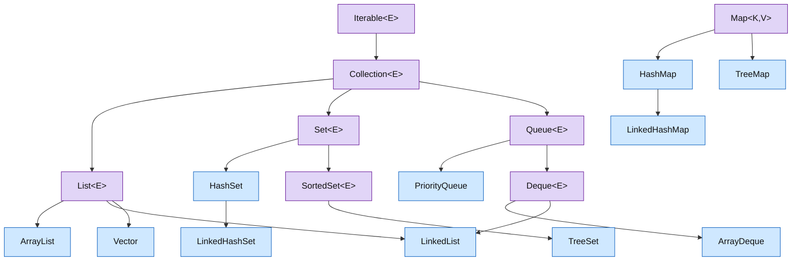
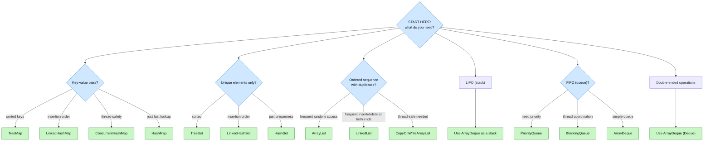

# 🔬 PART 10B: JAVA COLLECTIONS FRAMEWORK - INTERNAL ARCHITECTURE

> **Navigation**: [← Stack - Complete Internal View](03_stack_complete_internal_view.md) | [Chapter overview](../01g_DS_Internals.md) | [PERFORMANCE COMPARISON - ALL DATA STRUCTURES →](05_performance_comparison_all_data_structures.md)
> Page 4 of 6 in **Data Structure Internals — CPU & Memory Level**

## Java Collections hierarchy — complete view

**How to read this diagram.** Purple boxes are interfaces, blue boxes are concrete classes. `Map` sits outside the `Collection` tree. `LinkedList` implements both `List` and `Deque`, which is why it has two arrows into it.

**Thread-safe versions (`java.util.concurrent`):**

| Class | Behaviour |
| ----- | --------- |
| `ConcurrentHashMap` | Lock-free reads, fine-grained locking for writes |
| `CopyOnWriteArrayList` | Copy on write; great for read-heavy workloads |
| `ConcurrentLinkedQueue` | Lock-free queue using CAS operations |
| `BlockingQueue` | Thread coordination (producer-consumer) |

## When to use which collection — decision tree

**How to read this diagram.** Start at the blue question, follow the edge that matches your requirement, and stop at the green collection.

---

## DS Internals Comparison Table

The following tables provide a structured side-by-side comparison across the dimensions that matter most at the internals level: memory layout, allocation pattern, cache behavior, GC pressure, and Java representation.

### Sequential Collections: Array vs ArrayDeque vs LinkedList

| Property                | `int[]` (primitive array)                                                              | `ArrayList<Integer>`                                                                                              | `ArrayDeque<Integer>`                                                                | `LinkedList<Integer>`                                                                                   |
| ----------------------- | -------------------------------------------------------------------------------------- | ----------------------------------------------------------------------------------------------------------------- | ------------------------------------------------------------------------------------ | ------------------------------------------------------------------------------------------------------- |
| **Memory layout**       | Contiguous primitive values, no object overhead                                        | Reference array pointing to heap-scattered Integer objects                                                        | Single contiguous Object[] used as circular buffer                                   | Doubly-linked nodes scattered in heap                                                                   |
| **Allocation pattern**  | Single allocation at creation                                                          | Two allocations: ArrayList object + backing array; elements allocated separately on `add()`                       | Single circular buffer allocation (grows 2x, like ArrayList)                         | One allocation per node on every `add()`                                                                |
| **Cache behavior**      | Optimal: all values in same cache lines; sequential iteration = 1 load per 16 elements | Moderate: array reference pointer is contiguous; Integer objects are scattered (secondary cache miss per element) | Excellent: circular buffer is contiguous; no secondary cache misses for elements     | Poor: each node is a separate heap allocation; every traversal = potential cache miss                   |
| **GC pressure**         | Zero: primitives are not objects, no GC for them                                       | High: each Integer is a heap object with header; each add() may allocate a new Integer; GC must trace all of them | Moderate: elements are Integer objects but backing array is pre-allocated and reused | Very high: every node is a separate object; doubly-linked structure means more pointers for GC to trace |
| **Java representation** | `int[] arr = new int[n];` — no generics, raw pointer                                   | `ArrayList<Integer> list = new ArrayList<>();` — generic with autoboxing                                          | `ArrayDeque<Integer> deque = new ArrayDeque<>();` — generic, circular buffer         | `LinkedList<Integer> list = new LinkedList<>();` — doubly-linked, doubly-threaded                       |
| **When to choose**      | Bulk data, numerical processing, hot loops — always prefer this                        | Need dynamic size with O(1) random access and mostly read-heavy workloads                                         | Need FIFO/LIFO with no random access — faster than ArrayList for queue/stack         | Need frequent insertions/deletions at known positions in large lists (n > 10,000)                       |
| **Key trade-off**       | Fixed size, no type safety at compile time for heterogeneous data                      | Autoboxing overhead destroys memory efficiency                                                                    | No thread-safety, no index access                                                    | Pointer chasing destroys cache locality; rarely the right choice                                        |

### Key-Value Collections: HashMap vs TreeMap vs LinkedHashMap vs ConcurrentHashMap

| Property                | `HashMap<K,V>`                                                         | `TreeMap<K,V>`                                                           | `LinkedHashMap<K,V>`                                                | `ConcurrentHashMap<K,V>`                                                               |
| ----------------------- | ---------------------------------------------------------------------- | ------------------------------------------------------------------------ | ------------------------------------------------------------------- | -------------------------------------------------------------------------------------- |
| **Memory layout**       | Array of Node<> references (bucket table), each Node is heap-allocated | Red-Black tree nodes with parent/left/right pointers, all heap-allocated | HashMap layout + doubly-linked list thread through insertion order  | Array of CounterCell/Node, striped locks per segment                                   |
| **Access time (avg)**   | O(1) — hash → index → O(1) bucket lookup                               | O(log n) — tree traversal with pointer chasing                           | O(1) like HashMap + O(1) for insertion-order iteration              | O(1) — lock-free read, lock-striped write                                              |
| **Access time (worst)** | O(n) — all n entries in one bucket (collision attack or bad hash)      | O(log n) — always balanced                                               | O(n) — same as HashMap                                              | O(log n) — read is lock-free, write is segment-locked                                  |
| **Cache behavior**      | Good: bucket array is contiguous; chain/tree access is secondary       | Poor: tree nodes scattered; each level may be a cache miss               | Same as HashMap + additional cache pressure from linked-list thread | Moderate: per-segment arrays are contiguous; CounterCells add more heap allocations    |
| **GC pressure**         | Moderate: Node objects with hash, key, value, next pointers            | High: TreeNode has 3 extra pointer fields (parent, left, right) vs Node  | High: same as HashMap + doubly-linked list nodes                    | High: CounterCell array + segment array + nodes = multiple heap structures             |
| **Ordering**            | None                                                                   | Sorted by key (natural or Comparator)                                    | Insertion order (or access order if configured LRU)                 | None                                                                                   |
| **Thread-safety**       | None (unsynchronized)                                                  | None (unsynchronized)                                                    | None (unsynchronized)                                               | Full (lock-striping, Java 8+ uses CAS + synchronized)                                  |
| **When to choose**      | Default choice for key-value; sorted order not needed                  | Need sorted keys, range queries, floor/ceiling operations                | Need predictable iteration order (LRU cache, cache eviction)        | Concurrent writes from multiple threads; avoid Collections.synchronizedMap()           |
| **Key trade-off**       | No ordering; worst-case can be O(n)                                    | O(log n) access, sorted order, but more memory and pointer chasing       | Preserves insertion order at cost of extra linked-list bookkeeping  | Concurrent safety at cost of 2-3x overhead over HashMap; avoid for single-threaded use |

### String Representations: String vs StringBuilder vs char[]

| Property                | `String`                                                                                                      | `StringBuilder`                                                                        | `char[]`                                                                                       |
| ----------------------- | ------------------------------------------------------------------------------------------------------------- | -------------------------------------------------------------------------------------- | ---------------------------------------------------------------------------------------------- |
| **Memory layout**       | `char[]` value + hash cache field + coder field (Java 9+ compact strings)                                     | `char[]` value + count + shared base array                                             | Raw `char[]`                                                                                   |
| **Immutability**        | Immutable — char[] is final, no setters                                                                       | Mutable — char[] is modifiable in-place                                                | Mutable — raw array                                                                            |
| **Allocation pattern**  | Each concatenation: new String object + new char[] (interning for literals)                                   | Append: resizes char[] when full (1.5x growth, same as ArrayList)                      | Manual; no automatic resizing                                                                  |
| **Cache behavior**      | String's internal char[] is contiguous; hash cache avoids re-hashing                                          | Same as String's char[]; append() may resize and copy                                  | Fully contiguous; best cache behavior                                                          |
| **GC pressure**         | High for concatenation: each `+` creates a new String + new char[]; old ones become garbage                   | Low: pre-allocated buffer reused across append() calls                                 | Zero: no objects created                                                                       |
| **Thread-safety**       | Fully thread-safe (immutable)                                                                                 | Not thread-safe (mutable shared state)                                                 | Not thread-safe                                                                                |
| **Java representation** | `String s = "hello";` — backed by `char[]` (Java 8) or `byte[]` (Java 9+ compact strings)                     | `StringBuilder sb = new StringBuilder();` — same internal char[] as String             | `char[] arr = {'h','e','l','l','o'};` — primitive array                                        |
| **When to choose**      | String values that are held long-term, shared across threads, or used as map keys                             | Building strings incrementally (loops, repeated concatenation)                         | Performance-critical string manipulation where immutability and thread-safety are not required |
| **Key trade-off**       | Immutability enables sharing, interning, and use as map keys; but `String += x` inside a loop is O(n squared) | Pre-resizing (`new StringBuilder(n)`) avoids resize copies; append() is amortized O(1) | Manual management required; easy to introduce off-by-one errors; loses all String methods      |

### Production Decision Guide

Based on the internals above, here is a constraint-first decision matrix for choosing the right structure:

| Constraint                      | Constraint Value                  | Recommended Structure               | Why                                                                                                            |
| ------------------------------- | --------------------------------- | ----------------------------------- | -------------------------------------------------------------------------------------------------------------- |
| Memory-constrained environment  | Heap < 100 MB                     | `int[]`, `char[]`                   | Zero object overhead; primitive arrays are 5-14x more memory-efficient than boxed equivalents                  |
| GC pause-sensitive (large heap) | Heap > 4 GB, pause budget < 200ms | `ArrayDeque`, `int[]`               | Avoid structures that create many short-lived objects (ArrayList with autoboxing, LinkedList nodes)            |
| Thread-safe writes              | Multiple concurrent writers       | `ConcurrentHashMap`                 | Lock-striping allows concurrent writes without full locking; avoid `Collections.synchronizedMap()`             |
| Sorted key access               | Need floor/ceiling/subMap         | `TreeMap`                           | Only structure that guarantees sorted order with O(log n) operations; HashMap with sorted stream is O(n log n) |
| LRU cache behavior              | Evict oldest on access            | `LinkedHashMap` (access-order mode) | Override `removeEldestEntry()`; combines HashMap lookup with LRU eviction in O(1)                              |
| Bulk data processing            | Hot loop, no mutation             | `int[]`, `long[]`                   | Contiguous memory eliminates all secondary cache misses; JIT can auto-vectorize with SIMD                      |
| Insertion-order iteration       | Predictable iteration order       | `ArrayList` or `LinkedHashMap`      | ArrayList is 40x faster than LinkedList for iteration; LinkedHashMap only needed if eviction is required       |

---

[← Stack - Complete Internal View](03_stack_complete_internal_view.md) | [Chapter overview](../01g_DS_Internals.md) | [PERFORMANCE COMPARISON - ALL DATA STRUCTURES →](05_performance_comparison_all_data_structures.md)
