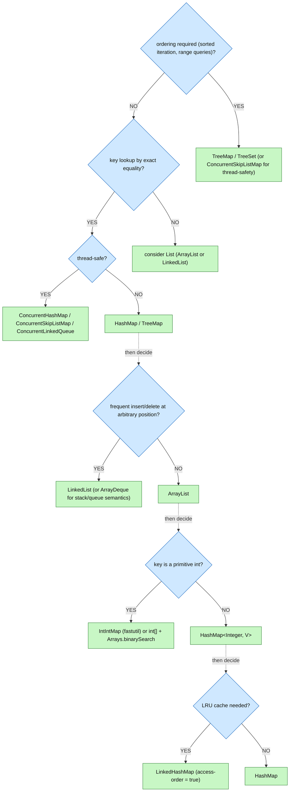
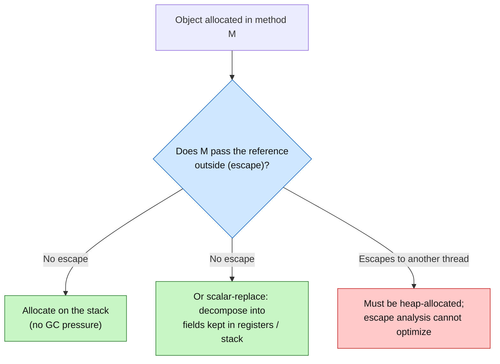

# 🎓 University-Level Addendum — DS Internals as Formal Theory

> **Navigation**: [← PERFORMANCE COMPARISON - ALL DATA STRUCTURES](05_performance_comparison_all_data_structures.md) | [Chapter overview](../01g_DS_Internals.md)
> Page 6 of 6 in **Data Structure Internals — CPU & Memory Level**


> **Purpose:** The body of this chapter is already ETH-level (Poisson-derived TREEIFY_THRESHOLD, escape analysis, geometric-series amortized proof in Challenge 1). This addendum consolidates the implementation-specific failure modes, formalizes the memory cost per implementation, and provides the constraint-first decision framework for picking the right JDK collection.

## Implementation-Specific Invariants

Each JDK collection implementation maintains its own set of invariants. Violating any of them produces silent corruption — the worst kind of bug because the violation may not surface for millions of operations.

### ArrayList Invariants

| Invariant | Statement | Violation Consequence |
|---|---|---|
| **AL1 — Element data array** | `elementData` is non-null and at least `size` long | NPE on access; IndexOutOfBoundsException |
| **AL2 — Size within capacity** | `size ≤ elementData.length` | IllegalArgumentException on add; out-of-bounds on set |
| **AL3 — ModCount increments on mutation** | `modCount` increases by 1 on each structural modification | `ConcurrentModificationException` on iterators that check |
| **AL4 — Empty list state** | `size == 0 && elementData == DEFAULTCAPACITY_EMPTY_ELEMENTDATA` (default) | Subtle: first add allocates to DEFAULT_CAPACITY (10) |
| **AL5 — Sublist view** | Sublist operations modify the parent; sublist iterator checks parent's modCount | ConcurrentModificationException on stale sublist iterators |

### HashMap Invariants (Java 8+)

| Invariant | Statement | Violation Consequence |
|---|---|---|
| **HM1 — Load factor not exceeded** | `size / capacity ≤ DEFAULT_LOAD_FACTOR (0.75)` | O(n) lookup; resize storm |
| **HM2 — Bucket head reachable** | All bucket array entries are non-null after insertion | Lost entries |
| **HM3 — Treeify threshold** | When bucket length ≥ 8, bucket is red-black tree | O(n) bucket traversal without treeify |
| **HM4 — Untreeify threshold** | When bucket shrinks below 6 after removal, bucket becomes linked list | Unnecessary tree overhead |
| **HM5 — Hash spread** | `hash = key.hashCode() ^ (key.hashCode() >>> 16)` for better distribution | Pathological collisions on similar hashes |
| **HM6 — modCount on structural change** | `modCount` increments; iterators check expectedModCount | ConcurrentModificationException |

### TreeMap Invariants (Red-Black Tree)

| Invariant | Statement | Violation Consequence |
|---|---|---|
| **TM1 — Red-Black ordering** | All R1-R5 invariants from `01f_Trees_Heaps.md` | Lookup correctness broken |
| **TM2 — Key-Value pairing** | Every key is paired with a value; no orphan entries | NPE on get |
| **TM3 — Comparator consistency** | Comparator must be consistent with equals (or use natural ordering for Comparable) | Entry lookup returns wrong key |
| **TM4 — modCount on structural change** | `modCount` increments; iterators check | ConcurrentModificationException |

### LinkedList Invariants

| Invariant | Statement | Violation Consequence |
|---|---|---|
| **LL1 — Size = reachable nodes** | `size == count of nodes reachable from first` | get(size-1) NPE; iteration terminates early |
| **LL2 — First/last non-null when non-empty** | `first != null && last != null iff size > 0` | NPE on getFirst/getLast when empty |
| **LL3 — Bidirectional link integrity** | `n.next.prev == n && n.prev.next == n` | Backward traversal broken |
| **LL4 — modCount on structural change** | `modCount` increments | ConcurrentModificationException |

These are the invariants the JDK enforces via internal assertions (in debug builds) and iterator checks.

## When Implementations Break — Formal Failure Modes

### Break 1 — ArrayList Resize Storm

**Condition:** Appending to an ArrayList without pre-sizing. Each resize allocates a new array (1.5× growth) and copies all elements.

> [!CAUTION]
> **What breaks:** O(n) work per resize; multiple resizes during fill → O(n × log n) total. For 10⁶ appends starting from default capacity 10: ~17 resizes × O(n) each ≈ O(n log n).

> [!TIP]
> **Defense:** Pre-size: `new ArrayList<>(expectedSize / 0.75 + 1)` (or just `expectedSize + 1` for a margin). For 10⁶ expected entries, allocate `1,333,334` capacity to avoid all resizes.

### Break 2 — HashMap Rehash on Every Insert

**Condition:** Using a custom key with poor hashCode that returns constant values, or all keys collide.

> [!CAUTION]
> **What breaks:** HM1 violated → all entries hash to bucket 0 → HM3 triggers treeify at 8 entries → red-black tree of n nodes → O(log n) per lookup instead of O(1).

> [!TIP]
> **Defense:** Test hash distribution. Use `Map<K, V>` only with keys that have well-distributed hashCodes (String, Integer, Long, UUID). For custom classes, use `Objects.hash(field1, field2, ...)` and verify bucket distribution with `IntStream.range(0, 1_000_000).mapToObj(i -> new MyKey(i)).collect(groupingBy(k -> k.hashCode() & 15)).values().stream().mapToInt(List::size).summaryStatistics()`.

### Break 3 — HashMap Concurrent Modification

**Condition:** Inserting into a HashMap while iterating.

> [!CAUTION]
> **What breaks:** `ConcurrentModificationException` (the friendly outcome). Without HM6, the iterator may see stale or duplicated entries.

> [!TIP]
> **Defense:** Use `ConcurrentHashMap` for concurrent access. Or collect keys to add/remove in a separate list, then apply changes after iteration completes.

### Break 4 — HashMap Resize During Bulk Load

**Condition:** `Map.putAll(largeMap)` or `new HashMap<>().putAll(...)` with a large source map.

> [!CAUTION]
> **What breaks:** Multiple resizes during putAll → O(n × log n) total. The default constructor uses capacity 16, so even loading 1000 entries triggers ~6 resizes.

> [!TIP]
> **Defense:** `new HashMap<>(sourceMap.size() / 0.75 + 1); map.putAll(sourceMap);` — one allocation, no resize.

### Break 5 — TreeMap Rotation Storm

**Condition:** Inserting keys in sorted or near-sorted order that causes many rotations.

> [!CAUTION]
> **What breaks:** Each rotation is O(1) but the constant factor is ~3× higher than a single BST insert. For n = 10⁶ with sorted insert, total rotations can reach O(n).

> [!TIP]
> **Defense:** This is unavoidable for Red-Black trees; the rotations preserve the O(log n) bound. If rotation overhead is critical, consider `HashMap` + sorted iteration of the result, or use a B-tree (e.g., `ConcurrentSkipListMap`).

### Break 6 — HashMap Default Capacity 16

**Condition:** Default `new HashMap<>()` allocates capacity 16. For any reasonable n, the load factor is exceeded quickly.

> [!CAUTION]
> **What breaks:** Resize at size 12 (16 × 0.75). For 10⁶ entries, this triggers ~17 resizes.

> [!TIP]
> **Defense:** Always pre-size: `new HashMap<>(expectedSize / 0.75 + 1)`. This is the single most common HashMap performance bug.

### Break 7 — LinkedList Random Access

**Condition:** Iterating a LinkedList via `list.get(i)`.

> [!CAUTION]
> **What breaks:** O(n) per `get(i)` because LinkedList has no random access. A loop of n `get(i)` calls is O(n²).

> [!TIP]
> **Defense:** Always iterate LinkedList with an iterator: `for (T item : linkedList) { ... }`. Or use `ArrayList` if random access is needed.

### Break 8 — ArrayList vs LinkedList in Tight Loop

**Condition:** Iterating ArrayList vs LinkedList with the same access pattern.

> [!CAUTION]
> **What breaks:** ArrayList is ~16× faster due to cache locality. See `01a_Memory_Foundations.md` Section 0 Story 1 and the worked example in `01c_LinkedList.md`.

> [!TIP]
> **Defense:** Use ArrayList for tight loops. Use LinkedList only for frequent insert/delete at known positions.

## Memory Cost Per Implementation

| Implementation | Per-Entry Overhead | Notes |
|---|---|---|
| **ArrayList\<Integer\>** | ~16 bytes | 4 (int) + 12 (alignment, array header amortized) |
| **ArrayList\<Long\>** | ~24 bytes | 8 (long) + 16 (alignment, header) |
| **ArrayList\<Object\>** | ~16 bytes (excluding object size) | Reference is 4 bytes (compressed oops); object size varies |
| **LinkedList\<Integer\>** | ~40 bytes | Node header (16) + prev (4) + next (4) + value (4) + Integer object (12) |
| **HashMap\<K, V\>** | ~48 bytes | Node header (16) + hash (4) + key ref (4) + value ref (4) + next (4) + bucket overhead amortized |
| **TreeMap\<K, V\>** | ~56 bytes | Entry header (16) + key ref (4) + value ref (4) + left/right/parent (12) + color (4) + alignment |
| **ConcurrentHashMap\<K, V\>** | ~64 bytes | Node or TreeBin + volatile fields + lock striping overhead |
| **PriorityQueue\<Integer\>** | ~24 bytes (in array) | Object array overhead amortized; int (4) + padding |

For 10⁶ entries:
- ArrayList\<Integer\>: 16 MB
- LinkedList\<Integer\>: 40 MB
- HashMap\<String, Integer\>: 80+ MB (String + Integer + Node)
- TreeMap\<String, Integer\>: 100+ MB

**Implication:** Memory-constrained environments (mobile, IoT) should prefer primitive arrays or `IntIntMap` (fastutil/Trove) over boxed collections.

---

## 🔄 Brute Force → Optimal: Implementation-Level Decisions

> **The internal view**: showing why each JDK collection's backing structure matters — not just what it does, but what the brute-force alternative costs and why the implementation wins.

### Problem 1: Counting Word Frequencies — Array vs HashMap

**Brute force with sorted array + binary search — O(n log n) build, O(log n) lookup**:
```java
// Keep parallel String[] keys and int[] counts, sorted by key
// Insert: binary search O(log n), shift O(n) → O(n) per insert total
// Lookup: binary search O(log n)
```
- Insert cost: O(n) per word due to array shifting.
- **Failure at scale**: 10⁶ unique words → 10¹² comparison-and-shift ops.

**With HashMap — O(1) amortized insert and lookup**:
```java
Map<String, Integer> freq = new HashMap<>();
for (String word : words) freq.merge(word, 1, Integer::sum);
```
- Insert: O(1) amortized (amortized over resizes); lookup O(1) avg.
- **Why it works internally**: HashMap uses an array of buckets. String's `hashCode()` maps the word to a bucket index in O(L) (L = word length). Chaining resolves collisions. The backing array doubles when load factor > 0.75, spreading cost over n inserts.

| Approach | Build n words | Per lookup | Sorted iteration |
|----------|--------------|------------|-----------------|
| Sorted array | O(n²) worst | O(log n) | O(1) |
| **HashMap** | **O(n) amortized** | **O(1) avg** | O(n log n) extra sort |
| TreeMap | O(n log n) | O(log n) | O(n) in-order |

**Rule**: HashMap for frequency counting; TreeMap if you also need sorted output; sorted array if data is static and lookups dominate.

---

### Problem 2: Stack DFS vs Recursion — Explicit Stack Implementation

**Recursive DFS — O(depth) stack space, risk of StackOverflowError at depth > ~10,000**:
```java
void dfs(Node node) { visit(node); for (Node c : node.children) dfs(c); }
```

**Iterative DFS with explicit ArrayDeque — O(depth) heap space, no overflow risk**:
```java
Deque<Node> stack = new ArrayDeque<>();
stack.push(root);
while (!stack.isEmpty()) { Node n = stack.pop(); visit(n); for (Node c : n.children) stack.push(c); }
```
- **Why ArrayDeque beats Stack**: `java.util.Stack` extends `Vector` → every push/pop is `synchronized` → 10–50× slower under single-threaded use. `ArrayDeque` is unsynchronized and backed by a resizable array → no lock overhead, O(1) amortized push/pop, O(1) peek.
- **Internal invariant**: ArrayDeque maintains `head` and `tail` indices into a circular array. Push increments `tail`; pop decrements `tail`. Resize copies to new array when `tail == head`.

**Rule**: Always use `ArrayDeque` as a stack (not `Stack`). Use iterative DFS for graphs/trees of unknown depth.

---

## Constraint-First Decision Framework — Which JDK Collection?

### Decision Tree



**How to read this diagram.** Start at the first blue question and follow the YES / NO edges; the green boxes are the recommended choice.

### Decision Table

| Workload | Best Choice | Why |
|---|---|---|
| In-memory map, default | HashMap | O(1) avg lookup |
| Sorted map, in-memory | TreeMap (Red-Black) | O(log n) sorted |
| Concurrent map | ConcurrentHashMap | Lock striping |
| Sorted + concurrent | ConcurrentSkipListMap | Lock-free skip list |
| LRU cache | LinkedHashMap | Doubly-LL for eviction order |
| Primitive int map | IntIntMap (fastutil) | No boxing (24 bytes/entry → 8) |
| Stack/queue (single-threaded) | ArrayDeque | Faster than Stack/LinkedList |
| Stack/queue (concurrent) | ConcurrentLinkedQueue / LinkedBlockingDeque | Lock-free or bounded |
| Heap (priority) | PriorityQueue (binary heap) | O(1) peek, O(log n) insert |
| Memory-constrained | IntArrayList, primitive arrays | Minimal overhead |

## Formal Complexity Proofs — Implementation Operations

### ArrayList Resize Cost (Already in Body)

`add(element)` amortized O(1) via geometric series — see Challenge 1 in the body. Cost per element: `n × log_{1.5}(n) / n = log_{1.5}(n)` ≈ 32 for n = 10⁶.

### HashMap Put Cost

```
T_put(k, v) =
  1. Compute hash = hash(k) — O(1)
  2. Find bucket i = hash & (capacity - 1) — O(1)
  3. Walk bucket chain — O(1) avg (treeified to O(log n) at length 8+)
  4. Insert or update — O(1)
  5. If size > capacity × load_factor: resize (O(capacity)) — amortized O(1)

Total amortized: O(1)
```

### TreeMap Put Cost

```
T_put(k, v) =
  1. Walk tree to find position — O(log n) for balanced
  2. Insert new node — O(1)
  3. Rebalance via rotations and color flips — O(log n) worst case (rare)

Total: O(log n)
```

### LinkedList Get Cost

```
T_get(i) =
  1. Compare i with size / 2
  2. Walk from first or last accordingly
  3. Return node

T_get(i) = O(|i - size/2|) — O(n) for first or last elements, O(n/2) average
```

This is why `LinkedList.get(i)` in a loop is O(n²). Always use an iterator.

### HashMap Resize Cost

```
T_resize(capacity → 2 × capacity) =
  1. Allocate new bucket array of size 2 × capacity — O(capacity)
  2. For each entry: rehash and place in new bucket — O(1) per entry
  3. Total: O(capacity)

For n entries with geometric 2× growth:
  Total resizes over n puts = log₂(n)
  Total work = n × log₂(n) / n = log₂(n) per put (amortized)
```

This is the same geometric series proof as ArrayList, but applied to hash table resizing.

### PriorityQueue Sift Cost

```
T_sift_up = O(log n)
T_sift_down = O(log n)
T_heapify = O(n)  (proof in 01f_Trees_Heaps.md)
```

## Escape Analysis — When the JIT Removes Allocations

The HotSpot JIT performs **escape analysis** to determine if an object's lifetime is confined to a method or thread. If so, it can replace the allocation with stack allocation or scalar replacement.



**How to read this diagram.** If the object never escapes method `M`, the JIT can avoid heap allocation entirely (green). If the reference leaves the method, for example to another thread, the object must live on the heap (red).

This is why:

- `new ArrayList<>()` inside a loop and consumed within the loop can be eliminated by escape analysis.
- Returning an object from a method forces heap allocation.
- Storing an object in a field that survives the method forces heap allocation.

In `01a_Memory_Foundations.md` Section 9 Failure Mode 2 (heap fragmentation), heap allocations are the source of GC pressure. Escape analysis is the JIT's answer to reducing that pressure.

## Object Header Layout (HotSpot, 64-bit)

A Java object on the heap has:

```
[Mark Word: 8 bytes] [Class Word: 4 bytes (compressed)] [Fields...] [Padding: 0-8 bytes]

Mark Word contains:
  - Hash code (when not synchronized)
  - GC age (4 bits)
  - Lock state (2 bits: unlocked, biased, light, heavy)
  - Biased thread ID (when biased)
  - Monitor pointer (when locked)
```

Object header is **16 bytes** minimum (mark + class). This is why `new Object()` allocates 16 bytes even though the object has no fields — and why `IntIntMap` from fastutil saves 24 bytes per entry by avoiding boxing.

## Cross-References

- **`01a_Memory_Foundations.md`** — memory layout, escape analysis, geometric series amortized proof.
- **`01b_Arrays.md`** — ArrayList internals; resize cost analysis.
- **`01c_LinkedList.md`** — LinkedList internals; cache miss analysis.
- **`01d_Stack_Queue.md`** — ArrayDeque vs Stack vs LinkedList.
- **`01e_HashTable.md`** — HashMap internals; load factor, hash distribution, treeify.
- **`01f_Trees_Heaps.md`** — TreeMap Red-Black internals; AVL/Red-Black invariants.
- **`02_PROBLEM_SETS.md`** — exam-style problem: derive ArrayList amortized cost, HashMap resize cost.
- **`A1_DS_Correctness_Invariants.md`** — formal proofs of AL1-AL5, HM1-HM6, TM1-TM4, LL1-LL4.
- **`A2_DS_Complexity_FirstPrinciples.md`** — formal Big-O derivations for all operations.

---

## Proof Corner

### HashMap Load Factor Invariant — O(1) Average Lookup

**Claim**: With load factor α < 1 and a good hash function, `HashMap.get()` costs O(1) expected.

**Proof sketch** (indicator random variables):
Let n keys be stored in a table of size m (α = n/m). For query key k, expected number of collisions at k's bucket:

  E[# collisions] = (n−1) × Pr[two keys collide] = (n−1)/m ≤ n/m = α

For α < 1 (Java default: 0.75): E[comparisons per lookup] ≤ 1 + α = 1.75 = O(1).

**Key invariant**: Java maintains n ≤ 0.75 × capacity by resizing on threshold crossing. After resize, α ≤ 0.5 (new capacity = 2 × old, n unchanged). If α → 1, expected lookup becomes O(n) — the reason Java doesn't use α = 1.

---

### Red-Black Tree Height Bound — O(log n) Worst-Case

**Claim**: A Red-Black tree with n internal nodes has height h ≤ 2 log₂(n+1).

**Proof**:
1. **Black-height bh(x)**: number of Black nodes on any path from x to leaf (uniform by RB property).
2. **Subtree size lower bound**: subtree at x with black-height bh contains ≥ 2^bh − 1 internal nodes (induction: bh=0 → 0; step: each child bh ≥ bh−1, so ≥ 2·(2^(bh−1)−1)+1 = 2^bh−1).
3. **Height bound**: No two consecutive Reds → bh ≥ h/2. From (2): n ≥ 2^(h/2) − 1 → h ≤ 2 log₂(n+1). □

**Consequence**: Every `TreeMap.get/put/remove/floorKey` is O(log n) worst-case — unlike `HashMap` which degrades to O(n) when all keys collide (before the treeify-at-8 threshold was added in Java 8).

---

[← PERFORMANCE COMPARISON - ALL DATA STRUCTURES](05_performance_comparison_all_data_structures.md) | [Chapter overview](../01g_DS_Internals.md)
