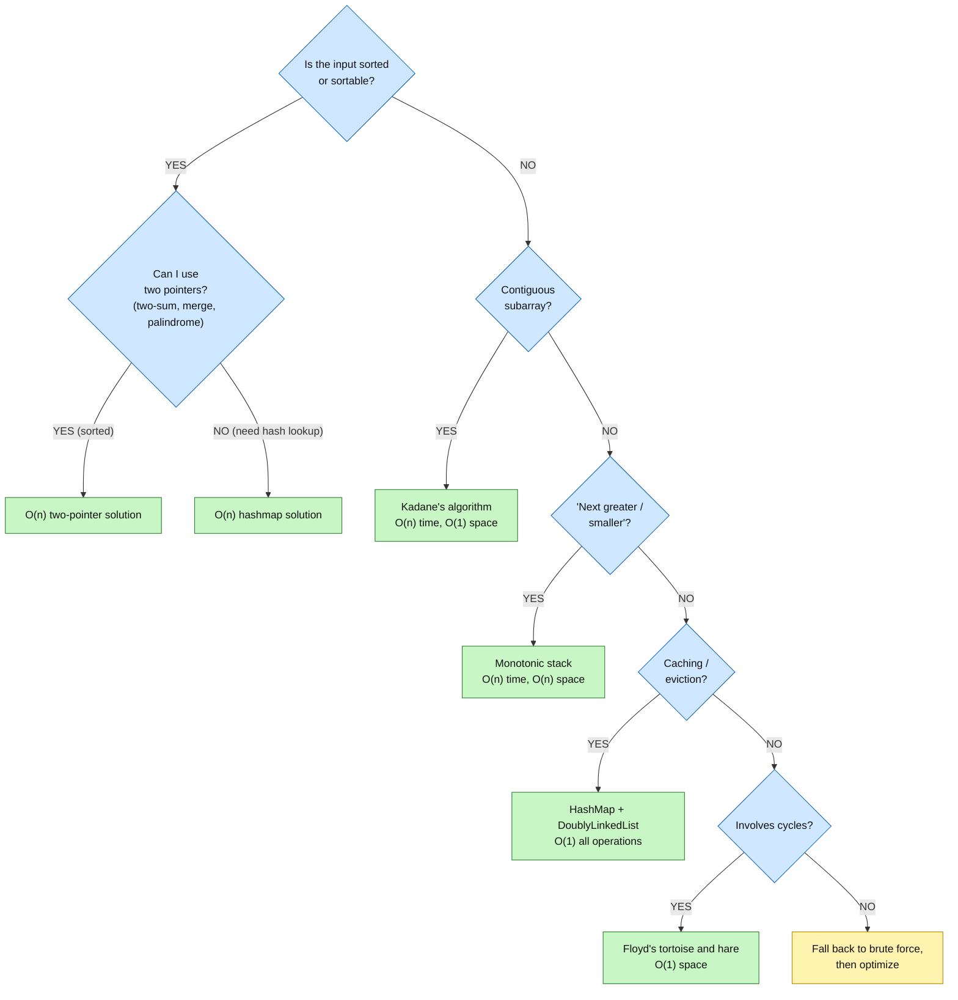

# Problem-Solving Mental Models

> **Navigation**: [Chapter overview](../02_PROBLEM_SETS.md) | [University-Level Exam Problem Bank →](02_university_level_exam_problem_bank.md)
> Page 1 of 2 in **Data Structures — Problem Sets**


Before attempting any problem in this file, internalize these three mental models. They are the constraint-first thinking framework used by every algorithm problem setter and almost every interview evaluator.

## Model 1: Constraint-First Reading

Before solving, identify the **constraint triple**:

```
(n: input size) + (time limit) + (memory limit)
```

- `n ≤ 10^5` → O(n log n) or O(n) solutions — O(n²) is too slow
- `n ≤ 10^6` → O(n) or O(1) space — consider streaming or in-place
- `n ≤ 10^2` → O(n²) may be acceptable — try brute force first
- `n = 1` or `n = 0` → edge cases, handle separately

**Example from Kadane's (DS-PS1 A3):** `n` is unspecified → assume general. You need O(n) because there's no constraint saying `n` is small. This immediately rules out O(n²) brute force (prefix sum of all subarrays).

## Model 2: Invariant Reasoning

Every algorithm preserves an **invariant** — a statement that holds true at every loop iteration. Finding the invariant _before coding_ is the single highest-leverage skill in algorithm problem solving.

**Kadane's invariant (DS-PS1 A3):**

> At each index `i`, `maxEndingHere` equals the maximum subarray sum of any subarray that **ends at index `i`**.

This is not stated in the problem body — it must be discovered. The invariant tells you exactly what decision to make at each step: restart if adding `arr[i]` hurts more than it helps.

**Monotonic stack invariant (DS-PS4 A1):**

> The stack always contains indices of elements for which no greater element has been found to the right, in **strictly decreasing value order**.

When a new element violates this order, you have found the next greater element for every popped index.

**Floyd cycle invariant (DS-PS3 A2):**

> Slow pointer and fast pointer, started together, maintain the invariant that the fast pointer is always exactly twice the distance of the slow pointer from the start. If a cycle exists, this distance eventually wraps to a multiple of the cycle length, causing a meeting.

## Model 3: Edge-Case Enumeration

Before finalizing any solution, enumerate the **edge-case matrix**:

| Edge case                                          | Why it matters                                          |
| -------------------------------------------------- | ------------------------------------------------------- |
| Empty input (`n = 0`)                              | Null checks, base case handling                         |
| Single element (`n = 1`)                           | No loop iterations, initialization correctness          |
| Two elements (`n = 2`)                             | Minimum non-trivial case, pointer advancement           |
| All equal elements                                 | Does your algorithm treat equal values correctly?       |
| Sorted input (ascending)                           | Some algorithms are optimized for sorted input          |
| Reverse sorted                                     | Can your algorithm handle worst-case ordering?          |
| All negative numbers                               | Kadane's initialization bug: never start `maxSoFar = 0` |
| All positive numbers                               | Kadane's always extends the subarray                    |
| Integer overflow (`n = 10^5`, values near INT_MAX) | Does your sum or product overflow?                      |
| Duplicate values                                   | Hash map collisions, two-pointer correctness            |

**Example:** Kadane's fails on `[-3, -2, -1]` if `maxSoFar` is initialized to `0` (returns `0` instead of `-1`). The correct initialization is `arr[0]`.

---

## Problem Set DS-PS1 — Arrays & Complexity

**Prerequisites:** `01a_Memory_Foundations.md`, `01b_Arrays.md`, `01_Algorithm_Thinking.md` §1-2

---

### Part A: Theoretical (Pen & Paper)

**A1 (Easy).** An array `a` of `n` integers is stored at memory address `base`. Each integer is 4 bytes. Derive a formula for the memory address of `a[i]` and explain why array access is O(1).

<details><summary>Answer</summary>

`address(a[i]) = base + i × 4`

Because the formula is a single multiplication + addition — it takes **constant time regardless of n**. This is the foundational reason arrays are O(1) random access: the CPU doesn't traverse elements, it computes the address directly.

🔴 **Erklärung (Common mistake):** Students often say "O(1) because it's fast." Speed is not the definition. O(1) means the time is _independent of n_. Even a slow O(1) operation remains O(1).

</details>

---

**A2 (Medium).** Analyze the time complexity of this code:

```java
for (int i = 0; i < n; i++) {
    for (int j = i; j < n; j++) {
        System.out.println(i + ", " + j);
    }
}
```

Show your work step by step.

<details><summary>Answer</summary>

Outer loop runs n times. For each `i`, the inner loop runs `n - i` times.

Total iterations = `Σ(i=0 to n-1) (n - i) = n + (n-1) + ... + 1 = n(n+1)/2`

**Time Complexity: O(n²)**

🔴 **Erklärung:** A common error is to say "two nested loops = O(n²)." This is a shortcut, not a proof. The inner loop starts at `j = i`, NOT `j = 0`. You must sum the iterations correctly. If the inner loop always started at 0, it would still be O(n²), but for different reasons — always show the sum.

</details>

---

**A3 (Hard).** You are given an array of n integers. Design an algorithm to find the maximum subarray sum (Kadane's algorithm). Prove that your approach is correct by stating the invariant that holds at each step.

<details><summary>Answer</summary>

**Algorithm (Kadane's):**

```
maxSoFar = arr[0]
maxEndingHere = arr[0]
for i = 1 to n-1:
    maxEndingHere = max(arr[i], maxEndingHere + arr[i])
    maxSoFar = max(maxSoFar, maxEndingHere)
return maxSoFar
```

**Invariant:** At every step `i`, `maxEndingHere` holds the maximum subarray sum ending exactly at index `i`. The key decision: if adding `arr[i]` to the current subarray makes it worse than starting fresh at `arr[i]`, we restart.

**Proof:** The maximum subarray must end at _some_ index `k`. At step `k`, `maxEndingHere` correctly holds the max subarray ending at `k`. Since `maxSoFar` tracks the global max, it will capture this value.

**Time: O(n), Space: O(1)**

🔴 **Erklärung:** A common failure is returning `0` when all numbers are negative, thinking "empty subarray is 0." The problem asks for a _non-empty_ subarray. Initialize `maxSoFar = arr[0]` not `0`.

</details>

---

### Part B: Implementation

**B1.** Implement a `DynamicArray<T>` class in Java:

```java
// Skeleton — file: JavaSolutions/ps/ds/DynamicArray.java
public class DynamicArray<T> {
    private Object[] data;
    private int size;
    private int capacity;

    public DynamicArray() {
        // TODO: initialize with capacity 4
    }

    public void add(T element) {
        // TODO: add to end, resize when full (double capacity)
    }

    public T get(int index) {
        // TODO: bounds-check and return element
    }

    public void remove(int index) {
        // TODO: shift elements left, size--
    }

    public int size() { return size; }

    private void resize() {
        // TODO: allocate new array of 2x capacity, copy elements
    }
}
```

**JUnit Test Stub:**

```java
// JavaSolutions/ps/ds/DynamicArrayTest.java
import org.junit.jupiter.api.*;
import static org.junit.jupiter.api.Assertions.*;

class DynamicArrayTest {
    @Test void testAddAndGet() {
        var arr = new DynamicArray<Integer>();
        arr.add(1); arr.add(2); arr.add(3);
        assertEquals(3, arr.size());
        assertEquals(2, arr.get(1));
    }
    @Test void testResize() {
        var arr = new DynamicArray<Integer>();
        for (int i = 0; i < 10; i++) arr.add(i);
        assertEquals(10, arr.size());
        assertEquals(9, arr.get(9));
    }
    @Test void testRemove() {
        var arr = new DynamicArray<String>();
        arr.add("a"); arr.add("b"); arr.add("c");
        arr.remove(1);
        assertEquals(2, arr.size());
        assertEquals("c", arr.get(1));
    }
    @Test void testBoundsCheck() {
        var arr = new DynamicArray<Integer>();
        arr.add(42);
        assertThrows(IndexOutOfBoundsException.class, () -> arr.get(5));
    }
}
```

---

### Production Pattern Recognition: From Classroom to Production Systems

Each problem in this file maps to a real-world production system. Recognizing these mappings helps you remember the algorithm and understand why it matters beyond the whiteboard.

#### Kadane's Algorithm (Max Subarray Sum, DS-PS1 A3)

| Production System               | How It Uses Kadane's                                                                                                                                                                                                  |
| ------------------------------- | --------------------------------------------------------------------------------------------------------------------------------------------------------------------------------------------------------------------- |
| **Stock trading profit**        | Given daily price history, find the maximum profit from one buy-sell pair. This is exactly Kadane's: the "profit" at day `i` = price[i] - price[i-1]. The max subarray sum of daily deltas = max single-trade profit. |
| **Signal processing**           | Finding the peak signal segment in a noisy time-series (EEG, audio). Kadane's finds the contiguous window with maximum aggregate energy above the noise floor.                                                        |
| ** Genomics (BLAST alignment)** | Finding the maximum-scoring local alignment between DNA sequences. Smith-Waterman uses a 2D variant of Kadane's (max scoring submatrix).                                                                              |

**Code pattern in production:**

```java
// Kadane's for stock profit (LeetCode 121)
int maxProfit = 0;
int minPrice = prices[0];
for (int price : prices) {
    minPrice = Math.min(minPrice, price);
    maxProfit = Math.max(maxProfit, price - minPrice);
}
// This is Kadane's in disguise: max(delta) subarray
```

#### Hash Map / Chaining (DS-PS2)

| Production System             | How It Uses Hash Tables                                                                                                                                                     |
| ----------------------------- | --------------------------------------------------------------------------------------------------------------------------------------------------------------------------- |
| **Redis / Memcached**         | In-memory key-value stores use hash tables with chaining or open addressing for O(1) GET/SET. The load factor tuning (0.75) directly controls memory vs. latency tradeoffs. |
| **OAuth token validation**    | JWT or session tokens are validated by looking up a key (JTI, session ID) in a hash map. A mutable-key bug (DS-PS2 A2) would make tokens permanently unretrievable.         |
| **CDN request deduplication** | CDN edge nodes use hash maps to track recently seen request IDs and prevent replay attacks. Chaining handles hash collisions from crafted malicious headers.                |

**Code pattern in production:**

```java
// Simulating Redis GET with your ChainingHashMap
public String get(String key) {
    return map.get(key);  // O(1) average — used millions of times/sec per server
}
```

#### Two-Pointer / Sliding Window (DS-PS1 A2 — nested loop analysis; also DS-PS3)

| Production System                 | How It Uses Two-Pointers                                                                                                                                                                                       |
| --------------------------------- | -------------------------------------------------------------------------------------------------------------------------------------------------------------------------------------------------------------- |
| **Log stream merging**            | Real-time log aggregation (ELK stack, Splunk) merges multiple sorted log streams using a k-way merge — a generalization of two-pointer merging.                                                                |
| **Deduplication pipeline**        | Data pipelines processing sorted/ordered streams (user event logs, transaction records) use two-pointer deduplication when the stream is pre-sorted by key.                                                    |
| **Rate limiting**                 | Sliding window rate limiting in API gateways (Envoy, NGINX) maintains a sliding window of request timestamps. Each new request: add timestamp, evict timestamps outside window, check count. O(1) per request. |
| **Network throughput monitoring** | Sliding window TCP throughput calculation: measure bytes sent in the last `W` milliseconds. Kadane's-like logic detects sustained high-throughput bursts.                                                      |

**Code pattern in production:**

```java
// Rate limiter using sliding window (DS-PS1 A2 pattern)
public class SlidingWindowRateLimiter {
    private int windowMs;
    private int maxRequests;

    public SlidingWindowRateLimiter(int windowMs, int maxRequests) {
        this.windowMs = windowMs;
        this.maxRequests = maxRequests;
    }

    public boolean allowRequest() {
        long now = System.currentTimeMillis();
        // Evict old entries (two-pointer: left index advances)
        while (!timestamps.isEmpty() && now - timestamps.peek() > windowMs) {
            timestamps.poll();
        }
        if (timestamps.size() < maxRequests) {
            timestamps.add(now);
            return true;
        }
        return false;
    }
}
```

#### Monotonic Stack (DS-PS4)

| Production System           | How It Uses Monotonic Stack                                                                                                                                                                          |
| --------------------------- | ---------------------------------------------------------------------------------------------------------------------------------------------------------------------------------------------------- |
| **Stock span problem**      | Given daily stock prices, find for each day how many consecutive days the price was less than or equal to today. This is a direct next-greater-element problem — the stack gives the answer in O(n). |
| **HTML/JSON parsing**       | Tag-matching parsers use a stack to ensure balanced tags. A variant (next-closing-tag) uses a monotonic decreasing stack over tag precedence levels.                                                 |
| **Temperature forecasting** | Given daily temperatures, find for each day how many days until a warmer day (Next Greater Element). Weather APIs use this for "how long until it warms up" UI widgets.                              |

**Code pattern in production:**

```java
// Production: next greater element for stock span (Next Greater, DS-PS4 A1)
public int[] nextGreaterElement(int[] nums) {
    int[] result = new int[nums.length];
    Stack<Integer> stack = new Stack<>();
    for (int i = 0; i < nums.length; i++) {
        while (!stack.isEmpty() && nums[stack.peek()] < nums[i]) {
            result[stack.pop()] = nums[i];  // nums[i] is next greater for popped index
        }
        stack.push(i);
    }
    while (!stack.isEmpty()) result[stack.pop()] = -1;
    return result;
}
```

---

### Part C: Challenge (Design)

**C1.** Your `DynamicArray` doubles its capacity on resize. This causes amortized O(1) `add`. What happens to amortized complexity if you grow by only 1 slot each time instead? Prove your answer mathematically.

<details><summary>Answer</summary>

**If growth = +1 per resize:**

Adding element at size `n` requires copying all `n` existing elements. Over `n` insertions total:
Cost = 1 + 2 + 3 + ... + n = n(n+1)/2 = **O(n²) total**, so O(n) amortized per operation.

**If growth = ×2 per resize:**

Resizes happen at sizes 1, 2, 4, 8, ... Total copy work = 1 + 2 + 4 + ... + n/2 < 2n = **O(n) total**, so **O(1) amortized** per operation.

🔴 **Erklärung:** This is the core reason Java's `ArrayList` uses growth factor 1.5x–2x, not 1.1x or +1. Smaller growth factors cause quadratic amortized cost. This is a direct consequence of the geometric series sum.

</details>

---

## Problem Set DS-PS2 — Hash Tables

**Prerequisites:** `01e_HashTable.md`, `Ch08_Collections_Internals.md`

---

### Part A: Theoretical

**A1 (Easy).** In Java's `HashMap`, what is the load factor and why does exceeding it trigger a resize? What is the default threshold?

<details><summary>Answer</summary>

**Load factor** = number of entries / number of buckets. Java's default is **0.75**. When `size > capacity × loadFactor`, the hashmap resizes (doubles and rehashes).

**Why 0.75?** It balances time vs space: lower load factor = fewer collisions (faster) but more memory; higher = more collisions (slower). 0.75 is empirically chosen as the sweet spot.

🔴 **Erklärung:** Students confuse load factor with fill percentage. At load factor 0.75, not 75% of slots contain an entry — buckets can contain multiple entries via chaining. It's the _ratio of entries to buckets_, not a density measure.

</details>

---

**A2 (Medium).** Explain what happens when you use a mutable object as a `HashMap` key and then mutate it. Trace through the internal mechanics to explain why the entry becomes unretrievable.

<details><summary>Answer</summary>

`HashMap` stores the key's **hashCode** at insertion time and places the entry in bucket `hash(key) % capacity`.

When you mutate the key, its `hashCode()` changes. The next `get()` computes a **new bucket index** from the new hash, finds nothing, and returns `null` — even though the entry still exists in the old bucket.

**The ghost entry** lives in the map forever, wasting memory and causing a subtle correctness bug.

> [!TIP]
> **Fix:** Always use **immutable keys** (String, Integer, UUID) or implement proper value-based immutability via DDD Value Objects.

🔴 **Erklärung:** This is one of the most common production bugs. The fix is not "override hashCode to return a constant" — that degrades performance to O(n) by forcing all keys into one bucket.

</details>

---

**A3 (Hard).** Java's `HashMap` uses tree-ification (converts a chain to a `TreeMap`-like Red-Black Tree) when a single bucket chain exceeds 8 entries. Why? Under what condition does this trigger, and what does it achieve?

<details><summary>Answer</summary>

Without tree-ification, a bucket chain is a `LinkedList`. If many keys hash to the same bucket (e.g., via a DoS attack using crafted hash collisions), all operations degrade to O(n).

**Tree-ification** converts the chain to a **Red-Black Tree** when chain length > 8. This provides O(log n) worst-case per bucket instead of O(n).

**Trigger condition:** Java also checks that the total map capacity is ≥ 64 before tree-ifying; otherwise it just resizes.

**📎 Reference Anchor:** [Java HashMap source](https://github.com/openjdk/jdk/blob/master/src/java.base/share/classes/java/util/HashMap.java)  
**Invariant learned:** `TREEIFY_THRESHOLD = 8` is documented at line ~270.

🔴 **Erklärung:** Many developers believe Java HashMap is always O(1). This is only true for the amortized average case with good hash distribution. Worst-case without tree-ification is O(n), which becomes O(log n) with it.

</details>

---

### Part B: Implementation

**B2.** Implement a `ChainingHashMap<K,V>` from scratch using an array of linked lists:

```java
// Skeleton — JavaSolutions/ps/ds/ChainingHashMap.java
public class ChainingHashMap<K, V> {
    private static final int DEFAULT_CAPACITY = 16;
    private static final double LOAD_FACTOR = 0.75;

    private LinkedList<Entry<K,V>>[] buckets;
    private int size;

    record Entry<K, V>(K key, V value) {}

    @SuppressWarnings("unchecked")
    public ChainingHashMap() {
        // TODO: initialize buckets array
    }

    public void put(K key, V value) {
        // TODO: hash key, find bucket, check for existing key, add or update
        // TODO: if size > capacity * LOAD_FACTOR, resize()
    }

    public V get(K key) {
        // TODO: hash key, find bucket, linear search for key
    }

    public void remove(K key) {
        // TODO: hash key, find and remove entry
    }

    private int hash(K key) {
        // TODO: return Math.abs(key.hashCode()) % buckets.length
    }

    private void resize() {
        // TODO: double capacity, rehash ALL existing entries
    }
}
```

---

### Part C: Challenge

**C2.** Design a `TwoSumO1Space` solution using your `ChainingHashMap`. Then prove that the time complexity is O(n) and the space complexity is O(n). Why can't we solve Two Sum in O(1) space with O(n) time?

<details><summary>Answer</summary>

**O(1) space proof of impossibility:** To find if any pair sums to target in O(n) time, we need to check `target - arr[i]` for each element — this requires O(1) lookup, which demands storing previously seen elements. A sorted array allows O(n log n) sort + O(n) two-pointer search, giving O(n log n) time O(1) space trade-off. But O(n) time inherently requires the hash map's O(n) space to trade for the speed.

This is the time-space tradeoff — you cannot achieve both O(n) time and O(1) space simultaneously for this problem.

</details>

---

## Problem Set DS-PS3 — Linked Lists

**Prerequisites:** `01c_LinkedList.md`, `12_LinkedList_Plus_TwoPointers.md`

---

### Part A: Theoretical

**A1 (Easy).** What is the time complexity of inserting an element at the head of a singly linked list vs an array? Explain why they differ.

<details><summary>Answer</summary>

**Linked List head insert:** O(1) — just update `newNode.next = head; head = newNode`. No shifting.

**Array head insert:** O(n) — all n existing elements must be shifted one position right to make room.

🔴 **Erklärung:** Students often think "both are just adding one element so they should be equal." The difference is memory layout. Array elements are contiguous — shifting is a physical memory copy. Linked list nodes are scattered — you just update two pointer values.

</details>

---

**A2 (Medium).** Trace Floyd's cycle detection algorithm on this list: `1 → 2 → 3 → 4 → 5 → 3` (node 5 points back to node 3). Show each step of slow/fast pointer movement until they meet.

<details><summary>Answer</summary>

Nodes: `1(pos0) → 2(pos1) → 3(pos2) → 4(pos3) → 5(pos4) → 3(pos2) [cycle]`

| Step  | Slow | Fast         |
| ----- | ---- | ------------ |
| Start | 1    | 1            |
| 1     | 2    | 3            |
| 2     | 3    | 5            |
| 3     | 4    | 4 ← **MEET** |

They meet at node `4`. A cycle exists.

**Finding entry point:** Move one pointer to head. Advance both one step at a time — they meet at cycle start (`3`).

🔴 **Erklärung:** Students often stop when they "detect" the cycle and forget the second phase (finding entry). In LeetCode 142 "Linked List Cycle II," the full problem requires the entry node, not just detection.

</details>

---

### Part B: Implementation

**B3.** Implement an LRU Cache using HashMap + DoublyLinkedList:

```java
// Skeleton — JavaSolutions/ps/ds/LRUCache.java
import java.util.HashMap;

public class LRUCache {
    private int capacity;
    private HashMap<Integer, Node> map;
    private Node head, tail; // dummy head and tail

    class Node {
        int key, val;
        Node prev, next;
        Node(int k, int v) { key = k; val = v; }
    }

    public LRUCache(int capacity) {
        // TODO: init capacity, map, dummy head/tail linked to each other
    }

    public int get(int key) {
        // TODO: if key in map, move node to front (most recent), return val
        // TODO: else return -1
    }

    public void put(int key, int value) {
        // TODO: if key exists, update value and move to front
        // TODO: else insert new node at front
        // TODO: if over capacity, evict node at tail (least recent)
    }

    private void moveToFront(Node node) { /* TODO */ }
    private void addToFront(Node node) { /* TODO */ }
    private void removeNode(Node node) { /* TODO */ }
}
```

---

## Problem Set DS-PS4 — Stacks & Queues

**Prerequisites:** `01d_Stack_Queue.md`, `15_Monotonic_Stack_Queue_Complete.md`

---

### Part A: Theoretical

**A1 (Medium).** Explain the **monotonic stack invariant** for the "Next Greater Element" problem. What property does the stack maintain at all times?

<details><summary>Answer</summary>

**Invariant:** At every step, the stack contains indices of elements for which we have **not yet found a greater element to the right**, in **monotonically decreasing order** from bottom to top.

When we see element `x`:

1. While stack top's value < `x`: pop it — `x` is its Next Greater Element.
2. Push `x`.

After processing all elements, remaining stack indices have **no greater element to the right** (answer = -1).

🔴 **Erklärung:** Students often confuse "monotonically decreasing stack" with "the elements are pushed in decreasing order." The stack stores _indices_, not values. The _values at those indices_ form a decreasing sequence.

</details>

---

**A2 (Hard).** The "Largest Rectangle in Histogram" problem uses a monotonic stack. Why does this work? Trace through bars `[2, 1, 5, 6, 2, 3]` showing each stack state.

<details><summary>Answer</summary>

**Key invariant:** We maintain a stack of bars in increasing height. When a bar is shorter than the top of the stack, we know the top bar's rectangle is bounded on the right. We pop and calculate: width = current_index - stack_top_after_pop - 1.

| i   | height | Stack (indices) | Action                                                     |
| --- | ------ | --------------- | ---------------------------------------------------------- |
| 0   | 2      | [0]             | push                                                       |
| 1   | 1      | [1]             | pop 0 (area=2×1=2), pop empty→area=1×1=1, push 1           |
| 2   | 5      | [1,2]           | push                                                       |
| 3   | 6      | [1,2,3]         | push                                                       |
| 4   | 2      | [1,4]           | pop 3 (area=6×1=6), pop 2 (area=5×2=10), push 4            |
| 5   | 3      | [1,4,5]         | push                                                       |
| end | —      | —               | pop 5 (area=3×1=3), pop 4 (area=2×2=4), pop 1 (area=1×6=6) |

**Maximum = 10** ✓

</details>

## Problem Pattern Catalog

This catalog maps every problem type in this file to its canonical solution approaches. Use it when you see a new problem — classify it first, then apply the matching pattern.

### How to Use This Catalog

1. **Identify the constraint type** (input size, time limit, space limit) to narrow the feasible complexity.
2. **Classify the problem type** from the left column.
3. **Match to a canonical approach** from the right column.
4. **Verify with a mental trace** on a small example before coding.

### Pattern Table

| Problem Type                       | Canonical Approaches                                                                                | Problems in This File |
| ---------------------------------- | --------------------------------------------------------------------------------------------------- | --------------------- |
| **Max subarray sum**               | Kadane's (O(n), O(1) space), Prefix sum + hashmap (O(n), O(n) space)                                | DS-PS1 A3             |
| **Two-sum**                        | Hash map (O(n) time, O(n) space), Two pointers on sorted array (O(n log n) time, O(1) space)        | DS-PS2 C2             |
| **Cycle detection**                | Floyd's tortoise and hare (O(n) time, O(1) space), Mark-visited (O(n) time, O(n) space)             | DS-PS3 A2             |
| **LRU cache**                      | HashMap + DoublyLinkedList (O(1) all ops), LinkedHashMap ordering (O(1) get, O(n) worst-case put)   | DS-PS3 B3             |
| **Hash map collisions**            | Chaining (linked list → treeify at TREEIFY_THRESHOLD=8), Open addressing (linear/quadratic probing) | DS-PS2 A3, B2         |
| **Mutable key bugs**               | Immutable keys (String, Integer, UUID), DDD Value Objects                                           | DS-PS2 A2             |
| **Next greater element**           | Monotonic decreasing stack (O(n) time, O(n) space)                                                  | DS-PS4 A1             |
| **Largest rectangle in histogram** | Monotonic stack (O(n) time, O(n) space), Divide and conquer (O(n log n))                            | DS-PS4 A2             |
| **Array random access analysis**   | Address formula: `base + i × sizeof(element)`                                                       | DS-PS1 A1             |
| **Nested loop summation**          | Sum the iterations: `Σ(i=0 to n-1) (n - i) = n(n+1)/2`                                              | DS-PS1 A2             |
| **Amortized analysis**             | Geometric series trick: `1 + 2 + 4 + ... + n = 2n - 1`                                              | DS-PS1 C1             |
| **Load factor resizing**           | Resize when `size > capacity × load_factor`; geometric growth gives O(1) amortized                  | DS-PS2 A1             |
| **Array vs. linked list insert**   | Array: O(n) shift; Linked list: O(1) pointer update                                                 | DS-PS3 A1             |

### Variant Taxonomy (When the Problem Changes Slightly)

| Base Problem            | Variant                              | What Changes                                                                   |
| ----------------------- | ------------------------------------ | ------------------------------------------------------------------------------ |
| Kadane's (max subarray) | Maximum product subarray             | Use max and min simultaneously (handles negative × negative)                   |
| Kadane's (max subarray) | Max subarray sum with circular array | Consider wrap-around: max of (normal max, total_sum - normal_min)              |
| Two-sum                 | 3-sum, 4-sum                         | Sort + two/three pointers; complexity O(n²) and O(n³)                          |
| Two-sum                 | Two-sum with duplicate values        | Use hashmap count, handle value == target/2 specially                          |
| Hash map                | LRU cache                            | Add ordering: doubly linked list or LinkedHashMap                              |
| Hash map                | Bloom filter                         | Probabilistic version: no delete, false positives possible                     |
| Monotonic stack         | Next smaller element                 | Reverse the inequality (pop while `stack_top >= current`)                      |
| Monotonic stack         | Largest rectangle in histogram       | For each bar: pop until stack_top < current_height                             |
| Floyd's cycle           | Find cycle start node                | After meeting, move one pointer to head; advance both one step until they meet |
| Floyd's cycle           | Happy number                         | Floyd's on digit-square-sum sequence; 1 = cycle end                            |

### Mental Model: Problem Classification Decision Tree



**How to read this diagram.** Answer each blue question in turn; the first "yes" gives the green technique to try. Yellow is the fallback when nothing matches.

### Cross-Reference to Algorithms Problem Sets

The following problem types are continued in `../03_Algorithms/03_PROBLEM_SETS.md`:

| Problem Type                                  | Where to Find More           |
| --------------------------------------------- | ---------------------------- |
| Tree traversals (BFS, DFS, Morris O(1) space) | `03_PROBLEM_SETS.md` DS-PS5  |
| Heap / priority queue problems                | `03_PROBLEM_SETS.md` DS-PS6  |
| Graph shortest paths (Dijkstra, Bellman-Ford) | `03_PROBLEM_SETS.md` DS-PS7  |
| Dynamic programming (subarray DP)             | `03_PROBLEM_SETS.md` DS-PS8  |
| Divide and conquer (merge sort, closest pair) | `03_PROBLEM_SETS.md` DS-PS9  |
| String algorithms (KMP, Rabin-Karp)           | `03_PROBLEM_SETS.md` DS-PS10 |

---

_More problem sets: DS-PS5 (Trees) and DS-PS6 (Heaps) are embedded in `03_Algorithms/03_PROBLEM_SETS.md` since trees/heaps blend DS and algorithm content._

---

[← Back to Semester 1](../../00_CURRICULUM/SEMESTER_1_GUIDE.md) | [Algorithms Problem Sets →](../../03_Algorithms/03_PROBLEM_SETS.md)

---

[Chapter overview](../02_PROBLEM_SETS.md) | [University-Level Exam Problem Bank →](02_university_level_exam_problem_bank.md)
