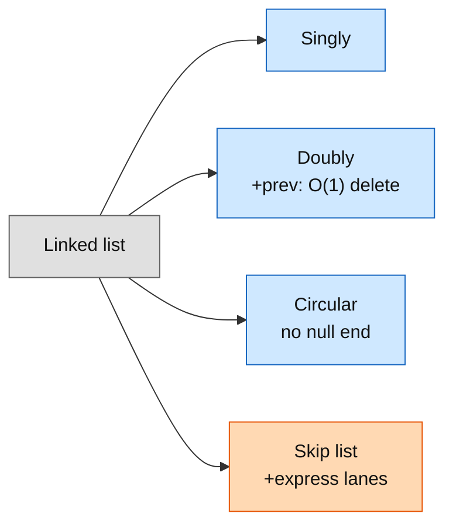

> **Navigation**: [Back to Index](../00_MASTER_INDEX.md) | [Next Chapter >](02b_DS_Variants_Advanced.md)

---

# 📚 Data Structures: ALL VARIANTS Complete Guide

## Every Variant of Every Data Structure - Deep Theory & Implementation

### 5W1H: Mastering Data Structure Variants

> [!NOTE]
> **WHAT:** A comprehensive taxonomy and implementation guide of every core data structure variant (Linear, Non-Linear, Hash-based).
>
> **WHY:** Standard arrays and lists are often insufficient. Real-world systems require specialized variants (e.g., Doubly Linked Lists for LRU caches, Deques for sliding windows) to meet strict O(1) performance constraints.
>
> **WHO:** Engineers building high-performance systems or preparing for advanced technical interviews where choosing the exact right variant determines pass/fail.
>
> **WHEN:** Use this guide when a standard data structure fails your time/space complexity requirements and you need a specialized alternative.
>
> **HOW:** By studying the exact memory layouts, pointer manipulations, and time complexities of each variant compared side-by-side.

---

## 💬 Explain It Like a Study Partner — Core Variants

> [!TIP]
> **Ask yourself first:** *"If a plain singly linked list already works, why are there doubly linked, circular and skip lists?"*

### 1. The bottom line

Each variant fixes **one specific pain** of its base structure by adding one small thing, and you pay a small price for it.

### 2. The textbook core

- **Doubly linked list:** adds a `prev` pointer → O(1) delete of a known node and backward traversal; costs one extra pointer per node.
- **Circular list:** last node points back to the first → natural for round-robin; needs care to avoid infinite loops.
- **Sentinel node:** a dummy head/tail → removes null/edge-case checks.
- **Skip list:** extra "express lane" levels built with coin flips → expected O(log n) search in a linked structure.
- Always describe a variant as **base structure + what you added + what it buys + what it costs**.

### 3. The real-world analogy

A **train line**: a local train stops at every station (level 0 of a skip list), while an express skips most of them. You ride the express to get near your stop, then switch to the local to reach it exactly.

### 4. Walkthrough: search 35 in a skip list

1. Start at the top level's head. The next node is 50, which overshoots 35, so drop down a level.
2. On the next level the next node is 25 (≤ 35), so move right to 25; its next is 50 (too far), so drop down.
3. On the level below, move 25 → 35 and **find it**.
4. Each level skips about half of the nodes, so the expected cost is O(log n).

> [!NOTE]
> **Quick check:** why would you choose a skip list over a balanced BST for a concurrent map? *It is simpler, and updates touch only a few nodes, which makes lock-free implementations easier.*

---

## ⚡ At a Glance — Core Variants

> [!NOTE]
> **Mental model:** each variant tweaks one design choice of its base structure — which pointers exist, where the ends are, or what extra field is stored — to remove a specific cost.

**How to read this diagram.** Grey is the base structure, blue are the classic variants, orange is the one that adds probabilistic shortcuts. Each arrow answers "what did we add, and what cost did it remove?".

| Variant | Extra cost | Removes this problem |
| ------- | ---------- | -------------------- |
| Doubly linked | +1 pointer per node | O(n) predecessor search on delete |
| Circular | Careful termination checks | Wrap-around (round-robin, buffers) |
| Sentinel node | One dummy node | Head/tail special cases |
| Skip list | Extra levels (~2× space) | O(n) search in a linked list |

> [!TIP]
> Learn variants as *"base + one change + what it buys"*; this makes them easy to recall and to choose between.

---

## Part 0b: Historical Evolution of Data Structure Variants

**Timeline of key inventions:**

| Year | Who → What | Why it mattered |
| ---- | ---------- | --------------- |
| 1955–1956 | Newell, Shaw & Simon → **linked lists** (IPL-II at RAND Corp) | First symbolic list processing; the foundation of all dynamic pointer-based structures. |
| 1962 | Adelson-Velsky & Landis → **AVL trees** | First self-balancing BST. Every node: `\|height(left) − height(right)\| ≤ 1`. |
| 1970 (pub. 1972) | Bayer & McCreight → **B-tree** | Disk I/O cost dominated memory cost. B-trees minimize disk reads by storing many keys per node (matching block size). |
| 1978 | Guibas & Sedgewick → **Red-Black trees** | Nearly balanced: path from root to leaf ≤ 2× the shortest path. The workhorse of production tree maps (Java `TreeMap`). |
| 1985 | Sleator & Tarjan → **Splay trees** | Self-adjusting: recently accessed elements move to the root (temporal locality). O(log n) amortized per operation. |
| 1970 / 2000s | Bloom (1970), rediscovered for big data → **Bloom filter** | Space-efficient set membership using k hash functions in O(k) time with a configurable false-positive rate. |
| 1989–1990 | William Pugh → **Skip list** | Probabilistic alternative to balanced BSTs: simpler to implement and easier to make concurrent. |
| 1995 | Boehm, Atkinson & Plass → **Rope** | Balanced tree for string storage: O(log n) concatenation and substring without copying. |
| 1996 | O'Neil, Cheng, Gawlick & O'Neil → **LSM-tree** | Batches writes and merges them sequentially, giving large write-throughput gains over random-write B-trees. Used by RocksDB, Cassandra, LevelDB. |
| 1999–2000 | Prokop; Bender, Demaine & Farach-Colton → **cache-oblivious structures / B-tree** | Optimal at *all* cache levels without knowing cache parameters, using a recursive (van Emde Boas) layout. |
| 2000s | Doug Baskins (HP) → **Judy array** | High-density, cache-friendly 256-way branching; adapts dynamically. |
| 2006 | Google Bigtable → **SSTable** (Sorted String Table) | Immutable, sorted key-value storage; foundation of Bigtable, LevelDB, Cassandra. |
| 2017 | Kraska et al. → **Learned indexes** (later SageDB) | Replace tree indices with machine-learned models that predict key positions. |

### Named Predecessors: Why Each Variant Was Invented

| Structure | Motivation | Predecessor |
| --------- | ---------- | ----------- |
| **B-tree** | Disk I/O cost ≫ memory cost. Store hundreds of keys per node to match OS page/block sizes. | 2-3 tree (simple multi-way search) |
| **LSM-tree** | Sequential writes are far cheaper than random writes (and SSDs have limited erase cycles). A B-tree does many random writes on update. | B-tree |
| **Skip list** | Balanced BSTs are hard to implement correctly and even harder to make concurrent. Pugh showed that probabilistic layering achieves O(log n) without rebalancing. | Sorted linked list |
| **Bloom filter** | Hash sets store full objects (space-heavy). A Bloom filter uses a bit array + k hash functions for O(k) membership with a tunable false-positive rate. | Hash set for exact membership |
| **Splay tree** | Balanced trees assume equal access probability, but real workloads have hot and cold keys. | AVL tree |

### Modern Practice Anchors: Production Implementations

| Language / system | Data structure used | Source |
| ----------------- | ------------------- | ------ |
| Java `java.util.TreeMap` | Red-Black tree | [TreeMap.java](https://github.com/openjdk/jdk/blob/jdk17/src/java.base/share/classes/java/util/TreeMap.java) |
| Java `java.util.concurrent.ConcurrentSkipListMap` | Skip list (lock-free) | [ConcurrentSkipListMap.java](https://github.com/openjdk/jdk/blob/jdk17/src/java.base/share/classes/java/util/concurrent/ConcurrentSkipListMap.java) |
| PostgreSQL indexes | B-tree (default); also GiST, GIN, BRIN | [nbtree README](https://github.com/postgres/postgres/blob/REL_17_STABLE/src/backend/access/nbtree/README) |
| Cassandra, RocksDB | LSM-tree (log-structured merge) | [rocksdb options.h](https://github.com/facebook/rocksdb/blob/main/include/rocksdb/options.h) |
| Google Bigtable, LevelDB | SSTable (Sorted String Table, immutable) | [leveldb table.h](https://github.com/google/leveldb/blob/main/include/leveldb/table.h) |
| Redis ZSET | Skip list + hash table (dual encoding) | [t_zset.c](https://github.com/redis/redis/blob/7.0/src/t_zset.c) |
| Linux kernel page cache | Radix tree (prefix-tree variant); the XArray API replaced it in newer kernels | [lib/radix-tree.c](https://github.com/torvalds/linux/blob/master/lib/radix-tree.c) |

---

## 📚 Topic Pages in This Chapter

This chapter is split into focused pages so each topic can be read on its own. Read them in order the first time; use the table to jump back later.

| # | Page | What is inside | Lines |
| --- | --- | --- | --- |
| 1 | [Data Structure Variant Map](02a_DS_Variants_Core/01_data_structure_variant_map.md) | Data Structure Variant Map · 1.1 Singly Linked List | 451 |
| 2 | [1.2 Doubly Linked List](02a_DS_Variants_Core/02_doubly_linked_list.md) | 1.2 Doubly Linked List | 485 |
| 3 | [1.3 Circular Linked List](02a_DS_Variants_Core/03_circular_linked_list.md) | 1.3 Circular Linked List | 284 |
| 4 | [1.4 Circular Doubly Linked List](02a_DS_Variants_Core/04_circular_doubly_linked_list.md) | 1.4 Circular Doubly Linked List | 284 |
| 5 | [1.5 Skip List](02a_DS_Variants_Core/05_skip_list.md) | 1.5 Skip List | 284 |
| 6 | [Appendix B: Production Failure Modes & Variant Selection](02a_DS_Variants_Core/06_appendix_b_production_failure_modes_variant.md) | Appendix B: Production Failure Modes &… | 146 |
| 7 | [University-Level Addendum — Core Variants as Formal Theory](02a_DS_Variants_Core/07_university_level_addendum_core_variants_as.md) | University-Level Addendum — Core Variants as… | 360 |

## Reality Check

> [!CAUTION]
> **Myth:** "A deque (double-ended queue) is just a doubly-linked list"
>
> **Reality:** A deque IS often implemented with a doubly-linked list (Java's `LinkedList` implements `Deque`). But Java's `ArrayDeque` is a deque implemented with a circular array — much faster due to cache locality, no per-element allocation overhead. For most deque use cases, `ArrayDeque` is 2-5x faster than `LinkedList`. The only case where `LinkedList` wins: O(1) insert/delete in the MIDDLE of the list (via an iterator), which `ArrayDeque` cannot do.

> [!CAUTION]
> **Myth:** "TreeSet and TreeMap always sort by natural ordering"
>
> **Reality:** TreeSet/TreeMap sort by the `Comparator` you provide (if any) or the natural ordering of elements (elements must implement `Comparable`). If you insert objects that don't implement `Comparable` without providing a `Comparator`, you get `ClassCastException` at insertion time. Custom `Comparator`: `new TreeSet<>((a, b) -> a.name.compareTo(b.name))`. The Comparator/Comparable must be consistent with `equals()` — if two objects compare as equal (return 0), they should be `equals()` — otherwise TreeSet may silently discard what it considers duplicates.

> [!CAUTION]
> **Myth:** "LinkedHashMap maintains insertion order"
>
> **Reality:** `LinkedHashMap` maintains insertion order by default. But: `LinkedHashMap(capacity, loadFactor, true)` enables access order — most recently accessed entry is last (implements LRU cache behavior). `get()` and `put()` both count as access in access-order mode. Combining with `removeEldestEntry()` override gives you a self-evicting LRU cache in about 10 lines of Java. This is the standard Java implementation interview answer for "implement an LRU cache."

> [!CAUTION]
> **Myth:** "PriorityQueue in Java is a min-heap — PriorityQueue.peek() returns the minimum"
>
> **Reality:** Default `PriorityQueue<Integer>` returns the minimum (natural ordering). For a max-heap: `new PriorityQueue<>(Collections.reverseOrder())` or `new PriorityQueue<>((a,b) -> b-a)`. For objects: provide a Comparator. Important: `PriorityQueue` does NOT sort all elements — it maintains heap property (peek is O(1), poll is O(log n)). Iterating a `PriorityQueue` with for-each does NOT give sorted order — it gives heap-array order. Always poll elements to get sorted output.

> [!CAUTION]
> **Myth:** "Stack class in Java is the standard stack implementation"
>
> **Reality:** `java.util.Stack` is a legacy class (extends `Vector` — synchronized). Use `Deque<Integer> stack = new ArrayDeque<>()` instead: `push()` = `addFirst()`, `pop()` = `removeFirst()`, `peek()` = `peekFirst()`. `ArrayDeque` is faster (no synchronization overhead, cache-friendly array), unsynchronized (appropriate for single-threaded use), and implements both stack and queue operations. Java's own `Stack` Javadoc recommends `ArrayDeque` as the preferred stack implementation.
