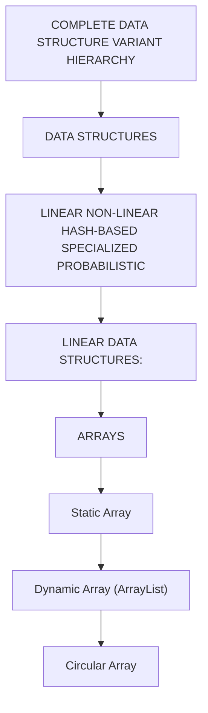
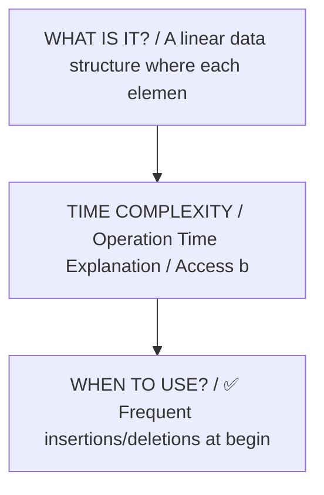
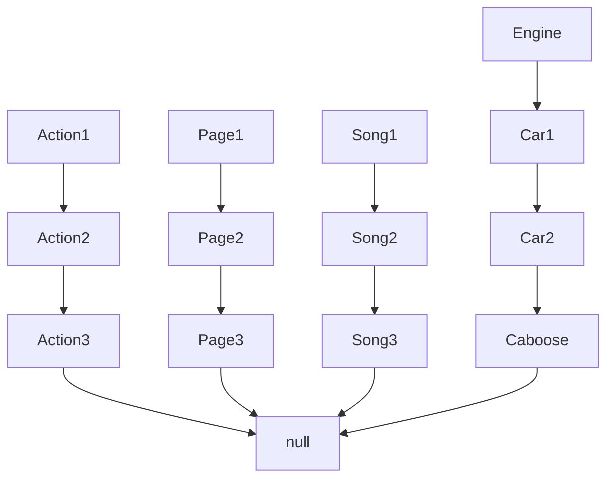
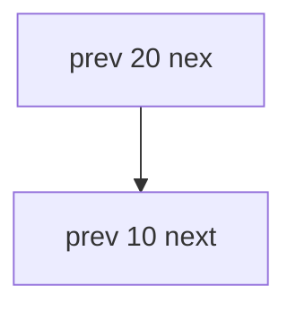
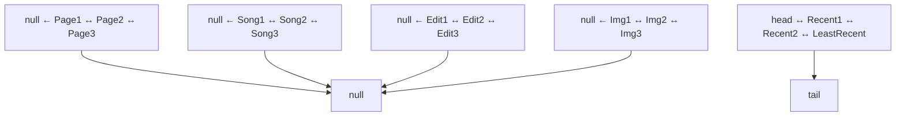
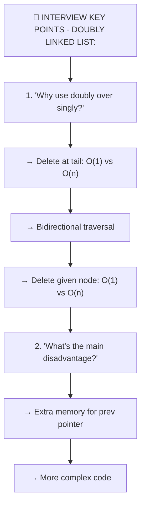
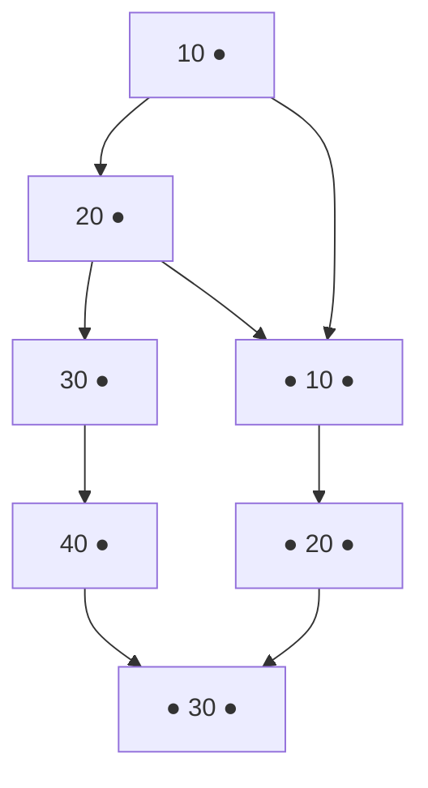
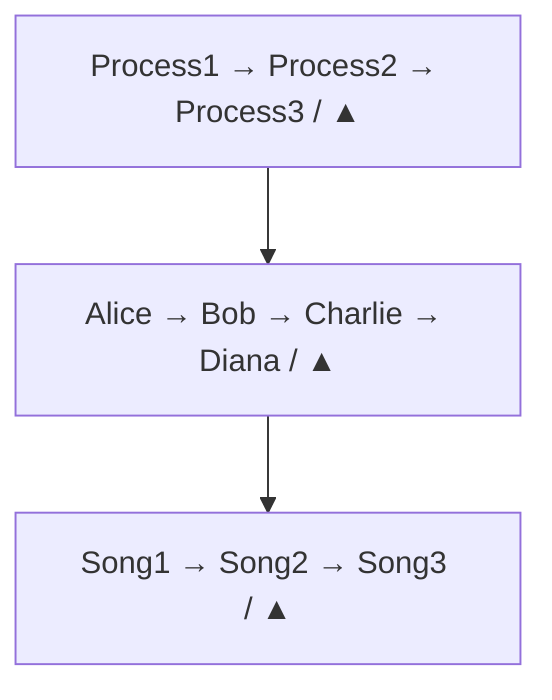
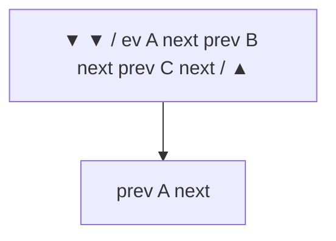
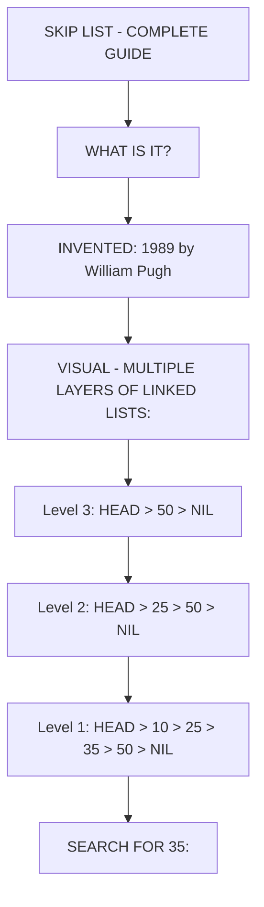

> **Navigation**: [Back to Index](../00_MASTER_INDEX.md) | [Next Chapter >](02b_DS_Variants_Advanced.md)

---

# 📚 Data Structures: ALL VARIANTS Complete Guide

## Every Variant of Every Data Structure - Deep Theory & Implementation

---

# 📌 Part 0: Data Structure Variant Map

::: map

```
╔══════════════════════════════════════════════════════════════════════════════╗
║              COMPLETE DATA STRUCTURE VARIANT HIERARCHY                       ║
╚══════════════════════════════════════════════════════════════════════════════╝

                         DATA STRUCTURES
                              │
     ┌────────────┬──────────┼──────────┬────────────┐
     │            │          │          │            │
  LINEAR      NON-LINEAR   HASH-BASED  SPECIALIZED  PROBABILISTIC
     │            │          │          │            │
     ▼            ▼          ▼          ▼            ▼

LINEAR DATA STRUCTURES:
├── ARRAYS
│   ├── Static Array
│   ├── Dynamic Array (ArrayList)
│   ├── Circular Array
│   ├── Bit Array / BitSet
│   └── Suffix Array
│
├── LINKED LISTS
│   ├── Singly Linked List
│   ├── Doubly Linked List
│   ├── Circular Linked List
│   ├── Circular Doubly Linked List
│   ├── Skip List
│   └── XOR Linked List (Memory Efficient)
│
├── STACKS
│   ├── Array-based Stack
│   ├── Linked List Stack
│   ├── Min Stack
│   ├── Max Stack
│   └── Two-Stack Queue
│
├── QUEUES
│   ├── Simple Queue
│   ├── Circular Queue
│   ├── Deque (Double-ended Queue)
│   ├── Priority Queue
│   └── Monotonic Queue

NON-LINEAR DATA STRUCTURES:
├── TREES
│   ├── Binary Tree
│   ├── Binary Search Tree (BST)
│   ├── AVL Tree (Self-balancing)
│   ├── Red-Black Tree
│   ├── B-Tree / B+ Tree
│   ├── Segment Tree
│   ├── Fenwick Tree (BIT)
│   ├── Trie (Prefix Tree)
│   ├── Suffix Tree
│   ├── N-ary Tree
│   ├── Heap (Min/Max)
│   └── Treap
│
└── GRAPHS
    ├── Directed Graph
    ├── Undirected Graph
    ├── Weighted Graph
    ├── DAG (Directed Acyclic Graph)
    └── Bipartite Graph

HASH-BASED:
├── HashMap / HashTable
├── HashSet
├── LinkedHashMap
├── LinkedHashSet
└── ConcurrentHashMap

SPECIALIZED:
├── Disjoint Set (Union-Find)
├── LRU Cache
├── LFU Cache
└── Bloom Filter
```

> **Flow**: COMPLETE DATA STRUCTURE VARIANT HIERARCHY → DATA STRUCTURES | DATA STRUCTURES → LINEAR NON-LINEAR HASH-BASED SPECIALIZED PROBABILISTIC | LINEAR NON-LINEAR HASH-BASED SPECIALIZED PROBABILISTIC → LINEAR DATA STRUCTURES: | LINEAR DATA STRUCTURES: → ARRAYS | ARRAYS → Static Array | Static Array → Dynamic Array (ArrayList) | ...+1 more



:::

---

# 🔗 Part 1: Linked List Variants (complete)

## 1.1 Singly Linked List

::: pattern

```
╔══════════════════════════════════════════════════════════════════════════════╗
║                    SINGLY LINKED LIST - COMPLETE GUIDE                       ║
╚══════════════════════════════════════════════════════════════════════════════╝

┌─────────────────────────────────────────────────────────────────────────────┐
│ WHAT IS IT?                                                                 │
├─────────────────────────────────────────────────────────────────────────────┤
│ A linear data structure where each element (node) contains:                 │
│ 1. DATA - The actual value stored                                           │
│ 2. NEXT - Reference/pointer to the next node                                │
│                                                                             │
│ VISUAL:                                                                     │
│  ┌────┬────┐    ┌────┬────┐    ┌────┬────┐    ┌────┬────┐                   │
│  │ 10 │  ●─┼───▶│ 20 │  ●─┼───▶│ 30 │  ●─┼───▶│ 40 │null│                   │
│  └────┴────┘    └────┴────┘    └────┴────┘    └────┴────┘                   │
│   head                                          tail                        │
│                                                                             │
│ KEY PROPERTY: Can only traverse FORWARD (one direction)                     │
└─────────────────────────────────────────────────────────────────────────────┘

┌─────────────────────────────────────────────────────────────────────────────┐
│ TIME COMPLEXITY                                                             │
├─────────────────────────────────────────────────────────────────────────────┤
│ Operation              │ Time    │ Explanation                              │
│ ─────────────────────────────────────────────────────────────────────────── │
│ Access by index        │ O(n)    │ Must traverse from head                  │
│ Search                 │ O(n)    │ Must check each node                     │
│ Insert at head         │ O(1)    │ Just change head pointer                 │
│ Insert at tail         │ O(1)*   │ *If tail pointer maintained              │
│ Insert at middle       │ O(n)    │ Must find position first                 │
│ Delete at head         │ O(1)    │ Just change head pointer                 │
│ Delete at tail         │ O(n)    │ Must find second-to-last                 │
│ Delete at middle       │ O(n)    │ Must find position first                 │
└─────────────────────────────────────────────────────────────────────────────┘

┌─────────────────────────────────────────────────────────────────────────────┐
│ WHEN TO USE?                                                                │
├─────────────────────────────────────────────────────────────────────────────┤
│ ✅ Frequent insertions/deletions at beginning                                │
│ ✅ Don't know size in advance                                                │
│ ✅ Memory is fragmented (non-contiguous is OK)                               │
│ ✅ Implementing stack (LIFO)                                                 │
│                                                                             │
│ ❌ Need random access by index                                               │
│ ❌ Need backward traversal                                                   │
│ ❌ Delete at end frequently (use doubly linked)                              │
│ ❌ Memory efficiency is critical (pointers add overhead)                     │
└─────────────────────────────────────────────────────────────────────────────┘
```

> **Flow**: WHAT IS IT? / A linear data structure where each elemen → TIME COMPLEXITY / Operation Time Explanation / Access b | TIME COMPLEXITY / Operation Time Explanation / Access b → WHEN TO USE? / ✅ Frequent insertions/deletions at begin



:::

::: example

```
REAL-WORLD APPLICATIONS:

1. UNDO FUNCTIONALITY (Simple):
   Action1 → Action2 → Action3 → null
   │
   └── Pop from end to undo

2. BROWSER FORWARD HISTORY:
   Page1 → Page2 → Page3 → null
   │
   └── Click "Forward" = move to next

3. MUSIC PLAYLIST (Forward only):
   Song1 → Song2 → Song3 → null
   │
   └── "Next Track" = go to next node

4. TRAIN CARS:
   Engine → Car1 → Car2 → Caboose → null
   │
   └── Each car connects to next
```

> **Flow**: Action1 → Action2 | Action2 → Action3 | Action3 → null | Page1 → Page2 | Page2 → Page3 | Page3 → null | ...+7 more



:::

```java
// COMPLETE SINGLY LINKED LIST IMPLEMENTATION
public class SinglyLinkedList<T> {

    // Node class
    private static class Node<T> {
        T data;
        Node<T> next;

        Node(T data) {
            this.data = data;
            this.next = null;
        }
    }

    private Node<T> head;
    private Node<T> tail;
    private int size;

    public SinglyLinkedList() {
        this.head = null;
        this.tail = null;
        this.size = 0;
    }

    // ═══════════════════════════════════════════════════════════════════════
    // INSERTION OPERATIONS
    // ═══════════════════════════════════════════════════════════════════════

    // Insert at beginning - O(1)
    public void insertAtHead(T data) {
        Node<T> newNode = new Node<>(data);
        if (head == null) {
            head = tail = newNode;
        } else {
            newNode.next = head;
            head = newNode;
        }
        size++;
    }

    // Insert at end - O(1) with tail pointer
    public void insertAtTail(T data) {
        Node<T> newNode = new Node<>(data);
        if (head == null) {
            head = tail = newNode;
        } else {
            tail.next = newNode;
            tail = newNode;
        }
        size++;
    }

    // Insert at index - O(n)
    public void insertAt(int index, T data) {
        if (index < 0 || index > size) {
            throw new IndexOutOfBoundsException("Index: " + index);
        }
        if (index == 0) {
            insertAtHead(data);
            return;
        }
        if (index == size) {
            insertAtTail(data);
            return;
        }

        Node<T> newNode = new Node<>(data);
        Node<T> current = head;

        // Traverse to node BEFORE insertion point
        for (int i = 0; i < index - 1; i++) {
            current = current.next;
        }

        newNode.next = current.next;
        current.next = newNode;
        size++;
    }

    // ═══════════════════════════════════════════════════════════════════════
    // DELETION OPERATIONS
    // ═══════════════════════════════════════════════════════════════════════

    // Delete from beginning - O(1)
    public T deleteFromHead() {
        if (head == null) {
            throw new RuntimeException("List is empty");
        }
        T data = head.data;
        head = head.next;
        if (head == null) {
            tail = null;
        }
        size--;
        return data;
    }

    // Delete from end - O(n) - THIS IS WHY DOUBLY LINKED IS BETTER FOR THIS
    public T deleteFromTail() {
        if (head == null) {
            throw new RuntimeException("List is empty");
        }
        if (head == tail) {
            T data = head.data;
            head = tail = null;
            size--;
            return data;
        }

        // Find second-to-last node
        Node<T> current = head;
        while (current.next != tail) {
            current = current.next;
        }

        T data = tail.data;
        current.next = null;
        tail = current;
        size--;
        return data;
    }

    // Delete by value - O(n)
    public boolean delete(T data) {
        if (head == null) return false;

        if (head.data.equals(data)) {
            deleteFromHead();
            return true;
        }

        Node<T> current = head;
        while (current.next != null) {
            if (current.next.data.equals(data)) {
                if (current.next == tail) {
                    tail = current;
                }
                current.next = current.next.next;
                size--;
                return true;
            }
            current = current.next;
        }
        return false;
    }

    // ═══════════════════════════════════════════════════════════════════════
    // SEARCH OPERATIONS
    // ═══════════════════════════════════════════════════════════════════════

    // Search - O(n)
    public boolean contains(T data) {
        Node<T> current = head;
        while (current != null) {
            if (current.data.equals(data)) {
                return true;
            }
            current = current.next;
        }
        return false;
    }

    // Get by index - O(n)
    public T get(int index) {
        if (index < 0 || index >= size) {
            throw new IndexOutOfBoundsException("Index: " + index);
        }
        Node<T> current = head;
        for (int i = 0; i < index; i++) {
            current = current.next;
        }
        return current.data;
    }

    // ═══════════════════════════════════════════════════════════════════════
    // UTILITY OPERATIONS
    // ═══════════════════════════════════════════════════════════════════════

    // Reverse - O(n) - VERY IMPORTANT FOR INTERVIEWS
    public void reverse() {
        Node<T> prev = null;
        Node<T> current = head;
        tail = head;  // Old head becomes new tail

        while (current != null) {
            Node<T> nextTemp = current.next;
            current.next = prev;
            prev = current;
            current = nextTemp;
        }
        head = prev;
    }

    // Find middle - O(n) using slow/fast pointers
    public T findMiddle() {
        if (head == null) {
            throw new RuntimeException("List is empty");
        }
        Node<T> slow = head;
        Node<T> fast = head;

        while (fast != null && fast.next != null) {
            slow = slow.next;
            fast = fast.next.next;
        }
        return slow.data;
    }

    // Detect cycle - O(n) Floyd's Algorithm
    public boolean hasCycle() {
        if (head == null) return false;

        Node<T> slow = head;
        Node<T> fast = head;

        while (fast != null && fast.next != null) {
            slow = slow.next;
            fast = fast.next.next;
            if (slow == fast) return true;
        }
        return false;
    }

    // Get Nth node from end - O(n)
    public T getNthFromEnd(int n) {
        Node<T> first = head;
        Node<T> second = head;

        // Move first n nodes ahead
        for (int i = 0; i < n; i++) {
            if (first == null) {
                throw new IndexOutOfBoundsException("n is larger than list size");
            }
            first = first.next;
        }

        // Move both until first reaches end
        while (first != null) {
            first = first.next;
            second = second.next;
        }

        return second.data;
    }

    public int size() { return size; }
    public boolean isEmpty() { return size == 0; }

    // Print list
    public void print() {
        Node<T> current = head;
        while (current != null) {
            System.out.print(current.data + " -> ");
            current = current.next;
        }
        System.out.println("null");
    }
}
```

---

## 1.2 Doubly Linked List

::: pattern

```
╔══════════════════════════════════════════════════════════════════════════════╗
║                    DOUBLY LINKED LIST - COMPLETE GUIDE                       ║
╚══════════════════════════════════════════════════════════════════════════════╝

┌─────────────────────────────────────────────────────────────────────────────┐
│ WHAT IS IT?                                                                 │
├─────────────────────────────────────────────────────────────────────────────┤
│ A linked list where each node has TWO pointers:                             │
│ 1. DATA - The actual value                                                  │
│ 2. PREV - Reference to PREVIOUS node                                        │
│ 3. NEXT - Reference to NEXT node                                            │
│                                                                             │
│ VISUAL:                                                                     │
│     null                                                           null     │
│      ↑                                                              ↑       │
│  ┌───┴───────┐    ┌───────────┐    ┌───────────┐    ┌───────────┬──┴──┐     │
│  │prev│10│next│◄──►│prev│20│next│◄──►│prev│30│next│◄──►│prev│40│next│       │
│  └───────────┘    └───────────┘    └───────────┘    └───────────────┘       │
│     head                                                   tail             │
│                                                                             │
│ KEY PROPERTY: Can traverse BOTH directions (forward AND backward)           │
└─────────────────────────────────────────────────────────────────────────────┘

┌─────────────────────────────────────────────────────────────────────────────┐
│ ADVANTAGES OVER SINGLY LINKED LIST                                          │
├─────────────────────────────────────────────────────────────────────────────┤
│                                                                             │
│ 1. BIDIRECTIONAL TRAVERSAL:                                                 │
│    - Can go forward AND backward                                            │
│    - Essential for "Previous" buttons                                       │
│                                                                             │
│ 2. O(1) DELETE FROM TAIL:                                                   │
│    Singly: O(n) - must find second-to-last                                  │
│    Doubly: O(1) - just use tail.prev                                        │
│                                                                             │
│ 3. EASIER NODE DELETION:                                                    │
│    Given a node reference, can delete in O(1)                               │
│    Don't need to find previous node!                                        │
│                                                                             │
│ 4. BETTER FOR LRU CACHE:                                                    │
│    Move nodes to front/back in O(1)                                         │
│                                                                             │
│ DISADVANTAGE:                                                               │
│    - More memory (extra prev pointer)                                       │
│    - More complex insertion/deletion code                                   │
└─────────────────────────────────────────────────────────────────────────────┘

┌─────────────────────────────────────────────────────────────────────────────┐
│ TIME COMPLEXITY COMPARISON                                                  │
├─────────────────────────────────────────────────────────────────────────────┤
│                                                                             │
│ Operation              │ Singly  │ Doubly  │ Winner                         │
│ ─────────────────────────────────────────────────────────────────────────── │
│ Access by index        │ O(n)    │ O(n)    │ Tie                            │
│ Insert at head         │ O(1)    │ O(1)    │ Tie                            │
│ Insert at tail         │ O(1)*   │ O(1)    │ Tie                            │
│ Delete at head         │ O(1)    │ O(1)    │ Tie                            │
│ Delete at tail         │ O(n)    │ O(1)    │ DOUBLY 🏆                       │
│ Delete given node      │ O(n)    │ O(1)    │ DOUBLY 🏆                       │
│ Traverse backward      │ O(n²)   │ O(n)    │ DOUBLY 🏆                       │
│ Memory per node        │ Less    │ More    │ SINGLY (if memory matters)     │
└─────────────────────────────────────────────────────────────────────────────┘
```

> **Flow**: prev 20 nex → prev 10 next



:::

::: example

```
REAL-WORLD APPLICATIONS:

1. BROWSER HISTORY (Back & Forward):
   null ← Page1 ↔ Page2 ↔ Page3 → null
           │
           └── "Back" = go to prev
               "Forward" = go to next

2. MUSIC PLAYER (Previous & Next):
   null ← Song1 ↔ Song2 ↔ Song3 → null
           │
           └── Previous Track / Next Track

3. TEXT EDITOR UNDO/REDO:
   null ← Edit1 ↔ Edit2 ↔ Edit3 → null
           │
           └── Undo = go prev
               Redo = go next

4. LRU CACHE (Move to front):
   head ↔ Recent1 ↔ Recent2 ↔ LeastRecent → tail
   │
   └── Access item = move to head in O(1)

5. IMAGE VIEWER (Swipe left/right):
   null ← Img1 ↔ Img2 ↔ Img3 → null
```

> **Flow**: null ← Page1 ↔ Page2 ↔ Page3 → null | null ← Song1 ↔ Song2 ↔ Song3 → null | null ← Edit1 ↔ Edit2 ↔ Edit3 → null | head ↔ Recent1 ↔ Recent2 ↔ LeastRecent → tail | null ← Img1 ↔ Img2 ↔ Img3 → null



:::

```java
// COMPLETE DOUBLY LINKED LIST IMPLEMENTATION
public class DoublyLinkedList<T> {

    // Node class with prev and next pointers
    private static class Node<T> {
        T data;
        Node<T> prev;
        Node<T> next;

        Node(T data) {
            this.data = data;
            this.prev = null;
            this.next = null;
        }
    }

    private Node<T> head;
    private Node<T> tail;
    private int size;

    public DoublyLinkedList() {
        this.head = null;
        this.tail = null;
        this.size = 0;
    }

    // ═══════════════════════════════════════════════════════════════════════
    // INSERTION OPERATIONS
    // ═══════════════════════════════════════════════════════════════════════

    // Insert at beginning - O(1)
    public void insertAtHead(T data) {
        Node<T> newNode = new Node<>(data);

        if (head == null) {
            // Empty list
            head = tail = newNode;
        } else {
            // Link with current head
            newNode.next = head;
            head.prev = newNode;
            head = newNode;
        }
        size++;
    }

    // Insert at end - O(1)
    public void insertAtTail(T data) {
        Node<T> newNode = new Node<>(data);

        if (tail == null) {
            // Empty list
            head = tail = newNode;
        } else {
            // Link with current tail
            newNode.prev = tail;
            tail.next = newNode;
            tail = newNode;
        }
        size++;
    }

    // Insert after a specific node - O(1)
    // THIS IS WHERE DOUBLY LINKED SHINES!
    public void insertAfter(Node<T> node, T data) {
        if (node == null) {
            throw new IllegalArgumentException("Node cannot be null");
        }

        Node<T> newNode = new Node<>(data);

        // Link new node
        newNode.prev = node;
        newNode.next = node.next;

        // Update existing links
        if (node.next != null) {
            node.next.prev = newNode;
        } else {
            tail = newNode;  // Inserting at end
        }
        node.next = newNode;

        size++;
    }

    // Insert before a specific node - O(1)
    public void insertBefore(Node<T> node, T data) {
        if (node == null) {
            throw new IllegalArgumentException("Node cannot be null");
        }

        Node<T> newNode = new Node<>(data);

        // Link new node
        newNode.next = node;
        newNode.prev = node.prev;

        // Update existing links
        if (node.prev != null) {
            node.prev.next = newNode;
        } else {
            head = newNode;  // Inserting at beginning
        }
        node.prev = newNode;

        size++;
    }

    // Insert at index - O(n)
    public void insertAt(int index, T data) {
        if (index < 0 || index > size) {
            throw new IndexOutOfBoundsException("Index: " + index);
        }
        if (index == 0) {
            insertAtHead(data);
            return;
        }
        if (index == size) {
            insertAtTail(data);
            return;
        }

        // Find the node at index
        Node<T> current = getNodeAt(index);
        insertBefore(current, data);
    }

    // ═══════════════════════════════════════════════════════════════════════
    // DELETION OPERATIONS
    // ═══════════════════════════════════════════════════════════════════════

    // Delete from beginning - O(1)
    public T deleteFromHead() {
        if (head == null) {
            throw new RuntimeException("List is empty");
        }

        T data = head.data;

        if (head == tail) {
            // Only one element
            head = tail = null;
        } else {
            head = head.next;
            head.prev = null;
        }

        size--;
        return data;
    }

    // Delete from end - O(1) - MUCH BETTER THAN SINGLY LINKED!
    public T deleteFromTail() {
        if (tail == null) {
            throw new RuntimeException("List is empty");
        }

        T data = tail.data;

        if (head == tail) {
            // Only one element
            head = tail = null;
        } else {
            tail = tail.prev;
            tail.next = null;
        }

        size--;
        return data;
    }

    // Delete a specific node - O(1) when you have the node reference!
    // THIS IS THE KILLER FEATURE OF DOUBLY LINKED LIST
    public T deleteNode(Node<T> node) {
        if (node == null) {
            throw new IllegalArgumentException("Node cannot be null");
        }

        T data = node.data;

        // Update prev's next
        if (node.prev != null) {
            node.prev.next = node.next;
        } else {
            head = node.next;  // Deleting head
        }

        // Update next's prev
        if (node.next != null) {
            node.next.prev = node.prev;
        } else {
            tail = node.prev;  // Deleting tail
        }

        size--;
        return data;
    }

    // Delete by value - O(n)
    public boolean delete(T data) {
        Node<T> current = head;

        while (current != null) {
            if (current.data.equals(data)) {
                deleteNode(current);
                return true;
            }
            current = current.next;
        }
        return false;
    }

    // ═══════════════════════════════════════════════════════════════════════
    // TRAVERSAL OPERATIONS
    // ═══════════════════════════════════════════════════════════════════════

    // Traverse forward
    public void traverseForward() {
        Node<T> current = head;
        System.out.print("null <- ");
        while (current != null) {
            System.out.print(current.data);
            if (current.next != null) {
                System.out.print(" <-> ");
            }
            current = current.next;
        }
        System.out.println(" -> null");
    }

    // Traverse backward
    public void traverseBackward() {
        Node<T> current = tail;
        System.out.print("null <- ");
        while (current != null) {
            System.out.print(current.data);
            if (current.prev != null) {
                System.out.print(" <-> ");
            }
            current = current.prev;
        }
        System.out.println(" -> null");
    }

    // ═══════════════════════════════════════════════════════════════════════
    // UTILITY OPERATIONS
    // ═══════════════════════════════════════════════════════════════════════

    // Get node at index - O(n) but optimized!
    // Can start from head OR tail depending on index
    private Node<T> getNodeAt(int index) {
        if (index < 0 || index >= size) {
            throw new IndexOutOfBoundsException("Index: " + index);
        }

        Node<T> current;

        // Optimization: start from closer end
        if (index < size / 2) {
            // Start from head
            current = head;
            for (int i = 0; i < index; i++) {
                current = current.next;
            }
        } else {
            // Start from tail (faster for second half)
            current = tail;
            for (int i = size - 1; i > index; i--) {
                current = current.prev;
            }
        }

        return current;
    }

    // Get by index - O(n)
    public T get(int index) {
        return getNodeAt(index).data;
    }

    // Reverse - O(n)
    public void reverse() {
        Node<T> current = head;
        Node<T> temp = null;

        // Swap prev and next for all nodes
        while (current != null) {
            temp = current.prev;
            current.prev = current.next;
            current.next = temp;
            current = current.prev;  // Move to next (which is now prev)
        }

        // Swap head and tail
        temp = head;
        head = tail;
        tail = temp;
    }

    // Move a node to front - O(1)
    // Very useful for LRU Cache!
    public void moveToFront(Node<T> node) {
        if (node == head) return;  // Already at front

        // Remove from current position
        if (node.prev != null) {
            node.prev.next = node.next;
        }
        if (node.next != null) {
            node.next.prev = node.prev;
        } else {
            tail = node.prev;  // Was at end
        }

        // Move to front
        node.prev = null;
        node.next = head;
        head.prev = node;
        head = node;
    }

    public int size() { return size; }
    public boolean isEmpty() { return size == 0; }
}
```

::: memory

```
🧠 INTERVIEW KEY POINTS - DOUBLY LINKED LIST:

1. "Why use doubly over singly?"
   → Delete at tail: O(1) vs O(n)
   → Bidirectional traversal
   → Delete given node: O(1) vs O(n)

2. "What's the main disadvantage?"
   → Extra memory for prev pointer
   → More complex code

3. "Real-world use case?"
   → LRU Cache (HashMap + Doubly Linked)
   → Browser back/forward
   → Text editor undo/redo

4. "How to delete a node in O(1)?"
   → node.prev.next = node.next
   → node.next.prev = node.prev
   → Handle edge cases (head/tail)
```

> **Flow**: 🧠 INTERVIEW KEY POINTS - DOUBLY LINKED LIST: → 1. 'Why use doubly over singly?' | 1. 'Why use doubly over singly?' → → Delete at tail: O(1) vs O(n) | → Delete at tail: O(1) vs O(n) → → Bidirectional traversal | → Bidirectional traversal → → Delete given node: O(1) vs O(n) | → Delete given node: O(1) vs O(n) → 2. 'What's the main disadvantage?' | 2. 'What's the main disadvantage?' → → Extra memory for prev pointer | ...+1 more



:::

---

## 1.3 Circular Linked List

::: pattern

```
╔══════════════════════════════════════════════════════════════════════════════╗
║                    CIRCULAR LINKED LIST - COMPLETE GUIDE                     ║
╚══════════════════════════════════════════════════════════════════════════════╝

┌─────────────────────────────────────────────────────────────────────────────┐
│ WHAT IS IT?                                                                 │
├─────────────────────────────────────────────────────────────────────────────┤
│ A linked list where the LAST node points BACK to the FIRST node.            │
│ No NULL at end - forms a CIRCLE!                                            │
│                                                                             │
│ SINGLY CIRCULAR:                                                            │
│       ┌────────────────────────────────────────┐                            │
│       │                                        │                            │
│       ▼                                        │                            │
│  ┌────┬────┐  ┌────┬────┐  ┌────┬────┐  ┌────┬─┴──┐                         │
│  │ 10 │  ●─┼─▶│ 20 │  ●─┼─▶│ 30 │  ●─┼─▶│ 40 │  ● │                         │
│  └────┴────┘  └────┴────┘  └────┴────┘  └────┴────┘                         │
│     head                                  tail                              │
│                                                                             │
│ DOUBLY CIRCULAR:                                                            │
│       ┌────────────────────────────────────────┐                            │
│       │      ┌──────────────────────────────┐  │                            │
│       ▼      │                              │  ▼                            │
│  ┌───┬───┬───┴┐  ┌───┬───┬───┐  ┌───┬───┬──┴┐                               │
│  │ ● │10 │ ●──┼─▶│ ● │20 │ ●─┼─▶│ ● │30 │ ● │                               │
│  └─▲─┴───┴────┘  └─▲─┴───┴───┘  └───┴───┴─▲─┘                               │
│    │               │                       │                                │
│    └───────────────┴───────────────────────┘                                │
│                                                                             │
│ KEY PROPERTY: Can traverse the entire list starting from ANY node!          │
│               No "end" - goes round and round.                              │
└─────────────────────────────────────────────────────────────────────────────┘

┌─────────────────────────────────────────────────────────────────────────────┐
│ WHY USE CIRCULAR?                                                           │
├─────────────────────────────────────────────────────────────────────────────┤
│                                                                             │
│ 1. ROUND-ROBIN SCHEDULING:                                                  │
│    - Process1 → Process2 → Process3 → Process1 → ...                        │
│    - CPU gives time to each process in circular order                       │
│                                                                             │
│ 2. MULTIPLAYER GAME TURNS:                                                  │
│    - Player1 → Player2 → Player3 → Player1 → ...                            │
│    - No need to reset to beginning                                          │
│                                                                             │
│ 3. CIRCULAR BUFFER/QUEUE:                                                   │
│    - Audio streaming                                                        │
│    - Producer-consumer problems                                             │
│                                                                             │
│ 4. REPEATED TRAVERSAL:                                                      │
│    - Carousel/slideshow that loops                                          │
│    - Music playlist on repeat                                               │
│                                                                             │
│ KEY INSIGHT: Useful when you need to wrap around!                           │
└─────────────────────────────────────────────────────────────────────────────┘
```

> **Flow**: 10 ● → 20 ● | 10 ● → ● 10 ● | 20 ● → 30 ● | 20 ● → ● 10 ● | 30 ● → 40 ● | 40 ● → ● 30 ● | ...+2 more



:::

::: example

```
REAL-WORLD APPLICATIONS:

1. OPERATING SYSTEM - ROUND ROBIN CPU SCHEDULING:
   ┌──────────────────────────────────────────┐
   │                                          │
   │    Process1 → Process2 → Process3 ───────┤
   │       ▲                                  │
   │       │                                  │
   │       └──────────────────────────────────┘
   │
   └── Each process gets CPU time, then goes to end

2. MULTIPLAYER GAME TURNS:
   ┌──────────────────────────────────────────┐
   │                                          │
   │    Alice → Bob → Charlie → Diana ────────┤
   │       ▲                                  │
   │       └──────────────────────────────────┘
   │
   └── After Diana's turn, it's Alice's turn again

3. MUSIC PLAYER ON REPEAT:
   ┌──────────────────────────────────────────┐
   │                                          │
   │    Song1 → Song2 → Song3 ────────────────┤
   │       ▲                                  │
   │       └──────────────────────────────────┘
   │
   └── After last song, goes back to first

4. JOSEPHUS PROBLEM (Classical):
   n people in circle, every k-th person eliminated
   Who survives? (Famous interview problem!)
```

> **Flow**: Process1 → Process2 → Process3 / ▲ → Alice → Bob → Charlie → Diana / ▲ | Alice → Bob → Charlie → Diana / ▲ → Song1 → Song2 → Song3 / ▲



:::

```java
// COMPLETE CIRCULAR SINGLY LINKED LIST IMPLEMENTATION
public class CircularLinkedList<T> {

    private static class Node<T> {
        T data;
        Node<T> next;

        Node(T data) {
            this.data = data;
        }
    }

    private Node<T> tail;  // We keep tail, not head! (head = tail.next)
    private int size;

    // Why keep tail instead of head?
    // - Insert at head: O(1) - create node, point to head, tail.next = new
    // - Insert at tail: O(1) - create node, point to head, update tail
    // With only head, insert at tail would be O(n)!

    public CircularLinkedList() {
        this.tail = null;
        this.size = 0;
    }

    // Insert at front - O(1)
    public void insertAtFront(T data) {
        Node<T> newNode = new Node<>(data);

        if (tail == null) {
            // First element - points to itself!
            newNode.next = newNode;
            tail = newNode;
        } else {
            // Insert between tail and head
            newNode.next = tail.next;  // New node points to old head
            tail.next = newNode;        // Tail points to new node (new head)
        }
        size++;
    }

    // Insert at end - O(1)
    public void insertAtEnd(T data) {
        insertAtFront(data);  // Insert at front
        tail = tail.next;      // Then move tail pointer
    }

    // Delete from front - O(1)
    public T deleteFromFront() {
        if (tail == null) {
            throw new RuntimeException("List is empty");
        }

        Node<T> head = tail.next;
        T data = head.data;

        if (head == tail) {
            // Only one element
            tail = null;
        } else {
            tail.next = head.next;
        }

        size--;
        return data;
    }

    // Delete from end - O(n) - must find second-to-last
    public T deleteFromEnd() {
        if (tail == null) {
            throw new RuntimeException("List is empty");
        }

        if (tail.next == tail) {
            // Only one element
            T data = tail.data;
            tail = null;
            size--;
            return data;
        }

        // Find second-to-last
        Node<T> current = tail.next;
        while (current.next != tail) {
            current = current.next;
        }

        T data = tail.data;
        current.next = tail.next;  // Point to head
        tail = current;            // New tail
        size--;
        return data;
    }

    // Traverse entire list - O(n)
    public void traverse() {
        if (tail == null) {
            System.out.println("Empty list");
            return;
        }

        Node<T> current = tail.next;  // Start from head
        do {
            System.out.print(current.data + " -> ");
            current = current.next;
        } while (current != tail.next);  // Stop when back at head

        System.out.println("(back to start)");
    }

    // JOSEPHUS PROBLEM - Classic circular list problem!
    // n people in circle, every k-th person eliminated
    // Returns the survivor's position (1-indexed)
    public static int josephus(int n, int k) {
        // Create circular list with positions 1 to n
        CircularLinkedList<Integer> circle = new CircularLinkedList<>();
        for (int i = 1; i <= n; i++) {
            circle.insertAtEnd(i);
        }

        Node<Integer> current = circle.tail;

        while (circle.size > 1) {
            // Move k-1 steps (k-th person from current)
            for (int i = 0; i < k - 1; i++) {
                current = current.next;
            }

            // Remove the k-th person (current.next)
            Node<Integer> toRemove = current.next;
            System.out.println("Eliminating person " + toRemove.data);

            current.next = toRemove.next;
            if (toRemove == circle.tail) {
                circle.tail = current;
            }
            circle.size--;
        }

        return circle.tail.data;
    }

    public int size() { return size; }
    public boolean isEmpty() { return size == 0; }
}
```

---

## 1.4 Circular Doubly Linked List

::: pattern

```
╔══════════════════════════════════════════════════════════════════════════════╗
║               CIRCULAR DOUBLY LINKED LIST - COMPLETE GUIDE                   ║
╚══════════════════════════════════════════════════════════════════════════════╝

┌─────────────────────────────────────────────────────────────────────────────┐
│ WHAT IS IT?                                                                 │
├─────────────────────────────────────────────────────────────────────────────┤
│ Combines BOTH concepts:                                                     │
│ • Doubly: Each node has prev AND next pointers                              │
│ • Circular: Last node connects to first, first connects to last             │
│                                                                             │
│ VISUAL:                                                                     │
│     ┌───────────────────────────────────────────────────────────┐           │
│     │                                                           │           │
│     │    ┌─────────────────────────────────────────────────┐    │           │
│     │    │                                                 │    │           │
│     ▼    │                                                 ▼    │           │
│  ┌──┴──┬───┬─────┐  ┌─────┬───┬─────┐  ┌─────┬───┬──┴──┐       │            │
│  │prev │ A │ next│◄─►│prev │ B │ next│◄─►│prev │ C │next │       │          │
│  └─────┴───┴──┬──┘  └─────┴───┴─────┘  └──┬──┴───┴─────┘       │            │
│               │                           │                     │           │
│               └───────────────────────────┘                     │           │
│     ▲                                                           │           │
│     └───────────────────────────────────────────────────────────┘           │
│                                                                             │
│ KEY: A.prev = C, C.next = A (circular in BOTH directions!)                  │
└─────────────────────────────────────────────────────────────────────────────┘

┌─────────────────────────────────────────────────────────────────────────────┐
│ ADVANTAGES                                                                  │
├─────────────────────────────────────────────────────────────────────────────┤
│                                                                             │
│ ✅ O(1) insertion at both ends                                               │
│ ✅ O(1) deletion at both ends                                                │
│ ✅ O(1) deletion of any node (given reference)                               │
│ ✅ Can traverse in both directions                                           │
│ ✅ Can wrap around in both directions                                        │
│ ✅ No need to check for null at boundaries                                   │
│                                                                             │
│ ❌ More memory (two pointers per node)                                       │
│ ❌ More complex code                                                         │
│                                                                             │
│ PERFECT FOR:                                                                │
│ • Deque (double-ended queue) implementation                                 │
│ • Applications needing wrap-around in both directions                       │
│ • When you frequently access both ends                                      │
└─────────────────────────────────────────────────────────────────────────────┘
```

> **Flow**: ▼ ▼ / ev A next prev B next prev C next / ▲ → prev A next



:::

::: example

```
REAL-WORLD APPLICATIONS:

1. FIBONACCI HEAP (Advanced Data Structure):
   - Uses circular doubly linked lists
   - O(1) amortized insert and decrease-key

2. ADVANCED CACHE IMPLEMENTATIONS:
   - Can move elements efficiently
   - Access patterns in both directions

3. IMAGE CAROUSEL WITH BOTH DIRECTIONS:
   - Swipe left OR right
   - Wrap around in either direction
```

:::

```java
// CIRCULAR DOUBLY LINKED LIST IMPLEMENTATION
public class CircularDoublyLinkedList<T> {

    private static class Node<T> {
        T data;
        Node<T> prev;
        Node<T> next;

        Node(T data) {
            this.data = data;
        }
    }

    private Node<T> head;
    private int size;

    public CircularDoublyLinkedList() {
        this.head = null;
        this.size = 0;
    }

    // Insert at front - O(1)
    public void insertAtFront(T data) {
        Node<T> newNode = new Node<>(data);

        if (head == null) {
            // First element - points to itself in both directions!
            newNode.next = newNode;
            newNode.prev = newNode;
            head = newNode;
        } else {
            Node<T> tail = head.prev;  // Last element

            // Link new node
            newNode.next = head;
            newNode.prev = tail;

            // Update existing links
            head.prev = newNode;
            tail.next = newNode;

            head = newNode;
        }
        size++;
    }

    // Insert at end - O(1)
    public void insertAtEnd(T data) {
        if (head == null) {
            insertAtFront(data);
            return;
        }

        Node<T> newNode = new Node<>(data);
        Node<T> tail = head.prev;

        // Link new node
        newNode.prev = tail;
        newNode.next = head;

        // Update existing links
        tail.next = newNode;
        head.prev = newNode;

        size++;
    }

    // Delete from front - O(1)
    public T deleteFromFront() {
        if (head == null) {
            throw new RuntimeException("List is empty");
        }

        T data = head.data;

        if (size == 1) {
            head = null;
        } else {
            Node<T> tail = head.prev;
            head = head.next;
            head.prev = tail;
            tail.next = head;
        }

        size--;
        return data;
    }

    // Delete from end - O(1)
    public T deleteFromEnd() {
        if (head == null) {
            throw new RuntimeException("List is empty");
        }

        if (size == 1) {
            return deleteFromFront();
        }

        Node<T> tail = head.prev;
        T data = tail.data;

        Node<T> newTail = tail.prev;
        newTail.next = head;
        head.prev = newTail;

        size--;
        return data;
    }

    // Traverse forward (full circle)
    public void traverseForward() {
        if (head == null) return;

        Node<T> current = head;
        do {
            System.out.print(current.data + " <-> ");
            current = current.next;
        } while (current != head);
        System.out.println("(back to " + head.data + ")");
    }

    // Traverse backward (full circle)
    public void traverseBackward() {
        if (head == null) return;

        Node<T> current = head.prev;  // Start from tail
        do {
            System.out.print(current.data + " <-> ");
            current = current.prev;
        } while (current != head.prev);
        System.out.println("(back to " + head.prev.data + ")");
    }

    public int size() { return size; }
    public boolean isEmpty() { return size == 0; }
}
```

---

## 1.5 Skip List

::: pattern

```
╔══════════════════════════════════════════════════════════════════════════════╗
║                       SKIP LIST - COMPLETE GUIDE                             ║
╚══════════════════════════════════════════════════════════════════════════════╝

┌─────────────────────────────────────────────────────────────────────────────┐
│ WHAT IS IT?                                                                 │
├─────────────────────────────────────────────────────────────────────────────┤
│ A probabilistic data structure that allows O(log n) search, insert, and     │
│ delete in a SORTED linked list. It's like a "fast lane" over the list!      │
│                                                                             │
│ INVENTED: 1989 by William Pugh                                              │
│                                                                             │
│ VISUAL - MULTIPLE LAYERS OF LINKED LISTS:                                   │
│                                                                             │
│ Level 3: HEAD ────────────────────────────────────────────> 50 ────> NIL    │
│            │                                                  │             │
│ Level 2: HEAD ──────────────> 25 ────────────────────────> 50 ────> NIL     │
│            │                   │                              │             │
│ Level 1: HEAD ───> 10 ──────> 25 ──────> 35 ──────────────> 50 ────> NIL    │
│            │       │           │          │                   │             │
│ Level 0: HEAD ─> 5 ─> 10 ─> 20 ─> 25 ─> 30 ─> 35 ─> 40 ─> 50 ─> 60 ─> NIL   │
│                                                                             │
│ SEARCH FOR 35:                                                              │
│ 1. Start at Level 3: HEAD -> 50 (too big, go down)                          │
│ 2. Level 2: HEAD -> 25 -> 50 (25 < 35 < 50, go down from 25)                │
│ 3. Level 1: 25 -> 35 (FOUND!)                                               │
│                                                                             │
│ Only visited: HEAD, 50, 25, 35 = 4 nodes instead of 7!                      │
└─────────────────────────────────────────────────────────────────────────────┘

┌─────────────────────────────────────────────────────────────────────────────┐
│ WHY USE SKIP LIST?                                                          │
├─────────────────────────────────────────────────────────────────────────────┤
│                                                                             │
│ PROBLEM: Sorted linked list has O(n) search                                 │
│ SOLUTION: Add "express lanes" for faster traversal                          │
│                                                                             │
│ COMPARISON:                                                                 │
│ ┌───────────────────────┬──────────────┬──────────────┬──────────────────┐  │
│ │ Operation             │ Linked List  │ BST          │ Skip List        │  │
│ ├───────────────────────┼──────────────┼──────────────┼──────────────────┤  │
│ │ Search                │ O(n)         │ O(log n)*    │ O(log n) avg     │  │
│ │ Insert                │ O(n)         │ O(log n)*    │ O(log n) avg     │  │
│ │ Delete                │ O(n)         │ O(log n)*    │ O(log n) avg     │  │
│ │ Ordered iteration     │ O(n)         │ O(n)         │ O(n)             │  │
│ │ Implementation        │ Simple       │ Complex      │ Moderate         │  │
│ │ Concurrent access     │ Hard         │ Very hard    │ Easier!          │  │
│ └───────────────────────┴──────────────┴──────────────┴──────────────────┘  │
│ * BST worst case is O(n) if unbalanced                                      │
│                                                                             │
│ KEY ADVANTAGE: Easier to implement concurrent (thread-safe) version!        │
│ This is why Redis uses skip list for sorted sets!                           │
└─────────────────────────────────────────────────────────────────────────────┘
```

> **Flow**: SKIP LIST - COMPLETE GUIDE → WHAT IS IT? | WHAT IS IT? → INVENTED: 1989 by William Pugh | INVENTED: 1989 by William Pugh → VISUAL - MULTIPLE LAYERS OF LINKED LISTS: | VISUAL - MULTIPLE LAYERS OF LINKED LISTS: → Level 3: HEAD &gt; 50 &gt; NIL | Level 3: HEAD &gt; 50 &gt; NIL → Level 2: HEAD &gt; 25 &gt; 50 &gt; NIL | Level 2: HEAD &gt; 25 &gt; 50 &gt; NIL → Level 1: HEAD &gt; 10 &gt; 25 &gt; 35 &gt; 50 &gt; NIL | ...+1 more



:::

::: example

```
REAL-WORLD APPLICATIONS:

1. REDIS SORTED SETS:
   - Redis uses skip lists for ZSET
   - O(log n) range queries
   - O(log n) rank operations

2. LEVELDB / ROCKSDB:
   - Key-value databases
   - In-memory index structure

3. LUCENE (Search Engine):
   - Posting lists with skip pointers

4. CONCURRENT DATA STRUCTURES:
   - ConcurrentSkipListMap in Java
   - Easier to make thread-safe than trees

WHY REDIS CHOSE SKIP LIST OVER BALANCED TREE:
- Simpler to implement
- Easier to debug
- Better for range queries
- Easier to make concurrent
- Memory locality can be better
```

:::

```java
// SKIP LIST IMPLEMENTATION
import java.util.Random;

public class SkipList<T extends Comparable<T>> {

    private static final int MAX_LEVEL = 16;  // Max height
    private static final double P = 0.5;      // Probability for level up

    private class Node {
        T value;
        Node[] forward;  // Array of forward pointers

        @SuppressWarnings("unchecked")
        Node(T value, int level) {
            this.value = value;
            this.forward = new SkipList.Node[level + 1];
        }
    }

    private Node head;
    private int level;  // Current highest level
    private int size;
    private Random random;

    @SuppressWarnings("unchecked")
    public SkipList() {
        this.head = new Node(null, MAX_LEVEL);
        this.level = 0;
        this.size = 0;
        this.random = new Random();
    }

    // Generate random level for new node
    private int randomLevel() {
        int lvl = 0;
        while (random.nextDouble() < P && lvl < MAX_LEVEL) {
            lvl++;
        }
        return lvl;
    }

    // Search - O(log n) average
    public boolean search(T value) {
        Node current = head;

        // Start from highest level, go down
        for (int i = level; i >= 0; i--) {
            while (current.forward[i] != null &&
                   current.forward[i].value.compareTo(value) < 0) {
                current = current.forward[i];
            }
        }

        // Move to level 0
        current = current.forward[0];

        return current != null && current.value.compareTo(value) == 0;
    }

    // Insert - O(log n) average
    @SuppressWarnings("unchecked")
    public void insert(T value) {
        Node[] update = new SkipList.Node[MAX_LEVEL + 1];
        Node current = head;

        // Find position at each level
        for (int i = level; i >= 0; i--) {
            while (current.forward[i] != null &&
                   current.forward[i].value.compareTo(value) < 0) {
                current = current.forward[i];
            }
            update[i] = current;  // Save node at this level
        }

        current = current.forward[0];

        // If value doesn't exist, insert it
        if (current == null || !current.value.equals(value)) {
            int newLevel = randomLevel();

            // If new level is higher than current
            if (newLevel > level) {
                for (int i = level + 1; i <= newLevel; i++) {
                    update[i] = head;
                }
                level = newLevel;
            }

            // Create and insert new node
            Node newNode = new Node(value, newLevel);
            for (int i = 0; i <= newLevel; i++) {
                newNode.forward[i] = update[i].forward[i];
                update[i].forward[i] = newNode;
            }

            size++;
        }
    }

    // Delete - O(log n) average
    @SuppressWarnings("unchecked")
    public boolean delete(T value) {
        Node[] update = new SkipList.Node[MAX_LEVEL + 1];
        Node current = head;

        // Find position at each level
        for (int i = level; i >= 0; i--) {
            while (current.forward[i] != null &&
                   current.forward[i].value.compareTo(value) < 0) {
                current = current.forward[i];
            }
            update[i] = current;
        }

        current = current.forward[0];

        // If found, delete it
        if (current != null && current.value.equals(value)) {
            for (int i = 0; i <= level; i++) {
                if (update[i].forward[i] != current) break;
                update[i].forward[i] = current.forward[i];
            }

            // Reduce level if needed
            while (level > 0 && head.forward[level] == null) {
                level--;
            }

            size--;
            return true;
        }
        return false;
    }

    // Display the skip list
    public void display() {
        System.out.println("Skip List (level " + level + "):");
        for (int i = level; i >= 0; i--) {
            System.out.print("Level " + i + ": ");
            Node current = head.forward[i];
            while (current != null) {
                System.out.print(current.value + " -> ");
                current = current.forward[i];
            }
            System.out.println("NIL");
        }
    }

    public int size() { return size; }
}
```

---

> **Navigation**: [< Previous](01g_DS_Internals.md) | [Back to Index](../00_MASTER_INDEX.md) | [Next >](02b_DS_Variants_Advanced.md)