> **Navigation**: [Back to Index](../00_MASTER_INDEX.md) | [Next Chapter >](02b_DS_Variants_Advanced.md)

---

# 📚 Data Structures: ALL VARIANTS Complete Guide

## Every Variant of Every Data Structure - Deep Theory & Implementation

### 5W1H: Mastering Data Structure Variants

> [!NOTE]
> **WHAT:** A comprehensive taxonomy and implementation guide of every core data structure variant (Linear, Non-Linear, Hash-based).
>
> **WHY:** Standard arrays and lists are often insufficient. Real-world systems require specialized variants (e.g., Doubly Linked Lists for LRU caches, Deques for sliding windows) to meet strict O(1) performance constraints.
>
> **WHO:** Engineers building high-performance systems or preparing for advanced technical interviews where choosing the exact right variant determines pass/fail.
>
> **WHEN:** Use this guide when a standard data structure fails your time/space complexity requirements and you need a specialized alternative.
>
> **HOW:** By studying the exact memory layouts, pointer manipulations, and time complexities of each variant compared side-by-side.

---

## 💬 Explain It Like a Study Partner — Core Variants

> [!TIP]
> **Ask yourself first:** *"If a plain singly linked list already works, why are there doubly linked, circular and skip lists?"*

### 1. The bottom line

Each variant fixes **one specific pain** of its base structure by adding one small thing, and you pay a small price for it.

### 2. The textbook core

- **Doubly linked list:** adds a `prev` pointer → O(1) delete of a known node and backward traversal; costs one extra pointer per node.
- **Circular list:** last node points back to the first → natural for round-robin; needs care to avoid infinite loops.
- **Sentinel node:** a dummy head/tail → removes null/edge-case checks.
- **Skip list:** extra "express lane" levels built with coin flips → expected O(log n) search in a linked structure.
- Always describe a variant as **base structure + what you added + what it buys + what it costs**.

### 3. The real-world analogy

A **train line**: a local train stops at every station (level 0 of a skip list), while an express skips most of them. You ride the express to get near your stop, then switch to the local to reach it exactly.

### 4. Walkthrough: search 35 in a skip list

1. Start at the top level's head. The next node is 50, which overshoots 35, so drop down a level.
2. On the next level the next node is 25 (≤ 35), so move right to 25; its next is 50 (too far), so drop down.
3. On the level below, move 25 → 35 and **find it**.
4. Each level skips about half of the nodes, so the expected cost is O(log n).

> [!NOTE]
> **Quick check:** why would you choose a skip list over a balanced BST for a concurrent map? *It is simpler, and updates touch only a few nodes, which makes lock-free implementations easier.*

---

## ⚡ At a Glance — Core Variants

> [!NOTE]
> **Mental model:** each variant tweaks one design choice of its base structure — which pointers exist, where the ends are, or what extra field is stored — to remove a specific cost.

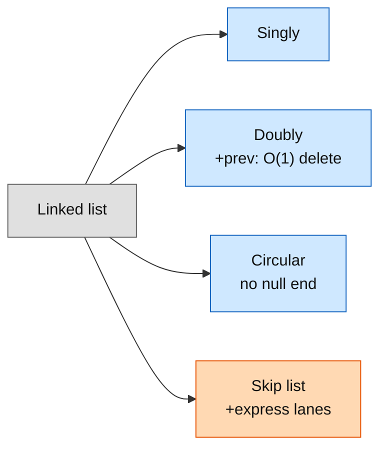

**How to read this diagram.** Grey is the base structure, blue are the classic variants, orange is the one that adds probabilistic shortcuts. Each arrow answers "what did we add, and what cost did it remove?".

| Variant | Extra cost | Removes this problem |
| ------- | ---------- | -------------------- |
| Doubly linked | +1 pointer per node | O(n) predecessor search on delete |
| Circular | Careful termination checks | Wrap-around (round-robin, buffers) |
| Sentinel node | One dummy node | Head/tail special cases |
| Skip list | Extra levels (~2× space) | O(n) search in a linked list |

> [!TIP]
> Learn variants as *"base + one change + what it buys"*; this makes them easy to recall and to choose between.

---

# Part 0b: Historical Evolution of Data Structure Variants

::: timeline

**Timeline of key inventions:**

| Year | Who → What | Why it mattered |
| ---- | ---------- | --------------- |
| 1955–1956 | Newell, Shaw & Simon → **linked lists** (IPL-II at RAND Corp) | First symbolic list processing; the foundation of all dynamic pointer-based structures. |
| 1962 | Adelson-Velsky & Landis → **AVL trees** | First self-balancing BST. Every node: `\|height(left) − height(right)\| ≤ 1`. |
| 1970 (pub. 1972) | Bayer & McCreight → **B-tree** | Disk I/O cost dominated memory cost. B-trees minimize disk reads by storing many keys per node (matching block size). |
| 1978 | Guibas & Sedgewick → **Red-Black trees** | Nearly balanced: path from root to leaf ≤ 2× the shortest path. The workhorse of production tree maps (Java `TreeMap`). |
| 1985 | Sleator & Tarjan → **Splay trees** | Self-adjusting: recently accessed elements move to the root (temporal locality). O(log n) amortized per operation. |
| 1970 / 2000s | Bloom (1970), rediscovered for big data → **Bloom filter** | Space-efficient set membership using k hash functions in O(k) time with a configurable false-positive rate. |
| 1989–1990 | William Pugh → **Skip list** | Probabilistic alternative to balanced BSTs: simpler to implement and easier to make concurrent. |
| 1995 | Boehm, Atkinson & Plass → **Rope** | Balanced tree for string storage: O(log n) concatenation and substring without copying. |
| 1996 | O'Neil, Cheng, Gawlick & O'Neil → **LSM-tree** | Batches writes and merges them sequentially, giving large write-throughput gains over random-write B-trees. Used by RocksDB, Cassandra, LevelDB. |
| 1999–2000 | Prokop; Bender, Demaine & Farach-Colton → **cache-oblivious structures / B-tree** | Optimal at *all* cache levels without knowing cache parameters, using a recursive (van Emde Boas) layout. |
| 2000s | Doug Baskins (HP) → **Judy array** | High-density, cache-friendly 256-way branching; adapts dynamically. |
| 2006 | Google Bigtable → **SSTable** (Sorted String Table) | Immutable, sorted key-value storage; foundation of Bigtable, LevelDB, Cassandra. |
| 2017 | Kraska et al. → **Learned indexes** (later SageDB) | Replace tree indices with machine-learned models that predict key positions. |

:::

### Named Predecessors: Why Each Variant Was Invented

| Structure | Motivation | Predecessor |
| --------- | ---------- | ----------- |
| **B-tree** | Disk I/O cost ≫ memory cost. Store hundreds of keys per node to match OS page/block sizes. | 2-3 tree (simple multi-way search) |
| **LSM-tree** | Sequential writes are far cheaper than random writes (and SSDs have limited erase cycles). A B-tree does many random writes on update. | B-tree |
| **Skip list** | Balanced BSTs are hard to implement correctly and even harder to make concurrent. Pugh showed that probabilistic layering achieves O(log n) without rebalancing. | Sorted linked list |
| **Bloom filter** | Hash sets store full objects (space-heavy). A Bloom filter uses a bit array + k hash functions for O(k) membership with a tunable false-positive rate. | Hash set for exact membership |
| **Splay tree** | Balanced trees assume equal access probability, but real workloads have hot and cold keys. | AVL tree |

### Modern Practice Anchors: Production Implementations

| Language / system | Data structure used | Source |
| ----------------- | ------------------- | ------ |
| Java `java.util.TreeMap` | Red-Black tree | [TreeMap.java](https://github.com/openjdk/jdk/blob/jdk17/src/java.base/share/classes/java/util/TreeMap.java) |
| Java `java.util.concurrent.ConcurrentSkipListMap` | Skip list (lock-free) | [ConcurrentSkipListMap.java](https://github.com/openjdk/jdk/blob/jdk17/src/java.base/share/classes/java/util/concurrent/ConcurrentSkipListMap.java) |
| PostgreSQL indexes | B-tree (default); also GiST, GIN, BRIN | [nbtree README](https://github.com/postgres/postgres/blob/REL_17_STABLE/src/backend/access/nbtree/README) |
| Cassandra, RocksDB | LSM-tree (log-structured merge) | [rocksdb options.h](https://github.com/facebook/rocksdb/blob/main/include/rocksdb/options.h) |
| Google Bigtable, LevelDB | SSTable (Sorted String Table, immutable) | [leveldb table.h](https://github.com/google/leveldb/blob/main/include/leveldb/table.h) |
| Redis ZSET | Skip list + hash table (dual encoding) | [t_zset.c](https://github.com/redis/redis/blob/7.0/src/t_zset.c) |
| Linux kernel page cache | Radix tree (prefix-tree variant); the XArray API replaced it in newer kernels | [lib/radix-tree.c](https://github.com/torvalds/linux/blob/master/lib/radix-tree.c) |

---

# 📌 Part 0: Data Structure Variant Map

::: map

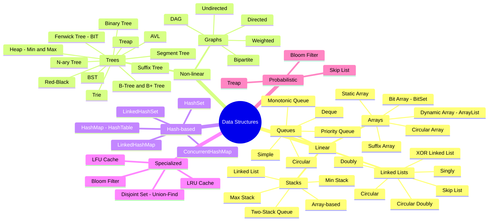

**How to read this diagram.** The five top-level branches are the families the rest of this chapter covers: linear, non-linear, hash-based, specialized and probabilistic. Each leaf is a variant with its own section.

::: invariants

**Key Invariants for Core Variants:**

| Data Structure   | Core Invariant Formula                                       | Notes                                                   |
| ---------------- | ------------------------------------------------------------ | ------------------------------------------------------- |
| ArrayList growth | `newCapacity = oldCapacity + (oldCapacity >> 1)`             | 1.5x growth (OpenJDK); guarantees O(1) amortized insert |
| Bloom filter FPR | `FPR = (1 - e^(-kn/m))^k` where k=hashes, n=elements, m=bits | Optimal k = (m/n) \* ln(2); never false negative        |
| Skip list height | P(node at level L+1) = p (typically 0.5)                     | Expected height O(log n); sorted at every level         |
| B+ tree fanout   | Node holds between `t-1` and `2t-1` keys                     | Minimum occupancy 50%; t = minimum degree               |
| Red-Black height | `h <= 2*log2(n+1)` — path ≤ 2x shortest                      | Guarantees O(log n) worst-case operations               |

:::

---

# 🔗 Part 1: Linked List Variants (complete)

## 1.1 Singly Linked List

### 💬 Study-Partner View — Singly Linked List

**1. The bottom line:** A chain of nodes where each one only knows the next node, so you can only walk forward.

**2. The textbook core:**

- Node = `data` + `next`; the list keeps a `head` (optionally a `tail`).
- Insert/delete at the head: **O(1)**. Insert at the tail: O(1) with a tail pointer.
- Search and access by index: **O(n)**. Delete the tail: O(n) (you need the previous node).
- Uses one pointer per node, the cheapest linked variant.

**3. The real-world analogy:** A **one-way street**: you can drive forward to the next block, but there is no way to turn around.

**4. Walkthrough:**

1. List is `10 → 20 → 30`. Insert `5` at the head.
2. Create node `5`, set `5.next = head` (10).
3. Set `head = 5`. List is `5 → 10 → 20 → 30`; nothing was moved.

> [!NOTE]
> **Quick check:** Why is deleting the tail O(n)? *You must walk from the head to find the node before the tail.*


::: pattern

### Singly linked list - complete guide

#### What is it

A linear data structure where each element (node) contains:

1. DATA - The actual value stored
2. NEXT - Reference/pointer to the next node

**Visual:** 

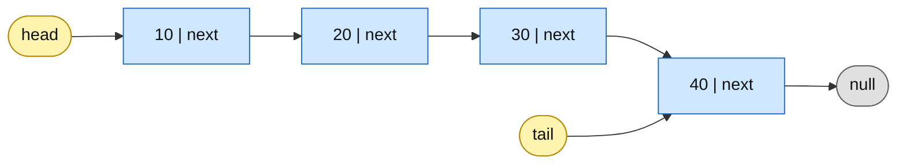

**How to read this diagram.** Each node holds a value and one `next` reference. `head` marks the start, `tail` the last node, and the last `next` is `null`. You can only walk forward.

**Key property:** Can only traverse FORWARD (one direction)

#### Time complexity

| Operation | Time | Explanation |
| --- | --- | --- |
| Access by index | O(n) | Must traverse from head |
| Search | O(n) | Must check each node |
| Insert at head | O(1) | Just change head pointer |
| Insert at tail | O(1)* | *If tail pointer maintained |
| Insert at middle | O(n) | Must find position first |
| Delete at head | O(1) | Just change head pointer |
| Delete at tail | O(n) | Must find second-to-last |
| Delete at middle | O(n) | Must find position first |

#### When to use

- ✅ Frequent insertions/deletions at beginning
- ✅ Don't know size in advance
- ✅ Memory is fragmented (non-contiguous is OK)
- ✅ Implementing stack (LIFO)

- ❌ Need random access by index
- ❌ Need backward traversal
- ❌ Delete at end frequently (use doubly linked)
- ❌ Memory efficiency is critical (pointers add overhead)

:::

::: example

**Real-world applications**

| # | Application | Chain | How it uses the list |
| - | ----------- | ----- | -------------------- |
| 1 | Undo functionality (simple) | `Action1 → Action2 → Action3 → null` | Pop from the end to undo |
| 2 | Browser forward history | `Page1 → Page2 → Page3 → null` | Click "Forward" = move to next |
| 3 | Music playlist (forward only) | `Song1 → Song2 → Song3 → null` | "Next Track" = go to next node |
| 4 | Train cars | `Engine → Car1 → Car2 → Caboose → null` | Each car connects to the next |

:::

```java
// COMPLETE SINGLY LINKED LIST IMPLEMENTATION
public class SinglyLinkedList<T> {

    // Node class
    private static class Node<T> {
        T data;
        Node<T> next;

        Node(T data) {
            this.data = data;
            this.next = null;
        }
    }

    private Node<T> head;
    private Node<T> tail;
    private int size;

    public SinglyLinkedList() {
        this.head = null;
        this.tail = null;
        this.size = 0;
    }

    // ═══════════════════════════════════════════════════════════════════════
    // INSERTION OPERATIONS
    // ═══════════════════════════════════════════════════════════════════════

    // Insert at beginning - O(1)
    public void insertAtHead(T data) {
        Node<T> newNode = new Node<>(data);
        if (head == null) {
            head = tail = newNode;
        } else {
            newNode.next = head;
            head = newNode;
        }
        size++;
    }

    // Insert at end - O(1) with tail pointer
    public void insertAtTail(T data) {
        Node<T> newNode = new Node<>(data);
        if (head == null) {
            head = tail = newNode;
        } else {
            tail.next = newNode;
            tail = newNode;
        }
        size++;
    }

    // Insert at index - O(n)
    public void insertAt(int index, T data) {
        if (index < 0 || index > size) {
            throw new IndexOutOfBoundsException("Index: " + index);
        }
        if (index == 0) {
            insertAtHead(data);
            return;
        }
        if (index == size) {
            insertAtTail(data);
            return;
        }

        Node<T> newNode = new Node<>(data);
        Node<T> current = head;

        // Traverse to node BEFORE insertion point
        for (int i = 0; i < index - 1; i++) {
            current = current.next;
        }

        newNode.next = current.next;
        current.next = newNode;
        size++;
    }

    // ═══════════════════════════════════════════════════════════════════════
    // DELETION OPERATIONS
    // ═══════════════════════════════════════════════════════════════════════

    // Delete from beginning - O(1)
    public T deleteFromHead() {
        if (head == null) {
            throw new RuntimeException("List is empty");
        }
        T data = head.data;
        head = head.next;
        if (head == null) {
            tail = null;
        }
        size--;
        return data;
    }

    // Delete from end - O(n) - THIS IS WHY DOUBLY LINKED IS BETTER FOR THIS
    public T deleteFromTail() {
        if (head == null) {
            throw new RuntimeException("List is empty");
        }
        if (head == tail) {
            T data = head.data;
            head = tail = null;
            size--;
            return data;
        }

        // Find second-to-last node
        Node<T> current = head;
        while (current.next != tail) {
            current = current.next;
        }

        T data = tail.data;
        current.next = null;
        tail = current;
        size--;
        return data;
    }

    // Delete by value - O(n)
    public boolean delete(T data) {
        if (head == null) return false;

        if (head.data.equals(data)) {
            deleteFromHead();
            return true;
        }

        Node<T> current = head;
        while (current.next != null) {
            if (current.next.data.equals(data)) {
                if (current.next == tail) {
                    tail = current;
                }
                current.next = current.next.next;
                size--;
                return true;
            }
            current = current.next;
        }
        return false;
    }

    // ═══════════════════════════════════════════════════════════════════════
    // SEARCH OPERATIONS
    // ═══════════════════════════════════════════════════════════════════════

    // Search - O(n)
    public boolean contains(T data) {
        Node<T> current = head;
        while (current != null) {
            if (current.data.equals(data)) {
                return true;
            }
            current = current.next;
        }
        return false;
    }

    // Get by index - O(n)
    public T get(int index) {
        if (index < 0 || index >= size) {
            throw new IndexOutOfBoundsException("Index: " + index);
        }
        Node<T> current = head;
        for (int i = 0; i < index; i++) {
            current = current.next;
        }
        return current.data;
    }

    // ═══════════════════════════════════════════════════════════════════════
    // UTILITY OPERATIONS
    // ═══════════════════════════════════════════════════════════════════════

    // Reverse - O(n) - VERY IMPORTANT FOR INTERVIEWS
    public void reverse() {
        Node<T> prev = null;
        Node<T> current = head;
        tail = head;  // Old head becomes new tail

        while (current != null) {
            Node<T> nextTemp = current.next;
            current.next = prev;
            prev = current;
            current = nextTemp;
        }
        head = prev;
    }

    // Find middle - O(n) using slow/fast pointers
    public T findMiddle() {
        if (head == null) {
            throw new RuntimeException("List is empty");
        }
        Node<T> slow = head;
        Node<T> fast = head;

        while (fast != null && fast.next != null) {
            slow = slow.next;
            fast = fast.next.next;
        }
        return slow.data;
    }

    // Detect cycle - O(n) Floyd's Algorithm
    public boolean hasCycle() {
        if (head == null) return false;

        Node<T> slow = head;
        Node<T> fast = head;

        while (fast != null && fast.next != null) {
            slow = slow.next;
            fast = fast.next.next;
            if (slow == fast) return true;
        }
        return false;
    }

    // Get Nth node from end - O(n)
    public T getNthFromEnd(int n) {
        Node<T> first = head;
        Node<T> second = head;

        // Move first n nodes ahead
        for (int i = 0; i < n; i++) {
            if (first == null) {
                throw new IndexOutOfBoundsException("n is larger than list size");
            }
            first = first.next;
        }

        // Move both until first reaches end
        while (first != null) {
            first = first.next;
            second = second.next;
        }

        return second.data;
    }

    public int size() { return size; }
    public boolean isEmpty() { return size == 0; }

    // Print list
    public void print() {
        Node<T> current = head;
        while (current != null) {
            System.out.print(current.data + " -> ");
            current = current.next;
        }
        System.out.println("null");
    }
}
```

---

> 🔬 **Section Challenge — 1.1 Singly Linked List**
>
> **Challenge 1 (Trace):** You need to implement a "Delete from tail" method for a singly linked list. Because you maintain a `tail` pointer, a junior engineer writes: `tail = null; size--;`. Trace why this completely corrupts the data structure and what the true time complexity of tail deletion is.
>
> <details><summary>Answer</summary>
>
> **Scenario:** Optimizing tail operations on a Singly Linked List.
> **Trace:** Setting the `tail` reference to `null` only updates your class variable. The actual second-to-last node in the list _still has its `.next` pointer pointing to the old tail object in memory_. Furthermore, because you didn't update the second-to-last node, you now have no way to find the new tail! The list is corrupted.
> **Debug/Fix:** To delete the tail, you MUST update the `.next` pointer of the second-to-last node to `null`. In a Singly Linked List, the only way to find the second-to-last node is to start at the head and traverse `N-1` steps. Therefore, even with a `tail` pointer, **deleting from the tail is strictly `O(N)`**.
>
> </details>

## 1.2 Doubly Linked List

### 💬 Study-Partner View — Doubly Linked List

**1. The bottom line:** A linked list where every node knows both its next and previous neighbour, so you can walk and delete in either direction.

**2. The textbook core:**

- Node = `prev` + `data` + `next`; list keeps `head` and `tail`.
- Delete a node you already hold: **O(1)** (`node.prev.next = node.next; node.next.prev = node.prev`).
- Insert/delete at both ends: O(1). Access by index: O(n), but you can start from the nearer end.
- Costs one extra pointer per node and more edge cases (head/tail).

**3. The real-world analogy:** A **two-way street** or a browser's back/forward buttons: from any page you can step back or forward.

**4. Walkthrough:**

1. List `A ⇄ B ⇄ C`; delete `B`.
2. Set `A.next = C` (what `B.next` was).
3. Set `C.prev = A` (what `B.prev` was).
4. `B` is now unreachable; the list is `A ⇄ C`. No search was needed.

> [!NOTE]
> **Quick check:** What is the classic use? *An LRU cache: hash map for lookup plus a doubly linked list to move items to the front in O(1).*


::: pattern

### Doubly linked list - complete guide

#### What is it

A linked list where each node has TWO pointers:

1. DATA - The actual value
2. PREV - Reference to PREVIOUS node
3. NEXT - Reference to NEXT node

**Visual:** 

null                                                           null
↑                                                              ↑

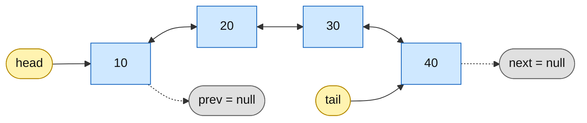

**How to read this diagram.** Each node has both `prev` and `next` references, so the arrows point both ways. The first node's `prev` and the last node's `next` are `null`.

**Key property:** Can traverse BOTH directions (forward AND backward)

#### Advantages over singly linked list

1. BIDIRECTIONAL TRAVERSAL:
   - Can go forward AND backward
   - Essential for "Previous" buttons

2. O(1) DELETE FROM TAIL:
   Singly: O(n) - must find second-to-last
   Doubly: O(1) - just use tail.prev

3. EASIER NODE DELETION:
   Given a node reference, can delete in O(1)
   Don't need to find previous node!

4. BETTER FOR LRU CACHE:
   Move nodes to front/back in O(1)

**Disadvantage:** 

- More memory (extra prev pointer)
- More complex insertion/deletion code

#### Time complexity comparison

| Operation | Singly | Doubly | Winner |
| --- | --- | --- | --- |
| Access by index | O(n) | O(n) | Tie |
| Insert at head | O(1) | O(1) | Tie |
| Insert at tail | O(1)* | O(1) | Tie |
| Delete at head | O(1) | O(1) | Tie |
| Delete at tail | O(n) | O(1) | DOUBLY 🏆 |
| Delete given node | O(n) | O(1) | DOUBLY 🏆 |
| Traverse backward | O(n²) | O(n) | DOUBLY 🏆 |
| Memory per node | Less | More | SINGLY (if memory matters) |

:::

::: example

**Real-world applications**

| # | Application | Chain | How it uses the list |
| - | ----------- | ----- | -------------------- |
| 1 | Browser history (back & forward) | `null ← Page1 ↔ Page2 ↔ Page3 → null` | "Back" = go to `prev`, "Forward" = go to `next` |
| 2 | Music player (previous & next) | `null ← Song1 ↔ Song2 ↔ Song3 → null` | Previous track / next track |
| 3 | Text-editor undo/redo | `null ← Edit1 ↔ Edit2 ↔ Edit3 → null` | Undo = go to `prev`, redo = go to `next` |
| 4 | LRU cache (move to front) | `head ↔ Recent1 ↔ Recent2 ↔ LeastRecent ↔ tail` | Access an item = move it to the head in O(1) |
| 5 | Image viewer (swipe left/right) | `null ← Img1 ↔ Img2 ↔ Img3 → null` | Swipe = follow `prev` / `next` |

:::

```java
// COMPLETE DOUBLY LINKED LIST IMPLEMENTATION
public class DoublyLinkedList<T> {

    // Node class with prev and next pointers
    private static class Node<T> {
        T data;
        Node<T> prev;
        Node<T> next;

        Node(T data) {
            this.data = data;
            this.prev = null;
            this.next = null;
        }
    }

    private Node<T> head;
    private Node<T> tail;
    private int size;

    public DoublyLinkedList() {
        this.head = null;
        this.tail = null;
        this.size = 0;
    }

    // ═══════════════════════════════════════════════════════════════════════
    // INSERTION OPERATIONS
    // ═══════════════════════════════════════════════════════════════════════

    // Insert at beginning - O(1)
    public void insertAtHead(T data) {
        Node<T> newNode = new Node<>(data);

        if (head == null) {
            // Empty list
            head = tail = newNode;
        } else {
            // Link with current head
            newNode.next = head;
            head.prev = newNode;
            head = newNode;
        }
        size++;
    }

    // Insert at end - O(1)
    public void insertAtTail(T data) {
        Node<T> newNode = new Node<>(data);

        if (tail == null) {
            // Empty list
            head = tail = newNode;
        } else {
            // Link with current tail
            newNode.prev = tail;
            tail.next = newNode;
            tail = newNode;
        }
        size++;
    }

    // Insert after a specific node - O(1)
    // THIS IS WHERE DOUBLY LINKED SHINES!
    public void insertAfter(Node<T> node, T data) {
        if (node == null) {
            throw new IllegalArgumentException("Node cannot be null");
        }

        Node<T> newNode = new Node<>(data);

        // Link new node
        newNode.prev = node;
        newNode.next = node.next;

        // Update existing links
        if (node.next != null) {
            node.next.prev = newNode;
        } else {
            tail = newNode;  // Inserting at end
        }
        node.next = newNode;

        size++;
    }

    // Insert before a specific node - O(1)
    public void insertBefore(Node<T> node, T data) {
        if (node == null) {
            throw new IllegalArgumentException("Node cannot be null");
        }

        Node<T> newNode = new Node<>(data);

        // Link new node
        newNode.next = node;
        newNode.prev = node.prev;

        // Update existing links
        if (node.prev != null) {
            node.prev.next = newNode;
        } else {
            head = newNode;  // Inserting at beginning
        }
        node.prev = newNode;

        size++;
    }

    // Insert at index - O(n)
    public void insertAt(int index, T data) {
        if (index < 0 || index > size) {
            throw new IndexOutOfBoundsException("Index: " + index);
        }
        if (index == 0) {
            insertAtHead(data);
            return;
        }
        if (index == size) {
            insertAtTail(data);
            return;
        }

        // Find the node at index
        Node<T> current = getNodeAt(index);
        insertBefore(current, data);
    }

    // ═══════════════════════════════════════════════════════════════════════
    // DELETION OPERATIONS
    // ═══════════════════════════════════════════════════════════════════════

    // Delete from beginning - O(1)
    public T deleteFromHead() {
        if (head == null) {
            throw new RuntimeException("List is empty");
        }

        T data = head.data;

        if (head == tail) {
            // Only one element
            head = tail = null;
        } else {
            head = head.next;
            head.prev = null;
        }

        size--;
        return data;
    }

    // Delete from end - O(1) - MUCH BETTER THAN SINGLY LINKED!
    public T deleteFromTail() {
        if (tail == null) {
            throw new RuntimeException("List is empty");
        }

        T data = tail.data;

        if (head == tail) {
            // Only one element
            head = tail = null;
        } else {
            tail = tail.prev;
            tail.next = null;
        }

        size--;
        return data;
    }

    // Delete a specific node - O(1) when you have the node reference!
    // THIS IS THE KILLER FEATURE OF DOUBLY LINKED LIST
    public T deleteNode(Node<T> node) {
        if (node == null) {
            throw new IllegalArgumentException("Node cannot be null");
        }

        T data = node.data;

        // Update prev's next
        if (node.prev != null) {
            node.prev.next = node.next;
        } else {
            head = node.next;  // Deleting head
        }

        // Update next's prev
        if (node.next != null) {
            node.next.prev = node.prev;
        } else {
            tail = node.prev;  // Deleting tail
        }

        size--;
        return data;
    }

    // Delete by value - O(n)
    public boolean delete(T data) {
        Node<T> current = head;

        while (current != null) {
            if (current.data.equals(data)) {
                deleteNode(current);
                return true;
            }
            current = current.next;
        }
        return false;
    }

    // ═══════════════════════════════════════════════════════════════════════
    // TRAVERSAL OPERATIONS
    // ═══════════════════════════════════════════════════════════════════════

    // Traverse forward
    public void traverseForward() {
        Node<T> current = head;
        System.out.print("null <- ");
        while (current != null) {
            System.out.print(current.data);
            if (current.next != null) {
                System.out.print(" <-> ");
            }
            current = current.next;
        }
        System.out.println(" -> null");
    }

    // Traverse backward
    public void traverseBackward() {
        Node<T> current = tail;
        System.out.print("null <- ");
        while (current != null) {
            System.out.print(current.data);
            if (current.prev != null) {
                System.out.print(" <-> ");
            }
            current = current.prev;
        }
        System.out.println(" -> null");
    }

    // ═══════════════════════════════════════════════════════════════════════
    // UTILITY OPERATIONS
    // ═══════════════════════════════════════════════════════════════════════

    // Get node at index - O(n) but optimized!
    // Can start from head OR tail depending on index
    private Node<T> getNodeAt(int index) {
        if (index < 0 || index >= size) {
            throw new IndexOutOfBoundsException("Index: " + index);
        }

        Node<T> current;

        // Optimization: start from closer end
        if (index < size / 2) {
            // Start from head
            current = head;
            for (int i = 0; i < index; i++) {
                current = current.next;
            }
        } else {
            // Start from tail (faster for second half)
            current = tail;
            for (int i = size - 1; i > index; i--) {
                current = current.prev;
            }
        }

        return current;
    }

    // Get by index - O(n)
    public T get(int index) {
        return getNodeAt(index).data;
    }

    // Reverse - O(n)
    public void reverse() {
        Node<T> current = head;
        Node<T> temp = null;

        // Swap prev and next for all nodes
        while (current != null) {
            temp = current.prev;
            current.prev = current.next;
            current.next = temp;
            current = current.prev;  // Move to next (which is now prev)
        }

        // Swap head and tail
        temp = head;
        head = tail;
        tail = temp;
    }

    // Move a node to front - O(1)
    // Very useful for LRU Cache!
    public void moveToFront(Node<T> node) {
        if (node == head) return;  // Already at front

        // Remove from current position
        if (node.prev != null) {
            node.prev.next = node.next;
        }
        if (node.next != null) {
            node.next.prev = node.prev;
        } else {
            tail = node.prev;  // Was at end
        }

        // Move to front
        node.prev = null;
        node.next = head;
        head.prev = node;
        head = node;
    }

    public int size() { return size; }
    public boolean isEmpty() { return size == 0; }
}
```

::: memory

> [!TIP]
> **🧠 Interview key points — Doubly Linked List**
>
>
> 1. **"Why use doubly over singly?"**
>    - Delete at tail: O(1) vs O(n)
>    - Bidirectional traversal
>    - Delete given node: O(1) vs O(n)
>
> 2. **"What's the main disadvantage?"**
>    - Extra memory for prev pointer
>    - More complex code
>
> 3. **"Real-world use case?"**
>    - LRU Cache (HashMap + Doubly Linked)
>    - Browser back/forward
>    - Text editor undo/redo
>
> 4. **"How to delete a node in O(1)?"**
>    - node.prev.next = node.next
>    - node.next.prev = node.prev
>    - Handle edge cases (head/tail)

:::

---

> 🔬 **Section Challenge — 1.2 Doubly Linked List**
>
> **Challenge 1 (Debug):** A developer writes an `O(1)` node deletion function: `public void deleteNode(Node n) { n.prev.next = n.next; n.next.prev = n.prev; }`. What critical `NullPointerException` (NPE) edge cases did they miss?
>
> <details><summary>Answer</summary>
>
> **Scenario:** Deleting an arbitrary node in a Doubly Linked List.
> **Trace:** The logic assumes that `n.prev` and `n.next` always exist.
>
> - If `n` is the `head`, `n.prev` is `null`. Calling `n.prev.next` throws an NPE.
> - If `n` is the `tail`, `n.next` is `null`. Calling `n.next.prev` throws an NPE.
>   **Debug/Fix:** You must handle the boundaries explicitly:
>
> ```java
> if (n.prev != null) n.prev.next = n.next;
> else head = n.next; // We are deleting the head
>
> if (n.next != null) n.next.prev = n.prev;
> else tail = n.prev; // We are deleting the tail
> ```
>
> </details>

## 1.3 Circular Linked List

### 💬 Study-Partner View — Circular Linked List

**1. The bottom line:** A linked list whose last node points back to the first, so there is no end and you can loop forever.

**2. The textbook core:**

- The last node's `next` is the head (not `null`).
- Traversal must stop by comparing against the starting node (or counting), otherwise it loops forever.
- Rotating the list or cycling round-robin is O(1) once you hold a pointer.
- Insert/delete follow the singly linked rules with an extra "keep the loop closed" step.

**3. The real-world analogy:** A **merry-go-round** or a round-table game: after the last player, it is the first player's turn again.

**4. Walkthrough:**

1. Processes `P1 → P2 → P3 → (back to P1)`; each gets a CPU time slice.
2. Run `P1`, then move `current = current.next` (P2).
3. After `P3` the pointer wraps to `P1` with no special case.
4. Stop condition for a full lap: `current == start`.

> [!NOTE]
> **Quick check:** What is the main bug risk? *Infinite loops: always check for returning to the start node.*


::: pattern

### Circular linked list - complete guide

#### What is it

A linked list where the LAST node points BACK to the FIRST node.
No NULL at end - forms a CIRCLE!

**Singly circular:** 

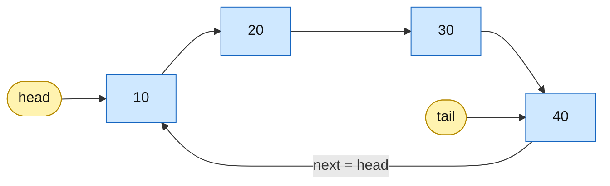

**How to read this diagram.** The last node points back to the first instead of `null`, so you can keep traversing forever (use `head` or a counter to know when to stop).

**Doubly circular:** 

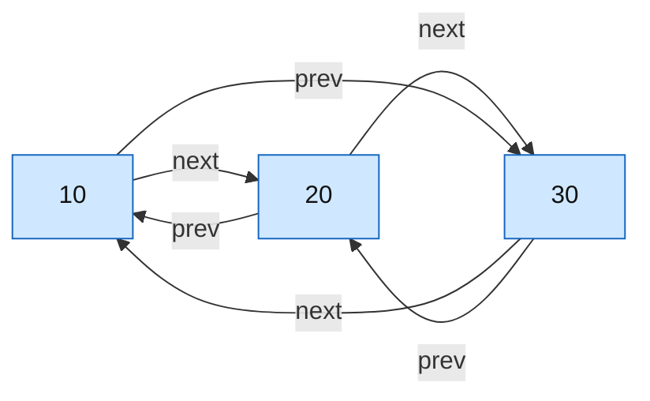

**How to read this diagram.** Every node has `prev` and `next`, and the ends wrap around: `30.next` is `10` and `10.prev` is `30`.

**Key property:** Can traverse the entire list starting from ANY node!

No "end" - goes round and round.

#### Why use circular

1. ROUND-ROBIN SCHEDULING:
   - Process1 → Process2 → Process3 → Process1 → ...
   - CPU gives time to each process in circular order

2. MULTIPLAYER GAME TURNS:
   - Player1 → Player2 → Player3 → Player1 → ...
   - No need to reset to beginning

3. CIRCULAR BUFFER/QUEUE:
   - Audio streaming
   - Producer-consumer problems

4. REPEATED TRAVERSAL:
   - Carousel/slideshow that loops
   - Music playlist on repeat

**Key insight:** Useful when you need to wrap around!

:::

::: example

**Real-world applications**

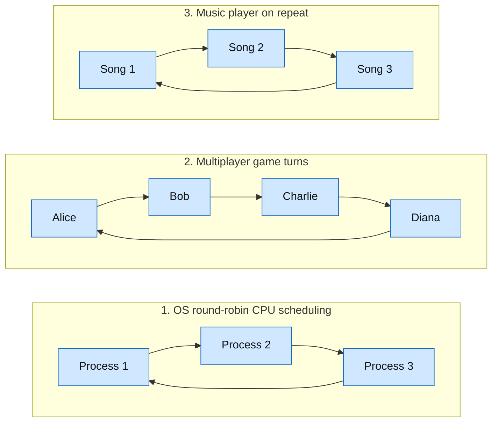

**How to read this diagram.** In each ring the last element links back to the first, so the cycle repeats forever.

| # | Application | Behaviour |
| - | ----------- | --------- |
| 1 | OS round-robin scheduling | Each process gets CPU time, then goes to the end of the ring |
| 2 | Multiplayer game turns | After Diana's turn, it is Alice's turn again |
| 3 | Music player on repeat | After the last song, play the first |
| 4 | Josephus problem (classic) | `n` people in a circle, every `k`-th person eliminated: who survives? (a famous interview problem) |

:::

```java
// COMPLETE CIRCULAR SINGLY LINKED LIST IMPLEMENTATION
public class CircularLinkedList<T> {

    private static class Node<T> {
        T data;
        Node<T> next;

        Node(T data) {
            this.data = data;
        }
    }

    private Node<T> tail;  // We keep tail, not head! (head = tail.next)
    private int size;

    // Why keep tail instead of head?
    // - Insert at head: O(1) - create node, point to head, tail.next = new
    // - Insert at tail: O(1) - create node, point to head, update tail
    // With only head, insert at tail would be O(n)!

    public CircularLinkedList() {
        this.tail = null;
        this.size = 0;
    }

    // Insert at front - O(1)
    public void insertAtFront(T data) {
        Node<T> newNode = new Node<>(data);

        if (tail == null) {
            // First element - points to itself!
            newNode.next = newNode;
            tail = newNode;
        } else {
            // Insert between tail and head
            newNode.next = tail.next;  // New node points to old head
            tail.next = newNode;        // Tail points to new node (new head)
        }
        size++;
    }

    // Insert at end - O(1)
    public void insertAtEnd(T data) {
        insertAtFront(data);  // Insert at front
        tail = tail.next;      // Then move tail pointer
    }

    // Delete from front - O(1)
    public T deleteFromFront() {
        if (tail == null) {
            throw new RuntimeException("List is empty");
        }

        Node<T> head = tail.next;
        T data = head.data;

        if (head == tail) {
            // Only one element
            tail = null;
        } else {
            tail.next = head.next;
        }

        size--;
        return data;
    }

    // Delete from end - O(n) - must find second-to-last
    public T deleteFromEnd() {
        if (tail == null) {
            throw new RuntimeException("List is empty");
        }

        if (tail.next == tail) {
            // Only one element
            T data = tail.data;
            tail = null;
            size--;
            return data;
        }

        // Find second-to-last
        Node<T> current = tail.next;
        while (current.next != tail) {
            current = current.next;
        }

        T data = tail.data;
        current.next = tail.next;  // Point to head
        tail = current;            // New tail
        size--;
        return data;
    }

    // Traverse entire list - O(n)
    public void traverse() {
        if (tail == null) {
            System.out.println("Empty list");
            return;
        }

        Node<T> current = tail.next;  // Start from head
        do {
            System.out.print(current.data + " -> ");
            current = current.next;
        } while (current != tail.next);  // Stop when back at head

        System.out.println("(back to start)");
    }

    // JOSEPHUS PROBLEM - Classic circular list problem!
    // n people in circle, every k-th person eliminated
    // Returns the survivor's position (1-indexed)
    public static int josephus(int n, int k) {
        // Create circular list with positions 1 to n
        CircularLinkedList<Integer> circle = new CircularLinkedList<>();
        for (int i = 1; i <= n; i++) {
            circle.insertAtEnd(i);
        }

        Node<Integer> current = circle.tail;

        while (circle.size > 1) {
            // Move k-1 steps (k-th person from current)
            for (int i = 0; i < k - 1; i++) {
                current = current.next;
            }

            // Remove the k-th person (current.next)
            Node<Integer> toRemove = current.next;
            System.out.println("Eliminating person " + toRemove.data);

            current.next = toRemove.next;
            if (toRemove == circle.tail) {
                circle.tail = current;
            }
            circle.size--;
        }

        return circle.tail.data;
    }

    public int size() { return size; }
    public boolean isEmpty() { return size == 0; }
}
```

---

> 🔬 **Section Challenge — 1.3 Circular Linked List**
>
> **Challenge 1 (Reasoning):** Why does an optimized Circular Linked List maintain a `tail` pointer instead of a `head` pointer? Trace how this allows `O(1)` insertions at BOTH the front and the back.
>
> <details><summary>Answer</summary>
>
> **Scenario:** Designing an efficient Circular Queue or Round-Robin Scheduler.
> **Trace:** If you only keep a `head` pointer, inserting at the back `insertAtEnd()` requires you to traverse the entire circle `O(N)` to find the last node so you can update its `.next` pointer to the new node.
> **Design Fix:** Keep a `tail` pointer instead.
>
> - The head is always trivially accessible via `tail.next`.
> - **Insert at Front:** `newNode.next = tail.next; tail.next = newNode;` (O(1)).
> - **Insert at Back:** `newNode.next = tail.next; tail.next = newNode; tail = newNode;` (O(1)).
> By simply maintaining the `tail`, you gain `O(1)` access to both ends of the circle!
> </details>

## 1.4 Circular Doubly Linked List

### 💬 Study-Partner View — Circular Doubly Linked List

**1. The bottom line:** A doubly linked list that also wraps around at both ends, so you can move in either direction forever.

**2. The textbook core:**

- Every node has `prev` and `next`; `head.prev` is the tail and `tail.next` is the head.
- No `null` pointers at all, which removes most head/tail special cases.
- Insert/delete at either end and at a known node: **O(1)**.
- Used inside structures such as Fibonacci heaps and LRU-style lists with a sentinel node.

**3. The real-world analogy:** A **Ferris wheel**: you can rotate it clockwise or counter-clockwise and every seat always has a neighbour on both sides.

**4. Walkthrough:**

1. Insert `X` after `A` in the ring `A ⇄ B ⇄ C ⇄ (A)`.
2. Set `X.prev = A` and `X.next = B`.
3. Set `B.prev = X` and `A.next = X`.
4. The ring is `A ⇄ X ⇄ B ⇄ C`; there was no null check because every node has two neighbours.

> [!NOTE]
> **Quick check:** Why use a sentinel node here? *It makes the empty list a one-node ring, so insert and delete need no special case.*


::: pattern

### Circular doubly linked list - complete guide

#### What is it

Combines BOTH concepts:

- Doubly: Each node has prev AND next pointers
- Circular: Last node connects to first, first connects to last

**Visual:** 

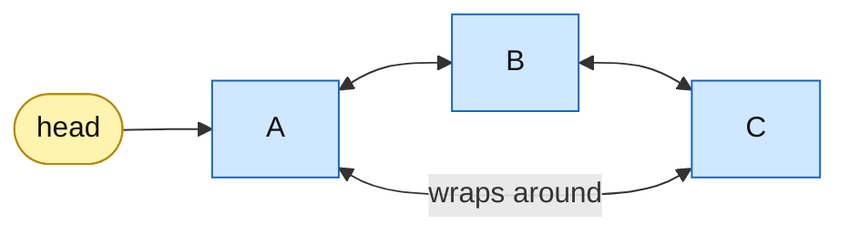

**How to read this diagram.** A circular doubly linked list: every link works in both directions, and the last node links back to the first (and the first back to the last), so there is no `null` end.

KEY: A.prev = C, C.next = A (circular in BOTH directions!)

#### Advantages

- ✅ O(1) insertion at both ends
- ✅ O(1) deletion at both ends
- ✅ O(1) deletion of any node (given reference)
- ✅ Can traverse in both directions
- ✅ Can wrap around in both directions
- ✅ No need to check for null at boundaries

- ❌ More memory (two pointers per node)
- ❌ More complex code

**Perfect for:** 

- Deque (double-ended queue) implementation
- Applications needing wrap-around in both directions
- When you frequently access both ends

:::

::: example

**Real-world applications**

| # | Application | Why a circular doubly linked list |
| - | ----------- | --------------------------------- |
| 1 | Fibonacci heap (advanced data structure) | Root lists and child lists are circular doubly linked lists; O(1) amortized insert and decrease-key |
| 2 | Advanced cache implementations | Elements can be moved efficiently; access patterns go in both directions |
| 3 | Image carousel in both directions | Swipe left or right, and wrap around in either direction |

:::

```java
// CIRCULAR DOUBLY LINKED LIST IMPLEMENTATION
public class CircularDoublyLinkedList<T> {

    private static class Node<T> {
        T data;
        Node<T> prev;
        Node<T> next;

        Node(T data) {
            this.data = data;
        }
    }

    private Node<T> head;
    private int size;

    public CircularDoublyLinkedList() {
        this.head = null;
        this.size = 0;
    }

    // Insert at front - O(1)
    public void insertAtFront(T data) {
        Node<T> newNode = new Node<>(data);

        if (head == null) {
            // First element - points to itself in both directions!
            newNode.next = newNode;
            newNode.prev = newNode;
            head = newNode;
        } else {
            Node<T> tail = head.prev;  // Last element

            // Link new node
            newNode.next = head;
            newNode.prev = tail;

            // Update existing links
            head.prev = newNode;
            tail.next = newNode;

            head = newNode;
        }
        size++;
    }

    // Insert at end - O(1)
    public void insertAtEnd(T data) {
        if (head == null) {
            insertAtFront(data);
            return;
        }

        Node<T> newNode = new Node<>(data);
        Node<T> tail = head.prev;

        // Link new node
        newNode.prev = tail;
        newNode.next = head;

        // Update existing links
        tail.next = newNode;
        head.prev = newNode;

        size++;
    }

    // Delete from front - O(1)
    public T deleteFromFront() {
        if (head == null) {
            throw new RuntimeException("List is empty");
        }

        T data = head.data;

        if (size == 1) {
            head = null;
        } else {
            Node<T> tail = head.prev;
            head = head.next;
            head.prev = tail;
            tail.next = head;
        }

        size--;
        return data;
    }

    // Delete from end - O(1)
    public T deleteFromEnd() {
        if (head == null) {
            throw new RuntimeException("List is empty");
        }

        if (size == 1) {
            return deleteFromFront();
        }

        Node<T> tail = head.prev;
        T data = tail.data;

        Node<T> newTail = tail.prev;
        newTail.next = head;
        head.prev = newTail;

        size--;
        return data;
    }

    // Traverse forward (full circle)
    public void traverseForward() {
        if (head == null) return;

        Node<T> current = head;
        do {
            System.out.print(current.data + " <-> ");
            current = current.next;
        } while (current != head);
        System.out.println("(back to " + head.data + ")");
    }

    // Traverse backward (full circle)
    public void traverseBackward() {
        if (head == null) return;

        Node<T> current = head.prev;  // Start from tail
        do {
            System.out.print(current.data + " <-> ");
            current = current.prev;
        } while (current != head.prev);
        System.out.println("(back to " + head.prev.data + ")");
    }

    public int size() { return size; }
    public boolean isEmpty() { return size == 0; }
}
```

---

> 🔬 **Section Challenge — 1.4 Circular Doubly Linked List**
>
> **Challenge 1 (Trace):** You are building a bidirectional image carousel. Trace the exact 4 pointer assignments required to insert a new `Node X` exactly between the `tail` and `head` so it becomes the new `head`.
>
> <details><summary>Answer</summary>
>
> **Scenario:** `O(1)` insertions in a completely connected ring.
> **Trace:** In a Circular Doubly Linked List, `tail.next == head` and `head.prev == tail`. When we insert `X` as the new head, `X` must sit between the old `tail` and the old `head`.
> **Execution (The 4 Pointers):**
>
> 1. `X.next = head;` (X points forward to old head)
> 2. `X.prev = tail;` (X points backward to tail)
> 3. `head.prev = X;` (Old head points backward to X)
> 4. `tail.next = X;` (Tail points forward to X)
> Finally, update the class variable: `head = X;`. This perfect symmetry is why CDLLs are used in advanced OS memory managers (like the Linux Kernel's `list_head`).
> </details>

### Variant Selection Challenge: ArrayList vs LinkedList vs Deque

> **Challenge 1 (Selection):** You are building a sliding window statistics calculator that:
>
> - Receives 1M events/second
> - Needs to calculate rolling average over last 1000 events
> - 99% of operations are "append event" and "get average of last N events"
> - 1% are "remove oldest event when window slides"
>
> You consider: ArrayList, LinkedList, ArrayDeque, custom circular buffer.
> **Which do you choose and why? Trace the per-operation cost.**
>
> <details><summary>Answer</summary>
>
> **Scenario:** High-throughput sliding window with O(1) amortized operations.
> **Trace:**
>
> - **ArrayList** fails because `remove(0)` is O(n) — must shift all elements left.
> - **LinkedList** fails because `get(i)` for computing average is O(n) — must traverse.
> - **ArrayDeque** wins: `addLast()` = O(1) amortized, `removeFirst()` = O(1) amortized, and random access for summing is O(n) but necessary.
> - **Circular buffer** also wins if you pre-allocate exactly 1000 slots — same complexity but cleaner memory.
>
> **Variants for each:**
>
> - Rolling statistics with known window size: Circular buffer (fixed array, head pointer)
> - Unknown/adaptive window size: ArrayDeque (dynamic, O(1) both ends)
> - Never remove from front: ArrayList (append only, O(1))
> </details>

> **Challenge 2 (Reasoning):** Why does Java's `ArrayList` use `newCapacity = oldCapacity + (oldCapacity >> 1)` for growth, not doubling? What goes wrong if capacity grows too fast or too slow?
>
> <details><summary>Answer</summary>
>
> **Scenario:** Memory-time trade-off in dynamic array growth.
> **Trace:**
>
> - **Doubling (1.5x -> 2x)**: Uses more memory (wasted capacity between old and new size). But fewer resizes = less copy overhead. Good when memory is cheap.
> - **1.5x (current Java)**: Compromise between memory waste and copy frequency. After n insertions: total copy cost = n + sum of geometric series < 2n = O(n).
> - **Fixed increment**: Poor — if increment is small (e.g., +10), resizes happen O(n) times, making total cost O(n^2).
>
> **Key invariant:** `newCapacity = oldCapacity * 1.5` guarantees amortized O(1) per insertion (proved via accounting method).
>
> - Growth factor > 1 guarantees geometric series convergence.
> - Any fixed increment (not proportional to size) gives O(n) amortized per insert.
> </details>

## 1.5 Skip List

### 💬 Study-Partner View — Skip List

**1. The bottom line:** A sorted linked list with "express lanes" built from coin flips, so searching skips most nodes.

**2. The textbook core:**

- Level 0 holds every element; each higher level holds a random subset (a node is promoted with probability `p`, often 1/2).
- Expected search, insert, delete: **O(log n)**; worst case O(n) but astronomically unlikely.
- Expected space: O(n) (about `n / (1 - p)` pointers).
- Easier to implement and to make concurrent than balanced trees (Java `ConcurrentSkipListMap`, Redis sorted sets).

**3. The real-world analogy:** A **subway with express and local trains**: ride the express to the neighbourhood, then switch to the local train to reach your exact stop.

**4. Walkthrough:**

1. Search 35 in lanes `L2: 25 → 50`, `L1: 10 → 25 → 35 → 50`, `L0: all elements`.
2. At the top lane move to 25; next is 50 (too far), so drop to a lower lane.
3. Move 25 → 35 and find it.
4. Each lane roughly halves the work, giving O(log n) expected steps.

> [!NOTE]
> **Quick check:** Where does the randomness come in? *Only when inserting: you flip coins to decide how many lanes the new node joins.*


::: pattern

### Skip list - complete guide

#### What is it

A probabilistic data structure that allows O(log n) search, insert, and
delete in a SORTED linked list. It's like a "fast lane" over the list!

**Invented:** 1989 by William Pugh

**Visual - multiple layers of linked lists:**

```mermaid
flowchart LR
    subgraph L3["Level 3"]
        direction LR
        h3(["HEAD"]) --> a50["50"]
    end
    subgraph L2["Level 2"]
        direction LR
        h2(["HEAD"]) --> b25["25"] --> b50["50"]
    end
    subgraph L1["Level 1"]
        direction LR
        h1(["HEAD"]) --> c10["10"] --> c25["25"] --> c35["35"] --> c50["50"] --> n1(["NIL"])
    end
    subgraph L0["Level 0 - every element"]
        direction LR
        h0(["HEAD"]) --> d5["5"] --> d10["10"] --> d20["20"] --> d25["25"] --> d30["30"] --> d35["35"] --> d40["40"] --> d50["50"] --> d60["60"] --> n0(["NIL"])
    end
    L3 ~~~ L2 ~~~ L1 ~~~ L0
    classDef head fill:#fff3b0,stroke:#b58900,color:#111
    classDef node fill:#cfe8ff,stroke:#1565c0,color:#111
    classDef nil fill:#e0e0e0,stroke:#616161,color:#111
    class h3,h2,h1,h0 head
    class a50,b25,b50,c10,c25,c35,c50,d5,d10,d20,d25,d30,d35,d40,d50,d60 node
    class n1,n0 nil
```

**How to read this diagram.** Level 0 is the full sorted list; each higher level is a sparser "express lane" that skips ahead. A search starts at the top level and drops down a level whenever the next node would overshoot, which gives O(log n) expected time.

**Key invariants:** 

Invariant 1 (Height): Each node appears at level-i with probability p^h
where h = node height. P = 0.5 (coin flip) by default in many impls.
Expected height of n-node list = O(log n).

Invariant 2 (Ordering): For every valid level L, the forward[L] chain
is sorted in ascending order by node value. This is what enables
binary-search-style traversal across levels.

Invariant 3 (Reachability): Every node at level-i is reachable by
following forward pointers from at least one node at level-(i+1).
(Level-linked structure ensures complete coverage at each layer.)

**Search for 35:** 

1. Start at Level 3: HEAD -> 50 (too big, go down)
2. Level 2: HEAD -> 25 -> 50 (25 < 35 < 50, go down from 25)
3. Level 1: 25 -> 35 (FOUND!)

Only visited: HEAD, 50, 25, 35 = 4 nodes instead of 7!

#### Why use skip list

**Problem:** Sorted linked list has O(n) search

**Solution:** Add "express lanes" for faster traversal

**Comparison:** 

| Operation | Linked List | BST | Skip List |
| --------- | ----------- | --- | --------- |
| Search | O(n) | O(log n)* | O(log n) avg |
| Insert | O(n) | O(log n)* | O(log n) avg |
| Delete | O(n) | O(log n)* | O(log n) avg |
| Ordered iteration | O(n) | O(n) | O(n) |
| Implementation | Simple | Complex | Moderate |
| Concurrent access | Hard | Very hard | Easier! |

\* A BST's worst case is O(n) if it is unbalanced.

**Key advantage:** Easier to implement concurrent (thread-safe) version!

This is why Redis uses skip list for sorted sets!

:::

::: example

**Real-world applications**

| # | Application | Why a skip list |
| - | ----------- | --------------- |
| 1 | Redis sorted sets (`ZSET`) | O(log n) range queries and rank operations |
| 2 | LevelDB / RocksDB | In-memory memtable index for the key-value store |
| 3 | Lucene (search engine) | Posting lists with skip pointers |
| 4 | Concurrent data structures | Java's `ConcurrentSkipListMap` is easier to make thread-safe than a balanced tree |

**Why Redis chose a skip list over a balanced tree:**

- Simpler to implement
- Easier to debug
- Range operations are simple (walk the bottom level)
- Memory per node is tunable (probability `p`), and often smaller than a balanced tree's

:::

```java
// SKIP LIST IMPLEMENTATION
import java.util.Random;

public class SkipList<T extends Comparable<T>> {

    private static final int MAX_LEVEL = 16;  // Max height
    private static final double P = 0.5;      // Probability for level up

    private class Node {
        T value;
        Node[] forward;  // Array of forward pointers

        @SuppressWarnings("unchecked")
        Node(T value, int level) {
            this.value = value;
            this.forward = new SkipList.Node[level + 1];
        }
    }

    private Node head;
    private int level;  // Current highest level
    private int size;
    private Random random;

    @SuppressWarnings("unchecked")
    public SkipList() {
        this.head = new Node(null, MAX_LEVEL);
        this.level = 0;
        this.size = 0;
        this.random = new Random();
    }

    // Generate random level for new node
    private int randomLevel() {
        int lvl = 0;
        while (random.nextDouble() < P && lvl < MAX_LEVEL) {
            lvl++;
        }
        return lvl;
    }

    // Search - O(log n) average
    public boolean search(T value) {
        Node current = head;

        // Start from highest level, go down
        for (int i = level; i >= 0; i--) {
            while (current.forward[i] != null &&
                   current.forward[i].value.compareTo(value) < 0) {
                current = current.forward[i];
            }
        }

        // Move to level 0
        current = current.forward[0];

        return current != null && current.value.compareTo(value) == 0;
    }

    // Insert - O(log n) average
    @SuppressWarnings("unchecked")
    public void insert(T value) {
        Node[] update = new SkipList.Node[MAX_LEVEL + 1];
        Node current = head;

        // Find position at each level
        for (int i = level; i >= 0; i--) {
            while (current.forward[i] != null &&
                   current.forward[i].value.compareTo(value) < 0) {
                current = current.forward[i];
            }
            update[i] = current;  // Save node at this level
        }

        current = current.forward[0];

        // If value doesn't exist, insert it
        if (current == null || !current.value.equals(value)) {
            int newLevel = randomLevel();

            // If new level is higher than current
            if (newLevel > level) {
                for (int i = level + 1; i <= newLevel; i++) {
                    update[i] = head;
                }
                level = newLevel;
            }

            // Create and insert new node
            Node newNode = new Node(value, newLevel);
            for (int i = 0; i <= newLevel; i++) {
                newNode.forward[i] = update[i].forward[i];
                update[i].forward[i] = newNode;
            }

            size++;
        }
    }

    // Delete - O(log n) average
    @SuppressWarnings("unchecked")
    public boolean delete(T value) {
        Node[] update = new SkipList.Node[MAX_LEVEL + 1];
        Node current = head;

        // Find position at each level
        for (int i = level; i >= 0; i--) {
            while (current.forward[i] != null &&
                   current.forward[i].value.compareTo(value) < 0) {
                current = current.forward[i];
            }
            update[i] = current;
        }

        current = current.forward[0];

        // If found, delete it
        if (current != null && current.value.equals(value)) {
            for (int i = 0; i <= level; i++) {
                if (update[i].forward[i] != current) break;
                update[i].forward[i] = current.forward[i];
            }

            // Reduce level if needed
            while (level > 0 && head.forward[level] == null) {
                level--;
            }

            size--;
            return true;
        }
        return false;
    }

    // Display the skip list
    public void display() {
        System.out.println("Skip List (level " + level + "):");
        for (int i = level; i >= 0; i--) {
            System.out.print("Level " + i + ": ");
            Node current = head.forward[i];
            while (current != null) {
                System.out.print(current.value + " -> ");
                current = current.forward[i];
            }
            System.out.println("NIL");
        }
    }

    public int size() { return size; }
}
```

---

# Appendix B: Production Failure Modes & Variant Selection

::: danger

### Production failure modes: when variant choice kills you

> [!WARNING]
> These are **real failure modes** observed in production systems. Choosing the wrong variant can degrade performance by 10× to 1000× or cause memory exhaustion.

:::

### Failure Mode 1: LinkedList Instead of ArrayList for Random Access

#### Context

A service processes items by index in a tight loop. Developer picks
LinkedList because "linked lists are faster for insertions."

**The bug:** 

LinkedList.get(i) requires O(n) traversal: head -> next -> next -> ...
For a list of 10,000 items accessed by random index, each access is O(n)
Worst case: 10,000 * 10,000 = 100,000,000 pointer hops!

ArrayList.get(i) is O(1): arr[i] = base_addr + (i * element_size)

**Performance impact:** 

- LinkedList: ~100ms per 1000 random accesses
- ArrayList:  ~1ms per 1000 random accesses
- 100x slowdown from the wrong variant choice

**Rule:** 

Use ArrayList (or array) when you need random access by index.
Use LinkedList ONLY when you need O(1) insert/delete at known position
(especially head/tail) without index-based access.
For most "list of items" use cases, ArrayList is correct.

### Failure Mode 2: ArrayList Resizing Storm Under High-Churn Insertion

#### Context

A queue-like system processes 1M items/second. Developer uses ArrayList
with default growth strategy.

**The bug:** 

Default growth: newCapacity = oldCapacity + (oldCapacity >> 1)
This means: capacity grows by 1.5x each resize
Initial: 10 → 15 → 22 → 33 → 49 → 73 → 109 → 163 → 244 → ...

At high insertion rate, the array must be:

1. Allocated at new size
2. All existing elements copied (System.arraycopy)
3. Old array GC'd

If insertions outpace growth:

- Each resize copies ALL elements (O(n) per resize)
- Frequent resize = O(n^2) total copy overhead
- GC pressure from temporary oversized arrays

**Mitigation:** 

- If size is known: new ArrayList<>(knownSize)
- If rate is predictable: pre-allocate with buffer
- For true queue semantics: use ArrayDeque or circular buffer
- Monitor: array resize events correlate with latency spikes

### Failure Mode 3: Bloom Filter False Positive Causing User-Visible Bug

#### Context

Caching layer uses Bloom filter to check "is key in cache?" before Redis.
Developer sets 10M elements, 1M bits (m=1,000,000, n=10,000,000).

**The math:** 

False positive rate formula: FPR = (1 - e^(-kn/m))^k
Where: k = hash functions, n = elements, m = bits

With k=10, n=10M, m=1M:
FPR = (1 - e^(-10*10M/1M))^10
= (1 - e^(-100))^10
≈ (1 - 3.7e-44)^10
≈ 0.9999999...
≈ 99.99% false positive rate!

Optimal k for given n/m: k_optimal = (m/n) * ln(2)
For m=1M, n=10M: k_optimal = (1/10) * 0.693 = 0.069 ≈ 1 hash!
With k=1: FPR = (1 - e^(-10))^1 ≈ 99.995% anyway!

**The failure:** Bloom says "key exists" but Redis has nothing → null pointer

exception in application code that trusted the cache layer.
PROPER SIZING (for 1% FPR):
m_needed = -n * ln(FPR) / (ln(2)^2)
For n=10M, FPR=0.01: m = -10M * ln(0.01) / 0.48 ≈ 95MB (760M bits)
Always size Bloom filter based on expected n and desired FPR, not guesses.

### Failure Mode 4: B-tree vs LSM-tree Write Amplification

#### Context

High-write workload (IoT sensor ingestion, 100K writes/sec). Team debates
B-tree (PostgreSQL) vs LSM-tree (RocksDB).

**The problem:** Write Amplification Factor (WAF)

WAF = bytes_written_to_disk / bytes_application_wrote

B-tree WAF: 10x to 50x

- Each write: random I/O to update leaf + traverse root-to-leaf
- Page splits propagate upward (multiple page writes)
- For 1 byte update: may write 10-50 bytes to disk

LSM-tree WAF: 5x to 20x (for sorted flushes/merges)

- Writes go to memory (memtable) — no disk I/O initially
- Periodic flush: sequential write of sorted run
- Compaction: merges sorted runs, but writes are sequential

REAL NUMBERS (Dell SSD, 100K writes/sec):

- B-tree: ~500K IOPS consumed, SSD wear in 2 years
- LSM-tree: ~150K IOPS consumed, better SSD longevity

**Read/write trade-off:** 

| Metric | B-tree | LSM-tree |
| ------ | ------ | -------- |
| Write speed | Slow (≈10K/s) | Fast (≈100K/s) |
| Read speed | Fast (single I/O) | Slower (merge I/O) |
| Write amplification | 10–50× | 5–20× |
| Space amplification | 1.5× | 1.5–2× (overhead) |
| Best for | Read-heavy OLTP | Write-heavy workloads |

> [!TIP]
> **Rule:** write-heavy? Use an LSM-tree. Read-heavy? Use a B-tree. (Figures are illustrative orders of magnitude.)

---


---

# 🎓 University-Level Addendum — Core Variants as Formal Theory

> **Purpose:** This addendum elevates the chapter to MIT/KTH/ETH rigor. The body already has comprehensive variant coverage (linked list variants, Skip List, Bloom filter, B-tree vs LSM-tree); this addendum provides the **variant-selection rationale** — when to pick each variant, why, with formal complexity comparisons and the constraint-first decision framework. Invariants for each variant are also formalized.

## Core Variant Invariants

Each variant maintains invariants beyond the underlying data structure. Violating them produces silent corruption.

### Deque Invariants

| Invariant | Statement | Violation Consequence |
|---|---|---|
| **DQ1 — Both ends reachable** | `first != null && last != null iff size > 0` | NPE on `peekFirst()` when empty |
| **DQ2 — Bidirectional integrity** | `n.next.prev == n && n.prev.next == n` | Backward iteration broken |
| **DQ3 — Head/tail sentinels (impl-specific)** | Some impls use sentinels to avoid null checks | Iterator returns null when non-empty |
| **DQ4 — Size consistency** | `size == count of reachable nodes` | Out-of-bounds on `get(size-1)` |

### PriorityQueue Invariants (Binary Heap)

| Invariant | Statement | Violation Consequence |
|---|---|---|
| **PQ1 — Heap property** | `n.parent.key ≤ n.key` for min-heap (or `≥` for max-heap) | `peek()` returns non-extreme |
| **PQ2 — Shape property** | Complete binary tree (filled level by level, left to right) | Array indexing breaks |
| **PQ3 — Index calculation** | `parent(i) = (i-1)/2`, `left(i) = 2i+1`, `right(i) = 2i+2` | Sift-up/sift-down access wrong nodes |
| **PQ4 — Comparator consistency** | Comparator must be consistent with equals (or use natural ordering) | Heap order inconsistent with logical equality |
| **PQ5 — Bounded size** | `size ≤ Integer.MAX_VALUE - 1` (some impls cap here) | `add()` throws on overflow |

### MultiMap Invariants

A MultiMap allows multiple values per key. There are two common implementations:

| Implementation | Invariant | Trade-off |
|---|---|---|
| **Map\<K, List\<V\>>** | For each key k, `values(k).size() ≥ 0`; empty list if no values | O(k) per `getAll(k)` where k is values count; explicit empty list handling |
| **Map\<K, Collection\<V\>>** | Same as above but with pluggable collection type | More flexible; same complexity |
| **Multimap from Guava** | `keys()` returns all distinct keys; `get(k)` returns empty collection if absent | Cleaner API; O(1) `get` returns empty collection |

### SortedSet vs HashSet vs LinkedHashSet

| Implementation | Order | Lookup | Insert | Memory/entry |
|---|---|---|---|---|
| **HashSet** | None (impl-defined) | O(1) avg | O(1) avg | ~48 bytes |
| **LinkedHashSet** | Insertion order | O(1) avg | O(1) avg | ~64 bytes (extra doubly-LL pointers) |
| **TreeSet (Red-Black)** | Comparator/natural | O(log n) | O(log n) | ~56 bytes |
| **EnumSet** | Enum declaration order | O(1) (bitmask) | O(1) | 8 bytes (long for ≤64 enums) |

### ConcurrentSkipListMap Invariants

| Invariant | Statement | Violation Consequence |
|---|---|---|
| **SL1 — Level 0 sorted** | All level-0 nodes in sorted order | Lookup correctness |
| **SL2 — Level bounds** | A node at level i has `next[i] != null` with `next[i].key > node.key` | Skip invariant broken; lookup O(n) |
| **SL3 — Random level** | Level chosen with probability 1/4 (or 1/2) at each promotion | Unbalanced; degraded to O(n) |
| **SL4 — CAS-based mutation** | Uses compare-and-swap for lock-free updates | Lost updates if CAS fails |

## Constraint-First Decision Framework — Variant Selection

### Deque vs Queue vs Stack

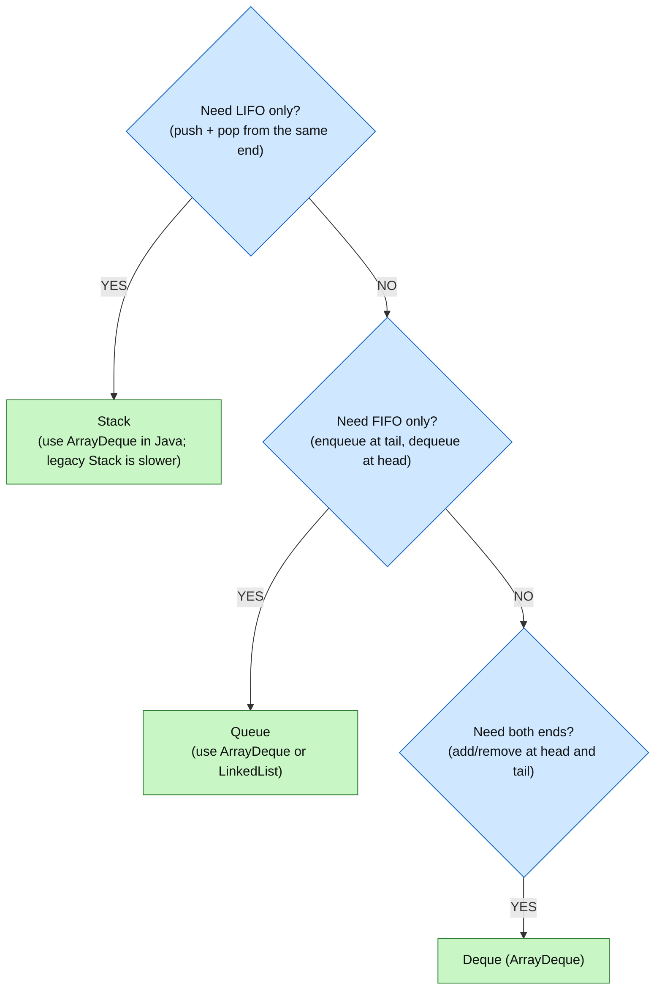

**How to read this diagram.** Answer the blue questions in order; the first YES gives the green structure to use.

**Variant selection rationale:**

| Use Case | Pick | Why |
|---|---|---|
| Undo/redo | ArrayDeque as stack | O(1) push/pop; no legacy `Stack` overhead |
| BFS | ArrayDeque as queue | O(1) enqueue/dequeue; cache-friendly vs LinkedList |
| Sliding window max | ArrayDeque (monotonic) | O(n) amortized; see `01d_Stack_Queue.md` |
| Producer-consumer | ArrayBlockingQueue | Bounded + thread-safe |
| Work-stealing scheduler | ConcurrentLinkedDeque | Lock-free; allows steal from both ends |

### PriorityQueue vs TreeSet vs TreeMap

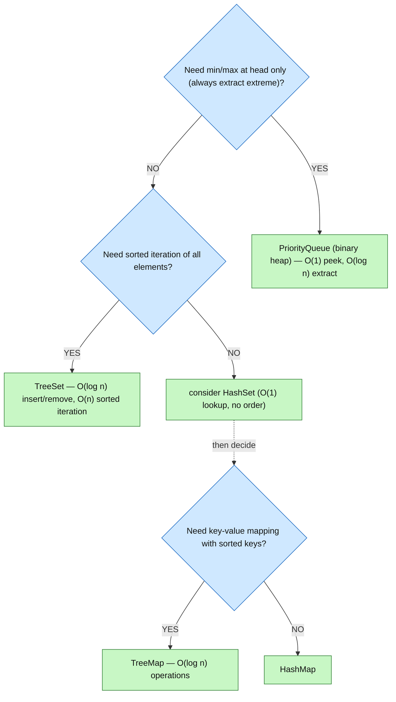

**How to read this diagram.** Start at the first blue question and follow the YES / NO edges; the green boxes are the recommended choice.

**Variant selection rationale:**

| Use Case | Pick | Why |
|---|---|---|
| Dijkstra's algorithm | PriorityQueue | Extract-min is the hot operation |
| Top-K elements | PriorityQueue (size K) | O(n log K) total |
| Maintaining sorted view | TreeSet | Sorted iteration is the hot operation |
| Range queries (last 7 days) | TreeSet/TreeMap | `subSet(from, to)` in O(log n + k) |
| Scheduler (extract by priority) | PriorityQueue | O(log n) extract-min; bulk insert via heapify O(n) |

### MultiMap vs Map<K, List<V>> vs Nested Collection

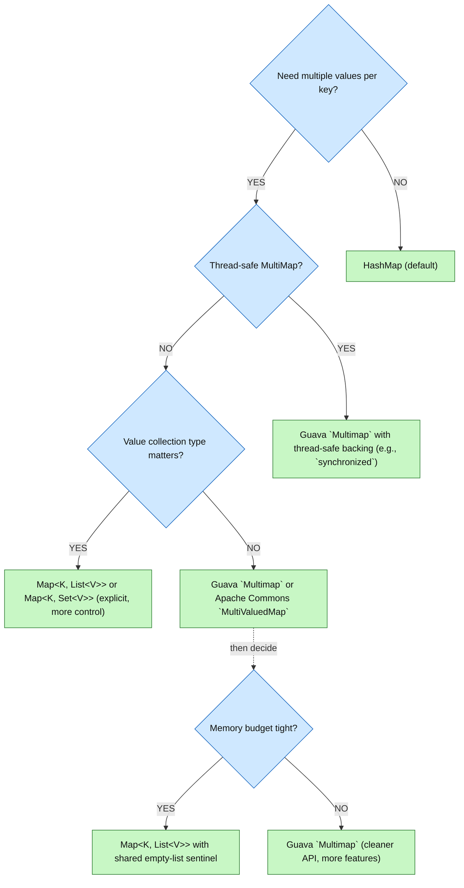

**How to read this diagram.** Start at the first blue question and follow the YES / NO edges; the green boxes are the recommended choice.

**Variant selection rationale:**

| Use Case | Pick | Why |
|---|---|---|
| Index inversion (word → pages) | Guava `ArrayListMultimap` | O(1) `put`; preserves insertion order |
| Graph adjacency list | `Map<V, List<E>>` | Explicit; allows fine control |
| Tag system (entity → tags) | Guava `HashMultimap` | O(1) `put`/`get`; no order needed |
| Multi-key lookup | `Map<K, Collection<V>>` with explicit null handling | Most flexible |

## When Core Variants Break — Formal Failure Modes

### Break 1 — ArrayDeque as Stack Overflow

**Condition:** Using `java.util.Stack` (legacy, synchronized) instead of `ArrayDeque`.

> [!CAUTION]
> **What breaks:** Synchronization overhead (~2-5× slower); legacy `Stack` extends `Vector` which has stale API. Modern best practice: `Deque<T> stack = new ArrayDeque<>();`.

> [!TIP]
> **Defense:** Always use `ArrayDeque` for stack/queue in non-concurrent code.

### Break 2 — PriorityQueue Non-Determinism

**Condition:** Two elements compare equal in the comparator.

> [!CAUTION]
> **What breaks:** `PriorityQueue` does not guarantee order for equal elements → non-deterministic iteration order → flaky tests.

> [!TIP]
> **Defense:** Always include a tie-breaker in the comparator: `(a, b) -> Integer.compare(a.priority, b.priority) != 0 ? Integer.compare(a.priority, b.priority) : Integer.compare(a.id, b.id)`.

### Break 3 — LinkedList Random Access

**Condition:** Using `list.get(i)` in a loop.

> [!CAUTION]
> **What breaks:** O(n) per `get(i)` → O(n²) total for the loop.

> [!TIP]
> **Defense:** Use `ArrayList` for random access; use iterator for `LinkedList`.

### Break 4 — ArrayDeque Capacity Resize

**Condition:** Adding to a fully-utilized ArrayDeque.

> [!CAUTION]
> **What breaks:** Internal array doubles; O(n) copy. For `ArrayDeque` (not `ArrayList`), the resize factor is implementation-defined (typically 2×).

> [!TIP]
> **Defense:** Pre-size: `new ArrayDeque<>(expectedSize)`.

### Break 5 — MultiMap Empty Collection Handling

**Condition:** `Map<K, List<V>>` where some keys have no values.

> [!CAUTION]
> **What breaks:** `get(k)` returns null instead of empty list → NPE on iteration. Common bug.

> [!TIP]
> **Defense:** Use `computeIfAbsent(k, k2 -> new ArrayList<>())` for first put; or use `Multimap` (Guava) which returns empty collection.

### Break 6 — TreeSet Comparator Inconsistency

**Condition:** `Comparator.compare(a, b)` returns inconsistent results across calls.

> [!CAUTION]
> **What breaks:** TreeSet contracts broken; entries in wrong positions; `contains(k)` returns wrong result.

> [!TIP]
> **Defense:** Comparator must be a pure function of inputs. Document this explicitly.

### Break 7 — ConcurrentSkipListMap Iteration Weakly Consistent

**Condition:** Iterating a `ConcurrentSkipListMap` while another thread modifies it.

> [!CAUTION]
> **What breaks:** Iterator returns elements that were present at some point during iteration; may not reflect latest state. This is *intentional* (weakly consistent iterator for concurrency) but surprising.

> [!TIP]
> **Defense:** Document weakly-consistent semantics; don't expect snapshot isolation.

### Break 8 — LinkedHashMap Removal Order

**Condition:** Using `LinkedHashMap` with `accessOrder = true` for LRU cache, but using `get()` to "peek" without intending eviction.

> [!CAUTION]
> **What breaks:** Each `get()` moves the entry to the tail (most-recently-used); subsequent eviction removes from the head (least-recently-used). A bug in the eviction policy can cause hot entries to be evicted incorrectly.

> [!TIP]
> **Defense:** Use `LinkedHashMap.getOrDefault()` to peek; or implement true LRU with separate metadata.

## Formal Complexity Comparison — Core Variants

### Stack Implementations

| Implementation | Push | Pop | Peek | Memory/Entry |
|---|---|---|---|---|
| ArrayDeque (as stack) | O(1) amortized | O(1) | O(1) | 4 bytes (int amortized) |
| LinkedList (as stack) | O(1) | O(1) | O(1) | 40 bytes |
| Legacy Stack (extends Vector) | O(1) + sync | O(1) + sync | O(1) | ~32 bytes + Vector overhead |

### Queue Implementations

| Implementation | Enqueue | Dequeue | Peek | Memory/Entry |
|---|---|---|---|---|
| ArrayDeque (as queue) | O(1) amortized | O(1) | O(1) | 4 bytes (int amortized) |
| LinkedList (as queue) | O(1) | O(1) | O(1) | 40 bytes |
| ArrayBlockingQueue | O(1) | O(1) | O(1) | 4 bytes + lock overhead |
| ConcurrentLinkedQueue | O(1) CAS | O(1) CAS | O(1) | 40 bytes |

### Deque Implementations

| Implementation | Add First/Last | Remove First/Last | Peek First/Last | Memory/Entry |
|---|---|---|---|---|
| ArrayDeque | O(1) amortized | O(1) | O(1) | 4 bytes (int amortized) |
| LinkedList (as deque) | O(1) | O(1) | O(1) | 40 bytes |
| ConcurrentLinkedDeque | O(1) CAS | O(1) CAS | O(1) | 40 bytes |

### Priority Queue Implementations

| Implementation | Insert | Extract-Min | Peek | Build (n elements) | Memory/Entry |
|---|---|---|---|---|---|
| PriorityQueue (binary heap) | O(log n) | O(log n) | O(1) | O(n) | 24 bytes (in array) |
| TreeSet (Red-Black) | O(log n) | O(log n) | O(log n) | O(n log n) | 56 bytes |
| ConcurrentSkipListMap | O(log n) CAS | O(log n) | O(log n) | O(n) | 80 bytes |

### MultiMap Implementations

| Implementation | Put | Get | Remove | Iteration | Memory/Entry |
|---|---|---|---|---|---|
| Map\<K, List\<V\>> | O(1) avg | O(k) | O(k) | O(n) | ~64 bytes (Map entry + List entry) |
| Guava HashMultimap | O(1) avg | O(1) | O(1) | O(n) | ~48 bytes |
| Guava ArrayListMultimap | O(1) avg | O(1) | O(1) | O(n) sorted | ~64 bytes |

Where k = number of values for key, n = total entries.

## Decision Examples

### Example 1 — LRU Cache

**Problem:** Cache 10⁴ entries; evict least-recently-used when full.

- **Need:** O(1) get + put; order by access time.
- **Pick:** `LinkedHashMap(initialCapacity, 0.75f, true)` (access-order) + override `removeEldestEntry`.
- **Why not PriorityQueue?** PQ tracks priority, not access order; updating priority on every access is O(log n).
- **Why not ConcurrentHashMap?** Need eviction; CHM doesn't track access order.

### Example 2 — Top-K Most Frequent Elements

**Problem:** Given 10⁶ elements, find the K (K = 100) most frequent.

- **Constraint:** Memory budget ≤ K; O(n log K) time acceptable.
- **Pick:** `HashMap<E, Integer>` for counting + `PriorityQueue<Map.Entry<E, Integer>>` of size K (min-heap on count).
- **Algorithm:** For each entry, if PQ size < K, add; else if entry.count > PQ.peek().count, PQ.poll() and add entry.
- **Time:** O(n log K) = 10⁶ × 7 ≈ 7 million ops.

### Example 3 — Sliding Window Maximum

**Problem:** Given array of size n, find max in each window of size k.

- **Constraint:** O(n) time, O(k) space.
- **Pick:** `ArrayDeque<Integer>` as monotonic deque (store indices).
- **Algorithm:** For each i, remove indices < i-k from head; remove indices with smaller values from tail; add i; record head.
- **Time:** O(n) amortized (each index enters and exits once).

## Cross-References

- **`01a_Memory_Foundations.md`** — pointer chasing cost in linked list variants.
- **`01c_LinkedList.md`** — LinkedList internals, invariants, break modes.
- **`01d_Stack_Queue.md`** — Stack/Queue invariants, monotonic stack/queue, decision framework.
- **`01e_HashTable.md`** — HashSet/HashMap vs LinkedHashSet/LinkedHashMap, ConcurrentHashMap.
- **`01f_Trees_Heaps.md`** — TreeSet/TreeMap internals; Red-Black invariants.
- **`01g_DS_Internals.md`** — implementation-specific invariants (AL, HM, TM, LL).
- **`02b_DS_Variants_Advanced.md`** — skip list, bloom filter, B-tree, LSM-tree, randomized structures.
- **`02_PROBLEM_SETS.md`** — exam-style variant selection problems.

---

## Proof Corner — Why Monotonic Deque is O(n) Amortised

**Claim**: The sliding window maximum algorithm using a monotonic deque runs in O(n) total time for an array of n elements, even though there is a `while` loop inside the outer `for` loop.

**Proof by amortised aggregate analysis**:

- Each of the n elements is **enqueued exactly once** (in the outer `for` loop).
- Each element is **dequeued at most once** (either popped from the back when a larger element arrives, or removed from the front when it slides out of the window).
- Total enqueue operations: n. Total dequeue operations: ≤ n.
- Total operations: ≤ 2n = O(n). QED.

**Invariant maintained**: At all times, the deque contains indices whose values form a **decreasing sequence** from front to back. This ensures the front is always the maximum in the current window.

**Loop invariant for the outer for-loop**: After processing index i, `deque.peekFirst()` is the index of the maximum element in `arr[max(0, i-k+1)..i]`.

- *Init*: Before i=0, deque is empty. Processing i=0 adds index 0.
- *Maintenance*: We remove front indices outside the window (< i-k+1), then remove back indices with values ≤ arr[i] (they can never be future maxima), then add i. The deque front is the window maximum.
- *Termination*: After i=n-1, we've computed the maximum for all n-k+1 windows.

---

## Brute Force to Optimal — DS Variant Selection

| Problem | Brute Force Choice | Why It Fails | Optimal Choice | Gain |
|---------|--------------------|--------------|----------------|------|
| Frequency count | Loop and count per query — O(n) per query | O(n*q) total | HashMap — O(1) per query | O(q) → O(1) |
| Ordered iteration | Sort on every access — O(n log n) | Too slow for many insertions | TreeMap/TreeSet — O(log n) per op | Sorted order always maintained |
| Last-inserted priority | Search through list — O(n) | O(n) per pop | ArrayDeque as stack — O(1) push/pop | O(n) → O(1) |
| Sliding window max | Scan every window — O(k) per window | O(nk) total | MonotonicDeque — O(1) amortised | O(nk) → O(n) |
| Membership test | Linear scan — O(n) | O(nq) total | HashSet — O(1) expected | O(n) → O(1) |

**Decision rule**: choose a DS by the *bottleneck operation* that is called most frequently. The data structure whose worst-case for that operation is best wins.

---

> **Navigation**: [< Previous](01g_DS_Internals.md) | [Back to Index](../00_MASTER_INDEX.md) | [Next >](02b_DS_Variants_Advanced.md)


---

## Reality Check

> [!CAUTION]
> **Myth:** "A deque (double-ended queue) is just a doubly-linked list"
>
> **Reality:** A deque IS often implemented with a doubly-linked list (Java's `LinkedList` implements `Deque`). But Java's `ArrayDeque` is a deque implemented with a circular array — much faster due to cache locality, no per-element allocation overhead. For most deque use cases, `ArrayDeque` is 2-5x faster than `LinkedList`. The only case where `LinkedList` wins: O(1) insert/delete in the MIDDLE of the list (via an iterator), which `ArrayDeque` cannot do.

> [!CAUTION]
> **Myth:** "TreeSet and TreeMap always sort by natural ordering"
>
> **Reality:** TreeSet/TreeMap sort by the `Comparator` you provide (if any) or the natural ordering of elements (elements must implement `Comparable`). If you insert objects that don't implement `Comparable` without providing a `Comparator`, you get `ClassCastException` at insertion time. Custom `Comparator`: `new TreeSet<>((a, b) -> a.name.compareTo(b.name))`. The Comparator/Comparable must be consistent with `equals()` — if two objects compare as equal (return 0), they should be `equals()` — otherwise TreeSet may silently discard what it considers duplicates.

> [!CAUTION]
> **Myth:** "LinkedHashMap maintains insertion order"
>
> **Reality:** `LinkedHashMap` maintains insertion order by default. But: `LinkedHashMap(capacity, loadFactor, true)` enables access order — most recently accessed entry is last (implements LRU cache behavior). `get()` and `put()` both count as access in access-order mode. Combining with `removeEldestEntry()` override gives you a self-evicting LRU cache in about 10 lines of Java. This is the standard Java implementation interview answer for "implement an LRU cache."

> [!CAUTION]
> **Myth:** "PriorityQueue in Java is a min-heap — PriorityQueue.peek() returns the minimum"
>
> **Reality:** Default `PriorityQueue<Integer>` returns the minimum (natural ordering). For a max-heap: `new PriorityQueue<>(Collections.reverseOrder())` or `new PriorityQueue<>((a,b) -> b-a)`. For objects: provide a Comparator. Important: `PriorityQueue` does NOT sort all elements — it maintains heap property (peek is O(1), poll is O(log n)). Iterating a `PriorityQueue` with for-each does NOT give sorted order — it gives heap-array order. Always poll elements to get sorted output.

> [!CAUTION]
> **Myth:** "Stack class in Java is the standard stack implementation"
>
> **Reality:** `java.util.Stack` is a legacy class (extends `Vector` — synchronized). Use `Deque<Integer> stack = new ArrayDeque<>()` instead: `push()` = `addFirst()`, `pop()` = `removeFirst()`, `peek()` = `peekFirst()`. `ArrayDeque` is faster (no synchronization overhead, cache-friendly array), unsynchronized (appropriate for single-threaded use), and implements both stack and queue operations. Java's own `Stack` Javadoc recommends `ArrayDeque` as the preferred stack implementation.
