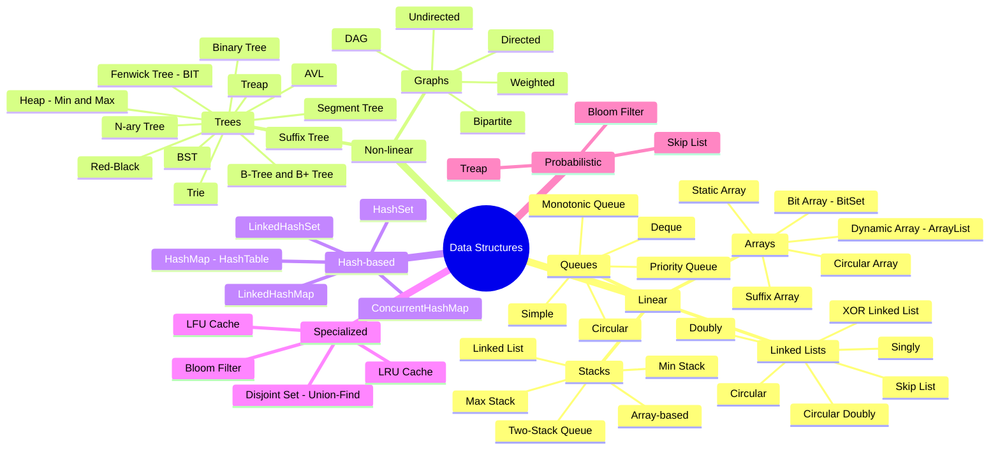
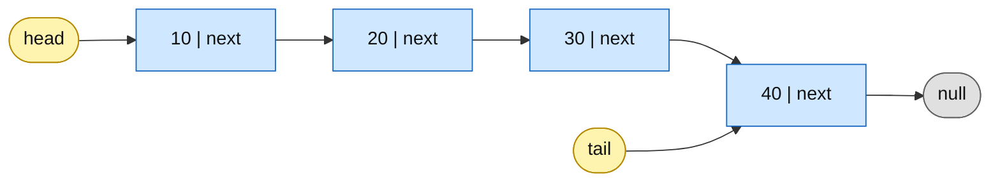

# 📌 Part 0: Data Structure Variant Map

> **Navigation**: [Chapter overview](../02a_DS_Variants_Core.md) | [1.2 Doubly Linked List →](02_doubly_linked_list.md)
> Page 1 of 7 in **Data Structures: ALL VARIANTS Complete Guide**




**How to read this diagram.** The five top-level branches are the families the rest of this chapter covers: linear, non-linear, hash-based, specialized and probabilistic. Each leaf is a variant with its own section.

> [!IMPORTANT]
>
> **Key Invariants for Core Variants:**
>
> | Data Structure   | Core Invariant Formula                                       | Notes                                                   |
> | ---------------- | ------------------------------------------------------------ | ------------------------------------------------------- |
> | ArrayList growth | `newCapacity = oldCapacity + (oldCapacity >> 1)`             | 1.5x growth (OpenJDK); guarantees O(1) amortized insert |
> | Bloom filter FPR | `FPR = (1 - e^(-kn/m))^k` where k=hashes, n=elements, m=bits | Optimal k = (m/n) \* ln(2); never false negative        |
> | Skip list height | P(node at level L+1) = p (typically 0.5)                     | Expected height O(log n); sorted at every level         |
> | B+ tree fanout   | Node holds between `t-1` and `2t-1` keys                     | Minimum occupancy 50%; t = minimum degree               |
> | Red-Black height | `h <= 2*log2(n+1)` — path ≤ 2x shortest                      | Guarantees O(log n) worst-case operations               |
>

---

## 🔗 Part 1: Linked List Variants (complete)

### 1.1 Singly Linked List

#### 💬 Study-Partner View — Singly Linked List

**1. The bottom line:** A chain of nodes where each one only knows the next node, so you can only walk forward.

**2. The textbook core:**

- Node = `data` + `next`; the list keeps a `head` (optionally a `tail`).
- Insert/delete at the head: **O(1)**. Insert at the tail: O(1) with a tail pointer.
- Search and access by index: **O(n)**. Delete the tail: O(n) (you need the previous node).
- Uses one pointer per node, the cheapest linked variant.

**3. The real-world analogy:** A **one-way street**: you can drive forward to the next block, but there is no way to turn around.

**4. Walkthrough:**

1. List is `10 → 20 → 30`. Insert `5` at the head.
2. Create node `5`, set `5.next = head` (10).
3. Set `head = 5`. List is `5 → 10 → 20 → 30`; nothing was moved.

> [!NOTE]
> **Quick check:** Why is deleting the tail O(n)? *You must walk from the head to find the node before the tail.*


#### Singly linked list - complete guide

##### What is it

A linear data structure where each element (node) contains:

1. DATA - The actual value stored
2. NEXT - Reference/pointer to the next node

**Visual:** 



**How to read this diagram.** Each node holds a value and one `next` reference. `head` marks the start, `tail` the last node, and the last `next` is `null`. You can only walk forward.

**Key property:** Can only traverse FORWARD (one direction)

##### Time complexity

| Operation | Time | Explanation |
| --- | --- | --- |
| Access by index | O(n) | Must traverse from head |
| Search | O(n) | Must check each node |
| Insert at head | O(1) | Just change head pointer |
| Insert at tail | O(1)* | *If tail pointer maintained |
| Insert at middle | O(n) | Must find position first |
| Delete at head | O(1) | Just change head pointer |
| Delete at tail | O(n) | Must find second-to-last |
| Delete at middle | O(n) | Must find position first |

##### When to use

- ✅ Frequent insertions/deletions at beginning
- ✅ Don't know size in advance
- ✅ Memory is fragmented (non-contiguous is OK)
- ✅ Implementing stack (LIFO)

- ❌ Need random access by index
- ❌ Need backward traversal
- ❌ Delete at end frequently (use doubly linked)
- ❌ Memory efficiency is critical (pointers add overhead)


**Real-world applications**

| # | Application | Chain | How it uses the list |
| - | ----------- | ----- | -------------------- |
| 1 | Undo functionality (simple) | `Action1 → Action2 → Action3 → null` | Pop from the end to undo |
| 2 | Browser forward history | `Page1 → Page2 → Page3 → null` | Click "Forward" = move to next |
| 3 | Music playlist (forward only) | `Song1 → Song2 → Song3 → null` | "Next Track" = go to next node |
| 4 | Train cars | `Engine → Car1 → Car2 → Caboose → null` | Each car connects to the next |


```java
// COMPLETE SINGLY LINKED LIST IMPLEMENTATION
public class SinglyLinkedList<T> {

    // Node class
    private static class Node<T> {
        T data;
        Node<T> next;

        Node(T data) {
            this.data = data;
            this.next = null;
        }
    }

    private Node<T> head;
    private Node<T> tail;
    private int size;

    public SinglyLinkedList() {
        this.head = null;
        this.tail = null;
        this.size = 0;
    }

    // ═══════════════════════════════════════════════════════════════════════
    // INSERTION OPERATIONS
    // ═══════════════════════════════════════════════════════════════════════

    // Insert at beginning - O(1)
    public void insertAtHead(T data) {
        Node<T> newNode = new Node<>(data);
        if (head == null) {
            head = tail = newNode;
        } else {
            newNode.next = head;
            head = newNode;
        }
        size++;
    }

    // Insert at end - O(1) with tail pointer
    public void insertAtTail(T data) {
        Node<T> newNode = new Node<>(data);
        if (head == null) {
            head = tail = newNode;
        } else {
            tail.next = newNode;
            tail = newNode;
        }
        size++;
    }

    // Insert at index - O(n)
    public void insertAt(int index, T data) {
        if (index < 0 || index > size) {
            throw new IndexOutOfBoundsException("Index: " + index);
        }
        if (index == 0) {
            insertAtHead(data);
            return;
        }
        if (index == size) {
            insertAtTail(data);
            return;
        }

        Node<T> newNode = new Node<>(data);
        Node<T> current = head;

        // Traverse to node BEFORE insertion point
        for (int i = 0; i < index - 1; i++) {
            current = current.next;
        }

        newNode.next = current.next;
        current.next = newNode;
        size++;
    }

    // ═══════════════════════════════════════════════════════════════════════
    // DELETION OPERATIONS
    // ═══════════════════════════════════════════════════════════════════════

    // Delete from beginning - O(1)
    public T deleteFromHead() {
        if (head == null) {
            throw new RuntimeException("List is empty");
        }
        T data = head.data;
        head = head.next;
        if (head == null) {
            tail = null;
        }
        size--;
        return data;
    }

    // Delete from end - O(n) - THIS IS WHY DOUBLY LINKED IS BETTER FOR THIS
    public T deleteFromTail() {
        if (head == null) {
            throw new RuntimeException("List is empty");
        }
        if (head == tail) {
            T data = head.data;
            head = tail = null;
            size--;
            return data;
        }

        // Find second-to-last node
        Node<T> current = head;
        while (current.next != tail) {
            current = current.next;
        }

        T data = tail.data;
        current.next = null;
        tail = current;
        size--;
        return data;
    }

    // Delete by value - O(n)
    public boolean delete(T data) {
        if (head == null) return false;

        if (head.data.equals(data)) {
            deleteFromHead();
            return true;
        }

        Node<T> current = head;
        while (current.next != null) {
            if (current.next.data.equals(data)) {
                if (current.next == tail) {
                    tail = current;
                }
                current.next = current.next.next;
                size--;
                return true;
            }
            current = current.next;
        }
        return false;
    }

    // ═══════════════════════════════════════════════════════════════════════
    // SEARCH OPERATIONS
    // ═══════════════════════════════════════════════════════════════════════

    // Search - O(n)
    public boolean contains(T data) {
        Node<T> current = head;
        while (current != null) {
            if (current.data.equals(data)) {
                return true;
            }
            current = current.next;
        }
        return false;
    }

    // Get by index - O(n)
    public T get(int index) {
        if (index < 0 || index >= size) {
            throw new IndexOutOfBoundsException("Index: " + index);
        }
        Node<T> current = head;
        for (int i = 0; i < index; i++) {
            current = current.next;
        }
        return current.data;
    }

    // ═══════════════════════════════════════════════════════════════════════
    // UTILITY OPERATIONS
    // ═══════════════════════════════════════════════════════════════════════

    // Reverse - O(n) - VERY IMPORTANT FOR INTERVIEWS
    public void reverse() {
        Node<T> prev = null;
        Node<T> current = head;
        tail = head;  // Old head becomes new tail

        while (current != null) {
            Node<T> nextTemp = current.next;
            current.next = prev;
            prev = current;
            current = nextTemp;
        }
        head = prev;
    }

    // Find middle - O(n) using slow/fast pointers
    public T findMiddle() {
        if (head == null) {
            throw new RuntimeException("List is empty");
        }
        Node<T> slow = head;
        Node<T> fast = head;

        while (fast != null && fast.next != null) {
            slow = slow.next;
            fast = fast.next.next;
        }
        return slow.data;
    }

    // Detect cycle - O(n) Floyd's Algorithm
    public boolean hasCycle() {
        if (head == null) return false;

        Node<T> slow = head;
        Node<T> fast = head;

        while (fast != null && fast.next != null) {
            slow = slow.next;
            fast = fast.next.next;
            if (slow == fast) return true;
        }
        return false;
    }

    // Get Nth node from end - O(n)
    public T getNthFromEnd(int n) {
        Node<T> first = head;
        Node<T> second = head;

        // Move first n nodes ahead
        for (int i = 0; i < n; i++) {
            if (first == null) {
                throw new IndexOutOfBoundsException("n is larger than list size");
            }
            first = first.next;
        }

        // Move both until first reaches end
        while (first != null) {
            first = first.next;
            second = second.next;
        }

        return second.data;
    }

    public int size() { return size; }
    public boolean isEmpty() { return size == 0; }

    // Print list
    public void print() {
        Node<T> current = head;
        while (current != null) {
            System.out.print(current.data + " -> ");
            current = current.next;
        }
        System.out.println("null");
    }
}
```

---

> 🔬 **Section Challenge — 1.1 Singly Linked List**
>
> **Challenge 1 (Trace):** You need to implement a "Delete from tail" method for a singly linked list. Because you maintain a `tail` pointer, a junior engineer writes: `tail = null; size--;`. Trace why this completely corrupts the data structure and what the true time complexity of tail deletion is.
>
> <details><summary>Answer</summary>
>
> **Scenario:** Optimizing tail operations on a Singly Linked List.
> **Trace:** Setting the `tail` reference to `null` only updates your class variable. The actual second-to-last node in the list _still has its `.next` pointer pointing to the old tail object in memory_. Furthermore, because you didn't update the second-to-last node, you now have no way to find the new tail! The list is corrupted.
> **Debug/Fix:** To delete the tail, you MUST update the `.next` pointer of the second-to-last node to `null`. In a Singly Linked List, the only way to find the second-to-last node is to start at the head and traverse `N-1` steps. Therefore, even with a `tail` pointer, **deleting from the tail is strictly `O(N)`**.
>
> </details>

---

[Chapter overview](../02a_DS_Variants_Core.md) | [1.2 Doubly Linked List →](02_doubly_linked_list.md)
