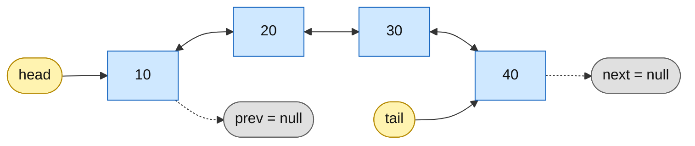

# 1.2 Doubly Linked List

> **Navigation**: [← Data Structure Variant Map](01_data_structure_variant_map.md) | [Chapter overview](../02a_DS_Variants_Core.md) | [1.3 Circular Linked List →](03_circular_linked_list.md)
> Page 2 of 7 in **Data Structures: ALL VARIANTS Complete Guide**


## 💬 Study-Partner View — Doubly Linked List

**1. The bottom line:** A linked list where every node knows both its next and previous neighbour, so you can walk and delete in either direction.

**2. The textbook core:**

- Node = `prev` + `data` + `next`; list keeps `head` and `tail`.
- Delete a node you already hold: **O(1)** (`node.prev.next = node.next; node.next.prev = node.prev`).
- Insert/delete at both ends: O(1). Access by index: O(n), but you can start from the nearer end.
- Costs one extra pointer per node and more edge cases (head/tail).

**3. The real-world analogy:** A **two-way street** or a browser's back/forward buttons: from any page you can step back or forward.

**4. Walkthrough:**

1. List `A ⇄ B ⇄ C`; delete `B`.
2. Set `A.next = C` (what `B.next` was).
3. Set `C.prev = A` (what `B.prev` was).
4. `B` is now unreachable; the list is `A ⇄ C`. No search was needed.

> [!NOTE]
> **Quick check:** What is the classic use? *An LRU cache: hash map for lookup plus a doubly linked list to move items to the front in O(1).*


## Doubly linked list - complete guide

### What is it

A linked list where each node has TWO pointers:

1. DATA - The actual value
2. PREV - Reference to PREVIOUS node
3. NEXT - Reference to NEXT node

**Visual:**



**How to read this diagram.** Each node has both `prev` and `next` references, so the arrows point both ways. The first node's `prev` and the last node's `next` are `null`.

**Key property:** Can traverse BOTH directions (forward AND backward)

### Advantages over singly linked list

1. BIDIRECTIONAL TRAVERSAL:
   - Can go forward AND backward
   - Essential for "Previous" buttons

2. O(1) DELETE FROM TAIL:
   Singly: O(n) - must find second-to-last
   Doubly: O(1) - just use tail.prev

3. EASIER NODE DELETION:
   Given a node reference, can delete in O(1)
   Don't need to find previous node!

4. BETTER FOR LRU CACHE:
   Move nodes to front/back in O(1)

**Disadvantage:** 

- More memory (extra prev pointer)
- More complex insertion/deletion code

### Time complexity comparison

| Operation | Singly | Doubly | Winner |
| --- | --- | --- | --- |
| Access by index | O(n) | O(n) | Tie |
| Insert at head | O(1) | O(1) | Tie |
| Insert at tail | O(1)* | O(1) | Tie |
| Delete at head | O(1) | O(1) | Tie |
| Delete at tail | O(n) | O(1) | DOUBLY 🏆 |
| Delete given node | O(n) | O(1) | DOUBLY 🏆 |
| Traverse backward | O(n²) | O(n) | DOUBLY 🏆 |
| Memory per node | Less | More | SINGLY (if memory matters) |


**Real-world applications**

| # | Application | Chain | How it uses the list |
| - | ----------- | ----- | -------------------- |
| 1 | Browser history (back & forward) | `null ← Page1 ↔ Page2 ↔ Page3 → null` | "Back" = go to `prev`, "Forward" = go to `next` |
| 2 | Music player (previous & next) | `null ← Song1 ↔ Song2 ↔ Song3 → null` | Previous track / next track |
| 3 | Text-editor undo/redo | `null ← Edit1 ↔ Edit2 ↔ Edit3 → null` | Undo = go to `prev`, redo = go to `next` |
| 4 | LRU cache (move to front) | `head ↔ Recent1 ↔ Recent2 ↔ LeastRecent ↔ tail` | Access an item = move it to the head in O(1) |
| 5 | Image viewer (swipe left/right) | `null ← Img1 ↔ Img2 ↔ Img3 → null` | Swipe = follow `prev` / `next` |


```java
// COMPLETE DOUBLY LINKED LIST IMPLEMENTATION
public class DoublyLinkedList<T> {

    // Node class with prev and next pointers
    private static class Node<T> {
        T data;
        Node<T> prev;
        Node<T> next;

        Node(T data) {
            this.data = data;
            this.prev = null;
            this.next = null;
        }
    }

    private Node<T> head;
    private Node<T> tail;
    private int size;

    public DoublyLinkedList() {
        this.head = null;
        this.tail = null;
        this.size = 0;
    }

    // ═══════════════════════════════════════════════════════════════════════
    // INSERTION OPERATIONS
    // ═══════════════════════════════════════════════════════════════════════

    // Insert at beginning - O(1)
    public void insertAtHead(T data) {
        Node<T> newNode = new Node<>(data);

        if (head == null) {
            // Empty list
            head = tail = newNode;
        } else {
            // Link with current head
            newNode.next = head;
            head.prev = newNode;
            head = newNode;
        }
        size++;
    }

    // Insert at end - O(1)
    public void insertAtTail(T data) {
        Node<T> newNode = new Node<>(data);

        if (tail == null) {
            // Empty list
            head = tail = newNode;
        } else {
            // Link with current tail
            newNode.prev = tail;
            tail.next = newNode;
            tail = newNode;
        }
        size++;
    }

    // Insert after a specific node - O(1)
    // THIS IS WHERE DOUBLY LINKED SHINES!
    public void insertAfter(Node<T> node, T data) {
        if (node == null) {
            throw new IllegalArgumentException("Node cannot be null");
        }

        Node<T> newNode = new Node<>(data);

        // Link new node
        newNode.prev = node;
        newNode.next = node.next;

        // Update existing links
        if (node.next != null) {
            node.next.prev = newNode;
        } else {
            tail = newNode;  // Inserting at end
        }
        node.next = newNode;

        size++;
    }

    // Insert before a specific node - O(1)
    public void insertBefore(Node<T> node, T data) {
        if (node == null) {
            throw new IllegalArgumentException("Node cannot be null");
        }

        Node<T> newNode = new Node<>(data);

        // Link new node
        newNode.next = node;
        newNode.prev = node.prev;

        // Update existing links
        if (node.prev != null) {
            node.prev.next = newNode;
        } else {
            head = newNode;  // Inserting at beginning
        }
        node.prev = newNode;

        size++;
    }

    // Insert at index - O(n)
    public void insertAt(int index, T data) {
        if (index < 0 || index > size) {
            throw new IndexOutOfBoundsException("Index: " + index);
        }
        if (index == 0) {
            insertAtHead(data);
            return;
        }
        if (index == size) {
            insertAtTail(data);
            return;
        }

        // Find the node at index
        Node<T> current = getNodeAt(index);
        insertBefore(current, data);
    }

    // ═══════════════════════════════════════════════════════════════════════
    // DELETION OPERATIONS
    // ═══════════════════════════════════════════════════════════════════════

    // Delete from beginning - O(1)
    public T deleteFromHead() {
        if (head == null) {
            throw new RuntimeException("List is empty");
        }

        T data = head.data;

        if (head == tail) {
            // Only one element
            head = tail = null;
        } else {
            head = head.next;
            head.prev = null;
        }

        size--;
        return data;
    }

    // Delete from end - O(1) - MUCH BETTER THAN SINGLY LINKED!
    public T deleteFromTail() {
        if (tail == null) {
            throw new RuntimeException("List is empty");
        }

        T data = tail.data;

        if (head == tail) {
            // Only one element
            head = tail = null;
        } else {
            tail = tail.prev;
            tail.next = null;
        }

        size--;
        return data;
    }

    // Delete a specific node - O(1) when you have the node reference!
    // THIS IS THE KILLER FEATURE OF DOUBLY LINKED LIST
    public T deleteNode(Node<T> node) {
        if (node == null) {
            throw new IllegalArgumentException("Node cannot be null");
        }

        T data = node.data;

        // Update prev's next
        if (node.prev != null) {
            node.prev.next = node.next;
        } else {
            head = node.next;  // Deleting head
        }

        // Update next's prev
        if (node.next != null) {
            node.next.prev = node.prev;
        } else {
            tail = node.prev;  // Deleting tail
        }

        size--;
        return data;
    }

    // Delete by value - O(n)
    public boolean delete(T data) {
        Node<T> current = head;

        while (current != null) {
            if (current.data.equals(data)) {
                deleteNode(current);
                return true;
            }
            current = current.next;
        }
        return false;
    }

    // ═══════════════════════════════════════════════════════════════════════
    // TRAVERSAL OPERATIONS
    // ═══════════════════════════════════════════════════════════════════════

    // Traverse forward
    public void traverseForward() {
        Node<T> current = head;
        System.out.print("null <- ");
        while (current != null) {
            System.out.print(current.data);
            if (current.next != null) {
                System.out.print(" <-> ");
            }
            current = current.next;
        }
        System.out.println(" -> null");
    }

    // Traverse backward
    public void traverseBackward() {
        Node<T> current = tail;
        System.out.print("null <- ");
        while (current != null) {
            System.out.print(current.data);
            if (current.prev != null) {
                System.out.print(" <-> ");
            }
            current = current.prev;
        }
        System.out.println(" -> null");
    }

    // ═══════════════════════════════════════════════════════════════════════
    // UTILITY OPERATIONS
    // ═══════════════════════════════════════════════════════════════════════

    // Get node at index - O(n) but optimized!
    // Can start from head OR tail depending on index
    private Node<T> getNodeAt(int index) {
        if (index < 0 || index >= size) {
            throw new IndexOutOfBoundsException("Index: " + index);
        }

        Node<T> current;

        // Optimization: start from closer end
        if (index < size / 2) {
            // Start from head
            current = head;
            for (int i = 0; i < index; i++) {
                current = current.next;
            }
        } else {
            // Start from tail (faster for second half)
            current = tail;
            for (int i = size - 1; i > index; i--) {
                current = current.prev;
            }
        }

        return current;
    }

    // Get by index - O(n)
    public T get(int index) {
        return getNodeAt(index).data;
    }

    // Reverse - O(n)
    public void reverse() {
        Node<T> current = head;
        Node<T> temp = null;

        // Swap prev and next for all nodes
        while (current != null) {
            temp = current.prev;
            current.prev = current.next;
            current.next = temp;
            current = current.prev;  // Move to next (which is now prev)
        }

        // Swap head and tail
        temp = head;
        head = tail;
        tail = temp;
    }

    // Move a node to front - O(1)
    // Very useful for LRU Cache!
    public void moveToFront(Node<T> node) {
        if (node == head) return;  // Already at front

        // Remove from current position
        if (node.prev != null) {
            node.prev.next = node.next;
        }
        if (node.next != null) {
            node.next.prev = node.prev;
        } else {
            tail = node.prev;  // Was at end
        }

        // Move to front
        node.prev = null;
        node.next = head;
        head.prev = node;
        head = node;
    }

    public int size() { return size; }
    public boolean isEmpty() { return size == 0; }
}
```


> [!TIP]
> **🧠 Interview key points — Doubly Linked List**
>
>
> 1. **"Why use doubly over singly?"**
>    - Delete at tail: O(1) vs O(n)
>    - Bidirectional traversal
>    - Delete given node: O(1) vs O(n)
>
> 2. **"What's the main disadvantage?"**
>    - Extra memory for prev pointer
>    - More complex code
>
> 3. **"Real-world use case?"**
>    - LRU Cache (HashMap + Doubly Linked)
>    - Browser back/forward
>    - Text editor undo/redo
>
> 4. **"How to delete a node in O(1)?"**
>    - node.prev.next = node.next
>    - node.next.prev = node.prev
>    - Handle edge cases (head/tail)


---

> 🔬 **Section Challenge — 1.2 Doubly Linked List**
>
> **Challenge 1 (Debug):** A developer writes an `O(1)` node deletion function: `public void deleteNode(Node n) { n.prev.next = n.next; n.next.prev = n.prev; }`. What critical `NullPointerException` (NPE) edge cases did they miss?
>
> <details><summary>Answer</summary>
>
> **Scenario:** Deleting an arbitrary node in a Doubly Linked List.
> **Trace:** The logic assumes that `n.prev` and `n.next` always exist.
>
> - If `n` is the `head`, `n.prev` is `null`. Calling `n.prev.next` throws an NPE.
> - If `n` is the `tail`, `n.next` is `null`. Calling `n.next.prev` throws an NPE.
>   **Debug/Fix:** You must handle the boundaries explicitly:
>
> ```java
> if (n.prev != null) n.prev.next = n.next;
> else head = n.next; // We are deleting the head
>
> if (n.next != null) n.next.prev = n.prev;
> else tail = n.prev; // We are deleting the tail
> ```
>
> </details>

---

[← Data Structure Variant Map](01_data_structure_variant_map.md) | [Chapter overview](../02a_DS_Variants_Core.md) | [1.3 Circular Linked List →](03_circular_linked_list.md)
