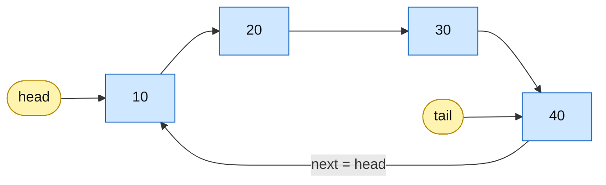
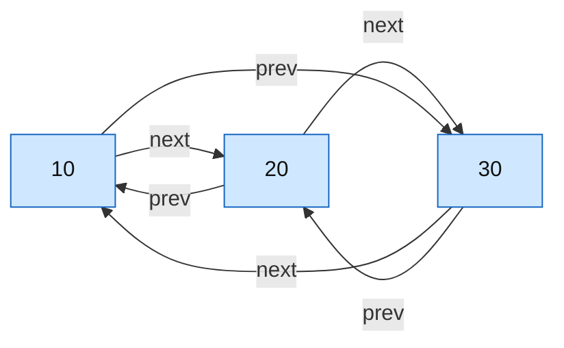
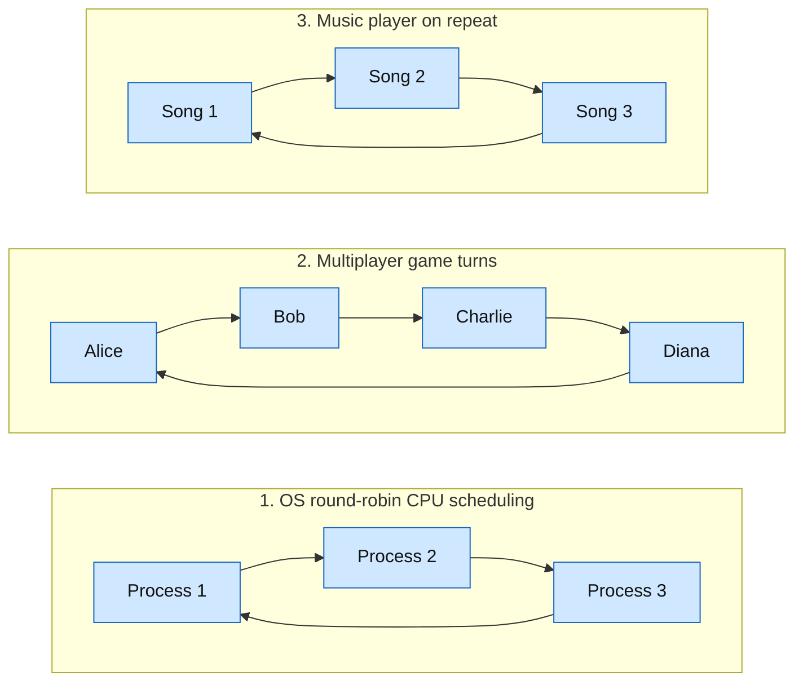

# 1.3 Circular Linked List

> **Navigation**: [← 1.2 Doubly Linked List](02_doubly_linked_list.md) | [Chapter overview](../02a_DS_Variants_Core.md) | [1.4 Circular Doubly Linked List →](04_circular_doubly_linked_list.md)
> Page 3 of 7 in **Data Structures: ALL VARIANTS Complete Guide**


## 💬 Study-Partner View — Circular Linked List

**1. The bottom line:** A linked list whose last node points back to the first, so there is no end and you can loop forever.

**2. The textbook core:**

- The last node's `next` is the head (not `null`).
- Traversal must stop by comparing against the starting node (or counting), otherwise it loops forever.
- Rotating the list or cycling round-robin is O(1) once you hold a pointer.
- Insert/delete follow the singly linked rules with an extra "keep the loop closed" step.

**3. The real-world analogy:** A **merry-go-round** or a round-table game: after the last player, it is the first player's turn again.

**4. Walkthrough:**

1. Processes `P1 → P2 → P3 → (back to P1)`; each gets a CPU time slice.
2. Run `P1`, then move `current = current.next` (P2).
3. After `P3` the pointer wraps to `P1` with no special case.
4. Stop condition for a full lap: `current == start`.

> [!NOTE]
> **Quick check:** What is the main bug risk? *Infinite loops: always check for returning to the start node.*


## Circular linked list - complete guide

### What is it

A linked list where the LAST node points BACK to the FIRST node.
No NULL at end - forms a CIRCLE!

**Singly circular:** 



**How to read this diagram.** The last node points back to the first instead of `null`, so you can keep traversing forever (use `head` or a counter to know when to stop).

**Doubly circular:** 



**How to read this diagram.** Every node has `prev` and `next`, and the ends wrap around: `30.next` is `10` and `10.prev` is `30`.

**Key property:** Can traverse the entire list starting from ANY node!

No "end" - goes round and round.

### Why use circular

1. ROUND-ROBIN SCHEDULING:
   - Process1 → Process2 → Process3 → Process1 → ...
   - CPU gives time to each process in circular order

2. MULTIPLAYER GAME TURNS:
   - Player1 → Player2 → Player3 → Player1 → ...
   - No need to reset to beginning

3. CIRCULAR BUFFER/QUEUE:
   - Audio streaming
   - Producer-consumer problems

4. REPEATED TRAVERSAL:
   - Carousel/slideshow that loops
   - Music playlist on repeat

**Key insight:** Useful when you need to wrap around!


**Real-world applications**



**How to read this diagram.** In each ring the last element links back to the first, so the cycle repeats forever.

| # | Application | Behaviour |
| - | ----------- | --------- |
| 1 | OS round-robin scheduling | Each process gets CPU time, then goes to the end of the ring |
| 2 | Multiplayer game turns | After Diana's turn, it is Alice's turn again |
| 3 | Music player on repeat | After the last song, play the first |
| 4 | Josephus problem (classic) | `n` people in a circle, every `k`-th person eliminated: who survives? (a famous interview problem) |


```java
// COMPLETE CIRCULAR SINGLY LINKED LIST IMPLEMENTATION
public class CircularLinkedList<T> {

    private static class Node<T> {
        T data;
        Node<T> next;

        Node(T data) {
            this.data = data;
        }
    }

    private Node<T> tail;  // We keep tail, not head! (head = tail.next)
    private int size;

    // Why keep tail instead of head?
    // - Insert at head: O(1) - create node, point to head, tail.next = new
    // - Insert at tail: O(1) - create node, point to head, update tail
    // With only head, insert at tail would be O(n)!

    public CircularLinkedList() {
        this.tail = null;
        this.size = 0;
    }

    // Insert at front - O(1)
    public void insertAtFront(T data) {
        Node<T> newNode = new Node<>(data);

        if (tail == null) {
            // First element - points to itself!
            newNode.next = newNode;
            tail = newNode;
        } else {
            // Insert between tail and head
            newNode.next = tail.next;  // New node points to old head
            tail.next = newNode;        // Tail points to new node (new head)
        }
        size++;
    }

    // Insert at end - O(1)
    public void insertAtEnd(T data) {
        insertAtFront(data);  // Insert at front
        tail = tail.next;      // Then move tail pointer
    }

    // Delete from front - O(1)
    public T deleteFromFront() {
        if (tail == null) {
            throw new RuntimeException("List is empty");
        }

        Node<T> head = tail.next;
        T data = head.data;

        if (head == tail) {
            // Only one element
            tail = null;
        } else {
            tail.next = head.next;
        }

        size--;
        return data;
    }

    // Delete from end - O(n) - must find second-to-last
    public T deleteFromEnd() {
        if (tail == null) {
            throw new RuntimeException("List is empty");
        }

        if (tail.next == tail) {
            // Only one element
            T data = tail.data;
            tail = null;
            size--;
            return data;
        }

        // Find second-to-last
        Node<T> current = tail.next;
        while (current.next != tail) {
            current = current.next;
        }

        T data = tail.data;
        current.next = tail.next;  // Point to head
        tail = current;            // New tail
        size--;
        return data;
    }

    // Traverse entire list - O(n)
    public void traverse() {
        if (tail == null) {
            System.out.println("Empty list");
            return;
        }

        Node<T> current = tail.next;  // Start from head
        do {
            System.out.print(current.data + " -> ");
            current = current.next;
        } while (current != tail.next);  // Stop when back at head

        System.out.println("(back to start)");
    }

    // JOSEPHUS PROBLEM - Classic circular list problem!
    // n people in circle, every k-th person eliminated
    // Returns the survivor's position (1-indexed)
    public static int josephus(int n, int k) {
        // Create circular list with positions 1 to n
        CircularLinkedList<Integer> circle = new CircularLinkedList<>();
        for (int i = 1; i <= n; i++) {
            circle.insertAtEnd(i);
        }

        Node<Integer> current = circle.tail;

        while (circle.size > 1) {
            // Move k-1 steps (k-th person from current)
            for (int i = 0; i < k - 1; i++) {
                current = current.next;
            }

            // Remove the k-th person (current.next)
            Node<Integer> toRemove = current.next;
            System.out.println("Eliminating person " + toRemove.data);

            current.next = toRemove.next;
            if (toRemove == circle.tail) {
                circle.tail = current;
            }
            circle.size--;
        }

        return circle.tail.data;
    }

    public int size() { return size; }
    public boolean isEmpty() { return size == 0; }
}
```

---

> 🔬 **Section Challenge — 1.3 Circular Linked List**
>
> **Challenge 1 (Reasoning):** Why does an optimized Circular Linked List maintain a `tail` pointer instead of a `head` pointer? Trace how this allows `O(1)` insertions at BOTH the front and the back.
>
> <details><summary>Answer</summary>
>
> **Scenario:** Designing an efficient Circular Queue or Round-Robin Scheduler.
> **Trace:** If you only keep a `head` pointer, inserting at the back `insertAtEnd()` requires you to traverse the entire circle `O(N)` to find the last node so you can update its `.next` pointer to the new node.
> **Design Fix:** Keep a `tail` pointer instead.
>
> - The head is always trivially accessible via `tail.next`.
> - **Insert at Front:** `newNode.next = tail.next; tail.next = newNode;` (O(1)).
> - **Insert at Back:** `newNode.next = tail.next; tail.next = newNode; tail = newNode;` (O(1)).
> By simply maintaining the `tail`, you gain `O(1)` access to both ends of the circle!
> </details>

---

[← 1.2 Doubly Linked List](02_doubly_linked_list.md) | [Chapter overview](../02a_DS_Variants_Core.md) | [1.4 Circular Doubly Linked List →](04_circular_doubly_linked_list.md)
