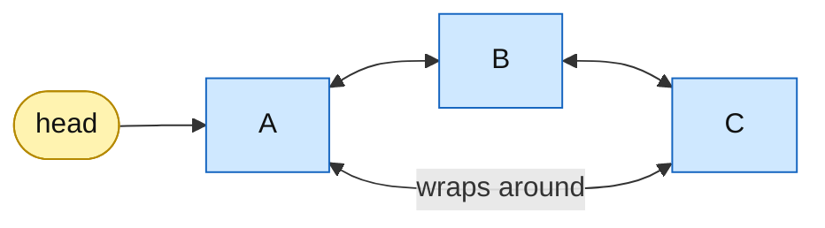

# 1.4 Circular Doubly Linked List

> **Navigation**: [← 1.3 Circular Linked List](03_circular_linked_list.md) | [Chapter overview](../02a_DS_Variants_Core.md) | [1.5 Skip List →](05_skip_list.md)
> Page 4 of 7 in **Data Structures: ALL VARIANTS Complete Guide**


## 💬 Study-Partner View — Circular Doubly Linked List

**1. The bottom line:** A doubly linked list that also wraps around at both ends, so you can move in either direction forever.

**2. The textbook core:**

- Every node has `prev` and `next`; `head.prev` is the tail and `tail.next` is the head.
- No `null` pointers at all, which removes most head/tail special cases.
- Insert/delete at either end and at a known node: **O(1)**.
- Used inside structures such as Fibonacci heaps and LRU-style lists with a sentinel node.

**3. The real-world analogy:** A **Ferris wheel**: you can rotate it clockwise or counter-clockwise and every seat always has a neighbour on both sides.

**4. Walkthrough:**

1. Insert `X` after `A` in the ring `A ⇄ B ⇄ C ⇄ (A)`.
2. Set `X.prev = A` and `X.next = B`.
3. Set `B.prev = X` and `A.next = X`.
4. The ring is `A ⇄ X ⇄ B ⇄ C`; there was no null check because every node has two neighbours.

> [!NOTE]
> **Quick check:** Why use a sentinel node here? *It makes the empty list a one-node ring, so insert and delete need no special case.*


## Circular doubly linked list - complete guide

### What is it

Combines BOTH concepts:

- Doubly: Each node has prev AND next pointers
- Circular: Last node connects to first, first connects to last

**Visual:** 



**How to read this diagram.** A circular doubly linked list: every link works in both directions, and the last node links back to the first (and the first back to the last), so there is no `null` end.

KEY: A.prev = C, C.next = A (circular in BOTH directions!)

### Advantages

- ✅ O(1) insertion at both ends
- ✅ O(1) deletion at both ends
- ✅ O(1) deletion of any node (given reference)
- ✅ Can traverse in both directions
- ✅ Can wrap around in both directions
- ✅ No need to check for null at boundaries

- ❌ More memory (two pointers per node)
- ❌ More complex code

**Perfect for:** 

- Deque (double-ended queue) implementation
- Applications needing wrap-around in both directions
- When you frequently access both ends


**Real-world applications**

| # | Application | Why a circular doubly linked list |
| - | ----------- | --------------------------------- |
| 1 | Fibonacci heap (advanced data structure) | Root lists and child lists are circular doubly linked lists; O(1) amortized insert and decrease-key |
| 2 | Advanced cache implementations | Elements can be moved efficiently; access patterns go in both directions |
| 3 | Image carousel in both directions | Swipe left or right, and wrap around in either direction |


```java
// CIRCULAR DOUBLY LINKED LIST IMPLEMENTATION
public class CircularDoublyLinkedList<T> {

    private static class Node<T> {
        T data;
        Node<T> prev;
        Node<T> next;

        Node(T data) {
            this.data = data;
        }
    }

    private Node<T> head;
    private int size;

    public CircularDoublyLinkedList() {
        this.head = null;
        this.size = 0;
    }

    // Insert at front - O(1)
    public void insertAtFront(T data) {
        Node<T> newNode = new Node<>(data);

        if (head == null) {
            // First element - points to itself in both directions!
            newNode.next = newNode;
            newNode.prev = newNode;
            head = newNode;
        } else {
            Node<T> tail = head.prev;  // Last element

            // Link new node
            newNode.next = head;
            newNode.prev = tail;

            // Update existing links
            head.prev = newNode;
            tail.next = newNode;

            head = newNode;
        }
        size++;
    }

    // Insert at end - O(1)
    public void insertAtEnd(T data) {
        if (head == null) {
            insertAtFront(data);
            return;
        }

        Node<T> newNode = new Node<>(data);
        Node<T> tail = head.prev;

        // Link new node
        newNode.prev = tail;
        newNode.next = head;

        // Update existing links
        tail.next = newNode;
        head.prev = newNode;

        size++;
    }

    // Delete from front - O(1)
    public T deleteFromFront() {
        if (head == null) {
            throw new RuntimeException("List is empty");
        }

        T data = head.data;

        if (size == 1) {
            head = null;
        } else {
            Node<T> tail = head.prev;
            head = head.next;
            head.prev = tail;
            tail.next = head;
        }

        size--;
        return data;
    }

    // Delete from end - O(1)
    public T deleteFromEnd() {
        if (head == null) {
            throw new RuntimeException("List is empty");
        }

        if (size == 1) {
            return deleteFromFront();
        }

        Node<T> tail = head.prev;
        T data = tail.data;

        Node<T> newTail = tail.prev;
        newTail.next = head;
        head.prev = newTail;

        size--;
        return data;
    }

    // Traverse forward (full circle)
    public void traverseForward() {
        if (head == null) return;

        Node<T> current = head;
        do {
            System.out.print(current.data + " <-> ");
            current = current.next;
        } while (current != head);
        System.out.println("(back to " + head.data + ")");
    }

    // Traverse backward (full circle)
    public void traverseBackward() {
        if (head == null) return;

        Node<T> current = head.prev;  // Start from tail
        do {
            System.out.print(current.data + " <-> ");
            current = current.prev;
        } while (current != head.prev);
        System.out.println("(back to " + head.prev.data + ")");
    }

    public int size() { return size; }
    public boolean isEmpty() { return size == 0; }
}
```

---

> 🔬 **Section Challenge — 1.4 Circular Doubly Linked List**
>
> **Challenge 1 (Trace):** You are building a bidirectional image carousel. Trace the exact 4 pointer assignments required to insert a new `Node X` exactly between the `tail` and `head` so it becomes the new `head`.
>
> <details><summary>Answer</summary>
>
> **Scenario:** `O(1)` insertions in a completely connected ring.
> **Trace:** In a Circular Doubly Linked List, `tail.next == head` and `head.prev == tail`. When we insert `X` as the new head, `X` must sit between the old `tail` and the old `head`.
> **Execution (The 4 Pointers):**
>
> 1. `X.next = head;` (X points forward to old head)
> 2. `X.prev = tail;` (X points backward to tail)
> 3. `head.prev = X;` (Old head points backward to X)
> 4. `tail.next = X;` (Tail points forward to X)
> Finally, update the class variable: `head = X;`. This perfect symmetry is why CDLLs are used in advanced OS memory managers (like the Linux Kernel's `list_head`).
> </details>

## Variant Selection Challenge: ArrayList vs LinkedList vs Deque

> **Challenge 1 (Selection):** You are building a sliding window statistics calculator that:
>
> - Receives 1M events/second
> - Needs to calculate rolling average over last 1000 events
> - 99% of operations are "append event" and "get average of last N events"
> - 1% are "remove oldest event when window slides"
>
> You consider: ArrayList, LinkedList, ArrayDeque, custom circular buffer.
> **Which do you choose and why? Trace the per-operation cost.**
>
> <details><summary>Answer</summary>
>
> **Scenario:** High-throughput sliding window with O(1) amortized operations.
> **Trace:**
>
> - **ArrayList** fails because `remove(0)` is O(n) — must shift all elements left.
> - **LinkedList** fails because `get(i)` for computing average is O(n) — must traverse.
> - **ArrayDeque** wins: `addLast()` = O(1) amortized, `removeFirst()` = O(1) amortized, and random access for summing is O(n) but necessary.
> - **Circular buffer** also wins if you pre-allocate exactly 1000 slots — same complexity but cleaner memory.
>
> **Variants for each:**
>
> - Rolling statistics with known window size: Circular buffer (fixed array, head pointer)
> - Unknown/adaptive window size: ArrayDeque (dynamic, O(1) both ends)
> - Never remove from front: ArrayList (append only, O(1))
> </details>

> **Challenge 2 (Reasoning):** Why does Java's `ArrayList` use `newCapacity = oldCapacity + (oldCapacity >> 1)` for growth, not doubling? What goes wrong if capacity grows too fast or too slow?
>
> <details><summary>Answer</summary>
>
> **Scenario:** Memory-time trade-off in dynamic array growth.
> **Trace:**
>
> - **Doubling (1.5x -> 2x)**: Uses more memory (wasted capacity between old and new size). But fewer resizes = less copy overhead. Good when memory is cheap.
> - **1.5x (current Java)**: Compromise between memory waste and copy frequency. After n insertions: total copy cost = n + sum of geometric series < 2n = O(n).
> - **Fixed increment**: Poor — if increment is small (e.g., +10), resizes happen O(n) times, making total cost O(n^2).
>
> **Key invariant:** `newCapacity = oldCapacity * 1.5` guarantees amortized O(1) per insertion (proved via accounting method).
>
> - Growth factor > 1 guarantees geometric series convergence.
> - Any fixed increment (not proportional to size) gives O(n) amortized per insert.
> </details>

---

[← 1.3 Circular Linked List](03_circular_linked_list.md) | [Chapter overview](../02a_DS_Variants_Core.md) | [1.5 Skip List →](05_skip_list.md)
