# 1.5 Skip List

> **Navigation**: [← 1.4 Circular Doubly Linked List](04_circular_doubly_linked_list.md) | [Chapter overview](../02a_DS_Variants_Core.md) | [Appendix B: Production Failure Modes &… →](06_appendix_b_production_failure_modes_variant.md)
> Page 5 of 7 in **Data Structures: ALL VARIANTS Complete Guide**


## 💬 Study-Partner View — Skip List

**1. The bottom line:** A sorted linked list with "express lanes" built from coin flips, so searching skips most nodes.

**2. The textbook core:**

- Level 0 holds every element; each higher level holds a random subset (a node is promoted with probability `p`, often 1/2).
- Expected search, insert, delete: **O(log n)**; worst case O(n) but astronomically unlikely.
- Expected space: O(n) (about `n / (1 - p)` pointers).
- Easier to implement and to make concurrent than balanced trees (Java `ConcurrentSkipListMap`, Redis sorted sets).

**3. The real-world analogy:** A **subway with express and local trains**: ride the express to the neighbourhood, then switch to the local train to reach your exact stop.

**4. Walkthrough:**

1. Search 35 in lanes `L2: 25 → 50`, `L1: 10 → 25 → 35 → 50`, `L0: all elements`.
2. At the top lane move to 25; next is 50 (too far), so drop to a lower lane.
3. Move 25 → 35 and find it.
4. Each lane roughly halves the work, giving O(log n) expected steps.

> [!NOTE]
> **Quick check:** Where does the randomness come in? *Only when inserting: you flip coins to decide how many lanes the new node joins.*


## Skip list - complete guide

### What is it

A probabilistic data structure that allows O(log n) search, insert, and
delete in a SORTED linked list. It's like a "fast lane" over the list!

**Invented:** 1989 by William Pugh

**Visual - multiple layers of linked lists:**

```mermaid
flowchart LR
    subgraph L3["Level 3"]
        direction LR
        h3(["HEAD"]) --> a50["50"]
    end
    subgraph L2["Level 2"]
        direction LR
        h2(["HEAD"]) --> b25["25"] --> b50["50"]
    end
    subgraph L1["Level 1"]
        direction LR
        h1(["HEAD"]) --> c10["10"] --> c25["25"] --> c35["35"] --> c50["50"] --> n1(["NIL"])
    end
    subgraph L0["Level 0 - every element"]
        direction LR
        h0(["HEAD"]) --> d5["5"] --> d10["10"] --> d20["20"] --> d25["25"] --> d30["30"] --> d35["35"] --> d40["40"] --> d50["50"] --> d60["60"] --> n0(["NIL"])
    end
    L3 ~~~ L2 ~~~ L1 ~~~ L0
    classDef head fill:#fff3b0,stroke:#b58900,color:#111
    classDef node fill:#cfe8ff,stroke:#1565c0,color:#111
    classDef nil fill:#e0e0e0,stroke:#616161,color:#111
    class h3,h2,h1,h0 head
    class a50,b25,b50,c10,c25,c35,c50,d5,d10,d20,d25,d30,d35,d40,d50,d60 node
    class n1,n0 nil
```



**How to read this diagram.** Level 0 is the full sorted list; each higher level is a sparser "express lane" that skips ahead. A search starts at the top level and drops down a level whenever the next node would overshoot, which gives O(log n) expected time.

**Key invariants:** 

Invariant 1 (Height): Each node appears at level-i with probability p^h
where h = node height. P = 0.5 (coin flip) by default in many impls.
Expected height of n-node list = O(log n).

Invariant 2 (Ordering): For every valid level L, the forward[L] chain
is sorted in ascending order by node value. This is what enables
binary-search-style traversal across levels.

Invariant 3 (Reachability): Every node at level-i is reachable by
following forward pointers from at least one node at level-(i+1).
(Level-linked structure ensures complete coverage at each layer.)

**Search for 35:** 

1. Start at Level 3: HEAD -> 50 (too big, go down)
2. Level 2: HEAD -> 25 -> 50 (25 < 35 < 50, go down from 25)
3. Level 1: 25 -> 35 (FOUND!)

Only visited: HEAD, 50, 25, 35 = 4 nodes instead of 7!

### Why use skip list

**Problem:** Sorted linked list has O(n) search

**Solution:** Add "express lanes" for faster traversal

**Comparison:** 

| Operation | Linked List | BST | Skip List |
| --------- | ----------- | --- | --------- |
| Search | O(n) | O(log n)* | O(log n) avg |
| Insert | O(n) | O(log n)* | O(log n) avg |
| Delete | O(n) | O(log n)* | O(log n) avg |
| Ordered iteration | O(n) | O(n) | O(n) |
| Implementation | Simple | Complex | Moderate |
| Concurrent access | Hard | Very hard | Easier! |

\* A BST's worst case is O(n) if it is unbalanced.

**Key advantage:** Easier to implement concurrent (thread-safe) version!

This is why Redis uses skip list for sorted sets!


**Real-world applications**

| # | Application | Why a skip list |
| - | ----------- | --------------- |
| 1 | Redis sorted sets (`ZSET`) | O(log n) range queries and rank operations |
| 2 | LevelDB / RocksDB | In-memory memtable index for the key-value store |
| 3 | Lucene (search engine) | Posting lists with skip pointers |
| 4 | Concurrent data structures | Java's `ConcurrentSkipListMap` is easier to make thread-safe than a balanced tree |

**Why Redis chose a skip list over a balanced tree:**

- Simpler to implement
- Easier to debug
- Range operations are simple (walk the bottom level)
- Memory per node is tunable (probability `p`), and often smaller than a balanced tree's


```java
// SKIP LIST IMPLEMENTATION
import java.util.Random;

public class SkipList<T extends Comparable<T>> {

    private static final int MAX_LEVEL = 16;  // Max height
    private static final double P = 0.5;      // Probability for level up

    private class Node {
        T value;
        Node[] forward;  // Array of forward pointers

        @SuppressWarnings("unchecked")
        Node(T value, int level) {
            this.value = value;
            this.forward = new SkipList.Node[level + 1];
        }
    }

    private Node head;
    private int level;  // Current highest level
    private int size;
    private Random random;

    @SuppressWarnings("unchecked")
    public SkipList() {
        this.head = new Node(null, MAX_LEVEL);
        this.level = 0;
        this.size = 0;
        this.random = new Random();
    }

    // Generate random level for new node
    private int randomLevel() {
        int lvl = 0;
        while (random.nextDouble() < P && lvl < MAX_LEVEL) {
            lvl++;
        }
        return lvl;
    }

    // Search - O(log n) average
    public boolean search(T value) {
        Node current = head;

        // Start from highest level, go down
        for (int i = level; i >= 0; i--) {
            while (current.forward[i] != null &&
                   current.forward[i].value.compareTo(value) < 0) {
                current = current.forward[i];
            }
        }

        // Move to level 0
        current = current.forward[0];

        return current != null && current.value.compareTo(value) == 0;
    }

    // Insert - O(log n) average
    @SuppressWarnings("unchecked")
    public void insert(T value) {
        Node[] update = new SkipList.Node[MAX_LEVEL + 1];
        Node current = head;

        // Find position at each level
        for (int i = level; i >= 0; i--) {
            while (current.forward[i] != null &&
                   current.forward[i].value.compareTo(value) < 0) {
                current = current.forward[i];
            }
            update[i] = current;  // Save node at this level
        }

        current = current.forward[0];

        // If value doesn't exist, insert it
        if (current == null || !current.value.equals(value)) {
            int newLevel = randomLevel();

            // If new level is higher than current
            if (newLevel > level) {
                for (int i = level + 1; i <= newLevel; i++) {
                    update[i] = head;
                }
                level = newLevel;
            }

            // Create and insert new node
            Node newNode = new Node(value, newLevel);
            for (int i = 0; i <= newLevel; i++) {
                newNode.forward[i] = update[i].forward[i];
                update[i].forward[i] = newNode;
            }

            size++;
        }
    }

    // Delete - O(log n) average
    @SuppressWarnings("unchecked")
    public boolean delete(T value) {
        Node[] update = new SkipList.Node[MAX_LEVEL + 1];
        Node current = head;

        // Find position at each level
        for (int i = level; i >= 0; i--) {
            while (current.forward[i] != null &&
                   current.forward[i].value.compareTo(value) < 0) {
                current = current.forward[i];
            }
            update[i] = current;
        }

        current = current.forward[0];

        // If found, delete it
        if (current != null && current.value.equals(value)) {
            for (int i = 0; i <= level; i++) {
                if (update[i].forward[i] != current) break;
                update[i].forward[i] = current.forward[i];
            }

            // Reduce level if needed
            while (level > 0 && head.forward[level] == null) {
                level--;
            }

            size--;
            return true;
        }
        return false;
    }

    // Display the skip list
    public void display() {
        System.out.println("Skip List (level " + level + "):");
        for (int i = level; i >= 0; i--) {
            System.out.print("Level " + i + ": ");
            Node current = head.forward[i];
            while (current != null) {
                System.out.print(current.value + " -> ");
                current = current.forward[i];
            }
            System.out.println("NIL");
        }
    }

    public int size() { return size; }
}
```

---

[← 1.4 Circular Doubly Linked List](04_circular_doubly_linked_list.md) | [Chapter overview](../02a_DS_Variants_Core.md) | [Appendix B: Production Failure Modes &… →](06_appendix_b_production_failure_modes_variant.md)
