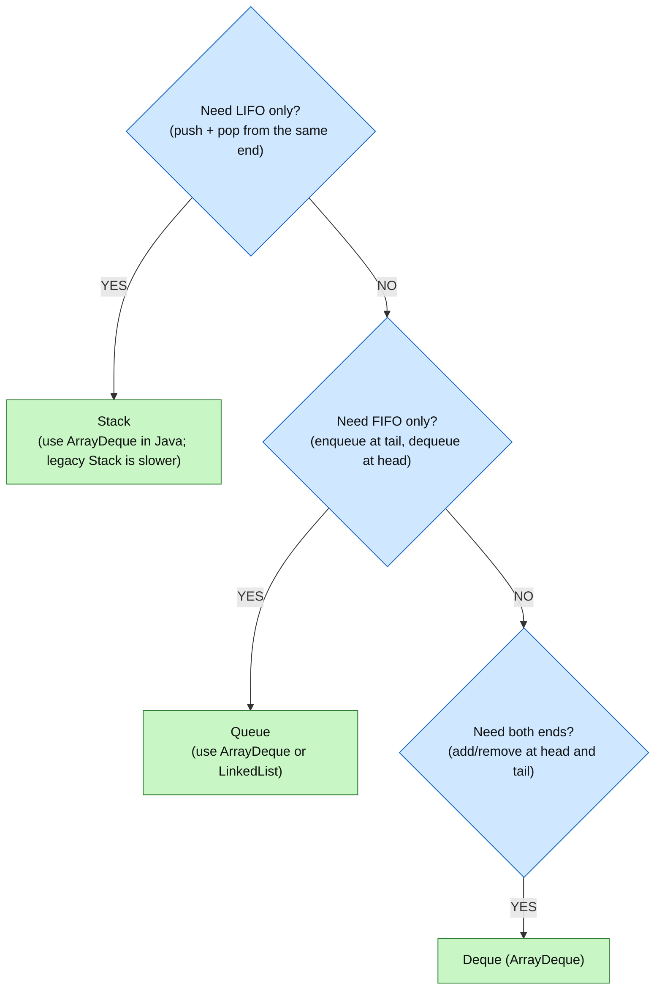
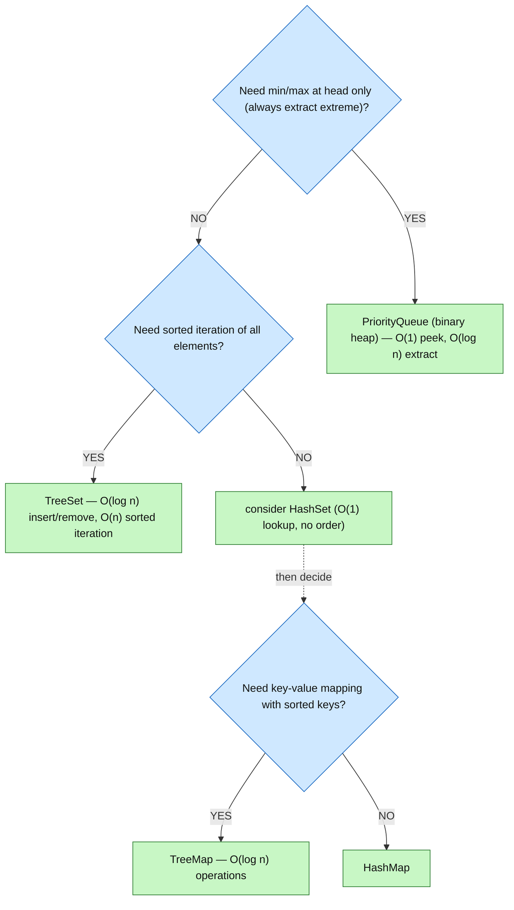
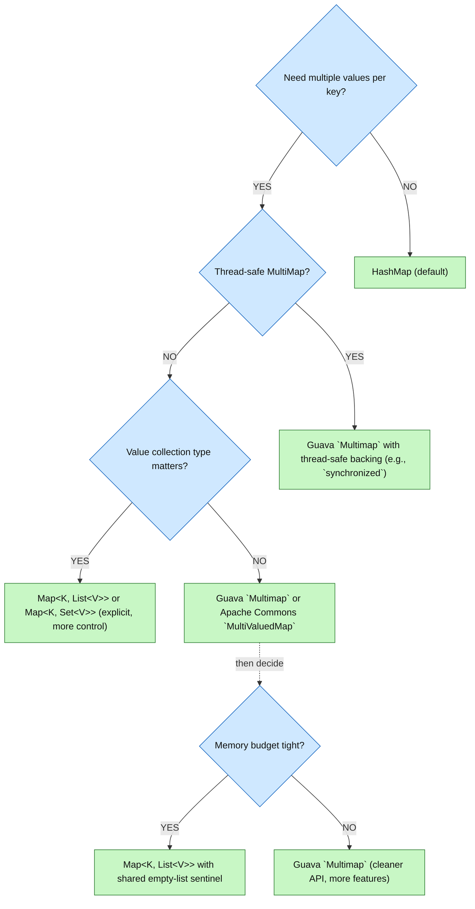

# 🎓 University-Level Addendum — Core Variants as Formal Theory

> **Navigation**: [← Appendix B: Production Failure Modes &…](06_appendix_b_production_failure_modes_variant.md) | [Chapter overview](../02a_DS_Variants_Core.md)
> Page 7 of 7 in **Data Structures: ALL VARIANTS Complete Guide**

> **Purpose:** This addendum elevates the chapter to MIT/KTH/ETH rigor. The body already has comprehensive variant coverage (linked list variants, Skip List, Bloom filter, B-tree vs LSM-tree); this addendum provides the **variant-selection rationale** — when to pick each variant, why, with formal complexity comparisons and the constraint-first decision framework. Invariants for each variant are also formalized.

## Core Variant Invariants

Each variant maintains invariants beyond the underlying data structure. Violating them produces silent corruption.

### Deque Invariants

| Invariant | Statement | Violation Consequence |
|---|---|---|
| **DQ1 — Both ends reachable** | `first != null && last != null iff size > 0` | NPE on `peekFirst()` when empty |
| **DQ2 — Bidirectional integrity** | `n.next.prev == n && n.prev.next == n` | Backward iteration broken |
| **DQ3 — Head/tail sentinels (impl-specific)** | Some impls use sentinels to avoid null checks | Iterator returns null when non-empty |
| **DQ4 — Size consistency** | `size == count of reachable nodes` | Out-of-bounds on `get(size-1)` |

### PriorityQueue Invariants (Binary Heap)

| Invariant | Statement | Violation Consequence |
|---|---|---|
| **PQ1 — Heap property** | `n.parent.key ≤ n.key` for min-heap (or `≥` for max-heap) | `peek()` returns non-extreme |
| **PQ2 — Shape property** | Complete binary tree (filled level by level, left to right) | Array indexing breaks |
| **PQ3 — Index calculation** | `parent(i) = (i-1)/2`, `left(i) = 2i+1`, `right(i) = 2i+2` | Sift-up/sift-down access wrong nodes |
| **PQ4 — Comparator consistency** | Comparator must be consistent with equals (or use natural ordering) | Heap order inconsistent with logical equality |
| **PQ5 — Bounded size** | `size ≤ Integer.MAX_VALUE - 1` (some impls cap here) | `add()` throws on overflow |

### MultiMap Invariants

A MultiMap allows multiple values per key. There are two common implementations:

| Implementation | Invariant | Trade-off |
|---|---|---|
| **Map\<K, List\<V\>>** | For each key k, `values(k).size() ≥ 0`; empty list if no values | O(k) per `getAll(k)` where k is values count; explicit empty list handling |
| **Map\<K, Collection\<V\>>** | Same as above but with pluggable collection type | More flexible; same complexity |
| **Multimap from Guava** | `keys()` returns all distinct keys; `get(k)` returns empty collection if absent | Cleaner API; O(1) `get` returns empty collection |

### SortedSet vs HashSet vs LinkedHashSet

| Implementation | Order | Lookup | Insert | Memory/entry |
|---|---|---|---|---|
| **HashSet** | None (impl-defined) | O(1) avg | O(1) avg | ~48 bytes |
| **LinkedHashSet** | Insertion order | O(1) avg | O(1) avg | ~64 bytes (extra doubly-LL pointers) |
| **TreeSet (Red-Black)** | Comparator/natural | O(log n) | O(log n) | ~56 bytes |
| **EnumSet** | Enum declaration order | O(1) (bitmask) | O(1) | 8 bytes (long for ≤64 enums) |

### ConcurrentSkipListMap Invariants

| Invariant | Statement | Violation Consequence |
|---|---|---|
| **SL1 — Level 0 sorted** | All level-0 nodes in sorted order | Lookup correctness |
| **SL2 — Level bounds** | A node at level i has `next[i] != null` with `next[i].key > node.key` | Skip invariant broken; lookup O(n) |
| **SL3 — Random level** | Level chosen with probability 1/4 (or 1/2) at each promotion | Unbalanced; degraded to O(n) |
| **SL4 — CAS-based mutation** | Uses compare-and-swap for lock-free updates | Lost updates if CAS fails |

## Constraint-First Decision Framework — Variant Selection

### Deque vs Queue vs Stack

**How to read this diagram.** Answer the blue questions in order; the first YES gives the green structure to use.

**Variant selection rationale:**

| Use Case | Pick | Why |
|---|---|---|
| Undo/redo | ArrayDeque as stack | O(1) push/pop; no legacy `Stack` overhead |
| BFS | ArrayDeque as queue | O(1) enqueue/dequeue; cache-friendly vs LinkedList |
| Sliding window max | ArrayDeque (monotonic) | O(n) amortized; see `01d_Stack_Queue.md` |
| Producer-consumer | ArrayBlockingQueue | Bounded + thread-safe |
| Work-stealing scheduler | ConcurrentLinkedDeque | Lock-free; allows steal from both ends |

### PriorityQueue vs TreeSet vs TreeMap

**How to read this diagram.** Start at the first blue question and follow the YES / NO edges; the green boxes are the recommended choice.

**Variant selection rationale:**

| Use Case | Pick | Why |
|---|---|---|
| Dijkstra's algorithm | PriorityQueue | Extract-min is the hot operation |
| Top-K elements | PriorityQueue (size K) | O(n log K) total |
| Maintaining sorted view | TreeSet | Sorted iteration is the hot operation |
| Range queries (last 7 days) | TreeSet/TreeMap | `subSet(from, to)` in O(log n + k) |
| Scheduler (extract by priority) | PriorityQueue | O(log n) extract-min; bulk insert via heapify O(n) |

### MultiMap vs Map<K, List<V>> vs Nested Collection

**How to read this diagram.** Start at the first blue question and follow the YES / NO edges; the green boxes are the recommended choice.

**Variant selection rationale:**

| Use Case | Pick | Why |
|---|---|---|
| Index inversion (word → pages) | Guava `ArrayListMultimap` | O(1) `put`; preserves insertion order |
| Graph adjacency list | `Map<V, List<E>>` | Explicit; allows fine control |
| Tag system (entity → tags) | Guava `HashMultimap` | O(1) `put`/`get`; no order needed |
| Multi-key lookup | `Map<K, Collection<V>>` with explicit null handling | Most flexible |

## When Core Variants Break — Formal Failure Modes

### Break 1 — ArrayDeque as Stack Overflow

**Condition:** Using `java.util.Stack` (legacy, synchronized) instead of `ArrayDeque`.

> [!CAUTION]
> **What breaks:** Synchronization overhead (~2-5× slower); legacy `Stack` extends `Vector` which has stale API. Modern best practice: `Deque<T> stack = new ArrayDeque<>();`.

> [!TIP]
> **Defense:** Always use `ArrayDeque` for stack/queue in non-concurrent code.

### Break 2 — PriorityQueue Non-Determinism

**Condition:** Two elements compare equal in the comparator.

> [!CAUTION]
> **What breaks:** `PriorityQueue` does not guarantee order for equal elements → non-deterministic iteration order → flaky tests.

> [!TIP]
> **Defense:** Always include a tie-breaker in the comparator: `(a, b) -> Integer.compare(a.priority, b.priority) != 0 ? Integer.compare(a.priority, b.priority) : Integer.compare(a.id, b.id)`.

### Break 3 — LinkedList Random Access

**Condition:** Using `list.get(i)` in a loop.

> [!CAUTION]
> **What breaks:** O(n) per `get(i)` → O(n²) total for the loop.

> [!TIP]
> **Defense:** Use `ArrayList` for random access; use iterator for `LinkedList`.

### Break 4 — ArrayDeque Capacity Resize

**Condition:** Adding to a fully-utilized ArrayDeque.

> [!CAUTION]
> **What breaks:** Internal array doubles; O(n) copy. For `ArrayDeque` (not `ArrayList`), the resize factor is implementation-defined (typically 2×).

> [!TIP]
> **Defense:** Pre-size: `new ArrayDeque<>(expectedSize)`.

### Break 5 — MultiMap Empty Collection Handling

**Condition:** `Map<K, List<V>>` where some keys have no values.

> [!CAUTION]
> **What breaks:** `get(k)` returns null instead of empty list → NPE on iteration. Common bug.

> [!TIP]
> **Defense:** Use `computeIfAbsent(k, k2 -> new ArrayList<>())` for first put; or use `Multimap` (Guava) which returns empty collection.

### Break 6 — TreeSet Comparator Inconsistency

**Condition:** `Comparator.compare(a, b)` returns inconsistent results across calls.

> [!CAUTION]
> **What breaks:** TreeSet contracts broken; entries in wrong positions; `contains(k)` returns wrong result.

> [!TIP]
> **Defense:** Comparator must be a pure function of inputs. Document this explicitly.

### Break 7 — ConcurrentSkipListMap Iteration Weakly Consistent

**Condition:** Iterating a `ConcurrentSkipListMap` while another thread modifies it.

> [!CAUTION]
> **What breaks:** Iterator returns elements that were present at some point during iteration; may not reflect latest state. This is *intentional* (weakly consistent iterator for concurrency) but surprising.

> [!TIP]
> **Defense:** Document weakly-consistent semantics; don't expect snapshot isolation.

### Break 8 — LinkedHashMap Removal Order

**Condition:** Using `LinkedHashMap` with `accessOrder = true` for LRU cache, but using `get()` to "peek" without intending eviction.

> [!CAUTION]
> **What breaks:** Each `get()` moves the entry to the tail (most-recently-used); subsequent eviction removes from the head (least-recently-used). A bug in the eviction policy can cause hot entries to be evicted incorrectly.

> [!TIP]
> **Defense:** Use `LinkedHashMap.getOrDefault()` to peek; or implement true LRU with separate metadata.

## Formal Complexity Comparison — Core Variants

### Stack Implementations

| Implementation | Push | Pop | Peek | Memory/Entry |
|---|---|---|---|---|
| ArrayDeque (as stack) | O(1) amortized | O(1) | O(1) | 4 bytes (int amortized) |
| LinkedList (as stack) | O(1) | O(1) | O(1) | 40 bytes |
| Legacy Stack (extends Vector) | O(1) + sync | O(1) + sync | O(1) | ~32 bytes + Vector overhead |

### Queue Implementations

| Implementation | Enqueue | Dequeue | Peek | Memory/Entry |
|---|---|---|---|---|
| ArrayDeque (as queue) | O(1) amortized | O(1) | O(1) | 4 bytes (int amortized) |
| LinkedList (as queue) | O(1) | O(1) | O(1) | 40 bytes |
| ArrayBlockingQueue | O(1) | O(1) | O(1) | 4 bytes + lock overhead |
| ConcurrentLinkedQueue | O(1) CAS | O(1) CAS | O(1) | 40 bytes |

### Deque Implementations

| Implementation | Add First/Last | Remove First/Last | Peek First/Last | Memory/Entry |
|---|---|---|---|---|
| ArrayDeque | O(1) amortized | O(1) | O(1) | 4 bytes (int amortized) |
| LinkedList (as deque) | O(1) | O(1) | O(1) | 40 bytes |
| ConcurrentLinkedDeque | O(1) CAS | O(1) CAS | O(1) | 40 bytes |

### Priority Queue Implementations

| Implementation | Insert | Extract-Min | Peek | Build (n elements) | Memory/Entry |
|---|---|---|---|---|---|
| PriorityQueue (binary heap) | O(log n) | O(log n) | O(1) | O(n) | 24 bytes (in array) |
| TreeSet (Red-Black) | O(log n) | O(log n) | O(log n) | O(n log n) | 56 bytes |
| ConcurrentSkipListMap | O(log n) CAS | O(log n) | O(log n) | O(n) | 80 bytes |

### MultiMap Implementations

| Implementation | Put | Get | Remove | Iteration | Memory/Entry |
|---|---|---|---|---|---|
| Map\<K, List\<V\>> | O(1) avg | O(k) | O(k) | O(n) | ~64 bytes (Map entry + List entry) |
| Guava HashMultimap | O(1) avg | O(1) | O(1) | O(n) | ~48 bytes |
| Guava ArrayListMultimap | O(1) avg | O(1) | O(1) | O(n) sorted | ~64 bytes |

Where k = number of values for key, n = total entries.

## Decision Examples

### Example 1 — LRU Cache

**Problem:** Cache 10⁴ entries; evict least-recently-used when full.

- **Need:** O(1) get + put; order by access time.
- **Pick:** `LinkedHashMap(initialCapacity, 0.75f, true)` (access-order) + override `removeEldestEntry`.
- **Why not PriorityQueue?** PQ tracks priority, not access order; updating priority on every access is O(log n).
- **Why not ConcurrentHashMap?** Need eviction; CHM doesn't track access order.

### Example 2 — Top-K Most Frequent Elements

**Problem:** Given 10⁶ elements, find the K (K = 100) most frequent.

- **Constraint:** Memory budget ≤ K; O(n log K) time acceptable.
- **Pick:** `HashMap<E, Integer>` for counting + `PriorityQueue<Map.Entry<E, Integer>>` of size K (min-heap on count).
- **Algorithm:** For each entry, if PQ size < K, add; else if entry.count > PQ.peek().count, PQ.poll() and add entry.
- **Time:** O(n log K) = 10⁶ × 7 ≈ 7 million ops.

### Example 3 — Sliding Window Maximum

**Problem:** Given array of size n, find max in each window of size k.

- **Constraint:** O(n) time, O(k) space.
- **Pick:** `ArrayDeque<Integer>` as monotonic deque (store indices).
- **Algorithm:** For each i, remove indices < i-k from head; remove indices with smaller values from tail; add i; record head.
- **Time:** O(n) amortized (each index enters and exits once).

## Cross-References

- **`01a_Memory_Foundations.md`** — pointer chasing cost in linked list variants.
- **`01c_LinkedList.md`** — LinkedList internals, invariants, break modes.
- **`01d_Stack_Queue.md`** — Stack/Queue invariants, monotonic stack/queue, decision framework.
- **`01e_HashTable.md`** — HashSet/HashMap vs LinkedHashSet/LinkedHashMap, ConcurrentHashMap.
- **`01f_Trees_Heaps.md`** — TreeSet/TreeMap internals; Red-Black invariants.
- **`01g_DS_Internals.md`** — implementation-specific invariants (AL, HM, TM, LL).
- **`02b_DS_Variants_Advanced.md`** — skip list, bloom filter, B-tree, LSM-tree, randomized structures.
- **`02_PROBLEM_SETS.md`** — exam-style variant selection problems.

---

## Proof Corner — Why Monotonic Deque is O(n) Amortised

**Claim**: The sliding window maximum algorithm using a monotonic deque runs in O(n) total time for an array of n elements, even though there is a `while` loop inside the outer `for` loop.

**Proof by amortised aggregate analysis**:

- Each of the n elements is **enqueued exactly once** (in the outer `for` loop).
- Each element is **dequeued at most once** (either popped from the back when a larger element arrives, or removed from the front when it slides out of the window).
- Total enqueue operations: n. Total dequeue operations: ≤ n.
- Total operations: ≤ 2n = O(n). QED.

**Invariant maintained**: At all times, the deque contains indices whose values form a **decreasing sequence** from front to back. This ensures the front is always the maximum in the current window.

**Loop invariant for the outer for-loop**: After processing index i, `deque.peekFirst()` is the index of the maximum element in `arr[max(0, i-k+1)..i]`.

- *Init*: Before i=0, deque is empty. Processing i=0 adds index 0.
- *Maintenance*: We remove front indices outside the window (< i-k+1), then remove back indices with values ≤ arr[i] (they can never be future maxima), then add i. The deque front is the window maximum.
- *Termination*: After i=n-1, we've computed the maximum for all n-k+1 windows.

---

## Brute Force to Optimal — DS Variant Selection

| Problem | Brute Force Choice | Why It Fails | Optimal Choice | Gain |
|---------|--------------------|--------------|----------------|------|
| Frequency count | Loop and count per query — O(n) per query | O(n*q) total | HashMap — O(1) per query | O(q) → O(1) |
| Ordered iteration | Sort on every access — O(n log n) | Too slow for many insertions | TreeMap/TreeSet — O(log n) per op | Sorted order always maintained |
| Last-inserted priority | Search through list — O(n) | O(n) per pop | ArrayDeque as stack — O(1) push/pop | O(n) → O(1) |
| Sliding window max | Scan every window — O(k) per window | O(nk) total | MonotonicDeque — O(1) amortised | O(nk) → O(n) |
| Membership test | Linear scan — O(n) | O(nq) total | HashSet — O(1) expected | O(n) → O(1) |

**Decision rule**: choose a DS by the *bottleneck operation* that is called most frequently. The data structure whose worst-case for that operation is best wins.

---

> **Navigation**: [< Previous](../01g_DS_Internals.md) | [Back to Index](../../00_MASTER_INDEX.md) | [Next >](../02b_DS_Variants_Advanced.md)

---

[← Appendix B: Production Failure Modes &…](06_appendix_b_production_failure_modes_variant.md) | [Chapter overview](../02a_DS_Variants_Core.md)
